<!--
If not stated otherwise in this file or this component's LICENSE
file the following copyright and licenses apply:

Copyright 2026 RDK Management

Licensed under the Apache License, Version 2.0 (the "License");
you may not use this file except in compliance with the License.
You may obtain a copy of the License at

http://www.apache.org/licenses/LICENSE-2.0

Unless required by applicable law or agreed to in writing, software
distributed under the License is distributed on an "AS IS" BASIS,
WITHOUT WARRANTIES OR CONDITIONS OF ANY KIND, either express or implied.
See the License for the specific language governing permissions and
limitations under the License.
-->

# EyilClient implementation guide

This is a required part of the [architecture and implementation specification](EyilSecureGateway.md).
Read its original ACs, common protocol/error/logging rules and gaps with this guide.
Section numbers are shared across the specification; client sections are in
[EyilClient.md](EyilClient.md), Gateway sections in [EyilGateway.md](EyilGateway.md),
and build/CI details in [BuildAndValidation.md](BuildAndValidation.md).

- [5.1 Responsibilities and limits](#51-responsibilities-and-limits)
- [5.2 Component organization and ownership](#52-component-organization-and-ownership)
- [5.3 General routing: concurrent requests on one connection](#53-general-routing-concurrent-requests-on-one-connection)
- [5.4 Public API index](#54-public-api-index)
- [5.5 client_connect()](#55-client_connect)
- [5.6 client_send_request()](#56-client_send_request)
- [5.7 client_send_request_async()](#57-client_send_request_async)
- [5.8 client_send_request_string() — Gateway returns unsupported service](#58-client_send_request_string--gateway-returns-unsupported-service)
- [5.9 client_send_request_string_async() — Gateway returns unsupported service](#59-client_send_request_string_async--gateway-returns-unsupported-service)
- [5.10 client_free_response()](#510-client_free_response)
- [5.11 client_register_notifications()](#511-client_register_notifications)
- [5.12 client_unregister_notifications()](#512-client_unregister_notifications)
- [5.13 client_disconnect()](#513-client_disconnect)
- [5.14 Deadlines, callbacks, reconnect and library unloading](#514-deadlines-callbacks-reconnect-and-library-unloading)
- [5.15 Call hierarchy](#515-call-hierarchy)

## 5. EyilClient design and API flows

### 5.1 Responsibilities and limits

EyilClient provides transport coordination, not Crypto semantics. A caller can
submit concurrent synchronous and asynchronous requests on the same `Client`.
A synchronous caller waits for its response; an async caller waits only for
libzmq send acceptance. Neither may hold a lock needed by the I/O owner or
another caller while waiting.

Each Client has one library-owned serving thread and one owned ZMQ context.
libzmq also creates its own internal I/O threads: those do not maintain the
library's pending map,
run its callbacks or replace its serving thread.

There is no application heartbeat producer, heartbeat worker, periodic liveness
RPC or inactivity watchdog in EyilClient. Connection-state handling uses
the monitor events and the request coordinator. Connect, sync requests and async
send submission retain 15-second deadlines; async response waiting has none.
Built-in libzmq transport heartbeats are also disabled, as specified in
section 5.5.

The library does not:

- Call AppManager, RuntimeManager, Thunder or ICrypto.
- Decide key authorization, generate trusted app identity or choose host paths.
- Allocate, map or release Gateway-owned buffers implicitly through the generic
  transport API. The app-side Crypto layer requests and maps them explicitly.
- Promise that reconnect preserves keys, buffers or a Gateway session.
- Treat a timeout, a successful send or a connection callback as proof that a
  remote Crypto operation finished.

### 5.2 Component organization and ownership

Use one ClientRuntime per Client, with one I/O owner and one retained request
record per entered request call. The rows below describe responsibilities and
method boundaries, not a requirement for a class or thread per row.

| Component / state | Responsibility | Owner / synchronization |
| --- | --- | --- |
| Public C API | Retain a live call, validate arguments, prepare owned input and wait for submission/result | Calling application thread; never touches DEALER |
| ClientRuntime | Connection generation, admission, slot, callback claims and shutdown | Per-Client state mutex and retained live-call references |
| Single submission slot | One retained Request reference, EMPTY/PUBLISHED/CLAIMED state and slot-available condition variable | Pre-created during connect; no std::queue, list of submissions or queue-node allocation |
| Request record | Owned envelope/text, mode, ID, generation, original deadline, send result and response waiter or handler | Retained independently by the caller, occupied slot, I/O owner and pending map as needed |
| I/O owner | Claim the slot, serialize/send, receive/correlate, process deadlines and PAIR events | One library-owned thread; sole DEALER owner |
| Pending map | request_id to expected response metadata and completion target | I/O owner; entry installed before first send and retired once |
| Per-call result conditions | Wake the async caller on send outcome or sync caller on final result | Waits release the state mutex; send acceptance and response completion remain separate states in the Request |
| Monitor collector | Decode PAIR events and drive connection-state handling | Existing I/O owner; agreed consolidation, no additional client monitor thread |
| Response storage | Owned binary response or NUL-terminated status text | Transferred to the application and freed with client_free_response |

The slot is shared only within one Client. Callers waiting for it remain on
their application threads, retaining their own request/call state; the library
does not put them in another submission container. The slot remains occupied
while its request is being prepared or waiting for libzmq acceptance. After a
terminal send outcome, the owner clears it and wakes waiting callers. Sent
requests remain independently tracked in the pending map, with no fixed count
cap. One occupied slot does not mean one outstanding remote operation.

Every request entry point obtains a live-call guard before input preparation.
The guard covers slot waiting, publication, send/result waiting and response
preparation. Disconnect wakes these calls before waiting for their guards to
drain. The application must still coordinate raw-handle lifetime as specified
in section 5.13. Socket ownership is never transferred to an application caller.

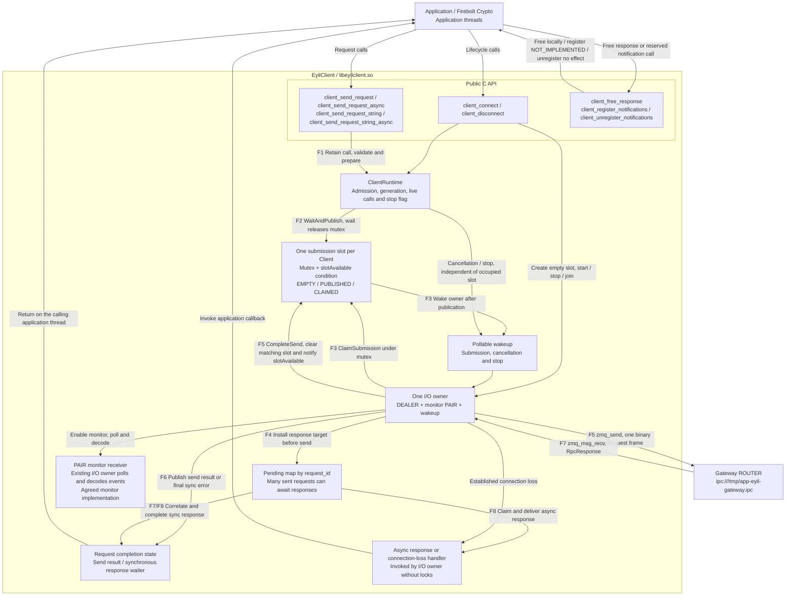

F1–F8 are the common flow points defined in section 5.3 and reused in every
request sequence. WaitAndPublish, ClaimSubmission and CompleteSend are internal
design method names on the runtime/owner, not additional public APIs. The slot
is read explicitly by ClaimSubmission; a wakeup alone does not transfer or send
the request. CompleteSend frees the slot after acceptance/failure, independently
of later response delivery. Connection and response callbacks share the owner
thread and must return promptly. Notification APIs create no callback state.

The PAIR monitor receiver is an internal socket plus event-decoding code.
Enabling monitoring on DEALER makes libzmq publish connection, handshake and
disconnect events at the unique client monitor endpoint. The same Client I/O
owner connects the PAIR receiver in that context, polls it alongside DEALER and
the submission wakeup, and updates connection/request state. This is the agreed
monitor implementation; no additional client monitor thread is required.
[ZeroMQ monitor API](https://libzmq.readthedocs.io/en/latest/zmq_socket_monitor.html)

#### Monitor responsibilities

The following duties remain required under the consolidated ownership model.
Reading monitor events must not wait for an RPC response, and callbacks run
without internal locks. libzmq's internal transport threads produce the events;
the Client I/O owner consumes them and owns the pending-request map.

| Expected monitor responsibility | How PAIR plus the I/O owner cover it |
| --- | --- |
| Set up event collection before connecting | The DEALER owner enables monitoring at the unique client monitor endpoint; the same owner creates/connects its PAIR receiver in the same ZMQ context |
| Receive and decode complete monitor messages | Poll PAIR alongside DEALER and the submission wakeup; validate the event frames, event value and endpoint for the configured monitor API version |
| Establish handshake readiness | On HANDSHAKE_SUCCEEDED, publish READY and wake client_connect without an application callback; CONNECTED alone does not establish readiness |
| Report initial connection/authentication failures | Wake the connect waiter with the exact ClientResult from section 5.5, without a callback; distinguish authentication denial from transport/protocol failure |
| Handle loss of an established connection | Mark the connection unusable, stop admission, fail unresolved sync/send-result waiters with CLIENT_COMMUNICATION_ERROR, retire accepted async response records and report CLIENT_CONNECTION_LOST once if callback admission remains open |
| Handle later state transitions without duplicates | Serialize the terminal loss transition, retire the old generation once and ignore later events; explicit reconnect creates a new Client and session as specified in section 5.14 |
| Keep application callbacks and request retirement coordinated | Invoke connection handlers without internal locks, resolve each active API waiter once and retire affected async response records once; no synthetic async error callback |
| Handle monitor failure and orderly stop | Treat unexpected collector failure as a runtime error; during requested shutdown, suppress intentional-close callbacks, wake the poller, stop monitoring and close PAIR on its owner without waiting indefinitely for another event |

Connect, synchronous-request and async-send deadlines are handled by the same
owner/coordinator; monitor events alone do not implement those timers. Async
responses have no timer. Poll and process submissions, replies and monitor events
in finite batches so each progresses. Callbacks must return promptly because a
blocking callback also delays monitor handling.

Freezing the application stops the serving/I/O owner and libzmq's threads.
The agreed hibernation contract requires the app to finish operations and
callbacks first while preserving its descriptors. The monitor handles transport
state, not app responsiveness, Gateway-side ZAP or service-payload decoding.

#### Single-slot publication, claiming and completion

Create the slot, state mutex, slotAvailable condition and pollable wakeup during
connect. No submission queue exists. The API prepares an owned Request before
publication, including its callback/waiter, generation and original deadline.
Preparation can fail with CLIENT_OUT_OF_MEMORY; publishing a retained reference
into an empty slot must not allocate.

WaitAndPublish locks the per-Client state, checks admission and waits until the
slot is EMPTY or a terminal condition occurs. A condition-variable wait releases
the mutex. Use one absolute 15-second deadline starting when the request call
is admitted, before input preparation and slot waiting; no stage restarts it.
After publication, unlock and signal the existing pollable wakeup. A condition
variable alone cannot wake the I/O owner's socket poll.

On that wakeup, ClaimSubmission locks state, reads the published Request,
retains it, marks the slot CLAIMED and unlocks. Reading the slot does not clear
it. The owner prepares serialization and the pending-map entry outside the
state lock, then attempts a nonblocking send. There is only one submitted,
not-yet-accepted request at a time. EAGAIN leaves that request in the slot while
the owner polls replies, PAIR events, writable readiness and active deadlines.
It must not block in zmq_send, spin, or wait on an application condition variable.

CompleteSend(request, outcome) applies to the retained Request that owns the
attempt. Under the state lock, it ends SEND_IN_PROGRESS, records the send
outcome once, applies any pending cancellation, disarms an accepted async send's
deadline and clears the slot only if that slot still belongs to this Request.
Unlock before notifying slotAvailable and the request's result condition.
These updates form one coordinated transition. The owner removes
an unsent pending entry before servicing another submission or response.

After acceptance, the pending map retains the response target but not the slot.
A synchronous caller can keep waiting for its response while another caller
publishes and sends a new request. Response retirement for request A must never
clear a slot now occupied by request B. Repeated retirement/completion is
harmless and cannot change an already committed result or release another
request's storage. No async response deadline starts.

The owner allocates increasing nonzero request IDs within its connection
generation. It never reuses a retired ID, including after timeout or failed
submission, so a late response cannot match another request. Do not wrap the
counter: exhaustion ends the generation through the terminal
CLIENT_COMMUNICATION_ERROR path. A fresh Client may restart its ID sequence;
its transport and Gateway context are independent.

| State / event | Required action |
| --- | --- |
| Another request occupies the slot | Wait on slotAvailable within the caller's original deadline; no queue-full result and no FIFO guarantee among competing callers |
| Deadline expires before publication | Return CLIENT_TIMEOUT; no request was transferred or sent |
| Allocation fails during input/request preparation | Return CLIENT_OUT_OF_MEMORY; release partial state, no publication or callback |
| Serialization or pending-map insertion fails after claiming | Owner retires unsent work, frees only its matching slot and completes with CLIENT_OUT_OF_MEMORY unless a terminal result/cancellation already won |
| Published/claimed request is cancelled before a send attempt | Mark cancelled, wake the owner and prevent any later send; retain the record until owner retirement and slot release |
| Nonblocking send attempt is in progress | Resolve that attempt before returning a failure claiming no acceptance; successful acceptance fixes the async result at CLIENT_OK |
| Explicit disconnect closes READY admission | Latch CLIENT_NOT_CONNECTED, notify slotAvailable immediately and wake the owner; preserve earlier results and resolve any send in progress before completing affected calls |
| Unexpected connection loss | Notify slotAvailable, retire unsent/sent state and complete unresolved calls with CLIENT_COMMUNICATION_ERROR; accepted async results remain CLIENT_OK |

EMPTY/PUBLISHED/CLAIMED describe the slot. SEND_IN_PROGRESS describes an
attempt on its retained Request while the slot remains CLAIMED. Only one such
attempt can execute on the owner. The state lock protects the final eligibility
check and transition into SEND_IN_PROGRESS against cancellation/close. Release it for the nonblocking
socket call, then publish the actual outcome under the same synchronization.
A waiter may request cancellation during an attempt but cannot declare that an
accepted message was unsent. After EAGAIN/EINTR, end SEND_IN_PROGRESS under the
lock and recheck cancellation, generation and the original deadline. If no
longer eligible, complete with the winning error; otherwise keep the CLAIMED
slot, poll other work and admit another attempt only through TryBeginSend.
Only the I/O owner clears an occupied slot; an expired caller cannot destroy
storage still retained by it.

Latch the first terminal runtime reason when READY admission closes. Callers
still preparing input or waiting for the slot are not in the pending map; they
read this retained reason before publication or completion. Explicit close
selects CLIENT_NOT_CONNECTED, transport loss CLIENT_COMMUNICATION_ERROR, and
connection-wide decode allocation failure CLIENT_OUT_OF_MEMORY under section
5.6. A later disconnect of an already LOST handle must not replace its reason.
Already committed per-call results remain unchanged. New calls on an already
lost/closing handle get CLIENT_NOT_CONNECTED. notify_all requires no heap
allocation.
Local stop uses its existing flag and wakeup, never waits for a free slot and
never publishes a stop request into that slot.

Every result arrow in the following UMLs uses this terminal-result arbitration.
An error discovered during preparation cannot overwrite a timeout or close
already committed while that preparation ran. A send-acceptance arrow records
the actual attempt outcome; for sync it is distinct from the final response
result. Only an accepted async send fixes the public result at CLIENT_OK.

#### Shared submission diagram (F1–F6)

This diagram is the common submission path for all four request APIs. The API
diagrams in sections 5.6–5.9 draw it as one "F2-F5 Submit" step and show only
their own differences. Early exits use `break`: once a `break` block runs, the
call ends there.

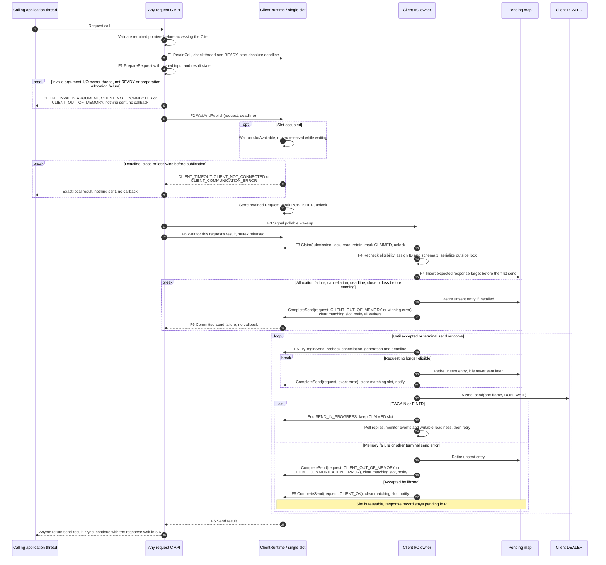

### 5.3 General routing: concurrent requests on one connection

Coverage: **AC2-Client.1, AC2-Client.2–AC2-Client.3, AC2-Client.5,
AC1.5–AC1.7, AC2-Firebolt.1–AC2-Firebolt.2**.

Use these flow points in the API diagrams and implementation:

| Point | Calling component / internal method | Work and next boundary |
| --- | --- | --- |
| F1 | C API: RetainCall / PrepareRequest | Validate handle, calling thread and arguments; check READY, start the deadline, own input and initialize request/result state |
| F2 | Calling thread: WaitAndPublish | Wait for the single slot, releasing the mutex; publish only while eligible; timeout/close/loss can end the wait |
| F3 | Caller: WakeIo; owner: ClaimSubmission | Wake the poller; owner explicitly locks, reads and retains the published request, marks CLAIMED and unlocks |
| F4 | Owner: PrepareWireRequest / TrackRequest | Recheck deadline/generation, assign ID and schema 1, serialize and install the pending entry before sending |
| F5 | Owner: TryBeginSend / CompleteSend | Attempt zmq_send(DONTWAIT); retain the slot on temporary backpressure; atomically record the send result and release only its matching slot, then wake callers |
| F6 | Calling thread: WaitForSend or WaitForResponse | Async returns send result; sync waits for its own final response within the same total deadline, without occupying the slot after send |
| F7 | Owner: ReceiveResponse / MatchRequest | Receive a complete response, validate framing/envelope, match the original ID/service/generation and require recorded send acceptance |
| F8 | Owner: CompleteResponse | Prepare final bytes/status text, claim completion against timeout/close, retire once, wake the sync caller or invoke the async callback without locks |

These internal names make the call boundaries explicit; they can be methods
and state in one ClientRuntime plus Request records. The common send/error
rules are in section 5.6; F1–F8 do not add public API methods. F6 is the caller's
wait/return: it overlaps owner steps F3–F5 and, for sync, F7–F8. Waiting on that
result condition does not prevent the owner from claiming or sending work.

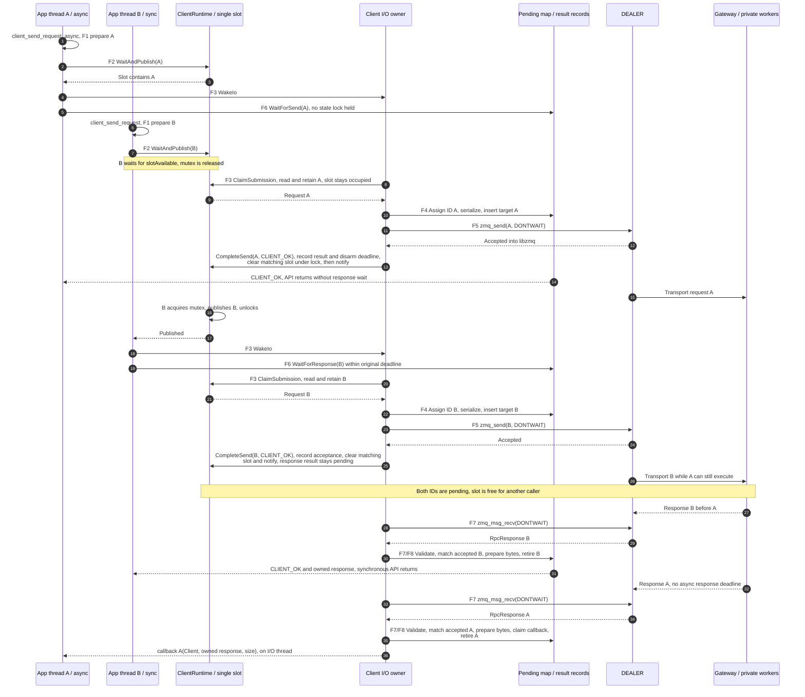

The diagram shows the successful path; each request still has independent
allocation, timeout, close and transport-error handling. Only one unsent
submission occupies the slot, while any number of successfully sent requests
can await responses subject to available memory. Callers waiting for the slot
are not stored in a client submission queue. Simultaneous callers have no FIFO
admission guarantee. The owner fairly services responses, monitor events,
submission readiness and deadlines, even while an occupied slot cannot send.

### 5.4 Public API index

The public API is declared in
[EyilClient.h](../apis/eyilclient/EyilClient.h). All nine methods
have individual sequences below. Both asynchronous request methods are required
public functionality under AC2-Client.5, alongside their synchronous counterparts.
The selected string path delivers Gateway's unsupported-service response;
successful text execution is outside this delivery as recorded in section 5.8.

| Method | Behavior | AC coverage |
| --- | --- | --- |
| client_connect | Return a handle after successful handshake; reject an occupied handle slot with CLIENT_ALREADY_CONNECTED; report exact startup/authentication/timeout errors | AC2-Client.1–AC2-Client.4; AC1.2, AC1.4–AC1.6 |
| client_send_request | Wait/publish one submission slot, then await the correlated binary response without holding that slot | AC2-Client.1, AC2-Client.2–AC2-Client.3, AC2-Client.5 |
| client_send_request_async | Wait for the slot and libzmq send acceptance within 15 seconds; deliver a later binary response with no response timeout | AC2-Client.1, AC2-Client.2–AC2-Client.3, AC2-Client.5 |
| client_send_request_string | Send copied raw text with service=UNSPECIFIED through the slot; return CLIENT_OK plus received RPC_STATUS_UNSUPPORTED_SERVICE status text | AC2-Client.1, AC2-Client.5 |
| client_send_request_string_async | Same slot/send contract; Gateway unsupported-service status is delivered as owned text through the response callback | AC2-Client.1, AC2-Client.5 |
| client_free_response | Release a library-allocated result | AC2-Client.1 |
| client_register_notifications | Return CLIENT_NOT_IMPLEMENTED; reserved for future support | AC2-Client.1 and the public header |
| client_unregister_notifications | Return without changing state; reserved for future support | AC2-Client.1 and the public header |
| client_disconnect | Stop admission/I/O, settle pending work and destroy the handle | AC2-Client.1–AC2-Client.4; AC1.12 on the Gateway side |

#### Allocation failures across the public API

Catch detectable allocation failures at the C API boundary and inside the
I/O owner, including `std::bad_alloc`, failed allocator returns and explicit
ENOMEM from local setup/transport. No C++ allocation exception may escape a
C entry point or terminate the serving loop. Use retained result state to
publish an error; failure reporting and cleanup must not require another heap
allocation. Diagnostics are best effort and must not prevent retirement.

| API | Allocation failure handling |
| --- | --- |
| client_connect | CLIENT_OUT_OF_MEMORY for handle/runtime/setup allocation failure; roll back only this attempt, join any started threads, leave the output NULL |
| client_send_request | CLIENT_OUT_OF_MEMORY for input/envelope/request/waiter/pending-map/send storage or correlated response allocation failure; NULL output and size 0 |
| client_send_request_async | Before send acceptance, return CLIENT_OUT_OF_MEMORY with no response callback; after acceptance, retire a matched response that cannot be allocated with diagnostics and no callback |
| client_send_request_string | Same synchronous rules, including copying input text, constructing the wire request and allocating the response string; return CLIENT_OUT_OF_MEMORY and NULL, releasing temporary storage |
| client_send_request_string_async | Same async rules, including input copying and wire-request preparation before acceptance, and response-string allocation afterward |
| client_free_response | Void, releases storage without allocating; NULL is accepted; no ClientResult is returned |
| client_register_notifications | Always CLIENT_NOT_IMPLEMENTED in this version; no state is allocated or handler retained |
| client_unregister_notifications | Void, no effect or allocation in this version |
| client_disconnect | Void, uses an existing stop flag and wakeup to initiate cleanup without waiting for a free slot or allocating a control request; frees retained state, no ClientResult is returned |

For all four request methods, pre-send failure cancels the unsent request and
releases partial state. A call that times out before publication cannot leave
work for the owner. A published request remains retained until owner retirement;
cancellation prevents it being sent after the API reports failure. A failure
after sending does not undo remote execution or
make a shared buffer safe to reuse. Never replay the operation to recover a
local allocation failure.

The common receive pipeline in section 5.6 also defines failure before a
response can be correlated. An accepted async send retains CLIENT_OK even if
response processing fails before the submitting thread resumes; its send result
cannot be revised or turned into an error callback.

#### Required asynchronous request behavior

Implement client_send_request_async() and client_send_request_string_async()
using the same connection, request correlation and coordinator as the
synchronous methods. The submitting thread waits for its send result, **not for
the remote response**.

- Validate and copy the request, initialize its retained send-result state,
  then WaitAndPublish into the single slot. Waiting releases the state mutex.
- Wake the I/O owner, which explicitly claims the slot and installs the pending
  record before attempting send. Return CLIENT_OK only after zmq_send accepts
  that request. Slot publication alone is insufficient.
- EAGAIN retains the occupied slot within the original 15-second budget while
  the owner services other replies and events. Acceptance or terminal failure
  clears the slot and wakes waiting callers.
- Return validation, allocation, connection or send-submission timeout errors
  directly from the API. A failed submission invokes no response callback.
- After send acceptance, retain the request for a response with **no response
  timeout**. A valid response invokes its registered callback at most once.
- Connection loss or explicit shutdown retires outstanding async records without
  a response callback. Transport loss is reported by the connection-event handler.
  Local failure to validate or allocate a matched response also retires that
  record with diagnostics and no response callback.
- A successful send therefore does not guarantee a later callback. Never
  fabricate a Gateway response or deliver NULL as a synthetic error response.

**Selected send guarantee:** zmq_send success means acceptance into libzmq's
queue. It does not prove physical UDS transmission, Gateway receipt or backend
execution, even with a blocking send. No receipt ACK or Protobuf extension is
required by this contract. See the
[ZeroMQ send contract](https://libzmq.readthedocs.io/en/latest/zmq_send.html).

The string method accepts the same NUL-terminated text as its synchronous
counterpart, without caller encoding. Both asynchronous request methods are
required. Byte-method callers continue to supply and interpret serialized
Protobuf; the plain-text contract applies to the string methods.

#### Async signatures and response ownership

The asynchronous request API uses these signatures:

```c
typedef void (*ClientResponseHandler)(
    Client *client,
    uint8_t *response_data,
    size_t response_size);

typedef void (*ClientStringResponseHandler)(
    Client *client,
    char *response_data);

ClientResult client_send_request_async(
    Client *client,
    const uint8_t *request_data,
    size_t request_size,
    ClientResponseHandler handler);

ClientResult client_send_request_string_async(
    Client *client,
    const char *request_data,
    ClientStringResponseHandler handler);
```

The pending map associates the library-assigned request_id with the handler
supplied for that request. Callback arguments carry the actual response only.
For byte responses, the app inspects RpcStatus and service status. String
responses carry the symbolic name of the received Gateway error, normally
RPC_STATUS_UNSUPPORTED_SERVICE, under the defined contract in section 5.8.
The caller releases either result through
client_free_response(). A valid Gateway error response follows the same response
delivery path. ClientNotificationHandler is reserved for future support and is
not used to deliver request results or local errors.

Copy input before returning so the caller may reuse its request storage.
Keep pending bookkeeping and callback code valid until response delivery or
connection teardown. Without a response deadline, a request that never receives
a reply can retain its pending-map entry and memory until teardown. Local
validation/allocation failure retires the affected entry but cannot report a
per-request error through these response-only signatures.

#### Send-result coordination and cancellation

Each async request has two distinct stages: a bounded submission wait and an
unbounded response wait. Keep separate send-result and response-completion
states in the same retained Request, rather than requiring separate allocated
coordinator objects. CompleteSend commits the send outcome and matching-slot
release together under the state lock, then notifies the request and slot
waiters. The submitting thread returns that result; response waiting never
occupies the slot.

Serialize the nonblocking send attempt and its acceptance publication against
send-deadline cancellation. Check the request's state and deadline before every
attempt. With no attempt in progress, cancellation atomically makes the request
ineligible for any later send. During SEND_IN_PROGRESS, latch the cancellation
reason and resolve that attempt before publishing its terminal send result.
If libzmq accepts it, the async result is CLIENT_OK even if the deadline or
close occurred during that attempt. If it does not accept it, apply the latched
reason and do not retry. Without cancellation, EAGAIN/EINTR leaves the request
eligible only within its original deadline; a terminal send error completes it.

After requesting cancellation, a waiter awaiting the active attempt uses its
result condition; it must not spin on an already expired deadline. The deadline
prevents a new send attempt, but resolving an admitted attempt and safely
retiring its state can finish later. This is not a hard real-time return bound.
Section 5.6 applies the same send eligibility rules to synchronous calls while
keeping their final response result separate from send acceptance.

After acceptance, disarm the async send deadline. Response arrival and
connection cleanup compete only for ownership of the pending record; retire it
once and discard late/duplicate replies. No async response-expiry task runs.
A local retirement or successful send does not prove backend completion or make
a shared buffer safe to reuse.

#### Request-callback execution model

- Invoke response callbacks on the owning Client's serving/I/O thread, without
  internal state/slot locks held. Callbacks are serialized within a Client;
  different Clients can invoke callbacks concurrently.
- Retire the pending record before calling application code, and keep the Client
  and response storage alive for the invocation.
- Never call the handler inline on the submission call stack. A fast response
  can invoke it on the I/O owner before the submitting thread resumes from its
  send-result wait; prepare application state before making the API call.
- A response callback may call client_free_response. Schedule new requests and
  other work on an application thread.
- All request APIs, including async submission, can wait for the I/O owner.
  Calling them from that owner's callback would deadlock. Detect this case and
  return CLIENT_INVALID_ARGUMENT before admission. Do not call client_connect
  or client_disconnect from the callback either.
- Callbacks must return promptly so other sends, replies, monitor events and
  active deadlines can progress.

These rules do not depend on AppManager or the Crypto backend. Explicit
disconnect closes callback admission, resolves unresolved sync/send-result
waiters with CLIENT_NOT_CONNECTED, retires async response records and waits for
already-claimed callbacks and live calls before destroying the handle. Section
5.13 defines the complete ordering. Section 5.5 defines the connection-handler
contract: startup uses the synchronous result, later unexpected loss emits
CLIENT_CONNECTION_LOST and explicit close emits no connection callback.

### 5.5 client_connect()

Coverage: **AC2-Client.1–AC2-Client.4; AC1.2, AC1.4–AC1.6**.

#### Handle ownership and CLIENT_ALREADY_CONNECTED

The API treats `Client **client` as an input/output handle slot.
Initialize it before the first call, for example `Client *client = NULL`.

- If `client == NULL`, return CLIENT_INVALID_ARGUMENT without dereferencing it.
- If `*client != NULL` and contains a valid Client handle that has not been
  destroyed, return CLIENT_ALREADY_CONNECTED immediately. Preserve that handle,
  its registered handler, pending requests and connection state. Do not allocate
  a runtime, start threads, connect another socket or invoke a callback for the
  rejected call.
- If `*client == NULL`, start a new connection attempt. Publish the handle only
  on CLIENT_OK; on startup failure the slot remains NULL after rollback.

CLIENT_ALREADY_CONNECTED is local handle-ownership validation, not a Gateway
rejection or a restriction to one connection per process, UID or app. A separate
NULL-initialized slot may create another independent Client. An existing handle
still occupies its slot after transport loss; calling client_connect with it is
not a reconnect API and returns CLIENT_ALREADY_CONNECTED. To reconnect, call
client_disconnect on the old handle from an application thread, reset the slot
to NULL and call client_connect again. The new call creates a fresh runtime and
authenticated session; the old handle never returns to READY after loss.

The caller must serialize access to the same handle slot, including concurrent
connect attempts. Uninitialized, fabricated or destroyed handles are invalid
API usage. After client_disconnect destroys a handle, the caller must reset its
own slot to NULL before reusing it: client_disconnect takes Client*, so it cannot
clear the caller's variable.

#### Readiness contract

**Agreed readiness contract:** return CLIENT_OK and publish a valid Client
handle only after local startup has succeeded and the client monitor receives
`ZMQ_EVENT_HANDSHAKE_SUCCEEDED` for the pending connection attempt. The
application can then immediately submit RPC requests. Gateway completes
NotifyAppState(CONNECTED) during authentication before returning ZAP success.
Crypto is available before Gateway activation; RPCs carry operation results.

The startup coordinator waits for handshake success or a terminal failure
within a **15-second connect deadline**. Deadline expiry returns CLIENT_TIMEOUT;
explicit authentication rejection returns CLIENT_AUTH_FAILED. Section 5.14
defines the common duration constant and its application to each timed wait.

#### Connection callback contract

client_connect is synchronous. Its return value reports the initial connection
outcome; the connection handler reports only a later unexpected loss.

| Situation | API result | Connection callback |
| --- | --- | --- |
| Initial setup and authentication succeed | CLIENT_OK with a valid Client handle | None |
| Initial connection attempt fails | Exact ClientResult, including CLIENT_AUTH_FAILED for an explicit authentication denial; output remains NULL | None |
| An established connection is lost unexpectedly | Retire pending work using section 5.14; later request submissions return CLIENT_NOT_CONNECTED | CLIENT_CONNECTION_LOST once, if the registered handler can be claimed before explicit close shuts callback admission |
| Application calls client_disconnect | Synchronous local cleanup, void return | None for the intentional close; an already-claimed loss callback may finish before disconnect returns |

CLIENT_CONNECTION_RESTORED and CLIENT_CONNECTION_TERMINATED are unused in this
design. A fresh explicit client_connect reports its own success or failure
through its return value. Authentication denial occurs during that call's
handshake and returns CLIENT_AUTH_FAILED; it does not generate TERMINATED.
An established socket closing does not by itself identify an authentication
failure. Automatic reconnect and in-place reauthentication are not part of
this lifecycle. RESTORED and TERMINATED remain unused enum values; their
presence does not introduce a reconnect or reauthentication requirement.

Keep connection-callback delivery disabled while the handle is unpublished.
Serialize successful handle publication with enabling loss-callback delivery;
retain a loss detected after startup success until it can be delivered with the
published handle. Failed startup never exposes an incomplete Client through a
callback. A genuine loss immediately after readiness can race the calling
thread's resumption; it is a distinct loss event, not a startup-success callback.
Section 5.13 defines callback claims and quiescence during explicit close.

#### Socket settings for a fresh connection

Set these options on each new client DEALER before zmq_connect:

| Option | Required setting | Purpose |
| --- | --- | --- |
| ZMQ_RECONNECT_IVL | -1 | Disable libzmq automatic reconnection |
| ZMQ_IMMEDIATE | 1 | Queue sends only on completed connections |
| ZMQ_LINGER | 0 | Discard unsent transport messages when closing the socket |

Also set zero linger on the client monitor socket. Retain the library's
HANDSHAKE_SUCCEEDED admission barrier and nonblocking sends; IMMEDIATE does not
replace readiness validation. Closing the old socket is required to retire its
transport queues. These options do not cancel messages already received by
Gateway or prove remote completion. See the
[ZeroMQ socket options](https://libzmq.readthedocs.io/en/latest/zmq_setsockopt.html).

The 15-second connect deadline still bounds readiness waiting for a new attempt.
It does not create an automatic retry loop. If startup fails, roll back that
attempt; another attempt requires a new explicit client_connect call. A terminal
failure returns its mapped error promptly; an attempt still pending at the
deadline returns CLIENT_TIMEOUT.

#### Disabled ZeroMQ heartbeats

**Decision: ZeroMQ transport heartbeats are disabled on both the client's
DEALER and Gateway's ROUTER.** Apply these settings before connect/bind and
whenever either socket is recreated:

| Option | Required setting | Meaning |
| --- | --- | --- |
| ZMQ_HEARTBEAT_IVL | 0 | Do not send periodic ZMTP PING commands |
| ZMQ_HEARTBEAT_TIMEOUT | 0 | No active heartbeat timeout while the heartbeat interval is disabled |
| ZMQ_HEARTBEAT_TTL | 0 | Do not request heartbeat-based expiry at the peer |

Configure the disabled values before zmq_connect()/zmq_bind() and after socket
recreation. These settings apply when establishing the connection. See the
[ZeroMQ socket-option contract](https://libzmq.readthedocs.io/en/latest/zmq_setsockopt.html).

Freezing an application also stops its libzmq threads. Disabling transport
heartbeats avoids disconnecting that preserved idle connection merely because
the frozen client cannot exchange heartbeat traffic. The agreed hibernation
preserves descriptors and starts only after the app finishes its operations.
An independent Thunder/Gateway failure uses terminal-loss cleanup; automatic
recovery of that platform failure is outside scope.

Keep the PAIR monitors and the 15-second connect, synchronous-request and
async-send deadlines. Async responses have no timeout. There is no application
heartbeat RPC, heartbeat worker, idle-expiry timer or inactivity watchdog.

Gateway serves requests and owns connection resources; it does not supervise
application health. An idle, completely hung process may retain its socket and
bounded connection state until actual disconnection or an explicitly agreed
platform lifecycle action. Protect other clients through quotas, fair scheduling
and nonblocking sends; do not add responsiveness probes or heartbeat expiry.

#### Connection sequence

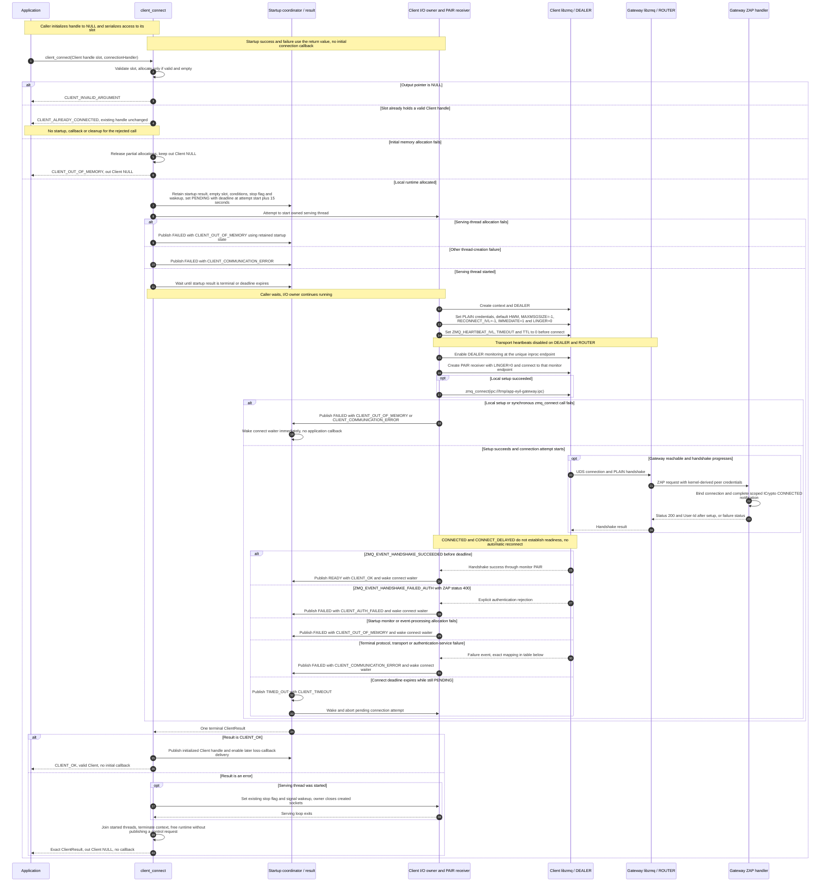

Startup state includes the empty slot, slotAvailable condition, stop flag and
wakeup needed for rollback. A detected
allocation failure during serving-thread creation or owner-side setup publishes
CLIENT_OUT_OF_MEMORY through that retained state. Other startup failures use
CLIENT_COMMUNICATION_ERROR. Cleanup only stops or joins threads that actually
started and does not allocate a shutdown action.

#### Exact initial-connect outcomes

| Condition / monitor event | Startup action | client_connect result |
| --- | --- | --- |
| Output argument `Client **client` is NULL | Reject before creating runtime state | CLIENT_INVALID_ARGUMENT |
| `*client` already holds a valid, not-yet-destroyed Client handle, including after transport loss | Reject before allocating or starting another connection; preserve the existing handle, handler and state | CLIENT_ALREADY_CONNECTED, original handle unchanged |
| Client/runtime/serving-thread allocation fails, including an explicit ENOMEM from local setup or startup event processing | Stop/roll back any initialized resources | CLIENT_OUT_OF_MEMORY, output NULL |
| Non-memory context/socket/monitor/thread setup failure, or synchronous zmq_connect error | Publish FAILED and stop the attempt | CLIENT_COMMUNICATION_ERROR, output NULL |
| ZMQ_EVENT_CONNECTED | Keep PENDING; transport connection alone is insufficient | No return yet |
| ZMQ_EVENT_CONNECT_DELAYED | Keep PENDING within the original deadline; do not create another connection attempt | No return yet |
| ZMQ_EVENT_HANDSHAKE_SUCCEEDED while PENDING and before the deadline | Publish READY and wake caller | CLIENT_OK, valid output handle |
| ZMQ_EVENT_HANDSHAKE_FAILED_AUTH with ZAP status 400 | Publish FAILED and wake caller immediately | CLIENT_AUTH_FAILED, output NULL |
| ZMQ_EVENT_HANDSHAKE_FAILED_AUTH with ZAP status 300 or 500 | End this connect attempt as an authentication-service failure | CLIENT_COMMUNICATION_ERROR, output NULL |
| ZMQ_EVENT_HANDSHAKE_FAILED_PROTOCOL | Publish FAILED and wake caller immediately | CLIENT_COMMUNICATION_ERROR, output NULL |
| ZMQ_EVENT_HANDSHAKE_FAILED_NO_DETAIL | Publish FAILED and wake caller immediately | CLIENT_COMMUNICATION_ERROR, output NULL |
| ZMQ_EVENT_DISCONNECTED before initial readiness | End this connect attempt and wake caller | CLIENT_COMMUNICATION_ERROR, output NULL |
| Monitor/receive processing terminates unexpectedly for a non-memory reason while startup is PENDING | Publish FAILED and wake caller | CLIENT_COMMUNICATION_ERROR, output NULL |
| Absolute connection deadline expires while startup is PENDING, including an unavailable endpoint without a terminal failure event | Publish TIMED_OUT; stop and clean up the attempt | CLIENT_TIMEOUT, output NULL |

The monitor's HANDSHAKE_FAILED_AUTH event carries the ZAP status: 400 is an
authentication denial, 300 a temporary authentication-service error and 500 an
internal authentication-service error. This client contract ends the current
connect call on those explicit failures, preserving CLIENT_AUTH_FAILED for a
denial. Event and status definitions:
[ZeroMQ monitor API](https://libzmq.readthedocs.io/en/latest/zmq_socket_monitor.html),
[ZAP specification](https://rfc.zeromq.org/spec/27/).

`zmq_connect()` returning zero and receiving ZMQ_EVENT_CONNECTED are both
insufficient for CLIENT_OK. Successful handshake detection is the agreed
readiness barrier. The client sends no extra Crypto request or AppManager
probe; Gateway performs CONNECTED during authentication as in section 6.5.

The startup coordinator stores a terminal result, rather than only a
`connected` boolean. The wait predicate is `startupState != PENDING` with an
absolute monotonic deadline. Success and explicit failures publish the result
and notify the waiter; the timeout path publishes CLIENT_TIMEOUT. Synchronize
these transitions so one attempt has one final outcome. A late handshake event
cannot revive a timed-out or failed attempt or restart its deadline. After a
previously successful client_connect, connection loss is terminal and recovery
uses a new explicit connection as defined in section 5.14.

On failure of a new connection attempt from an empty slot, keep the output
handle NULL, close created sockets on their owner, stop/join started threads,
terminate the owned context and free the incomplete handle before returning.
CLIENT_ALREADY_CONNECTED is an earlier rejection: preserve the existing handle
and do not run startup rollback against it. The deadline bounds the readiness
wait; safe rollback still has to finish. Return every startup outcome through
client_connect alone, without a connection callback. Handshake success does
not emit RESTORED, and authentication denial does not emit TERMINATED. Only a
separate unexpected loss after startup success can enter the loss-callback path
defined above.

### 5.6 client_send_request()

Coverage: **AC2-Client.1, AC2-Client.2–AC2-Client.3, AC2-Client.5**; Crypto use also supports **AC2-Firebolt.1–AC2-Firebolt.2**.

The caller supplies one serialized RpcRequest containing the service and its
opaque payload. The library parses that envelope, replaces request_id and
schema_version, and serializes the outgoing request. It validates the returning
RpcResponse and gives the caller its complete serialized bytes. It does not
parse CryptoRequest or CryptoResponse. No additional service argument or byte
API signature change is needed for this agreed envelope handling.

#### Submission and synchronous wait

The shared submission (F2–F5) is drawn in section 5.2 and the shared receive
pipeline (F7–F8) below. This diagram shows only what is specific to the
synchronous byte API.

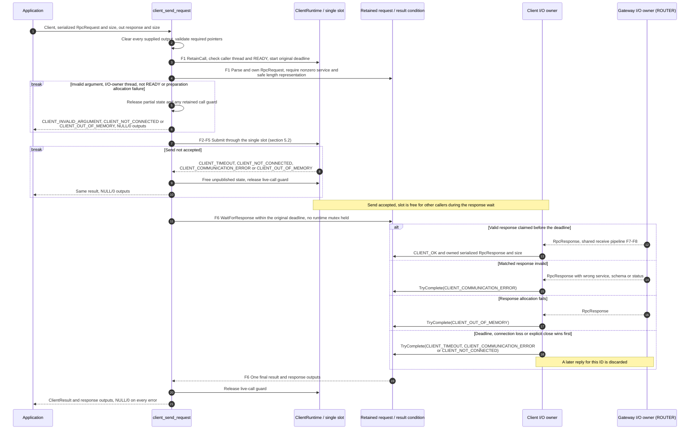

The single slot is released at F5, so the synchronous response wait does not
serialize other requests behind the remote operation. Every local-error return
releases the call guard and prepared storage, with NULL/0 outputs. Races between
the response, the deadline and close are drawn in "Synchronous timeout,
disconnect and response races" below.

Before dereferencing outputs, validate their addresses; clear every supplied
output even if another required argument is missing. Require a non-NULL live
Client, non-NULL input with nonzero representable length, and both output pointers.
An empty/default envelope or RPC_SERVICE_UNSPECIFIED is invalid. Other numeric
service values can reach Gateway, which determines support. Validate Protobuf
parsing and safe length conversions without imposing a message-size policy cap
or interpreting the service payload.
Caller-supplied request_id and schema_version are ignored and overwritten.

The request record owns its parsed data, completion state and connection
generation. Application input need remain valid only for the API call. Allocate
the owned request and completion bookkeeping before acceptance. For async
calls the same preparation completes before returning CLIENT_OK. Neither API
may leave a published pointer into temporary caller storage.

#### Shared nonblocking send and receive pipeline

This pipeline serves all four request APIs. Socket operations, pending-map
mutation and monitor processing belong to the I/O owner. A record identifies
whether its caller waits for a synchronous result or only for async send
acceptance. Sync requests retain their total deadline after send; async requests
disarm their submission deadline once libzmq accepts the message.

The send half (F3–F5) is the shared submission diagram in section 5.2. After
EAGAIN/EINTR, resume at TryBeginSend on the same tracked Request; do not assign
another ID, reinsert the pending entry or claim another submission. The diagram
below is the shared receive half (F7–F8). Receive processing can run on any
owner iteration, including while the slot waits for writable readiness.

CompleteSend updates the retained Request's send result and releases only its
matching slot in the single transition defined in section 5.2. Arrows to result
waiters below notify/read that committed state; they do not perform another
unconditional result assignment. All synchronous error completions use
TryComplete and preserve an earlier terminal result. In particular, retirement
of an accepted response record never touches another request's submission slot.

Explicit local close uses CLIENT_NOT_CONNECTED for still-pending API results;
unexpected transport loss uses CLIENT_COMMUNICATION_ERROR. Preserve any result
that already won completion. No callback or send attempt can be newly admitted
after the local-close cutoff; section 5.13 covers an attempt already in progress.

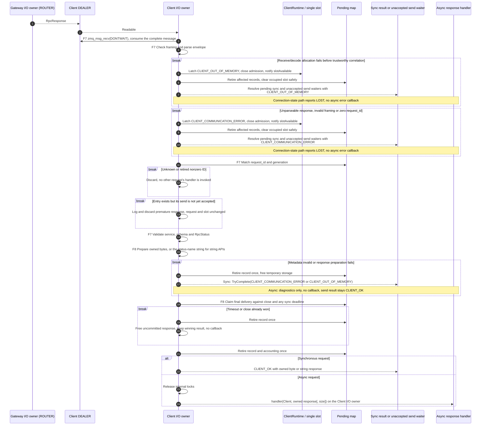

Implementation rules:

- Install the response target before sending, so even an immediate reply can
  be correlated. Serialization, message-storage and pending-map allocation
  failures retire only the affected unsent request, publish
  CLIENT_OUT_OF_MEMORY unless another terminal path already won, and leave
  other requests progressing. Clear only that Request's matching slot and notify
  waiting callers on its terminal send result. Use one DEALER body frame without
  a REQ-style delimiter.
- A successful zmq_send is the async return boundary: libzmq queued the message.
  Do not claim physical delivery or submit it again. EAGAIN permits retry only
  for work that has not been accepted, within its original active deadline.
  EINTR permits retry while the request remains eligible. Other terminal send
  failures return CLIENT_COMMUNICATION_ERROR; explicit memory failures return
  CLIENT_OUT_OF_MEMORY. See
  [zmq_send](https://libzmq.readthedocs.io/en/latest/zmq_send.html).
- Receive with zmq_msg_recv and check ZMQ_RCVMORE. EAGAIN means nothing to read;
  EINTR permits retry. Drain malformed multipart input without treating its
  remaining frames as separate responses. See
  [zmq_msg_recv](https://libzmq.readthedocs.io/en/latest/zmq_msg_recv.html).
- A detected receive/decode allocation failure before trustworthy request-ID
  correlation cannot safely be attributed to one request. Mark the connection
  unusable and close it on its owner. Resolve still-pending synchronous results
  and unaccepted async send waiters with CLIENT_OUT_OF_MEMORY, including callers
  waiting for the slot through the retained runtime failure reason; retire accepted
  async records and report CLIENT_CONNECTION_LOST through the connection-state
  path. Do not use a partly parsed ID to fail an unrelated request. Complete
  cleanup with retained state, without allocating another control action.
- Uncorrelatable malformed input makes the connection unusable under the
  terminal-loss policy. Resolve pending synchronous and not-yet-accepted send
  waiters with CLIENT_COMMUNICATION_ERROR. Retire accepted async response
  records and report connection loss through the connection-state path.
- A parsed nonzero ID absent from the pending map is discarded. It may be a
  late synchronous reply or a duplicate; it is not a notification.
- A pending entry alone does not authorize response delivery: its send must
  already be recorded as accepted. Log and discard a premature response for an
  installed but unaccepted request without retiring it, changing its send result
  or clearing its slot. The sole owner records acceptance before processing
  another received message, so a valid fast response satisfies this check.
- A matched response must have the expected service, schema version 1 and a
  known nonzero RpcStatus. A valid Gateway error response is still delivered
  normally: byte sync returns CLIENT_OK with bytes and byte async invokes its
  response handler. String records expect service=0 and a non-OK status with
  empty payload; return its symbolic name as defined in section 5.8. Only the
  service-specific byte consumer interprets CryptoResponse.
- Matched metadata failure returns CLIENT_COMMUNICATION_ERROR to a synchronous
  waiter; matched response allocation failure returns CLIENT_OUT_OF_MEMORY.
  Claim either error through TryComplete; preserve a timeout/close that already
  won and free any uncommitted storage.
  For an async record whose send succeeded, retire it with diagnostics and no
  response callback. Its send result remains CLIENT_OK, even if its submitting
  thread has not resumed yet. These signatures have no post-send error channel.
- Returned response storage must be compatible with client_free_response.
  String methods copy the validated non-OK RpcStatus name into owned
  NUL-terminated storage; they do not return the binary envelope as a C string.
  If response-text preparation fails, apply the same sync-error/async-retirement
  distinction. Never truncate binary data at an embedded NUL to report success.
- Prepare the final byte or string result before claiming synchronous success
  or an async callback. Serialize that claim with explicit close and any active
  synchronous deadline. If another terminal path wins during preparation, free
  the uncommitted result; a received envelope alone does not commit public success.
- Retire request accounting once and free temporary Protobuf/ZMQ storage on
  every terminal path. Late replies cannot revive a retired request.

The connection-wide handling of an uncorrelatable malformed response or decode
allocation failure follows the terminal cleanup path in section 5.14, preserving
the error mappings above. Recovery requires explicit close and a fresh connect.
An allocation failure after trustworthy correlation affects only that request.
No async response deadline or synthetic local-error RpcResponse is introduced.
Failure before correlation wakes all entered slot waiters as well as pending
requests. The runtime latches its first terminal reason before notifying
slotAvailable; later explicit teardown cannot overwrite that reason.

#### Synchronous timeout, disconnect and response races

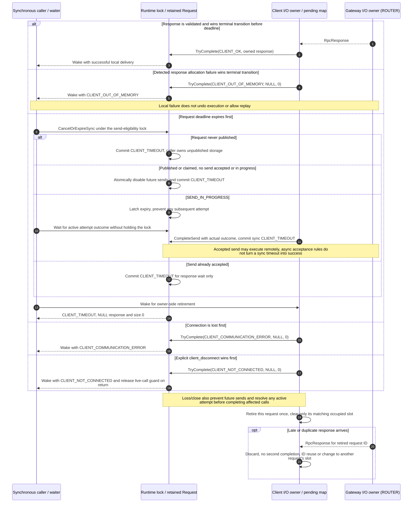

The waiter and owner share a retained Request, not a pointer to the caller's
stack. TryComplete claims its final result and response ownership once against
all other terminal paths. Before send acceptance, a synchronous timeout must
also cancel send eligibility under the same state lock used by TryBeginSend;
changing only the response waiter is insufficient. During an admitted attempt,
latch expiry and wait for its actual outcome. An accepted send is recorded as
such, but a synchronous call whose response deadline expired still returns
CLIENT_TIMEOUT. It may have executed remotely. A nonaccepted attempt after
expiry is retired without another send.

After acceptance, timeout ends only the local response wait. Check the absolute
deadline when claiming the final response, including after byte/string storage
preparation. If another result wins during preparation, free the uncommitted
storage. The owner alone removes pending entries and clears a slot only when
it still contains this Request; an older response timeout cannot affect a newer
submission. Published storage survives until owner retirement, even if its
caller has returned. Unpublished storage remains the caller's responsibility.
Async submission uses the separate send-result rules in section 5.4 and has
no response deadline after acceptance.

On every local failure, return NULL response and size zero. A timeout ends the
local wait; it does not cancel remote work, release remote buffers or authorize
replay. A valid response containing a non-OK RpcStatus still returns CLIENT_OK;
the caller inspects that status and eventually calls client_free_response.

The 15-second synchronous deadline includes preparation and waiting for the
single slot. The pending-response map grows dynamically; detected allocation
failures use CLIENT_OUT_OF_MEMORY. A busy slot waits or times out, with no
local queue-full result. Section 5.14 defines terminal loss and explicit reconnect.
Section 5.13 defines explicit-close results and callback quiescence. The
[resource policy in section 6.2](EyilGateway.md#initial-resource-policy) applies
no additional message-size cap and retains transport defaults; safe
representation and arithmetic checks remain mandatory.

### 5.7 client_send_request_async()

Coverage: **AC2-Client.1, AC2-Client.2–AC2-Client.3, AC2-Client.5**.

The caller waits for slot availability and libzmq acceptance within one total
15-second send budget. Publishing the slot or waking the owner does not complete
the API. The shared submission (F2–F5) is drawn in section 5.2 and the shared
receive pipeline (F7–F8) in section 5.6; the diagram below shows only what is
specific to the async byte API. A valid response may arrive before the
submitting thread resumes, so application callback state must be ready before
API entry.

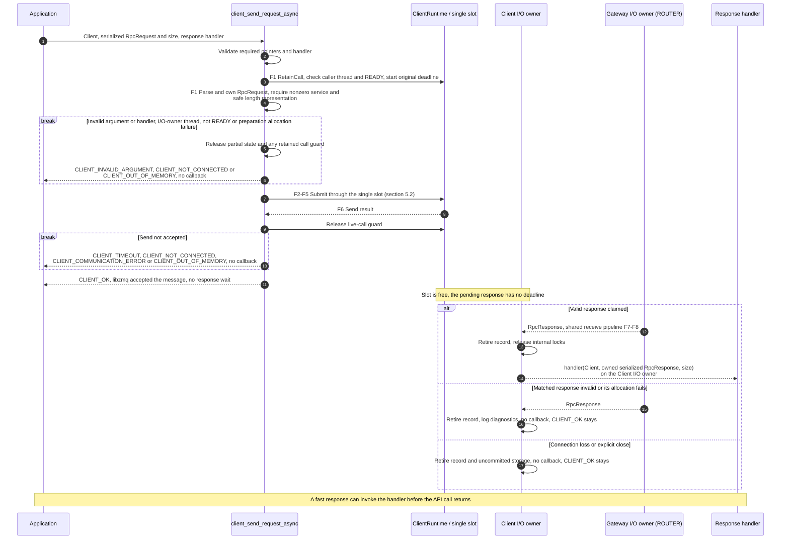

There is no response timeout after acceptance. All pre-acceptance failures
return through ClientResult and invoke no response callback. Invalid arguments,
envelope, handler or request calls from the I/O-owner callback return
CLIENT_INVALID_ARGUMENT. A non-ready handle returns CLIENT_NOT_CONNECTED.
Preparation, serialization or pending-map allocation failure returns
CLIENT_OUT_OF_MEMORY. Slot/send deadline expiry returns CLIENT_TIMEOUT.
Explicit close returns CLIENT_NOT_CONNECTED; unexpected loss or terminal send
failure returns CLIENT_COMMUNICATION_ERROR. Connection-wide local failures
retain the mappings in the common pipeline.

After CLIENT_OK, a validated correlated response, including a Gateway error,
invokes ClientResponseHandler at most once. Connection cleanup or local response
processing failure can retire it without a callback. The pending map remains
dynamic; an unanswered async request can stay there until teardown. Callbacks
run on the I/O owner without locks and may free their response, but must schedule
new request calls on an application thread.

### 5.8 client_send_request_string() — Gateway returns unsupported service

Coverage: **AC2-Client.1, AC2-Client.5**. Actual string-service execution is a
delivery limitation against AC2-Client.5; the original AC remains unchanged.

Accept an ordinary NUL-terminated request string, without a size argument,
Base64, ProtoJSON or a caller-built envelope. The library copies bytes up to
the first NUL and uses the same slot, owner, pending map and total synchronous
deadline as the byte API. **Gateway rejects the string request with the existing
RPC_STATUS_UNSUPPORTED_SERVICE (4).** The public method does not return a local
CLIENT_NOT_IMPLEMENTED without contacting Gateway.

#### Defined wire request and error response

| Boundary | Selected representation |
| --- | --- |
| Caller input | NUL-terminated text, including an empty string; NULL is invalid |
| Internal request | RpcRequest with assigned nonzero request_id, schema_version=1, service=RPC_SERVICE_UNSPECIFIED (0) and payload equal to the copied text bytes, excluding the terminator |
| Gateway dispatch | After common context/envelope/ID checks, service 0 has no registered handler. Log ERROR unsupported_service and construct a correlated RPC_STATUS_UNSUPPORTED_SERVICE response; do not parse CryptoRequest or submit a service job |
| Wire response | RpcResponse echoes request_id and service=0, sets schema_version=1 and status=RPC_STATUS_UNSUPPORTED_SERVICE, with empty payload |
| Synchronous C result | CLIENT_OK with a library-allocated NUL-terminated string containing exactly RPC_STATUS_UNSUPPORTED_SERVICE |
| Async C result / response | CLIENT_OK after libzmq send acceptance; a delivered error response later invokes the supplied string callback with that same owned status string |

UNSPECIFIED records the absence of an assigned text service. It is not a new
service identifier and never selects Crypto. The internal string builder alone
creates this envelope; the public byte-input validator continues to require a
nonzero service. Common response validation matches the service expected by
the pending record, including 0 for this string path. No Protobuf field, enum
or schema-version change is needed for this unsupported behavior. A future text
service requires an explicit route and interpretation contract; do not turn
service 0 into a working text service or guess a route from input contents.

The status string is the symbolic name of the **received** non-OK RpcStatus.
For example, a correlated INVALID_CONNECTION or INTERNAL reply is exposed as
RPC_STATUS_INVALID_CONNECTION or RPC_STATUS_INTERNAL. This is a defined remote
error representation, not a fabricated local-error response. Reject an unknown
or UNSPECIFIED status, unexpected OK or nonempty payload on this unsupported
path as CLIENT_COMMUNICATION_ERROR for sync, or diagnostic retirement without
a callback for an already-accepted async request. Future successful text/service
responses are outside this version's scope.

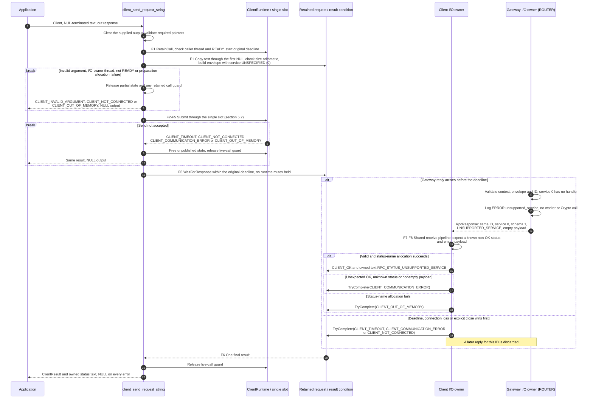

#### Plain-string ownership and local failures

The caller supplies a valid NUL-terminated string and keeps it unchanged until
the API returns. Scan to the first NUL without an additional text-size cap, own
the bytes before publication and use checked lengths during Protobuf
serialization and ZMQ transmission. The first NUL ends input: "abc\0def"
supplies "abc" only. Empty input still reaches the
same unsupported-service response. Never measure a serialized envelope using
strlen(), decode caller text as Protobuf, or infer a Crypto operation from it.

For a valid remote error, allocate the symbolic status name plus its final NUL
before claiming completion. The application checks that text and calls
client_free_response. CLIENT_OK means the remote error response was delivered;
it does not mean the text operation succeeded. A successful string result is
never NULL and is never binary Protobuf disguised as a C string.

Invalid arguments or lengths that the actual API cannot safely represent return
CLIENT_INVALID_ARGUMENT; there is no additional size-policy threshold. Allocation
failure in copying, request creation, serialization, pending-map insertion or
final status-string preparation returns CLIENT_OUT_OF_MEMORY. Slot waiting,
send attempts and final response preparation share the original 15-second
deadline. Timeout, explicit close and unexpected loss return CLIENT_TIMEOUT,
CLIENT_NOT_CONNECTED and CLIENT_COMMUNICATION_ERROR respectively, with NULL
output. Free all partial storage and release the live-call guard on every exit.
The general race/uncorrelatable-response rules in section 5.6 also apply.

This keeps the existing C signatures and raw-string input boundary. Consumers
use the byte APIs with serialized CryptoRequest payloads for actual Crypto
operations. Neither client nor Gateway translates arbitrary text into ICrypto.

### 5.9 client_send_request_string_async() — Gateway returns unsupported service

Coverage: **AC2-Client.1, AC2-Client.5**, with the same string-service delivery
limitation as section 5.8. The async transport path is required: the method
copies raw text, waits for its single-slot handoff and libzmq acceptance, then
returns the send result. It does not wait for Gateway's unsupported response
and does not return CLIENT_NOT_IMPLEMENTED locally.

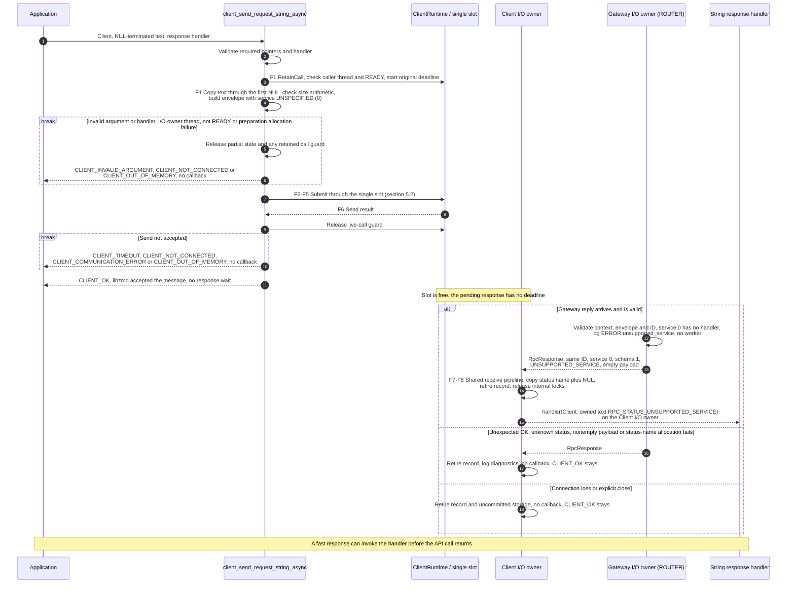

The wire envelope and exact status-text representation are defined in section
5.8. A delivered RPC_STATUS_UNSUPPORTED_SERVICE response invokes
ClientStringResponseHandler(Client, owned_status_text); the caller frees it
through client_free_response. Gateway errors are real responses and therefore
use the existing response-only callback, with no new ClientResult callback
argument or user_data parameter.

Input validation, copying, slot waiting and send failures follow section 5.7.
A failed submission has no response callback. After acceptance there is no
response timeout: loss, explicit close, invalid response or inability to allocate
the status text can retire the record without a callback. Preserve the already
published CLIENT_OK send result. A fast response can invoke the handler on the
I/O owner before the submitting thread resumes. No internal lock is held during
the callback, and request/disconnect calls must be scheduled on an application
thread.

### 5.10 client_free_response()

Coverage: **AC2-Client.1**.

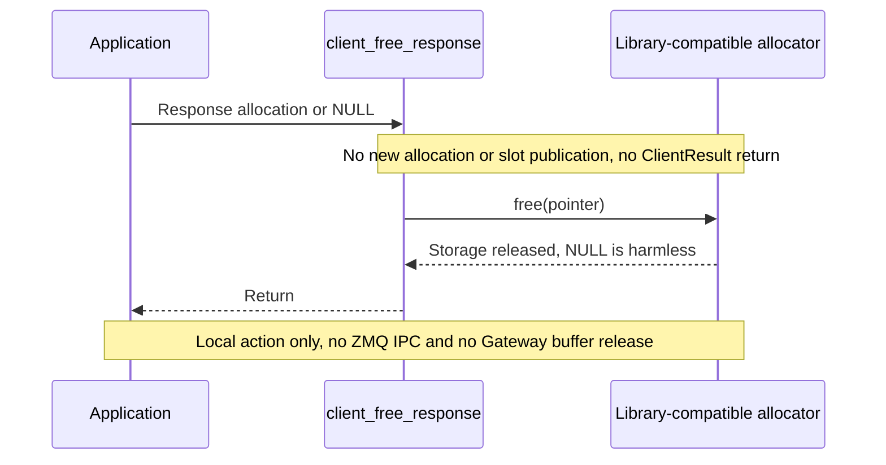

This releases a message-result allocation, not a shared-memory object.
Do not pass a mapped buffer, stack memory or a Gateway buffer ID. Freeing a
response requires no request record or new allocation and remains available
after another API reports CLIENT_OUT_OF_MEMORY.

### 5.11 client_register_notifications()

Coverage: **AC2-Client.1**. This API is reserved for future notification support.

**Return CLIENT_NOT_IMPLEMENTED.** The function ignores its arguments and does
not store or invoke the handler, allocate notification state, subscribe to events
or send a message to Gateway.

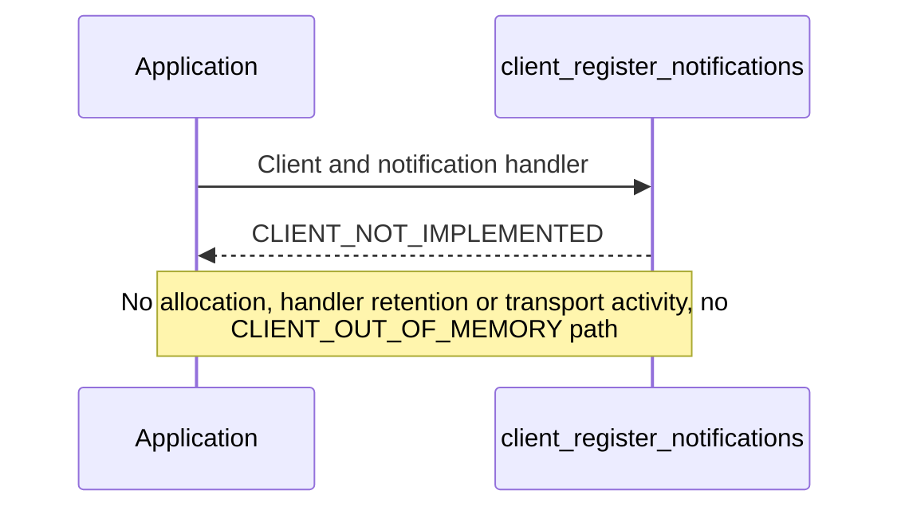

Notification delivery is outside this version's scope. A future feature must
define the events, Protobuf payloads, wire identification and callback lifecycle
before enabling this API. It is not a pending decision for the current delivery.

Connection-state events go to ClientConnectionEventHandler registered through
client_connect(). Async responses go to the response handler supplied with each
request. A late or unmatched RPC response follows the validation rules in
section 5.6 and must not be reclassified as a notification.

### 5.12 client_unregister_notifications()

Coverage: **AC2-Client.1**. This API is reserved for future notification support.

This void function returns without changing state. Notification registration
is unsupported, so there is no handler to remove or notification delivery to drain.

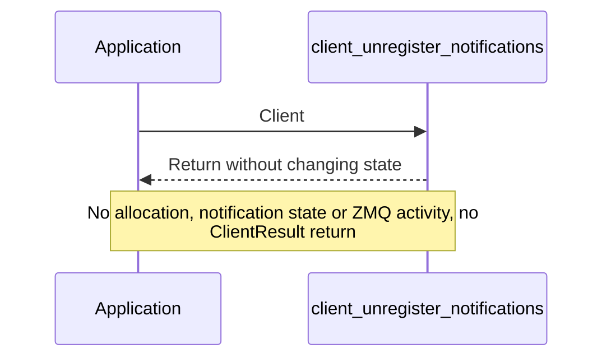

Calling this function is not required before client_disconnect in this version.
It does not affect the connection-event handler or pending request responses.
Neither notification function allocates, so neither has an out-of-memory path.

### 5.13 client_disconnect()

Coverage: **AC2-Client.1–AC2-Client.4**, leading to **AC1.12** when the Gateway detects closure.

client_disconnect is a synchronous local cleanup barrier. The app may call it
while calls wait for the slot, occupy it or await responses; it need not wait for those
responses first. The function closes new admission, wakes slot waiters, cancels the unsent submission,
retires pending response IDs and closes the connection. It returns only after
the old runtime is quiescent and the handle is destroyed. It does not wait for
a Gateway acknowledgement or certify that remote operations have finished.

#### Results and callback behavior during explicit close

| State when local close wins | Outcome |
| --- | --- |
| Synchronous request still waiting | Return CLIENT_NOT_CONNECTED with NULL response and size 0 for bytes, or NULL for strings; prevent further sends and resolve any admitted send attempt before returning |
| Async submission not accepted and no send attempt in progress | Return CLIENT_NOT_CONNECTED through its send waiter; cancel the unsent action and invoke no response callback |
| Nonblocking send attempt in progress | Latch close and wait for its outcome; acceptance preserves async CLIENT_OK, while a pending sync response result becomes CLIENT_NOT_CONNECTED; nonacceptance cannot trigger another attempt |
| Async send already accepted | Preserve CLIENT_OK, remove its pending response ID and release library-owned storage without a response callback |
| Uncommitted response or unclaimed callback | Discard its storage and pending record; do not start delivery after the close cutoff |
| Result or callback already claimed | Preserve the winning result/ownership, let the call or callback finish and wait for its live reference to be released |
| Already LOST handle | Finish teardown without changing the loss result or closing an already closed socket again |

Serialize local-close admission with request publication and callback claims.
Use the same retained completion state for close, response, timeout and transport
failure: only one terminal result wins. If a nonblocking send is already in
progress, let the owner resolve it before completing its send waiter. Successful
libzmq acceptance remains CLIENT_OK for an async submission even if local close
was requested while that attempt ran. A synchronous call still waiting for its
response returns CLIENT_NOT_CONNECTED when close wins, even if its send was
accepted. That local error does not prove remote cancellation. Unsent actions
cancelled by close can never execute later.

An intentional close generates no connection callback. Suppress monitor events
caused by shutting down the socket. A connection callback already claimed for an
earlier unexpected loss may finish; no new callback is claimed after callback
admission closes.
Response and connection callbacks run without internal locks, and no callback
can execute for that Client after client_disconnect returns.

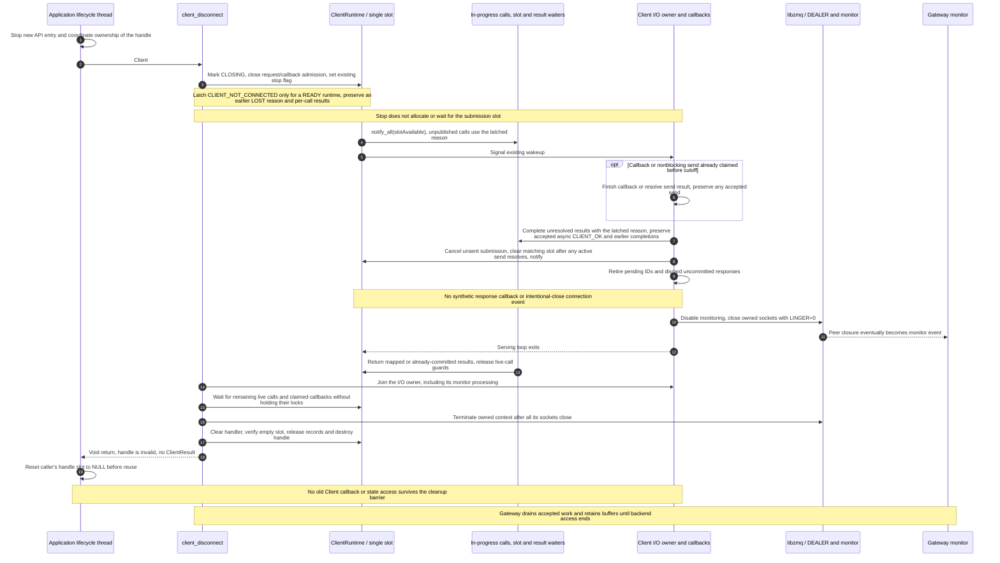

Disconnect must remain possible after allocation failure. Set a stop flag
created during connect, notify slotAvailable and signal the existing wakeup.
Shutdown must not acquire an empty slot or publish a control request. Resolve
result waiters using retained
completion objects and erase/free records without constructing a temporary
container. The function is void; it cannot report CLIENT_OUT_OF_MEMORY and
must not depend on allocating an error object to clean up.

Wake and resolve pending callers before waiting for their live-call references
to drain. Never wait while holding the state/slot or callback locks they need
to return. Joining the I/O owner also waits for its active callback. Callbacks
must return promptly; safe cleanup cannot forcefully terminate application code
running on that thread. Preserve results already committed to a caller,
including a fully prepared string owned by a completed waiter. Response-text
preparation precedes the final completion claim, as specified in section 5.8.
Free only uncommitted library-owned response storage.

The same function destroys a handle whose connection already reached LOST.
Reuse completed cleanup safely: close each socket once, join started threads
and terminate the old owned ZMQ context before releasing the handle. Free only
library-owned undelivered response storage; results already transferred to the
caller remain available for client_free_response. Explicit reconnect starts
from a NULL handle slot with no old runtime state, as specified in section 5.14.

#### Concurrent callers and handle lifetime

- Call disconnect from an application lifecycle thread, never from a Client
  response/connection callback or the I/O thread it must join. A callback can
  schedule cleanup on an application thread and return.
- The application serializes connect/disconnect and destruction of the same
  handle. Stop new call entry and coordinate threads that could still enter
  using a copied raw pointer. A call not yet holding an internal live reference
  must not race handle destruction; neither the internal state mutex nor a raw
  Client pointer makes that race safe.
- Calls already holding live references may remain blocked in the library while
  disconnect runs. Close wakes their waiters. An entered call that has not yet
  submitted work checks admission before publication and returns the retained
  terminal reason instead of publishing into the slot: CLIENT_NOT_CONNECTED for
  explicit close from READY, or the earlier loss reason for an already LOST
  runtime. Every return path
  releases its guard, including validation and allocation failures.
- Serialize callback admission with CLOSING. Claims made before the cutoff
  retain the Client until return; later responses/events are discarded. Keep
  the registered handler and its application dependencies valid until the
  disconnect barrier completes, then clear the registration.
- Once disconnect returns, do not use the old handle again, including a second
  disconnect. Clear the application's slot and use a new Client for reconnect.
  Already-transferred response allocations remain app-owned and may still be
  released through client_free_response.

The library never detaches a live thread and destroys its state. Explicit local
close cleans transport and request bookkeeping; Gateway's accepted jobs and
shared-buffer leases follow their existing drain and completion rules.

### 5.14 Deadlines, callbacks, reconnect and library unloading

#### Initial timeout and submission defaults

| Setting | Initial value | Meaning |
| --- | --- | --- |
| Common timed-wait duration | 15,000 ms | Used for connect, sync requests and async send submission; no public timeout setter |
| Connect deadline | Attempt start plus 15 seconds | Includes startup/handshake waiting; rollback must finish safely |
| Synchronous request deadline | Request-call admission plus 15 seconds | One budget covering input preparation, slot availability, serialization, send, receive/validation and final result preparation |
| Async send deadline | Request-call admission plus 15 seconds | Covers preparation, waiting/publishing the slot and send attempts until libzmq acceptance |
| Async response deadline | None | Send acceptance disarms its send timer; pending response remains until delivery or retirement/teardown |
| Client submission storage | One pre-created slot | At most one published/claimed unsent request; other callers wait on slotAvailable, with no queue container or queue-full result |
| Pending-response map | Dynamic, no fixed request-count cap | Install before first send; sent requests awaiting replies do not occupy the slot |

Do not restart the deadline after acquiring the slot or after sending. Use a
monotonic clock. A call waiting for the slot gets CLIENT_TIMEOUT when its
original budget expires. Callers wait without holding the state mutex; the I/O
owner can process the occupied slot, earlier responses and monitor events.
None of these timers expires an idle connection.

Cancellation before publication leaves nothing for the owner. Cancellation of
a published request marks its retained state and wakes the owner; that request
cannot be sent later. If a nonblocking send is already in progress, resolve
that attempt before reporting failure claiming no acceptance. Acceptance keeps
the async CLIENT_OK result even if a deadline/close raced it. The slot remains
occupied until its owner finishes that send/cancellation outcome, then becomes
available independently of response waiting.

Slot publication moves a retained reference and does not allocate. Input,
request state, serialization, pending-map growth and response preparation still
can fail with CLIENT_OUT_OF_MEMORY under sections 5.2 and 5.4. Unpublished callers
retain their own prepared requests while blocked, so removal of the submission
container is not a total client memory bound. The pending map can retain
unanswered async requests indefinitely because there is no response timeout.
No FIFO guarantee is made among callers competing for the slot.

There is no additional message/text-size cap. Use ZMQ_MAXMSGSIZE=-1 and default
libzmq HWM (1000 send/receive messages per peer in 4.3.4), with safe length
conversion/arithmetic and normal allocation-failure handling. EAGAIN retains
the occupied client slot while the I/O owner continues polling.

Gateway has no request waiting queue. It retains one admitted current request,
pauses further receives while waiting for a private worker and returns
RPC_STATUS_INTERNAL if Dispatch has not started within ten seconds. That timer
does not cover unread libzmq traffic and does not replace the client's own
deadlines. App-owned delivered responses remain valid until freed.

#### Terminal connection loss and explicit reconnect

**Decision:** loss of an established connection ends that connection generation.
The I/O owner closes admission and transitions READY to LOST once. It stops
submissions, retires pending work and closes the old transport; it does not
reconnect the socket, restore the handle to READY or replay an operation. A new
request on the still-allocated lost handle returns CLIENT_NOT_CONNECTED.

| State at detected transport loss | Required cleanup/result |
| --- | --- |
| Callers waiting for the slot | Save the terminal failure reason and notify slotAvailable; entered calls return that reason without publication |
| Published/claimed unsent request | Cancel, resolve any active send attempt, clear the slot and release its reference; never send cancelled work later |
| Synchronous result or async send-result waiter still pending | Complete once with CLIENT_COMMUNICATION_ERROR; clear response outputs and invoke no async response callback |
| Async send already accepted by libzmq | Preserve its CLIENT_OK submission result, retire its response record without a callback and release library-owned request state |
| Unread, received or prepared response not committed to a caller | Discard it and release its library-owned storage and accounting |
| Result already committed to a waiter or callback | Preserve the winning completion and ownership transfer; do not overwrite it or free the caller's response |
| Old libzmq queues | Disable monitoring and close owner-held sockets with LINGER=0; discard unread input, release received message objects and do not reuse the sockets |

Use the retained completion objects, stop flags and wakeups so cleanup remains
possible after allocation failure. A response, timeout or send acceptance that
already won its terminal transition keeps its result. For connection-wide
local allocation/validation failures, use the existing error mappings from
section 5.6 with the same teardown discipline. No synthetic async error response
is introduced.

The terminal runtime reason is latched once. Explicit cleanup after loss must
not change CLIENT_COMMUNICATION_ERROR or CLIENT_OUT_OF_MEMORY to
CLIENT_NOT_CONNECTED for previously admitted callers still preparing input or
waiting for the slot. New calls after READY ended are rejected before admission
with CLIENT_NOT_CONNECTED; they do not inherit an older operation's error.

Report CLIENT_CONNECTION_LOST once for the established connection, without held
internal locks, if its callback is claimed before explicit close shuts callback
admission. Local close does not create a new loss event. The I/O owner closes
both DEALER and its monitor PAIR. The old serving loop exits and the lost handle remains valid
only for rejected requests and orderly destruction. client_disconnect joins the
started threads and terminates the old owned ZMQ context; none of that runtime
is reused. A callback already executing must return before destruction completes.
The application schedules disconnect/reconnect from an application thread, not
from the connection callback.

Neither CLIENT_CONNECTION_RESTORED nor CLIENT_CONNECTION_TERMINATED is emitted.
The new explicit connection reports its startup outcome only through the
client_connect return value, just like the first connection. It cannot restore
the old handle or session.

The explicit API sequence is:

```c
client_disconnect(client);
client = NULL;
ClientResult result = client_connect(&client, connection_handler);
```

The application first coordinates its callers and the old handle's lifetime.
A successful new connect has a new Client runtime, owned ZMQ context, DEALER,
monitor endpoint and connection generation. Gateway authenticates a new
User-Id/session and performs CONNECTED again. Matching UID/PID or future
authoritative app identity does not restore an old connection. The submission
slot and pending-response map start empty; old buffer IDs and session key handles
cannot be used in the new session.

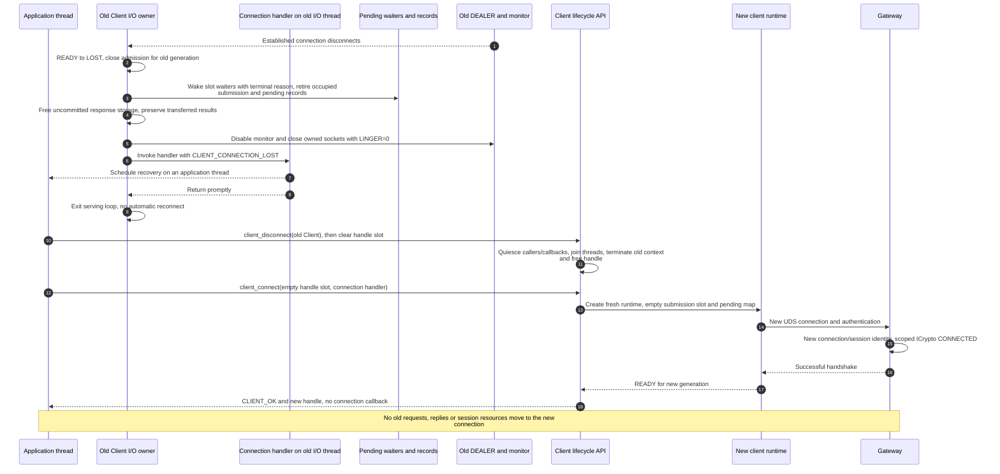

Client cleanup is not a remote cancellation acknowledgement. Gateway separately
closes the old context's admission and drops its undeliverable responses. Accepted
Gateway jobs follow the existing drain/deadline contract; active backend access
must finish before DISCONNECTED and buffer destruction. A new session can be
admitted while the old one retains private cleanup references, without sharing
its resources or accepting its late completions. A missing response does not
make automatic operation replay safe.

#### Freeze and runtime behavior

The application owns preparation for freezing its process: stop new submissions,
finish accepted operations and callbacks, and leave no uncertain remote work.
Async CLIENT_OK confirms only send acceptance, so it does not satisfy this
preparation requirement; the operation may still be executing remotely.
With no pending operation, no request timer is active and the 15-second duration
does not expire the idle connection. No custom heartbeat or inactivity watchdog
is part of that flow.

The intended freeze preserves the process and its descriptors. Transport
heartbeats are disabled on both ends, so a lack of heartbeat traffic during the
pause does not expire that connection. Actual socket closure or Gateway failure
still uses normal disconnect handling. Section 6.14 describes the Gateway side
and the distinction from process destruction.

#### Concurrency, callbacks and reconnect

The following constraints apply to all request APIs:

- Protect the one submission slot and admission state with a per-Client mutex.
  WaitAndPublish releases that mutex while waiting; ClaimSubmission retains
  the request and unlocks before serialization or I/O. CompleteSend frees the
  slot after acceptance/failure. Process replies and monitor events even when
  the occupied slot cannot send. The pending-response map has no fixed count cap.
- Use a monotonic clock for the agreed 15-second local deadlines. The current
  API has no timeout argument; future configurability is optional and does not
  block the initial fixed defaults. There is no idle-connection expiry.
- Resolve each synchronous result and async send-result waiter once. Async
  callbacks deliver responses at most once and are not guaranteed after send
  success. Retire async records without a callback on connection loss or local
  response-processing failure. Late replies cannot trigger a duplicate callback
  or satisfy another request; this does not guarantee exactly-once execution.
- Explicit local close resolves still-pending sync/send results with
  CLIENT_NOT_CONNECTED, retires pending IDs without synthetic callbacks and
  waits for live calls/claimed callbacks before destroying the handle. Preserve
  an earlier response, send acceptance, timeout or unexpected-loss result.
- Do not retry automatically after a timeout or reconnect. A crypto operation
  may already have changed backend state.
- Disable automatic transport reconnect and discard old pending requests and
  undelivered responses on connection loss. Explicit reconnect creates a fresh
  context with no reused buffer IDs, session key handles or queued work.
- Apply RECONNECT_IVL=-1, IMMEDIATE=1 and LINGER=0 to each new DEALER. Close the
  old socket rather than reconnecting it or carrying its libzmq queues forward.
- Keep transport heartbeats disabled on DEALER and ROUTER, including after
  socket recreation. Actual connection loss still invalidates assumptions about
  the old Gateway context, buffers and key handles. The explicit new-connection
  flow above applies after any actual loss, including one observed after thaw.
- Connection callbacks are specified by the header to run on
  an internal thread without calling other client APIs. Request callbacks use
  the execution rules in section 5.4: run on the I/O owner without held
  internal locks, permit response freeing, and prohibit all request calls
  because they wait for that same owner. Schedule new requests, disconnect and
  heavy work on an application thread.
- If arbitrary blocking callbacks must be supported, add a separate bounded
  completion executor with its own shutdown contract. Do not silently create
  an unbounded thread per callback.
- An application-owned event-loop mode would need additional public integration
  APIs. It is an optional future extension, not a requirement for this version.

#### Library unloading

A shared library can create threads. Runtime unloading is safe only after the
application disconnects every Client, all library-owned threads are joined,
all calls/callbacks have returned, owned ZMQ contexts are terminated and all
buffers requiring `client_free_response()` have been freed. No thread may still
execute library code after `dlclose()`. libzmq's internal threads do not remove
this obligation. See the
[dynamic loader API](https://man7.org/linux/man-pages/man3/dlopen.3.html).

### 5.15 Call hierarchy

```text
Application / Firebolt Crypto
  client_connect
    ClientRuntime::Start
      Allocate runtime, EMPTY slot, slotAvailable, result conditions, stop flag, wakeup
      Start I/O owner, create DEALER and set options before connecting
        heartbeat IVL/TIMEOUT/TTL=0, RECONNECT_IVL=-1, IMMEDIATE=1, LINGER=0
      Enable monitoring, connect PAIR receiver, then connect DEALER and await handshake
      HANDSHAKE_SUCCEEDED -> publish handle, CLIENT_OK, no initial callback
      Failure -> retained error, stop/join/close and NULL output

  client_send_request / client_send_request_async
    F1 RetainCall / PrepareRequest
      Check READY, start original deadline, own and validate binary RpcRequest
  client_send_request_string / client_send_request_string_async
    F1 RetainCall / PrepareRequest
      Check READY, start original deadline, scan/copy raw text to first NUL
      Build service=UNSPECIFIED envelope, payload=text bytes, no terminator

  Shared request path for all four methods
    F2 ClientRuntime::WaitAndPublish
      Wait until EMPTY or deadline/close/failure, release mutex during wait
      Publish retained Request, mark PUBLISHED, unlock
    F3 WakeIo -> I/O poller
      ClientRuntime::ClaimSubmission -> lock/read/retain/CLAIMED/unlock
    F4 I/O owner: PrepareWireRequest / TrackRequest
      Recheck eligibility -> assign ID/schema -> serialize -> install pending entry
      Allocation failure -> CLIENT_OUT_OF_MEMORY unless another terminal path won
                            retire unsent entry, free matching slot, notify
    F5 TryBeginSend -> zmq_send(DEALER, DONTWAIT)
      EAGAIN/EINTR -> occupied slot retained, process replies/events, retry if eligible
      Deadline/close/loss -> disable later sends, resolve any active attempt first
      CompleteSend(request, outcome) -> commit send result and free matching slot once
        Accepted async -> CLIENT_OK, even if cancellation raced the admitted attempt
        Sync response result remains separate; expiry/close does not become success
        Unlock -> notify result and slot waiters
    F6 Calling thread
      Async: return send result, no response timeout after acceptance
      Sync: wait for final response within original deadline, slot already free
    F7 I/O owner: zmq_msg_recv -> framing/parse -> match ID/service/schema/status
      Uncorrelatable allocation failure -> terminal CLIENT_OUT_OF_MEMORY, wake slot waiters
      Uncorrelatable invalid response -> terminal CLIENT_COMMUNICATION_ERROR, wake waiters
      Unknown/retired ID -> discard
      Installed but unaccepted ID -> log/discard response, preserve request and slot
    F8 CompleteResponse
      Byte: allocate serialized response bytes, preserve RpcStatus/service payload
      String: validate non-OK status/empty payload -> allocate RpcStatus name + NUL
        Gateway normally returns UNSUPPORTED_SERVICE, service=0, no Crypto invocation
      Claim result against deadline/close -> retire pending entry once
        Never clear another request's occupied submission slot
      Sync: CLIENT_OK + response, or exact local error with NULL/0
      Async: response callback without locks, or diagnostics/retirement without callback

  Monitor processing on I/O owner
    Established loss -> READY to LOST, latch reason once, notify slotAvailable
    Resolve occupied send, fail unresolved results, retire async records
    Close sockets with LINGER=0, emit CLIENT_CONNECTION_LOST if callback claim allowed
    Exit owner, no automatic reconnect or RESTORED/TERMINATED event
    App explicitly disconnects old handle and connects a fresh runtime/session

  client_register_notifications -> CLIENT_NOT_IMPLEMENTED, no retained handler
  client_unregister_notifications -> no effect
  client_free_response -> free, no slot access or allocation

  client_disconnect
    App coordinates handle lifetime and stops new call entry
    Close admission, set existing stop flag, notify slotAvailable, wake I/O owner
    No wait for EMPTY and no control request published into the slot
    Resolve active send, preserve accepted async CLIENT_OK
    Unresolved calls -> latched reason (CLIENT_NOT_CONNECTED for close from READY)
    Preserve earlier LOST reason, clear matching occupied slot and pending IDs
    Owner closes sockets -> join -> quiesce entered calls/claimed callbacks
    Terminate context, destroy runtime, no callback after return
```

The numbered boundaries match sections 5.2–5.9. They belong to one runtime and
its Request records; no additional client coordinator thread or request pool
is implied. Gateway request scheduling remains independent.

