<!--
If not stated otherwise in this file or this component's LICENSE
file the following copyright and licenses apply:

Copyright 2026 RDK Management

Licensed under the Apache License, Version 2.0 (the "License");
you may not use this file except in compliance with the License.
You may obtain a copy of the License at

http://www.apache.org/licenses/LICENSE-2.0

Unless required by applicable law or agreed to in writing, software
distributed under the License is distributed on an "AS IS" BASIS,
WITHOUT WARRANTIES OR CONDITIONS OF ANY KIND, either express or implied.
See the License for the specific language governing permissions and
limitations under the License.
-->

# EyilClient implementation guide

This guide complements the [canonical capability specs](SpecificationMap.md#capability-index).
Read their full detailed contracts with the diagrams, rationale and procedures here.
Original ACs and open decisions remain in [EyilSecureGateway.md](EyilSecureGateway.md).
Section numbers and source anchors are preserved for navigation; the
[source map](SpecificationMap.md) covers every original section.

- [5.1 Responsibilities and limits](#51-responsibilities-and-limits)
- [5.2 Component organization and ownership](#52-component-organization-and-ownership)
- [5.3 General routing: concurrent requests on one connection](#53-general-routing-concurrent-requests-on-one-connection)
- [5.4 Public API index](#54-public-api-index)
- [5.5 client_connect()](#55-client_connect)
- [5.6 client_send_request()](#56-client_send_request)
- [5.7 client_send_request_async()](#57-client_send_request_async)
- [5.8 client_send_request_string() — Gateway returns unsupported service](#58-client_send_request_string--gateway-returns-unsupported-service)
- [5.9 client_send_request_string_async() — Gateway returns unsupported service](#59-client_send_request_string_async--gateway-returns-unsupported-service)
- [5.10 client_free_response()](#510-client_free_response)
- [5.11 client_register_notifications()](#511-client_register_notifications)
- [5.12 client_unregister_notifications()](#512-client_unregister_notifications)
- [5.13 client_disconnect()](#513-client_disconnect)
- [5.14 Deadlines, callbacks, reconnect and library unloading](#514-deadlines-callbacks-reconnect-and-library-unloading)
- [5.15 Call hierarchy](#515-call-hierarchy)

## 5. EyilClient design and API flows

### 5.1 Responsibilities and limits

Contract requirements: [CR-01 Public methods and transport scope](../openspec/specs/client-requests/spec.md#requirement-cr-01-public-methods-and-transport-scope),
[CC-01 Connection ownership and application lifetime](../openspec/specs/client-connection/spec.md#requirement-cc-01-connection-ownership-and-application-lifetime).

### 5.2 Component organization and ownership

Contract requirements: [CR-03 Single-slot ownership and publication](../openspec/specs/client-requests/spec.md#requirement-cr-03-single-slot-ownership-and-publication),
[CC-01 Connection ownership and application lifetime](../openspec/specs/client-connection/spec.md#requirement-cc-01-connection-ownership-and-application-lifetime).

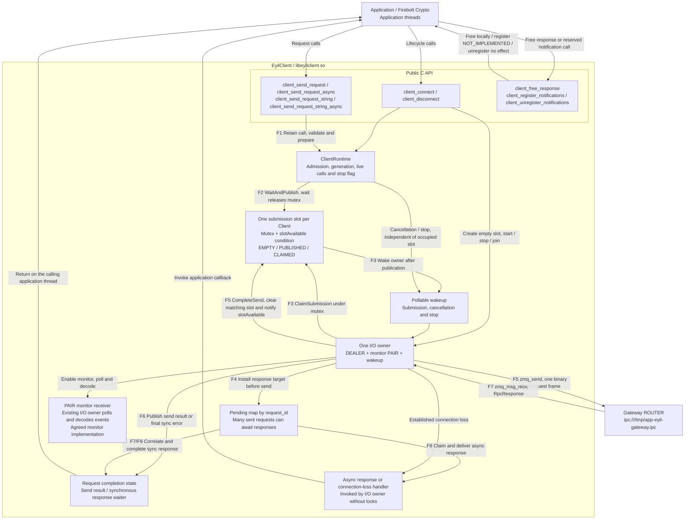

F1–F8 are the common flow points defined in section 5.3 and reused in every
request sequence. WaitAndPublish, ClaimSubmission and CompleteSend are internal
design method names on the runtime/owner, not additional public APIs. The slot
is read explicitly by ClaimSubmission; a wakeup alone does not transfer or send
the request. CompleteSend frees the slot after acceptance/failure, independently
of later response delivery. Connection and response callbacks share the owner
thread and must return promptly. Notification APIs create no callback state.

#### Monitor responsibilities

Contract requirements: [CC-01 Connection ownership and application lifetime](../openspec/specs/client-connection/spec.md#requirement-cc-01-connection-ownership-and-application-lifetime).

#### Single-slot publication, claiming and completion

Contract requirements: [CR-03 Single-slot ownership and publication](../openspec/specs/client-requests/spec.md#requirement-cr-03-single-slot-ownership-and-publication).

#### Shared submission diagram (F1–F6)

This diagram is the common submission path for all four request APIs. The API
diagrams in sections 5.6–5.9 draw it as one "F2-F5 Submit" step and show only
their own differences. Early exits use `break`: once a `break` block runs, the
call ends there.

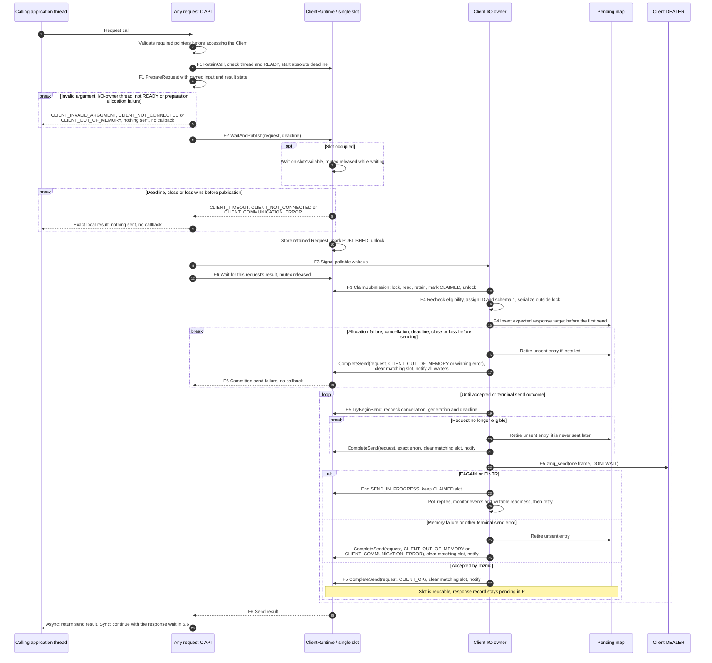

### 5.3 General routing: concurrent requests on one connection

Contract requirements: [CR-03 Single-slot ownership and publication](../openspec/specs/client-requests/spec.md#requirement-cr-03-single-slot-ownership-and-publication),
[CR-07 Shared nonblocking send and receive pipeline](../openspec/specs/client-requests/spec.md#requirement-cr-07-shared-nonblocking-send-and-receive-pipeline).

Coverage: **AC2-Client.1, AC2-Client.2–AC2-Client.3, AC2-Client.5,
AC1.5–AC1.7, AC2-Firebolt.1–AC2-Firebolt.2**.

Use these flow points in the API diagrams and implementation:

| Point | Calling component / internal method | Work and next boundary |
| --- | --- | --- |
| F1 | C API: RetainCall / PrepareRequest | Validate handle, calling thread and arguments; check READY, start the deadline, own input and initialize request/result state |
| F2 | Calling thread: WaitAndPublish | Wait for the single slot, releasing the mutex; publish only while eligible; timeout/close/loss can end the wait |
| F3 | Caller: WakeIo; owner: ClaimSubmission | Wake the poller; owner explicitly locks, reads and retains the published request, marks CLAIMED and unlocks |
| F4 | Owner: PrepareWireRequest / TrackRequest | Recheck deadline/generation, assign ID and schema 1, serialize and install the pending entry before sending |
| F5 | Owner: TryBeginSend / CompleteSend | Attempt zmq_send(DONTWAIT); retain the slot on temporary backpressure; atomically record the send result and release only its matching slot, then wake callers |
| F6 | Calling thread: WaitForSend or WaitForResponse | Async returns send result; sync waits for its own final response within the same total deadline, without occupying the slot after send |
| F7 | Owner: ReceiveResponse / MatchRequest | Receive a complete response, validate framing/envelope, match the original ID/service/generation and require recorded send acceptance |
| F8 | Owner: CompleteResponse | Prepare final bytes/status text, claim completion against timeout/close, retire once, wake the sync caller or invoke the async callback without locks |

These internal names make the call boundaries explicit; they can be methods
and state in one ClientRuntime plus Request records. The common send/error
rules are in section 5.6; F1–F8 do not add public API methods. F6 is the caller's
wait/return: it overlaps owner steps F3–F5 and, for sync, F7–F8. Waiting on that
result condition does not prevent the owner from claiming or sending work.

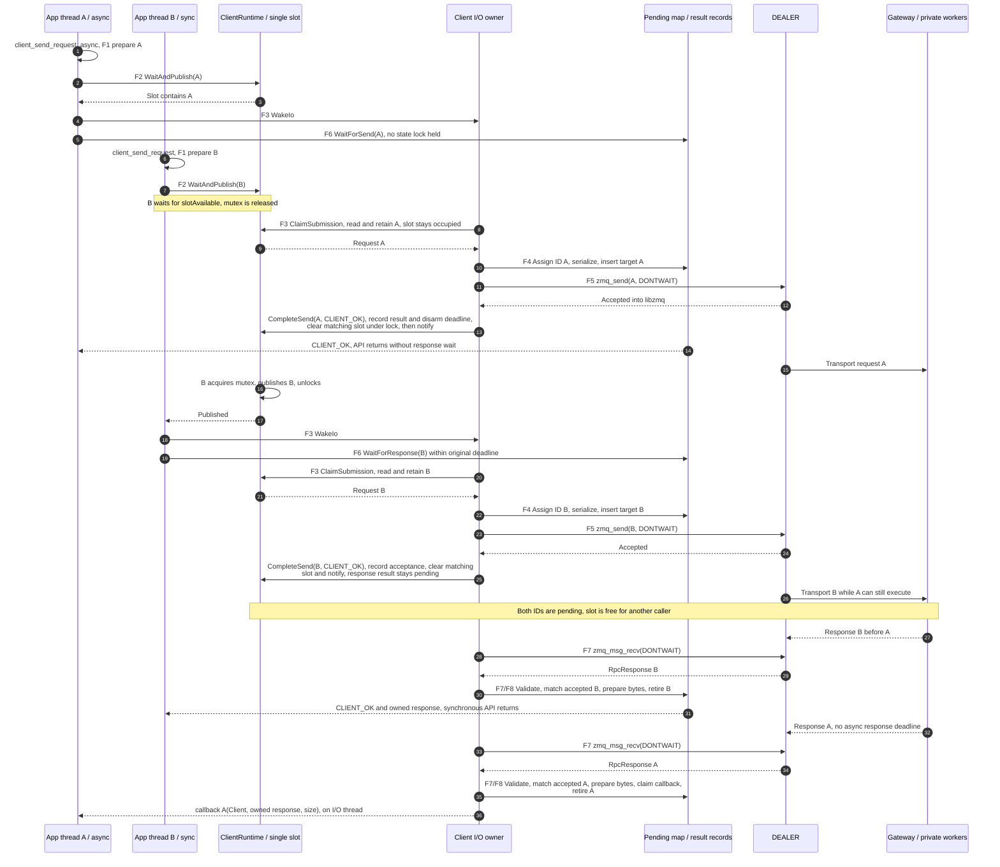

### 5.4 Public API index

Contract requirements: [CR-01 Public methods and transport scope](../openspec/specs/client-requests/spec.md#requirement-cr-01-public-methods-and-transport-scope).

#### Allocation failures across the public API

Contract requirements: [CR-02 Local result and allocation-failure contract](../openspec/specs/client-requests/spec.md#requirement-cr-02-local-result-and-allocation-failure-contract).

#### Required asynchronous request behavior

Contract requirements: [CR-04 Asynchronous send acceptance and response-only delivery](../openspec/specs/client-requests/spec.md#requirement-cr-04-asynchronous-send-acceptance-and-response-only-delivery).

#### Async signatures and response ownership

Contract requirements: [CR-04 Asynchronous send acceptance and response-only delivery](../openspec/specs/client-requests/spec.md#requirement-cr-04-asynchronous-send-acceptance-and-response-only-delivery).

The asynchronous request API uses these signatures:

```c
typedef void (*ClientResponseHandler)(
    Client *client,
    uint8_t *response_data,
    size_t response_size);

typedef void (*ClientStringResponseHandler)(
    Client *client,
    char *response_data);

ClientResult client_send_request_async(
    Client *client,
    const uint8_t *request_data,
    size_t request_size,
    ClientResponseHandler handler);

ClientResult client_send_request_string_async(
    Client *client,
    const char *request_data,
    ClientStringResponseHandler handler);
```

#### Send-result coordination and cancellation

Contract requirements: [CR-04 Asynchronous send acceptance and response-only delivery](../openspec/specs/client-requests/spec.md#requirement-cr-04-asynchronous-send-acceptance-and-response-only-delivery).

#### Request-callback execution model

Contract requirements: [CR-05 Response callback execution](../openspec/specs/client-requests/spec.md#requirement-cr-05-response-callback-execution).

### 5.5 client_connect()

Coverage: **AC2-Client.1–AC2-Client.4; AC1.2, AC1.4–AC1.6**.

#### Handle ownership and CLIENT_ALREADY_CONNECTED

Contract requirements: [CC-02 Connect handle and readiness](../openspec/specs/client-connection/spec.md#requirement-cc-02-connect-handle-and-readiness).

#### Readiness contract

Contract requirements: [CC-02 Connect handle and readiness](../openspec/specs/client-connection/spec.md#requirement-cc-02-connect-handle-and-readiness).

#### Connection callback contract

Contract requirements: [CC-03 Connection event callback timing](../openspec/specs/client-connection/spec.md#requirement-cc-03-connection-event-callback-timing).

#### Socket settings for a fresh connection

Contract requirements: [CC-04 Socket configuration and disabled heartbeats](../openspec/specs/client-connection/spec.md#requirement-cc-04-socket-configuration-and-disabled-heartbeats).

#### Disabled ZeroMQ heartbeats

Contract requirements: [CC-04 Socket configuration and disabled heartbeats](../openspec/specs/client-connection/spec.md#requirement-cc-04-socket-configuration-and-disabled-heartbeats).

Freezing an application also stops its libzmq threads. Disabling transport
heartbeats avoids disconnecting that preserved idle connection merely because
the frozen client cannot exchange heartbeat traffic. The agreed hibernation
preserves descriptors and starts only after the app finishes its operations.
An independent Thunder/Gateway failure uses terminal-loss cleanup; automatic
recovery of that platform failure is outside scope.

#### Connection sequence

The diagram's reference to the outcome table resolves to
[CC-05 Initial connection outcomes and rollback](../openspec/specs/client-connection/spec.md#requirement-cc-05-initial-connection-outcomes-and-rollback).

Contract requirements: [CC-02 Connect handle and readiness](../openspec/specs/client-connection/spec.md#requirement-cc-02-connect-handle-and-readiness).

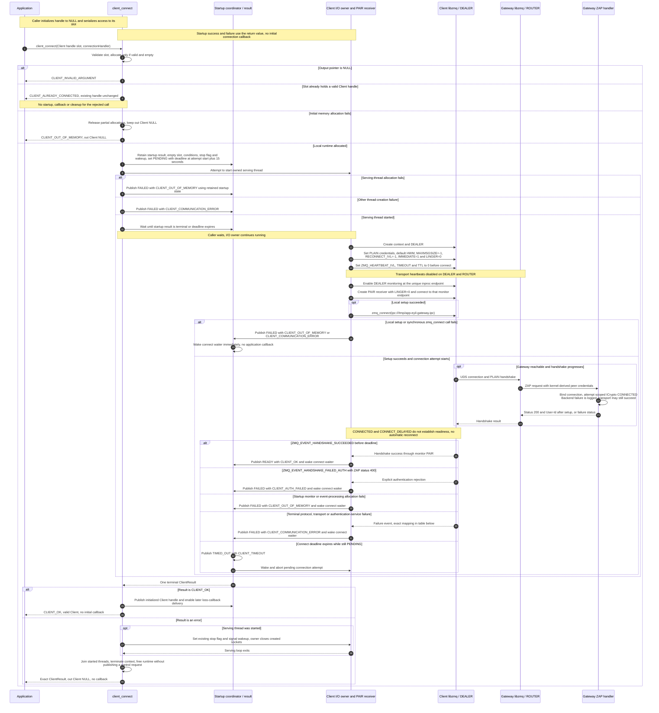

#### Exact initial-connect outcomes

Contract requirements: [CC-05 Initial connection outcomes and rollback](../openspec/specs/client-connection/spec.md#requirement-cc-05-initial-connection-outcomes-and-rollback).

### 5.6 client_send_request()

Contract requirements: [RP-01 Envelope and request identity](../openspec/specs/rpc-protocol/spec.md#requirement-rp-01-envelope-and-request-identity),
[CR-06 Binary request validation and synchronous completion](../openspec/specs/client-requests/spec.md#requirement-cr-06-binary-request-validation-and-synchronous-completion).

Coverage: **AC2-Client.1, AC2-Client.2–AC2-Client.3, AC2-Client.5**; Crypto use also supports **AC2-Firebolt.1–AC2-Firebolt.2**.

#### Submission and synchronous wait

Contract requirements: [CR-06 Binary request validation and synchronous completion](../openspec/specs/client-requests/spec.md#requirement-cr-06-binary-request-validation-and-synchronous-completion).

The shared submission (F2–F5) is drawn in section 5.2 and the shared receive
pipeline (F7–F8) below. This diagram shows only what is specific to the
synchronous byte API.

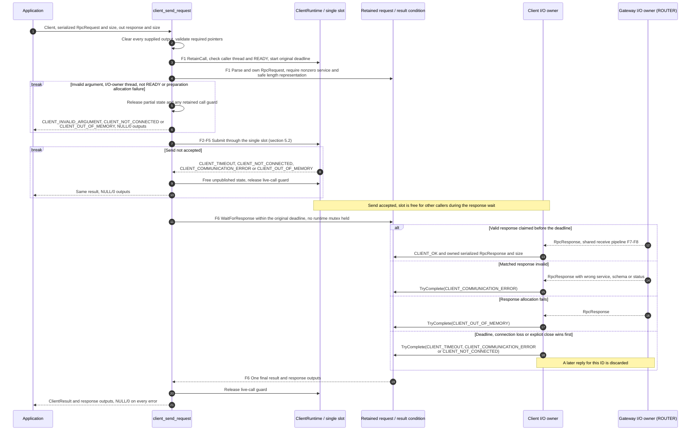

#### Shared nonblocking send and receive pipeline

Contract requirements: [CR-07 Shared nonblocking send and receive pipeline](../openspec/specs/client-requests/spec.md#requirement-cr-07-shared-nonblocking-send-and-receive-pipeline).

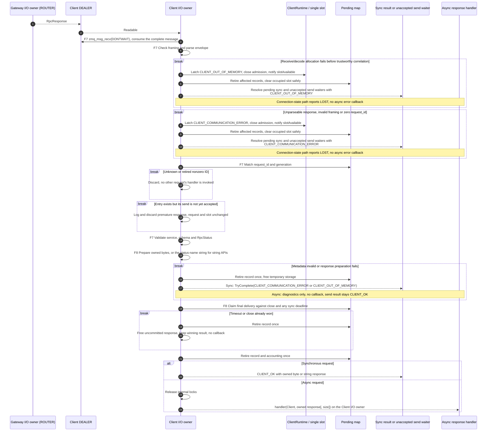

#### Synchronous timeout, disconnect and response races

Contract requirements: [CR-06 Binary request validation and synchronous completion](../openspec/specs/client-requests/spec.md#requirement-cr-06-binary-request-validation-and-synchronous-completion).

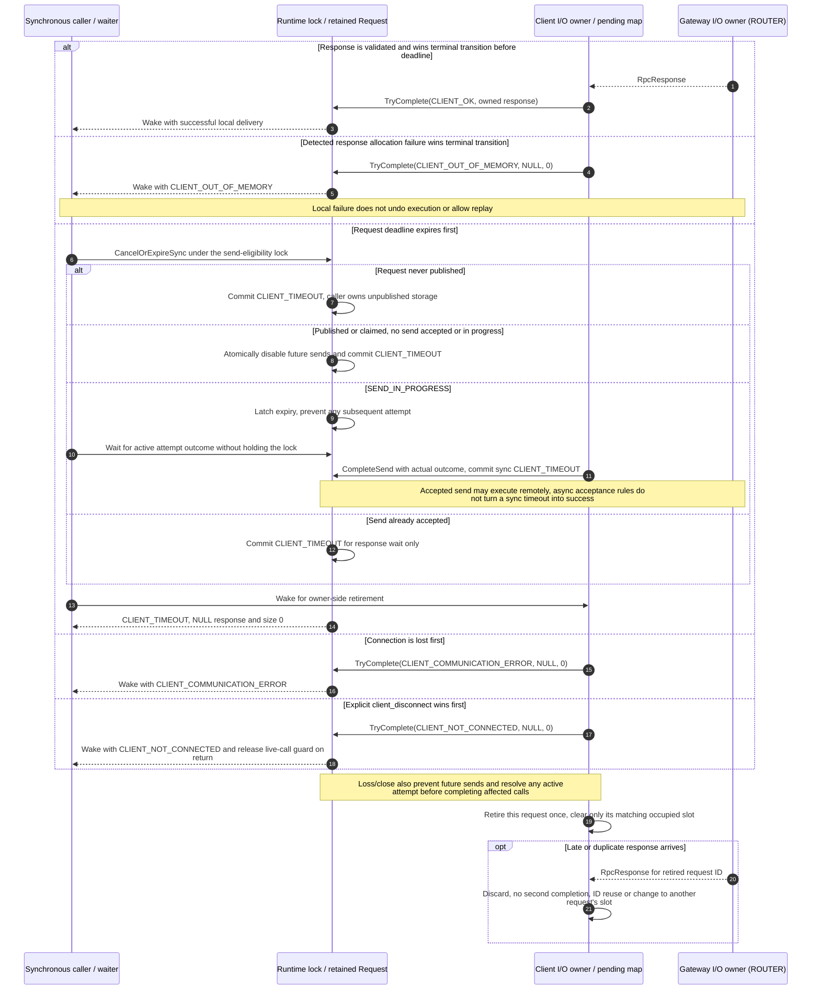

### 5.7 client_send_request_async()

Contract requirements: [CR-04 Asynchronous send acceptance and response-only delivery](../openspec/specs/client-requests/spec.md#requirement-cr-04-asynchronous-send-acceptance-and-response-only-delivery),
[CR-05 Response callback execution](../openspec/specs/client-requests/spec.md#requirement-cr-05-response-callback-execution),
[CR-11 Deadlines and dynamic response state](../openspec/specs/client-requests/spec.md#requirement-cr-11-deadlines-and-dynamic-response-state),
[CR-08 Asynchronous byte API outcomes](../openspec/specs/client-requests/spec.md#requirement-cr-08-asynchronous-byte-api-outcomes).

Coverage: **AC2-Client.1, AC2-Client.2–AC2-Client.3, AC2-Client.5**.

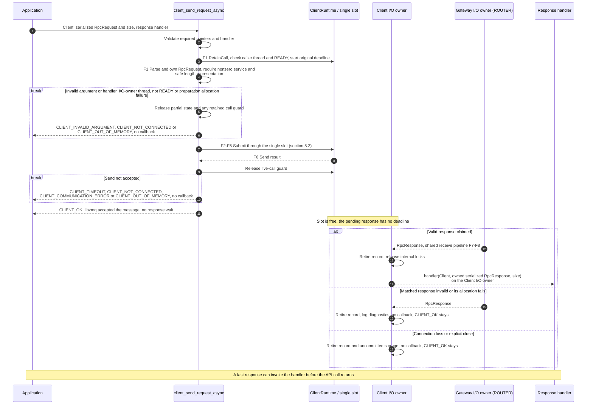

### 5.8 client_send_request_string() — Gateway returns unsupported service

Contract requirements: [CR-09 Raw-string API ownership and local outcomes](../openspec/specs/client-requests/spec.md#requirement-cr-09-raw-string-api-ownership-and-local-outcomes).

Coverage: **AC2-Client.1, AC2-Client.5**. Actual string-service execution is a
delivery limitation against AC2-Client.5; the original AC remains unchanged.

#### Defined wire request and error response

Contract requirements: [RP-05 Unsupported raw-text wire contract](../openspec/specs/rpc-protocol/spec.md#requirement-rp-05-unsupported-raw-text-wire-contract).

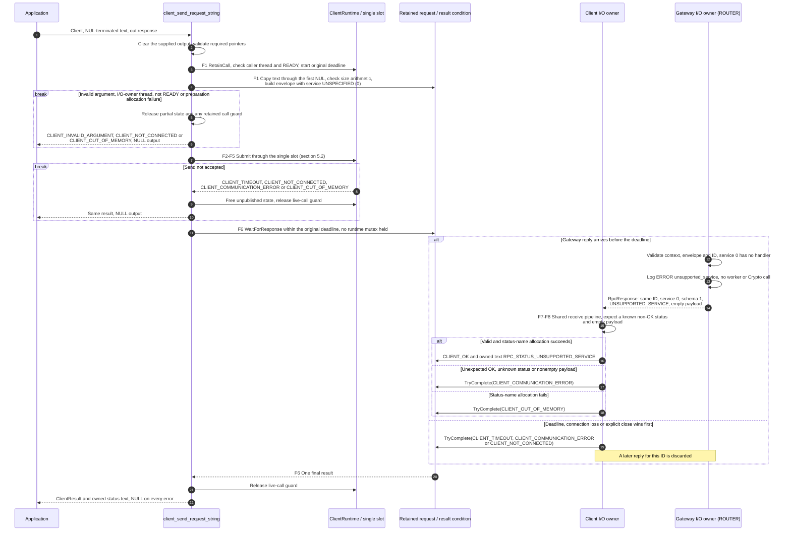

#### Plain-string ownership and local failures

Contract requirements: [CR-09 Raw-string API ownership and local outcomes](../openspec/specs/client-requests/spec.md#requirement-cr-09-raw-string-api-ownership-and-local-outcomes).

### 5.9 client_send_request_string_async() — Gateway returns unsupported service

Contract requirements: [CR-09 Raw-string API ownership and local outcomes](../openspec/specs/client-requests/spec.md#requirement-cr-09-raw-string-api-ownership-and-local-outcomes).

Coverage: **AC2-Client.1, AC2-Client.5**, with the same string-service delivery
limitation as section 5.8. The async transport path is required: the method
copies raw text, waits for its single-slot handoff and libzmq acceptance, then
returns the send result. It does not wait for Gateway's unsupported response
and does not return CLIENT_NOT_IMPLEMENTED locally.

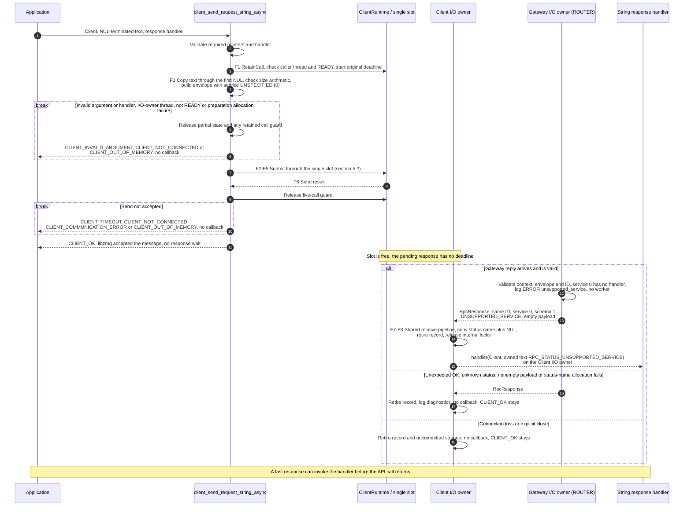

### 5.10 client_free_response()

Contract requirements: [CR-10 Response freeing and reserved notifications](../openspec/specs/client-requests/spec.md#requirement-cr-10-response-freeing-and-reserved-notifications).

Coverage: **AC2-Client.1**.

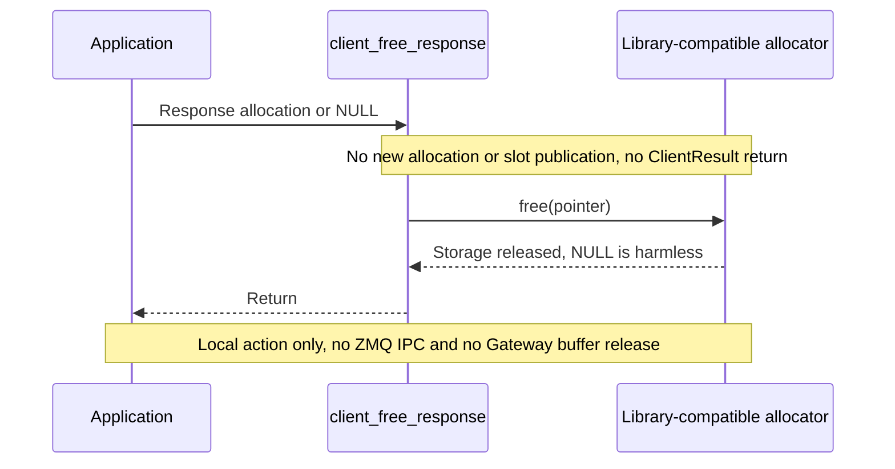

### 5.11 client_register_notifications()

Contract requirements: [CR-10 Response freeing and reserved notifications](../openspec/specs/client-requests/spec.md#requirement-cr-10-response-freeing-and-reserved-notifications).

Coverage: **AC2-Client.1**. This API is reserved for future notification support.

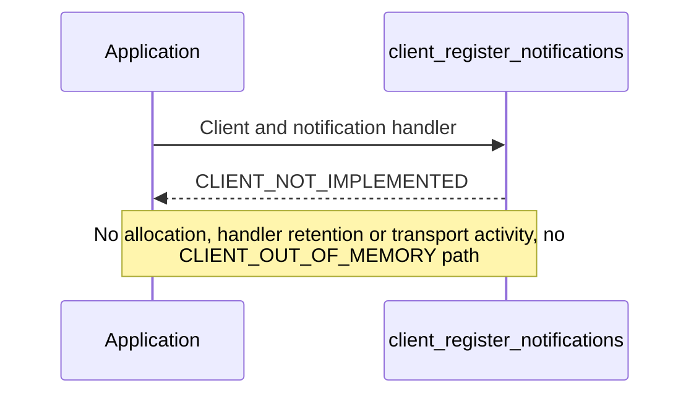

### 5.12 client_unregister_notifications()

Contract requirements: [CR-10 Response freeing and reserved notifications](../openspec/specs/client-requests/spec.md#requirement-cr-10-response-freeing-and-reserved-notifications).

Coverage: **AC2-Client.1**. This API is reserved for future notification support.

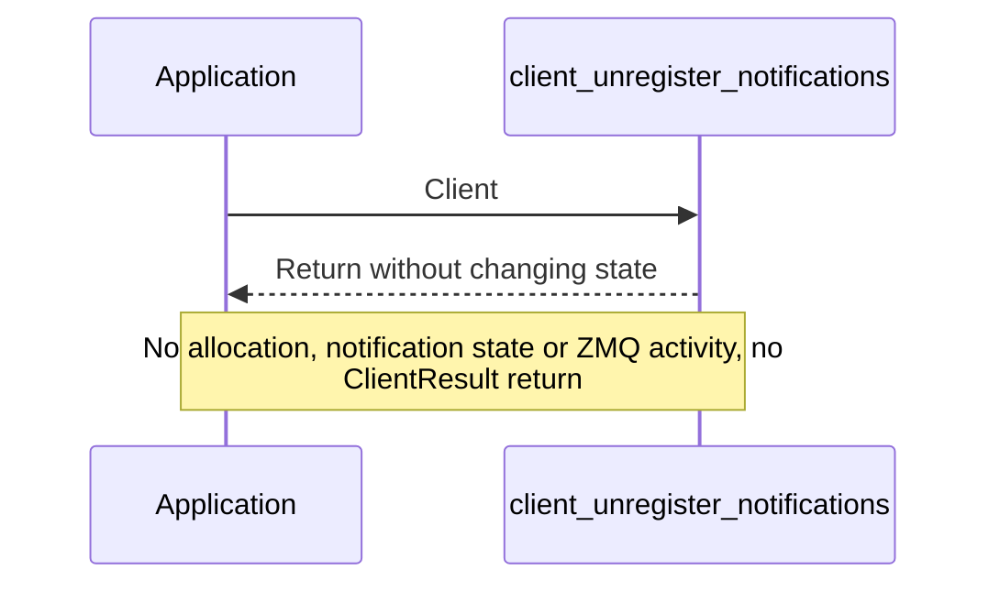

### 5.13 client_disconnect()

Contract requirements: [CC-06 Explicit disconnect barrier and raw-handle coordination](../openspec/specs/client-connection/spec.md#requirement-cc-06-explicit-disconnect-barrier-and-raw-handle-coordination).

Coverage: **AC2-Client.1–AC2-Client.4**, leading to **AC1.12** when the Gateway detects closure.

#### Results and callback behavior during explicit close

Contract requirements: [CC-06 Explicit disconnect barrier and raw-handle coordination](../openspec/specs/client-connection/spec.md#requirement-cc-06-explicit-disconnect-barrier-and-raw-handle-coordination).

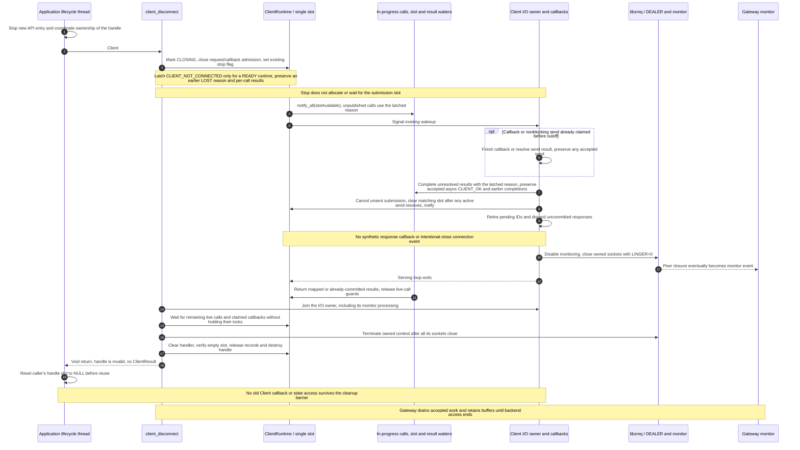

#### Concurrent callers and handle lifetime

Contract requirements: [CC-06 Explicit disconnect barrier and raw-handle coordination](../openspec/specs/client-connection/spec.md#requirement-cc-06-explicit-disconnect-barrier-and-raw-handle-coordination).

### 5.14 Deadlines, callbacks, reconnect and library unloading

#### Initial timeout and submission defaults

Contract requirements: [CR-11 Deadlines and dynamic response state](../openspec/specs/client-requests/spec.md#requirement-cr-11-deadlines-and-dynamic-response-state),
[GR-02 Current-request admission and worker-start deadline](../openspec/specs/gateway-routing/spec.md#requirement-gr-02-current-request-admission-and-worker-start-deadline),
[CR-10 Response freeing and reserved notifications](../openspec/specs/client-requests/spec.md#requirement-cr-10-response-freeing-and-reserved-notifications).

#### Terminal connection loss and explicit reconnect

Contract requirements: [CC-07 Terminal loss and explicit fresh connection](../openspec/specs/client-connection/spec.md#requirement-cc-07-terminal-loss-and-explicit-fresh-connection).

The explicit API sequence is:

```c
client_disconnect(client);
client = NULL;
ClientResult result = client_connect(&client, connection_handler);
```

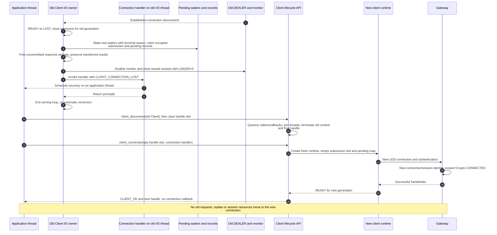

#### Freeze and runtime behavior

Contract requirements: [CC-08 Prepared process freeze and library unload](../openspec/specs/client-connection/spec.md#requirement-cc-08-prepared-process-freeze-and-library-unload).

#### Concurrency, callbacks and reconnect

Contract requirements: [CR-03 Single-slot ownership and publication](../openspec/specs/client-requests/spec.md#requirement-cr-03-single-slot-ownership-and-publication),
[CR-04 Asynchronous send acceptance and response-only delivery](../openspec/specs/client-requests/spec.md#requirement-cr-04-asynchronous-send-acceptance-and-response-only-delivery),
[CR-05 Response callback execution](../openspec/specs/client-requests/spec.md#requirement-cr-05-response-callback-execution),
[CR-11 Deadlines and dynamic response state](../openspec/specs/client-requests/spec.md#requirement-cr-11-deadlines-and-dynamic-response-state),
[CC-04 Socket configuration and disabled heartbeats](../openspec/specs/client-connection/spec.md#requirement-cc-04-socket-configuration-and-disabled-heartbeats),
[CC-06 Explicit disconnect barrier and raw-handle coordination](../openspec/specs/client-connection/spec.md#requirement-cc-06-explicit-disconnect-barrier-and-raw-handle-coordination),
[CC-07 Terminal loss and explicit fresh connection](../openspec/specs/client-connection/spec.md#requirement-cc-07-terminal-loss-and-explicit-fresh-connection).

- If arbitrary blocking callbacks must be supported, add a separate bounded
  completion executor with its own shutdown contract. Do not silently create
  an unbounded thread per callback.
- An application-owned event-loop mode would need additional public integration
  APIs. It is an optional future extension, not a requirement for this version.

#### Library unloading

Contract requirements: [CC-08 Prepared process freeze and library unload](../openspec/specs/client-connection/spec.md#requirement-cc-08-prepared-process-freeze-and-library-unload).

### 5.15 Call hierarchy

```text
Application / Firebolt Crypto
  client_connect
    ClientRuntime::Start
      Allocate runtime, EMPTY slot, slotAvailable, result conditions, stop flag, wakeup
      Start I/O owner, create DEALER and set options before connecting
        heartbeat IVL/TIMEOUT/TTL=0, RECONNECT_IVL=-1, IMMEDIATE=1, LINGER=0
      Enable monitoring, connect PAIR receiver, then connect DEALER and await handshake
      HANDSHAKE_SUCCEEDED -> publish handle, CLIENT_OK, no initial callback
      Failure -> retained error, stop/join/close and NULL output

  client_send_request / client_send_request_async
    F1 RetainCall / PrepareRequest
      Check READY, start original deadline, own and validate binary RpcRequest
  client_send_request_string / client_send_request_string_async
    F1 RetainCall / PrepareRequest
      Check READY, start original deadline, scan/copy raw text to first NUL
      Build service=UNSPECIFIED envelope, payload=text bytes, no terminator

  Shared request path for all four methods
    F2 ClientRuntime::WaitAndPublish
      Wait until EMPTY or deadline/close/failure, release mutex during wait
      Publish retained Request, mark PUBLISHED, unlock
    F3 WakeIo -> I/O poller
      ClientRuntime::ClaimSubmission -> lock/read/retain/CLAIMED/unlock
    F4 I/O owner: PrepareWireRequest / TrackRequest
      Recheck eligibility -> assign ID/schema -> serialize -> install pending entry
      Allocation failure -> CLIENT_OUT_OF_MEMORY unless another terminal path won
                            retire unsent entry, free matching slot, notify
    F5 TryBeginSend -> zmq_send(DEALER, DONTWAIT)
      EAGAIN/EINTR -> occupied slot retained, process replies/events, retry if eligible
      Deadline/close/loss -> disable later sends, resolve any active attempt first
      CompleteSend(request, outcome) -> commit send result and free matching slot once
        Accepted async -> CLIENT_OK, even if cancellation raced the admitted attempt
        Sync response result remains separate; expiry/close does not become success
        Unlock -> notify result and slot waiters
    F6 Calling thread
      Async: return send result, no response timeout after acceptance
      Sync: wait for final response within original deadline, slot already free
    F7 I/O owner: zmq_msg_recv -> framing/parse -> match ID/service/schema/status
      Uncorrelatable allocation failure -> terminal CLIENT_OUT_OF_MEMORY, wake slot waiters
      Uncorrelatable invalid response -> terminal CLIENT_COMMUNICATION_ERROR, wake waiters
      Unknown/retired ID -> discard
      Installed but unaccepted ID -> log/discard response, preserve request and slot
    F8 CompleteResponse
      Byte: allocate serialized response bytes, preserve RpcStatus/service payload
      String: validate non-OK status/empty payload -> allocate RpcStatus name + NUL
        Gateway normally returns UNSUPPORTED_SERVICE, service=0, no Crypto invocation
      Claim result against deadline/close -> retire pending entry once
        Never clear another request's occupied submission slot
      Sync: CLIENT_OK + response, or exact local error with NULL/0
      Async: response callback without locks, or diagnostics/retirement without callback

  Monitor processing on I/O owner
    Established loss -> READY to LOST, latch reason once, notify slotAvailable
    Resolve occupied send, fail unresolved results, retire async records
    Close sockets with LINGER=0, emit CLIENT_CONNECTION_LOST if callback claim allowed
    Exit owner, no automatic reconnect or RESTORED/TERMINATED event
    App explicitly disconnects old handle and connects a fresh runtime/session

  client_register_notifications -> CLIENT_NOT_IMPLEMENTED, no retained handler
  client_unregister_notifications -> no effect
  client_free_response -> free, no slot access or allocation

  client_disconnect
    App coordinates handle lifetime and stops new call entry
    Close admission, set existing stop flag, notify slotAvailable, wake I/O owner
    No wait for EMPTY and no control request published into the slot
    Resolve active send, preserve accepted async CLIENT_OK
    Unresolved calls -> latched reason (CLIENT_NOT_CONNECTED for close from READY)
    Preserve earlier LOST reason, clear matching occupied slot and pending IDs
    Owner closes sockets -> join -> quiesce entered calls/claimed callbacks
    Terminate context, destroy runtime, no callback after return
```

The numbered boundaries match sections 5.2–5.9. They belong to one runtime and
its Request records; no additional client coordinator thread or request pool
is implied. Gateway request scheduling remains independent.

