<!--
If not stated otherwise in this file or this component's LICENSE
file the following copyright and licenses apply:

Copyright 2026 RDK Management

Licensed under the Apache License, Version 2.0 (the "License");
you may not use this file except in compliance with the License.
You may obtain a copy of the License at

http://www.apache.org/licenses/LICENSE-2.0

Unless required by applicable law or agreed to in writing, software
distributed under the License is distributed on an "AS IS" BASIS,
WITHOUT WARRANTIES OR CONDITIONS OF ANY KIND, either express or implied.
See the License for the specific language governing permissions and
limitations under the License.
-->

# EyilGateway implementation guide

This is a required part of the [architecture and implementation specification](EyilSecureGateway.md).
Read its original ACs, common protocol/error/logging rules and gaps with this guide.
Section numbers are shared across the specification; client sections are in
[EyilClient.md](EyilClient.md), Gateway sections in [EyilGateway.md](EyilGateway.md),
and build/CI details in [BuildAndValidation.md](BuildAndValidation.md).

- [6.1 Plugin and implementation organization](#61-plugin-and-implementation-organization)
- [6.2 Thread model and private Thunder pool](#62-thread-model-and-private-thunder-pool)
- [6.3 Runtime records and synchronization](#63-runtime-records-and-synchronization)
- [6.4 Startup and partial-start failure](#64-startup-and-partial-start-failure)
- [6.5 ZAP, interim identity and future AppManager lookup](#65-zap-interim-identity-and-future-appmanager-lookup)
- [6.6 Request ingress, dispatch and response delivery](#66-request-ingress-dispatch-and-response-delivery)
- [6.7 Crypto adapter: per-call ICrypto references and per-connection sessions](#67-crypto-adapter-per-call-icrypto-references-and-per-connection-sessions)
- [6.8 Crypto operation routing map](#68-crypto-operation-routing-map)
- [6.9 Non-shared-memory operations](#69-non-shared-memory-operations)
- [6.10 Shared-memory identity, records and invariants](#610-shared-memory-identity-records-and-invariants)
- [6.11 AllocateSharedBuffer and client mapping](#611-allocatesharedbuffer-and-client-mapping)
- [6.12 Shared-memory operations: common backend boundary](#612-shared-memory-operations-common-backend-boundary)
- [6.13 ReleaseSharedBuffer and conflicting buffer operations](#613-releasesharedbuffer-and-conflicting-buffer-operations)
- [6.14 Disconnect detection, PID observations and hibernation](#614-disconnect-detection-pid-observations-and-hibernation)
- [6.15 On-demand Crypto lookup and invocation failures](#615-on-demand-crypto-lookup-and-invocation-failures)
- [6.16 Gateway deactivation, reactivation and fresh startup after a crash](#616-gateway-deactivation-reactivation-and-fresh-startup-after-a-crash)
- [6.17 Implementation order and verification targets](#617-implementation-order-and-verification-targets)

## 6. EyilGateway design and flows

### 6.1 Plugin and implementation organization

EyilGateway runs **in process** with Thunder. The thin
`EyilGateway` wrapper implements IPlugin and acquires
`EyilGatewayImplementation` using
`Root<Exchange::IConfiguration>()`, then calls `Configure(IShell*)`.
The default `configuration.root.mode` is `Off`. A future `Local` mode can use
the same split with matching framework proxy/stubs.

**There is no app-facing Gateway COM-RPC or JSON-RPC API.** IConfiguration is
the internal Thunder bootstrap contract. The wrapper owns the sole implementation
interface reference. Its final Release invokes the implementation destructor,
which drains and destroys the runtime before releasing its retained IShell.
No additional lifecycle interface is introduced. ICrypto calls form a separate
trusted backend boundary. "No public Gateway COM-RPC API" does not mean there
are no framework/backend interfaces internally.

| Component | Responsibility | Separation rule |
| --- | --- | --- |
| EyilGateway wrapper | Register notifications, acquire/configure implementation, final Release waits for destruction | Keep transport and service logic out of IPlugin |
| EyilGatewayImplementation | Own configuration/runtime and destructor-driven shutdown | IConfiguration starts the runtime; destruction drains and stops it before releasing IShell |
| GatewayServer / IoLoop | Own ROUTER, receive messages, route completions | No blocking backend work; no worker uses ROUTER |
| ZapAuthenticator | Own REP, parse credentials, answer ZAP | No application-supplied identity is trusted |
| AuthenticationProvider | Interim acceptance; future authoritative lookup | TODO(AUTH-APPMANAGER), separate from transport |
| ConnectionRegistry | Map User-Id to retained context; serialize admission/closing | Never key ownership solely by UID/PID/routing ID |
| RequestDispatcher | Envelope/service validation, routing and nonblocking handoff to the private pool | Service-neutral at outer boundary |
| Current request / dispatcher | One retained admitted request awaiting a worker, no request queue | Pause further ROUTER reception; worker-start deadline is 10 seconds, with atomic timeout/start arbitration |
| RequestJob | One retained dispatch object per accepted request | Immutable input plus explicit context/resource references |
| PrivateRequestPool | Own a Core::ThreadPool with a configured worker count | No replacement of Thunder's global worker singleton; internal capacity must not block ROUTER |
| CryptoServiceAdapter | Decode Crypto operations and query/invoke/release ICrypto per call | No cached ICrypto pointer, global Crypto session, health observer or duplicated key policy |
| SharedBufferManager | Create/track connection-owned allocations, shared per-host-UID quota records, active-use leases and deferred release; finalize once access ends | Gateway-local; quota spans connections, buffer access remains scoped to its owner connection; no dependency on ICrypto types |
| CompletionHandoff | Transfer completed owned records to the ROUTER owner, without count/byte caps | At most one send attempt; release on success/failure, no reply retry queue or delivery to a replacement route |
| MonitorCollector | Own PAIR and post normalized transport events | Correlation is a prerequisite for targeted cleanup |

#### Gateway component and API-call overview

Coverage: **AC1.1–AC1.12; AC2-Client.2–AC2-Client.3, AC2-Client.5;
AC2-Firebolt.1–AC2-Firebolt.2**.

The application calls EyilClient's C API. Gateway receives the resulting
Protobuf RPC over its ROUTER socket and dispatches a request job. The diagram
separates that request/response path from authentication, connection cleanup
and Thunder lifecycle control. Everything inside the implementation block is
owned by that Gateway runtime; the application and Crypto plugin remain
outside it.

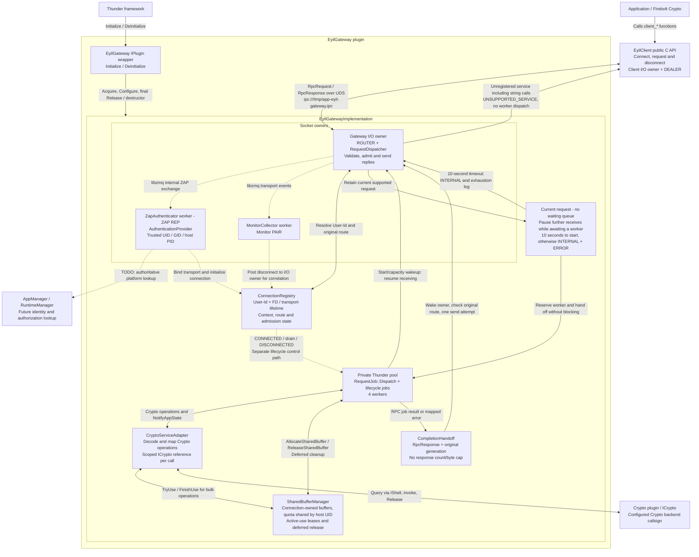

Solid arrows show API calls and RPC data flow. Dashed arrows show authentication,
monitor events and connection lifecycle control. The ZAP and monitor arrows are
libzmq's internal exchanges; they do not mean the ROUTER owner uses REP or PAIR.
This is a component/call map; the sequence diagrams below define ordering and
failure handling.

The three transport owners are separate Gateway threads. RequestDispatcher
runs on the ROUTER owner; request and lifecycle jobs run on the private pool.
The monitor collector posts events to the I/O owner, which correlates them and
serializes the registry's disconnect transition.
The adapter, registry, buffer manager and completion handoff are shared runtime
components, not additional threads. The private pool has four workers, in
addition to the transport owners and libzmq's internal threads. A worker wait
pauses only further request reception; responses and control handling continue.

| Call or event entering Gateway | Internal path and result | Detailed flow |
| --- | --- | --- |
| Thunder Initialize / Deinitialize | Wrapper acquires/configures the implementation; deactivation releases its sole interface reference and awaits destructor completion | Sections 6.4 and 6.16 |
| client_connect | DEALER handshake reaches ZAP; bind a unique User-Id to the transport/context and settle the worker-side NotifyAppState(CONNECTED) attempt before ZAP success. Backend failure is logged separately and does not reject the transport | Section 6.5 |
| client_send_request / client_send_request_async carrying a Crypto RpcRequest | ROUTER owner validates/adopts the current request, pauses further receives while waiting up to 10 seconds for a worker, then dispatches or returns INTERNAL; completions use the same owner | Sections 6.6–6.9 |
| client_send_request_string / client_send_request_string_async | ROUTER rejects the unrouted service=0 envelope with RPC_STATUS_UNSUPPORTED_SERVICE before worker admission; client exposes the received status as text | Sections 5.8–5.9 and 6.6 |
| ALLOCATE_SHARED_BUFFER / RELEASE_SHARED_BUFFER | Worker calls SharedBufferManager locally. Allocation returns buffer_id, name and size; release acceptance blocks new use and defers physical cleanup while access remains active or unresolved | Sections 6.10–6.11 and 6.13 |
| ENCRYPT / DECRYPT / SIGN / VERIFY | Worker-side adapter acquires an execution-time buffer lease, calls ICrypto using trusted context/object metadata, and ends the lease when backend access is definitively complete | Section 6.12 |
| Other Crypto operations | Adapter queries the configured callsign through IShell, invokes the mapped ICrypto method and releases the reference immediately after that call | Sections 6.7–6.9 |
| Peer closure after client_disconnect or unexpected transport loss | PAIR event identifies the original connection; immediately close its admission, drain accepted work, notify DISCONNECTED with its ApplicationContext through the private pool and finalize releasable resources; no grace period or wait for another connection to close | Section 6.14 |

Only the ROUTER owner sends RPC replies. Workers publish completions carrying
the original connection generation; backend notifications publish internal
lifecycle results, not unsolicited RPCs. A response gets at most one
nonblocking send attempt. An undeliverable response is logged and dropped,
without retry or a second error reply. Admission rejections use the same owner
and delivery policy without creating a service job. Lifecycle work uses the
separate retained control path; it does not depend on the current RPC ingress
record or on receiving another application message.

There is no application heartbeat service, heartbeat worker or inactivity
watchdog in the Gateway runtime. The registry has no last-request-age expiry
rule. Connection cleanup is driven by correlated disconnect events and the
normal explicit shutdown path. ROUTER's built-in ZeroMQ heartbeats are disabled
at startup and on socket recreation, matching the client settings.
Gateway owns request isolation and resource accounting; application-health
supervision and app restart decisions remain outside its responsibilities.

These are recommended responsibilities, not a requirement for one source file
per row. Keep explicit module/config/version files, a thin wrapper and separate
implementation sources. Use internal interfaces at unfinished integration points
to isolate AppManager integration. Use topic/crypto ICrypto types only within the
Crypto adapter; keep them out of EyilClient, transport and buffer ownership.
Gateway does not poll Crypto health or subscribe to Crypto availability events.
The wrapper notifications for Gateway's own implementation lifetime remain
separate from Crypto and are still required.

### 6.2 Thread model and private Thunder pool

Coverage: **AC1.1–AC1.3, AC1.7**.

| Execution context | Owns / performs | Must not do |
| --- | --- | --- |
| Thunder framework thread | Initialize/Deinitialize and framework notifications | Run application requests synchronously |
| Gateway I/O owner | ROUTER, the current request, worker-capacity/deadline handling and completion draining | Block while waiting for Crypto, a worker or a slow client |
| ZAP worker | REP and authentication exchange | Use ROUTER or modify another thread's socket |
| Monitor worker | PAIR events, normalized disconnect records | Guess a session from a non-unique PID |
| Private Thunder workers | RequestJob::Dispatch, buffer operations and scoped ICrypto calls | Send a ROUTER reply or own transport state |
| libzmq internal threads | Transport machinery | Replace Gateway request/session coordination |

Create a Gateway-owned Core::ThreadPool with **four workers** and the
Thunder/platform default stack size. Application request work must not use
Core::IWorkerPool::Assign(), Core::IWorkerPool::Instance().Submit(), or helper
jobs that implicitly submit to Thunder's global pool. The wrapper's framework
deactivation job may still use the global pool.

#### Current request, receive pause and worker timeout

Gateway has **no request waiting queue**. The ROUTER owner retains at most one
current admitted request that has not started Dispatch. This is the current
ingress operation, with its immutable input, connection generation, request ID,
completion bookkeeping and absolute deadline; it is not a growing container.
Already running jobs are independent of that current-request record.

1. When there is no current request awaiting dispatch, receive and validate one
   complete RPC. Invalid or unsupported requests use the normal owner-side
   rejection path. For a supported admitted request, establish an absolute
   monotonic deadline at admission plus **10,000 ms**.
2. Try to reserve an available private worker and hand over this distinct job
   without blocking. Use one synchronized capacity account for all jobs on that
   pool, including lifecycle jobs; a request must not assume a worker remains
   available merely because an earlier count was nonzero.
3. If a worker cannot start the current request yet, **pause further ROUTER
   request reception**. Disable its receive-readiness interest while paused so
   unread traffic cannot cause a busy loop. Continue draining worker completions,
   transport/control events and the current request's timer. ZAP and monitor
   owners also continue; never sleep or block the I/O owner for ten seconds.
4. Worker capacity/start/completion transitions signal the existing pollable
   wakeup. Attempt handoff when capacity changes, retaining the original
   deadline. Before service execution, Dispatch atomically claims
   WAITING -> RUNNING only if the deadline has not expired. That claim disarms
   the worker-wait timer and lets the I/O owner resume receiving the next RPC.
5. If the deadline wins, atomically claim WAITING -> EXPIRED, log ERROR
   `worker_pool_exhausted`, and produce **RPC_STATUS_INTERNAL with empty payload**
   through the normal single-attempt response path. The expired request must
   never invoke Crypto or perform a buffer operation. Resume reception after
   the current record's handoff ownership is settled.

Keep the record alive across timer/handoff races. If a job has been handed to
Thunder but has not started, the worker must observe EXPIRED and return without
service execution or another response. Do not reuse its worker reservation or
lose its retained references before that handoff is reclaimed. In particular,
do not turn Thunder's internal dispatch queue into another application backlog:
submit only against reserved available execution capacity, and keep the current
ingress record until Dispatch claims it or its expired handoff is reclaimed.
There is no second Gateway queue or queue-full error.

The timeout log must make saturation explicit: reason `worker_pool_exhausted`,
configured worker count, running/reserved counts, wait duration, request_id,
service and connection generation. It means the pool could not start the
request within ten seconds under the current load. Include lifecycle-worker
usage where relevant; slow or stuck backend calls can occupy the pool too.
Do not hide the condition behind a generic allocation error. Log any failure to
deliver the error separately; no second reply or service replay is attempted.

For example, `reason=worker_pool_exhausted workers=4 running=4 reserved=0
wait_ms=10000`, followed by request ID, service and connection generation,
identifies a request that could not start while all four workers were occupied.

Emit `worker_pool_wait` at WARNING once when a request first cannot obtain
capacity. Both diagnostics distinguish running jobs from reserved handoffs that
have not started; running lifecycle jobs are included and also reported
separately. Compute `wait_ms` from the monotonic admission timestamp, rather than
printing the configured timeout as the observed duration.

Transport owners have no periodic idle-poll interval. ROUTER polls its socket
and eventfd indefinitely without a current deadline, or until the current
request's absolute worker-start deadline. Pending completions continue draining
without a blocking poll. Worker start/completion and registry changes signal the
owner. ZAP and monitor each poll their socket and a separate stop eventfd, so
shutdown wakes both even with no traffic. After transport failure, cleanup waits
for a state-revision change under the registry mutex to avoid missed wakeups;
unresolved cleanup does not introduce a retry timer.

The timer starts when Gateway admits this current request, **not** when the
client submits it or when libzmq first buffers it. Unread messages can remain
in libzmq/kernel buffers while reception is paused. They have no Gateway job or
Gateway worker-wait timer yet. Transport high-water marks and the client's
existing deadlines apply there. Removing the Gateway queue does not remove
libzmq's transport buffers or promise an end-to-end ten-second response time.

The ten-second timer is not a backend execution timeout. A request that already
claimed RUNNING completes through the usual execution/lease rules. Disconnect
or deactivation preserves accepted-work ownership; the one current request
keeps its original worker-start deadline, while running work drains normally.
Lifecycle control uses retained context state and its own wakeups; it must not
depend on receiving another application request or obtaining an ingress slot.

Use a version-appropriate nonblocking handoff with explicit ownership and
worker-start acknowledgement. Not every Thunder Submit overload reports enqueue
success; validate the adapter against the selected release. Never block ROUTER,
spin on a full pool, lose an unacknowledged job, or submit additional waiting
jobs behind the current one. Reference:
[Thunder pool implementation](https://github.com/rdkcentral/Thunder/blob/2c0fcc5529e7da734be558ca6efa05d934dcce31/Source/core/ThreadPool.h).

Detectable request/job/completion allocation failure returns RPC_STATUS_INTERNAL
when a correlated response can be constructed and sent. Release partial state
without leaving a request that can execute later. After execution begins, a
failure does not undo backend effects or end an unresolved buffer lease.
Client-local allocation failures remain CLIENT_OUT_OF_MEMORY.

#### Initial resource policy

This table states the implementation policy. **Unlimited** means no additional
EyilClient/Gateway count or byte admission cap for that resource. Memory
allocation can still fail; representation limits and overflow-safe arithmetic
in the C API, Protobuf, libzmq and service interfaces still apply.

| Resource | Initial value / policy |
| --- | --- |
| Maximum complete request / response | Unlimited; bulk Crypto data uses shared memory |
| Reserved/completed response slots | Unlimited |
| Reserved/completed response data | Unlimited |
| ZeroMQ send/receive high-water marks | Keep libzmq defaults: ZMQ_SNDHWM = 1000 and ZMQ_RCVHWM = 1000 messages per peer in libzmq 4.3.4, on ROUTER and DEALER |
| Private request workers | 4, configured independently of Thunder's global pool |
| Worker stack size | Keep the Thunder/platform default |
| Shared memory per buffer | At most 1.5 MiB = 1,572,864 bytes for the entire allocation |
| Shared buffers per application UID | At most 4 allocations across all connections with the same trusted host UID, including child apps sharing it; at most 6 MiB = 6,291,456 bytes combined |
| Global shared memory | Unlimited; no additional Gateway-wide shared-memory quota |
| Kernel socket buffers | Keep OS defaults: ZMQ_SNDBUF = -1 and ZMQ_RCVBUF = -1 |

There are no Gateway waiting-request-count or queued-request-byte settings.
Section 6.2's single-current-request pause and ten-second worker-start deadline
provide overload handling instead. HWM is a transport message-count threshold
per peer, not a byte budget or a private-worker count. It does not create a
Gateway request queue. The libzmq defaults are specified in
[ZeroMQ 4.3.4 socket options](https://github.com/zeromq/libzmq/blob/v4.3.4/doc/zmq_setsockopt.txt).

Apply no configurable maximum RPC/message/text size; set ZMQ_MAXMSGSIZE=-1 on
DEALER and ROUTER. Preserve required framing, schema, enum, numeric-conversion
and service-parameter validation. Reject an input that cannot be represented
by the actual parsing/transport API safely; do not truncate lengths or bypass
integer-overflow checks. Invalid client input uses CLIENT_INVALID_ARGUMENT;
detected client allocation failure uses CLIENT_OUT_OF_MEMORY. Gateway failures
use the existing infrastructure/service error layers in section 4.2.

Response bookkeeping/storage grows as needed without slot or byte reservations
against policy limits. Publishing a completed job must not wait for client
receipt. On allocation failure, log the stage and use the existing error/drop
path; never retry the backend operation to recover response storage.

Shared-memory limits count the entire allocation, including input, output and
alignment space, and remain charged through deferred cleanup. The limit is
1.5 MiB (1,572,864 bytes) per buffer and four buffers per application UID across
all its connections. The resulting maximum is 6 MiB (6,291,456 bytes), not an
additional independent byte-budget setting. Section 6.10 defines shared quota
accounting separately from connection ownership.

This revised sizing decision supersedes the shared-memory proposal's section
6.3 limits and examples requiring larger allocations. The proposal's ownership,
error and deferred-release contracts still apply. A buffer's capacity includes
both input and output; it is not a plaintext-size allowance. There is no global
shared-memory cap. Backing-space preallocation must still succeed or return
CRYPTO_ERROR_OPERATION_FAILED. Request/response messages retain the Unlimited
policy; the shared-buffer limit must not become a transport message-size cap.

### 6.3 Runtime records and synchronization

Each connection context contains:

| Field group | Required information |
| --- | --- |
| Identity | Unique User-Id, activation and connection generations, interim appId and sessionId |
| Transport binding | Gateway-side accepted FD plus immutable transport lifetime, bound to User-Id before ZAP success; FD is metadata owned by libzmq |
| Peer | Trusted host UID/GID/PID; process-instance evidence if available |
| Routing | Binary ROUTER routing ID plus a proven binding to this connection generation |
| Admission | AUTHENTICATING, ACTIVE, DRAINING, CLOSING or RETIRED; admission policy and current/handoff/in-flight bookkeeping |
| Crypto context | Per-connection initialization/drain state and last observed call outcome; no ICrypto pointer or background plugin-health state |
| Resources | Owned buffer IDs, quota key equal to trusted host UID, execution-time active-use leases, pending releases and cleanup accounting; jobs awaiting execution do not reserve buffers |
| Lifecycle | Correlated closing reason and exactly-once cleanup/notification state |

Preserve runtime app-instance identity separately when a future platform API
supplies it. The interim per-connection sessionId is not evidence of a real
launcher-provided app instance. Never derive uniqueness from UID, PID or a
reusable numeric FD alone.

Each RequestJob retains an immutable request plus `User-Id`, connection
generation, request_id, expected service and the required resource references.
A completion carries the same identity tuple and activation generation; workers
do not look up "whatever connection now has this routing ID."

Required synchronization rules:

- The Gateway ROUTER I/O owner serializes admission, route publication and
  terminal connection transitions. ZAP/monitor workers submit normalized control
  events.
- ZAP must publish its context before returning acceptance; an acknowledgement
  or a protected registry insertion is needed so the first request cannot race
  ahead of its record. No backend call runs under the registry lock.
- SharedBufferManager protects lookup, ownership, active-use state and the
  shared per-host-UID quota map with short locks. Reserve allocation count and
  bytes atomically across all connections of that UID before creating an object;
  connection teardown cannot reset another connection's charges. A worker checks
  and acquires an idle buffer atomically when it executes; retaining a request
  before execution reserves no buffer dependency.
  Release atomically sets releasePending on a valid owned allocation, including
  one in use, and prevents subsequent use. Competing uses of a busy buffer and
  uses of an unavailable/release-pending buffer fail under section 4.2.
  Last-use completion and release compete for one finalization claim; neither
  can destroy the object while an active or unresolved access remains.
  Section 6.13 also orders finalization against connection teardown. No lock is
  held across ICrypto, filesystem or transport calls.
- CONNECTED runs once during authentication before a context becomes ACTIVE
  and ZAP returns success. RPC workers never perform lazy session creation.
  Keep notification bookkeeping, not internal Crypto key state or health data.
- Closing new admission does not cancel accepted jobs. During deactivation or
  a correlated peer disconnect, the current admitted request starts within its
  original 10-second worker-wait deadline
  or expires with an error; started jobs complete before resources are released.
- Accepted jobs use their retained context and original generation during drain;
  removal from new-request lookup must not make them resolve a replacement
  context or fail solely because admission is now closed. Buffer dependencies
  and validation still apply. A disconnected route cannot receive a completion.
- A session removed from public lookup may remain privately retained by accepted
  jobs and lifecycle tasks. Purge entitlement/admission visibility immediately;
  retain only what those jobs and cleanup need.

These rules require synchronized records, not an ordering guarantee between
accepted operations. Section 6.13 defines the outcome when release overtakes use.
The client's DEALER I/O owner cannot enforce Gateway buffer ownership or stop
an application from writing through its own mapping.

### 6.4 Startup and partial-start failure

Coverage: **AC1.1–AC1.3, AC1.7**.

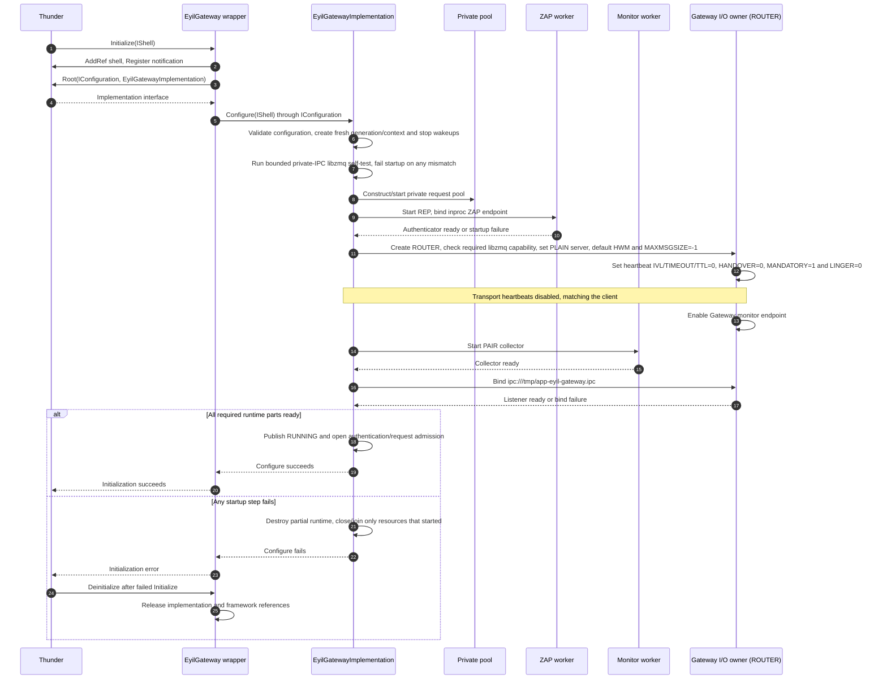

When Crypto is included, platform/Thunder lifecycle coordination should make it
available before client use and retain it through Gateway's final DISCONNECTED
calls. Gateway startup and transport admission also work without Crypto; the
platform's preferred ordering is not a Configure precondition. Configure stores
the backend list; each notification and operation acquires its configured
interface on demand. There is no cached
ICrypto pointer, availability observer or startup polling. AppManager/RuntimeManager
lookup is not called in this phase.

Run the isolated capability self-test in section 6.14 before creating the
production listener. It uses its own context and minimal test authenticator,
never Crypto, AppManager or the production registry. Its private directory is
created under IShell::VolatilePath(). Then start the private
pool, ZAP and monitor collector before binding ROUTER. Use standard zmq_bind
at the unchanged AC endpoint under the trusted
[deployment assumptions](EyilSecureGateway.md#74-settled-deployment-and-scope-assumptions).
Thunder owns single-instance activation and container policy supplies the correct
endpoint mount. Publish
RUNNING only once all owners are ready; a racing handshake cannot create an
ACTIVE context while startup admission is closed. Each activation gets fresh
registries, counters, generation, wakeups, sockets and its own ZMQ context.

Before binding ROUTER, explicitly set ZMQ_HEARTBEAT_IVL, ZMQ_HEARTBEAT_TIMEOUT
and ZMQ_HEARTBEAT_TTL to 0, matching client setup in section 5.5. Use the PAIR
monitor for transport events and event-driven cleanup. There is no application
heartbeat worker or inactivity watchdog.

Partial rollback uses the same runtime-destruction discipline as section 6.16. Create
stop state and wakeups before starting threads; close/join only resources
actually created/started. Failed Configure returns only after rollback completes.

Bind failure logs ERROR and fails activation through the same rollback path.
Standard libzmq listener ownership covers bind/close; no separate native listener
or endpoint lock is introduced. Container policy exposes the current socket
across endpoint recreation, as assumed in sections 3.3 and 7.4.

### 6.5 ZAP, interim identity and future AppManager lookup

Coverage: **AC1.2, AC1.4–AC1.6; AC2-Client.2–AC2-Client.3**.

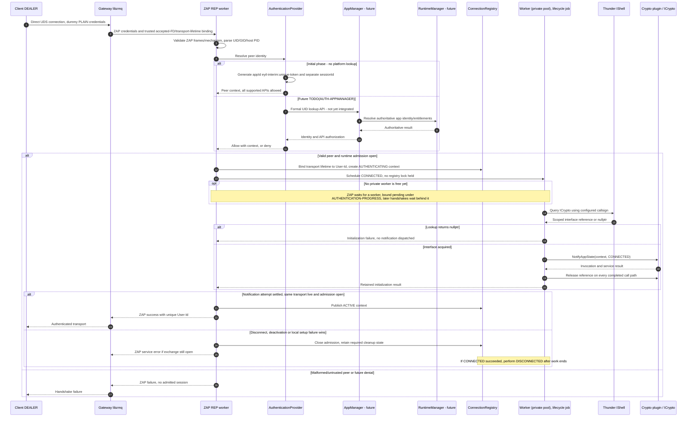

The ZAP worker assigns one unique User-Id per accepted connection; every request
resolves its context through that authenticated metadata. With authoritative
platform identities, the architect suggests `<app_id>#<app_instance_id>` for
one connection and a unique suffix such as
`<app_id>#<app_instance_id>#<connection_count>` if multiple connections are
allowed. Escape/validate delimiter-based fields and avoid collisions with any
retained connection generation. The string alone does not replace the trusted
transport-lifetime binding.

**Multiple connections — architect decision pending:** typically one app
instance is expected to keep one connection. Allowing additional connections
with distinct User-Ids or rejecting a second connection remains under architect
review. Until that decision and authoritative identity integration, retain the
current independent interim contexts; do not reject another connection merely
because UID or PID matches. If multiple connections are allowed, their backend
ApplicationContext mapping must preserve independent teardown: a unique ZAP
User-Id alone does not isolate two connections passed to Crypto with an identical
ApplicationContext. Track this under MULTI-CONNECTION-POLICY in section 7.2.

For the interim provider, User-Id can encode `appId#sessionId#connectionToken`,
or be an opaque token resolved through the registry. Generated sessionId is not
an authoritative app-instance ID. Each accepted connection gets its own context;
reconnection creates a new generation. The shared host-UID buffer quota in
section 6.10 does not merge these contexts or defer teardown until the last
connection closes.

Gateway attempts CONNECTED during authentication for every accepted connection,
including one that never sends an RPC. The private lifecycle job settles before
ZAP success; its failure is logged but does not reject an otherwise valid peer.
An unconfigured callsign performs no Thunder lookup. A configured but absent
interface produces the same unavailable-backend result. ZAP waits without
registry locks and wakes on stop/transport closure. A late CONNECTED result
cannot revive a closed context.

Keep transport authentication separate from backend-session initialization.
Missing Crypto does not prevent a usable Client handle or local buffer RPCs;
backend calls use their normal per-call lookup and error mapping. If Crypto
appears later, Gateway does not silently repeat CONNECTED or replay operations:
Crypto validates ApplicationContext and can return its invalid-session error.
A fresh explicit connection performs a new CONNECTED attempt. Successful
initialization is recorded only for matching DISCONNECTED cleanup, not as a
cached health flag. Retain any uncertain notification cleanup obligation; an
in-progress CONNECTED job remains included in plugin shutdown accounting.

Set interim appId to `eyil-interim:<unique-token>`, with an unpredictable token
unique to the connection, and generate a separate sessionId. Keep both stable
for that connection's notifications and operations. Reserve the `eyil-interim:`
prefix for this provider; an authoritative provider must not issue identities
in that namespace. Multiple connections from one process still get different
appIds and sessionIds. The client does not supply or override either value.

The marker lets Crypto distinguish an interim identity from an authoritative
platform appId without changing ApplicationContext or the public protocol.
It does not itself enforce key policy: Crypto's treatment of the marker,
including any refusal of device-global keys requiring real app identity, must
be agreed and implemented by Crypto under AUTH-APPMANAGER. Do not claim that
adding the prefix already restricts key access or add a Gateway key-policy check.
Interim values identify this connection only; they do not authorize provisioned-key use.
The platform allocates application UIDs; Gateway must obtain the current
UID-to-app/app-instance relationship through the agreed AppManager/RuntimeManager
integration. Do not infer appId from a numeric UID or introduce an independent
static UID map that can become stale when the platform reassigns a UID.
Until that integration exists, retain the selected interim identity behavior
and leave Crypto's key policy with Crypto.

Platform activation order establishes availability, not a bound on the duration
of NotifyAppState(CONNECTED). The single ZAP REP exchange waits for its lifecycle
job before replying, so a slow call can delay subsequent authentication. The
client's 15-second connect timeout does not cancel that job. Admission waiting,
lifecycle-worker capacity and late-result cleanup are tracked under
AUTHENTICATION-PROGRESS in section 7.2; no backend execution timeout or forced
thread cancellation is introduced by the current design.

The interim "accept all" decision removes policy checks, not frame validation,
credential provenance checks, quotas or buffer isolation. Production API
entitlements are cached per connection and purged from admission on disconnect.
No app-supplied username, password, route or payload field replaces the kernel
identity or the future platform lookup.

### 6.6 Request ingress, dispatch and response delivery

Coverage: **AC1.1, AC1.5–AC1.11; AC2-Client.5**.

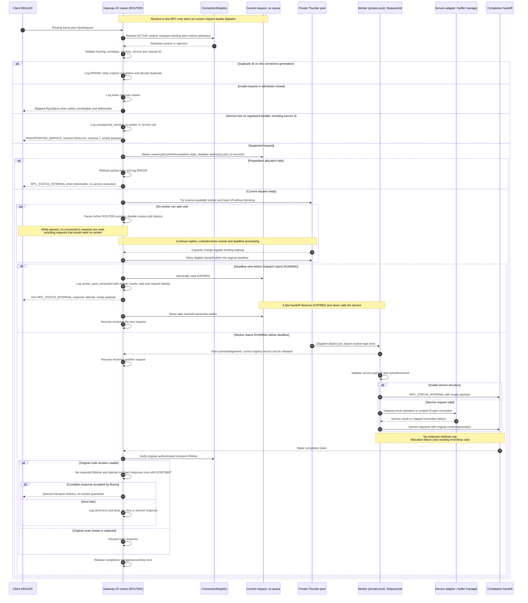

Section 6.2 defines the single-current-request state and timer/handoff races.
Pause reception of subsequent requests while that record awaits a worker;
the I/O owner must continue sending earlier completions and handling control
events. The ten-second deadline produces RPC_STATUS_INTERNAL and an explicit
worker_pool_exhausted ERROR, not a queue-full result. Actual request/job/response
allocation failures are logged separately and use RPC_STATUS_INTERNAL when
deliverable. Buffer service outcomes use RPC_STATUS_OK plus CryptoError.

The ROUTER owner serializes admission with deactivation. Accepted work remains
owned during drain. Validate framing, safe message-length representation,
trusted metadata, live context, schema 1, service, request ID, service structure,
operation/oneof agreement, enum/range validity and allocation ownership. There
is no additional request/response byte cap. Preserve the original completion
when a request ID is duplicated. Independent operations may finish out of order.

Prepare owned job/completion bookkeeping before execution, without reserving
capacity against count/byte budgets. Complete buffer validation before committing
release; a rejection before that point creates no releasePending transition.
If a job acquired an active-use lease but fails before calling Crypto, FinishUse
ends that unused lease and may enable deferred cleanup. Response preparation or
delivery failure after release acceptance cannot undo the accepted release.

String calls carry service=RPC_SERVICE_UNSPECIFIED, schema 1, a nonzero ID and
raw text payload. Once received and structurally validated, Gateway logs ERROR
unsupported_service and returns RPC_STATUS_UNSUPPORTED_SERVICE with echoed
ID/service/schema and empty payload. No worker, Crypto call or buffer operation
is needed. A receive pause can delay reading this request too; Gateway cannot
classify an unread message. Common invalid-context/schema/duplicate-ID rules
take precedence. Do not sniff formats or translate text into Crypto operations.

All admission errors use normal response allocation, original-transport
validation and one send attempt. If allocation or delivery fails, log/drop;
the sync caller may time out and an accepted async call may receive no callback.

#### Response ownership and completion handoff

Private workers publish completed owned records to the ROUTER owner through
a synchronized handoff and existing wakeup. This holds results awaiting their
single send attempt; it is not an application request waiting queue or a reply
retry queue. **Response record count and response bytes are unlimited by policy.**
There are no per-connection/global slot credits, response-byte budgets or
configured serialized-response maximum.

Allocate completion bookkeeping with the request so publishing a completed
record does not need another queue-node allocation. Grow response storage as
needed, with checked size arithmetic and the underlying API representation
limits. Allocation/serialization failure uses RPC_STATUS_INTERNAL if a valid
correlated error can be prepared; otherwise log the local failure and retire
the response. Never rerun the operation, undo an accepted release or free an
unresolved backend lease to recover response storage.

Workers do not wait for clients or ROUTER sends. The owner processes finite
batches of ingress/completions between checks of control events and timers,
including while receiving is paused for worker capacity. This scheduling rule
adds no request-count or storage admission limit. Release each result once on send acceptance, failed send
or stale-route disposal. libzmq's default HWM applies to its separate transport
queues; it is not a completion-storage budget.

#### One response send attempt

**Gateway attempts each response once, nonblocking. On failure it records a
local delivery error and drops the response.** There are no retained failed
replies, per-connection retry queues, send-retry timers or second attempts.

Configure ROUTER_MANDATORY=1 and use ZMQ_DONTWAIT for the multipart response.
A full route reports EAGAIN and an unreachable route reports EHOSTUNREACH;
neither is permission to replay the operation.
[ROUTER send behavior](https://libzmq.readthedocs.io/en/latest/zmq_setsockopt.html#zmq-router-mandatory-accept-only-routable-messages)

| Outcome | Gateway action |
| --- | --- |
| Original context/route is already retired or replaced | Discard the stale completion without sending it to another connection |
| Complete response accepted by libzmq | Release Gateway completion storage/accounting; do not wait for client receipt |
| EAGAIN | Record output-backpressure failure, drop this response and continue other work; do not infer process death or disconnect solely for this result |
| EHOSTUNREACH | Record unreachable-route failure and drop; connection cleanup uses the authenticated lifecycle path |
| EINTR or another send error | Record the failed attempt, drop without a retry and apply any required socket/runtime error handling |
| Completion preparation/publication fails | Record local failure and release owned state without blocking a worker or starting another backend operation |

"One attempt" applies to the complete response message, whose ROUTER framing is
[routing_id][RpcResponse bytes], not to a single frame. Prepare both frames
before starting, use SNDMORE on the route frame, and never interleave another
response. If routing-frame submission fails, do not submit its payload. If a
later frame fails, preserve or terminate the socket's multipart state safely
under the verified libzmq contract before sending unrelated traffic; never
restart that response. The target transport tests must cover these frame-level
failure paths. Success confirms local libzmq acceptance, not peer receipt.
[Send and multipart contract](https://libzmq.readthedocs.io/en/latest/zmq_send.html)

Apply this policy to successful results and all Gateway error replies, including
ten-second worker-capacity timeout errors. Do not attempt to send a
second RPC_STATUS_INTERNAL to report the failure of the first response.
Record the request ID, connection generation and local send error in bounded
diagnostics/counters, without logging Crypto payloads. Drop releases response
storage, not an allocation still leased to an active backend operation.

The client cannot observe this local send failure through a response that was
not delivered. If the transport stays open, a synchronous call reaches its
15-second CLIENT_TIMEOUT; an accepted async request has no response timeout and
may retain its pending record until local teardown or connection loss, without
a response callback. A monitor reports connection events, not individual
dropped replies. This policy does not introduce an async error callback or
unsolicited notification.

The 10-second Gateway deadline bounds the current admitted request's wait for
a worker, not backend execution or reply delivery. Adding a backend execution
deadline would not make a dropped error reply observable to the client, cancel an in-process
ICrypto call or prove that shared memory is no longer in use. The selected
contract introduces no such execution deadline. Bounded retention after an
undelivered async response would require a separately agreed client retirement
policy or connection teardown; it cannot be guaranteed by a Gateway timer alone.

libzmq's default output HWM applies to accepted transport messages separately
from the unlimited-by-policy completion handoff. Gateway does not reserve a
response slot/byte allowance or wait for a frozen peer to read a reply.

### 6.7 Crypto adapter: per-call ICrypto references and per-connection sessions

Coverage: **AC1.8, AC1.12**.

Use the ICrypto API from
[entservices-apis branch topic/crypto](https://github.com/rdkcentral/entservices-apis/tree/topic/crypto),
specifically [apis/Crypto/ICrypto.h](https://github.com/rdkcentral/entservices-apis/blob/topic/crypto/apis/Crypto/ICrypto.h).
The reviewed branch revision is 6926f6a72fbfff18b691d09b3b7376fbd541b9d3.
The platform build supplies compatible headers and any required COM-RPC
proxy/stubs from that branch; pin a compatible revision in the dependency
recipe for reproducible builds. Crypto operations use the deployed backend
through its configured callsign. Gateway startup and transport admission also
work when no backend is configured or installed.

The interface supplies ApplicationContext { appId, sessionId } and
SharedBuffer { name }. Construct these from trusted internal records. A raw
FD integer is not an interprocess shared-memory identity.

#### Callsign configuration: BitBake to CMake to runtime

The production default callsign is empty: an image can run Gateway without a Crypto backend.
With `BUILD_EYIL_DEV_TOOLS=ON`, an empty configured value selects the installed
development-only `org.rdk.CryptoTestBackend` plugin. An explicit callsign is preserved;
disabling development tools restores the empty default. See
[development tools](DevelopmentClient.md#development-cryptotestbackend).
Products select the installed plugin explicitly through CMake/BitBake:

```cmake
set(PLUGIN_EYILGATEWAY_CRYPTO_CALLSIGN ""
    CACHE STRING "Optional Crypto backend callsign"
)
```

```bitbake
EYILGATEWAY_CRYPTO_CALLSIGN ?= ""
EXTRA_OECMAKE += "-DPLUGIN_EYILGATEWAY_CRYPTO_CALLSIGN=${EYILGATEWAY_CRYPTO_CALLSIGN}"
```

The generated Thunder configuration carries a list of service/callsign entries:

```json
{
    "callsign": "org.rdk.EyilGateway",
    "configuration": {
        "backends": [
            { "service": "crypto", "callsign": "" }
        ],
        "workers": 4
    }
}
```

Configure(IShell*) reads ConfigLine() and selects the `crypto` entry by service
name, independently of list order. Missing/empty `backends`, an omitted `crypto`
entry or an empty/omitted callsign means no configured Crypto backend. Do not
query Thunder with an empty callsign or substitute another plugin. Products
can set it to `org.rdk.Crypto` or their installed callsign. Malformed JSON,
null entries/fields, empty service names, duplicate service entries or a worker
count outside 1–255 fail configuration. Entries for future services are accepted
as configuration, but do not register an adapter or make those RPC services
supported. This list replaces the single `cryptocallsign` setting.

No ICrypto lookup is needed during Gateway startup. The listener and client
handshake remain available when Crypto is unconfigured or absent; backend RPCs
return RPC_STATUS_INTERNAL for an unavailable interface. Gateway-local buffer
operations do not require Crypto. Every configured invocation resolves the
selected callsign afresh. Configuration comes from Thunder, never app payloads,
and changes require reconfiguration/restart. Gateway's own callsign remains
org.rdk.EyilGateway.

Gateway code does not explicitly throw exceptions. Validation, syscall and
transport failures return checked errors; Configure maps invalid settings to
ERROR_BAD_REQUEST and startup failures to ERROR_GENERAL after rollback.
Catch exceptions from external operations, including Protobuf/STL allocations,
thread construction and ICrypto invocation, and convert them to the appropriate
method result. A null backend lookup is a per-invocation error.

The wrapper returns its initialization error without calling Deinitialize.
Thunder must invoke Deinitialize after a failed Initialize; on R4 this requires
legacyinitialize=false. A later activation creates a fresh implementation.
Returning an error does not itself schedule automatic reactivation.

#### Interface ownership

Acquire ICrypto on the private worker immediately before the method invocation.
Hold the returned reference in a local raw ICrypto pointer and call Release
explicitly as soon as the invocation returns, including the catch path for an
exception raised by the backend. Do not put Thunder interfaces in C++ smart
pointers. The API returns value outputs into
caller-owned storage; check Core::hresult before consuming them, then map and
serialize them after releasing the interface. Release exactly once on every
path, including errors and unwinding; later response-allocation failure must
not leave an interface retained. Do not hold ICrypto while waiting in the
worker-wait phase, waiting for a session-initialization barrier or delivering a response.

No ICrypto pointer is cached in GatewayRuntime, CryptoServiceAdapter, a
connection context or a job waiting for execution. Concurrent invocations own independent
references, even if Thunder returns the same underlying object. Crypto owns
its internal synchronization under the ICrypto contract; reference counting
does not serialize calls. Use the same query/invoke/release scope for
NotifyAppState as for all operation methods.

This is a short-lived interface reference. Thunder owns the plugin and its
COM-RPC transport; Release is not an instruction to destroy Crypto, close a
physical transport connection or end the application's Crypto session. The
Gateway retains its IShell reference until workers and lifecycle jobs finish,
so they can safely perform their own lookups.

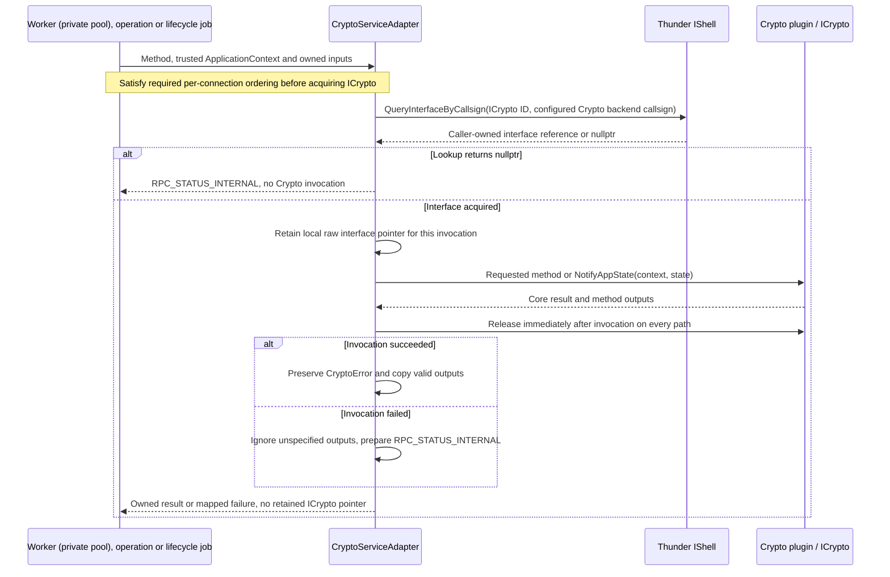

#### Application context is separate from the interface reference

Keep appId and sessionId stable for the client connection. The Crypto plugin
owns the corresponding session and transient keys; Gateway keeps only trusted
identity and lifecycle bookkeeping. There is no global Crypto session shared
by all apps and no new app session for each interface lookup.

For example, GenerateKey returns a key ID, Gateway releases its ICrypto
reference, and a later Sign obtains another reference and passes the same
ApplicationContext and key ID. Crypto must preserve that session's state across
these independent interface references. Releasing an interface must not invoke
NotifyAppState(DISCONNECTED) or discard the app's keys.

In the current design, the NotifyAppState(CONNECTED) attempt settles during
authentication before ZAP success and RPC admission; backend failure does not
reject the transport. Matching DISCONNECTED is sent if CONNECTED succeeded.
Keep that connection's ApplicationContext
stable across CONNECTED, operations and DISCONNECTED. Each detected disconnect
starts teardown of its corresponding context, even if the app remains alive or
has another connection. After accepted work finishes, send DISCONNECTED once
before final connection-resource release, without a grace timer or last-client
condition. This also covers authenticated connections that never send a request.
Section 6.14 distinguishes this execution ordering from the architect's
clarification of the disconnect trigger.

Crypto owns session creation, key lifetime, authorization, internal concurrency
and backend recovery. Gateway forwards ApplicationContext and arguments, checks
results and releases each interface reference. It does not implement those
Crypto policies. Every notification uses the same per-call ownership as an
operation.

Gateway does not poll Crypto, subscribe to its plugin-state changes, cache a
backend-health flag or automatically reactivate/restart it. Lookup and call
results are the observations available to Gateway. A new lookup does not prove
that earlier keys or sessions survived a backend restart. Section 6.15 defines
the Gateway error boundary; Crypto owns its internal recovery. Framework
notifications for the Gateway implementation are unrelated and remain valid.

Crypto owns key authorization. Gateway checks API entitlements when that
platform integration is enabled, without duplicating Crypto's key-usage,
export-protection or cross-app-sharing decisions.

### 6.8 Crypto operation routing map

All 17 Protobuf operations have an explicit destination. Only the two buffer
management operations terminate locally; the remaining 15 invoke the Crypto
backend. Structure/limit checks apply even in the interim accept-all phase.

| CryptoRequest operation | Destination / method | Main inputs → successful outputs |
| --- | --- | --- |
| LOAD_KEY | ICrypto::LoadKey | locator, provision_type → key_id |
| KEY_EXISTS | ICrypto::KeyExists | locator → exists, key_id when present |
| FLUSH_KEYS | ICrypto::FlushKeys | trusted context → empty response |
| GENERATE_KEY_PAIR | ICrypto::GenerateKeyPair | algorithm, matching parameters → private_key_id, public_key_id |
| DERIVE_SESSION_KEYS | ICrypto::DeriveSessionKeys | algorithm and source key IDs → encryption/hmac/wrapping key IDs |
| GET_KEY_INFO | ICrypto::GetKeyInfo | key_id → type, usages, algorithm |
| GENERATE_KEY | ICrypto::GenerateKey | algorithm, usages → key_id |
| UNLOAD_KEY | ICrypto::UnloadKey | key_id → empty response |
| IMPORT_KEY | ICrypto::ImportKey | type, optional protection format, blob → key_id |
| EXPORT_KEY | ICrypto::ExportKey | key_id, optional protection format → blob |
| GENERATE_RANDOM | ICrypto::GenerateRandom | bounded byte count → random bytes |
| ENCRYPT | ICrypto::Encrypt | buffer_id, algorithm, key_id, init/input regions → encrypted region |
| DECRYPT | ICrypto::Decrypt | buffer_id, algorithm, key_id, init/encrypted regions → plaintext region |
| SIGN | ICrypto::Sign | buffer_id, algorithms, key_id, input region → signature region |
| VERIFY | ICrypto::Verify | buffer_id, algorithms, key_id, input/signature regions → verification_status |
| ALLOCATE_SHARED_BUFFER | SharedBufferManager::Allocate | requested_size → buffer_id, client name, size |
| RELEASE_SHARED_BUFFER | SharedBufferManager::RequestRelease | buffer_id → accepted release, immediate cleanup or destruction deferred until active access ends |

Preserve optional presence for import_export_type rather than replacing an
absent field with the enum's zero value. Validate repeated usages, algorithm
parameter variants, sizes and numeric conversions before constructing backend
types. Use explicit mappings rather than assuming enum ordinals always match.

#### Client and Gateway boundaries in the Crypto sequences

The Crypto sequences in sections 6.9–6.13 use the **byte request APIs**.
The consumer constructs the operation-specific message inside CryptoRequest,
serializes it into RpcRequest.payload, selects RPC_SERVICE_CRYPTO and supplies
that serialized outer request to client_send_request or
client_send_request_async. EyilClient replaces request_id/schema_version and
handles the outer response only. The consumer checks RpcStatus, then decodes
CryptoResponse and checks CryptoError before using operation outputs.

An operation name in a diagram identifies its payload; it is not another public
EyilClient function. Shared-buffer allocation returns response bytes containing
buffer_id, name and size, never a mapped pointer from EyilClient. String APIs
receive Gateway UNSUPPORTED_SERVICE and are not usable for these Crypto operations in this version.

Every dispatch follows the waiting-deadline, resource-reservation and accepted
work-drain rules in section 6.6. Response arrows show the successful delivery
path: the ROUTER owner makes one guarded nonblocking attempt, and a failed send
is logged/dropped without replay or a guaranteed client callback. Rejections
and allocation/invocation failures use section 4.2, including an ERROR log.

### 6.9 Non-shared-memory operations

Coverage: **AC1.8; AC2-Firebolt.1–AC2-Firebolt.2**. This flow applies to the eleven key/random
operations above; allocation/release and the four bulk-data operations have
separate flows.

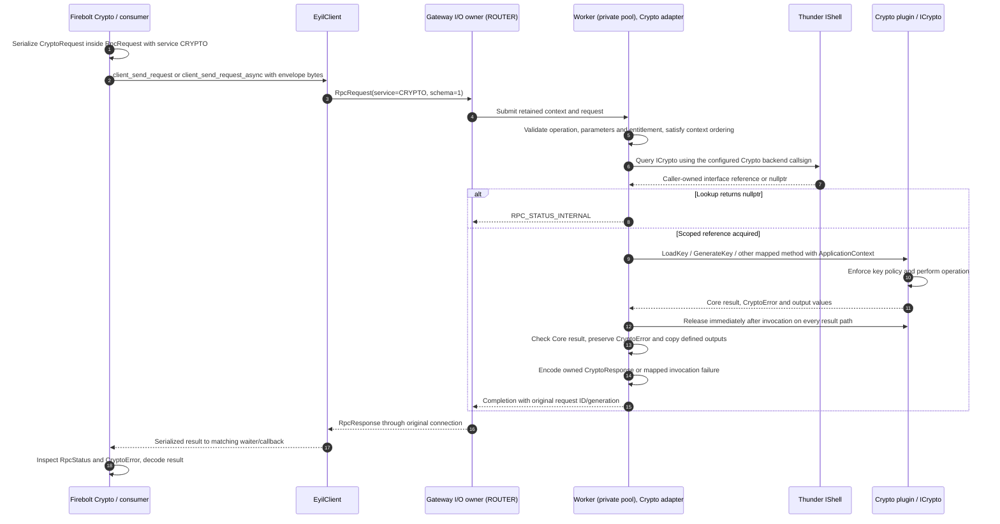

Key generation/import/derivation may change backend state. Loss of a response
does not justify retrying automatically. Ordering UnloadKey or FlushKeys
is handled by Crypto under its ICrypto contract. Gateway does not implement
key-policy synchronization. Competing buffer uses fail at execution-time checks;
a valid release is accepted with destruction deferred until active access ends,
as specified in sections 6.10–6.13.

### 6.10 Shared-memory identity, records and invariants

Coverage: **AC1.9–AC1.12**. Allocation is a Gateway responsibility; mapping by
the application and access by Crypto are separate responsibilities.

**Agreed application contract:** authenticated applications are trusted to
coordinate their buffer users and follow the allocation/use/release rules.
The app keeps the object name and size unchanged, does not unlink it, and does
not overwrite participating regions while Crypto is using them. Authentication
identifies the peer; this cooperation is an application responsibility, not a
protection enforced by EyilClient. Gateway still validates connection ownership,
ranges, states and quotas for every operation.

| Identifier | Example | Meaning |
| --- | --- | --- |
| buffer_id | Opaque generated token | Gateway lookup key, scoped to one connection generation |
| quota_key | Trusted host UID from ZAP peer credentials | Key of shared allocation accounting across all connections/processes with that UID; not an access token or Crypto appId |
| Client name | `/eyil.<random-token>` | POSIX name opened with shm_open() inside the app container |
| Backend path | `/proc/<host-peer-pid>/root/dev/shm/eyil.<random-token>` | Proposed host-visible path passed as SharedBuffer.name |
| Gateway FD | Process-local descriptor | Retains the created object; never sent as a bare integer to Crypto |
| Shared-memory directory FD | Gateway-owned reference to the original peer shared-memory directory | Supports allocation cleanup after peer exit without resolving /proc/PID/root again |
| BufferRegion | `{ offset, length }` | Byte range in the same allocation, not a pointer |

Each buffer record retains the owner token/generation, peer evidence, opaque ID,
client name, backend path, actual capacity, object FD, retained directory and
AppQuotaRecord references, active-use count, releasePending flag and
finalization/cleanup state. The active-use count is initially zero or one.
A pending release may coexist with active or unresolved access. Directory
references may be shared by a connection's allocations. Jobs retain their
context and buffer ID but reserve no buffer use before execution.

#### Application quota shared across connections

For this limit, the application accounting group is **all connections with the
same trusted host UID from ZAP**. Child apps sharing their parent's UID share
the same four allocations. Use the host credential observed by Gateway, not
container-local UID 0, GID, PID, User-Id, sessionId, a caller-supplied value or
the generated per-connection `eyil-interim:` appId. This quota key does not
require an AppManager lookup and does not replace Crypto's ApplicationContext
or establish API/key authorization.

SharedBufferManager owns `AppQuotaMap[host_uid]`. A connection retains its quota
key; allocation reservations and records retain the associated AppQuotaRecord,
containing charged allocation count and actual capacity bytes. Obtain/create
that shared record under the manager's synchronization, so concurrent first
allocations from two connections cannot create independent allowances.

- Validate `0 < capacity <= 1,572,864` before admission. If allocation size is
  rounded, validate and charge the final logical capacity, not only the request.
- Atomically reserve one of the four slots and its capacity before filesystem
  creation. Include unpublished reservations, live allocations, release-pending
  allocations and failed-cleanup records in the charged count. Account bytes
  alongside the count; the two limits imply at most 6,291,456 bytes per UID.
- Complete rollback returns its reservation once. If an object or owned cleanup
  resource remains, retain the record and charge until physical cleanup finishes.
  A lost allocation reply does not refund a live allocation.
- Release acceptance, client timeout or disconnect alone does not return a slot.
  Only completed physical cleanup of that allocation returns its charge, once.
  Closing one connection cleans its own allocations without resetting the UID's
  shared counters or touching buffers belonging to another connection.
- A new connection with the same UID joins existing accounting, including any
  cleanup retained from older connections. UID reuse must not reset outstanding
  charges or grant access to old buffers. Retire a quota-map entry only when its
  charges and all allocation-attempt references are gone, synchronized with
  concurrent lookup/reservation; never leave a charged record outside the map.

For example, connections A and B of one UID may hold two buffers each. A fifth
allocation from A, B or a newly opened connection C fails with
RPC_STATUS_OK and CRYPTO_ERROR_OPERATION_FAILED. It becomes possible after one
allocation completes cleanup. A different UID has its own four-slot allowance;
there is no Gateway-wide shared-memory cap.

Sharing quota does **not** share buffer access: only the original owner
connection/generation may use or release its buffer_id. Each connection retains
its independent Crypto session and disconnect lifecycle.

Quota rejection uses RPC_STATUS_OK with CRYPTO_ERROR_OPERATION_FAILED and an
ERROR log containing host UID, connection generation, requested capacity,
charged count/bytes and limits. A per-buffer size excess instead uses
CRYPTO_ERROR_OVERSIZED_INPUT_DATA; zero size uses
CRYPTO_ERROR_INVALID_PARAMETERS, as specified in section 4.2.

Use exclusive creation, generated names, close-on-exec descriptors and deliberate
ownership/mode settings. The shared-memory proposal sets the peer UID/GID and
owner read/write access. Verify user-namespace mappings and backend permissions
on the target platform; Gateway running in Thunder is not itself proof of the
required procfs access.

The proposal's namespace path uses the peer's mount view. Access is subject to
procfs checks and can become unavailable when the peer or its main thread exits.
See [proc_pid_root](https://man7.org/linux/man-pages/man5/proc_pid_root.5.html).
The selected trust model requires the app to preserve that name/object binding.
Retaining an object FD alone does not prevent replacement of its pathname.
Keep the proposal's app-namespace backend path for this version. The discussed
`/proc/<gateway-pid>/fd/<fd>` alternative is not selected: it would require
different procfs/open rules and still would not prove that the correct peer
namespace was captured initially or prevent modification/truncation. The
existing path remains subject to backend-completion validation in section 7.1.

**PID reuse edge case:** if the peer exits and its PID has not been reused,
opening `/proc/<pid>/root/dev/shm` fails; log ERROR and return the existing
allocation-failure result. Linux can reuse a freed PID after the allocation
counter wraps at [pid_max](https://docs.kernel.org/admin-guide/sysctl/kernel.html#pid-max),
so the path could then refer to another process. Retained directory/object FDs
protect resources only after capture.

Retain the original shared-memory directory FD and generated relative filename
for Gateway cleanup, using unlinkat() against that directory after backend
access ends. Close the directory reference after its last allocation is cleaned
up. Do not rebuild cleanup paths using a dead or reused PID. Directory-relative
operations keep a stable directory reference; see
[openat](https://man7.org/linux/man-pages/man2/open.2.html) and
[unlinkat](https://man7.org/linux/man-pages/man2/unlink.2.html).

Required invariants:

- Only the owner connection may resolve a buffer_id; same UID/PID is insufficient.
- A connection may have multiple allocations. Allow at most one executing
  operation per allocation. A worker atomically checks ownership/state and
  takes the active-use lease when execution begins. A competing use fails with
  RPC_STATUS_OK with CRYPTO_ERROR_INVALID_SESSION_STATE and an ERROR log;
  it is not queued behind the active
  operation. A valid release is accepted and closes admission to that buffer;
  its destruction waits for the active use to end. Other allocations and
  connections remain independent.
- Check `offset <= size && length <= size - offset`; avoid unchecked
  `offset + length` arithmetic. Enforce the region presence and overlap rules
  below.
- Keep the active-use lease through the ICrypto invocation. A completed
  synchronous invocation, including a defined CryptoError, ends that access
  under the Crypto contract. Every definitive lease-ending path checks for a
  pending release and triggers eligible cleanup, including failure before a
  backend invocation. Release/disconnect must not invalidate Gateway's own live
  records. Operations that have not claimed a buffer have no lease: release may
  overtake them, and their execution-time lookup then fails without calling Crypto.
- The app must not resize, unlink or modify participating regions while an
  operation is outstanding. This is the selected cooperation contract; hard
  enforcement against a violating app is outside this version's scope.
- Gateway owns unlink/cleanup. An app unmaps/closes its own view; it does not
  call shm_unlink(). Unlink/close by Gateway also does not revoke an existing
  app mapping.
- A local client timeout is not a backend completion event. Gateway does not
  receive that timer event or prolong the client's wait; it lets the invocation
  finish and handles the result normally. An uncertain COM-RPC failure remains
  different from a completed invocation returning a defined service error.

#### Region presence and overlap rules

These rules implement the shared-memory proposal's non-overlapping inputs
(section 7) and plugin-selected output placement (section 9). In-place
processing is not supported in this version.

| Operation | Required input regions | Inputs that must not overlap each other | Output region | Output must not overlap |
| --- | --- | --- | --- | --- |
| Encrypt | init_data, input_data | init_data and input_data | encrypted_data | init_data, input_data |
| Decrypt | init_data, encrypted_data | init_data and encrypted_data | output_data | init_data, encrypted_data |
| Sign | input_data | (single input) | signature | input_data |
| Verify | input_data, expected_signature | input_data and expected_signature | none | (no output region) |

1. **Presence:** every required region field must be present in the request.
   A missing required region is CRYPTO_ERROR_INVALID_PARAMETERS.
2. **Bounds:** every present region satisfies `offset <= size && length <=
   size - offset`, including a region of length 0.
3. **Zero length:** Gateway accepts a present region of length 0 and passes it
   to Crypto. Whether the algorithm accepts it is Crypto's decision; for example
   AES-CBC rejects empty init_data with CRYPTO_ERROR_INVALID_INIT_DATA. A region
   of length 0 never overlaps another region.
4. **Overlap test:** two non-empty regions `[a, a + la)` and `[b, b + lb)`
   overlap when `a < b + lb && b < a + la`. Compute the sums in 64-bit
   arithmetic. Adjacent regions (`a + la == b`) do not overlap.
5. **Gateway input check:** in TryUse, after bounds and presence, reject
   overlapping inputs with CRYPTO_ERROR_INVALID_PARAMETERS and an ERROR log
   naming both regions. Rejection takes no active-use lease and makes no Crypto
   call.
6. **Gateway output check:** after a completed invocation with
   CRYPTO_ERROR_NONE, a non-empty output region must be inside the allocation
   and must not overlap any non-empty input region. A violation is an invalid
   successful output region: ERROR log and RPC_STATUS_INTERNAL, with the region
   not exposed. The lease still ends normally.
7. **BUFFER_OVERFLOW:** the returned required region describes capacity, not
   written data. It is exempt from the bounds and overlap checks and is
   forwarded unchanged.
8. **Crypto:** independently applies the same bounds and overlap rules to the
   actual opened object, chooses an output that overlaps no input, and writes
   only inside the output region it returns. Input regions remain unchanged.
9. **Client:** declare every region holding data that must survive the
   operation. Bytes outside the declared input regions may be overwritten by
   the output. After success, read only the returned output region; the input
   regions can be read back unchanged.

The [resource policy in section 6.2](#initial-resource-policy) sets 1.5 MiB per
allocation and four allocations per host UID across connections. Pending release
and incomplete cleanup remain charged to that shared record. There is no
additional per-connection allowance or Gateway-wide shared-memory quota.
Validate platform memory and tmpfs sizing under the resource-policy validation
in section 7.3.

#### Application cleanup after completion or error

When an allocation is no longer needed, including when abandoning it after an
error, the app-side Crypto layer stops further use, unmaps/closes its local view
and sends ReleaseSharedBufferRequest(buffer_id) through EyilClient. The response
must be checked for release acceptance. Success retires the ID from further
use; it does not mean that active backend access or physical cleanup has already
finished. Freeing a message with client_free_response() does not release a shared
allocation. For an async release call, CLIENT_OK confirms only libzmq send
acceptance; inspect the eventual RPC/service response for Gateway acceptance.

This applies when the app knows the buffer ID and still has a usable connection.
An error or the 15-second client timeout does not force an active Crypto call to
finish. Gateway accepts a valid release while access is active or unresolved,
marks releasePending and retains the object until access is known to have ended.
The app does not need to resubmit merely because the buffer was busy. Accepted
release does not cancel the original operation, authorize further reads/writes
of that allocation or certify readiness to freeze a process with uncertain work.
The app must not consume a later operation result's regions from a buffer it has
abandoned. Ordinary completion, including a returned CryptoError, triggers
eligible deferred cleanup without waiting for the app to receive the result.

If the release response is lost or its client wait times out, the app cannot
infer that release was rejected; it may already be pending or complete. Do not
resume buffer use or automatically replay the release. Closing the connection
transfers any remaining reclamation to Gateway's drain/cleanup path. A successful
release reply also does not promise immediate quota availability for another
allocation: pending resources still count against the limits.

If allocation fails before an ID is published, Gateway rolls back its partial
allocation. If the allocation succeeded but its response was lost, the app has
no ID to release; connection teardown reclaims that allocation as well. After
unexpected connection loss, cleanup needs no release RPC from the app. A fresh
connection cannot release or reuse the old connection's IDs.

#### Application/container access and failure limits

The app opens its allocation with O_RDWR and maps it with MAP_SHARED. Its
mapping is writable without going through EyilClient or Gateway. A client-side
mutex or an advisory in-use flag can coordinate cooperating callers, but cannot
stop another app thread from writing, truncating or unlinking the object using
ordinary memory access or system calls. A container's private /dev/shm separates
its namespace; it does not remove the app's access to its own allocation.

| App action | Effect and error boundary |
| --- | --- |
| Close its FD or unmap its own view | Does not invalidate an FD or mapping already held by Gateway or Crypto; no Crypto failure is implied |
| Unlink before Crypto opens the object | A later open can fail; Crypto handles that failure and returns its service result |
| Unlink after Crypto has opened/mapped the object | Existing references remain usable; unlink alone does not cancel the operation |
| Replace the name | A later open may resolve a different object; failure is not guaranteed merely because Gateway still holds the original FD |
| Rewrite input through its mapping during execution | Crypto may consume changed or inconsistent data without detecting an error |
| Shrink an object already mapped by Crypto | Access beyond its new end can raise SIGBUS; this is not automatically a returned CryptoError |

These are Linux shared-memory semantics, described by
[shm_open/shm_unlink](https://man7.org/linux/man-pages/man3/shm_open.3.html),
[mmap](https://man7.org/linux/man-pages/man2/mmap.2.html) and the shared-memory
hazards in [memfd_create](https://man7.org/linux/man-pages/man2/memfd_create.2.html).
They do not require Gateway to preserve an invalid request until it succeeds.

Crypto owns validation and safe access inside its ICrypto implementation.
Gateway forwards a returned CryptoError in the service response with
RPC_STATUS_OK when the invocation and Gateway handling succeeded. It does not
retry the operation. A failed ICrypto invocation uses RPC_STATUS_INTERNAL and
an ERROR log. A fault that terminates the backend, or Thunder when Crypto shares
its process, cannot be assumed to yield a normal response. These limits are
accepted with the trusted-app cooperation contract; they are not an outstanding
requirement to add memory protection to EyilClient.

EyilClient cannot revoke another process's mapping, and Gateway changing file
permissions does not revoke existing writable mappings. Additional containment
of a violating app would be a separate platform/backend requirement. It is not
part of the selected path/name-based ICrypto integration.

If a synchronous call has already returned CLIENT_TIMEOUT after 15 seconds,
its pending ID is retired. Gateway may subsequently send Crypto's success or
error result, but EyilClient discards that late reply. There is no second return
or notification callback. An accepted async request can receive the error
through its response callback while its connection and pending ID remain live.
Both follow the single response-send attempt and delivery limits in section 6.6.

### 6.11 AllocateSharedBuffer and client mapping

Coverage: **AC1.9–AC1.11; AC2-Client.5; AC2-Firebolt.1–AC2-Firebolt.2**. No ICrypto call is involved.

Prepare a retained allocation/cleanup record before creating the filesystem
object. Failed creation rolls back resources and quota; if physical rollback
itself fails, keep that private record and the unreclaimed resource charges for
connection cleanup, log ERROR and return RPC_STATUS_OK with
CRYPTO_ERROR_OPERATION_FAILED without publishing a buffer ID. The charge belongs
to the UID's shared quota record even if this connection has already closed.
Failure reporting must not lose the only reference to a partially created object.
This service allocation failure is distinct from failure to construct/send
its response, which follows the infrastructure fallback in section 4.2.

After exclusive creation, set the logical size with ftruncate(), then call
`fallocate(fd, 0, 0, capacity)` for the complete allocation before publishing
the buffer ID/name or handing the object to the app. Perform preallocation while
the new object still has Gateway-only access, then apply the agreed peer
ownership/permissions and verify the final size. ftruncate alone does not reserve
tmpfs space; this step detects insufficient backing capacity during allocation
instead of leaving Crypto to discover it while accessing a mapped buffer.
See [fallocate](https://man7.org/linux/man-pages/man2/fallocate.2.html).

Treat ENOSPC, ENOMEM, unsupported preallocation and other terminal fallocate
errors as allocation failure: log ERROR with stage, errno and requested size,
roll back the unpublished object and quota, and return RPC_STATUS_OK with
CRYPTO_ERROR_OPERATION_FAILED and the allocation response oneof. Keep the private
cleanup record and charges if rollback cannot finish. Never silently fall back
to ftruncate-only allocation or publish a partly preallocated object. A
recoverable interruption may be retried on the same unpublished object, with
stop and connection state rechecked before publication.

Preallocation does not prevent later app truncation, hole punching, mutation,
or unrelated memory pressure. Keep the cooperation and lease rules; this is
not a claim that all SIGBUS/OOM causes are removed. Validate tmpfs support and
memory-cgroup charging on the product: pages allocated by Gateway need not be
charged to the app's cgroup. EyilClient does not allocate or preallocate these
objects.

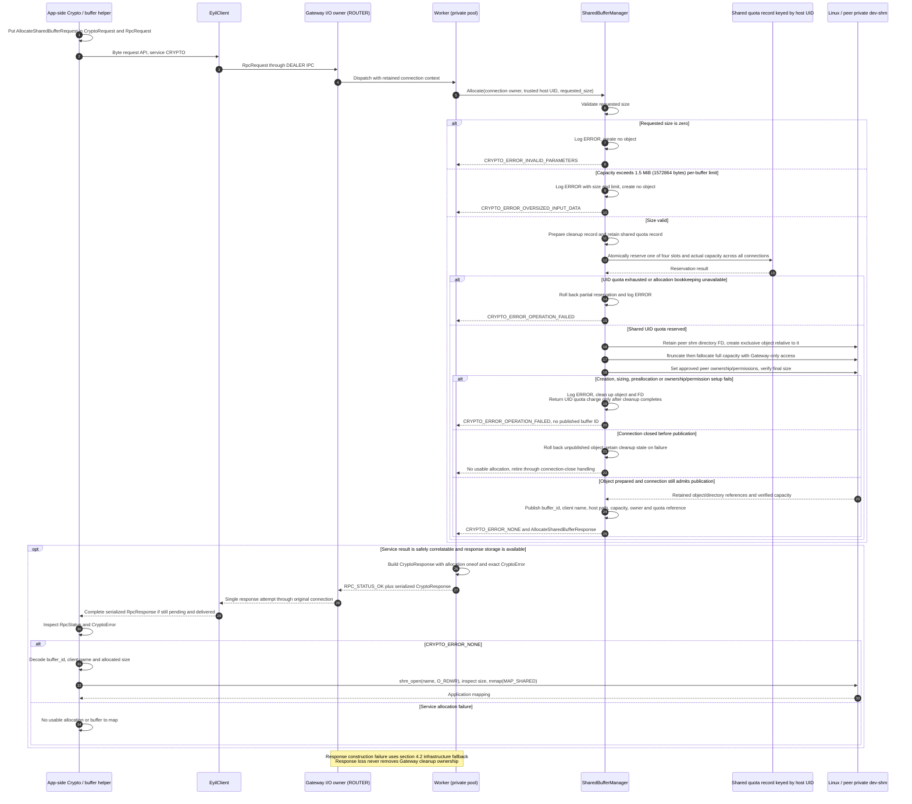

The application implements its buffer mapping helper outside this repository
and the EyilClient transport API. It also handles allocation success followed
by mapping failure: request release when possible, otherwise correlated
connection cleanup reclaims the record.

If the connection closes while creation is in progress, recheck its generation
before publishing the result and clean up an allocation that cannot be admitted.
If an allocation reply is lost, the Gateway may own a buffer unknown to the app;
quota accounting and eventual connection cleanup must still cover it.

### 6.12 Shared-memory operations: common backend boundary

For all four operations, the app writes inputs before sending the request.
When a worker executes the request, SharedBufferManager atomically resolves
buffer_id, validates owner/ranges/state and claims the idle allocation. Missing,
unowned, released, release-pending or busy buffers return RPC_STATUS_OK with
CRYPTO_ERROR_INVALID_SESSION_STATE and an ERROR log before any ICrypto call.
Invalid input regions use CRYPTO_ERROR_INVALID_PARAMETERS. Operation-specific
limits belong to the Crypto adapter/backend, not SharedBufferManager. Preserve
CRYPTO_ERROR_OVERSIZED_INPUT_DATA when an input exceeds the operation maximum,
using the same RPC_STATUS_OK service envelope. Any adapter rejection after
claiming a buffer must finish its unused lease. Do not reserve buffers for
jobs before execution, wait for a conflict to clear or replay failed work. After a
successful claim, Gateway passes the trusted backend path and regions to the
Crypto adapter.

**Required Crypto backend behavior**, following section 11 of the shared-memory
proposal, independently of Gateway's TryUse checks in section 6.10:

- Open `SharedBuffer::name` with `open()` and
  `O_RDWR | O_CLOEXEC | O_NOFOLLOW`.
- Obtain the actual opened-object size with `fstat()` and reject zero,
  unsupported or oversized objects before mapping. Validate against that size,
  rather than trusting a size supplied by the caller.
- Independently validate every input and every output region actually accessed
  using `offset <= actualSize && length <= actualSize - offset`. Use checked or
  wider arithmetic for size conversions, output placement and capacity
  calculations; apply the overlap rules in section 6.10 and algorithm-specific
  constraints before accessing the regions.
- Map only for the synchronous operation. Unmap and close all acquired resources
  on every return path, including a returned CryptoError. Retain no buffer name,
  descriptor, mapping or allocation record after the call, and perform no
  background access to that buffer after returning.

An accepted release can retire the ID while that invocation runs; it preserves
the existing active-use lease and backing object until access ends.

FinishUse ends that lease exactly once and checks releasePending. It triggers
eligible cleanup outside manager locks, or records readiness for connection
cleanup if disconnect/deactivation owns finalization. Invoke it on every
definitive path, including null lookup and failure before calling Crypto, a
returned service error and later response-processing failure. It does not wait
for reply delivery. Section 6.13 defines the finalization and error contract.

For Thunder R4, an ordinary failed Core::hresult is a completed method return:
report RPC_STATUS_INTERNAL and end the lease. COM-RPC transport failures carry
the COM_ERROR flag and conservatively retain the access obligation. A C++
exception unwinding a direct in-process call also ends its synchronous access;
an exception from a Thunder proxy does not establish remote completion. Identify
the proxy locally without another interface lookup or backend call. These
distinctions preserve the backend contract above and the unresolved remote
completion boundary in section 7.1.

The topic/crypto ICrypto contract selects output locations in Crypto. Gateway
forwards the returned region only after validating the invocation and service
result. On success, output must be inside the allocation. A BUFFER_OVERFLOW
result may describe required capacity rather than an accessible output range.
Preserve CRYPTO_ERROR_BUFFER_OVERFLOW and the defined required offset/length
in the operation response even when that region exceeds the current capacity;
do not apply the successful-output bounds rejection to it. The app must not
read it as produced data. Compute required capacity with checked/wider
arithmetic; the app can explicitly allocate a sufficiently large new buffer,
rewrite inputs and submit a new operation, subject to the configured limits.
The library/Gateway does not replay automatically or resize a mapped buffer.

An invalid successful output region, including one that overlaps an input
region, is a Gateway processing failure: log ERROR
and return RPC_STATUS_INTERNAL without exposing that region as usable output.
Definitive backend return still ends the lease and can complete pending release;
response validation or serialization must not leave completed access active.

The four shared-memory operations follow one flow, drawn once below. Each
invocation acquires its own scoped ICrypto reference. The CONNECTED attempt has
already settled during authentication; null lookup and invocation failures follow
sections 6.7 and 6.15. The table lists what differs per operation. Each
`break` block ends the job early; its error completion still reaches the client
through the same single send attempt as the final response.

Coverage: **AC1.8–AC1.11; AC2-Firebolt.1–AC2-Firebolt.2**.

| Operation | App writes before the request | ICrypto call | Output returned | BUFFER_OVERFLOW possible | App reads on success |
| --- | --- | --- | --- | --- | --- |
| Encrypt | init_data, plaintext input_data | Encrypt(context, buffer, algorithm, keyId, initData, inputData) | encrypted_data region | Yes | Ciphertext region |
| Decrypt | init_data, encrypted_data | Decrypt(context, buffer, algorithm, keyId, initData, encryptedData) | output_data region | Yes | Plaintext region |
| Sign | input_data | Sign(context, buffer, algorithm, keyId, digestAlgorithm, inputData) | signature region | Yes | Signature region |
| Verify | input_data, expected_signature | Verify(context, buffer, algorithm, keyId, digestAlgorithm, inputData, expectedSignature) | verification_status | No | verification_status only, no binary output region |

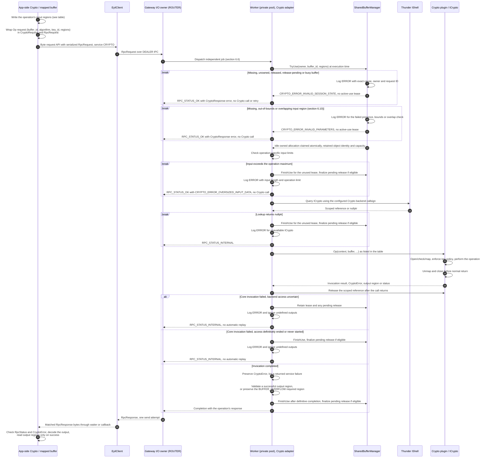

A verification result of false and a failed invocation are different outcomes.
For every operation, a transport failure after remote dispatch may leave
completion uncertain. Do not take the normal FinishUse arrow in that case;
retain the access obligation and any accepted pending release until backend
completion is established. A definitive error result ends access and permits
deferred cleanup just as a successful operation does.

### 6.13 ReleaseSharedBuffer and conflicting buffer operations

Coverage: **AC1.9–AC1.12**. Release is a Gateway-local operation.

#### Release acceptance and deferred destruction

**Agreed release contract:** validate the buffer ID and owning connection, then
atomically set releasePending. From that instant, no new operation may acquire
the allocation. If no active access remains, Gateway cleans up immediately,
subject to the connection-teardown ordering below. Otherwise, it retains the
object, directory reference, record and quota until the last active use ends.
The completion path then performs cleanup; no worker waits for another operation,
no polling timer runs and no application retry is required.

Return RPC_STATUS_OK with CRYPTO_ERROR_NONE and the empty
ReleaseSharedBufferResponse once release has been accepted. Do not wait for an
active operation to finish before producing this response. Success means **the
ID is retired from further use and Gateway has accepted cleanup responsibility**.
It does not certify that the object has already been unlinked, that backend
execution ended or that kernel memory has been reclaimed. No pending status,
additional response, notification or Protobuf/API extension is required.

The deferred period has no fixed deadline. The 10-second worker-wait budget
applies before the release job starts; expiry there rejects an unexecuted
request and creates no pending release. The 15-second client wait does not
cancel an accepted release or authorize destruction. Once accepted, the release
remains pending until its cleanup prerequisites are satisfied, independently of
whether the response reaches the client.

#### Atomic state and execution-time conflicts

SharedBufferManager protects lookup, ownership, active-use count,
releasePending and finalization claims with short locks. It holds no such lock
across ICrypto, filesystem operations or response delivery. Store these fields
in the retained allocation record: recording releasePending and ending a use
must not depend on allocating a separate pending-release job.

| State / event | Atomic transition and outcome |
| --- | --- |
| Valid use of an idle allocation with releasePending false | Claim the sole active-use lease; activeOperations becomes 1 |
| Competing use while activeOperations is 1 | RPC_STATUS_OK with CRYPTO_ERROR_INVALID_SESSION_STATE and ERROR log; no wait and no Crypto call |
| First valid release, with activeOperations either 0 or 1 | Set releasePending, reject all later uses and accept release; retain any active lease |
| New use after releasePending is set | RPC_STATUS_OK with CRYPTO_ERROR_INVALID_SESSION_STATE and ERROR log, even if the original operation has since ended |
| Unknown/unowned ID or another release after release was already accepted | RPC_STATUS_OK with CRYPTO_ERROR_INVALID_SESSION_STATE and ERROR log; leave the original release and active use unchanged |
| Definitive end of active access | Decrement activeOperations once; if releasePending is false the allocation becomes idle, otherwise trigger eligible finalization |
| releasePending, activeOperations zero and lifecycle ordering permits cleanup | One worker claims finalization under the lock, then cleans up outside it; other paths cannot claim it again concurrently |
| Physical cleanup succeeds | Remove the private cleanup record, return only this allocation's count/byte charge to its shared host-UID quota record, and drop retained references exactly once |
| Physical cleanup fails | Keep the ID unavailable, retain unresolved cleanup/accounting and log ERROR; never restore the allocation to use |

Uncertain backend access retains its active-use obligation until completion is
established; returning an invocation error or releasing ICrypto is not itself
that evidence. It may coexist with releasePending. Section 7.1 describes this
exceptional lifecycle boundary.

**Operations awaiting execution have no buffer reservation.** Check the buffer when a job
executes. Gateway does not promise request-arrival ordering, delay release to
preserve a not-yet-started use or replay a rejected operation.

| Race at the buffer manager | Result |
| --- | --- |
| Release is accepted before an admitted Encrypt claims the buffer | The ID becomes unavailable; Encrypt returns RPC_STATUS_OK with CRYPTO_ERROR_INVALID_SESSION_STATE without calling Crypto |
| Encrypt claims the buffer before Release executes | Encrypt retains its lease; Release is accepted immediately, with destruction deferred until that use ends |
| Two operations try to claim the same idle buffer | One claims it; the other returns RPC_STATUS_OK with CRYPTO_ERROR_INVALID_SESSION_STATE if it observes active use |
| A later operation executes after the previous use ends, without an accepted release | It may claim the still-live buffer and proceed normally |
| Release races the last active-use completion | Either path may find the object ready for cleanup, but exactly one claims finalization; no lost release or double cleanup |
| The app removes the object outside Gateway before Crypto opens it | Crypto handles an open/access failure if detected; Gateway logs and forwards the returned CryptoError and ends the lease after definitive completion |

The application submits dependent operations sequentially when it needs a
particular order. Different buffers and connections can execute concurrently.
Deferred destruction protects an existing active use; it does not add a buffer
dependency queue or promise that an admitted operation will succeed.

#### Release request sequence

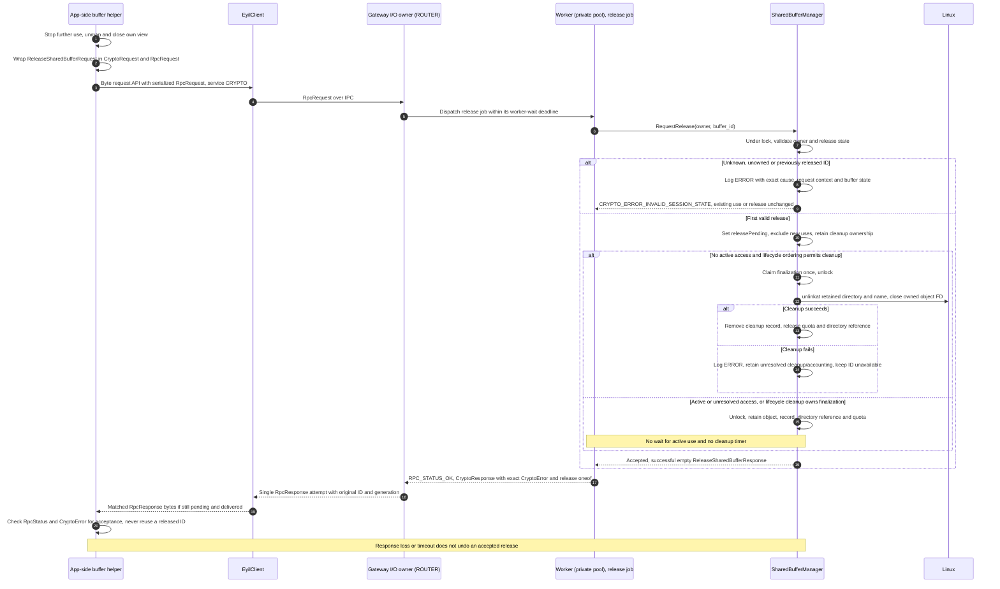

The following flow shows release during an active operation on a live connection:

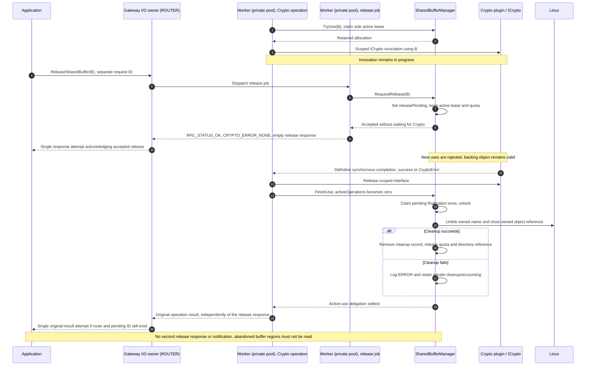

The release-before-use case is also intentionally allowed:

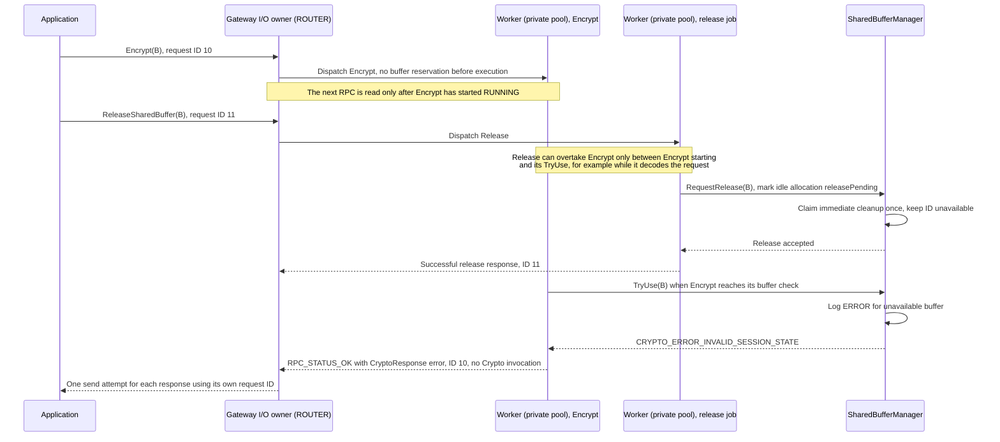

#### Completion, cleanup failures and response ownership

Finish the active-use obligation on every path that establishes no backend
access remains: failure before invocation, null ICrypto lookup, or definitive
synchronous return, including a CryptoError or verification result of false.
A later output-validation, serialization or response-allocation failure must
not strand that lease. Use retained/scoped ownership so it is ended once even
on error paths. If releasePending is set, run eligible finalization on the
current worker outside manager locks. Otherwise return the allocation to idle.
No request worker waits for another worker to free the allocation.

An ambiguous remote invocation failure keeps the access obligation and pending
release intact. When backend/platform lifecycle handling establishes completion,
the same finalization path becomes eligible. Neither a client timeout, connection
loss nor the passage of a fixed interval provides that evidence.

Unlink through the retained directory reference and generated relative name;
then release Gateway's remaining object/reference ownership. A missing name
(ENOENT) is already unlinked and does not by itself prevent closing retained
references and completing accounting. A different filesystem cleanup failure
keeps private state describing exactly what remains, and emits an ERROR log
with the buffer ID, owning connection and failed step. Do not double-close a
released descriptor, remove quota twice or make the ID usable again. The normal
connection cleanup path can revisit retained failed cleanup; there is no
periodic cleanup poller or client-driven replay requirement.

| Failure / outcome | Response and resource handling |
| --- | --- |
| Release rejected for unknown/unowned/already-released ID | RPC_STATUS_OK with CRYPTO_ERROR_INVALID_SESSION_STATE and ERROR log; no new releasePending transition |
| Release rejected before dispatch because of worker-wait timeout or infrastructure failure | RPC_STATUS_INTERNAL with empty payload and ERROR log; no releasePending transition for this request |
| Valid release accepted while idle, busy or awaiting definitive backend completion | Successful release response acknowledges acceptance; keep resources and quota until eligible physical cleanup completes |
| Filesystem cleanup fails after acceptance, even during the immediate idle-buffer path | Log ERROR and retain private cleanup/accounting; the accepted-release result stays successful, with no second response |
| Release response allocation/serialization fails after acceptance | Preserve pending cleanup; report RPC_STATUS_INTERNAL if a correlated fallback can be built before any send attempt, otherwise log/drop; no rollback or automatic replay |
| Release response send fails, or client has already timed out/disconnected | Log/drop under the single-attempt rule; cleanup continues without an ACK from the client |
| Original Crypto operation returns a defined error while release is pending | Forward its CryptoError through its own request; end active use and finalize when eligible |
| Original Crypto invocation leaves remote access uncertain | RPC_STATUS_INTERNAL for that operation when deliverable; retain its access obligation and any pending release until completion is established |

Cleanup failure does not overwrite an earlier accepted release or the original
Crypto result. Success does not revoke an app mapping or certify that the kernel
freed pages still referenced by another process. Quota is released only when
Gateway's allocation cleanup completes, rather than on response creation or
send acceptance.

#### Coordination with disconnect and plugin drain

Connection teardown retains the agreed ordering: settle accepted work and
active access, notify Crypto with DISCONNECTED, then finalize the connection's
remaining allocations. At the admission cutoff, SharedBufferManager records
lifecycle ownership atomically against finalization claims. A finalizer already
claimed by an earlier explicit release finishes as part of that earlier work.
Still-unclaimed records, including accepted pending releases, are finalized by
connection cleanup after the notification stage. Last-use completion records
readiness and wakes that cleanup path without blocking a worker.

Closing admission alone does not mark every buffer released: previously
accepted operations that have not started may still use allocations without releasePending,
subject to their execution-time checks and original dispatch budget. An accepted
explicit release still rejects later uses of its ID. Release jobs admitted before
the cutoff may record acceptance during drain without waiting for physical
cleanup. After accepted work settles, connection cleanup marks all remaining
allocations for release. App exit, a lost allocation reply or an omitted release
RPC therefore leaves cleanup owned by Gateway, not by the vanished client.

### 6.14 Disconnect detection, PID observations and hibernation

Coverage: **AC1.3, AC1.5–AC1.6, AC1.12**.

#### Required connection-to-FD binding

One monitor is attached to the Gateway ROUTER and observes all its underlying
connections. Each DISCONNECTED event concerns one of those connections. Client
disconnect closes DEALER on its owning thread; the resulting UDS closure is
detected by Gateway without a disconnect Protobuf message or heartbeat.
Close is asynchronous and does not acknowledge remote cleanup.
[Monitor API](https://libzmq.readthedocs.io/en/latest/zmq_socket_monitor.html),
[socket close API](https://libzmq.readthedocs.io/en/latest/zmq_close.html)

| Gateway input | Information to associate |
| --- | --- |
| Monitor ACCEPTED | Gateway-side accepted transport FD and its lifetime |
| ZAP authentication | Trusted peer credentials and transport FD/lifetime metadata; Gateway assigns a unique User-Id |
| ROUTER request | User-Id, transport FD/lifetime metadata and binary routing ID |
| Monitor DISCONNECTED | Transport FD/lifetime and versioned peer credentials |

**Bind the Gateway-side FD and its connection lifetime to User-Id before ZAP
success.** Keep the activation generation and a non-reused transport lifetime
identifier in that record. The client's own numeric FD is unrelated.

The platform/libzmq integration must expose the same trusted binding to ZAP and
disconnect handling. A transport-generated connection token accompanying the FD
in local ZAP metadata and versioned monitor events supplies that contract.
Credentials alone or arrival order across independent queues do not.
This is a required integration contract, not a claim that standard ZAP exposes
an accepted FD or standard monitor events contain User-Id.

An event's FD may already be closed. Its stored number can still be used for
lookup; the lifetime identifier prevents selection of a newer connection that
reused it. The registry observes the FD but never closes, reads, writes or
duplicates it. Do not rediscover credentials by calling SO_PEERCRED on a delayed
event's FD. ZMQ_FD returned by zmq_getsockopt is a notification descriptor for
the ZeroMQ socket, not an accepted client's FD.
[ZMQ_FD contract](https://libzmq.readthedocs.io/en/latest/zmq_getsockopt.html#zmq-fd-retrieve-file-descriptor-associated-with-the-socket)

Required rules:

1. Establish the binding during authentication, before any RPC is needed.
   Connections that never send a request remain identifiable for cleanup.
2. Serialize acceptance and closure of that lifetime. Retain closing state
   until in-progress authentication resolves; delayed ACCEPTED or ZAP completion
   must not resurrect a closed connection.
3. Resolve each disconnect to the original context only. Two connections from
   the same UID/GID/PID remain independent.
4. Carry activation and connection generations through every job, completion
   and control event. Retire a binding once; delayed/duplicate events cannot
   affect a replacement connection or a new Gateway activation.
5. Bind ROUTER routing identity to that same transport lifetime and keep
   ROUTER_HANDOVER disabled. At send handoff, the transport integration must
   verify the route still identifies the original connection. A stale registry
   entry or matching routing-ID string alone does not permit old response
   delivery to a replacement connection.
6. Treat missing/conflicting binding evidence as a transport-contract failure,
   never as permission to choose all connections with the same PID. Reject an
   unbound connection; if reliable runtime accounting is lost, use controlled
   teardown rather than guessing ownership.

Use the local metadata and monitor encoding below. A version-2 monitor alone
does not establish support for this extension. Validate FD reuse, rapid
reconnect, interleaved handshakes and closure before the first request on each
target.

#### Rationale: authentication succeeds before the first message

Coverage: **AC1.3, AC1.5–AC1.6, AC1.12**. The source extension supplies the common
connection identity needed for cleanup under the selected authentication-time
session lifecycle. It is not needed merely to obtain an accepted FD.

Unmodified libzmq 4.3.4 already reports the accepted transport FD through
ZMQ_EVENT_ACCEPTED. Its ZAP request exposes the peer credentials, but neither
that FD nor a shared connection-lifetime identifier. A received application
message can provide User-Id and FD together, using message metadata and the
existing ZMQ_SRCFD accessor. That last association exists only if a message
actually reaches the Gateway receiver.
[Monitor events](https://libzmq.readthedocs.io/en/latest/zmq_socket_monitor.html),
[4.3.4 message metadata](https://github.com/zeromq/libzmq/blob/v4.3.4/src/stream_engine_base.cpp),
[4.3.4 ZAP request construction](https://github.com/zeromq/libzmq/blob/v4.3.4/src/zap_client.cpp).

The distinction between connection readiness and first-message delivery is
essential. The transport handshake and ZAP exchange happen during connection
setup. client_connect returns CLIENT_OK after handshake success; this does not
require the application to submit a Crypto RPC or confirm that Gateway has
received any application message. The application may immediately disconnect
one of its Clients while keeping its other connections open. A transport failure
can also occur before its first queued message reaches Gateway.

Gateway already creates an independent ApplicationContext and attempts
NotifyAppState(CONNECTED) during authentication, before ZAP success. When that
notification succeeds, it needs matching cleanup even if no RPC follows. This failure does not require a
shared-memory allocation to exist: the authenticated context and Crypto session
are enough to make targeted disconnect handling necessary.

##### Failure sequence without a shared transport identity

Clients A and B below are two DEALER sockets in the same application process,
with identical UID/GID/PID. The diagram shows B's authentication being processed
first to illustrate independent scheduling. The A/B labels describe the actual
connections for the reader; they are not extra information available to the ZAP
handler. Neither connection sends an application message in this sequence.

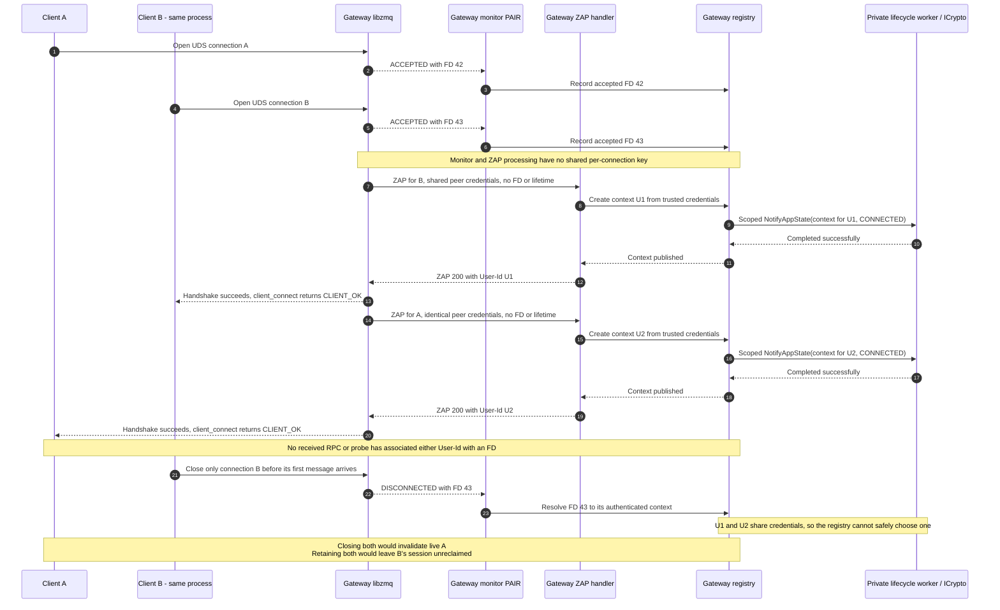

Adding UID/GID/PID to the disconnect event identifies the process but still
does not distinguish U1 from U2. Pairing the first ACCEPTED event with the first
ZAP request is also insufficient: independent queues and I/O threads do not
provide that ordering contract. The FD can identify the disconnected transport
while the application still lacks its association with the authenticated session.

##### Why an immediate request or automatic probe does not close the gap

ZMQ_PROBE_ROUTER=1 can make DEALER automatically send an empty message when a
connection is established. It defaults to 0. This is a one-time probe, not a
periodic heartbeat; Gateway would have to recognize it separately from an RPC.
If received, it can help associate routing identity, User-Id and FD. It is not
enabled by the current client design.
[ZMQ_PROBE_ROUTER](https://libzmq.readthedocs.io/en/latest/zmq_setsockopt.html#zmq-probe-router-bootstrap-connections-to-router-sockets).

Neither a probe nor an application HELLO is guaranteed to reach Gateway before
the connection fails. Successful zmq_send only establishes local queue
acceptance. A successful transport handshake is not an acknowledgement that
Gateway's application loop has consumed the probe. The failure sequence above
therefore also applies when a first message was queued but never received.
[Send completion contract](https://libzmq.readthedocs.io/en/latest/zmq_send.html).

An explicit HELLO/ACK protocol could define a different session-activation
boundary and defer Crypto CONNECTED until Gateway receives HELLO. That would
require a new bootstrap contract and rules for all pre-HELLO state. It would
change the selected requirement to bind the context and notify Crypto during
ZAP. The source extension satisfies that existing requirement without depending
on a new application message. FD and outgoing-route reuse also require lifetime
checks independently of when the first message arrives.

##### Selected sequence with the connection-lifetime extension

The extension assigns the lifetime before authentication and carries it through
local ZAP metadata, received messages and monitor events. The registry can bind
the FD to User-Id before acknowledging ZAP. The sequence below shows B closing
without an RPC while A remains live.

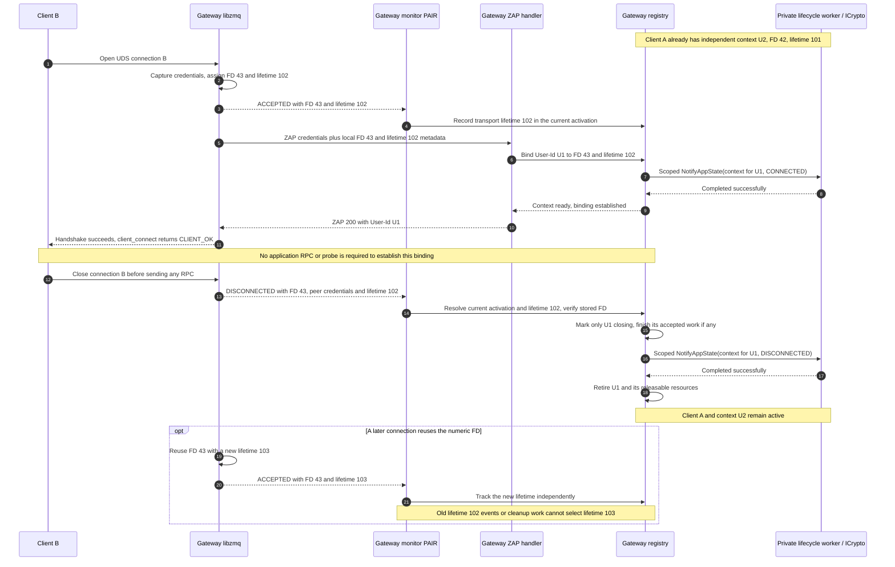

The shown ordering is one valid execution, not a requirement that monitor
events arrive before ZAP. Both paths use the same lifetime, so the registry can
merge their evidence without guessing. If disconnect overtakes an in-progress
authentication or CONNECTED job, retain a CLOSING record for that lifetime.
After the job settles, send matching DISCONNECTED if CONNECTED succeeded;
late authentication completion must not reactivate the closed context.

The non-reused lifetime is also necessary after the initial binding: a delayed
event, retained job or cleanup action keyed only by FD could otherwise select
a replacement connection. Carry the activation/lifetime tuple through every
such record. For outgoing responses, check the original lifetime against the
currently selected ROUTER pipe before sending, as specified below. The patch
provides the transport evidence and send guard; Gateway must implement the
registry transitions and resource cleanup that consume them.

#### Required libzmq extension and platform integration

The source patch is included in this repository:
[zmq_connection_lifetime.patch](zmq_connection_lifetime.patch).
Apply it to the upstream libzmq 4.3.4 sources in the platform recipe. It contains
the connection metadata, version-2 monitor events, guarded ROUTER sends,
regression tests and libzmq integration notes described below.

The reviewed RDK manifest selects `meta-openembedded` tag `rdk-4.0.0`, whose
[ZeroMQ recipe](https://github.com/rdkcentral/meta-openembedded/blob/4ad41baed6236d499804cbfc4f174042d84fce97/meta-oe/recipes-connectivity/zeromq/zeromq_4.3.4.bb)
uses **libzmq 4.3.4**. Build that library with the connection-lifetime source
extension and `-DENABLE_DRAFTS=ON`. Gateway uses the matching headers with
`ZMQ_BUILD_DRAFT_API` defined. Stock libzmq 4.3.4 does not supply this complete
binding; the properties and guarded-send option below are downstream additions.

| Boundary | Required extension contract |
| --- | --- |
| ZAP request body frames | `zmq_msg_gets()` exposes `Transport-Connection-Id` and `Transport-FD` as decimal uint64 strings; Peer-Address retains kernel-derived UDS credentials |
| Received ROUTER request | The same transport properties accompany User-Id on the body and routing frames; copy them before closing the messages |
| Monitor ACCEPTED, version 2 | Two values: `[FD, connection_id]` |
| Monitor DISCONNECTED, version 2 | Five values: `[FD, UID, GID, PID, connection_id]` |
| Monitor version 1 | Existing framing and single FD value remain unchanged; it cannot provide the required lifetime binding |
| Outgoing ROUTER reply | Set `ZMQ_ROUTER_EXPECTED_CONNECTION_ID` to the original request's uint64 transport identity before its routing frame; libzmq verifies the selected pipe on the ROUTER owner thread |

The stream engine allocates a nonzero identity before authentication and does
not reuse it within the loaded library instance. Pair it with Gateway's own
activation generation; the identity is not persistent across process restart
or library unloading. Capture UID/GID/PID while the accepted UDS FD is valid;
disconnect reporting uses the retained snapshot. An unavailable credential is
represented by UINT64_MAX and must not be accepted as a valid UDS identity.

ZAP keeps its standard multipart body. The added properties are local message
metadata, not extra wire frames or application-supplied credentials. The ZAP
request-ID field is not the connection lifetime. Native transport properties
take precedence over metadata from ZAP replies or remote peers. This contract
uses a direct inproc ZAP handler; rebuilding ZAP messages from their byte strings
alone would lose the local properties.

The ROUTER guard uses downstream option number 10001 and a native uint64
argument. Its value persists until changed; zero disables it. Gateway must
successfully set the original connection ID for every response, then attempt
the routing frame and body under the single-attempt policy in section 6.6.
A missing or replaced route fails with EHOSTUNREACH before entering multipart
send state, even if the same routing-ID bytes now identify a different peer.
Do not send the body after routing-frame failure. The guard does not promise
peer receipt after local send acceptance.

Keep ROUTER_MANDATORY enabled and ROUTER_HANDOVER disabled. The guard supports
the binding ROUTER and accepted ZMTP TCP/IPC stream path; unsupported routes
fail closed. Check option results, metadata presence and monitor frame counts.
Do not silently fall back to PID matching, an unguarded send or assumed event
ordering when the installed library lacks the extension. The version number
reported by zmq_version() alone cannot identify this downstream capability.

#### Startup capability check before admission

Before binding the production IPC endpoint or publishing RUNNING, the ROUTER
owner checks the required downstream option and sets up the version-2 monitor.
A successful build against patched headers is not evidence that the loaded
shared library has the same capabilities. The following is an implementation
outline; FailStartup means ERROR logging followed by normal startup rollback:

```cpp
uint64_t expected = UINT64_MAX; // Probe before bind; no request can be sent.
if (zmq_setsockopt(router, ZMQ_ROUTER_EXPECTED_CONNECTION_ID,
                  &expected, sizeof(expected)) != 0) {
    return FailStartup("zmq_connection_lifetime_unavailable", zmq_errno());
}
expected = 0;
if (zmq_setsockopt(router, ZMQ_ROUTER_EXPECTED_CONNECTION_ID,
                  &expected, sizeof(expected)) != 0) {
    return FailStartup("zmq_connection_lifetime_reset_failed", zmq_errno());
}
if (zmq_socket_monitor_versioned(router, monitorEndpoint, monitorEvents,
                                 2, ZMQ_PAIR) != 0) {
    return FailStartup("zmq_monitor_v2_unavailable", zmq_errno());
}
// Start the monitor receiver and complete the other startup prerequisites.
// Only then bind the production endpoint and open admission.
```

Use the real configured monitor endpoint/event mask and the existing socket
owner; do not create a second monitor here. A missing required draft symbol may
prevent library loading before Configure; that is also a startup failure, never
a reason to fall back to version-1 events. Report the runtime version for
diagnostics, but do not use it as the capability test. Resetting the probe does
not replace setting the original connection ID before every actual reply.

Option 10001 detects the downstream guard; version-2 monitoring is also present
in stock draft-enabled libzmq and does not identify the patch. Neither the
version number nor successful option/monitor setup proves the metadata and
event contents. In addition to the production-socket checks above, Configure
must complete this behavioral self-test before creating the production listener:

1. Create an isolated ZMQ context and a private Gateway-owned directory with
   mode 0700 containing a temporary IPC endpoint. One test owner runs the
   nonblocking ROUTER, DEALERs, monitor PAIR and a minimal ZAP REP; use only dummy
   credentials and probe bytes. The test never calls Crypto/AppManager, modifies
   production contexts, or binds the public endpoint.
2. Probe option 10001 and enable version-2 monitoring. Establish two connections
   from the same process. Verify distinct nonzero transport identities, the
   accepted FD/lifetime pair, kernel credential encoding and the ZAP metadata.
   Exchange one probe on the first connection; require the same lifetime/FD
   and assigned User-Id on its ROUTER routing/body frames.
3. Try a reply guarded by the other connection's identity: the routing-frame
   send must fail with EHOSTUNREACH and no body may be sent. Set the correct
   guard and verify one successful probe reply. Close both peers, including the
   second peer before it sends an application message; require the five-value
   disconnect events to match their original accepted/ZAP lifetimes and
   credential snapshots. Independent monitor/ZAP delivery order is permitted.
4. Use one total 15-second monotonic self-test deadline and wake on requested
   stop. Failure, missing metadata, wrong event shape or expiry logs one
   actionable ERROR and fails Configure before production bind/admission.
   Close sockets on their owner with zero linger, join any started test owner,
   terminate the private context and remove only its owned temporary entries
   on both success and failure. Safe rollback must finish before Configure
   returns; the deadline does not authorize abandoning a thread.

Log one successful startup summary, not each probe frame. The test must exercise
the library actually loaded by Gateway, not an external executable that might
resolve another libzmq. Its bounded check does not replace the patch's full
FD/route-reuse regression or testing the product's installed binary. Continue
validating native properties and event shapes at runtime; reject missing or
invalid identity evidence without accepting an unbound connection or sending
an unguarded reply. Stock or mismatched libzmq must fail activation without
leaking partially started resources.

The extension regression must cover independent connections from one process,
no-request disconnects, rejected/in-progress authentication, closure before ZAP,
FD reuse, context recreation, monitor-v1 compatibility and stale reply rejection
after route reuse. It must also reject replacement of native transport identity
by ZAP metadata. Run it against the selected dependency and runtime configuration;
this specification records required scenarios, not execution results.

**TODO(ZMQ-PLATFORM):** integrate the extension into the product recipe, consume
its properties/events and guarded-send option in Gateway, and verify the
matching headers, library and behavior on the target rootfs. Gateway must still
serialize authentication/disconnect state, retain closing records for late
events and explicitly retire its contexts during local shutdown.

#### Event-driven connection cleanup

On correlated disconnect, mark that context CLOSING immediately, close its
admission and remove public authentication/routing visibility. Retain resources
for accepted work. The one current admitted request starts within its original
worker deadline or expires; handed-off records retain ownership until reclaimed,
and running operations finish before destructive connection cleanup.
There is no reconnect grace period or idle/process-responsiveness timeout.

The architect's clarification ties DISCONNECTED to detection of each client's
disconnection and its corresponding ApplicationContext. Do not wait for app
termination, the last connection from that app instance, or a reconnect window.
The application decides when to close; keeping one connection across operations
and idle periods for its lifetime is recommended.

The current implementation design starts teardown immediately and drains
accepted work before invoking DISCONNECTED, because that notification may
release Crypto resources still used by a call. Schedule it as soon as that
drain permits. This is the existing active-work safety ordering; the architect's
quoted clarification establishes the trigger and absence of a grace period
but does not explicitly specify ordering against in-flight Crypto calls.
Section 7.1 retains the abnormal-completion boundary. An idle connection has
no accepted work to drain and its notification is immediately eligible.

At that cutoff, establish SharedBufferManager's lifecycle finalization gate as
specified in section 6.13. It covers still-unclaimed pending releases and all
remaining connection allocations; it does not invalidate unreleased buffers
needed by accepted jobs. Finish any already-claimed explicit-release finalizer
as part of draining that work. Last-use completion records cleanup readiness;
remaining destruction follows the DISCONNECTED notification stage, without
occupying a worker while waiting for another job.

**App crash or unexpected disconnect:** the app need not send any release
requests. When its connection closes, the monitor's FD/lifetime binding selects
the original context and Gateway performs the same cleanup as for an explicit
client disconnect. Settle accepted work, notify Crypto with DISCONNECTED and
release the connection's remaining allocations after active access ends. This
includes allocations whose response never reached the app. Release through
retained directory/object references rather than reopening the exited process's
/proc/PID/root path. The application trust assumption does not remove this
Gateway responsibility. Actual target behavior is verified by the crash and
disconnect scenarios in section 6.17.

Discard completed responses waiting for the closed route and release their
response storage. Later completions from retained old jobs are discarded on
the same generation check. An explicit client reconnect authenticates a new
context; never transfer the old current request, response storage or buffer ownership to
it. Old resources remain retained only as needed for safe backend completion
and cleanup, independently of the new context.

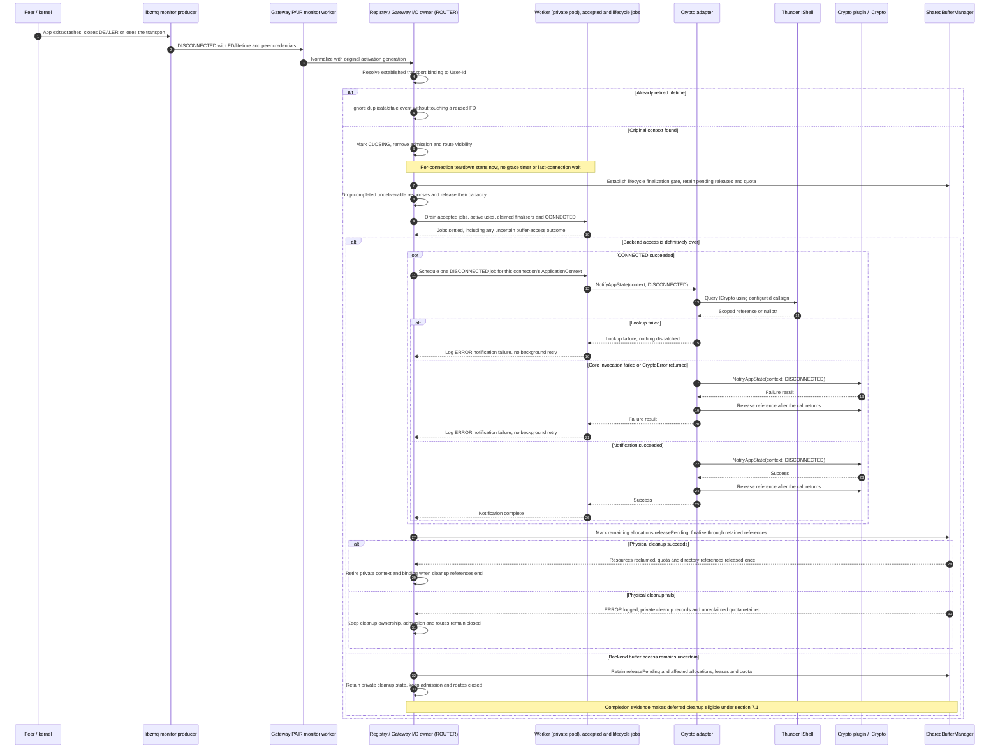

CONNECTED is attempted during authentication, so a successfully initialized
backend context still receives matching cleanup if the client sends no RPC.
Local resources are also cleaned when initialization failed. If closure races CONNECTED, await
its outcome and retire the provisional context without admitting requests.
Do not infer that a failed notification cancelled an outstanding backend call.
Public admission/route removal is immediate; physical destruction waits for
retained jobs and leases, followed by the notification stage. Pending explicit
releases remain owned throughout this path, even if their responses were lost;
they do not require another app request or generate a later notification.
A returned invocation error does not, by itself,
establish that a remote operation stopped. Keeping private cleanup state for
that uncertainty does not re-enable the old connection or introduce Crypto
health polling.

A confirmed exit of an exact process instance can identify all its associated
contexts if process-exit integration is adopted. It needs PID-reuse protection.
A socket event carrying PID/UID is not a process-exit notification: closing
one socket must not remove the process's other connections. Inherited sockets
require a separate ownership policy. Normal socket cleanup needs no process
health polling.

Both endpoints disable ZeroMQ heartbeats. An idle/frozen process with an open
socket retains its context; Gateway does not supervise application health.
Prepared application hibernation needs no Gateway lifecycle observer; Thunder
still owns plugin stop/reactivation.

#### Intended process-freeze behavior and prerequisites

**An application may freeze its process after completing its operations. The
application owns that preparation; Gateway must not treat the pause as a
disconnect merely because the application is idle.** Transport heartbeats are
disabled on both ends as specified in section 5.5. This scenario preserves the
existing process and socket descriptors under the agreed hibernation contract.

The intended operation freezes the existing process with its descriptors
preserved, for example through a process stop or container freezer. Linux's
[cgroup freezer](https://docs.kernel.org/admin-guide/cgroup-v2.html) stops the
processes until thawed; freezing is distinct from killing them.

Before allowing the freeze, the application must:

1. Stop new submissions from all its callers and finish any connect attempt.
2. Wait for all accepted requests and response callbacks to finish. There must
   be no unsent request, outstanding response, active callback or active backend
   operation belonging to the connection.
3. Coordinate its shared-buffer users so no Crypto operation is still reading
   or writing a region. Idle allocations and key/session state may remain owned
   by the live connection; freezing does not imply release.
4. Treat a timeout or communication error as an uncertain remote outcome, not
   proof that the operation ended. Without definitive completion, the app has
   not established the required idle state. The generic API has no remote-drain
   or cancel acknowledgement that could prove otherwise.

No new public prepare-to-freeze API or AppManager subscription is introduced by
these assumptions. The application coordinates its own activity with its
platform's freeze mechanism. This is a responsibility of the app, not a claim
that the current library can atomically certify remote quiescence.

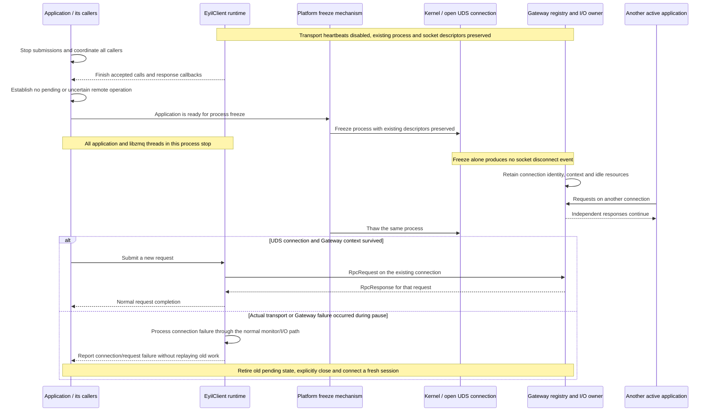

No application-level heartbeat or inactivity watchdog participates in this
flow. The 15-second deadlines cover connect, synchronous requests and async
send submission only. Async responses and otherwise idle connections do not expire.

**No heartbeat-driven expiry:** both endpoints disable transport heartbeats,
so a paused client does not lose its connection because it cannot exchange
heartbeat traffic. Actual disconnect events still require normal cleanup.
UID/GID/PID enrich event correlation; they neither preserve a closed socket nor
prove that an application is responsive.

A process that is stopped can retain its PID/UID and its open UDS descriptors.
Do not classify a stopped state, absence of CPU progress or lack of messages as
disconnect evidence. PID existence provides no responsiveness guarantee, and the
client I/O owner that processes monitor events is frozen with the app.
UID/GID/PID metadata accompanies transport-disconnect events. It does not
report process freeze or introduce a timeout for an idle connection.

The agreed hibernation preserves the process, descriptors and connection after
the app finishes operations and callbacks. It requires no AppManager/RuntimeManager
lifecycle observer or reconnect. Actual app termination uses disconnect cleanup.
Thunder crash or Gateway reload is a platform failure case outside automatic
client/session recovery; it is not an open hibernation or reconnect requirement.

#### Gateway behavior if a client stops receiving

For an idle freeze with the connection preserved, Gateway has no operation to
complete and no response to deliver to that client. It retains the context and
idle resource allocations while other clients continue. Retained buffers are
expected state, not evidence that disconnect cleanup failed; apply
the per-host-UID quota across all connections of each application group. Size
platform memory/tmpfs for the expected UID groups; no Gateway-wide shared-memory
cap is selected.

The design must still contain failures when an app freezes unexpectedly or
violates its preparation contract:

- Attempt each completed response once through the ROUTER owner with DONTWAIT.
  If accepted, it may remain in libzmq's bounded output queue. If rejected,
  record the local error and release the response; Gateway retains no retry.
- EAGAIN is output pressure, not proof of death or a reason to expire a frozen
  connection. Drop only the failed response and continue processing other work.
  The client may receive nothing and no connection monitor event is implied.
- A frozen client must not occupy workers waiting to deliver replies. Workers
  publish owned completion records without count/byte admission caps; ROUTER
  makes one nonblocking send attempt. libzmq retains its default HWM. The
  ten-second worker-wait timer does not expire completed responses or messages
  still buffered in libzmq. Client submission uses one slot; its pending-response
  map remains dynamic.
- If an operation is still executing, retain its context and buffer leases
  until its actual completion. Freezing, an undelivered reply or a local timeout
  must not invalidate backend memory access. On thaw, a synchronous request whose
  deadline elapsed can report CLIENT_TIMEOUT even if backend
  execution finished during the pause. Async response waiting has no deadline.
- A real peer exit or socket failure still requires the normal correlated
  disconnect cleanup. If Gateway fails while the app is frozen, the app learns
  about the transport failure after it resumes; preservation is not guaranteed
  across that independent failure.

The response policy is defined in section 6.6: owned completion handoff without
count/byte caps, one send attempt, local error and drop. No freeze
timeout or forced disconnect for EAGAIN is introduced.

#### Platform validation requirements

Validate process freeze and disconnect behavior on the supported device with
its configured libzmq, monitor-event format and platform hibernation mechanism.
Tests must cover a prepared idle process frozen longer than 15 seconds,
continued operation of other clients, thaw with the same connection, transport
backpressure and cleanup after an actual socket closure. Section 6.17 lists the
runtime acceptance scenarios.

### 6.15 On-demand Crypto lookup and invocation failures

Coverage: **AC1.8–AC1.12**.

There is no Crypto health-monitoring component or plugin-availability
subscription. A request or lifecycle job resolves the configured interface
when it needs to call it. A failed lookup is an invocation-time condition;
it does not stop Gateway transport, reject new client connections or prevent
Gateway-local buffer operations. A failed CONNECTED attempt is logged and
recorded separately from transport admission as specified in section 6.5.

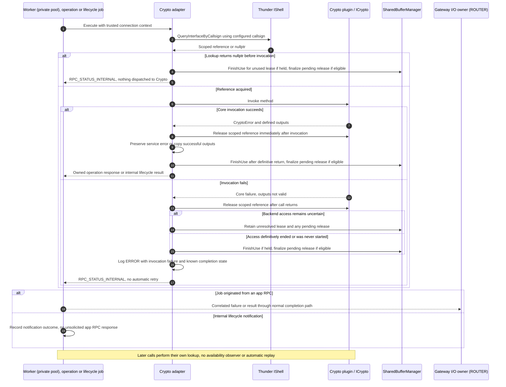

Successful lookup does not guarantee that the call will succeed or that a
previous session survived. The selected API includes
CRYPTO_ERROR_INVALID_SESSION_STATE and CRYPTO_ERROR_INVALID_KEY_ID; preserve
those service results instead of silently recreating a session and retrying the
operation. They are not evidence, by themselves, of a particular restart cause.
Crypto owns session/key recovery; Gateway reports results without reconstructing
Crypto state or replaying operations.

Gateway cannot promise immediate detection of an idle Crypto restart without a
notification or explicit generation contract. This design accepts detection
through subsequent lookups/calls; it does not add health subscriptions to close
that gap. Session identity, valid key ownership and any backend generation check
are enforced by Crypto's contract. Gateway reports the result and does not
treat an error as permission to reuse an old context or buffer.

A scoped Release ends Gateway's interface ownership; it does not cancel a
remote operation or prove that shared-memory access stopped. Preserve unresolved
leases and any accepted pending release until backend/platform lifecycle
handling establishes completion; then signal the same finalization path used
by normal FinishUse. A null lookup before dispatch and a definitive synchronous
return, including CryptoError, can end this job's lease immediately and trigger
eligible cleanup. Later response-processing failure does not keep a completed
use active or cancel release. A blocked in-process call retains its reference
until the call actually returns; it
cannot be safely cancelled by releasing that reference from another thread.
Gateway retains its own buffer-lifetime obligations without implementing
Crypto recovery or adding a Crypto health-monitoring worker.

### 6.16 Gateway deactivation, reactivation and fresh startup after a crash

Coverage: **AC1.1–AC1.3, AC1.5–AC1.12**.

**Block new admissions, finish accepted work, close client connections, stop
ZeroMQ and owned threads, then destroy the runtime.** This requirement is
part of Thunder plugin ownership and needs no app lifecycle subscription.

#### States and explicit stop ownership

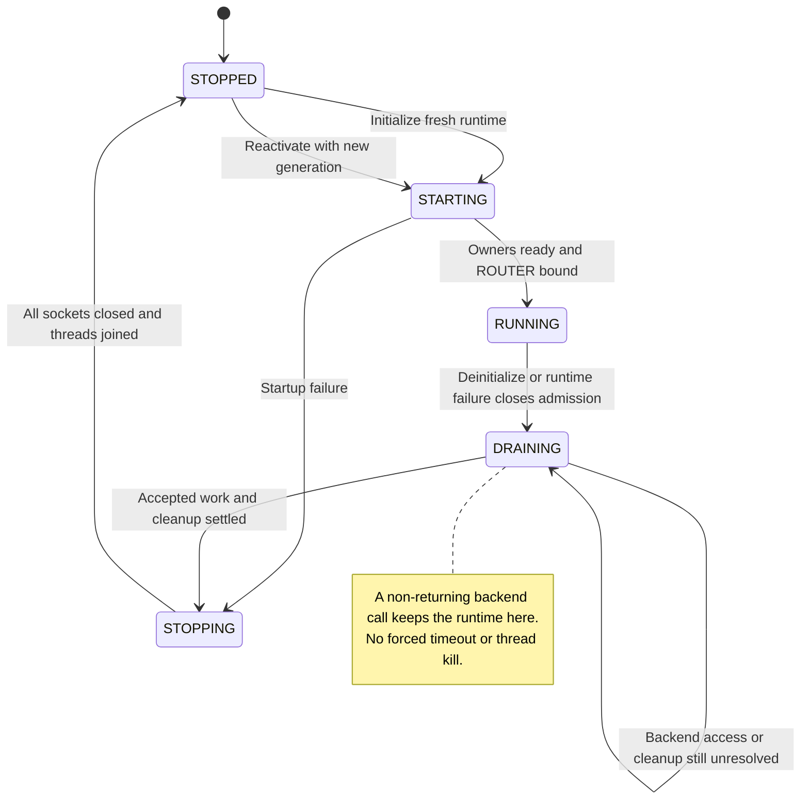

The wrapper owns the sole IConfiguration reference to the implementation. During
Deinitialize it releases that reference on the framework lifecycle thread. The
final Release synchronously invokes EyilGatewayImplementation's destructor.
That destructor destroys the runtime first: it closes admission, drains accepted
work, performs session/buffer cleanup and joins every owned thread. Only then
may the implementation release its retained IShell and finish destruction.
The wrapper releases its own IShell after the implementation's Release returns.

Jobs retain runtime/context/resource state, not IConfiguration references; they
must not postpone the last interface Release or trigger destruction on a worker.
The framework serializes activation/deactivation. Do not release the final
implementation reference from a worker/socket thread that destruction must join.
Partial-start rollback destroys the same owned runtime and only initialized
resources. There is no additional lifecycle-control interface. Future remote
implementation support must separately validate final-release completion and
library lifetime before remote Terminate can be used.
Runtime failures request framework deactivation through the wrapper. Suppress
new lifecycle callbacks and quiesce registered ones without self-joining the
callback that initiated teardown.
The runtime reports its first running-state failure through an internal C++
callback. The implementation queues an IShell::Job(DEACTIVATED, FAILURE) on the
framework pool, which invokes wrapper teardown on a framework thread. Startup
rollback and an already requested stop do not schedule another deactivation.

#### Admission and drain contract

- Serialize RUNNING to DRAINING with request acceptance. An accepted request has
  its owned job/context/accounting published before the cutoff. Work still in
  a client's submission slot or in libzmq without Gateway admission is not in that set.
- Block new RPC and authentication admission. Reply to a trustworthy rejected
  RPC with RPC_STATUS_INVALID_CONNECTION when its route permits; otherwise
  discard it safely. Do not invent a disconnect message or new status.
- Continue running jobs and retain the one current admitted request. Its
  original ten-second worker-start deadline still applies; expiry logs
  worker_pool_exhausted, produces RPC_STATUS_INTERNAL when deliverable and
  prevents later execution. Reclaim any expired handoff before releasing its
  ownership. This deadline and deactivation do not cancel running jobs.
- At the admission cutoff, establish each context's buffer-finalization gate.
  Previously claimed explicit-release cleanup finishes with its job; other
  pending releases retain their records and quota for cleanup after DISCONNECTED.
  Do not wait for this gated destruction before scheduling DISCONNECTED: first
  wait for accepted jobs and active-use obligations to settle, then notify and
  finalize, as in section 6.13.
- Keep ROUTER, ZAP, monitor processing, dispatcher and private pool running while
  draining. Do not unbind/close ROUTER or shut down its context at drain start.
  An empty current-request record is insufficient: account for handed-off/active jobs, authentication
  already in progress, lifecycle jobs, completions, buffer leases and claimed
  finalizers. A release response being sent is not proof of completed cleanup.
- Preserve routes for existing responses. If a peer disconnects, retire its
  route but finish its accepted work and cleanup obligations. A late ZAP result
  cannot publish a new ACTIVE context after the cutoff.
- Wait without registry/dispatcher/completion locks. Schedule lifecycle cleanup only when its
  prerequisites finish, rather than occupying every worker waiting for work
  still awaiting those workers.
- Apply the normal one-attempt response rule during drain. Give each routable
  completion its single nonblocking attempt, then release it on acceptance or
  local failure. Completion means execution/ownership settled, not app receipt.
  Never block a worker on delivery or retry a failed response. Retire any
  remaining unsent storage when entering STOPPING; no receipt ACK is required.
- After accepted work ends, send DISCONNECTED once per initialized context and
  mark all remaining allocations releasePending. Finalize those whose backend
  access has ended, including earlier accepted releases and failed-cleanup
  records. Include connections that authenticated but never sent an RPC.
  Release quota once physical cleanup completes. Unresolved access or cleanup
  errors retain private ownership and must not be reported as completed teardown.

#### Deactivation sequence

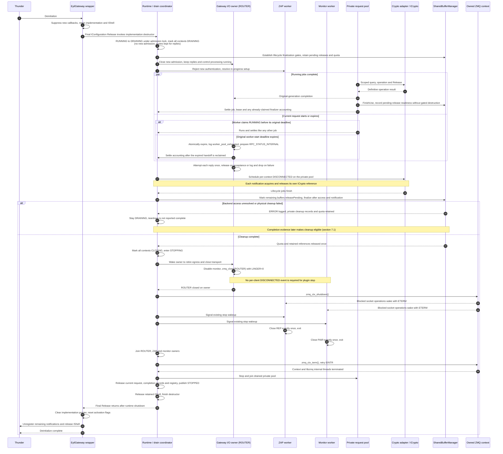

#### ROUTER and context teardown

Set ZMQ_LINGER=0 on all application-owned Gateway sockets when created.
Execution drains before closure; linger is not an operation or delivery ACK.
Zero linger prevents unsent traffic to a frozen client from prolonging transport
teardown. Close is asynchronous.
[Socket close contract](https://libzmq.readthedocs.io/en/latest/zmq_close.html)

Only the ROUTER owner disables monitoring and closes ROUTER. Never close
registry peer FDs directly, close ROUTER from Deinitialize, or use
zmq_disconnect on a bound listener. Enumerate all registered contexts directly
during stop; local ROUTER closure need not produce one DISCONNECTED event per
client. The monitor worker must not await MONITOR_STOPPED indefinitely.

After ROUTER closes and no response/authentication exchange remains necessary,
zmq_ctx_shutdown interrupts blocked socket operations with ETERM. Owners treat
ETERM during stop as expected and still close their own sockets exactly once.
They also have an existing stop flag and pollable wakeup; shutdown must not
depend on allocating a queue entry or receiving one last monitor event.
[Context shutdown](https://libzmq.readthedocs.io/en/latest/zmq_ctx_shutdown.html)

Join socket owners before zmq_ctx_term. Termination waits for socket closure and
linger; retry EINTR. Do not share the Gateway shutdown context with other
Thunder plugins. Once shut down, a context cannot be restarted; reactivation
creates a fresh one.
[Context termination](https://libzmq.readthedocs.io/en/latest/zmq_ctx_term.html)

The standard libzmq IPC listener owns its native socket and pathname cleanup.
Gateway closes the ZMQ socket on its owner and completes context teardown;
it does not manage a second adopted listener FD or endpoint lifecycle lock.
Thunder and container policy supply the deployment guarantees in section 7.4.

Partial-start rollback applies the same order to only the resources that exist.
No close/join assumes that startup reached the next stage. Successful teardown
leaves no application worker, ZMQ socket, libzmq thread or callback using plugin
code.

A graceful stop waits for actual backend completion. The client timeout and
Gateway worker-wait deadline cannot terminate a running ICrypto call. If it
never returns, do not force-kill its thread, unload code or free leased memory.
Crypto/platform failure escalation is outside Gateway policy; bounded
destruction is not promised for a non-returning backend.

#### Reactivation and fresh startup after a crash

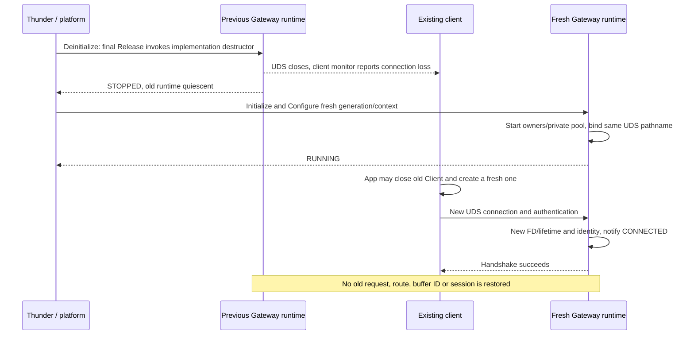

Reactivate only after normal stop reaches STOPPED. Reset per-activation flags
and recreate the current-request state, completion handoff, registry, identities,
pool, sockets and context. Old events
or completions must not affect the new generation even if FD numbers or routing
IDs repeat. Rebinding can create a new socket inode; container mounts must
expose the new endpoint as required in section 3.3.

After a crash, use exactly the normal startup path with empty Gateway state.
Do not reconstruct old connections, requests, buffers or sessions, and do not
wait for old clients. Thunder/platform owns crash detection and relaunch. An
in-process crash may also terminate Thunder; its restart precedes activation.

Actual UDS closure is detected by the client monitor without heartbeats. A
frozen client processes it after resuming. Pending sync/send waiters fail;
accepted async records retire without synthetic response callbacks. The app may
close the old Client from an application thread and call client_connect again.
Automatic reconnect is disabled. Close with zero linger, discard old pending
requests and undelivered responses, and establish a fresh session as specified
in section 5.14. Old-session operations must not be replayed.

Use fresh buffer names after restart. Do not adopt old objects or blindly
unlink allocations from a previous runtime. Persistent leftover storage and
Crypto's internal recovery belong to the platform/backend; Gateway does not
implement restoration of old sessions.

### 6.17 Implementation order and verification targets

Build Gateway against the selected ICrypto API and implement its Crypto adapter
as part of this delivery. The following order separates transport, operation
routing and lifecycle work without deferring the ICrypto dependency:

1. Implement the FD/lifetime binding and fresh-runtime stop/reactivation
   contract. Apply the agreed client callback and synchronous local-close
   contracts, together with the selected 15-second
   connect/sync-request/async-send deadlines, the single client submission slot and
   CLIENT_OUT_OF_MEMORY handling, with no async response timeout. Disable ZeroMQ
   heartbeats on both ends. Implement terminal client loss, zero-linger queue
   disposal and explicit creation of a fresh Client. Apply the agreed idle
   hibernation contract; automatic recovery after Thunder failure or Gateway
   reload is outside scope.
2. Implement the agreed RPC envelope, local error behavior and selected async
   completion contract. Document that contract in the public API. Add EyilClient's
   owner loop, single slot with mutex/condition/wakeup, pending map and shutdown.
   Prove callers wait/publish/claim/send independently of earlier responses.
   Implement string service=0 requests and Gateway UNSUPPORTED_SERVICE replies,
   including symbolic status text in both string methods. Preserve the plain-text
   public boundary.
3. Implement startup, ZAP/interim identities, authentication-time CONNECTED,
   the registry and monitor binding. Prove multiple connections from one PID
   remain independent, including closure before the first request.
4. Add four private workers and one current ingress record, with no request
   queue. Pause further receives while that record awaits a worker, continue
   replies/control processing, and return INTERNAL with worker_pool_exhausted
   ERROR if Dispatch has not started within ten seconds. Validate capacity/start
   wakeups, timeout races, per-call ICrypto ownership and completion routing.
5. Add Gateway-local allocations, atomic execution-time ownership/state
   checks and active-use leases. Reject competing uses and uses of retired IDs
   without reserving uses before execution or replaying an operation. Accept valid release
   immediately, defer destruction until active access ends, and retain quota
   through cleanup. Apply the trusted-app cooperation contract, retained directory
   references and exactly-once finalization across release/disconnect/stop.
   Validate the exceptional completion boundary in section 7.1 with the
   platform/Crypto implementation.
6. Integrate AppManager/RuntimeManager authentication only at the marked TODOs,
   once their formal API exists. Hibernation needs no lifecycle subscription;
   application preparation follows the selected idle-process contract.
7. Validate CONNECTED during authentication, accepted-work drain,
   DISCONNECTED, owner-thread teardown and clean reactivation. Exercise the
   ICrypto contract without adding backend policy, health monitoring or replay.

| Test scope | Scenario / evidence required |
| --- | --- |
| L1 client | Nonzero request IDs are never reused within a generation, including after failed submission/retirement; counter exhaustion cannot wrap; response matching and duplicate/late replies; argument/output ownership; each waiter resolves once and each response callback runs at most once |
| L1 async send | API cannot return CLIENT_OK before zmq_send accepts the message; EAGAIN keeps the send waiter pending; timeout/error cancels unsent work with no callback; race acceptance against deadline and disconnect |
| L1 async response | A response later than 15 seconds is delivered; no response timer exists; original callback signatures carry valid Gateway error responses; connection loss or local response-processing failure retires the record without an error callback |
| L1 callback execution | Request calls from the I/O-owner callback return CLIENT_INVALID_ARGUMENT; freeing a response is allowed; callback runs without internal locks and may precede submitting-thread resumption |
| L1 connection callbacks | Initial success and every startup failure produce no callback; later unexpected loss produces CLIENT_CONNECTION_LOST at most once; explicit close suppresses new callback claims; RESTORED and TERMINATED are never emitted, including after an explicit fresh connect |
| L1 client submission slot | At most one published/claimed unsent request; competing callers wait with the mutex released; owner explicitly claims it; acceptance/failure frees the slot, sent requests remain independently pending; no queue container or queue-full result |
| L1 slot waiting and cancellation | Occupy the slot with EAGAIN, keep receiving earlier responses/PAIR events, expire a competing caller without publication, and prove its request never sends; clear SEND_IN_PROGRESS after every nonaccepted attempt and apply latched cancellation before retry; race cancellation with acceptance and preserve accepted async CLIENT_OK |
| L1 synchronous pre-send timeout | Expire a published/claimed sync request before TryBeginSend and prove no later send occurs; expire during an admitted attempt and resolve its actual outcome before returning CLIENT_TIMEOUT, even if accepted; verify the same behavior for both sync methods |
| L1 request-specific retirement | Retire response/timeout for accepted A while B occupies the slot; B remains intact. Repeat completion/retirement for A and inject preparation failure after timeout/close; preserve each winning result and release each matching slot/reference once |
| L1 premature response | Inject a response for a pending entry whose send is not yet accepted; discard/log it without callback, retirement or slot release. A fast valid reply after recorded acceptance still completes normally |
| L1 slot-waiter teardown | Wake callers that have not entered the pending map on explicit close, transport loss and connection-wide decode allocation failure; propagate CLIENT_NOT_CONNECTED, CLIENT_COMMUNICATION_ERROR and CLIENT_OUT_OF_MEMORY respectively, without allocating or waiting for EMPTY; a later explicit close cannot overwrite the loss reason for already admitted callers |
| L1 client startup allocation failures | Fail runtime, thread-start and owner-side setup allocation; CLIENT_OUT_OF_MEMORY leaves output NULL, closes partial resources and joins only started threads |
| L1 client submission allocation failures | Inject failure during input copy, request/waiter creation, serialization and pending-map insertion; all four request APIs return CLIENT_OUT_OF_MEMORY before send acceptance, release partial state and cannot send later or invoke a callback |
| L1 client response allocation failures | Sync returns CLIENT_OUT_OF_MEMORY and NULL/0; matched async responses retire without a callback or revision of accepted CLIENT_OK, even before the submitter resumes; uncorrelatable decode failure follows connection-wide cleanup |
| L1 client cleanup under allocation failure | Free/disconnect complete without waiting for a free slot or allocating a control request/temporary cleanup container; notification register/unregister allocate nothing and retain their specified outcomes |
| L1 client deadlines | Sync uses one 15-second total budget through final byte/string result preparation and async only a 15-second send budget; slot waiting uses the original budget and cancellation cannot send work after returning failure |
| L1 terminal client loss | Retire unsent/pending work and uncommitted responses once; unresolved waiters get CLIENT_COMMUNICATION_ERROR, accepted async submissions retain CLIENT_OK without error callbacks; preserve committed/app-owned responses and reject new requests on the lost handle |
| L1 explicit client disconnect | Close with sync/async/string calls waiting for or occupying the slot; unresolved waiters return CLIENT_NOT_CONNECTED with cleared outputs, accepted async sends retain CLIENT_OK, pending IDs and undelivered responses retire once; cancelled actions never send later |
| L1 disconnect races and callbacks | Race close against send acceptance, timeout, response claim and transport loss; preserve one result, suppress intentional-close events, release every live-call guard and wait for claimed callbacks; no callback or state access after return |
| L1 plain-string APIs | Both string methods copy to the first NUL with no size argument or caller encoding; exercise empty strings, whitespace and line breaks as data, representable large inputs, caller input reuse and allocation failures; copy the received non-OK RpcStatus name with one response terminator; reject unknown/UNSPECIFIED status, unexpected OK and nonempty error payload |
| L1 string completion races | Race response-text preparation with the synchronous deadline, explicit close and transport loss; no intermediate binary success escapes, the winning result is preserved, and any losing prepared string is freed |
| L2 string rejection | Both string APIs send raw text in a service=0 RpcRequest; Gateway logs ERROR and returns correlated UNSUPPORTED_SERVICE with empty payload before worker admission; sync returns CLIENT_OK plus exact status text, async receives that text through its response callback; no ICrypto call or invented text service |
| L1 Gateway | Envelope/oneof validation; context lookup; current/handoff/in-flight ownership; enum/presence mapping; allocation rollback; the same numeric request ID on two authenticated connections is independent, while a duplicate of tracked work in one connection cannot replace its completion |
| L1 Gateway rejection logging | Undecodable service payloads, operation/oneof mismatches and infrastructure failures use RPC_STATUS_INTERNAL with empty payload. Buffer/service errors follow the CryptoError table in section 4.2 under RPC_STATUS_OK. Both log ERROR with the exact cause and known request/connection context; duplicate IDs cannot dispatch twice or replace the original completion; unsafe correlation logs/drops; logs contain no payload or key material |
| L1 buffer error mapping | Zero size/invalid regions: INVALID_PARAMETERS; size/input maximum: OVERSIZED_INPUT_DATA; allocation or quota failure: OPERATION_FAILED; missing/wrong-session/released/busy/release-pending buffer and repeated release: INVALID_SESSION_STATE; output capacity: BUFFER_OVERFLOW. Assert RPC_STATUS_OK, the matching CryptoResponse oneof, unusable success outputs on error, exact diagnostics and cleanup ownership. A first valid release while busy still succeeds |
| L1 Gateway receive pause | Occupy all four workers, admit one current request and verify further ROUTER receives pause without a request queue. Replies, monitor/control events and timers continue; worker-capacity wakeup resumes dispatch/reception without spinning |
| L1 Gateway worker timeout | After 10,000 ms from current-request admission, return INTERNAL with empty payload and worker_pool_exhausted ERROR containing total/running/reserved workers and request identity. Race expiry against Dispatch, including a handed-off job; one result, no execution after expiry, no timeout of running calls. Unread libzmq messages have no Gateway timer yet |
| L1 Gateway drain | Atomic admission cutoff; the current request starts or expires under its original deadline, handed-off ownership settles, running work finishes; stop/control handling requires no new RPC or request queue |
| L1 Gateway response storage | Response storage grows when allocations succeed, with no response-count/byte budget rejection. Inject actual bookkeeping/serialization allocation failure; preserve one completion/error and cleanup ownership without blocking a worker or replaying service work |
| L1 resource configuration | Four private workers, default stack size, default HWM 1000/1000 and kernel buffers, MAXMSGSIZE=-1; individual request/response size and completion storage remain unlimited by policy. Accept capacity 1,572,864 bytes; reject 1,572,865 with RPC_STATUS_OK/OVERSIZED_INPUT_DATA. At most four allocations and 6,291,456 logical capacity bytes per host UID. Distinct UIDs have independent allowances with no global cap. Preserve arithmetic, representation and service validation |
| L1 shared application quota | Allocate two buffers on connection A and two on B with the same host UID; reject the fifth through either connection or new C with RPC_STATUS_OK/OPERATION_FAILED and an ERROR log. Different PIDs and interim appIds, including child apps with that UID, share the allowance. Different UIDs do not. Same-UID connections still cannot use/release each other's buffer IDs |
| L1 quota reservation and cleanup | Race allocations from multiple same-UID connections for the final slot; only one reservation succeeds. Inject creation/preallocation/rollback failure and verify exact charges. Pending release, lost reply and disconnect do not refund before cleanup; closing one connection cannot reset another's charges. Reconnect and reused UID cannot bypass retained charges. Race zero-charge record removal with new allocation and preserve one shared record |
| L1 Gateway response send | At most one logical response attempt; EAGAIN/EHOSTUNREACH/EINTR cause local error and drop; no requeue, second error response or backend replay; storage released once; multipart frames never cross responses |
| L1 region rules | Per operation: missing required region, out-of-bounds region, overlapping inputs and adjacent inputs (allowed); length-0 regions pass Gateway and reach Crypto; 64-bit overlap arithmetic near UINT32_MAX; successful output overlapping an input or outside the allocation returns RPC_STATUS_INTERNAL and ends the lease; BUFFER_OVERFLOW region is forwarded unchanged even when out of bounds |
| L1 buffer concurrency | Admitted jobs reserve no buffer before TryUse; release winning before TryUse returns RPC_STATUS_OK with CRYPTO_ERROR_INVALID_SESSION_STATE and no Crypto call; use winning rejects a competing use through the same service error but permits release acceptance; race release with last-use completion and verify one finalization claim, no use after releasePending and no lost cleanup |
| L1 deferred release | Release during active access returns RPC_STATUS_OK, CRYPTO_ERROR_NONE and the empty release response before that access ends; retain object, record, directory reference and quota; definitive completion triggers cleanup once; duplicate release cannot clear state or create another finalizer |
| L1 buffer completion errors | Null lookup/pre-invocation failure, defined CryptoError and post-call validation/serialization/allocation failure end the lease exactly once when access is definitively over and trigger eligible pending cleanup; ambiguous remote failure retains access and releasePending until completion evidence arrives |
| L1 release and cleanup failures | Idle and deferred cleanup failures log ERROR and keep the ID unavailable with retained cleanup/accounting; accepted release is not retroactively failed and produces no second response; ENOENT permits remaining cleanup; partial allocation rollback failure retains a private record without publishing an ID |
| L1 release response loss and deadlines | Response preparation/send failure and a client timeout do not undo accepted release; expiry of the current release request before Dispatch creates no releasePending state. Deferred cleanup has no forced destruction deadline and does not depend on response delivery |
| L2 transport | Real DEALER/ROUTER IPC, ZAP metadata, reverse-order completion and simultaneous sync/async callers |
| L2 backend-independent admission | Empty/default backend configuration and absent configured Crypto still allow startup and handshake. Sync/async backend RPCs deliver RPC_STATUS_INTERNAL; local allocate/release and unsupported string responses remain available. Missing backend does not emit a connection-loss callback; duplicate backend service configuration is rejected |
| L2 connect readiness | CONNECTED alone cannot complete connect; HANDSHAKE_SUCCEEDED returns CLIENT_OK; explicit rejection returns CLIENT_AUTH_FAILED; unresolved/stalled attempt reaches CLIENT_TIMEOUT; each failure wakes the waiter and rolls back resources; no startup outcome invokes a callback, and immediate subsequent loss cannot expose an unpublished handle |
| L2 explicit reconnect | Verify RECONNECT_IVL=-1, IMMEDIATE=1 and LINGER=0; after loss and Gateway return, no automatic handshake or old queued send occurs; explicit close/new connect creates an empty client runtime and new Gateway session, rejects old buffer IDs and never delivers old replies to new requests |
| L2 client disconnect barrier | Disconnect with pending calls and an active short callback; wake callers before waiting, join socket owners without lock deadlocks, discard transport queues, preserve app-owned responses and verify zero callbacks after return |
| L2 disabled heartbeats | Verify IVL/TIMEOUT/TTL are 0 on DEALER and ROUTER before connect/bind and after socket recreation; confirm monitor-driven cleanup still occurs on actual socket closure |
| L2 disconnect | Trusted FD/lifetime-to-User-Id binding; close one of multiple supported interim connections from a PID while the app and other connection remain alive; notify the closed connection's ApplicationContext once after safe drain, with no grace/last-connection wait and no unrelated cleanup. Cover delayed/duplicate events, FD/route reuse and disconnect before the first request |
| L2 guarded responses | Apply the expected transport lifetime to successful and error replies; force route reuse and verify no old response reaches a replacement connection, including before monitor cleanup catches up |
| L2 libzmq startup self-test | Stock draft-enabled libzmq passes monitor-v2 setup but fails the option-10001 check; missing/wrong metadata or event contents fail the private IPC test before production bind. A compatible loaded library passes distinct same-PID lifetimes, a no-request disconnect and wrong-guard rejection. Expiry/stop/failure closes all private sockets/context/temp entries; no Crypto call, production session or public listener is created |
| L1 interim identity | appId has reserved eyil-interim: prefix and a unique token; separate sessionId is stable through CONNECTED, operations and DISCONNECTED. Two connections from one PID differ; app payloads cannot replace either identity. Marker recognition alone is not proof of Crypto key-policy enforcement |
| L1/L2 buffer preallocation | ftruncate success followed by fallocate failure returns RPC_STATUS_OK plus CRYPTO_ERROR_OPERATION_FAILED without publishing an ID. Cover ENOSPC/ENOMEM/unsupported operation and partial rollback failure; verify object/FD/quota ownership. On an isolated test tmpfs using the product configuration, exhaust capacity and verify allocation fails before Crypto accesses the buffer; record cgroup charging and remaining truncation risk |
| L2 endpoint integration | Use the exact AC URI under the single-instance Thunder and trusted container-mount assumptions. Exercise standard bind/close, logged bind failure and partial-start rollback; container clients reach the configured Gateway endpoint |
| L2 buffers | Container-private mapping, cross-connection rejection, release before an admitted use claims the buffer and deferred release during active use; buffer remains accessible to the active backend until definitive completion, new uses fail, and quota becomes available only after cleanup; Crypto errors are forwarded; size/region failures and lost replies; a result after a synchronous timeout is discarded |
| Shared-memory platform validation | Verify app permissions, directory/object reference lifetime and namespace/process reuse under the selected cooperation contract; cleanup does not reopen an exited or reused PID's path |
| L2 app crash cleanup | Allocate buffers, then terminate the owning app without release RPCs; correlated disconnect settles accepted work, sends DISCONNECTED and reclaims all remaining objects/FDs/quotas through retained directory references; repeat with an active Crypto call, accepted pending release, lost allocation/release replies and notification failure, without early destruction or lost cleanup ownership |
| L2 lifecycle | Fail every startup stage; stop idle/busy/receive-paused runtimes; race CONNECTED, explicit release, finalization and disconnect/deactivation; drain already-claimed finalizers, gate other destruction until accepted work settles and DISCONNECTED runs; pending-release records do not block the notification that enables cleanup; unresolved access/cleanup cannot report successful teardown |
| L2 socket teardown | ROUTER closes on its owner after drain; slow/frozen reader cannot block; REP/PAIR close on stop/ETERM; no final monitor-event dependency; all threads/context retire |
| L2 reactivation | Repeated activation cycles rebind in host/container views; fresh identities/generations; stale callbacks/events cannot reach new clients; no FD/thread leaks |
| L2 crash restart | Start with empty state; client monitor observes loss; no old replay/session restoration; fresh connection performs authentication and CONNECTED |
| L2 process freeze | With transport heartbeats disabled: app drains operations/callbacks, freezes longer than 15 seconds, preserves its live context/buffers while another client continues, then resumes; no custom RPC heartbeat or inactivity watchdog exists |
| L2 unexpected frozen receiver | Force output backpressure; failed response is logged/dropped once with no retry or forced idle disconnect; other clients continue; client sync timeout and retained async pending record match the contract |
| L2 multipart response errors | Inject failure before/after routing frame; verify safe multipart finalization or controlled socket teardown, no response retry and no mixing routes/payloads |
| Crypto integration | CMake/BitBake callsign reaches runtime lookup; one query/release per invocation including notifications, errors and local output-allocation failures; no retained ICrypto or health subscriptions; invocation/CryptoError mapping; restart observed through call results; communicator restrictions |
| Future platform integration | AppManager/RuntimeManager identity mapping and API entitlements |

Use a controlled fake adapter for concurrency/failure tests when needed, clearly
separate from production Crypto and never described as real cryptography.
An eventual DobbyTool-based smoke test should execute the client inside a real
application container to verify mounts, credentials and private shared memory;
DobbyTool itself is not in the RPC path.

Runtime components and their integration boundaries are organized as follows:

```text
GatewayRuntime
  authentication = InterimIdentityProvider
    // appId = eyil-interim:<unique-token>; separate per-connection sessionId.
    // TODO(AUTH-APPMANAGER): replace acceptance with the formal UID lookup.
    // TODO(API-AUTHORIZATION): populate per-connection API entitlements.
  cryptoBackend = CryptoServiceAdapter(shell, ConfiguredCallsign("crypto"))
    // Query topic/crypto ICrypto immediately before each invocation.
    // Scoped Release after use, no cached interface or Crypto health observer.
    // CONNECTED during authentication; DISCONNECTED after accepted work ends.
    // Crypto owns internal session/key behavior and recovery.
  lifecycleObserver = none
    // Hibernation preserves the idle connection; the app finishes operations first.
```

Keep this choice explicit in startup/configuration and tests. Interim admission
must not be silently mistaken for production authorization when the later
provider is unavailable.

