<!--
If not stated otherwise in this file or this component's LICENSE
file the following copyright and licenses apply:

Copyright 2026 RDK Management

Licensed under the Apache License, Version 2.0 (the "License");
you may not use this file except in compliance with the License.
You may obtain a copy of the License at

http://www.apache.org/licenses/LICENSE-2.0

Unless required by applicable law or agreed to in writing, software
distributed under the License is distributed on an "AS IS" BASIS,
WITHOUT WARRANTIES OR CONDITIONS OF ANY KIND, either express or implied.
See the License for the specific language governing permissions and
limitations under the License.
-->

# EyilGateway implementation guide

This guide complements the [canonical capability specs](SpecificationMap.md#capability-index).
Read their full detailed contracts with the diagrams, rationale and procedures here.
Original ACs and open decisions remain in [EyilSecureGateway.md](EyilSecureGateway.md).
Section numbers and source anchors are preserved for navigation; the
[source map](SpecificationMap.md) covers every original section.

- [6.1 Plugin and implementation organization](#61-plugin-and-implementation-organization)
- [6.2 Thread model and private Thunder pool](#62-thread-model-and-private-thunder-pool)
- [6.3 Runtime records and synchronization](#63-runtime-records-and-synchronization)
- [6.4 Startup and partial-start failure](#64-startup-and-partial-start-failure)
- [6.5 ZAP, interim identity and future AppManager lookup](#65-zap-interim-identity-and-future-appmanager-lookup)
- [6.6 Request ingress, dispatch and response delivery](#66-request-ingress-dispatch-and-response-delivery)
- [6.7 Crypto adapter: per-call ICrypto references and per-connection sessions](#67-crypto-adapter-per-call-icrypto-references-and-per-connection-sessions)
- [6.8 Crypto operation routing map](#68-crypto-operation-routing-map)
- [6.9 Non-shared-memory operations](#69-non-shared-memory-operations)
- [6.10 Shared-memory identity, records and invariants](#610-shared-memory-identity-records-and-invariants)
- [6.11 AllocateSharedBuffer and client mapping](#611-allocatesharedbuffer-and-client-mapping)
- [6.12 Shared-memory operations: common backend boundary](#612-shared-memory-operations-common-backend-boundary)
- [6.13 ReleaseSharedBuffer and conflicting buffer operations](#613-releasesharedbuffer-and-conflicting-buffer-operations)
- [6.14 Disconnect detection, PID observations and hibernation](#614-disconnect-detection-pid-observations-and-hibernation)
- [6.15 On-demand Crypto lookup and invocation failures](#615-on-demand-crypto-lookup-and-invocation-failures)
- [6.16 Gateway deactivation, reactivation and fresh startup after a crash](#616-gateway-deactivation-reactivation-and-fresh-startup-after-a-crash)
- [6.17 Implementation order and verification targets](#617-implementation-order-and-verification-targets)

## 6. EyilGateway design and flows

### 6.1 Plugin and implementation organization

Contract requirements: [GL-01 Wrapper and implementation ownership](../openspec/specs/gateway-lifecycle/spec.md#requirement-gl-01-wrapper-and-implementation-ownership).

| Component | Responsibility | Separation rule |
| --- | --- | --- |
| EyilGateway wrapper | Register notifications, acquire/configure implementation, final Release waits for destruction | Keep transport and service logic out of IPlugin |
| EyilGatewayImplementation | Own configuration/runtime and destructor-driven shutdown | IConfiguration starts the runtime; destruction drains and stops it before releasing IShell |
| GatewayServer / IoLoop | Own ROUTER, receive messages, route completions | No blocking backend work; no worker uses ROUTER |
| ZapAuthenticator | Own REP, parse credentials, answer ZAP | No application-supplied identity is trusted |
| AuthenticationProvider | Interim acceptance; future authoritative lookup | TODO(AUTH-APPMANAGER), separate from transport |
| ConnectionRegistry | Map User-Id to retained context; serialize admission/closing | Never key ownership solely by UID/PID/routing ID |
| RequestDispatcher | Envelope/service validation, routing and nonblocking handoff to the private pool | Service-neutral at outer boundary |
| Current request / dispatcher | One retained admitted request awaiting a worker, no request queue | Pause further ROUTER reception; worker-start deadline is 10 seconds, with atomic timeout/start arbitration |
| RequestJob | One retained dispatch object per accepted request | Immutable input plus explicit context/resource references |
| PrivateRequestPool | Own a Core::ThreadPool with a configured worker count | No replacement of Thunder's global worker singleton; internal capacity must not block ROUTER |
| CryptoServiceAdapter | Decode Crypto operations and query/invoke/release ICrypto per call | No cached ICrypto pointer, global Crypto session, health observer or duplicated key policy |
| SharedBufferManager | Create/track connection-owned allocations, shared per-host-UID quota records, active-use leases and deferred release; finalize once access ends | Gateway-local; quota spans connections, buffer access remains scoped to its owner connection; no dependency on ICrypto types |
| CompletionHandoff | Transfer completed owned records to the ROUTER owner, without count/byte caps | At most one send attempt; release on success/failure, no reply retry queue or delivery to a replacement route |
| MonitorCollector | Own PAIR and post normalized transport events | Correlation is a prerequisite for targeted cleanup |

#### Gateway component and API-call overview

Contract requirements: [GR-01 Socket owners and private request workers](../openspec/specs/gateway-routing/spec.md#requirement-gr-01-socket-owners-and-private-request-workers),
[GR-04 Ingress validation and accepted ownership](../openspec/specs/gateway-routing/spec.md#requirement-gr-04-ingress-validation-and-accepted-ownership),
[GR-05 Completion handoff](../openspec/specs/gateway-routing/spec.md#requirement-gr-05-completion-handoff),
[GR-06 Single nonblocking response attempt](../openspec/specs/gateway-routing/spec.md#requirement-gr-06-single-nonblocking-response-attempt),
[CC-04 Socket configuration and disabled heartbeats](../openspec/specs/client-connection/spec.md#requirement-cc-04-socket-configuration-and-disabled-heartbeats),
[CI-03 FD and transport-lifetime binding](../openspec/specs/connection-identity/spec.md#requirement-ci-03-fd-and-transport-lifetime-binding),
[GL-01 Wrapper and implementation ownership](../openspec/specs/gateway-lifecycle/spec.md#requirement-gl-01-wrapper-and-implementation-ownership).

Coverage: **AC1.1–AC1.12; AC2-Client.2–AC2-Client.3, AC2-Client.5;
AC2-Firebolt.1–AC2-Firebolt.2**.

The application calls EyilClient's C API. Gateway receives the resulting
Protobuf RPC over its ROUTER socket and dispatches a request job. The diagram
separates that request/response path from authentication, connection cleanup
and Thunder lifecycle control. Everything inside the implementation block is
owned by that Gateway runtime; the application and Crypto plugin remain
outside it.

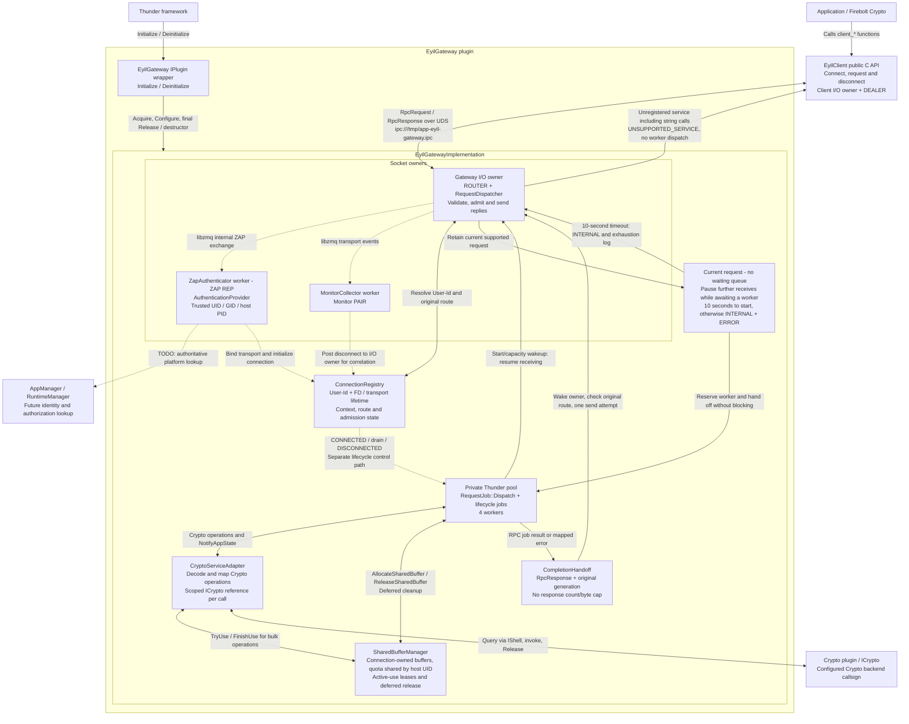

Solid arrows show API calls and RPC data flow. Dashed arrows show authentication,
monitor events and connection lifecycle control. The ZAP and monitor arrows are
libzmq's internal exchanges; they do not mean the ROUTER owner uses REP or PAIR.
This is a component/call map; the sequence diagrams below define ordering and
failure handling.

| Call or event entering Gateway | Internal path and result | Detailed flow |
| --- | --- | --- |
| Thunder Initialize / Deinitialize | Wrapper acquires/configures the implementation; deactivation releases its sole interface reference and awaits destructor completion | Sections 6.4 and 6.16 |
| client_connect | DEALER handshake reaches ZAP; bind a unique User-Id to the transport/context and settle the worker-side NotifyAppState(CONNECTED) attempt before ZAP success. Backend failure is logged separately and does not reject the transport | Section 6.5 |
| client_send_request / client_send_request_async carrying a Crypto RpcRequest | ROUTER owner validates/adopts the current request, pauses further receives while waiting up to 10 seconds for a worker, then dispatches or returns INTERNAL; completions use the same owner | Sections 6.6–6.9 |
| client_send_request_string / client_send_request_string_async | ROUTER rejects the unrouted service=0 envelope with RPC_STATUS_UNSUPPORTED_SERVICE before worker admission; client exposes the received status as text | Sections 5.8–5.9 and 6.6 |
| ALLOCATE_SHARED_BUFFER / RELEASE_SHARED_BUFFER | Worker calls SharedBufferManager locally. Allocation returns buffer_id, name and size; release acceptance blocks new use and defers physical cleanup while access remains active or unresolved | Sections 6.10–6.11 and 6.13 |
| ENCRYPT / DECRYPT / SIGN / VERIFY | Worker-side adapter acquires an execution-time buffer lease, calls ICrypto using trusted context/object metadata, and ends the lease when backend access is definitively complete | Section 6.12 |
| Other Crypto operations | Adapter queries the configured callsign through IShell, invokes the mapped ICrypto method and releases the reference immediately after that call | Sections 6.7–6.9 |
| Peer closure after client_disconnect or unexpected transport loss | PAIR event identifies the original connection; immediately close its admission, drain accepted work, notify DISCONNECTED with its ApplicationContext through the private pool and finalize releasable resources; no grace period or wait for another connection to close | Section 6.14 |

### 6.2 Thread model and private Thunder pool

Contract requirements: [GR-01 Socket owners and private request workers](../openspec/specs/gateway-routing/spec.md#requirement-gr-01-socket-owners-and-private-request-workers).

Coverage: **AC1.1–AC1.3, AC1.7**.

#### Current request, receive pause and worker timeout

Contract requirements: [GR-02 Current-request admission and worker-start deadline](../openspec/specs/gateway-routing/spec.md#requirement-gr-02-current-request-admission-and-worker-start-deadline),
[DG-02 Worker capacity and retained-cleanup diagnostics](../openspec/specs/diagnostics/spec.md#requirement-dg-02-worker-capacity-and-retained-cleanup-diagnostics).

For example, `reason=worker_pool_exhausted workers=4 running=4 reserved=0
wait_ms=10000`, followed by request ID, service and connection generation,
identifies a request that could not start while all four workers were occupied.

#### Initial resource policy

Contract requirements: [GR-03 Resource and transport policy](../openspec/specs/gateway-routing/spec.md#requirement-gr-03-resource-and-transport-policy).

This revised sizing decision supersedes the shared-memory proposal's section
6.3 limits and examples requiring larger allocations. The proposal's ownership,
error and deferred-release contracts still apply. A buffer's capacity includes
both input and output; it is not a plaintext-size allowance. There is no global
shared-memory cap. Backing-space preallocation must still succeed or return
CRYPTO_ERROR_OPERATION_FAILED. Request/response messages retain the Unlimited
policy; the shared-buffer limit must not become a transport message-size cap.

### 6.3 Runtime records and synchronization

Contract requirements: [GL-02 Runtime records and synchronization](../openspec/specs/gateway-lifecycle/spec.md#requirement-gl-02-runtime-records-and-synchronization).

### 6.4 Startup and partial-start failure

Contract requirements: [GL-03 Startup, configuration failures and rollback](../openspec/specs/gateway-lifecycle/spec.md#requirement-gl-03-startup-configuration-failures-and-rollback).

Coverage: **AC1.1–AC1.3, AC1.7**.

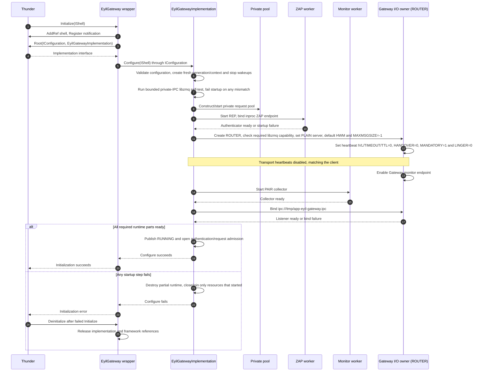

### 6.5 ZAP, interim identity and future AppManager lookup

Contract requirements: [CI-02 Independent interim connection contexts](../openspec/specs/connection-identity/spec.md#requirement-ci-02-independent-interim-connection-contexts),
[CY-03 Authentication-time CONNECTED and session bookkeeping](../openspec/specs/crypto-integration/spec.md#requirement-cy-03-authentication-time-connected-and-session-bookkeeping).

Coverage: **AC1.2, AC1.4–AC1.6; AC2-Client.2–AC2-Client.3**.

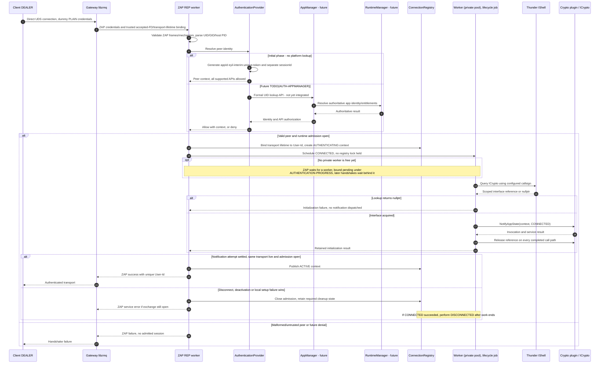

Platform activation order establishes availability, not a bound on the duration
of NotifyAppState(CONNECTED). The single ZAP REP exchange waits for its lifecycle
job before replying, so a slow call can delay subsequent authentication. The
client's 15-second connect timeout does not cancel that job. Admission waiting,
lifecycle-worker capacity and late-result cleanup are tracked under
AUTHENTICATION-PROGRESS in section 7.2; no backend execution timeout or forced
thread cancellation is introduced by the current design.

### 6.6 Request ingress, dispatch and response delivery

Contract requirements: [GR-02 Current-request admission and worker-start deadline](../openspec/specs/gateway-routing/spec.md#requirement-gr-02-current-request-admission-and-worker-start-deadline),
[RP-02 Status layers and correlated Gateway failures](../openspec/specs/rpc-protocol/spec.md#requirement-rp-02-status-layers-and-correlated-gateway-failures),
[GR-04 Ingress validation and accepted ownership](../openspec/specs/gateway-routing/spec.md#requirement-gr-04-ingress-validation-and-accepted-ownership).

Coverage: **AC1.1, AC1.5–AC1.11; AC2-Client.5**.

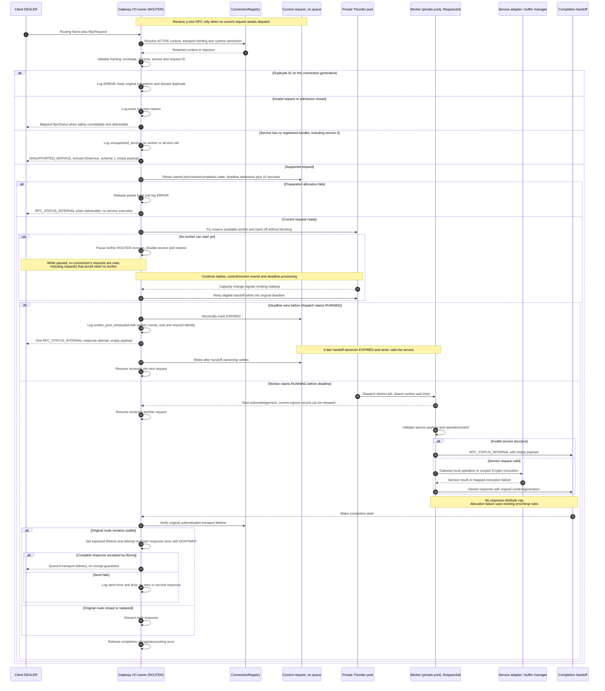

#### Response ownership and completion handoff

Contract requirements: [GR-05 Completion handoff](../openspec/specs/gateway-routing/spec.md#requirement-gr-05-completion-handoff).

#### One response send attempt

Contract requirements: [GR-06 Single nonblocking response attempt](../openspec/specs/gateway-routing/spec.md#requirement-gr-06-single-nonblocking-response-attempt).

The 10-second Gateway deadline bounds the current admitted request's wait for
a worker, not backend execution or reply delivery. Adding a backend execution
deadline would not make a dropped error reply observable to the client, cancel an in-process
ICrypto call or prove that shared memory is no longer in use. The selected
contract introduces no such execution deadline. Bounded retention after an
undelivered async response would require a separately agreed client retirement
policy or connection teardown; it cannot be guaranteed by a Gateway timer alone.

### 6.7 Crypto adapter: per-call ICrypto references and per-connection sessions

Contract requirements: [SDK-02 Compatible build and runtime dependencies](../openspec/specs/sdk-installation/spec.md#requirement-sdk-02-compatible-build-and-runtime-dependencies),
[CY-01 Configured backend list and availability](../openspec/specs/crypto-integration/spec.md#requirement-cy-01-configured-backend-list-and-availability).

Coverage: **AC1.8, AC1.12**.

#### Callsign configuration: BitBake to CMake to runtime

Contract requirements: [CY-01 Configured backend list and availability](../openspec/specs/crypto-integration/spec.md#requirement-cy-01-configured-backend-list-and-availability),
[GL-03 Startup, configuration failures and rollback](../openspec/specs/gateway-lifecycle/spec.md#requirement-gl-03-startup-configuration-failures-and-rollback),
[GL-01 Wrapper and implementation ownership](../openspec/specs/gateway-lifecycle/spec.md#requirement-gl-01-wrapper-and-implementation-ownership).

```cmake
set(PLUGIN_EYILGATEWAY_CRYPTO_CALLSIGN ""
    CACHE STRING "Optional Crypto backend callsign"
)
```

```bitbake
EYILGATEWAY_CRYPTO_CALLSIGN ?= ""
EXTRA_OECMAKE += "-DPLUGIN_EYILGATEWAY_CRYPTO_CALLSIGN=${EYILGATEWAY_CRYPTO_CALLSIGN}"
```

The generated Thunder configuration carries a list of service/callsign entries:

```json
{
    "callsign": "org.rdk.EyilGateway",
    "configuration": {
        "backends": [
            { "service": "crypto", "callsign": "" }
        ],
        "workers": 4
    }
}
```

#### Interface ownership

Contract requirements: [CY-02 Scoped Thunder interface references](../openspec/specs/crypto-integration/spec.md#requirement-cy-02-scoped-thunder-interface-references).

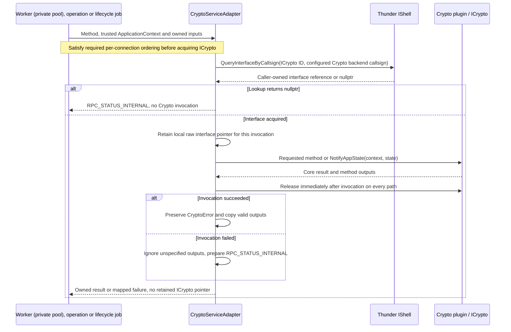

#### Application context is separate from the interface reference

Contract requirements: [CY-03 Authentication-time CONNECTED and session bookkeeping](../openspec/specs/crypto-integration/spec.md#requirement-cy-03-authentication-time-connected-and-session-bookkeeping).

For example, GenerateKey returns a key ID, Gateway releases its ICrypto
reference, and a later Sign obtains another reference and passes the same
ApplicationContext and key ID. Crypto must preserve that session's state across
these independent interface references. Releasing an interface must not invoke
NotifyAppState(DISCONNECTED) or discard the app's keys.

### 6.8 Crypto operation routing map

Contract requirements: [CY-04 Crypto operation destinations and conversions](../openspec/specs/crypto-integration/spec.md#requirement-cy-04-crypto-operation-destinations-and-conversions).

#### Client and Gateway boundaries in the Crypto sequences

Contract requirements: [CY-05 Service consumer and backend policy boundary](../openspec/specs/crypto-integration/spec.md#requirement-cy-05-service-consumer-and-backend-policy-boundary),
[GR-02 Current-request admission and worker-start deadline](../openspec/specs/gateway-routing/spec.md#requirement-gr-02-current-request-admission-and-worker-start-deadline),
[GR-06 Single nonblocking response attempt](../openspec/specs/gateway-routing/spec.md#requirement-gr-06-single-nonblocking-response-attempt),
[SM-05 Execution-time access and definitive completion](../openspec/specs/shared-memory/spec.md#requirement-sm-05-execution-time-access-and-definitive-completion),
[RP-02 Status layers and correlated Gateway failures](../openspec/specs/rpc-protocol/spec.md#requirement-rp-02-status-layers-and-correlated-gateway-failures),
[DG-01 Severity, context and confidentiality](../openspec/specs/diagnostics/spec.md#requirement-dg-01-severity-context-and-confidentiality).

### 6.9 Non-shared-memory operations

Contract requirements: [CY-05 Service consumer and backend policy boundary](../openspec/specs/crypto-integration/spec.md#requirement-cy-05-service-consumer-and-backend-policy-boundary).

Coverage: **AC1.8; AC2-Firebolt.1–AC2-Firebolt.2**. This flow applies to the eleven key/random
operations above; allocation/release and the four bulk-data operations have
separate flows.

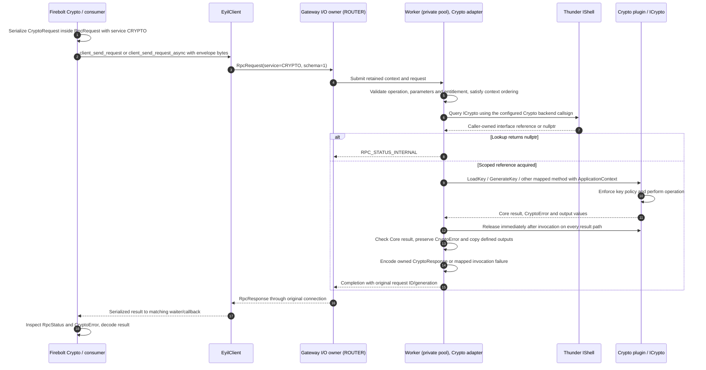

### 6.10 Shared-memory identity, records and invariants

Contract requirements: [SM-01 Allocation identity and trusted application cooperation](../openspec/specs/shared-memory/spec.md#requirement-sm-01-allocation-identity-and-trusted-application-cooperation).

Coverage: **AC1.9–AC1.12**. Allocation is a Gateway responsibility; mapping by
the application and access by Crypto are separate responsibilities.

#### Application quota shared across connections

Contract requirements: [SM-02 Shared trusted-host-UID quota](../openspec/specs/shared-memory/spec.md#requirement-sm-02-shared-trusted-host-uid-quota),
[SM-01 Allocation identity and trusted application cooperation](../openspec/specs/shared-memory/spec.md#requirement-sm-01-allocation-identity-and-trusted-application-cooperation).

For example, connections A and B of one UID may hold two buffers each. A fifth
allocation from A, B or a newly opened connection C fails with
RPC_STATUS_OK and CRYPTO_ERROR_OPERATION_FAILED. It becomes possible after one
allocation completes cleanup. A different UID has its own four-slot allowance;
there is no Gateway-wide shared-memory cap.

The proposal's namespace path uses the peer's mount view. Access is subject to
procfs checks and can become unavailable when the peer or its main thread exits.
See [proc_pid_root](https://man7.org/linux/man-pages/man5/proc_pid_root.5.html).
The selected trust model requires the app to preserve that name/object binding.
Retaining an object FD alone does not prevent replacement of its pathname.
Keep the proposal's app-namespace backend path for this version. The discussed
`/proc/<gateway-pid>/fd/<fd>` alternative is not selected: it would require
different procfs/open rules and still would not prove that the correct peer
namespace was captured initially or prevent modification/truncation. The
existing path remains subject to backend-completion validation in section 7.1.

**PID reuse edge case:** if the peer exits and its PID has not been reused,
opening `/proc/<pid>/root/dev/shm` fails; log ERROR and return the existing
allocation-failure result. Linux can reuse a freed PID after the allocation
counter wraps at [pid_max](https://docs.kernel.org/admin-guide/sysctl/kernel.html#pid-max),
so the path could then refer to another process. Retained directory/object FDs
protect resources only after capture.

#### Region presence and overlap rules

Contract requirements: [SM-03 Region presence, overlap and output validation](../openspec/specs/shared-memory/spec.md#requirement-sm-03-region-presence-overlap-and-output-validation),
[SM-02 Shared trusted-host-UID quota](../openspec/specs/shared-memory/spec.md#requirement-sm-02-shared-trusted-host-uid-quota).

#### Application cleanup after completion or error

Contract requirements: [SM-08 Application release and abandoned allocations](../openspec/specs/shared-memory/spec.md#requirement-sm-08-application-release-and-abandoned-allocations).

#### Application/container access and failure limits

Contract requirements: [CY-06 Backend shared-buffer access contract](../openspec/specs/crypto-integration/spec.md#requirement-cy-06-backend-shared-buffer-access-contract).

The app opens its allocation with O_RDWR and maps it with MAP_SHARED. Its
mapping is writable without going through EyilClient or Gateway. A client-side
mutex or an advisory in-use flag can coordinate cooperating callers, but cannot
stop another app thread from writing, truncating or unlinking the object using
ordinary memory access or system calls. A container's private /dev/shm separates
its namespace; it does not remove the app's access to its own allocation.

| App action | Effect and error boundary |
| --- | --- |
| Close its FD or unmap its own view | Does not invalidate an FD or mapping already held by Gateway or Crypto; no Crypto failure is implied |
| Unlink before Crypto opens the object | A later open can fail; Crypto handles that failure and returns its service result |
| Unlink after Crypto has opened/mapped the object | Existing references remain usable; unlink alone does not cancel the operation |
| Replace the name | A later open may resolve a different object; failure is not guaranteed merely because Gateway still holds the original FD |
| Rewrite input through its mapping during execution | Crypto may consume changed or inconsistent data without detecting an error |
| Shrink an object already mapped by Crypto | Access beyond its new end can raise SIGBUS; this is not automatically a returned CryptoError |

These are Linux shared-memory semantics, described by
[shm_open/shm_unlink](https://man7.org/linux/man-pages/man3/shm_open.3.html),
[mmap](https://man7.org/linux/man-pages/man2/mmap.2.html) and the shared-memory
hazards in [memfd_create](https://man7.org/linux/man-pages/man2/memfd_create.2.html).
They do not require Gateway to preserve an invalid request until it succeeds.

EyilClient cannot revoke another process's mapping, and Gateway changing file
permissions does not revoke existing writable mappings. Additional containment
of a violating app would be a separate platform/backend requirement. It is not
part of the selected path/name-based ICrypto integration.

### 6.11 AllocateSharedBuffer and client mapping

Container-owned tmpfs creation and cleanup use
[SM-10 Scoped private-worker filesystem identity](../openspec/specs/shared-memory/spec.md#requirement-sm-10-scoped-private-worker-filesystem-identity).
The host's root UID may be unmapped in the container's tmpfs user namespace;
the private worker uses the trusted mapped UID/GID and restores its filesystem
credentials and capability state before returning to other work.

Contract requirements: [SM-04 Exclusive allocation and backing-space reservation](../openspec/specs/shared-memory/spec.md#requirement-sm-04-exclusive-allocation-and-backing-space-reservation).

Coverage: **AC1.9–AC1.11; AC2-Client.5; AC2-Firebolt.1–AC2-Firebolt.2**. No ICrypto call is involved.

Preallocation does not prevent later app truncation, hole punching, mutation,
or unrelated memory pressure. Keep the cooperation and lease rules; this is
not a claim that all SIGBUS/OOM causes are removed. Validate tmpfs support and
memory-cgroup charging on the product: pages allocated by Gateway need not be
charged to the app's cgroup. EyilClient does not allocate or preallocate these
objects.

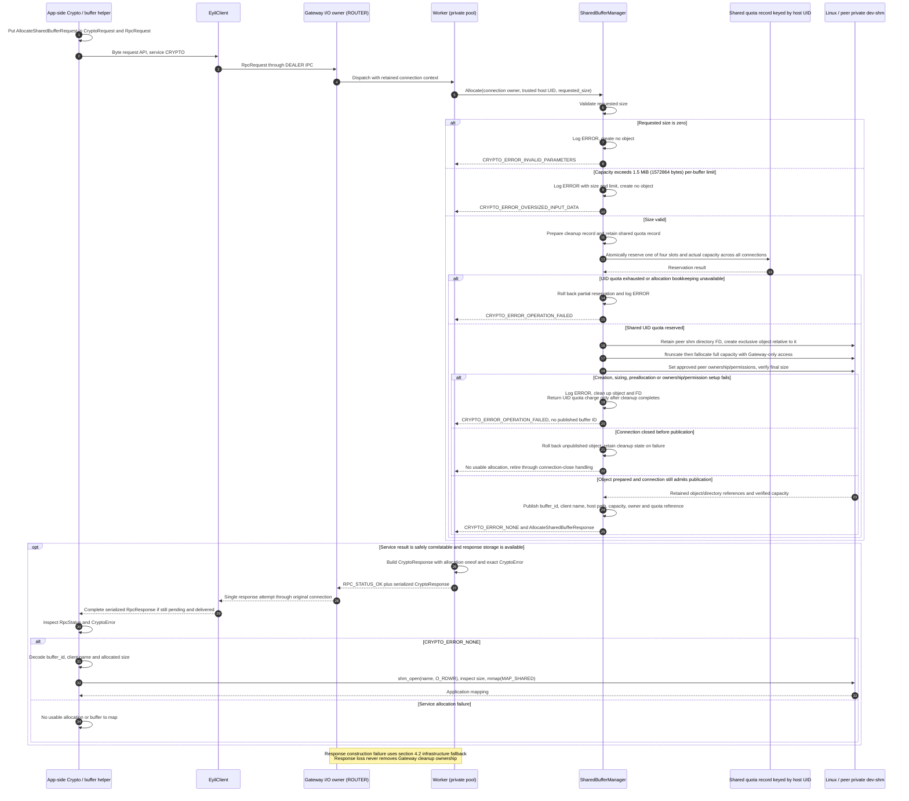

### 6.12 Shared-memory operations: common backend boundary

The operation table referenced by this sequence is preserved in
[SM-03 Region presence, overlap and output validation](../openspec/specs/shared-memory/spec.md#requirement-sm-03-region-presence-overlap-and-output-validation).

Contract requirements: [SM-05 Execution-time access and definitive completion](../openspec/specs/shared-memory/spec.md#requirement-sm-05-execution-time-access-and-definitive-completion),
[CY-06 Backend shared-buffer access contract](../openspec/specs/crypto-integration/spec.md#requirement-cy-06-backend-shared-buffer-access-contract),
[SM-03 Region presence, overlap and output validation](../openspec/specs/shared-memory/spec.md#requirement-sm-03-region-presence-overlap-and-output-validation).

The four shared-memory operations follow one flow, drawn once below. Each
invocation acquires its own scoped ICrypto reference. The CONNECTED attempt has
already settled during authentication; null lookup and invocation failures follow
sections 6.7 and 6.15. The table lists what differs per operation. Each
`break` block ends the job early; its error completion still reaches the client
through the same single send attempt as the final response.

Coverage: **AC1.8–AC1.11; AC2-Firebolt.1–AC2-Firebolt.2**.

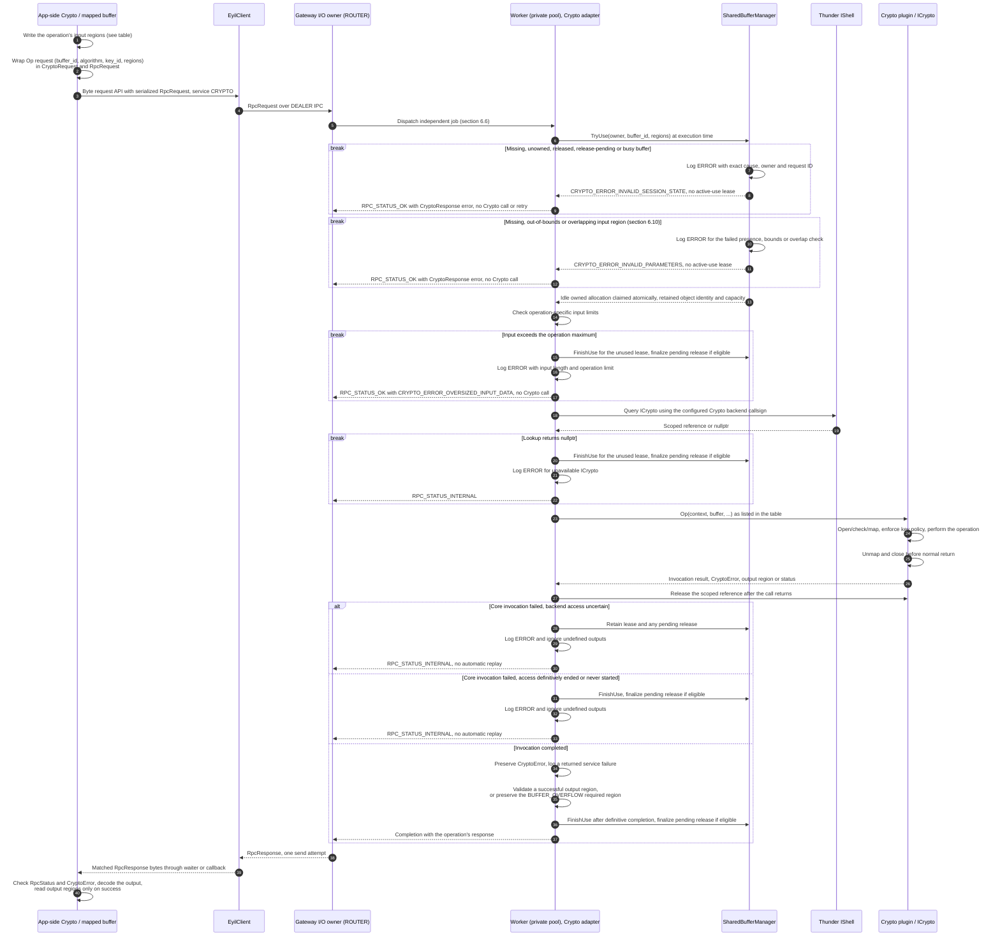

### 6.13 ReleaseSharedBuffer and conflicting buffer operations

Coverage: **AC1.9–AC1.12**. Release is a Gateway-local operation.

#### Release acceptance and deferred destruction

Contract requirements: [SM-06 Release acceptance and execution-time conflicts](../openspec/specs/shared-memory/spec.md#requirement-sm-06-release-acceptance-and-execution-time-conflicts).

#### Atomic state and execution-time conflicts

Contract requirements: [SM-06 Release acceptance and execution-time conflicts](../openspec/specs/shared-memory/spec.md#requirement-sm-06-release-acceptance-and-execution-time-conflicts).

#### Release request sequence

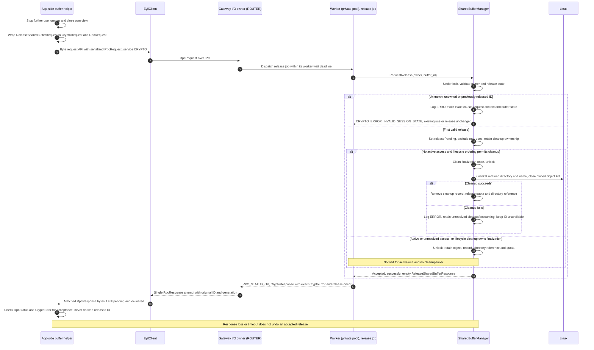

The following flow shows release during an active operation on a live connection:

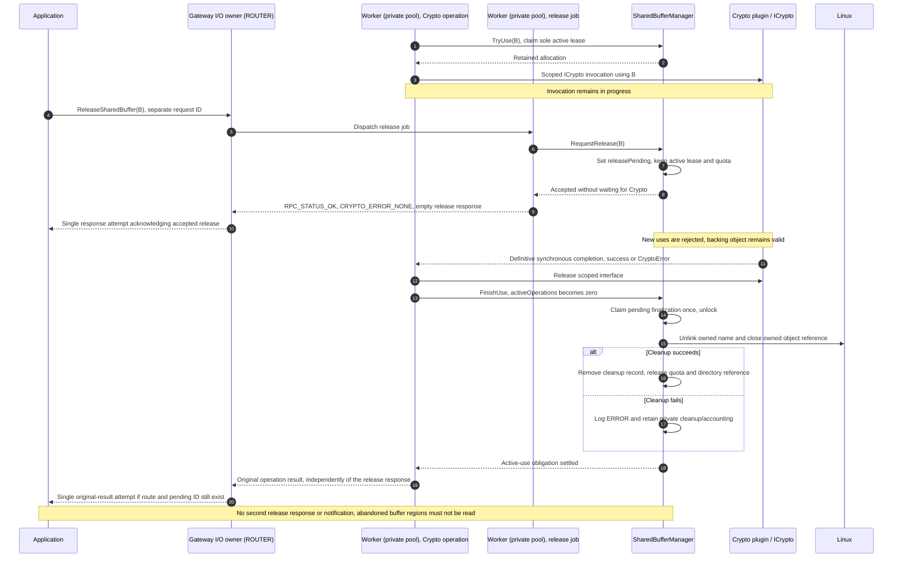

The release-before-use case is also intentionally allowed:

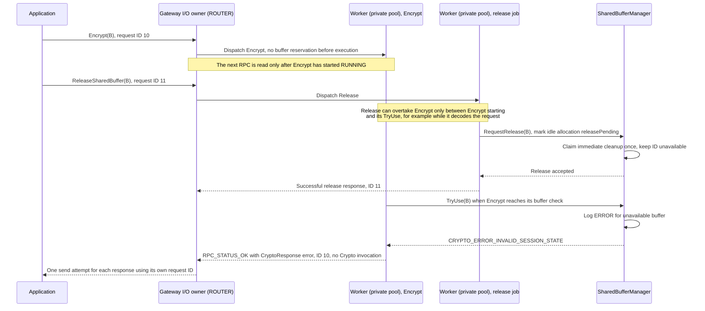

#### Completion, cleanup failures and response ownership

Contract requirements: [SM-07 Deferred finalization and cleanup failures](../openspec/specs/shared-memory/spec.md#requirement-sm-07-deferred-finalization-and-cleanup-failures).

#### Coordination with disconnect and plugin drain

Contract requirements: [SM-07 Deferred finalization and cleanup failures](../openspec/specs/shared-memory/spec.md#requirement-sm-07-deferred-finalization-and-cleanup-failures).

### 6.14 Disconnect detection, PID observations and hibernation

Coverage: **AC1.3, AC1.5–AC1.6, AC1.12**.

#### Required connection-to-FD binding

Contract requirements: [CI-03 FD and transport-lifetime binding](../openspec/specs/connection-identity/spec.md#requirement-ci-03-fd-and-transport-lifetime-binding).

#### Rationale: authentication succeeds before the first message

Coverage: **AC1.3, AC1.5–AC1.6, AC1.12**. The source extension supplies the common
connection identity needed for cleanup under the selected authentication-time
session lifecycle. It is not needed merely to obtain an accepted FD.

Unmodified libzmq 4.3.4 already reports the accepted transport FD through
ZMQ_EVENT_ACCEPTED. Its ZAP request exposes the peer credentials, but neither
that FD nor a shared connection-lifetime identifier. A received application
message can provide User-Id and FD together, using message metadata and the
existing ZMQ_SRCFD accessor. That last association exists only if a message
actually reaches the Gateway receiver.
[Monitor events](https://libzmq.readthedocs.io/en/latest/zmq_socket_monitor.html),
[4.3.4 message metadata](https://github.com/zeromq/libzmq/blob/v4.3.4/src/stream_engine_base.cpp),
[4.3.4 ZAP request construction](https://github.com/zeromq/libzmq/blob/v4.3.4/src/zap_client.cpp).

The distinction between connection readiness and first-message delivery is
essential. The transport handshake and ZAP exchange happen during connection
setup. client_connect returns CLIENT_OK after handshake success; this does not
require the application to submit a Crypto RPC or confirm that Gateway has
received any application message. The application may immediately disconnect
one of its Clients while keeping its other connections open. A transport failure
can also occur before its first queued message reaches Gateway.

Gateway already creates an independent ApplicationContext and attempts
NotifyAppState(CONNECTED) during authentication, before ZAP success. When that
notification succeeds, it needs matching cleanup even if no RPC follows. This failure does not require a
shared-memory allocation to exist: the authenticated context and Crypto session
are enough to make targeted disconnect handling necessary.

##### Failure sequence without a shared transport identity

Clients A and B below are two DEALER sockets in the same application process,
with identical UID/GID/PID. The diagram shows B's authentication being processed
first to illustrate independent scheduling. The A/B labels describe the actual
connections for the reader; they are not extra information available to the ZAP
handler. Neither connection sends an application message in this sequence.

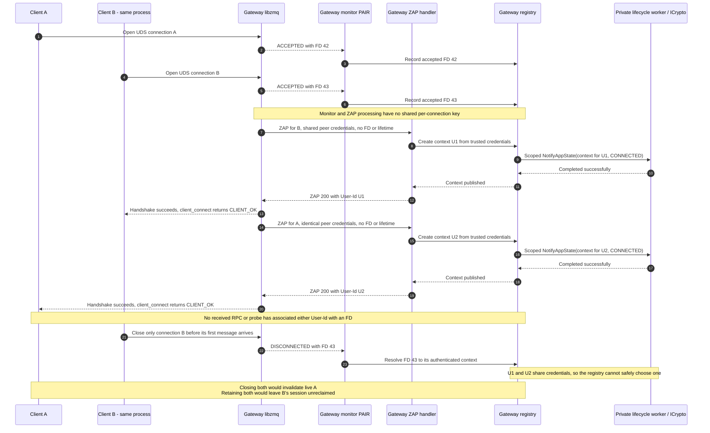

Adding UID/GID/PID to the disconnect event identifies the process but still
does not distinguish U1 from U2. Pairing the first ACCEPTED event with the first
ZAP request is also insufficient: independent queues and I/O threads do not
provide that ordering contract. The FD can identify the disconnected transport
while the application still lacks its association with the authenticated session.

##### Why an immediate request or automatic probe does not close the gap

ZMQ_PROBE_ROUTER=1 can make DEALER automatically send an empty message when a
connection is established. It defaults to 0. This is a one-time probe, not a
periodic heartbeat; Gateway would have to recognize it separately from an RPC.
If received, it can help associate routing identity, User-Id and FD. It is not
enabled by the current client design.
[ZMQ_PROBE_ROUTER](https://libzmq.readthedocs.io/en/latest/zmq_setsockopt.html#zmq-probe-router-bootstrap-connections-to-router-sockets).

Neither a probe nor an application HELLO is guaranteed to reach Gateway before
the connection fails. Successful zmq_send only establishes local queue
acceptance. A successful transport handshake is not an acknowledgement that
Gateway's application loop has consumed the probe. The failure sequence above
therefore also applies when a first message was queued but never received.
[Send completion contract](https://libzmq.readthedocs.io/en/latest/zmq_send.html).

An explicit HELLO/ACK protocol could define a different session-activation
boundary and defer Crypto CONNECTED until Gateway receives HELLO. That would
require a new bootstrap contract and rules for all pre-HELLO state. It would
change the selected requirement to bind the context and notify Crypto during
ZAP. The source extension satisfies that existing requirement without depending
on a new application message. FD and outgoing-route reuse also require lifetime
checks independently of when the first message arrives.

##### Selected sequence with the connection-lifetime extension

Contract requirements: [CI-03 FD and transport-lifetime binding](../openspec/specs/connection-identity/spec.md#requirement-ci-03-fd-and-transport-lifetime-binding).

The extension assigns the lifetime before authentication and carries it through
local ZAP metadata, received messages and monitor events. The registry can bind
the FD to User-Id before acknowledging ZAP. The sequence below shows B closing
without an RPC while A remains live.

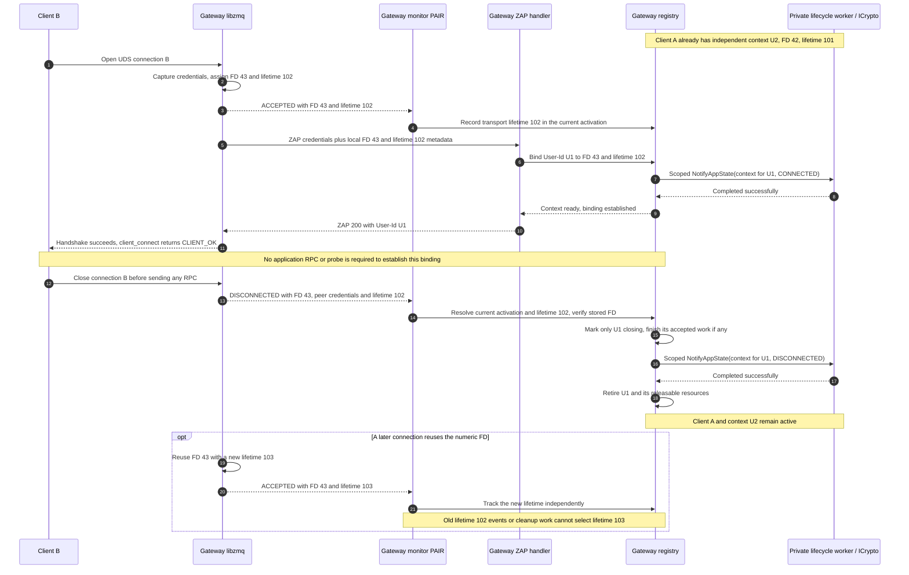

#### Required libzmq extension and platform integration

Contract requirements: [CI-04 Required libzmq extension and guarded replies](../openspec/specs/connection-identity/spec.md#requirement-ci-04-required-libzmq-extension-and-guarded-replies).

#### Startup capability check before admission

Contract requirements: [CI-05 Startup capability verification before admission](../openspec/specs/connection-identity/spec.md#requirement-ci-05-startup-capability-verification-before-admission).

```cpp
uint64_t expected = UINT64_MAX; // Probe before bind; no request can be sent.
if (zmq_setsockopt(router, ZMQ_ROUTER_EXPECTED_CONNECTION_ID,
                  &expected, sizeof(expected)) != 0) {
    return FailStartup("zmq_connection_lifetime_unavailable", zmq_errno());
}
expected = 0;
if (zmq_setsockopt(router, ZMQ_ROUTER_EXPECTED_CONNECTION_ID,
                  &expected, sizeof(expected)) != 0) {
    return FailStartup("zmq_connection_lifetime_reset_failed", zmq_errno());
}
if (zmq_socket_monitor_versioned(router, monitorEndpoint, monitorEvents,
                                 2, ZMQ_PAIR) != 0) {
    return FailStartup("zmq_monitor_v2_unavailable", zmq_errno());
}
// Start the monitor receiver and complete the other startup prerequisites.
// Only then bind the production endpoint and open admission.
```

The extension regression must cover independent connections from one process,
no-request disconnects, rejected/in-progress authentication, closure before ZAP,
FD reuse, context recreation, monitor-v1 compatibility and stale reply rejection
after route reuse. It must also reject replacement of native transport identity
by ZAP metadata. Run it against the selected dependency and runtime configuration;
this specification records required scenarios, not execution results.

**TODO(ZMQ-PLATFORM):** integrate the extension into the product recipe, consume
its properties/events and guarded-send option in Gateway, and verify the
matching headers, library and behavior on the target rootfs. Gateway must still
serialize authentication/disconnect state, retain closing records for late
events and explicitly retire its contexts during local shutdown.

#### Event-driven connection cleanup

Contract requirements: [GL-04 Correlated disconnect and backend notification order](../openspec/specs/gateway-lifecycle/spec.md#requirement-gl-04-correlated-disconnect-and-backend-notification-order),
[CC-08 Prepared process freeze and library unload](../openspec/specs/client-connection/spec.md#requirement-cc-08-prepared-process-freeze-and-library-unload),
[CC-04 Socket configuration and disabled heartbeats](../openspec/specs/client-connection/spec.md#requirement-cc-04-socket-configuration-and-disabled-heartbeats),
[CI-03 FD and transport-lifetime binding](../openspec/specs/connection-identity/spec.md#requirement-ci-03-fd-and-transport-lifetime-binding).

The architect's clarification ties DISCONNECTED to detection of each client's
disconnection and its corresponding ApplicationContext. Do not wait for app
termination, the last connection from that app instance, or a reconnect window.
The application decides when to close; keeping one connection across operations
and idle periods for its lifetime is recommended.

The current implementation design starts teardown immediately and drains
accepted work before invoking DISCONNECTED, because that notification may
release Crypto resources still used by a call. Schedule it as soon as that
drain permits. This is the existing active-work safety ordering; the architect's
quoted clarification establishes the trigger and absence of a grace period
but does not explicitly specify ordering against in-flight Crypto calls.
Section 7.1 retains the abnormal-completion boundary. An idle connection has
no accepted work to drain and its notification is immediately eligible.

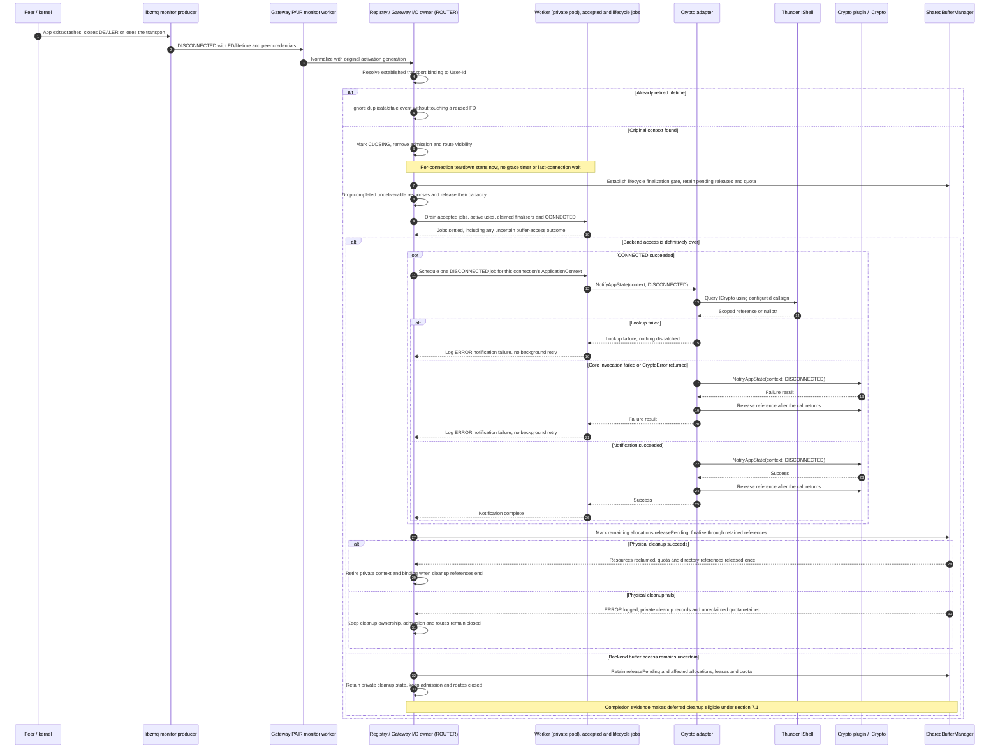

A confirmed exit of an exact process instance can identify all its associated
contexts if process-exit integration is adopted. It needs PID-reuse protection.
A socket event carrying PID/UID is not a process-exit notification: closing
one socket must not remove the process's other connections. Inherited sockets
require a separate ownership policy. Normal socket cleanup needs no process
health polling.

#### Intended process-freeze behavior and prerequisites

Contract requirements: [CC-08 Prepared process freeze and library unload](../openspec/specs/client-connection/spec.md#requirement-cc-08-prepared-process-freeze-and-library-unload),
[CC-04 Socket configuration and disabled heartbeats](../openspec/specs/client-connection/spec.md#requirement-cc-04-socket-configuration-and-disabled-heartbeats),
[CI-03 FD and transport-lifetime binding](../openspec/specs/connection-identity/spec.md#requirement-ci-03-fd-and-transport-lifetime-binding).

The intended operation freezes the existing process with its descriptors
preserved, for example through a process stop or container freezer. Linux's
[cgroup freezer](https://docs.kernel.org/admin-guide/cgroup-v2.html) stops the
processes until thawed; freezing is distinct from killing them.

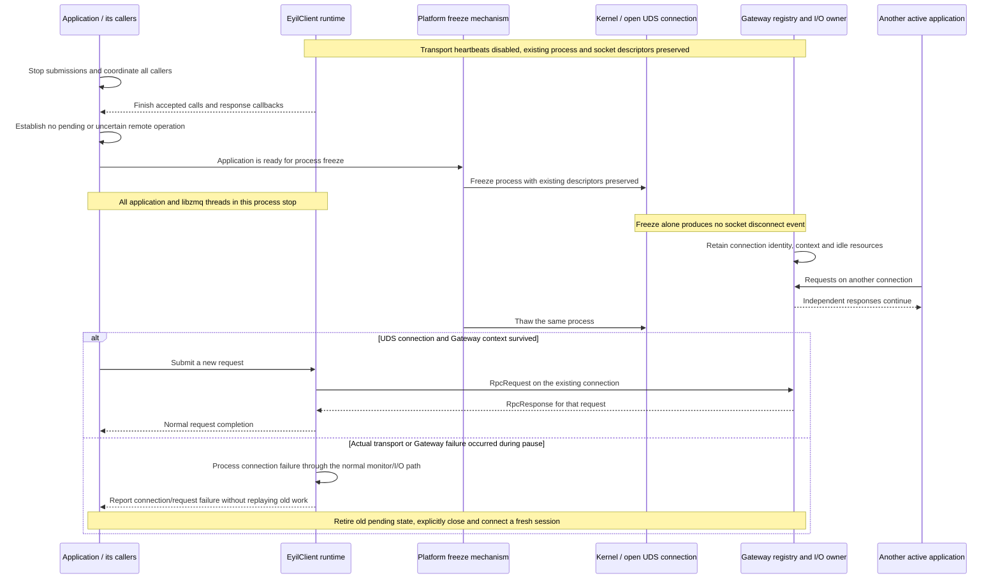

#### Gateway behavior if a client stops receiving

Contract requirements: [GR-07 Unexpected frozen or slow receiver](../openspec/specs/gateway-routing/spec.md#requirement-gr-07-unexpected-frozen-or-slow-receiver).

#### Platform validation requirements

Validate process freeze and disconnect behavior on the supported device with
its configured libzmq, monitor-event format and platform hibernation mechanism.
Tests must cover a prepared idle process frozen longer than 15 seconds,
continued operation of other clients, thaw with the same connection, transport
backpressure and cleanup after an actual socket closure. Section 6.17 lists the
runtime acceptance scenarios.

### 6.15 On-demand Crypto lookup and invocation failures

Contract requirements: [CY-07 On-demand lookup failures and recovery boundary](../openspec/specs/crypto-integration/spec.md#requirement-cy-07-on-demand-lookup-failures-and-recovery-boundary).

Coverage: **AC1.8–AC1.12**.

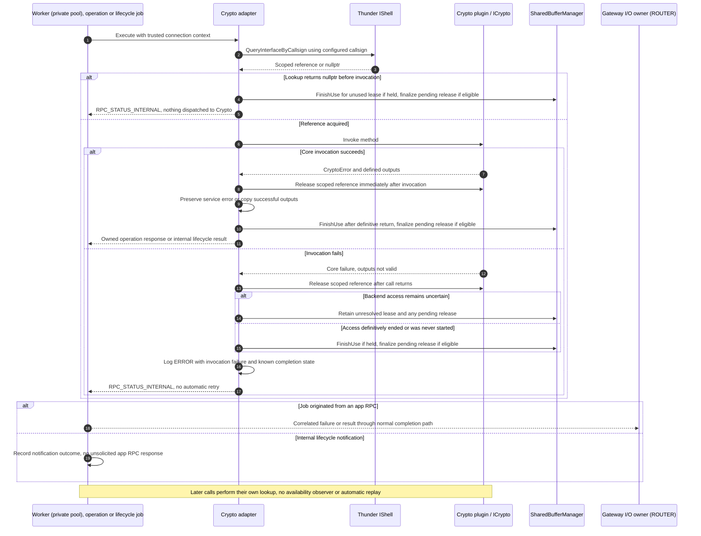

### 6.16 Gateway deactivation, reactivation and fresh startup after a crash

Contract requirements: [GL-05 Admission cutoff and graceful drain](../openspec/specs/gateway-lifecycle/spec.md#requirement-gl-05-admission-cutoff-and-graceful-drain).

Coverage: **AC1.1–AC1.3, AC1.5–AC1.12**.

#### States and explicit stop ownership

Contract requirements: [GL-01 Wrapper and implementation ownership](../openspec/specs/gateway-lifecycle/spec.md#requirement-gl-01-wrapper-and-implementation-ownership).

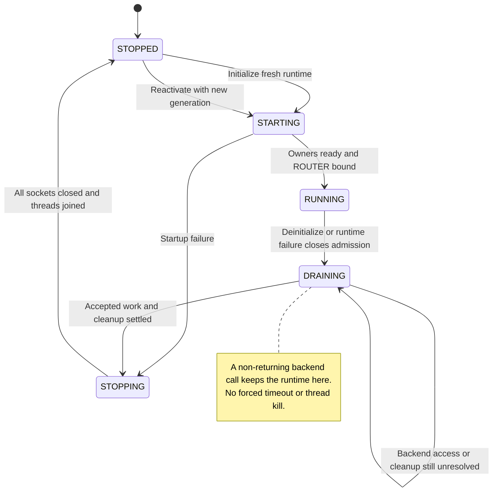

#### Admission and drain contract

Contract requirements: [GL-05 Admission cutoff and graceful drain](../openspec/specs/gateway-lifecycle/spec.md#requirement-gl-05-admission-cutoff-and-graceful-drain).

#### Deactivation sequence

Contract requirements: [DG-02 Worker capacity and retained-cleanup diagnostics](../openspec/specs/diagnostics/spec.md#requirement-dg-02-worker-capacity-and-retained-cleanup-diagnostics).

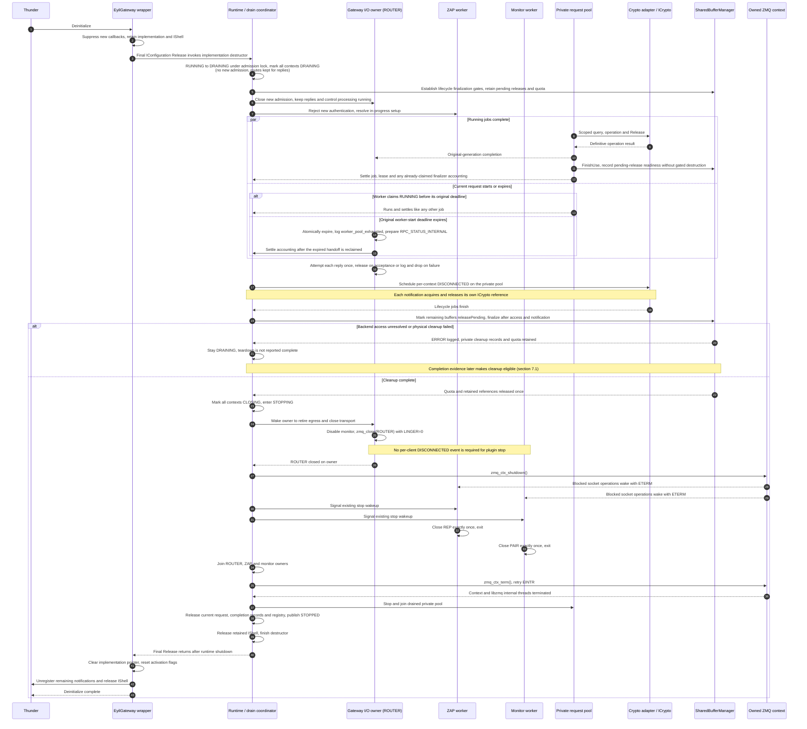

#### ROUTER and context teardown

Contract requirements: [GL-01 Wrapper and implementation ownership](../openspec/specs/gateway-lifecycle/spec.md#requirement-gl-01-wrapper-and-implementation-ownership),
[GL-06 Socket and context teardown](../openspec/specs/gateway-lifecycle/spec.md#requirement-gl-06-socket-and-context-teardown).

#### Reactivation and fresh startup after a crash

Contract requirements: [GL-07 Reactivation and fresh startup after crash](../openspec/specs/gateway-lifecycle/spec.md#requirement-gl-07-reactivation-and-fresh-startup-after-crash).

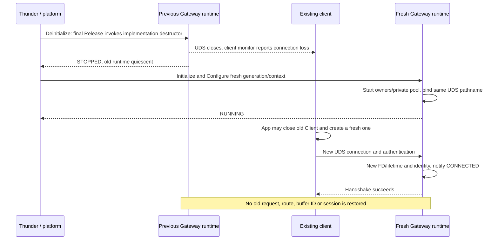

### 6.17 Implementation order and verification targets

Build Gateway against the selected ICrypto API and implement its Crypto adapter
as part of this delivery. The following order separates transport, operation
routing and lifecycle work without deferring the ICrypto dependency:

1. Implement the FD/lifetime binding and fresh-runtime stop/reactivation
   contract. Apply the agreed client callback and synchronous local-close
   contracts, together with the selected 15-second
   connect/sync-request/async-send deadlines, the single client submission slot and
   CLIENT_OUT_OF_MEMORY handling, with no async response timeout. Disable ZeroMQ
   heartbeats on both ends. Implement terminal client loss, zero-linger queue
   disposal and explicit creation of a fresh Client. Apply the agreed idle
   hibernation contract; automatic recovery after Thunder failure or Gateway
   reload is outside scope.
2. Implement the agreed RPC envelope, local error behavior and selected async
   completion contract. Document that contract in the public API. Add EyilClient's
   owner loop, single slot with mutex/condition/wakeup, pending map and shutdown.
   Prove callers wait/publish/claim/send independently of earlier responses.
   Implement string service=0 requests and Gateway UNSUPPORTED_SERVICE replies,
   including symbolic status text in both string methods. Preserve the plain-text
   public boundary.
3. Implement startup, ZAP/interim identities, authentication-time CONNECTED,
   the registry and monitor binding. Prove multiple connections from one PID
   remain independent, including closure before the first request.
4. Add four private workers and one current ingress record, with no request
   queue. Pause further receives while that record awaits a worker, continue
   replies/control processing, and return INTERNAL with worker_pool_exhausted
   ERROR if Dispatch has not started within ten seconds. Validate capacity/start
   wakeups, timeout races, per-call ICrypto ownership and completion routing.
5. Add Gateway-local allocations, atomic execution-time ownership/state
   checks and active-use leases. Reject competing uses and uses of retired IDs
   without reserving uses before execution or replaying an operation. Accept valid release
   immediately, defer destruction until active access ends, and retain quota
   through cleanup. Apply the trusted-app cooperation contract, retained directory
   references and exactly-once finalization across release/disconnect/stop.
   Validate the exceptional completion boundary in section 7.1 with the
   platform/Crypto implementation.
6. Integrate AppManager/RuntimeManager authentication only at the marked TODOs,
   once their formal API exists. Hibernation needs no lifecycle subscription;
   application preparation follows the selected idle-process contract.
7. Validate CONNECTED during authentication, accepted-work drain,
   DISCONNECTED, owner-thread teardown and clean reactivation. Exercise the
   ICrypto contract without adding backend policy, health monitoring or replay.

| Test scope | Scenario / evidence required |
| --- | --- |
| L1 client | Nonzero request IDs are never reused within a generation, including after failed submission/retirement; counter exhaustion cannot wrap; response matching and duplicate/late replies; argument/output ownership; each waiter resolves once and each response callback runs at most once |
| L1 async send | API cannot return CLIENT_OK before zmq_send accepts the message; EAGAIN keeps the send waiter pending; timeout/error cancels unsent work with no callback; race acceptance against deadline and disconnect |
| L1 async response | A response later than 15 seconds is delivered; no response timer exists; original callback signatures carry valid Gateway error responses; connection loss or local response-processing failure retires the record without an error callback |
| L1 callback execution | Request calls from the I/O-owner callback return CLIENT_INVALID_ARGUMENT; freeing a response is allowed; callback runs without internal locks and may precede submitting-thread resumption |
| L1 connection callbacks | Initial success and every startup failure produce no callback; later unexpected loss produces CLIENT_CONNECTION_LOST at most once; explicit close suppresses new callback claims; RESTORED and TERMINATED are never emitted, including after an explicit fresh connect |
| L1 client submission slot | At most one published/claimed unsent request; competing callers wait with the mutex released; owner explicitly claims it; acceptance/failure frees the slot, sent requests remain independently pending; no queue container or queue-full result |
| L1 slot waiting and cancellation | Occupy the slot with EAGAIN, keep receiving earlier responses/PAIR events, expire a competing caller without publication, and prove its request never sends; clear SEND_IN_PROGRESS after every nonaccepted attempt and apply latched cancellation before retry; race cancellation with acceptance and preserve accepted async CLIENT_OK |
| L1 synchronous pre-send timeout | Expire a published/claimed sync request before TryBeginSend and prove no later send occurs; expire during an admitted attempt and resolve its actual outcome before returning CLIENT_TIMEOUT, even if accepted; verify the same behavior for both sync methods |
| L1 request-specific retirement | Retire response/timeout for accepted A while B occupies the slot; B remains intact. Repeat completion/retirement for A and inject preparation failure after timeout/close; preserve each winning result and release each matching slot/reference once |
| L1 premature response | Inject a response for a pending entry whose send is not yet accepted; discard/log it without callback, retirement or slot release. A fast valid reply after recorded acceptance still completes normally |
| L1 slot-waiter teardown | Wake callers that have not entered the pending map on explicit close, transport loss and connection-wide decode allocation failure; propagate CLIENT_NOT_CONNECTED, CLIENT_COMMUNICATION_ERROR and CLIENT_OUT_OF_MEMORY respectively, without allocating or waiting for EMPTY; a later explicit close cannot overwrite the loss reason for already admitted callers |
| L1 client startup allocation failures | Fail runtime, thread-start and owner-side setup allocation; CLIENT_OUT_OF_MEMORY leaves output NULL, closes partial resources and joins only started threads |
| L1 client submission allocation failures | Inject failure during input copy, request/waiter creation, serialization and pending-map insertion; all four request APIs return CLIENT_OUT_OF_MEMORY before send acceptance, release partial state and cannot send later or invoke a callback |
| L1 client response allocation failures | Sync returns CLIENT_OUT_OF_MEMORY and NULL/0; matched async responses retire without a callback or revision of accepted CLIENT_OK, even before the submitter resumes; uncorrelatable decode failure follows connection-wide cleanup |
| L1 client cleanup under allocation failure | Free/disconnect complete without waiting for a free slot or allocating a control request/temporary cleanup container; notification register/unregister allocate nothing and retain their specified outcomes |
| L1 client deadlines | Sync uses one 15-second total budget through final byte/string result preparation and async only a 15-second send budget; slot waiting uses the original budget and cancellation cannot send work after returning failure |
| L1 terminal client loss | Retire unsent/pending work and uncommitted responses once; unresolved waiters get CLIENT_COMMUNICATION_ERROR, accepted async submissions retain CLIENT_OK without error callbacks; preserve committed/app-owned responses and reject new requests on the lost handle |
| L1 explicit client disconnect | Close with sync/async/string calls waiting for or occupying the slot; unresolved waiters return CLIENT_NOT_CONNECTED with cleared outputs, accepted async sends retain CLIENT_OK, pending IDs and undelivered responses retire once; cancelled actions never send later |
| L1 disconnect races and callbacks | Race close against send acceptance, timeout, response claim and transport loss; preserve one result, suppress intentional-close events, release every live-call guard and wait for claimed callbacks; no callback or state access after return |
| L1 plain-string APIs | Both string methods copy to the first NUL with no size argument or caller encoding; exercise empty strings, whitespace and line breaks as data, representable large inputs, caller input reuse and allocation failures; copy the received non-OK RpcStatus name with one response terminator; reject unknown/UNSPECIFIED status, unexpected OK and nonempty error payload |
| L1 string completion races | Race response-text preparation with the synchronous deadline, explicit close and transport loss; no intermediate binary success escapes, the winning result is preserved, and any losing prepared string is freed |
| L2 string rejection | Both string APIs send raw text in a service=0 RpcRequest; Gateway logs ERROR and returns correlated UNSUPPORTED_SERVICE with empty payload before worker admission; sync returns CLIENT_OK plus exact status text, async receives that text through its response callback; no ICrypto call or invented text service |
| L1 Gateway | Envelope/oneof validation; context lookup; current/handoff/in-flight ownership; enum/presence mapping; allocation rollback; the same numeric request ID on two authenticated connections is independent, while a duplicate of tracked work in one connection cannot replace its completion |
| L1 Gateway rejection logging | Undecodable service payloads, operation/oneof mismatches and infrastructure failures use RPC_STATUS_INTERNAL with empty payload. Buffer/service errors follow the CryptoError table in section 4.2 under RPC_STATUS_OK. Both log ERROR with the exact cause and known request/connection context; duplicate IDs cannot dispatch twice or replace the original completion; unsafe correlation logs/drops; logs contain no payload or key material |
| L1 buffer error mapping | Zero size/invalid regions: INVALID_PARAMETERS; size/input maximum: OVERSIZED_INPUT_DATA; allocation or quota failure: OPERATION_FAILED; missing/wrong-session/released/busy/release-pending buffer and repeated release: INVALID_SESSION_STATE; output capacity: BUFFER_OVERFLOW. Assert RPC_STATUS_OK, the matching CryptoResponse oneof, unusable success outputs on error, exact diagnostics and cleanup ownership. A first valid release while busy still succeeds |
| L1 Gateway receive pause | Occupy all four workers, admit one current request and verify further ROUTER receives pause without a request queue. Replies, monitor/control events and timers continue; worker-capacity wakeup resumes dispatch/reception without spinning |
| L1 Gateway worker timeout | After 10,000 ms from current-request admission, return INTERNAL with empty payload and worker_pool_exhausted ERROR containing total/running/reserved workers and request identity. Race expiry against Dispatch, including a handed-off job; one result, no execution after expiry, no timeout of running calls. Unread libzmq messages have no Gateway timer yet |
| L1 Gateway drain | Atomic admission cutoff; the current request starts or expires under its original deadline, handed-off ownership settles, running work finishes; stop/control handling requires no new RPC or request queue |
| L1 Gateway response storage | Response storage grows when allocations succeed, with no response-count/byte budget rejection. Inject actual bookkeeping/serialization allocation failure; preserve one completion/error and cleanup ownership without blocking a worker or replaying service work |
| L1 resource configuration | Four private workers, default stack size, default HWM 1000/1000 and kernel buffers, MAXMSGSIZE=-1; individual request/response size and completion storage remain unlimited by policy. Accept capacity 1,572,864 bytes; reject 1,572,865 with RPC_STATUS_OK/OVERSIZED_INPUT_DATA. At most four allocations and 6,291,456 logical capacity bytes per host UID. Distinct UIDs have independent allowances with no global cap. Preserve arithmetic, representation and service validation |
| L1 shared application quota | Allocate two buffers on connection A and two on B with the same host UID; reject the fifth through either connection or new C with RPC_STATUS_OK/OPERATION_FAILED and an ERROR log. Different PIDs and interim appIds, including child apps with that UID, share the allowance. Different UIDs do not. Same-UID connections still cannot use/release each other's buffer IDs |
| L1 quota reservation and cleanup | Race allocations from multiple same-UID connections for the final slot; only one reservation succeeds. Inject creation/preallocation/rollback failure and verify exact charges. Pending release, lost reply and disconnect do not refund before cleanup; closing one connection cannot reset another's charges. Reconnect and reused UID cannot bypass retained charges. Race zero-charge record removal with new allocation and preserve one shared record |
| L1 Gateway response send | At most one logical response attempt; EAGAIN/EHOSTUNREACH/EINTR cause local error and drop; no requeue, second error response or backend replay; storage released once; multipart frames never cross responses |
| L1 region rules | Per operation: missing required region, out-of-bounds region, overlapping inputs and adjacent inputs (allowed); length-0 regions pass Gateway and reach Crypto; 64-bit overlap arithmetic near UINT32_MAX; successful output overlapping an input or outside the allocation returns RPC_STATUS_INTERNAL and ends the lease; BUFFER_OVERFLOW region is forwarded unchanged even when out of bounds |
| L1 buffer concurrency | Admitted jobs reserve no buffer before TryUse; release winning before TryUse returns RPC_STATUS_OK with CRYPTO_ERROR_INVALID_SESSION_STATE and no Crypto call; use winning rejects a competing use through the same service error but permits release acceptance; race release with last-use completion and verify one finalization claim, no use after releasePending and no lost cleanup |
| L1 deferred release | Release during active access returns RPC_STATUS_OK, CRYPTO_ERROR_NONE and the empty release response before that access ends; retain object, record, directory reference and quota; definitive completion triggers cleanup once; duplicate release cannot clear state or create another finalizer |
| L1 buffer completion errors | Null lookup/pre-invocation failure, defined CryptoError and post-call validation/serialization/allocation failure end the lease exactly once when access is definitively over and trigger eligible pending cleanup; ambiguous remote failure retains access and releasePending until completion evidence arrives |
| L1 release and cleanup failures | Idle and deferred cleanup failures log ERROR and keep the ID unavailable with retained cleanup/accounting; accepted release is not retroactively failed and produces no second response; ENOENT permits remaining cleanup; partial allocation rollback failure retains a private record without publishing an ID |
| L1 release response loss and deadlines | Response preparation/send failure and a client timeout do not undo accepted release; expiry of the current release request before Dispatch creates no releasePending state. Deferred cleanup has no forced destruction deadline and does not depend on response delivery |
| L2 transport | Real DEALER/ROUTER IPC, ZAP metadata, reverse-order completion and simultaneous sync/async callers |
| L2 worker burst saturation | Four authenticated connections send 1,000 additional requests while all four workers are blocked in mock Crypto. Advance the test clock through 16 separate admission deadlines; assert INTERNAL replies, one parsed waiting request, paused ROUTER reception and no backend execution of expired requests. Unblock workers, validate every remaining response and per-connection ID exactly once, then send fresh requests on every connection. This uses simulated deadlines alongside the separate real-time ten-second exhaustion test; it does not impose FIFO/fairness or an application request queue |
| L2 backend-independent admission | Empty/default backend configuration and absent configured Crypto still allow startup and handshake. Sync/async backend RPCs deliver RPC_STATUS_INTERNAL; local allocate/release and unsupported string responses remain available. Missing backend does not emit a connection-loss callback; duplicate backend service configuration is rejected |
| L2 connect readiness | CONNECTED alone cannot complete connect; HANDSHAKE_SUCCEEDED returns CLIENT_OK; explicit rejection returns CLIENT_AUTH_FAILED; unresolved/stalled attempt reaches CLIENT_TIMEOUT; each failure wakes the waiter and rolls back resources; no startup outcome invokes a callback, and immediate subsequent loss cannot expose an unpublished handle |
| L2 explicit reconnect | Verify RECONNECT_IVL=-1, IMMEDIATE=1 and LINGER=0; after loss and Gateway return, no automatic handshake or old queued send occurs; explicit close/new connect creates an empty client runtime and new Gateway session, rejects old buffer IDs and never delivers old replies to new requests |
| L2 client disconnect barrier | Disconnect with pending calls and an active short callback; wake callers before waiting, join socket owners without lock deadlocks, discard transport queues, preserve app-owned responses and verify zero callbacks after return |
| L2 disabled heartbeats | Verify IVL/TIMEOUT/TTL are 0 on DEALER and ROUTER before connect/bind and after socket recreation; confirm monitor-driven cleanup still occurs on actual socket closure |
| L2 disconnect | Trusted FD/lifetime-to-User-Id binding; close one of multiple supported interim connections from a PID while the app and other connection remain alive; notify the closed connection's ApplicationContext once after safe drain, with no grace/last-connection wait and no unrelated cleanup. Cover delayed/duplicate events, FD/route reuse and disconnect before the first request |
| L2 guarded responses | Apply the expected transport lifetime to successful and error replies; force route reuse and verify no old response reaches a replacement connection, including before monitor cleanup catches up |
| L2 libzmq startup self-test | Stock draft-enabled libzmq passes monitor-v2 setup but fails the option-10001 check; missing/wrong metadata or event contents fail the private IPC test before production bind. A compatible loaded library passes distinct same-PID lifetimes, a no-request disconnect and wrong-guard rejection. Expiry/stop/failure closes all private sockets/context/temp entries; no Crypto call, production session or public listener is created |
| L1 interim identity | appId has reserved eyil-interim: prefix and a unique token; separate sessionId is stable through CONNECTED, operations and DISCONNECTED. Two connections from one PID differ; app payloads cannot replace either identity. Marker recognition alone is not proof of Crypto key-policy enforcement |
| L1/L2 buffer preallocation | ftruncate success followed by fallocate failure returns RPC_STATUS_OK plus CRYPTO_ERROR_OPERATION_FAILED without publishing an ID. Cover ENOSPC/ENOMEM/unsupported operation and partial rollback failure; verify object/FD/quota ownership. On an isolated test tmpfs using the product configuration, exhaust capacity and verify allocation fails before Crypto accesses the buffer; record cgroup charging and remaining truncation risk |
| L2 endpoint integration | Use the exact AC URI under the single-instance Thunder and trusted container-mount assumptions. Exercise standard bind/close, logged bind failure and partial-start rollback; container clients reach the configured Gateway endpoint |
| L2 buffers | Container-private mapping, cross-connection rejection, release before an admitted use claims the buffer and deferred release during active use; buffer remains accessible to the active backend until definitive completion, new uses fail, and quota becomes available only after cleanup; Crypto errors are forwarded; size/region failures and lost replies; a result after a synchronous timeout is discarded |
| Shared-memory platform validation | Verify app permissions, directory/object reference lifetime and namespace/process reuse under the selected cooperation contract; cleanup does not reopen an exited or reused PID's path |
| L2 app crash cleanup | Allocate buffers, then terminate the owning app without release RPCs; correlated disconnect settles accepted work, sends DISCONNECTED and reclaims all remaining objects/FDs/quotas through retained directory references; repeat with an active Crypto call, accepted pending release, lost allocation/release replies and notification failure, without early destruction or lost cleanup ownership |
| L2 lifecycle | Fail every startup stage; stop idle/busy/receive-paused runtimes; race CONNECTED, explicit release, finalization and disconnect/deactivation; drain already-claimed finalizers, gate other destruction until accepted work settles and DISCONNECTED runs; pending-release records do not block the notification that enables cleanup; unresolved access/cleanup cannot report successful teardown |
| L2 socket teardown | ROUTER closes on its owner after drain; slow/frozen reader cannot block; REP/PAIR close on stop/ETERM; no final monitor-event dependency; all threads/context retire |
| L2 reactivation | Repeated activation cycles rebind in host/container views; fresh identities/generations; stale callbacks/events cannot reach new clients; no FD/thread leaks |
| L2 crash restart | Start with empty state; client monitor observes loss; no old replay/session restoration; fresh connection performs authentication and CONNECTED |
| L2 process freeze | With transport heartbeats disabled: app drains operations/callbacks, freezes longer than 15 seconds, preserves its live context/buffers while another client continues, then resumes; no custom RPC heartbeat or inactivity watchdog exists |
| L2 unexpected frozen receiver | Force output backpressure; failed response is logged/dropped once with no retry or forced idle disconnect; other clients continue; client sync timeout and retained async pending record match the contract |
| L2 multipart response errors | Inject failure before/after routing frame; verify safe multipart finalization or controlled socket teardown, no response retry and no mixing routes/payloads |
| Crypto integration | CMake/BitBake callsign reaches runtime lookup; one query/release per invocation including notifications, errors and local output-allocation failures; no retained ICrypto or health subscriptions; invocation/CryptoError mapping; restart observed through call results; communicator restrictions |
| Future platform integration | AppManager/RuntimeManager identity mapping and API entitlements |

Use a controlled fake adapter for concurrency/failure tests when needed, clearly
separate from production Crypto and never described as real cryptography.
An eventual DobbyTool-based smoke test should execute the client inside a real
application container to verify mounts, credentials and private shared memory;
DobbyTool itself is not in the RPC path.

Runtime components and their integration boundaries are organized as follows:

```text
GatewayRuntime
  authentication = InterimIdentityProvider
    // appId = eyil-interim:<unique-token>; separate per-connection sessionId.
    // TODO(AUTH-APPMANAGER): replace acceptance with the formal UID lookup.
    // TODO(API-AUTHORIZATION): populate per-connection API entitlements.
  cryptoBackend = CryptoServiceAdapter(shell, ConfiguredCallsign("crypto"))
    // Query topic/crypto ICrypto immediately before each invocation.
    // Scoped Release after use, no cached interface or Crypto health observer.
    // CONNECTED during authentication; DISCONNECTED after accepted work ends.
    // Crypto owns internal session/key behavior and recovery.
  lifecycleObserver = none
    // Hibernation preserves the idle connection; the app finishes operations first.
```

Keep this choice explicit in startup/configuration and tests. Interim admission
must not be silently mistaken for production authorization when the later
provider is unavailable.

