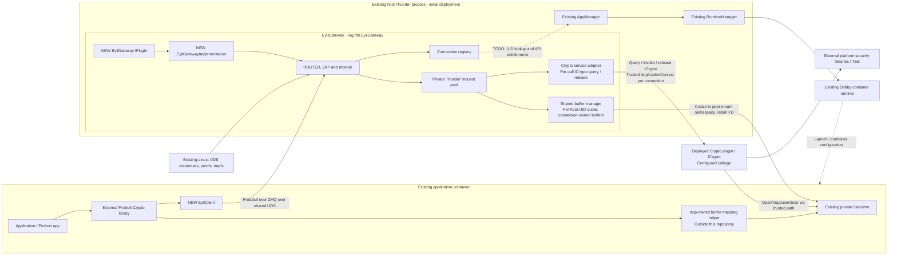

<!--
If not stated otherwise in this file or this component's LICENSE
file the following copyright and licenses apply:

Copyright 2026 RDK Management

Licensed under the Apache License, Version 2.0 (the "License");
you may not use this file except in compliance with the License.
You may obtain a copy of the License at

http://www.apache.org/licenses/LICENSE-2.0

Unless required by applicable law or agreed to in writing, software
distributed under the License is distributed on an "AS IS" BASIS,
WITHOUT WARRANTIES OR CONDITIONS OF ANY KIND, either express or implied.
See the License for the specific language governing permissions and
limitations under the License.
-->

# Eyil Secure Gateway architecture and implementation guide

## 1. Introduction

Contract requirements: [SDK-02 Compatible build and runtime dependencies](../openspec/specs/sdk-installation/spec.md#requirement-sdk-02-compatible-build-and-runtime-dependencies),
[CY-01 Configured backend list and availability](../openspec/specs/crypto-integration/spec.md#requirement-cy-01-configured-backend-list-and-availability),
[CY-02 Scoped Thunder interface references](../openspec/specs/crypto-integration/spec.md#requirement-cy-02-scoped-thunder-interface-references),
[CI-07 Trusted identity and external seams](../openspec/specs/connection-identity/spec.md#requirement-ci-07-trusted-identity-and-external-seams).

This specification defines the EyilClient and EyilGateway architecture: transport,
concurrent request coordination, connection contexts, request execution and
gateway-owned shared memory. It also records the integration boundaries and
unanswered questions that must not be replaced
by assumptions in code.

Eyil Secure Gateway is an open-source RDK component intended for the
`rdkcentral` ecosystem. The supported platform deployment uses the
**AppManager and RuntimeManager plugins**. Crypto is its first service; the
Gateway remains a general service router. The plugin is `EyilGateway`, its
callsign is `org.rdk.EyilGateway`, and its independent C client library is
`EyilClient`, installed as `libeyilclient.so`.

The document specifies the design and its required behavior. Items marked
**Proposed** require review; **TODO** identifies an unresolved contract or
integration decision. Deployment diagrams distinguish platform components from
EyilGateway and EyilClient responsibilities. UML sequences define call flows,
ownership and failure handling. Unresolved policy, public API and format
choices are listed separately from agreed behavior.

Agreed contracts are canonical in [openspec/specs/](../openspec/specs/).
The [source map](SpecificationMap.md) links every original section to exact
requirements or retained guidance. Original section numbers remain continuous:

| File | Required reading |
| --- | --- |
| [Capability specs](SpecificationMap.md#capability-index) | Complete agreed contracts, tables, requirement scenarios and open-decision links |
| This document | Original ACs, platform placement, common-contract links and gaps |
| [EyilClient.md](EyilClient.md) | Sections 5.1–5.15: client diagrams, API sequences, rationale and contract links |
| [EyilGateway.md](EyilGateway.md) | Sections 6.1–6.17: runtime/shared-memory diagrams, rationale, contract links and verification targets |
| [BuildAndValidation.md](BuildAndValidation.md) | Section 6.18: repository layout, build, installation and CI validation |

For implementation, including Copilot-assisted work, read the relevant capability
requirements and their detailed contract clauses/tables, then the linked guide
diagrams and open decisions. The guides explain the contracts without maintaining
a second normative prose copy. Original ACs remain unchanged; scenarios and
diagrams do not resolve TODOs or override explicit contract exceptions.

Navigation: [ACs](#2-acceptance-criteria-and-scope),
[platform architecture](#3-high-level-architecture-and-platform-placement),
[protocol](#4-apis-protobuf-and-zeromq),
[client flows](EyilClient.md#5-eyilclient-design-and-api-flows),
[Gateway flows](EyilGateway.md#6-eyilgateway-design-and-flows),
[gaps to answer](#7-gaps-to-answer).

## 2. Acceptance criteria and scope

Sections 2.1–2.3 reproduce the supplied acceptance criteria with their original
wording and labels, including both groups labelled **AC2**. WHEN conditions and
every THEN/AND clause are preserved. Row references are documentation-only
identifiers for UML traceability: AC1.1–AC1.12, AC2-Client.1–AC2-Client.5 and
AC2-Firebolt.1–AC2-Firebolt.2. They do not rename the original AC groups.

Implementation decisions and proposals are recorded separately in section 2.4
and the detailed architecture sections. They do not replace or amend the ACs.

### 2.1 AC1 - Eyil Gateway Plugin

WHEN the device runs thunder framework

| Reference | Original acceptance criterion |
| --- | --- |
| AC1.1 | THEN the Eyil Gateway SHALL run as the thunder plugin and listen for request from its client over ZMQ (over UDS) with ZMQ socket type ZMQ_ROUTER and bind on ipc:///tmp/app-eyil-gateway.ipc |
| AC1.2 | AND the Eyil Gateway SHALL also run the ZMQ Auth Protocol (ZAP) Handler with ZMQ socket type ZMQ_REP and SHALL use ZMQ_PLAIN_SERVER mode for authentication |
| AC1.3 | AND the Eyil Gateway SHALL also run the ZMQ monitor thread on inproc://app-eyil-gateway-monitor with socket type as ZMQ_PAIR |
| AC1.4 | AND the Eyil Gateway SHALL retrieve the UID of the connecting client using ZMQ's PEER CREDENTIAL mechanism (address frame) within the ZMQ Auth Protocol (ZAP) Handler for the purpose of authentication and authorisation (As part of this EPIC, no auth check is required. Assume all clients are authenticated and all APIs are authorised). |
| AC1.5 | AND the Eyil Gateway, upon successful authentication, SHALL assign a unique "User-ID" for the client within the ZAP Handler (One ID per connection). |
| AC1.6 | AND the Eyil Gateway SHALL retrieve the "User-Id" (from every request it receives in its main thread) and maintain a separate session for each "User-ID" |
| AC1.7 | AND ** the Eyil Gateway SHALL process each request in a separate thread AND processing of one request shall not block or delay the processing of other requests |
| AC1.8 | AND the Eyil Gateway SHALL parse the payload as per the attached "proto" definition and when the RPC service name is RPC_SERVICE_CRYPTO, then route the calls to underlying Crypto Plugin whose interface definition is available at https://github.com/rdkcentral/entservices-apis/pull/1089/changes |
| AC1.9 | AND the Eyil Gateway SHALL create and own the "shared memory" required for some of the crypto operations (encrypt, decrypt, sign and verify) as per the attached Gateway-Owned-Shared-Memory-Proposal.md |
| AC1.10 | AND the AllocateSharedBufferRequest and  ReleaseSharedBufferRequest defined in proto SHALL terminate at the Eyil Gateway itself and the gateway shall own the life cycle of the shared memory |
| AC1.11 | AND the Eyil Gateway SHALL create separate shared memory buffer for each of the connection so that there is no accidental overwrite by crypto gateway or multiple clients |
| AC1.12 | AND the Eyil Gateway SHALL release all resources (including the shared memory) maintained for a connection whenever it learns that a particular client is disconnected after informing the same with Crypto Plugin through its NotifyAppState API. |

### 2.2 AC2 - Eyil Client Lib

WHEN the device runs thunder framework and Eyil Gateway

| Reference | Original acceptance criterion |
| --- | --- |
| AC2-Client.1 | THEN Eyil Client Library SHALL provide convenience APIs for the Firebolt Crypto Client Library as defined in the attached EyilClient.h |
| AC2-Client.2 | AND the Eyil Client Library SHALL connect with the Eyil Gateway at ipc:///tmp/app-eyil-gateway.ipc using ZMQ (over UDS) with ZMQ socket type ZMQ_DEALER |
| AC2-Client.3 | AND the Eyil Client Library SHALL also use ZMQ Auth Protocol (ZAP), however SHALL pass dummy username and token (exists only for future potential use and also to provide a piggy bagging provision for the PEER CRED authentication over ZAP). |
| AC2-Client.4 | AND the Eyil Client Library SHALL also run the ZMQ monitor thread on `"inproc://app-eyil-client-monitor-<client specific unique-identifier>"` with socket type as ZMQ_PAIR |
| AC2-Client.5 | AND the Eyil Client Library SHALL provide both synchronous as well as asynchronous APIs for sending and receiving byte stream as well as "string" formatted request - response payload as defined in the google protobuf definitions attached, for the firebolt Crypto Client Library to route the requests coming from the Firebolt Apps. |

### 2.3 AC2 - Firebolt Crypto Client Library

WHEN Firebolt Apps and Eyil Gateway are running in the sytem

| Reference | Original acceptance criterion |
| --- | --- |
| AC2-Firebolt.1 | THEN the Firebolt CryptoClient Library SHALL make use of the EyilClient Library to route the calls from apps to underlying Eyil Gateway (which will subsequently route the calls to Crypto Plugin) |
| AC2-Firebolt.2 | AND Firebolt CryptoClient Library SHALL make use of the attached EyilClient.h for sending and receiving data from underlying Crypto operations and shall make use of the attached proto definitions for serialising / deserialzing the payload. |

### 2.4 Design decisions and interpretation

Contract requirements: [GR-01 Socket owners and private request workers](../openspec/specs/gateway-routing/spec.md#requirement-gr-01-socket-owners-and-private-request-workers),
[GR-02 Current-request admission and worker-start deadline](../openspec/specs/gateway-routing/spec.md#requirement-gr-02-current-request-admission-and-worker-start-deadline),
[GL-05 Admission cutoff and graceful drain](../openspec/specs/gateway-lifecycle/spec.md#requirement-gl-05-admission-cutoff-and-graceful-drain),
[GL-06 Socket and context teardown](../openspec/specs/gateway-lifecycle/spec.md#requirement-gl-06-socket-and-context-teardown),
[GL-07 Reactivation and fresh startup after crash](../openspec/specs/gateway-lifecycle/spec.md#requirement-gl-07-reactivation-and-fresh-startup-after-crash),
[CR-10 Response freeing and reserved notifications](../openspec/specs/client-requests/spec.md#requirement-cr-10-response-freeing-and-reserved-notifications),
[CC-01 Connection ownership and application lifetime](../openspec/specs/client-connection/spec.md#requirement-cc-01-connection-ownership-and-application-lifetime),
[CR-03 Single-slot ownership and publication](../openspec/specs/client-requests/spec.md#requirement-cr-03-single-slot-ownership-and-publication),
[CR-04 Asynchronous send acceptance and response-only delivery](../openspec/specs/client-requests/spec.md#requirement-cr-04-asynchronous-send-acceptance-and-response-only-delivery),
[CR-11 Deadlines and dynamic response state](../openspec/specs/client-requests/spec.md#requirement-cr-11-deadlines-and-dynamic-response-state),
[CC-04 Socket configuration and disabled heartbeats](../openspec/specs/client-connection/spec.md#requirement-cc-04-socket-configuration-and-disabled-heartbeats),
[CC-08 Prepared process freeze and library unload](../openspec/specs/client-connection/spec.md#requirement-cc-08-prepared-process-freeze-and-library-unload),
[CC-07 Terminal loss and explicit fresh connection](../openspec/specs/client-connection/spec.md#requirement-cc-07-terminal-loss-and-explicit-fresh-connection),
[CC-03 Connection event callback timing](../openspec/specs/client-connection/spec.md#requirement-cc-03-connection-event-callback-timing).

The following implementation decisions and proposals describe the design; they
are not additional acceptance criteria. The original separate-thread and
nonblocking wording remains in AC1.7. Private-pool scheduling, receive pauses,
worker-start deadlines, callback behavior, lifecycle ordering and protocol
handling are described against the unchanged ACs. The agreed client monitor
implementation runs PAIR collection and connection-state handling on the same
serving/I/O thread, as specified in section 5.2.

Both string methods accept ordinary NUL-terminated text without a caller-supplied
length or encoding step. EyilClient owns input copying and wire serialization.
The byte methods retain explicit sizes for binary Protobuf. String calls use
service=RPC_SERVICE_UNSPECIFIED until a text service is defined; Gateway returns
RPC_STATUS_UNSUPPORTED_SERVICE and EyilClient exposes that received status as
NUL-terminated text. Section 5.8 defines the exact request and response. This is
an explicit delivery limitation against the original string-functionality AC,
not a change to its wording or a local CLIENT_NOT_IMPLEMENTED implementation.

Firebolt Crypto and the real Crypto plugin are separate deliverables. Their
presence in diagrams does not add their implementation to this repository.

### 2.5 Delivery boundary

Contract requirements: [CI-07 Trusted identity and external seams](../openspec/specs/connection-identity/spec.md#requirement-ci-07-trusted-identity-and-external-seams),
[CY-01 Configured backend list and availability](../openspec/specs/crypto-integration/spec.md#requirement-cy-01-configured-backend-list-and-availability),
[CY-03 Authentication-time CONNECTED and session bookkeeping](../openspec/specs/crypto-integration/spec.md#requirement-cy-03-authentication-time-connected-and-session-bookkeeping),
[CC-01 Connection ownership and application lifetime](../openspec/specs/client-connection/spec.md#requirement-cc-01-connection-ownership-and-application-lifetime),
[GL-04 Correlated disconnect and backend notification order](../openspec/specs/gateway-lifecycle/spec.md#requirement-gl-04-correlated-disconnect-and-backend-notification-order),
[SDK-05 In-process plugin and optional startup integration](../openspec/specs/sdk-installation/spec.md#requirement-sdk-05-in-process-plugin-and-optional-startup-integration).

| Part | Responsibility | Integration boundary |
| --- | --- | --- |
| Thunder wrapper | IPlugin, Root<IConfiguration>(), Configure(), final release and remote-connection notification | Final Release invokes the implementation destructor; drain and teardown finish before it returns |
| Implementation library | IConfiguration and runtime ownership | Transport, authentication seam, registry, private pool, CryptoServiceAdapter using ICrypto, router and buffers |
| EyilClient | Nine C APIs, connection handles, coordinator, I/O thread, pending requests and response ownership | Independent of Thunder and ICrypto; async behavior uses the public callback signatures, as specified in section 5.4 |
| Protocol | Generated rpc.proto and crypto.proto, schema constant 1 | EyilClient handles the RPC envelope; service consumers handle service payloads |
| ZeroMQ | Runtime sockets, monitors and peer credentials | Target libzmq must provide the required credential and monitor behavior |
| AppManager / RuntimeManager | Future identity and entitlement integration | TODO(AUTH-APPMANAGER); no calls or authentication dependency in the initial scope |
| ICrypto API | Required Gateway build/API dependency | Use entservices-apis topic/crypto headers and compatible COM-RPC bindings where required; CryptoServiceAdapter implements the calls against this interface |
| Crypto plugin | Required deployed backend for Crypto operations | Callsign selected through PLUGIN_EYILGATEWAY_CRYPTO_CALLSIGN; query/invoke/release ICrypto per call with the connection's ApplicationContext |
| Tests and CI | Build/install validation, L1/L2 and coverage | Validate the API, concurrency, transport and ownership flows in this document |

## 3. High-level architecture and platform placement

### 3.1 RDK deployment

The deployment is an RDK platform with AppManager and RuntimeManager. The initial
Gateway implementation shares Thunder's process, while an application and its
EyilClient instance run inside an application container. The wrapper/implementation
split preserves a path to a separate implementation process later.

AppManager and RuntimeManager remain part of the intended deployment while
their Gateway authentication integration is pending. Crypto is called through
the configured Thunder interface. Local PC builds and isolated development
tests validate the component; production deployment uses the RDK platform
components shown below.

The inner EyilGateway block groups components owned by the plugin. AppManager
and RuntimeManager remain separate plugins within the Thunder process. The
diagram distinguishes existing platform infrastructure from new Gateway
components and pending AppManager/RuntimeManager integration. Crypto may itself
be in process or remote;
Gateway must not depend on a raw pointer or FD being meaningful in Crypto's
process.

### 3.2 Components, ownership and trust boundaries

Contract requirements: [CI-01 Endpoints, PLAIN and trusted request metadata](../openspec/specs/connection-identity/spec.md#requirement-ci-01-endpoints-plain-and-trusted-request-metadata),
[CI-02 Independent interim connection contexts](../openspec/specs/connection-identity/spec.md#requirement-ci-02-independent-interim-connection-contexts),
[SM-01 Allocation identity and trusted application cooperation](../openspec/specs/shared-memory/spec.md#requirement-sm-01-allocation-identity-and-trusted-application-cooperation),
[SM-02 Shared trusted-host-UID quota](../openspec/specs/shared-memory/spec.md#requirement-sm-02-shared-trusted-host-uid-quota),
[CI-07 Trusted identity and external seams](../openspec/specs/connection-identity/spec.md#requirement-ci-07-trusted-identity-and-external-seams).

| Component | Owner / location | Responsibility |
| --- | --- | --- |
| Application / Firebolt Crypto | Application container; external consumer | Express operations, serialize Crypto payloads and consume results |
| EyilClient | New library in the application's process | Transport coordination, RPC correlation and C API buffer ownership |
| App-side mapping helper | Implemented by the application, outside this repository and the EyilClient transport API | Open/map the name returned by allocation; manage app mappings and release coordination |
| EyilGateway wrapper | New Thunder IPlugin | Framework lifecycle and implementation acquisition |
| EyilGatewayImplementation | New implementation library | Own Gateway transport, contexts, request pool, adapters and allocations |
| AppManager / RuntimeManager | Existing RDK platform plugins | Future authoritative identity/entitlements |
| Dobby / DobbyTool | Existing container runtime / diagnostic tool | Launch, container namespace/mount setup and test execution; no request routing |
| Linux kernel / libzmq | Existing platform dependencies | UDS transport and peer credentials; monitor support depends on the target libzmq |
| Crypto plugin / ICrypto | Deployed external Thunder backend | Crypto execution, per-application-session state, keys and key authorization |
| Sec API / secure hardware / TEE | External platform-specific implementation | Backend-dependent cryptographic operations; no Gateway dependency |

### 3.3 Container mounts and direct access

Contract requirements: [CI-06 Deployment and endpoint trust boundary](../openspec/specs/connection-identity/spec.md#requirement-ci-06-deployment-and-endpoint-trust-boundary).

Gateway's private pool isolates its request scheduling from Thunder's global
worker queue. It does not isolate process crashes, total CPU/memory pressure or
a blocked in-process backend. Those limits matter while Gateway is in process.

### 3.4 External integration seams

Contract requirements: [CI-07 Trusted identity and external seams](../openspec/specs/connection-identity/spec.md#requirement-ci-07-trusted-identity-and-external-seams).

| TODO | Integration point | Selected behavior / remaining decision |
| --- | --- | --- |
| TODO(AUTH-APPMANAGER) | AuthenticationProvider called by ZAP; future Gateway → AppManager → RuntimeManager lookup using trusted UID | Accept valid direct UDS peers, record UID/GID/PID, create appId `eyil-interim:<unique-token>` and a separate unique sessionId per connection; the prefix marks non-authoritative identity |
| TODO(API-AUTHORIZATION) | Admission check against entitlements cached in the connection context | Allow all structurally valid supported APIs; still enforce limits and buffer ownership |
| ICrypto lifecycle | Scoped NotifyAppState calls through CryptoServiceAdapter using the connection's ApplicationContext | Attempt CONNECTED during authentication; backend failure does not reject transport admission. Detected disconnect immediately starts per-connection teardown, with DISCONNECTED after safe drain for an initialized backend context as specified in section 6.14. No grace period or wait for app termination/the last connection; Crypto owns its session/key cleanup |

## 4. APIs: Protobuf and ZeroMQ

### 4.1 The two Protobuf files

Contract requirements: [RP-01 Envelope and request identity](../openspec/specs/rpc-protocol/spec.md#requirement-rp-01-envelope-and-request-identity),
[SDK-03 Installed artifacts and shared binding ownership](../openspec/specs/sdk-installation/spec.md#requirement-sdk-03-installed-artifacts-and-shared-binding-ownership),
[RP-05 Unsupported raw-text wire contract](../openspec/specs/rpc-protocol/spec.md#requirement-rp-05-unsupported-raw-text-wire-contract).

### 4.2 Status and error layers

Contract requirements: [RP-02 Status layers and correlated Gateway failures](../openspec/specs/rpc-protocol/spec.md#requirement-rp-02-status-layers-and-correlated-gateway-failures).

#### Agreed local error behavior

Contract requirements: [CR-02 Local result and allocation-failure contract](../openspec/specs/client-requests/spec.md#requirement-cr-02-local-result-and-allocation-failure-contract),
[RP-05 Unsupported raw-text wire contract](../openspec/specs/rpc-protocol/spec.md#requirement-rp-05-unsupported-raw-text-wire-contract),
[CR-09 Raw-string API ownership and local outcomes](../openspec/specs/client-requests/spec.md#requirement-cr-09-raw-string-api-ownership-and-local-outcomes),
[CR-03 Single-slot ownership and publication](../openspec/specs/client-requests/spec.md#requirement-cr-03-single-slot-ownership-and-publication),
[CR-11 Deadlines and dynamic response state](../openspec/specs/client-requests/spec.md#requirement-cr-11-deadlines-and-dynamic-response-state),
[GR-02 Current-request admission and worker-start deadline](../openspec/specs/gateway-routing/spec.md#requirement-gr-02-current-request-admission-and-worker-start-deadline),
[RP-02 Status layers and correlated Gateway failures](../openspec/specs/rpc-protocol/spec.md#requirement-rp-02-status-layers-and-correlated-gateway-failures),
[CR-04 Asynchronous send acceptance and response-only delivery](../openspec/specs/client-requests/spec.md#requirement-cr-04-asynchronous-send-acceptance-and-response-only-delivery),
[RP-03 Protocol scope and concurrency limits](../openspec/specs/rpc-protocol/spec.md#requirement-rp-03-protocol-scope-and-concurrency-limits),
[CR-06 Binary request validation and synchronous completion](../openspec/specs/client-requests/spec.md#requirement-cr-06-binary-request-validation-and-synchronous-completion).

#### Gateway faults, buffer service outcomes and explicit error logging

Contract requirements: [RP-02 Status layers and correlated Gateway failures](../openspec/specs/rpc-protocol/spec.md#requirement-rp-02-status-layers-and-correlated-gateway-failures),
[SM-09 Buffer service error mapping](../openspec/specs/shared-memory/spec.md#requirement-sm-09-buffer-service-error-mapping),
[DG-01 Severity, context and confidentiality](../openspec/specs/diagnostics/spec.md#requirement-dg-01-severity-context-and-confidentiality),
[GR-06 Single nonblocking response attempt](../openspec/specs/gateway-routing/spec.md#requirement-gr-06-single-nonblocking-response-attempt),
[SM-06 Release acceptance and execution-time conflicts](../openspec/specs/shared-memory/spec.md#requirement-sm-06-release-acceptance-and-execution-time-conflicts),
[SM-07 Deferred finalization and cleanup failures](../openspec/specs/shared-memory/spec.md#requirement-sm-07-deferred-finalization-and-cleanup-failures).

### 4.3 Protocol capabilities and limitations

Contract requirements: [RP-03 Protocol scope and concurrency limits](../openspec/specs/rpc-protocol/spec.md#requirement-rp-03-protocol-scope-and-concurrency-limits).

### 4.4 ZeroMQ endpoints and message framing

Contract requirements: [CI-01 Endpoints, PLAIN and trusted request metadata](../openspec/specs/connection-identity/spec.md#requirement-ci-01-endpoints-plain-and-trusted-request-metadata),
[RP-04 Multipart framing](../openspec/specs/rpc-protocol/spec.md#requirement-rp-04-multipart-framing),
[GR-01 Socket owners and private request workers](../openspec/specs/gateway-routing/spec.md#requirement-gr-01-socket-owners-and-private-request-workers).

### 4.5 Diagnostics and logging

Contract requirements: [DG-01 Severity, context and confidentiality](../openspec/specs/diagnostics/spec.md#requirement-dg-01-severity-context-and-confidentiality).

## 5. EyilClient design and API flows

The client contracts are in [client-connection](../openspec/specs/client-connection/spec.md)
and [client-requests](../openspec/specs/client-requests/spec.md).
[EyilClient.md](EyilClient.md) retains sections 5.1–5.15, API sequences and internal
flow points with links to the full ownership, race and error contracts. Read the
related protocol/diagnostics specs and the outstanding decisions in section 7.

| Detailed guide | Content |
| --- | --- |
| Sections 5.1–5.3 | Responsibilities, component/API-call diagram, one submission slot, I/O ownership and concurrent request routing |
| Section 5.4 | API index, allocation failures, async send acceptance, supplied callback signatures, ownership and reentrancy |
| Sections 5.5–5.13 | All nine C APIs with full UML and terminal-result handling |
| Sections 5.14–5.15 | Deadlines, explicit fresh reconnect, callbacks, freezing, unloading and call hierarchy |

The main document is an entry point, not a substitute for those implementation
details. There is no client request queue; one I/O owner services submissions,
responses and monitor events, with multiple pending responses tracked by ID.

## 6. EyilGateway design and flows

Gateway contracts are indexed in the [capability map](SpecificationMap.md#capability-index).
[EyilGateway.md](EyilGateway.md) retains sections 6.1–6.17, detailed UML,
platform-patch rationale and verification scenarios, with links to the complete
resource/lifetime contracts. [BuildAndValidation.md](BuildAndValidation.md)
contains section 6.18 and its build/install procedures.

| Detailed guide | Content |
| --- | --- |
| Sections 6.1–6.3 | Component/API-call diagram, socket owners, private pool, current-request receive pause, resource policy and synchronization |
| Sections 6.4–6.9 | Activation, ZAP, request dispatch, ICrypto ownership/configuration and service operations |
| Sections 6.10–6.13 | Shared-memory identity, allocation, four Crypto flows, conflicting uses, accepted release and deferred destruction |
| Sections 6.14–6.16 | Disconnect binding, required libzmq extension, capability checks, freeze, backend failures and plugin teardown/reactivation |
| Sections 6.17–6.18 | Implementation sequence, complete L1/L2 acceptance targets, repository layout, build/install and CI commands |

## 7. Gaps to answer

Contract requirements: [SM-01 Allocation identity and trusted application cooperation](../openspec/specs/shared-memory/spec.md#requirement-sm-01-allocation-identity-and-trusted-application-cooperation),
[SM-05 Execution-time access and definitive completion](../openspec/specs/shared-memory/spec.md#requirement-sm-05-execution-time-access-and-definitive-completion),
[SM-06 Release acceptance and execution-time conflicts](../openspec/specs/shared-memory/spec.md#requirement-sm-06-release-acceptance-and-execution-time-conflicts),
[SM-07 Deferred finalization and cleanup failures](../openspec/specs/shared-memory/spec.md#requirement-sm-07-deferred-finalization-and-cleanup-failures),
[SM-08 Application release and abandoned allocations](../openspec/specs/shared-memory/spec.md#requirement-sm-08-application-release-and-abandoned-allocations),
[GL-04 Correlated disconnect and backend notification order](../openspec/specs/gateway-lifecycle/spec.md#requirement-gl-04-correlated-disconnect-and-backend-notification-order),
[CI-03 FD and transport-lifetime binding](../openspec/specs/connection-identity/spec.md#requirement-ci-03-fd-and-transport-lifetime-binding),
[GL-05 Admission cutoff and graceful drain](../openspec/specs/gateway-lifecycle/spec.md#requirement-gl-05-admission-cutoff-and-graceful-drain),
[GL-07 Reactivation and fresh startup after crash](../openspec/specs/gateway-lifecycle/spec.md#requirement-gl-07-reactivation-and-fresh-startup-after-crash),
[CY-03 Authentication-time CONNECTED and session bookkeeping](../openspec/specs/crypto-integration/spec.md#requirement-cy-03-authentication-time-connected-and-session-bookkeeping),
[CY-06 Backend shared-buffer access contract](../openspec/specs/crypto-integration/spec.md#requirement-cy-06-backend-shared-buffer-access-contract),
[GR-06 Single nonblocking response attempt](../openspec/specs/gateway-routing/spec.md#requirement-gr-06-single-nonblocking-response-attempt).

Section 7.1 describes a backend-completion edge case and a potential backend
contract. Section 7.2 lists remaining API/product choices. Section 7.3 separates
integration and verification from unresolved design decisions. Section 7.4
records settled deployment and scope assumptions.

### 7.1 Abnormal backend completion: lifecycle integration boundary

**Normal case:** the client times out after 15 seconds, but Crypto completes at
20 seconds. Gateway observes that completion and can finish an accepted deferred
release under the normal cleanup rules. A completed invocation returning a
defined CryptoError also ends that operation's buffer access.

**Potential backend/integration requirement — to confirm:** when an ICrypto
call returns to Gateway, no backend work from that invocation may continue
accessing its shared buffer. This guarantee should cover successful returns,
service errors and invocation failures. A client-side timeout is not a return
from Gateway's ICrypto call.

**Edge case to verify:** COM-RPC may return a communication error while the
remote Crypto operation is still running. Confirm that the backend and COM-RPC
integration can uphold the proposed guarantee. If they cannot, reliable evidence
that access ended is required before cleanup. Until then, Gateway retains the
buffer references, quota and pending cleanup; disconnect or a failed
DISCONNECTED notification alone is not completion evidence. Deferral protects
the buffer but does not prove that Crypto finished.

This is a backend/platform lifecycle requirement to confirm, not a new AC or
EyilClient API. The existing deferred-release and notification ordering remain
defined in sections 6.13–6.16.
**TODO:** SHM-COMPLETION.

### 7.2 Remaining API and platform decisions

These items complement the abnormal-completion boundary. The deployment,
hibernation, reconnect scope, client monitor and application buffer-helper
responsibilities in section 7.4 are settled and are not remaining gaps.

| TODO | Answer needed / integration boundary |
| --- | --- |
| AUTH-APPMANAGER | Formal UID lookup via AppManager/RuntimeManager, authoritative app/app-instance identity, UID reuse guarantees and lookup failure behavior; no independent static UID-to-appId map. Interim appIds use reserved `eyil-interim:` prefix; agree Crypto's handling of that marker for identity-dependent key policy |
| MULTI-CONNECTION-POLICY | Architects expect one connection per app instance; confirmation is pending on allowing additional connections with unique User-Ids or rejecting a second connection. If allowed, define the corresponding ICrypto ApplicationContext mapping so closing one connection cannot release another's active resources. Section 6.5 preserves independent interim contexts until that decision; shared host-UID quota is separate |
| AUTHENTICATION-PROGRESS | Define a bound on waiting for authentication-time CONNECTED and lifecycle-worker capacity if needed. Platform startup ordering is selected; it does not bound an ICrypto call. A client timeout cannot cancel a running call, and any abandoned exchange must retain cleanup ownership for a late result |
| API-AUTHORIZATION | Exact entitlement format and mapping from service/operation to allowed APIs; currently all supported APIs are allowed |
| FUTURE-TEXT-SERVICE | Successful execution of text commands needs a separately defined service route and request/response semantics. Current behavior is settled: service=0 is rejected by Gateway with UNSUPPORTED_SERVICE and exposed as status text; this future feature does not block the selected rejection path |

### 7.3 Integration and validation work

These items implement or verify selected contracts. They are not additional
unresolved Gateway architecture gaps.

| Work item | Required integration / evidence |
| --- | --- |
| ZMQ-PLATFORM | Integrate the included [libzmq 4.3.4 patch](zmq_connection_lifetime.patch) into the product build and Gateway consumers; enable draft APIs, probe option 10001 and run the bounded private-IPC behavioral self-test before production bind/admission, validate ZAP/request metadata and version-2 FD/lifetime events, and guard ROUTER sends. Monitor version 2 alone does not identify the patch. Test the exact rootfs binary and activation failure with an incompatible library; section 6.14 defines the contract |
| DEPLOYMENT | Use the trusted single-instance Thunder lifecycle and container endpoint policy in section 7.4. Verify procfs/user-namespace access, private /dev/shm and blocked direct Crypto communicator access. Leftover storage after a crash belongs to platform recovery; Gateway starts fresh and does not reconstruct or blindly unlink old allocations |
| Resource policy | Apply the [initial resource policy in section 6.2](EyilGateway.md#initial-resource-policy): four private workers, default stacks, default libzmq HWM and kernel buffers; no additional message/text or response-count/byte caps. Shared memory allows 1.5 MiB (1,572,864 bytes) per buffer and four allocations per trusted host UID across all its connections, including child apps sharing that UID; at most 6 MiB combined, with no global cap. Quota remains charged through deferred cleanup and reconnect. No Gateway request queue exists; the current request pauses further receives while waiting up to ten seconds for a worker. Validate memory/representation behavior without inventing extra admission limits |
| Private Thunder pool | Validate nonblocking transfer to reserved execution capacity, worker-start acknowledgement, wakeups and drain against Thunder; four private workers, no application backlog in the pool. While the current RPC waits, pause only new receives; after ten seconds return INTERNAL and log worker_pool_exhausted, with no later execution |
| SDK and runtime dependencies | Supply the selected topic/crypto ICrypto headers/bindings and matching Thunder interfaces. Configure the Crypto entry in the backend list when deployed. Gateway also starts and accepts clients with an empty/default or unavailable backend; backend RPCs report errors. When Crypto is included, platform/Thunder coordination should retain it through Gateway drain. Validate per-call references, authentication-time CONNECTED attempts and ordered DISCONNECTED without a Crypto health observer |
| Diagnostics | Verify section 4.5: actionable ERROR/WARNING context, bounded startup/stop INFO summaries, suppression counts for repeated errors, no sensitive content and no default full request-flow tracing |
| Runtime acceptance | Exercise the L1/L2 scenarios in section 6.17 on the intended dependency set and device, including concurrent requests, response drops, stop/reactivation and prepared process freeze |

### 7.4 Settled deployment and scope assumptions

Contract requirements: [CI-06 Deployment and endpoint trust boundary](../openspec/specs/connection-identity/spec.md#requirement-ci-06-deployment-and-endpoint-trust-boundary),
[CC-08 Prepared process freeze and library unload](../openspec/specs/client-connection/spec.md#requirement-cc-08-prepared-process-freeze-and-library-unload),
[CC-04 Socket configuration and disabled heartbeats](../openspec/specs/client-connection/spec.md#requirement-cc-04-socket-configuration-and-disabled-heartbeats),
[CC-07 Terminal loss and explicit fresh connection](../openspec/specs/client-connection/spec.md#requirement-cc-07-terminal-loss-and-explicit-fresh-connection),
[GL-07 Reactivation and fresh startup after crash](../openspec/specs/gateway-lifecycle/spec.md#requirement-gl-07-reactivation-and-fresh-startup-after-crash),
[CC-01 Connection ownership and application lifetime](../openspec/specs/client-connection/spec.md#requirement-cc-01-connection-ownership-and-application-lifetime),
[SM-02 Shared trusted-host-UID quota](../openspec/specs/shared-memory/spec.md#requirement-sm-02-shared-trusted-host-uid-quota),
[SM-08 Application release and abandoned allocations](../openspec/specs/shared-memory/spec.md#requirement-sm-08-application-release-and-abandoned-allocations),
[SDK-02 Compatible build and runtime dependencies](../openspec/specs/sdk-installation/spec.md#requirement-sdk-02-compatible-build-and-runtime-dependencies),
[CY-02 Scoped Thunder interface references](../openspec/specs/crypto-integration/spec.md#requirement-cy-02-scoped-thunder-interface-references),
[CI-07 Trusted identity and external seams](../openspec/specs/connection-identity/spec.md#requirement-ci-07-trusted-identity-and-external-seams),
[CR-03 Single-slot ownership and publication](../openspec/specs/client-requests/spec.md#requirement-cr-03-single-slot-ownership-and-publication),
[CR-04 Asynchronous send acceptance and response-only delivery](../openspec/specs/client-requests/spec.md#requirement-cr-04-asynchronous-send-acceptance-and-response-only-delivery),
[CR-11 Deadlines and dynamic response state](../openspec/specs/client-requests/spec.md#requirement-cr-11-deadlines-and-dynamic-response-state).
