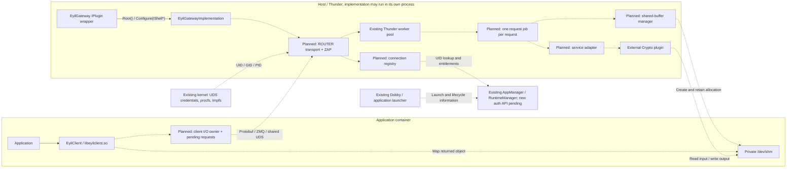
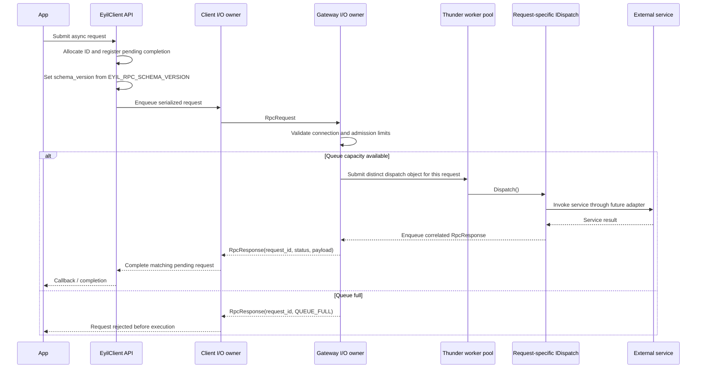

<!--
If not stated otherwise in this file or this component's LICENSE
file the following copyright and licenses apply:

Copyright 2026 RDK Management

Licensed under the Apache License, Version 2.0 (the "License");
you may not use this file except in compliance with the License.
You may obtain a copy of the License at

http://www.apache.org/licenses/LICENSE-2.0

Unless required by applicable law or agreed to in writing, software
distributed under the License is distributed on an "AS IS" BASIS,
WITHOUT WARRANTIES OR CONDITIONS OF ANY KIND, either express or implied.
See the License for the specific language governing permissions and
limitations under the License.
-->

# Eyil Secure Gateway architecture

## Scope and implementation status

Eyil Secure Gateway provides an application-facing gateway that can support
multiple services. Crypto is the first planned service. The Thunder plugin is
`EyilGateway`, with callsign `org.rdk.EyilGateway`; the independent C client
library is `EyilClient`, installed as `libeyilclient.so`.

This revision is a buildable skeleton. It provides a thin Thunder IPlugin wrapper,
a separate implementation class, a minimal C library, generated Protobuf types,
ZeroMQ build integration, installation metadata, and CI scaffolding.

It does not open sockets, authenticate clients, dispatch requests, allocate
shared memory, or invoke a backend. Crypto message definitions describe the
service contract; their presence does not implement those operations. There is
no dependency on ICrypto.h and no Crypto implementation or stub.

The wrapper and implementation are separate plugin libraries. The wrapper
acquires `EyilGatewayImplementation` using Thunder's `Root<IConfiguration>()`
and calls `Configure(IShell*)`. The default `configuration.root.mode` is `Off`
(in process); `Local` runs the implementation in a separate Thunder process.
The public client header is `eyilclient/EyilClient.h`. It exposes nine C functions
for connection, binary/string requests, asynchronous requests, notifications
and cleanup. There is no client version getter.

These APIs currently provide placeholders: operations return
`CLIENT_NOT_IMPLEMENTED`, clear any provided handle/response outputs, and
invoke no callbacks. Missing required output pointers return
`CLIENT_INVALID_ARGUMENT`. Disconnect and notification unregistration are
no-ops; `client_free_response()` uses free() and accepts NULL. No client handle,
connection state, thread or socket is allocated.

| Component | Current state | Planned responsibility |
| --- | --- | --- |
| EyilGateway wrapper | Root acquisition, Configure, remote notifications and cleanup | Thunder plugin lifecycle |
| EyilGatewayImplementation | IConfiguration implementation; dependency logging only | Own transport, dispatch and service adapters |
| EyilClient | Public C API with error-returning placeholders | Async application requests |
| EyilProtocol | Generated rpc.proto and crypto.proto | Common wire contract |
| ZMQ | Located and linked by CMake | DEALER/ROUTER over UDS and ZAP |
| Thunder worker pool | Existing platform facility | One dispatch object per accepted request |
| Authentication provider | Future | UID lookup and entitlement caching |
| Shared-buffer manager | Future | Gateway-owned allocations and active-use tracking |
| Crypto plugin | External, future integration | Crypto operations and key policy |

## Deployment and trust boundaries

The dashed components below are planned; their runtime behavior is not present
in this skeleton.



There is one UDS listening endpoint shared by applications, with an independent
gateway context for every connection. A proposed development endpoint is
`ipc:///tmp/app-eyil-gateway.ipc`. The `ipc://` prefix selects a Unix-domain
socket, not IP networking. Deployment must expose the socket directory to the
intended containers and define ownership and permissions. A dedicated directory
mount is preferable to relying on unrelated contents of a shared /tmp; its
production path and Dobby configuration remain TODO.

The gateway is the application entry point. The Crypto COM-RPC endpoint must
be inaccessible to ordinary application containers. ApplicationContext metadata
alone does not authenticate a direct caller of a Crypto interface. The stated
platform direction is to remove general application access to Thunder; the
actual mount and access restrictions must be verified on the deployment.

Dobby is an external container/lifecycle source. DobbyTool may eventually execute
a test client inside an existing container; it is not part of the request path.

### Thunder implementation lifecycle

This lifecycle is implemented for the plugin itself. Application connection
and hibernation behavior remains pending.

```mermaid
sequenceDiagram
    participant Shell as Thunder IShell
    participant GW as EyilGateway wrapper
    participant IM as EyilGatewayImplementation
    participant Pool as Thunder worker pool
    Shell->>GW: Initialize(shell)
    GW->>Shell: AddRef(); Register(remote notification)
    GW->>Shell: Root<IConfiguration>(connectionId, 5000, implementation name)
    Shell-->>GW: IConfiguration interface (local object or COM-RPC proxy)
    GW->>IM: Configure(shell)
    IM-->>GW: ERROR_NONE
    GW-->>Shell: Success
    opt Remote implementation terminates unexpectedly
        Shell->>GW: Deactivated(remote connection)
        GW->>Pool: Submit IShell::Job(DEACTIVATED, FAILURE)
        Pool->>Shell: Deactivate plugin
    end
    Shell->>GW: Deinitialize(shell)
    GW->>Shell: Unregister(remote notification)
    GW->>Shell: Retain remote connection if connectionId != 0
    GW->>IM: Release()
    GW->>Shell: Terminate / release remote connection if present
    GW->>Shell: Release()
```

Root or Configure failure performs the same cleanup before Initialize returns
an error. The wrapper does not expose IConfiguration through its own interface
map. Each library registers its own Thunder service. Shared
`API_VERSION_NUMBER_MAJOR`, `API_VERSION_NUMBER_MINOR` and
`API_VERSION_NUMBER_PATCH` macros in `EyilGateway/Version.h` define plugin
metadata and both service registrations; the current version is **1.0.0**.
This component version is separate from the RPC envelope schema version.

## Protocol and status

`apis/proto/rpc.proto` defines the common envelope.
`apis/proto/crypto.proto` defines the existing Crypto service messages.
Both are compiled into `libeyilprotocol.so`; generated .pb.cc/.pb.h files stay
in the build directory. The implementation and client link the protocol target
and ZeroMQ; the wrapper only links Thunder. No gRPC dependency is introduced.

`RpcRequest` contains request_id, service, schema_version and payload.
`RpcResponse` contains the matching request_id/service, schema_version,
RpcStatus status at field 4, and service-specific payload at field 5.

| RpcStatus | Meaning |
| --- | --- |
| UNSPECIFIED = 0 | Unset status; never successful completion |
| OK = 1 | Gateway processing completed; inspect the service result |
| INVALID_REQUEST = 2 | Decoded request violates the RPC contract |
| UNSUPPORTED_SCHEMA = 3 | Unsupported envelope version |
| UNSUPPORTED_SERVICE = 4 | Unsupported service selector |
| MALFORMED_REQUEST = 5 | Request cannot be decoded |
| INVALID_CONNECTION = 6 | Request has no valid connection context |
| INTERNAL = 7 | Gateway or backend integration failure |
| QUEUE_FULL = 8 | Admission rejected before operation execution |

A Crypto failure can accompany RPC_STATUS_OK: routing and service invocation
completed, but CryptoResponse.error reports the operation outcome. Client-local
errors such as a lost connection or timeout remain separate from both fields.

This contract starts at schema version **1**, defined by
EYIL_RPC_SCHEMA_VERSION in ProtocolVersion.h. EyilClient will set this value
on every outgoing RpcRequest. The library therefore owns the envelope version;
applications do not select it for individual calls.

The current C API takes serialized request bytes. When request handling is
implemented, the library will decode and re-encode the outer RPC envelope to
set schema_version, while leaving the service-specific payload opaque.
The skeleton still returns CLIENT_NOT_IMPLEMENTED and sends no requests.
Version validation and negotiation are future runtime work.

TODO(CLIENT-CONTRACT): the supplied public header currently says the API does
not serialize or deserialize Protobuf. Before request handling is implemented,
clarify that callers serialize service payloads while the library must process
the outer envelope to set its version. The header's existing wording is kept
pending that clarification.

A future responder must set OK explicitly. Unknown status values and
UNSPECIFIED cannot be treated as success. For gateway failures, a service
payload must not be assumed to contain a valid service result.

TODO(PROTOCOL): define handling when a malformed envelope does not provide a
trustworthy request_id, as well as duplicate IDs, maximum frame size and
service-payload validation boundaries. Removed heartbeat service value 2 is
reserved and is not reused.

## Async client and request dispatch

Planned behavior uses DEALER on the client and ROUTER on the gateway. Each
socket has one owning I/O thread. Application threads submit work through a
queue; Thunder worker threads return responses through a gateway completion
queue. Workers do not access the ROUTER socket.

DEALER/ROUTER permit multiple outstanding requests. Request IDs correlate
responses, which can arrive out of order. These sockets must not be shared
concurrently across threads.
[ZeroMQ socket types and thread safety](https://libzmq.readthedocs.io/en/latest/zmq_socket.html)



Every accepted request needs its own dispatch object; one permanent worker-loop
job would still serialize work and would occupy a Thunder worker indefinitely.
Admission must be bounded before submitting to Thunder. Submission behavior when
the shared Thunder pool is full also needs to be handled without blocking the
transport indefinitely.

Planned call hierarchy:

```text
EyilClient async API
  pending-request registry + outbound queue
    client I/O owner -> zmq_send
      gateway I/O owner -> envelope/context validation
        Core::IWorkerPool::Submit(new request-specific IDispatch)
          request job -> service adapter -> backend
          completion queue -> gateway I/O owner -> zmq_send
            client I/O owner -> request_id lookup -> callback executor
```

TODO(CLIENT): finalize the C callback signature, user-data ownership, queue limits,
deadlines, completion delivery and shutdown. Callbacks should run outside the
socket-owning thread if reentrant client calls are supported. A synchronous API
can wait on the same async engine. A local timeout does not cancel backend work,
and automatic retries must not duplicate operations with side effects.

## Identity and connection tracking

The planned authentication path derives UID/GID/PID from kernel-provided UDS
peer information carried through ZAP. Application-supplied identity fields are
not authoritative.

The architect's updated direction is to query AppManager using the peer UID;
AppManager works with RuntimeManager to obtain appId and API entitlements.
Cache the returned details for that connection and purge its admission state
when it disconnects. The formal lookup API and UID-to-launch-instance guarantees
are pending.

The interim direction, before that API exists, is to accept connections,
record trusted peer credentials and assign unique appId/session identifiers
internally. This is not production application authorization and is not
implemented in the skeleton.

Every connection is independent, including multiple connections from one
process. Assign a unique connection/session token. UID, PID, a raw socket FD,
or a concatenation of UID/GID/PID does not uniquely identify a connection over
its lifetime. Runtime app-instance identity and gateway connection identity
must remain distinguishable when the production API is available.

There is no heartbeat. The supplied libzmq disconnect proposal adds peer
credentials to disconnect monitor events; that reports socket disconnection,
not whether the process still exists. Integrating that mechanism requires a
matching patched, draft-enabled libzmq build and reliable correlation with
the connection token. The skeleton requires only standard ZeroMQ 4.3 APIs.

Process-existence observations may supplement connection monitoring. PID reuse,
multiple sockets per process and inherited descriptors need explicit handling.
A frozen process can still exist and retain its socket; process existence does
not establish responsiveness or imply disconnection.

TODO(LIFECYCLE): define hibernation/resume behavior, event subscription APIs,
reconnect policy, idle behavior, never-used connections, and races between
process exit, socket closure and queued work. No lifecycle rule is inferred
from an unanswered architecture question.

## Shared memory and backend boundary

Gateway ownership of shared memory is an architectural decision, but all
allocation and backend logic is outside this skeleton.

The planned flow is:

1. The client requests an allocation size through Protobuf.
2. The gateway creates and owns the allocation in the client's private /dev/shm,
   retains a descriptor, and records its connection owner, size and active uses.
3. The response supplies an opaque buffer_id, a client-visible name and size.
4. The client opens/maps the object and writes input regions.
5. Encrypt/decrypt/sign/verify carry buffer_id and offset/length regions.
6. The gateway validates ownership/bounds and retains an active-use reference.
7. The service adapter passes the trusted buffer identity to Crypto.
8. Crypto returns its service result and any output region.
9. Once backend access is finished, the active-use reference can be released.
10. Release or disconnection destroys an allocation only after its active uses
    are finished and backend completion is known.

The proposed namespace access uses /proc/<host-peer-pid>/root/dev/shm. The
backend-facing identity is a trusted name/path, not a client-supplied pathname.
A raw FD integer is not portable across separate COM-RPC processes. The final
backend interface and transfer mechanism remain pending; no provisional
ICrypto.h is defined in this repository.

Parallel request jobs require synchronized ownership/quota records and retained
buffer leases. A lookup returning an unprotected raw pointer is insufficient:
a concurrent release or disconnect must not destroy a buffer in use. Initial
use should allow one active operation per allocation unless concurrency rules
explicitly permit more.

TODO(SHM): settle timeout/disconnect versus backend completion, ambiguous
completion, release ordering, mutable/truncated client memory, input snapshots,
limits and output placement. These decisions must be reflected in the eventual
backend interface. Gateway ownership alone does not prevent a writable client
mapping from changing while Crypto reads it.

Crypto owns key authorization policy: locators, key usages, permitted operations,
import/export restrictions and cross-app sharing. The gateway supplies the
trusted context and API-level admission decision; it does not implement
cryptographic key policy.

## Decisions and pending review

| Area | Direction | Pending |
| --- | --- | --- |
| Naming | EyilGateway / org.rdk.EyilGateway / EyilClient | None for skeleton |
| Transport | Protobuf over ZMQ UDS, shared listening path | Mounts, permissions, deployment path |
| Async | Multiple in-flight requests, request_id correlation | Public C API and callback contract |
| Dispatch | Separate Thunder job for each request | Backpressure and resource synchronization |
| RPC status | Typed enum; explicit OK; schema 1 set by EyilClient | Negotiation and malformed-request correlation |
| Identity | Kernel peer credentials; per-connection context | AppManager API and launch identity guarantees |
| Interim authentication | Accept and assign internal identifiers | Explicit production enablement policy |
| Disconnect | No heartbeat; observe transport/peer state | Monitor patch and stable event correlation |
| Lifecycle | Keep undecided cases as TODO | Hibernate/resume, teardown and outstanding operations |
| Shared memory | Gateway creates and owns allocations | Backend identity contract and safe completion |
| Crypto | External plugin owns key policy | Final interface and direct-access restrictions |

## Build, install and validation

Required tools: CMake 3.21+, Ninja, a C/C++ compiler, Protobuf 3.15+ development
files and protoc, ZeroMQ 4.3+ development files, and Python 3.9+. Building the
plugin additionally requires Thunder Core/COM/Plugins, ThunderTools and the
matching `interfaces/IConfiguration.h` from ThunderInterfaces or the platform's
entservices-apis SDK. Out-of-process use also requires matching IConfiguration
proxy/stubs in Thunder's configured proxystub directory. Do not mix headers
and proxy/stubs from different interface providers or releases.

For a native SDK build, install the host development prerequisites, then run:

```sh
bash build_dependencies.sh
bash build.sh
python3 scripts/run-tests.py --build-dir build --label L1
python3 scripts/run-tests.py --build-dir build --label L2
bash scripts/check-install.sh build rootfs/all
```

build_dependencies.sh fetches pinned Thunder R4.4, ThunderTools and
ThunderInterfaces sources into the ignored _deps directory. It builds the
IConfiguration headers and proxy/stubs along with Thunder. It does not install
system packages. To use an existing SDK, set EYIL_THUNDER_PREFIX; optional
EYIL_DEPS_DIR selects local dependency storage. EYIL_CONFIGURATION_INCLUDE_DIR
can select the SDK include directory containing `interfaces/IConfiguration.h`
when it is not found automatically.

To generate a configuration for a separate implementation process, build with
`bash build.sh -DPLUGIN_EYILGATEWAY_MODE=Local`. The default is `Off`. Install both
plugin libraries and make the matching proxy/stubs available to Thunder and
WPEProcess before using Local mode.

The client and protocol can be built without Thunder:

```sh
cmake -S . -B build-client -G Ninja \
  -DPLUGIN_EYILGATEWAY=OFF -DBUILD_EYILCLIENT=ON \
  -DCMAKE_INSTALL_PREFIX=/usr -DCMAKE_INSTALL_LIBDIR=lib
cmake --build build-client
bash scripts/check-install.sh build-client rootfs/client
```

Use a CMake toolchain file and target dependency prefixes when cross compiling.
Protobuf_PROTOC_EXECUTABLE must identify a host-runnable protoc. Cross-platform
rootfs validation is still pending.

Installed CMake consumers use EyilClient::EyilClient and
EyilProtocol::EyilProtocol. The C header is eyilclient/EyilClient.h; the client also
provides eyilclient.pc. Both plugin libraries install to the Thunder plugin
directory. The generated configuration uses org.rdk.EyilGateway, with autostart
false by default. No test executables are installed.

L1 and L2 are intentionally empty. Their runners invoke CTest and emit summaries
and JUnit reports with zero tests. Install-consumer checks verify compilation,
linking, client API placeholders and the Protobuf status contract separately;
they are not advertised as implemented service tests.

```sh
EYIL_BUILD_DIR=build-coverage bash build.sh -DENABLE_COVERAGE=ON
python3 scripts/coverage.py --build-dir build-coverage
```

Coverage instruments handwritten plugin/client code, excluding generated
Protobuf and dependency sources. Empty suites produce an explicit coverage
unavailable summary. Once real tests are registered with L1/L2 labels, the same
runner produces XML, HTML and text reports. No artificial percentage is reported.
Use `--label L1` or `--label L2` to run coverage for one suite; the default runs
both suites.

## Repository checks and GitHub configuration

C/C++ uses .clang-format; Python uses Black; YAML uses yamllint. New source,
build, workflow and documentation files carry the Apache-2.0 licensing header.
JSON remains strict JSON and is covered by LICENSE/NOTICE. README.md is
intentionally empty.

Install the pinned development tools from scripts/requirements-dev.txt and run
scripts/check-format.sh plus scripts/validate-files.py. Build outputs and local
SDKs are ignored by Git.

GitHub workflows cover native build/install checks, standalone client builds,
L1/L2, coverage, formatting, JSON validation, manual CI, FOSSID,
changelog/version validation, and manual draft release creation. CLA and
CODEOWNERS are retained as repository governance.

L1 and L2 each collect coverage for their selected suite through the shared
`native-ci.yml` workflow. Manual CI uses the same native build job. Formatting
and licensing checks run together with JSON checks in `json_validator.yml`.
The scripts directory supplies the build and validation commands used locally
and in CI; GitHub Actions itself does not require that directory layout.

Jobs use GitHub-hosted `ubuntu-24.04` runners. This release supplies Protobuf
3.21, which meets the project's 3.15 minimum for proto3 optional fields; Ubuntu
22.04 supplies Protobuf 3.12. The native SDK cache includes the runner release.
No organization-specific runner label is required. Native and standalone-client
builds use CMake 3.28.3, matching the tested SDK setup and retaining compatibility
with the pinned Thunder sources' older CMake policy baseline.

FOSSID uses the public
`rdkcentral/build_tools_workflows/.github/workflows/fossid_integration_stateless_diffscan.yml@1.0.0`
on pull requests from branches in this repository. It requires the four FOSSID
secrets referenced in the workflow and skips fork pull requests. CLA uses
`rdkcentral/cmf-actions` and requires CLA_ASSISTANT. Build, test, coverage and
repository-validation jobs require no organization credentials.

TODO(CI): add Coverity when an accessible rdkcentral workflow and its credential
contract are available. No private Coverity workflow is referenced in this
repository.

The scripts directory, formatting configuration and CHANGELOG.md must be
committed with the workflows so a fresh checkout contains their dependencies.

The release workflow is manual and creates a draft only from main after
checking the requested version against CMake and CHANGELOG.md. Repository
administrators must configure branch protection and runner access separately.
Version checks also compare the CMake version and EyilGateway/Version.h so the
plugin's reported and registered versions agree.
