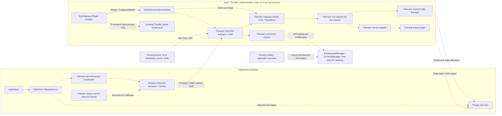

<!--
If not stated otherwise in this file or this component's LICENSE
file the following copyright and licenses apply:

Copyright 2026 RDK Management

Licensed under the Apache License, Version 2.0 (the "License");
you may not use this file except in compliance with the License.
You may obtain a copy of the License at

http://www.apache.org/licenses/LICENSE-2.0

Unless required by applicable law or agreed to in writing, software
distributed under the License is distributed on an "AS IS" BASIS,
WITHOUT WARRANTIES OR CONDITIONS OF ANY KIND, either express or implied.
See the License for the specific language governing permissions and
limitations under the License.
-->

# Eyil Secure Gateway architecture

## Scope and implementation status

Eyil Secure Gateway provides an application-facing gateway that can support
multiple services. Crypto is the first planned service. The Thunder plugin is
`EyilGateway`, with callsign `org.rdk.EyilGateway`; the independent C client
library is `EyilClient`, installed as `libeyilclient.so`.

This revision is a buildable skeleton. It provides a thin Thunder IPlugin wrapper,
a separate implementation class, a minimal C library, generated Protobuf types,
ZeroMQ build integration, installation metadata, and CI scaffolding.

It does not open sockets, authenticate clients, dispatch requests, allocate
shared memory, or invoke a backend. Crypto message definitions describe the
service contract; their presence does not implement those operations. There is
no dependency on ICrypto.h and no Crypto implementation or stub.

The wrapper and implementation are separate plugin libraries. The wrapper
acquires `EyilGatewayImplementation` using Thunder's `Root<IConfiguration>()`
and calls `Configure(IShell*)`. The default `configuration.root.mode` is `Off`
(in process); `Local` runs the implementation in a separate Thunder process.
The public client header is `eyilclient/EyilClient.h`. It exposes nine C functions
for connection, binary/string requests, asynchronous requests, notifications
and cleanup. There is no client version getter.

These APIs currently provide placeholders: operations return
`CLIENT_NOT_IMPLEMENTED`, clear any provided handle/response outputs, and
invoke no callbacks. Missing required output pointers return
`CLIENT_INVALID_ARGUMENT`. Disconnect and notification unregistration are
no-ops; `client_free_response()` uses free() and accepts NULL. No client handle,
connection state, thread or socket is allocated.

| Component | Current state | Planned responsibility |
| --- | --- | --- |
| EyilGateway wrapper | Root acquisition, Configure, remote notifications and cleanup | Thunder plugin lifecycle |
| EyilGatewayImplementation | IConfiguration implementation; dependency logging only | Own transport, dispatch and service adapters |
| EyilClient | Public C API with error-returning placeholders | Per-connection coordinator, library-owned I/O and concurrent requests |
| EyilProtocol | Generated rpc.proto and crypto.proto | Common wire contract |
| ZMQ | Located and linked by CMake | DEALER/ROUTER over UDS and ZAP |
| Gateway request pool | Future instance of Thunder Core::ThreadPool | Private bounded execution, one dispatch object per accepted request |
| Thunder global worker pool | Existing platform facility | Framework/lifecycle work; not Gateway request execution |
| Authentication provider | Future | UID lookup and entitlement caching |
| Shared-buffer manager | Future | Gateway-owned allocations and active-use tracking |
| Crypto plugin | External, future integration | Crypto operations and key policy |

## High-level acceptance criteria

These criteria describe the target behavior, not completed functionality in the
current skeleton. The architecture below refines their execution model without
making unanswered lifecycle or public API questions into requirements.

### AC1: EyilGateway plugin

When Thunder is running, EyilGateway shall:

- Run as a Thunder plugin and accept client requests on a ZMQ_ROUTER socket at
  `ipc:///tmp/app-eyil-gateway.ipc`.
- Enable PLAIN server mode on the ROUTER and run a ZAP handler using ZMQ_REP at
  `inproc://zeromq.zap.01` in the same ZMQ context. The authenticator must be
  ready before client handshakes are accepted.
- Monitor transport events through ZMQ_PAIR at
  `inproc://app-eyil-gateway-monitor`.
- Obtain the peer UID from the trusted ZAP address supplied by the platform's
  libzmq peer-credential implementation. Retain GID and host PID as well for
  namespace access and connection bookkeeping. In this epic, accept clients
  without an AppManager authorization check and allow all gateway APIs.
- Assign a unique ZAP User-Id per connection and derive every request's session
  from that metadata. Generate interim appId/sessionId values internally.
- Dispatch each accepted request independently through a Gateway-owned Thunder
  thread pool. Keep transport handling responsive while other requests execute,
  subject to configured admission limits and backend concurrency constraints.
- Decode the agreed Protobuf envelope and route RPC_SERVICE_CRYPTO operations
  through the external Crypto plugin's ICrypto contract. Crypto implementation
  and key authorization remain outside Gateway's scope.
- Create and own shared-memory allocations needed by encrypt, decrypt, sign and
  verify. AllocateSharedBufferRequest and ReleaseSharedBufferRequest terminate
  in Gateway. Each allocation belongs to one connection; a connection can own
  multiple allocations, with ownership, bounds and active-use checks.
- On a correlated disconnect, close that session to new work, notify Crypto
  through NotifyAppState(DISCONNECTED), and release its resources when backend
  access has finished. Cleanup must not invalidate active operations.

### AC2: EyilClient library

When the Gateway endpoint is available, EyilClient shall:

- Provide the convenience C API described by EyilClient.h, usable by the
  Firebolt Crypto Client Library. EyilClient itself has no Thunder dependency.
- Connect using ZMQ_DEALER to `ipc:///tmp/app-eyil-gateway.ipc`.
- Drive the connection with a library-owned I/O thread. Applications submit
  requests through the existing C API and do not supply an event loop.
- Set dummy PLAIN username/password values internally so the server's ZAP
  exchange can carry trusted peer information. The client does not host a ZAP
  handler, and the dummy strings are not app identity credentials.
- Monitor its socket through ZMQ_PAIR at
  `inproc://app-eyil-client-monitor-<unique-client-id>`.
- Support synchronous and asynchronous binary and string request/response APIs,
  with multiple requests outstanding on a single connection and responses
  correlated by request_id rather than arrival order. The string representation
  still needs a precise encoding contract.

The supplied ACs describe dedicated monitor threads on both sides. The Gateway
design retains a monitor worker. The client proposal below can service its PAIR
monitor on the same I/O loop as its DEALER; this consolidation requires agreement
that monitoring, rather than a separate OS thread, is the high-level requirement.
A literal dedicated-client-monitor-thread requirement remains an alternative.

### AC3: Firebolt Crypto Client Library

The Firebolt Crypto Client Library shall use EyilClient to route app operations
to Gateway and serialize/deserialize Crypto service payloads using the agreed
Protobuf definitions. EyilClient coordinates the outer RPC envelope. Firebolt
Crypto is an external consumer and a separate implementation deliverable.

## Deployment and trust boundaries

The dashed components below are planned; their runtime behavior is not present
in this skeleton.



There is one UDS listening endpoint shared by applications, with an independent
gateway context for every connection. The endpoint specified by the ACs is
`ipc:///tmp/app-eyil-gateway.ipc`. The `ipc://` prefix selects a Unix-domain
socket, not IP networking. Deployment must expose the socket directory to the
intended containers and define ownership and permissions. A dedicated directory
mount is preferable to relying on unrelated contents of a shared /tmp; its
production path and Dobby configuration remain TODO.

| Endpoint | Owner / consumer | Scope |
| --- | --- | --- |
| `ipc:///tmp/app-eyil-gateway.ipc` | Gateway ROUTER binds; client DEALER connects | Filesystem UDS exposed to intended containers |
| `inproc://zeromq.zap.01` | Gateway ZAP REP binds; server libzmq connects | Gateway ZMQ context only |
| `inproc://app-eyil-gateway-monitor` | Monitor API binds; Gateway PAIR collector connects | Gateway ZMQ context only |
| `inproc://app-eyil-client-monitor-<unique-client-id>` | Monitor API binds; client PAIR collector connects | Client ZMQ context only |

The inproc endpoints are internal to their ZMQ context and require no container
socket mounts. ZMQ_PLAIN_SERVER is a ROUTER option, not a setting on the REP
authenticator. [ZAP specification](https://rfc.zeromq.org/spec/27/)

The gateway is the application entry point. The Crypto COM-RPC endpoint must
be inaccessible to ordinary application containers. ApplicationContext metadata
alone does not authenticate a direct caller of a Crypto interface. The stated
platform direction is to remove general application access to Thunder; the
actual mount and access restrictions must be verified on the deployment.

Dobby is an external container/lifecycle source. DobbyTool may eventually execute
a test client inside an existing container; it is not part of the request path.

### Thunder implementation lifecycle

This lifecycle is implemented for the plugin itself. Application connection
and hibernation behavior remains pending.

```mermaid
sequenceDiagram
    participant Shell as Thunder IShell
    participant GW as EyilGateway wrapper
    participant IM as EyilGatewayImplementation
    participant Pool as Thunder global worker pool
    Shell->>GW: Initialize(shell)
    GW->>Shell: AddRef(); Register(remote notification)
    GW->>Shell: Root<IConfiguration>(connectionId, 5000, implementation name)
    Shell-->>GW: IConfiguration interface (local object or COM-RPC proxy)
    GW->>IM: Configure(shell)
    IM-->>GW: ERROR_NONE
    GW-->>Shell: Success
    opt Remote implementation terminates unexpectedly
        Shell->>GW: Deactivated(remote connection)
        GW->>Pool: Submit IShell::Job(DEACTIVATED, FAILURE)
        Pool->>Shell: Deactivate plugin
    end
    Shell->>GW: Deinitialize(shell)
    GW->>Shell: Unregister(remote notification)
    GW->>Shell: Retain remote connection if connectionId != 0
    GW->>IM: Release()
    GW->>Shell: Terminate / release remote connection if present
    GW->>Shell: Release()
```

Root or Configure failure performs the same cleanup before Initialize returns
an error. The wrapper does not expose IConfiguration through its own interface
map. Each library registers its own Thunder service. Shared
`API_VERSION_NUMBER_MAJOR`, `API_VERSION_NUMBER_MINOR` and
`API_VERSION_NUMBER_PATCH` macros in `EyilGateway/Version.h` define plugin
metadata and both service registrations; the current version is **1.0.0**.
This component version is separate from the RPC envelope schema version.

## Protocol and status

`apis/proto/rpc.proto` defines the common envelope.
`apis/proto/crypto.proto` defines the existing Crypto service messages.
Both are compiled into `libeyilprotocol.so`; generated .pb.cc/.pb.h files stay
in the build directory. The implementation and client link the protocol target
and ZeroMQ; the wrapper only links Thunder. No gRPC dependency is introduced.

`RpcRequest` contains request_id, service, schema_version and payload.
`RpcResponse` contains the matching request_id/service, schema_version,
RpcStatus status at field 4, and service-specific payload at field 5.

| RpcStatus | Meaning |
| --- | --- |
| UNSPECIFIED = 0 | Unset status; never successful completion |
| OK = 1 | Gateway processing completed; inspect the service result |
| INVALID_REQUEST = 2 | Decoded request violates the RPC contract |
| UNSUPPORTED_SCHEMA = 3 | Unsupported envelope version |
| UNSUPPORTED_SERVICE = 4 | Unsupported service selector |
| MALFORMED_REQUEST = 5 | Request cannot be decoded |
| INVALID_CONNECTION = 6 | Request has no valid connection context |
| INTERNAL = 7 | Gateway or backend integration failure |
| QUEUE_FULL = 8 | Admission rejected before operation execution |

A Crypto failure can accompany RPC_STATUS_OK: routing and service invocation
completed, but CryptoResponse.error reports the operation outcome. Client-local
errors such as a lost connection or timeout remain separate from both fields.

This contract starts at schema version **1**, defined by
EYIL_RPC_SCHEMA_VERSION in ProtocolVersion.h. EyilClient will set this value
on every outgoing RpcRequest. The library therefore owns the envelope version;
applications do not select it for individual calls.

The current C API takes serialized request bytes. When request handling is
implemented, the library will decode and re-encode the outer RPC envelope to
set schema_version and coordinate request_id, while leaving the service-specific
payload opaque. Firebolt Crypto serializes CryptoRequest and interprets
CryptoResponse; EyilClient does not interpret key or algorithm policy.
The skeleton still returns CLIENT_NOT_IMPLEMENTED and sends no requests.
Version validation and negotiation are future runtime work.

TODO(CLIENT-CONTRACT): the supplied public header currently says the API does
not serialize or deserialize Protobuf. Before request handling is implemented,
clarify that callers serialize service payloads while the library must process
the outer envelope to set its version and coordinate request IDs. Also specify
the string API's text encoding and conversion boundary: binary Protobuf may
contain zero bytes and cannot be passed directly as a NULL-terminated string.
The header's existing wording is kept pending that clarification.

A future responder must set OK explicitly. Unknown status values and
UNSPECIFIED cannot be treated as success. For gateway failures, a service
payload must not be assumed to contain a valid service result.

TODO(PROTOCOL): define handling when a malformed envelope does not provide a
trustworthy request_id, as well as duplicate IDs, maximum frame size and
service-payload validation boundaries. Removed heartbeat service value 2 is
unused in the current enum; a formal reservation, if required, is a separate
schema decision. No heartbeat service is part of this design.

## Gateway request execution

EyilGatewayImplementation will own a bounded Core::ThreadPool, including when
the plugin runs in process. Every accepted request becomes a separate
Core::IDispatch object submitted directly to this private pool. Worker count,
stack size and queue limits are configuration decisions; there is no new thread
per request. Crypto can impose additional concurrency limits.

This separates Gateway request execution and synchronous backend waits from
Thunder's global worker slots. It does not isolate CPU, memory, process failure
or resources used by Crypto itself. The wrapper may still submit framework
lifecycle jobs to Thunder's global pool.

| Execution role | Responsibility |
| --- | --- |
| Gateway I/O owner | Own ROUTER, receive frames and User-Id metadata, validate admission, send queued completions |
| ZAP worker | Own REP, obtain trusted credentials and establish a connection identity |
| Gateway monitor worker | Own PAIR, receive transport events and report correlated disconnects |
| Private Thunder request pool | Execute one dispatch object per accepted request, validate service/buffer state and invoke the adapter |

Workers return results through a completion queue and wake the I/O owner. They
never send or receive on ROUTER. Admission reserves capacity before submitting;
excess work receives RPC_STATUS_QUEUE_FULL without blocking the I/O owner.
The connection/session and any buffer leases must outlive the request job.

Thunder's Core::ThreadPool is independently constructible. The local R4.4 SDK
uses this pattern in RPC::InvokeServerType. Core::WorkerPool is also possible,
but adds scheduling/timer machinery that immediate request dispatch does not
require. [Thunder pool example](https://github.com/rdkcentral/Thunder/blob/2c0fcc5529e7da734be558ca6efa05d934dcce31/Source/com/Administrator.h)

Two implementation constraints prevent accidentally using or blocking the
global pool:

- Do not call Core::IWorkerPool::Assign from a plugin. It changes the
  process-wide pool binding. Core::IWorkerPool::Instance and the
  IWorkerPool::JobType convenience Submit helper target that global binding.
- Implement admission accounting separately. In the checked R4.4 API,
  WorkerPool::Submit waits indefinitely for queue space and
  ThreadPool::Submit(job, timeout) returns void. A zero timeout alone does not
  provide queue-full reporting. [Thunder submission APIs](https://github.com/rdkcentral/Thunder/blob/2c0fcc5529e7da734be558ca6efa05d934dcce31/Source/core/WorkerPool.h)

On plugin shutdown, stop admission, resolve queued work, wait for active calls,
stop the private pool and release backend/buffer state before implementation
unload. A pool stop does not cancel a running Crypto call. The exact policy for
an unresponsive backend remains TODO; plugin unload must not leave executing
jobs referring to destroyed code or objects.

## Proposed EyilClient architecture

The proposal separates a per-connection request coordinator from the mechanism
that drives I/O. Concurrent requests do not require concurrent access to the
same DEALER socket. One I/O owner can send several requests before any reply
arrives, receive replies in any order, and complete the matching requests.
ROUTER and DEALER must not be used concurrently by multiple threads.
[ZeroMQ socket types](https://libzmq.readthedocs.io/en/latest/zmq_socket.html)

### Components and ownership

| Component | Responsibility |
| --- | --- |
| C API facade | Validate arguments, capture request data and submit commands; no socket access from calling threads |
| Connection coordinator | Own connection generation, request IDs, pending requests, bounded admission and completion state |
| Outbound command queue | Transfer work from calling threads to the I/O owner and wake it |
| Pending-request registry | Map request_id to expected service, response format, callback or synchronous waiter, and deadline |
| Transport / serving thread | Own DEALER and monitor PAIR, encode the outer envelope and perform nonblocking send/receive |
| Completion delivery | Resolve synchronous waiters and schedule asynchronous callbacks outside internal locks |

Pending state and transport state are serialized on the I/O owner; submission
and completion queues have the synchronization needed at their boundaries.
Request bytes are copied or otherwise retained before an async submission
returns. Holding a caller's temporary byte pointer is insufficient.

The coordinator allocates a unique wire request_id within the connection
generation, registers the pending entry before transmission and sets
schema_version to 1. Request identifiers are not connection authentication
tokens. Proposed ownership of wire IDs, including treatment of caller-supplied
IDs in serialized envelopes, must be reflected in the final public contract.

### I/O ownership: library-owned thread

A library can create threads: its code runs inside the application's process
and can call the platform threading APIs. Packaging that code as a shared
library imposes no prohibition. The design questions are resource budget,
callback affinity, shutdown and who keeps I/O progressing.

The first version will use a library-owned serving/I/O thread for each Client
connection. client_connect creates the connection machinery; synchronous and
asynchronous calls enqueue work; client_disconnect wakes and stops the machinery
and joins the library-owned threads before returning. The application does not
provide an I/O driver, poll the socket or keep an external event loop running.
This threading choice needs no event-loop parameter in EyilClient.h, although
the callback/error and shutdown contracts still require clarification.

The I/O thread creates, uses and closes the DEALER socket. It processes outbound
commands, incoming responses, deadlines and monitor events without waiting for
each request's response before sending the next request. Multiple requests are
outstanding simultaneously; there is no thread per request. Any separate monitor
or callback worker must have the same explicit stop-and-join ownership.

A shared serving loop for several Client handles can be considered later. Every
connection would still retain independent pending state and identity. The first
version does not require that optimization.

libzmq has its own internal I/O threads for IPC. Those threads move transport
data; they do not implement EyilClient's request registry, completion callbacks
or application shutdown contract. EyilClient's serving thread is additional to
those internal threads. [ZeroMQ context threading](https://libzmq.readthedocs.io/en/latest/zmq_ctx_set.html)

The workspace Sky D-Bus reference supports this separation:

- ASServiceLib/dbus/dbusconnection.h accepts an EventLoop at connection creation.
- dbusconnection.cpp schedules calls through EventLoop::invokeMethod and maps
  reply cookies to callbacks in m_callbacks. A reply removes its matching entry.
- ASServiceLib/eventloop/eventloop.h provides I/O notifications, timers and
  owner-thread checks; eventloop.cpp queues cross-thread work and wakes the loop.

These are reference patterns, not a dependency on Sky or sd-bus. In EyilClient,
the Protobuf request_id takes the role of the D-Bus reply cookie. The Sky
synchronous path that blocks its event-loop thread is not adopted: EyilClient
must preserve progress for other outstanding requests. EyilClient adopts the
coordinator pattern while owning its serving loop internally.

### Optional future application I/O integration

An app-provided loop is a future extension, not a requirement for the first
version. It would require an agreed public API change to select/register a driver
and document callback affinity. Keeping coordinator and transport responsibilities
separate preserves that option without exposing I/O machinery now.

An injected I/O driver needs capabilities to:

1. Post work and wake a designated owner thread from another thread.
2. Register and unregister readability notifications for client-owned handles.
3. Schedule/cancel monotonic deadline timers and deferred continuations.
4. Report whether the caller is on the I/O owner thread.
5. Quiesce registered callbacks before Client destruction and keep the loop
   alive until detach completes.

These are architectural responsibilities, not final C function names. The app
feeds readiness, timer and wakeup events to EyilClient; EyilClient performs the
ZMQ calls. Merely asking the app to call send/receive periodically is insufficient
for reliable async progress. An arbitrary executor that moves tasks between
threads is also insufficient: DEALER requires one stable owner.

For integration with an existing poll/epoll-style loop, watch the ZMQ_FD
notification descriptor and inspect ZMQ_EVENTS on the owner thread. Use
nonblocking send/receive, refresh events after each operation, and reschedule
remaining ready work when a fairness budget is exhausted. The descriptor is
edge-triggered and must not be read, written or closed by the app. Enqueueing
outbound work must itself wake/schedule I/O; no new socket edge is guaranteed.
The PAIR monitor can be registered on the same loop, subject to the monitor
thread clarification in AC2. [ZeroMQ event-loop integration](https://libzmq.readthedocs.io/en/latest/zmq_getsockopt.html)

The existing client_connect signature accepts no I/O driver, and its event and
notification callbacks are documented as running on internal threads. App-loop
mode therefore requires an agreed public API extension or registration contract
and updated callback documentation. No header or implementation change is made
by this design. A callback executor and an I/O driver are different contracts:
the former delivers app callbacks; the latter makes transport progress.

### Concurrent requests and out-of-order completion

```mermaid
sequenceDiagram
    participant A as App callers
    participant C as EyilClient coordinator
    participant IO as EyilClient serving thread
    participant G as Gateway I/O owner
    participant P as Gateway private Thunder pool
    participant B as Crypto adapter / ICrypto
    A->>C: Submit request A
    C->>IO: Queue submission; wake owner
    IO->>C: Register A as request_id 101
    IO->>G: RpcRequest(101, schema_version 1)
    G->>P: Submit job A after admission
    P->>B: Invoke operation A
    A->>C: Submit request B before A completes
    C->>IO: Queue submission; wake owner
    IO->>C: Register B as request_id 102
    IO->>G: RpcRequest(102, schema_version 1)
    G->>P: Submit independent job B
    P->>B: Invoke operation B concurrently where supported
    B-->>P: B completes first
    P-->>G: Enqueue response 102; wake I/O owner
    G-->>IO: RpcResponse(102)
    IO->>C: Match and remove pending 102
    C-->>A: Deliver B completion
    B-->>P: A completes
    P-->>G: Enqueue response 101; wake I/O owner
    G-->>IO: RpcResponse(101)
    IO->>C: Match and remove pending 101
    C-->>A: Deliver A completion
```

Different operations may be in flight together even though the owner processes
individual socket actions serially. There is no connection-wide lock held while
waiting for a response. One connection can therefore support simultaneous
synchronous and asynchronous callers without opening a socket per request.

### Completion, deadlines and shutdown

- A synchronous API submits through the same coordinator and waits on its own
  completion state. The I/O owner continues servicing all requests. Blocking
  synchronous calls on that owner thread must be rejected or disallowed by the
  contract; a nested receive loop would introduce reentrancy and starvation.
  Connect and close also must not wait for their own serving/callback thread.
  Calls from prohibited callback contexts must be rejected or disallowed by the
  contract; client_disconnect cannot join the thread currently executing it.
- Async submission reports local acceptance, not successful remote execution.
  Each accepted request needs one terminal completion: response, local failure,
  timeout or connection loss. Late/duplicate replies must not complete it twice
  or be delivered to a newer connection generation.
- Application callbacks run without coordinator locks. The first-version
  design uses an internal execution context, consistent with the existing
  connection/notification callback documentation. If callbacks use the serving
  thread itself, they must be brief and must not make blocking client calls.
  Whether to use a separate internal callback worker, and the exact response
  callback/reentrancy guarantees, remain review items. No application executor
  is required for the selected threading model.
- Bound outbound requests, pending entries and completion delivery. Do not hold
  unlimited client data when the peer or callback consumer is slow. Client-local
  admission failure is distinct from a received RPC_STATUS_QUEUE_FULL response.
- A client deadline does not cancel Crypto execution or permit shared-buffer
  reuse. No automatic replay of operations with side effects is assumed.
- Client close must stop admission, resolve pending work and stop timers and
  monitor handling. It must stop and join the library-owned workers and ensure
  no callback can access freed Client state after disconnect returns. Exact
  pending-request error delivery remains part of the completion contract.

### Runtime library unloading

Owning threads does not prohibit runtime unloading. Unloading requires explicit
quiescence: all Client handles must be disconnected, all outstanding API calls
and callbacks must have returned, and no code may call back into the library.
Response buffers requiring client_free_response must be released while the
library is still loaded.

The shutdown sequence is:

1. Close admission and resolve pending requests locally without assuming that
   a remote Crypto operation has been cancelled.
2. Wake the serving/monitor workers and have each socket owner close its sockets.
   Stop scheduled work and prevent further callback delivery after cleanup.
3. Join all EyilClient-owned workers. Do not leave detached workers behind.
4. Terminate the library-owned ZMQ context when its last user is gone. A shared
   context must remain alive while another Client still uses it.
5. Return from client_disconnect after its resources and callbacks are quiescent.
   The application waits for concurrent API callers to return, releases remaining
   response buffers, and only then may unload the library.

Use an explicit finite ZMQ_LINGER policy, including zero if unsent messages are
to be discarded, so shutdown does not wait indefinitely for delivery. Closing
a ZMQ socket is asynchronous; context termination waits for all sockets to close
and for outstanding sends to satisfy linger. Optional zmq_ctx_shutdown can wake
blocking ZMQ operations during final context teardown; it does not replace
zmq_ctx_term and must not stop other live clients sharing the context.
[ZeroMQ context termination](https://libzmq.readthedocs.io/en/latest/zmq_ctx_term.html)

dlclose follows loader reference counts and may unload the library and its
dependencies. It does not provide the application's thread-join or callback
barrier. Keep shutdown explicit rather than relying on library destructors or
assuming an executing thread keeps its code mapped.
[Linux library loading](https://man7.org/linux/man-pages/man3/dlopen.3.html)

TODO(CLIENT-API): the current async callbacks have no local-error result or
caller user-data parameter. Define how request-specific failure, callback
context, deadlines and shutdown are represented before implementing this
proposal. I/O-driver registration is relevant only to the optional future mode.
The existing notification registration API also
needs an agreed wire notification contract; RpcResponse alone does not define
unsolicited events.

### Planned method hierarchy

```text
Firebolt Crypto API / other caller
  serialize service payload and submit through EyilClient C API
    coordinator command queue -> wake library-owned serving thread
      I/O owner: allocate request_id, register pending, set schema_version=1
        DEALER nonblocking send -> Gateway ROUTER receive
          User-Id context + envelope validation + bounded admission
            Gateway-owned Core::ThreadPool.Submit(request-specific IDispatch)
              shared-buffer manager OR Crypto adapter -> ICrypto
              completion queue -> Gateway I/O owner -> ROUTER send
        DEALER receive -> request_id lookup -> remove pending entry
      synchronous waiter OR deferred async completion
```

## Identity and connection tracking

The planned authentication path derives UID/GID/PID from kernel-provided UDS
peer information carried through ZAP. Application-supplied identity fields are
not authoritative.

The architect's updated direction is to query AppManager using the peer UID;
AppManager works with RuntimeManager to obtain appId and API entitlements.
Cache the returned details for that connection and purge its admission state
when it disconnects. The formal lookup API and UID-to-launch-instance guarantees
are pending.

The interim direction, before that API exists, is to accept connections,
record trusted peer credentials and assign unique appId/session identifiers
internally. This is not production application authorization and is not
implemented in the skeleton.

The ZAP worker returns a unique User-Id for each accepted connection and records
its trusted UID/GID/PID and ApplicationContext. On each request, the ROUTER I/O
owner copies the exact ZMQ message metadata property "User-Id" and resolves that
context. A client-supplied routing ID or payload field is not a substitute.
The request job retains the context independently of its registry entry.

Every connection is independent, including multiple connections from one
process. Assign a unique connection/session token. UID, PID, a raw socket FD,
or a concatenation of UID/GID/PID does not uniquely identify a connection over
its lifetime. Runtime app-instance identity and gateway connection identity
must remain distinguishable when the production API is available.

There is no heartbeat. The supplied libzmq disconnect proposal adds peer
credentials to disconnect monitor events; that reports socket disconnection,
not whether the process still exists. Integrating that mechanism requires a
matching patched, draft-enabled libzmq build and reliable correlation with
the connection token. The skeleton requires only standard ZeroMQ 4.3 APIs.

Standard disconnect monitor events do not contain the ZAP User-Id. Adding
UID/GID/PID still cannot distinguish two connections from the same process.
FD reuse and reconnects also require a generation-aware correlation scheme.
This remains a prerequisite for targeted cleanup; it must not disconnect every
session with the same UID or PID. [ZeroMQ monitor events](https://libzmq.readthedocs.io/en/latest/zmq_socket_monitor.html)

Process-existence observations may supplement connection monitoring. PID reuse,
multiple sockets per process and inherited descriptors need explicit handling.
A frozen process can still exist and retain its socket; process existence does
not establish responsiveness or imply disconnection.

NotifyAppState(CONNECTED) establishes the lower-level Crypto session before its
first operation. Concurrent first requests need ordered session initialization.
After a correlated disconnect, admission closes immediately; accepted jobs
retain their resources until safe completion. The proposed teardown order is
to resolve queued work, finish active backend calls, issue
NotifyAppState(DISCONNECTED), then destroy remaining resources. Notification
failure, backend failure and exact ordering still need agreement. This is safe
resource retention, not a reconnect grace period.

TODO(LIFECYCLE): define hibernation/resume behavior, event subscription APIs,
reconnect policy, idle behavior, never-used connections, and races between
process exit, socket closure and queued work. No lifecycle rule is inferred
from an unanswered architecture question.

## Shared memory and backend boundary

Gateway ownership of shared memory is an architectural decision, but all
allocation and backend logic is outside this skeleton.

The planned flow is:

1. The client requests an allocation size through Protobuf.
2. The gateway creates and owns the allocation in the client's private /dev/shm,
   retains a descriptor, and records its connection owner, size and active uses.
3. The response supplies an opaque buffer_id, a client-visible name and size.
4. The client opens/maps the object and writes input regions.
5. Encrypt/decrypt/sign/verify carry buffer_id and offset/length regions.
6. The gateway validates ownership/bounds and retains an active-use reference.
7. The service adapter passes the trusted buffer identity to Crypto.
8. Crypto returns its service result and any output region.
9. Once backend access is finished, the active-use reference can be released.
10. Release or disconnection destroys an allocation only after its active uses
    are finished and backend completion is known.

The proposed namespace access uses `/proc/<host-peer-pid>/root/dev/shm`. The
backend-facing identity is a trusted name/path, not a client-supplied pathname.
A raw FD integer is not portable across separate COM-RPC processes.

The reviewed revision of
[ICrypto PR #1089](https://github.com/rdkcentral/entservices-apis/pull/1089),
[commit 6926f6a](https://github.com/rdkcentral/entservices-apis/blob/6926f6a72fbfff18b691d09b3b7376fbd541b9d3/apis/Crypto/ICrypto.h),
now defines ApplicationContext with appId/sessionId and SharedBuffer with a host
path in name. For the four shared-memory operations, Crypto opens the object, obtains
its actual size, validates regions and completes all access within the
synchronous call. It releases its acquired buffer resources before returning.
This supplies the previously missing identity contract; adoption of an approved
interface revision and its adapter remains pending. No ICrypto header or backend
implementation is added to this skeleton by the architecture update.

An invocation result (Core::hresult) and a Crypto operation result (CryptoError)
are distinct. The adapter maps them into the outer RpcStatus and inner service
result. A COM-RPC timeout or lost connection does not prove that the remote
operation has returned, even with the synchronous buffer contract.

Parallel request jobs require synchronized ownership/quota records and retained
buffer leases. A lookup returning an unprotected raw pointer is insufficient:
a concurrent release or disconnect must not destroy a buffer in use. Initial
use should allow one active operation per allocation unless concurrency rules
explicitly permit more.

Each allocation is owned by one session; multiple allocations per session allow
concurrent operations without sharing an active buffer. A different connection,
including one from the same process, cannot use that buffer_id. The client maps
and unmaps the returned object, but Gateway owns creation, size and unlinking.
Whether mapping helpers belong to Firebolt Crypto or a separate client utility
is pending; the present EyilClient API provides transport functions only.

Gateway-Owned-Shared-Memory-Proposal.md is the reference for allocation ownership,
namespaces and region handling. Its sample's 15-second inactivity watchdog,
single-threaded dispatch and transport_error_code field are not adopted here:
this design uses no heartbeat/assumed idle expiry, a private request pool, and
the RpcStatus envelope above.

TODO(SHM): settle timeout/disconnect versus backend completion, ambiguous
completion, release ordering, mutable/truncated client memory, input snapshots,
limits and output placement. These decisions must be reflected in the eventual
backend interface. Gateway ownership alone does not prevent a writable client
mapping from changing while Crypto reads it.

Crypto owns key authorization policy: locators, key usages, permitted operations,
import/export restrictions and cross-app sharing. The gateway supplies the
trusted context and API-level admission decision; it does not implement
cryptographic key policy.

## Decisions and pending review

| Area | Direction | Pending |
| --- | --- | --- |
| Naming | EyilGateway / org.rdk.EyilGateway / EyilClient | None for skeleton |
| Transport | ROUTER/DEALER at ipc:///tmp/app-eyil-gateway.ipc | Container mounts, permissions, production path |
| ZAP | Gateway REP, ROUTER PLAIN server, client dummy credentials | Target peer-credential support and later auth lookup |
| Async | Per-connection coordinator, multiple in-flight requests, request_id correlation | Wire-ID ownership and public completion/error contract |
| Client I/O | Library-owned serving thread for the first version; no app I/O handler required | Callback/error contract, thread budget and connect readiness semantics |
| Future app-loop mode | Optional extension using the same coordinator | Driver registration and callback-affinity API changes |
| Runtime unload | Disconnect all clients; quiesce calls/callbacks; join workers; terminate the last owned ZMQ context | Finite linger setting and context-sharing implementation |
| Client monitor | Unique inproc PAIR endpoint | Confirm whether a dedicated monitor thread is mandatory or same-loop handling is acceptable |
| Dispatch | Gateway-owned Core::ThreadPool; separate job per accepted request | Thread/stack budget, admission limits and backend concurrency |
| RPC status | Typed enum; explicit OK; schema 1 set by EyilClient | Negotiation and malformed-request correlation |
| Identity | Kernel peer credentials; per-connection context | AppManager API and launch identity guarantees |
| Interim authentication | Accept and assign internal identifiers | Explicit production enablement policy |
| Disconnect | No heartbeat; observe transport/peer state | Monitor patch and stable event correlation |
| Lifecycle | Close admission on disconnect; retain resources still in use | Hibernate/resume, reconnect, notification ordering and backend failure |
| Shared memory | Gateway owns per-session allocations; trusted host path to Crypto | Safe completion, mutable memory, quotas and client mapping helpers |
| Crypto | External plugin owns key policy; revised ICrypto describes shared memory | Approved interface revision, adapter and direct-access restrictions |
| String requests | Same coordinator as binary requests | Text encoding and conversion boundary |
| Firebolt Crypto | External consumer under AC3 | Service serialization and integration ownership |

Review scenarios for the eventual implementation include two requests on one
connection completing in reverse order, simultaneous sync/async callers,
queue-full rejection without I/O starvation, two connections from one PID
remaining independent, release/disconnect during an active Crypto call, and
detach with queued client callbacks. These are architecture review targets;
the skeleton's L1/L2 suites remain empty.

## Build, install and validation

Required tools: CMake 3.21+, Ninja, a C/C++ compiler, Protobuf 3.15+ development
files and protoc, ZeroMQ 4.3+ development files, and Python 3.9+. Building the
plugin additionally requires Thunder Core/COM/Plugins, ThunderTools and the
matching `interfaces/IConfiguration.h` from ThunderInterfaces or the platform's
entservices-apis SDK. Out-of-process use also requires matching IConfiguration
proxy/stubs in Thunder's configured proxystub directory. Do not mix headers
and proxy/stubs from different interface providers or releases.

For a native SDK build, install the host development prerequisites, then run:

```sh
bash build_dependencies.sh
bash build.sh
python3 scripts/run-tests.py --build-dir build --label L1
python3 scripts/run-tests.py --build-dir build --label L2
bash scripts/check-install.sh build rootfs/all
```

build_dependencies.sh fetches pinned Thunder R4.4, ThunderTools and
ThunderInterfaces sources into the ignored _deps directory. It builds the
IConfiguration headers and proxy/stubs along with Thunder. It does not install
system packages. To use an existing SDK, set EYIL_THUNDER_PREFIX; optional
EYIL_DEPS_DIR selects local dependency storage. EYIL_CONFIGURATION_INCLUDE_DIR
can select the SDK include directory containing `interfaces/IConfiguration.h`
when it is not found automatically.

To generate a configuration for a separate implementation process, build with
`bash build.sh -DPLUGIN_EYILGATEWAY_MODE=Local`. The default is `Off`. Install both
plugin libraries and make the matching proxy/stubs available to Thunder and
WPEProcess before using Local mode.

The client and protocol can be built without Thunder:

```sh
cmake -S . -B build-client -G Ninja \
  -DPLUGIN_EYILGATEWAY=OFF -DBUILD_EYILCLIENT=ON \
  -DCMAKE_INSTALL_PREFIX=/usr -DCMAKE_INSTALL_LIBDIR=lib
cmake --build build-client
bash scripts/check-install.sh build-client rootfs/client
```

Use a CMake toolchain file and target dependency prefixes when cross compiling.
Protobuf_PROTOC_EXECUTABLE must identify a host-runnable protoc. Cross-platform
rootfs validation is still pending.

Installed CMake consumers use EyilClient::EyilClient and
EyilProtocol::EyilProtocol. The C header is eyilclient/EyilClient.h; the client also
provides eyilclient.pc. Both plugin libraries install to the Thunder plugin
directory. The generated configuration uses org.rdk.EyilGateway, with autostart
false by default. No test executables are installed.

L1 and L2 are intentionally empty. Their runners invoke CTest and emit summaries
and JUnit reports with zero tests. Install-consumer checks verify compilation,
linking, client API placeholders and the Protobuf status contract separately;
they are not advertised as implemented service tests.

```sh
EYIL_BUILD_DIR=build-coverage bash build.sh -DENABLE_COVERAGE=ON
python3 scripts/coverage.py --build-dir build-coverage
```

Coverage instruments handwritten plugin/client code, excluding generated
Protobuf and dependency sources. Empty suites produce an explicit coverage
unavailable summary. Once real tests are registered with L1/L2 labels, the same
runner produces XML, HTML and text reports. No artificial percentage is reported.
Use `--label L1` or `--label L2` to run coverage for one suite; the default runs
both suites.

## Repository checks and GitHub configuration

C/C++ uses .clang-format; Python uses Black; YAML uses yamllint. New source,
build, workflow and documentation files carry the Apache-2.0 licensing header.
JSON remains strict JSON and is covered by LICENSE/NOTICE. README.md is
intentionally empty.

Install the pinned development tools from scripts/requirements-dev.txt and run
scripts/check-format.sh plus scripts/validate-files.py. Build outputs and local
SDKs are ignored by Git.

GitHub workflows cover native build/install checks, standalone client builds,
L1/L2, coverage, formatting, JSON validation, manual CI, FOSSID,
changelog/version validation, and manual draft release creation. CLA and
CODEOWNERS are retained as repository governance.

L1 and L2 each collect coverage for their selected suite through the shared
`native-ci.yml` workflow. Manual CI uses the same native build job. Formatting
and licensing checks run together with JSON checks in `json_validator.yml`.
The scripts directory supplies the build and validation commands used locally
and in CI; GitHub Actions itself does not require that directory layout.

Jobs use GitHub-hosted `ubuntu-24.04` runners. This release supplies Protobuf
3.21, which meets the project's 3.15 minimum for proto3 optional fields; Ubuntu
22.04 supplies Protobuf 3.12. The native SDK cache includes the runner release.
No organization-specific runner label is required. Native and standalone-client
builds use CMake 3.28.3, matching the tested SDK setup and retaining compatibility
with the pinned Thunder sources' older CMake policy baseline.

FOSSID uses the public
`rdkcentral/build_tools_workflows/.github/workflows/fossid_integration_stateless_diffscan.yml@1.0.0`
on pull requests from branches in this repository. It requires the four FOSSID
secrets referenced in the workflow and skips fork pull requests. CLA uses
`rdkcentral/cmf-actions` and requires CLA_ASSISTANT. Build, test, coverage and
repository-validation jobs require no organization credentials.

TODO(CI): add Coverity when an accessible rdkcentral workflow and its credential
contract are available. No private Coverity workflow is referenced in this
repository.

The scripts directory, formatting configuration and CHANGELOG.md must be
committed with the workflows so a fresh checkout contains their dependencies.

The release workflow is manual and creates a draft only from main after
checking the requested version against CMake and CHANGELOG.md. Repository
administrators must configure branch protection and runner access separately.
Version checks also compare the CMake version and EyilGateway/Version.h so the
plugin's reported and registered versions agree.
