<!--
If not stated otherwise in this file or this component's LICENSE
file the following copyright and licenses apply:

Copyright 2026 RDK Management

Licensed under the Apache License, Version 2.0 (the "License");
you may not use this file except in compliance with the License.
You may obtain a copy of the License at

http://www.apache.org/licenses/LICENSE-2.0

Unless required by applicable law or agreed to in writing, software
distributed under the License is distributed on an "AS IS" BASIS,
WITHOUT WARRANTIES OR CONDITIONS OF ANY KIND, either express or implied.
See the License for the specific language governing permissions and
limitations under the License.
-->

# Eyil Secure Gateway architecture and implementation guide

## 1. Introduction

This document defines the EyilClient and EyilGateway architecture: transport,
concurrent request coordination, connection contexts, request execution and
gateway-owned shared memory. It also records the integration boundaries and
unanswered questions that must not be replaced
by assumptions in code.

Eyil Secure Gateway is an open-source RDK component intended for the
`rdkcentral` ecosystem. The supported platform deployment uses the
**AppManager and RuntimeManager plugins**. Crypto is its first service; the
Gateway remains a general service router. The plugin is `EyilGateway`, its
callsign is `org.rdk.EyilGateway`, and its independent C client library is
`EyilClient`, installed as `libeyilclient.so`.

> **Integration scope:** ICrypto from entservices-apis branch `topic/crypto` is
> a required Gateway build/API dependency. The deployed Crypto plugin supplies
> the runtime implementation and is available before Gateway activation.
> Gateway queries its configurable callsign for
> each invocation and releases that interface reference immediately after use.
> AppManager/RuntimeManager API integration remains at the explicitly marked
> TODO boundaries.

The document specifies the design and its required behavior. Items marked
**Proposed** require review; **TODO** identifies an unresolved contract or
integration decision. Deployment diagrams distinguish platform components from
EyilGateway and EyilClient responsibilities. UML sequences define call flows,
ownership and failure handling. Unresolved policy, public API and format
choices are listed separately from agreed behavior.

Navigation: [ACs](#2-acceptance-criteria-and-scope),
[platform architecture](#3-high-level-architecture-and-platform-placement),
[protocol](#4-apis-protobuf-and-zeromq),
[client flows](#5-eyilclient-design-and-api-flows),
[Gateway flows](#6-eyilgateway-design-and-flows),
[gaps to answer](#7-gaps-to-answer).

## 2. Acceptance criteria and scope

Sections 2.1–2.3 reproduce the supplied acceptance criteria with their original
wording and labels, including both groups labelled **AC2**. WHEN conditions and
every THEN/AND clause are preserved. Row references are documentation-only
identifiers for UML traceability: AC1.1–AC1.12, AC2-Client.1–AC2-Client.5 and
AC2-Firebolt.1–AC2-Firebolt.2. They do not rename the original AC groups.

Implementation decisions and proposals are recorded separately in section 2.4
and the detailed architecture sections. They do not replace or amend the ACs.

### 2.1 AC1 - Eyil Gateway Plugin

WHEN the device runs thunder framework

| Reference | Original acceptance criterion |
| --- | --- |
| AC1.1 | THEN the Eyil Gateway SHALL run as the thunder plugin and listen for request from its client over ZMQ (over UDS) with ZMQ socket type ZMQ_ROUTER and bind on ipc:///tmp/app-eyil-gateway.ipc |
| AC1.2 | AND the Eyil Gateway SHALL also run the ZMQ Auth Protocol (ZAP) Handler with ZMQ socket type ZMQ_REP and SHALL use ZMQ_PLAIN_SERVER mode for authentication |
| AC1.3 | AND the Eyil Gateway SHALL also run the ZMQ monitor thread on inproc://app-eyil-gateway-monitor with socket type as ZMQ_PAIR |
| AC1.4 | AND the Eyil Gateway SHALL retrieve the UID of the connecting client using ZMQ's PEER CREDENTIAL mechanism (address frame) within the ZMQ Auth Protocol (ZAP) Handler for the purpose of authentication and authorisation (As part of this EPIC, no auth check is required. Assume all clients are authenticated and all APIs are authorised). |
| AC1.5 | AND the Eyil Gateway, upon successful authentication, SHALL assign a unique "User-ID" for the client within the ZAP Handler (One ID per connection). |
| AC1.6 | AND the Eyil Gateway SHALL retrieve the "User-Id" (from every request it receives in its main thread) and maintain a separate session for each "User-ID" |
| AC1.7 | AND ** the Eyil Gateway SHALL process each request in a separate thread AND processing of one request shall not block or delay the processing of other requests |
| AC1.8 | AND the Eyil Gateway SHALL parse the payload as per the attached "proto" definition and when the RPC service name is RPC_SERVICE_CRYPTO, then route the calls to underlying Crypto Plugin whose interface definition is available at https://github.com/rdkcentral/entservices-apis/pull/1089/changes |
| AC1.9 | AND the Eyil Gateway SHALL create and own the "shared memory" required for some of the crypto operations (encrypt, decrypt, sign and verify) as per the attached Gateway-Owned-Shared-Memory-Proposal.md |
| AC1.10 | AND the AllocateSharedBufferRequest and  ReleaseSharedBufferRequest defined in proto SHALL terminate at the Eyil Gateway itself and the gateway shall own the life cycle of the shared memory |
| AC1.11 | AND the Eyil Gateway SHALL create separate shared memory buffer for each of the connection so that there is no accidental overwrite by crypto gateway or multiple clients |
| AC1.12 | AND the Eyil Gateway SHALL release all resources (including the shared memory) maintained for a connection whenever it learns that a particular client is disconnected after informing the same with Crypto Plugin through its NotifyAppState API. |

### 2.2 AC2 - Eyil Client Lib

WHEN the device runs thunder framework and Eyil Gateway

| Reference | Original acceptance criterion |
| --- | --- |
| AC2-Client.1 | THEN Eyil Client Library SHALL provide convenience APIs for the Firebolt Crypto Client Library as defined in the attached EyilClient.h |
| AC2-Client.2 | AND the Eyil Client Library SHALL connect with the Eyil Gateway at ipc:///tmp/app-eyil-gateway.ipc using ZMQ (over UDS) with ZMQ socket type ZMQ_DEALER |
| AC2-Client.3 | AND the Eyil Client Library SHALL also use ZMQ Auth Protocol (ZAP), however SHALL pass dummy username and token (exists only for future potential use and also to provide a piggy bagging provision for the PEER CRED authentication over ZAP). |
| AC2-Client.4 | AND the Eyil Client Library SHALL also run the ZMQ monitor thread on `"inproc://app-eyil-client-monitor-<client specific unique-identifier>"` with socket type as ZMQ_PAIR |
| AC2-Client.5 | AND the Eyil Client Library SHALL provide both synchronous as well as asynchronous APIs for sending and receiving byte stream as well as "string" formatted request - response payload as defined in the google protobuf definitions attached, for the firebolt Crypto Client Library to route the requests coming from the Firebolt Apps. |

### 2.3 AC2 - Firebolt Crypto Client Library

WHEN Firebolt Apps and Eyil Gateway are running in the sytem

| Reference | Original acceptance criterion |
| --- | --- |
| AC2-Firebolt.1 | THEN the Firebolt CryptoClient Library SHALL make use of the EyilClient Library to route the calls from apps to underlying Eyil Gateway (which will subsequently route the calls to Crypto Plugin) |
| AC2-Firebolt.2 | AND Firebolt CryptoClient Library SHALL make use of the attached EyilClient.h for sending and receiving data from underlying Crypto operations and shall make use of the attached proto definitions for serialising / deserialzing the payload. |

### 2.4 Design decisions and interpretation

The following implementation decisions and proposals describe the design; they
are not additional acceptance criteria. The original separate-thread and
nonblocking wording remains in AC1.7. Private-pool scheduling, queue/deadline
limits, callback behavior, lifecycle ordering and protocol handling below must
be reviewed against the unchanged ACs. The proposed client monitor consolidation
remains explicitly subject to the AC2-Client.4 confirmation in section 5.2.

Each accepted request has an independent dispatch job on the fixed private
worker pool. Workers are reused across jobs; available workers, backend
capacity and resource dependencies determine execution concurrency.

Gateway activation/deactivation is required independently of future app
lifecycle integration. Deactivation blocks new admissions, settles already
accepted requests under their dispatch deadlines and drain rules, closes client
connections, stops ZeroMQ and joins owned threads before destruction.
Reactivation and startup after a crash create
fresh runtime state; old connections and requests are not restored. Section
6.16 defines the sequence.

Both string methods accept ordinary NUL-terminated text without a caller-supplied
length or encoding step. EyilClient owns input copying and wire serialization.
The byte methods retain explicit sizes for binary Protobuf. String calls use
service=RPC_SERVICE_UNSPECIFIED until a text service is defined; Gateway returns
RPC_STATUS_UNSUPPORTED_SERVICE and EyilClient exposes that received status as
NUL-terminated text. Section 5.8 defines the exact request and response. This is
an explicit delivery limitation against the original string-functionality AC,
not a change to its wording or a local CLIENT_NOT_IMPLEMENTED implementation.

Notification APIs are retained for future support. In this version,
client_register_notifications returns CLIENT_NOT_IMPLEMENTED and
client_unregister_notifications has no effect. No notification handler is stored
or invoked. Async responses and connection-state callbacks retain their separate
contracts.

EyilClient uses a **library-owned serving/I/O thread**, one per `Client`.
Applications do not supply an I/O handler or pump the library. AC2-Client.4 specifies
a separate client monitor thread. Handling its PAIR socket on the serving loop
is a proposed consolidation;
confirmation is required before treating that as satisfying the literal
dedicated-thread wording. See TODO(CLIENT-MONITOR).

Initial client defaults are **15 seconds for connect**, **15 seconds per
synchronous request** and **15 seconds for async send submission**. Client
requests use one submission slot per Client. Competing callers wait for that
slot within their original deadline; there is no client submission queue or
queue-full result. The pending-response map grows dynamically with no fixed
request-count cap. Async responses have no deadline. These time limits do not
expire idle connections. An application may freeze
its process after finishing all operations and callbacks; it owns preparation
for that freeze. ZeroMQ heartbeats are disabled on both ends. See section 5.5
for socket settings and sections 5.14 and 6.14 for lifecycle assumptions.

The supplied ACs do not define automatic reconnect, retry or session-restoration
behavior. This is a **missing lifecycle requirement**, tracked as
TODO(RECONNECT-LIFECYCLE) in section 7.2. The current delivery follows the agreed
explicit-reconnect policy while the broader platform lifecycle requirements
remain to be specified.

The agreed design makes connection loss terminal for that Client
connection: disable automatic reconnect, retire pending client work and discard
undelivered messages. The app closes the old Client and explicitly connects again
with fresh client and Gateway session state. No waiting/submitted request, response, buffer
ID or session key handle is transferred to the new connection. Section 5.14
defines cleanup and ownership.

Initial connection success or failure is reported only by the synchronous
client_connect return value. A later unexpected connection loss invokes
CLIENT_CONNECTION_LOST once through the registered handler, subject to the
explicit-close cutoff. Explicit disconnect emits no connection callback.
CLIENT_CONNECTION_RESTORED and CLIENT_CONNECTION_TERMINATED are not emitted by
this lifecycle. Section 5.5 defines the callback contract.

The ACs require socket monitoring and cleanup on disconnect. They do
not require application heartbeat RPCs, an inactivity watchdog or ZeroMQ
transport heartbeats. EyilClient and Gateway have transport heartbeats
disabled and contain no custom heartbeat or inactivity-watchdog logic.

Firebolt Crypto and the real Crypto plugin are separate deliverables. Their
presence in diagrams does not add their implementation to this repository.

### 2.5 Delivery boundary

| Part | Responsibility | Integration boundary |
| --- | --- | --- |
| Thunder wrapper | IPlugin, Root<IConfiguration>(), Configure(), private StopAndWait(), release and remote-connection notification | Await drain and teardown before releasing the implementation |
| Implementation library | IConfiguration and runtime ownership | Transport, authentication seam, registry, private pool, CryptoServiceAdapter using ICrypto, router and buffers |
| EyilClient | Nine C APIs, connection handles, coordinator, I/O thread, pending requests and response ownership | Independent of Thunder and ICrypto; async behavior uses the public callback signatures, as specified in section 5.4 |
| Protocol | Generated rpc.proto and crypto.proto, schema constant 1 | EyilClient handles the RPC envelope; service consumers handle service payloads |
| ZeroMQ | Runtime sockets, monitors and peer credentials | Target libzmq must provide the required credential and monitor behavior |
| AppManager / RuntimeManager | Future identity, entitlement and optional lifecycle integration | TODO(AUTH-APPMANAGER); no calls or authentication dependency in the initial scope |
| ICrypto API | Required Gateway build/API dependency | Use entservices-apis topic/crypto headers and compatible COM-RPC bindings where required; CryptoServiceAdapter implements the calls against this interface |
| Crypto plugin | Required deployed backend for Crypto operations | Callsign selected through PLUGIN_EYILGATEWAY_CRYPTO_CALLSIGN; query/invoke/release ICrypto per call with the connection's ApplicationContext |
| Tests and CI | Build/install validation, L1/L2 and coverage | Validate the API, concurrency, transport and ownership flows in this document |

Keep authentication and Crypto integration behind separate adapters. The interim
identity provider accepts connections until AppManager lookup is integrated.
CryptoServiceAdapter calls the deployed Crypto plugin using trusted connection
metadata and checks both invocation and service results. Gateway-local buffer
allocation/release needs no ICrypto call.

Short-lived interface ownership does not remove the ICrypto dependency.
Crypto is available before Gateway activation. Gateway sends CONNECTED during
authentication and DISCONNECTED after accepted work ends. Crypto owns its
internal session, key and recovery implementation.

## 3. High-level architecture and platform placement

### 3.1 RDK deployment

The deployment is an RDK platform with AppManager and RuntimeManager. The initial
Gateway implementation shares Thunder's process, while an application and its
EyilClient instance run inside an application container. The wrapper/implementation
split preserves a path to a separate implementation process later.

AppManager and RuntimeManager remain part of the intended deployment while
their Gateway authentication integration is pending. Crypto is called through
the configured Thunder interface. Local PC builds and isolated development
tests validate the component; production deployment uses the RDK platform
components shown below.

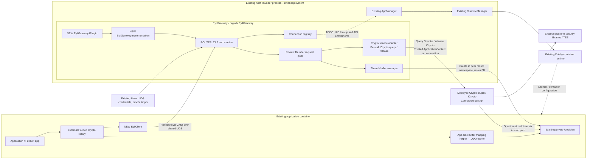

The inner EyilGateway block groups components owned by the plugin. AppManager
and RuntimeManager remain separate plugins within the Thunder process. The
diagram distinguishes existing platform infrastructure from new Gateway
components and pending AppManager/RuntimeManager integration. Crypto may itself
be in process or remote;
Gateway must not depend on a raw pointer or FD being meaningful in Crypto's
process.

### 3.2 Components, ownership and trust boundaries

| Component | Owner / location | Responsibility |
| --- | --- | --- |
| Application / Firebolt Crypto | Application container; external consumer | Express operations, serialize Crypto payloads and consume results |
| EyilClient | New library in the application's process | Transport coordination, RPC correlation and C API buffer ownership |
| App-side mapping helper | Placement TODO; not part of the current EyilClient transport API | Open/map the name returned by allocation; manage app mappings |
| EyilGateway wrapper | New Thunder IPlugin | Framework lifecycle and implementation acquisition |
| EyilGatewayImplementation | New implementation library | Own Gateway transport, contexts, request pool, adapters and allocations |
| AppManager / RuntimeManager | Existing RDK platform plugins | Future authoritative identity/entitlements; lifecycle information if adopted |
| Dobby / DobbyTool | Existing container runtime / diagnostic tool | Launch, container namespace/mount setup and test execution; no request routing |
| Linux kernel / libzmq | Existing platform dependencies | UDS transport and peer credentials; monitor support depends on the target libzmq |
| Crypto plugin / ICrypto | Deployed external Thunder backend | Crypto execution, per-application-session state, keys and key authorization |
| Sec API / secure hardware / TEE | External platform-specific implementation | Backend-dependent cryptographic operations; no Gateway dependency |

There is **one listening UDS endpoint**, shared by all intended applications.
Each accepted connection gets its own identity, request accounting and buffer
ownership. Separate connections do not require separate socket paths.

The app cannot authoritatively provide its UID, appId, sessionId or a host
shared-memory path. The transport supplies peer credentials; the Gateway creates
the connection context and resolves opaque buffer IDs. Key policy remains in
Crypto, including locators, usages, import/export restrictions and sharing.

### 3.3 Container mounts and direct access

The AC endpoint is `ipc:///tmp/app-eyil-gateway.ipc`. Deployment must expose the
same socket object to intended containers, with deliberate directory/socket
permissions. Sharing all of host `/tmp` also exposes unrelated objects; a narrow
mount is preferred when supported. A directory mount avoids binding a container
to an obsolete socket inode after the server recreates it. Final Dobby mount
configuration and permissions remain TODO(DEPLOYMENT).

Monitor and ZAP `inproc://` endpoints are local to a ZMQ context; they need no
filesystem socket or container mount.

Ordinary application containers must not acquire the Crypto interface directly
through Thunder's communicator. `ApplicationContext` is identity metadata; it
does not authenticate the COM-RPC caller. The platform direction is to restrict
general app access to Thunder. Deployment validation must verify the actual
communicator mounts and access policy for the deployed Crypto integration.

Gateway's private pool isolates its request scheduling from Thunder's global
worker queue. It does not isolate process crashes, total CPU/memory pressure or
a blocked in-process backend. Those limits matter while Gateway is in process.

### 3.4 External integration seams

| TODO | Integration point | Selected behavior / remaining decision |
| --- | --- | --- |
| TODO(AUTH-APPMANAGER) | AuthenticationProvider called by ZAP; future Gateway → AppManager → RuntimeManager lookup using trusted UID | Accept valid direct UDS peers, record UID/GID/PID, create unique interim appId/sessionId per connection |
| TODO(API-AUTHORIZATION) | Admission check against entitlements cached in the connection context | Allow all structurally valid supported APIs; still enforce limits and buffer ownership |
| ICrypto lifecycle | Scoped NotifyAppState calls through CryptoServiceAdapter | CONNECTED during authentication; DISCONNECTED after accepted work ends; Crypto owns its internal session/key behavior |
| TODO(LIFECYCLE-EVENTS) | Lifecycle observer receiving platform events and submitting serialized context transitions | No AppManager/RuntimeManager subscriptions or inferred hibernate/idle policy |

The interface names in this table describe internal seams. They are not
additional app-facing Thunder interfaces and do not claim that a formal
AppManager authentication API is already available. Future API additions should
be confined to these seams, rather than spreading external plugin types through
the client, transport or buffer registry.

## 4. APIs: Protobuf and ZeroMQ

### 4.1 The two Protobuf files

| File | Purpose | Boundary |
| --- | --- | --- |
| [rpc.proto](../apis/proto/rpc.proto) | Service-neutral RpcRequest/RpcResponse, request_id, service, schema_version and RpcStatus | EyilClient ↔ Gateway routing |
| [crypto.proto](../apis/proto/crypto.proto) | CryptoRequest/CryptoResponse, operations, key metadata, buffer allocation/release and offset/length regions | Crypto consumer ↔ Gateway Crypto adapter |

`RpcRequest.payload` carries service payload bytes. For CRYPTO these are a
serialized CryptoRequest; the unsupported string path carries text as described
below. `RpcResponse.payload` contains the service response when available and
is empty for Gateway routing errors. Crypto
defines an operation enum and a `oneof`; they must agree. A valid Protobuf parse
alone does not validate the operation, enum values, required message presence
or allowed lengths.

The RPC envelope fields are:

| Message | Fields |
| --- | --- |
| RpcRequest | request_id: uint64; service: RpcService; schema_version: uint32; payload: bytes |
| RpcResponse | request_id: uint64; service: RpcService; schema_version: uint32; status: RpcStatus; payload: bytes |

[ProtocolVersion.h](../apis/proto/ProtocolVersion.h) fixes the current envelope
schema to **1**. EyilClient sets it for each RPC. There is no version negotiation
or fallback protocol in the current schema. Library/package ABI versions and
Thunder plugin metadata versions are separate concepts.

Client and Gateway must use matching generated rpc.proto and crypto.proto
definitions for the agreed schema.

**Agreed envelope handling:** EyilClient
serializes/deserializes the outer RPC envelope, owns request IDs, sets
schema_version to 1 and correlates responses.

For the byte API, the caller supplies a serialized RpcRequest carrying
service and payload. EyilClient parses the envelope, assigns request_id, sets
schema_version and serializes it for transmission. On receipt, it parses and
validates RpcResponse, matches request_id to the pending call and returns the
serialized response to that caller. The service is carried in the envelope;
no separate service argument is needed. Crypto payload bytes remain opaque to
EyilClient and are interpreted by the service-specific consumer.

Request IDs are nonzero and unique throughout one Client connection generation,
including after a request is retired. Different connections may use the same
numeric ID. Gateway therefore identifies a request by its authenticated
connection generation together with request_id, never by request_id globally.

Both string request APIs accept ordinary NUL-terminated request text and return
ordinary NUL-terminated response text. EyilClient measures and copies input up
to the first NUL; the caller supplies no size or text encoding. Wire envelope
construction and serialization belong inside the library. The current string
path uses service=RPC_SERVICE_UNSPECIFIED (0) and carries raw text bytes in
payload. Gateway rejects that unrouted request with
RPC_STATUS_UNSUPPORTED_SERVICE; the client returns its symbolic status name as
text. No text is interpreted as CryptoRequest or sent to ICrypto. Section 5.8
defines this unsupported behavior and the complete string error representation.

### 4.2 Status and error layers

| Layer | Meaning and handling |
| --- | --- |
| ClientResult | Local C API validation, connection, allocation, timeout or communication result |
| RpcStatus | Gateway routing/execution result; explicitly inspect it even when a response was received |
| CryptoError | Crypto service result, carried inside CryptoResponse |
| Core::hresult | Whether the ICrypto invocation itself succeeded; check before reading output parameters |

`CLIENT_OK` on an asynchronous submission means zmq_send accepted the message
into libzmq's queue; it does not confirm physical UDS delivery or remote success.
`RPC_STATUS_OK` means the Gateway successfully produced the
service response; `CryptoResponse.error` can still report a failed crypto
operation. Protobuf's zero default `RPC_STATUS_UNSPECIFIED` is not success.

#### Agreed local error behavior

The following client behavior is agreed. It applies independently of AppManager authentication and the outcome of
a Crypto invocation.
Apply ClientResult through the connect, synchronous request or async submission
return value. Async response callbacks carry response data only; they do not
carry local ClientResult errors.

| Situation | ClientResult | Response handling |
| --- | --- | --- |
| Invalid arguments, oversized string input or invalid caller-supplied binary request envelope | CLIENT_INVALID_ARGUMENT | No response |
| client_register_notifications is called | CLIENT_NOT_IMPLEMENTED | Reserved for future support; no handler is stored or invoked |
| client_connect receives a valid, already allocated Client handle in the caller's slot | CLIENT_ALREADY_CONNECTED | Preserve the existing handle and connection state; create no new connection and invoke no callback |
| Submission without a usable connection | CLIENT_NOT_CONNECTED | No response |
| Explicit client_disconnect wins while a synchronous result or an unaccepted async send is pending | CLIENT_NOT_CONNECTED | Clear synchronous outputs, cancel unsent work and retire pending IDs; no async response callback |
| Authentication explicitly rejected | CLIENT_AUTH_FAILED | No response |
| Detected allocation failure during connect, sync processing or async submission before libzmq acceptance, including request preparation and pending-map insertion | CLIENT_OUT_OF_MEMORY | Roll back local state; sync outputs remain NULL/0 and async submission invokes no response callback |
| Connect, synchronous request or async send-submission deadline expires | CLIENT_TIMEOUT | No handle on connect failure; no synchronous response on timeout; async send failure invokes no response callback. A synchronous timeout may leave remote execution in progress |
| Connection lost during a synchronous request or before async send acceptance, malformed synchronous response or terminal send failure | CLIENT_COMMUNICATION_ERROR | No response |
| Valid correlated synchronous RPC response delivered, or async message accepted by zmq_send | CLIENT_OK | Sync returns the response; async returns without waiting for one. The caller checks RpcStatus and service status when a response is delivered |

These mappings apply when that terminal path wins. An admitted nonblocking send
must finish before its acceptance is known: timeout or close during the attempt
cannot turn an accepted async send into a failed submission. A synchronous
call can still time out or close while awaiting its response. Section 5.2
defines result arbitration and preserves the first terminal runtime reason.

For synchronous byte responses, every local error produces `response_data == NULL` and
`response_size == 0`. For string responses, it produces `response_data == NULL`.
A valid Gateway error response, including RPC_STATUS_INTERNAL, is still a
received RPC response: byte APIs return CLIENT_OK with its bytes and preserve
RpcStatus.
Do not turn a local failure into a fabricated Gateway RpcResponse or CryptoError.

Byte APIs expose the complete RpcResponse for inspection. String APIs expose
the symbolic name of its validated non-OK RpcStatus, normally the exact text
"RPC_STATUS_UNSUPPORTED_SERVICE". Sync returns CLIENT_OK with that owned string;
async delivers it through the existing response callback after a successful
send. The text is a remote rejection, not successful text-service execution.
Local errors still use ClientResult and do not fabricate a response. Unexpected
OK, unknown status or nonempty payload on this unsupported string path is a
response-validation failure as specified in section 5.8.

Connect, synchronous request and async send-submission timeouts are **15,000 ms**
in the initial version, using one common internal duration constant. Async
responses have no timeout. No new public timeout-configuration
API is required for this version. An authentication error requires an explicit
rejection; an unavailable endpoint or lost connection is not evidence of denied
access.
Temporary socket backpressure is handled within the active send deadline and
is not automatically a terminal communication failure. Client callers wait for
the one submission slot within their original deadline. There is no submission
container or queue-full result. Allocation failure in owned request state or
the dynamic pending-response map uses CLIENT_OUT_OF_MEMORY. A busy slot alone
is not an allocation failure; expiry while waiting uses CLIENT_TIMEOUT.
Gateway allows at most 1,024 requests waiting for a private-pool worker, with
a 10-second deadline to start dispatch. Queue saturation, expiry before dispatch
and detected Gateway allocation failure map to RPC_STATUS_INTERNAL when a
correlated reply can be constructed and sent. It does not become a local
CLIENT_OUT_OF_MEMORY result in EyilClient.

An async submission that returns an error must not invoke its response callback.
After CLIENT_OK, deliver a valid correlated response at most once. There is no
async response timeout and no synthetic error callback. A connection failure
retires outstanding async records through the connection-state path; a matched
response that fails local validation/allocation is retired with diagnostics and
no callback. Therefore a callback is not guaranteed after every successful send.
Section 5.4 defines this response-only contract.

A timeout or connection loss does not prove remote cancellation. Do not replay
the operation automatically or claim that its shared buffer is safe to reuse.

| RpcStatus | Intended use |
| --- | --- |
| UNSPECIFIED (0) | Missing/unset result; reject as an invalid response |
| OK (1) | Successfully routed and processed at the Gateway layer |
| INVALID_REQUEST (2) | Parsed outer RPC envelope violates the agreed structure; service-payload rejections use the generic error below |
| UNSUPPORTED_SCHEMA (3) | Unsupported envelope schema_version |
| UNSUPPORTED_SERVICE (4) | No registered service, including service=UNSPECIFIED used by the unsupported string path; log ERROR and return empty payload |
| MALFORMED_REQUEST (5) | Cannot decode the outer RPC envelope or its framing; service-payload decoding failures use the generic error below |
| INVALID_CONNECTION (6) | Missing, stale or inadmissible authenticated connection context |
| INTERNAL (7) | Generic Gateway rejection or execution failure, including the cases below, full 1,024-entry waiting queue, 10-second dispatch-wait expiry, allocation failure, null ICrypto lookup or failed invocation when a correlated reply is possible |

#### Generic Gateway rejection and explicit error logging

Use the existing **RPC_STATUS_INTERNAL** for invalid service payloads,
shared-buffer quota failures and rejected uses of busy, release-pending or
already released buffers, when a reply can be safely correlated. A first valid
ReleaseSharedBuffer request is accepted even while the buffer is in use;
physical cleanup is deferred as specified in section 6.13. No additional wire
error codes are needed.
The Gateway must log the specific cause at **ERROR** severity where the
rejection is detected, independently of whether an error response can be sent.

| Rejection | RPC result when safely correlatable | Required log detail |
| --- | --- | --- |
| Duplicate ID still owned by an accepted request on the same connection generation | No second response; log and discard the duplicate | Duplicate ID and the original request's state; preserve the original job/completion |
| Invalid service payload | RPC_STATUS_INTERNAL | Decode failure, operation/oneof mismatch, invalid field, enum, range or buffer reference, as applicable |
| Shared-buffer quota exceeded | RPC_STATUS_INTERNAL | Requested size/count, current usage, applicable limit and whether the quota is per connection or global |
| New use rejected because a buffer is release-pending, being destroyed or already released | RPC_STATUS_INTERNAL | Buffer ID and release state or failed lookup |
| Competing use rejected because a buffer is busy | RPC_STATUS_INTERNAL | Buffer ID and active-use state |
| Release rejected because the ID is unknown, belongs to another connection or already has an accepted release | RPC_STATUS_INTERNAL | Requested ID and exact validation/state failure; preserve the original release and any active use |

Include the connection token/generation, request_id, service and operation when
known. Record a specific reason such as `duplicate_request_id`,
`invalid_service_payload`, `buffer_quota_exceeded`, `buffer_unavailable` or
`buffer_busy`; these are local diagnostics, not new protocol fields. Do not log
request payloads, key material or shared-memory contents. Rejected work must not
invoke Crypto, overwrite another request's state or invalidate active buffer
leases. Roll back partially reserved resources.

Use an empty service payload for a Gateway rejection; do not fabricate a
CryptoError. A successfully invoked Crypto method still preserves its actual
CryptoError in the service response. Existing outer-envelope, schema, service
and connection status mappings remain as listed above.

Only send an error when the request ID and original authenticated route permit
unambiguous correlation. A duplicate ID still owned by an accepted request must
not produce a second competing response under that ID: log and discard the
duplicate, leave the original job/completion intact and never dispatch a second
operation. Scope this check to the authenticated connection generation; request
1 on another connection is independent. This is not a replay/deduplication
guarantee for completed operations. Likewise, log and discard malformed input
without a trustworthy ID or route. The generic status does not justify inventing a request ID or replying
to a replacement connection.

Error replies follow the same single nonblocking send-attempt rule as successful
responses. Log any delivery failure separately and drop the reply without a
retry. A generic failure does not acknowledge buffer release or prove that an
earlier operation finished. Sections 6.10–6.13 define execution-time buffer
checks, rejection of competing uses and deferred destruction after an accepted
release. Gateway does not preserve queued buffer operations through a release
or replay rejected work.

An accepted release returns RPC_STATUS_OK with CRYPTO_ERROR_NONE and the empty
ReleaseSharedBufferResponse. This acknowledges that the ID is closed to further
use and Gateway owns cleanup; it does not certify physical destruction or backend
completion. Cleanup errors after acceptance are logged at ERROR, retain private
cleanup state and quota, and do not change that release result or generate a
second response. Response-allocation or delivery failure after acceptance does
not undo the release. The full failure and ownership rules are in section 6.13.

### 4.3 Protocol capabilities and limitations

| Capability | Implementation consequence |
| --- | --- |
| Independent request_id | Many requests may be outstanding; match responses by ID, not arrival order |
| Explicit service enum | A new service needs a schema/adapter addition; only CRYPTO is currently defined |
| Opaque service payload | Transport does not implement Crypto key policy |
| Buffer ID plus regions | Four bulk-data operations avoid embedding their input/output in the RPC message |
| Empty ReleaseSharedBufferResponse | Successful response acknowledges accepted release; destruction may wait for active access to end, with no later completion notification |
| uint32 buffer fields | Validate size/ranges with overflow-safe arithmetic and stricter configured quotas |
| No app identity fields | Derive context from trusted transport metadata |
| No deadline/cancel message | A local timeout cannot cancel backend work or prove buffer reuse is safe |
| No notification envelope | Notification support is reserved for the future; registration returns CLIENT_NOT_IMPLEMENTED and creates no subscription |
| No retry/deduplication contract | Do not replay key generation, import or other operations automatically |
| NUL-terminated string API boundary | Copy input without caller encoding; send an unrouted service=0 envelope and expose Gateway UNSUPPORTED_SERVICE as status text; successful text-service execution is deferred |
| No lifecycle/heartbeat messages | Do not invent idle expiry, hibernation commands or heartbeat services |

The protocol permits concurrent requests; it does not define ordering for
operations sharing a key, buffer or session. Request-ID correlation also does
not provide exactly-once execution or distinguish a lost reply from an operation
that never ran.

### 4.4 ZeroMQ endpoints and message framing

| Endpoint | Socket / owner | Purpose |
| --- | --- | --- |
| `ipc:///tmp/app-eyil-gateway.ipc` | Gateway ROUTER binds; each client DEALER connects | Application RPC over filesystem UDS |
| `inproc://zeromq.zap.01` | Gateway ZAP REP binds | Internal authentication exchange |
| `inproc://app-eyil-gateway-monitor` | ROUTER monitor publishes; Gateway PAIR receives | Gateway transport events |
| `inproc://app-eyil-client-monitor-<unique-client-id>` | DEALER monitor publishes; client PAIR receives | Client transport events |

DEALER sends one frame containing the serialized RpcRequest.
ROUTER receives `[routing_id][RpcRequest bytes]` and replies with
`[routing_id][RpcResponse bytes]`; DEALER receives the response body only.
There is no empty REQ delimiter.
Validate the frame count and consume/reject an entire malformed multipart
message before accepting another. Define size and frame limits explicitly.

String API input does not change this framing: EyilClient constructs the binary
RpcRequest internally and sends it with its serialized length. Gateway still
receives a binary envelope. The local C-string terminator is not a transport
frame delimiter and is not included in a directly carried text payload.

The ROUTER I/O owner copies `zmq_msg_gets(message, "User-Id")` before closing
the received message. The routing frame is a delivery address, not authenticated
identity. ZAP's User-Id is a different identifier.

Each DEALER and ROUTER has one socket-owning thread. Client API callers hand
work to their owner through one synchronized submission slot and a wakeup.
Gateway workers hand results to ROUTER through its completion queue. Neither
application callers nor Gateway workers send or receive on the owner's socket. This follows the restrictions for these socket types in the
[ZeroMQ socket API](https://libzmq.readthedocs.io/en/latest/zmq_socket.html).
Socket options, connection, monitoring and closure follow the same ownership.

PLAIN server mode belongs on the ROUTER. The REP handler answers ZAP exchanges;
EyilClient supplies dummy PLAIN strings and never runs a ZAP server. The trusted
UID/GID/PID representation depends on the target libzmq implementation, rather
than the client password. See the
[ZAP specification](https://rfc.zeromq.org/spec/27/).

## 5. EyilClient design and API flows

### 5.1 Responsibilities and limits

EyilClient provides transport coordination, not Crypto semantics. A caller can
submit concurrent synchronous and asynchronous requests on the same `Client`.
A synchronous caller waits for its response; an async caller waits only for
libzmq send acceptance. Neither may hold a lock needed by the I/O owner or
another caller while waiting.

Each Client has one library-owned serving thread and one owned ZMQ context.
libzmq also creates its own internal I/O threads: those do not maintain the
library's pending map,
run its callbacks or replace its serving thread.

There is no application heartbeat producer, heartbeat worker, periodic liveness
RPC or inactivity watchdog in EyilClient. Connection-state handling uses
the monitor events and the request coordinator. Connect, sync requests and async
send submission retain 15-second deadlines; async response waiting has none.
Built-in libzmq transport heartbeats are also disabled, as specified in
section 5.5.

The library does not:

- Call AppManager, RuntimeManager, Thunder or ICrypto.
- Decide key authorization, generate trusted app identity or choose host paths.
- Allocate, map or release Gateway-owned buffers implicitly through the generic
  transport API. The app-side Crypto layer requests and maps them explicitly.
- Promise that reconnect preserves keys, buffers or a Gateway session.
- Treat a timeout, a successful send or a connection callback as proof that a
  remote Crypto operation finished.

### 5.2 Component organization and ownership

Use one ClientRuntime per Client, with one I/O owner and one retained request
record per entered request call. The rows below describe responsibilities and
method boundaries, not a requirement for a class or thread per row.

| Component / state | Responsibility | Owner / synchronization |
| --- | --- | --- |
| Public C API | Retain a live call, validate arguments, prepare owned input and wait for submission/result | Calling application thread; never touches DEALER |
| ClientRuntime | Connection generation, admission, slot, callback claims and shutdown | Per-Client state mutex and retained live-call references |
| Single submission slot | One retained Request reference, EMPTY/PUBLISHED/CLAIMED state and slot-available condition variable | Pre-created during connect; no std::queue, list of submissions or queue-node allocation |
| Request record | Owned envelope/text, mode, ID, generation, original deadline, send result and response waiter or handler | Retained independently by the caller, occupied slot, I/O owner and pending map as needed |
| I/O owner | Claim the slot, serialize/send, receive/correlate, process deadlines and PAIR events | One library-owned thread; sole DEALER owner |
| Pending map | request_id to expected response metadata and completion target | I/O owner; entry installed before first send and retired once |
| Per-call result conditions | Wake the async caller on send outcome or sync caller on final result | Waits release the state mutex; send acceptance and response completion remain separate states in the Request |
| Monitor collector | Decode PAIR events and drive connection-state handling | I/O owner in the proposed consolidation; dedicated-thread AC wording remains CLIENT-MONITOR |
| Response storage | Owned binary response or NUL-terminated status text | Transferred to the application and freed with client_free_response |

The slot is shared only within one Client. Callers waiting for it remain on
their application threads, retaining their own request/call state; the library
does not put them in another submission container. The slot remains occupied
while its request is being prepared or waiting for libzmq acceptance. After a
terminal send outcome, the owner clears it and wakes waiting callers. Sent
requests remain independently tracked in the pending map, with no fixed count
cap. One occupied slot does not mean one outstanding remote operation.

Every request entry point obtains a live-call guard before input preparation.
The guard covers slot waiting, publication, send/result waiting and response
preparation. Disconnect wakes these calls before waiting for their guards to
drain. The application must still coordinate raw-handle lifetime as specified
in section 5.13. Socket ownership is never transferred to an application caller.

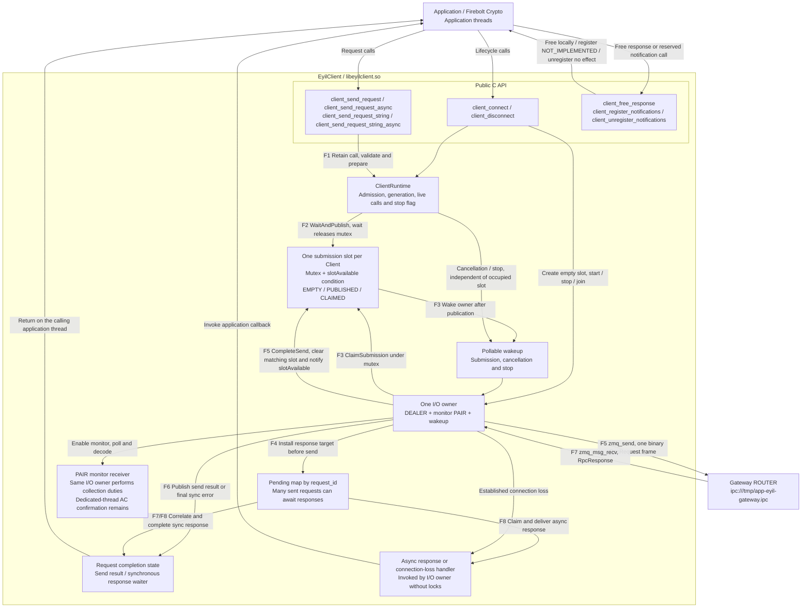

F1–F8 are the common flow points defined in section 5.3 and reused in every
request sequence. WaitAndPublish, ClaimSubmission and CompleteSend are internal
design method names on the runtime/owner, not additional public APIs. The slot
is read explicitly by ClaimSubmission; a wakeup alone does not transfer or send
the request. CompleteSend frees the slot after acceptance/failure, independently
of later response delivery. Connection and response callbacks share the owner
thread and must return promptly. Notification APIs create no callback state.

The PAIR monitor receiver is an internal socket plus event-decoding code.
Enabling monitoring on DEALER makes libzmq create the other PAIR endpoint, which
emits connection, handshake and disconnect events. The receiver connects through
the client monitor's inproc endpoint. It carries transport events rather than
RPC responses. See the
[ZeroMQ monitor API](https://libzmq.readthedocs.io/en/latest/zmq_socket_monitor.html).
In the proposed arrangement, the same client I/O loop reads DEALER and the
PAIR receiver; the PAIR block does not itself imply a separate thread or service.
The dedicated-monitor-thread wording remains TODO(CLIENT-MONITOR).

> **Note for the PAIR and I/O-owner blocks:** together they perform the monitor
> thread's expected event-collection and connection-state duties. The PAIR block
> is a socket and decoder executed by the I/O owner, not another thread. A
> separate worker is technically optional; accepting this arrangement against
> the AC's explicit monitor-thread wording remains to be confirmed.

Monitoring is a responsibility, not necessarily a dedicated thread. The two
proposed arrangements consume the same PAIR events:

| Thread or component | Responsibility |
| --- | --- |
| libzmq's internal I/O threads | Transport/protocol work and production of socket-monitor events |
| EyilClient serving/I/O owner | Own DEALER, poll replies, submissions and deadlines; in the proposed consolidated model, also poll the monitor PAIR and update connection state |
| Optional dedicated monitor worker | Own only the monitor PAIR and post decoded events to the coordinator/I/O owner; needed only if the AC requires a distinct worker |

In the consolidated model, poll the DEALER, monitor PAIR and submission wakeup
together. Reading a monitor event must not wait for an RPC response. A dedicated
monitor worker would separate that event-reading work, but it would not replace
the I/O owner or its pending-request coordination. ZeroMQ's monitor API requires
a PAIR receiver, not a particular application-thread arrangement. The remaining
CLIENT-MONITOR question is acceptance of the AC's thread wording; both proposed
arrangements provide the required monitoring function.

Freezing the whole application stops both its serving thread and any dedicated
monitor thread, including libzmq's own threads. Adding a separate monitor thread
cannot make the frozen application process events. In either arrangement,
callbacks must remain short to avoid delaying the client's processing.

#### Monitor responsibilities for AC confirmation

Confirm the following monitoring contract independently of whether a dedicated
OS thread is required. The consolidated implementation assigns collection and
handling to the existing I/O owner. A dedicated collector would own only PAIR
and forward events to that owner; it must not also read or write DEALER or
independently mutate the pending-request map.

| Expected monitor responsibility | How PAIR plus the I/O owner cover it |
| --- | --- |
| Set up event collection before connecting | The DEALER owner enables monitoring at the unique client monitor endpoint; the collector creates/connects its PAIR receiver in the same ZMQ context |
| Receive and decode complete monitor messages | Poll PAIR alongside DEALER and the submission wakeup; validate the event frames, event value and endpoint for the configured monitor API version |
| Establish handshake readiness | On HANDSHAKE_SUCCEEDED, publish READY and wake client_connect without an application callback; CONNECTED alone does not establish readiness |
| Report initial connection/authentication failures | Wake the connect waiter with the exact ClientResult from section 5.5, without a callback; distinguish authentication denial from transport/protocol failure |
| Handle loss of an established connection | Mark the connection unusable, stop admission, fail unresolved sync/send-result waiters with CLIENT_COMMUNICATION_ERROR, retire accepted async response records and report CLIENT_CONNECTION_LOST once if callback admission remains open |
| Handle later state transitions without duplicates | Serialize the terminal loss transition, retire the old generation once and ignore later events; explicit reconnect creates a new Client and session as specified in section 5.14 |
| Keep application callbacks and request retirement coordinated | Invoke connection handlers without internal locks, resolve each active API waiter once and retire affected async response records once; no synthetic async error callback |
| Handle monitor failure and orderly stop | Treat unexpected collector failure as a runtime error; during requested shutdown, suppress intentional-close callbacks, wake the poller, stop monitoring and close PAIR on its owner without waiting indefinitely for another event |

The selected monitor events and their framing come from the
[ZeroMQ monitor API](https://libzmq.readthedocs.io/en/latest/zmq_socket_monitor.html).
The ClientResult mapping, pending-request completion and callback rules are
EyilClient responsibilities built on those events. The 15-second connect, sync
request and async send-submission timers are coordinator/I/O-loop work; monitor
events alone do not implement those deadlines. Async response waiting has no timer.

The loop must fairly service monitor events, replies and submissions in bounded
batches. Functional equivalence does not imply identical scheduling isolation:
a blocking callback on the shared owner delays monitor processing too. A
separate collector can keep reading events in that situation, but pending-map
updates and request completions still need the owner. The proposed design
therefore requires nonblocking I/O and short application callbacks.

**Confirmation to obtain:** does the PAIR receiver plus the I/O owner, with the
responsibilities above, satisfy AC2-Client.4, or is an additional dedicated OS thread
itself mandatory? No heartbeat sender, idle-session watchdog or periodic PID
responsiveness probe is part of this monitor contract. The monitor also does
not perform Gateway-side ZAP authentication or decode service responses.

#### Single-slot publication, claiming and completion

Create the slot, state mutex, slotAvailable condition and pollable wakeup during
connect. No submission queue exists. The API prepares an owned Request before
publication, including its callback/waiter, generation and original deadline.
Preparation can fail with CLIENT_OUT_OF_MEMORY; publishing a retained reference
into an empty slot must not allocate.

WaitAndPublish locks the per-Client state, checks admission and waits until the
slot is EMPTY or a terminal condition occurs. A condition-variable wait releases
the mutex. Use one absolute 15-second deadline starting when the request call
is admitted, before input preparation and slot waiting; no stage restarts it.
After publication, unlock and signal the existing pollable wakeup. A condition
variable alone cannot wake the I/O owner's socket poll.

On that wakeup, ClaimSubmission locks state, reads the published Request,
retains it, marks the slot CLAIMED and unlocks. Reading the slot does not clear
it. The owner prepares serialization and the pending-map entry outside the
state lock, then attempts a nonblocking send. There is only one submitted,
not-yet-accepted request at a time. EAGAIN leaves that request in the slot while
the owner polls replies, PAIR events, writable readiness and active deadlines.
It must not block in zmq_send, spin, or wait on an application condition variable.

CompleteSend(request, outcome) applies to the retained Request that owns the
attempt. Under the state lock, it ends SEND_IN_PROGRESS, records the send
outcome once, applies any pending cancellation, disarms an accepted async send's
deadline and clears the slot only if that slot still belongs to this Request.
Unlock before notifying slotAvailable and the request's result condition.
These updates form one coordinated transition. The owner removes
an unsent pending entry before servicing another submission or response.

After acceptance, the pending map retains the response target but not the slot.
A synchronous caller can keep waiting for its response while another caller
publishes and sends a new request. Response retirement for request A must never
clear a slot now occupied by request B. Repeated retirement/completion is
harmless and cannot change an already committed result or release another
request's storage. No async response deadline starts.

The owner allocates increasing nonzero request IDs within its connection
generation. It never reuses a retired ID, including after timeout or failed
submission, so a late response cannot match another request. Do not wrap the
counter: exhaustion ends the generation through the terminal
CLIENT_COMMUNICATION_ERROR path. A fresh Client may restart its ID sequence;
its transport and Gateway context are independent.

| State / event | Required action |
| --- | --- |
| Another request occupies the slot | Wait on slotAvailable within the caller's original deadline; no queue-full result and no FIFO guarantee among competing callers |
| Deadline expires before publication | Return CLIENT_TIMEOUT; no request was transferred or sent |
| Allocation fails during input/request preparation | Return CLIENT_OUT_OF_MEMORY; release partial state, no publication or callback |
| Serialization or pending-map insertion fails after claiming | Owner retires unsent work, frees only its matching slot and completes with CLIENT_OUT_OF_MEMORY unless a terminal result/cancellation already won |
| Published/claimed request is cancelled before a send attempt | Mark cancelled, wake the owner and prevent any later send; retain the record until owner retirement and slot release |
| Nonblocking send attempt is in progress | Resolve that attempt before returning a failure claiming no acceptance; successful acceptance fixes the async result at CLIENT_OK |
| Explicit disconnect closes READY admission | Latch CLIENT_NOT_CONNECTED, notify slotAvailable immediately and wake the owner; preserve earlier results and resolve any send in progress before completing affected calls |
| Unexpected connection loss | Notify slotAvailable, retire unsent/sent state and complete unresolved calls with CLIENT_COMMUNICATION_ERROR; accepted async results remain CLIENT_OK |

EMPTY/PUBLISHED/CLAIMED describe the slot. SEND_IN_PROGRESS describes an
attempt on its retained Request while the slot remains CLAIMED. Only one such
attempt can execute on the owner. The state lock protects the final eligibility
check and transition into SEND_IN_PROGRESS against cancellation/close. Release it for the nonblocking
socket call, then publish the actual outcome under the same synchronization.
A waiter may request cancellation during an attempt but cannot declare that an
accepted message was unsent. After EAGAIN/EINTR, end SEND_IN_PROGRESS under the
lock and recheck cancellation, generation and the original deadline. If no
longer eligible, complete with the winning error; otherwise keep the CLAIMED
slot, poll other work and admit another attempt only through TryBeginSend.
Only the I/O owner clears an occupied slot; an expired caller cannot destroy
storage still retained by it.

Latch the first terminal runtime reason when READY admission closes. Callers
still preparing input or waiting for the slot are not in the pending map; they
read this retained reason before publication or completion. Explicit close
selects CLIENT_NOT_CONNECTED, transport loss CLIENT_COMMUNICATION_ERROR, and
connection-wide decode allocation failure CLIENT_OUT_OF_MEMORY under section
5.6. A later disconnect of an already LOST handle must not replace its reason.
Already committed per-call results remain unchanged. New calls on an already
lost/closing handle get CLIENT_NOT_CONNECTED. notify_all requires no heap
allocation.
Local stop uses its existing flag and wakeup, never waits for a free slot and
never publishes a stop request into that slot.

Every result arrow in the following UMLs uses this terminal-result arbitration.
An error discovered during preparation cannot overwrite a timeout or close
already committed while that preparation ran. A send-acceptance arrow records
the actual attempt outcome; for sync it is distinct from the final response
result. Only an accepted async send fixes the public result at CLIENT_OK.

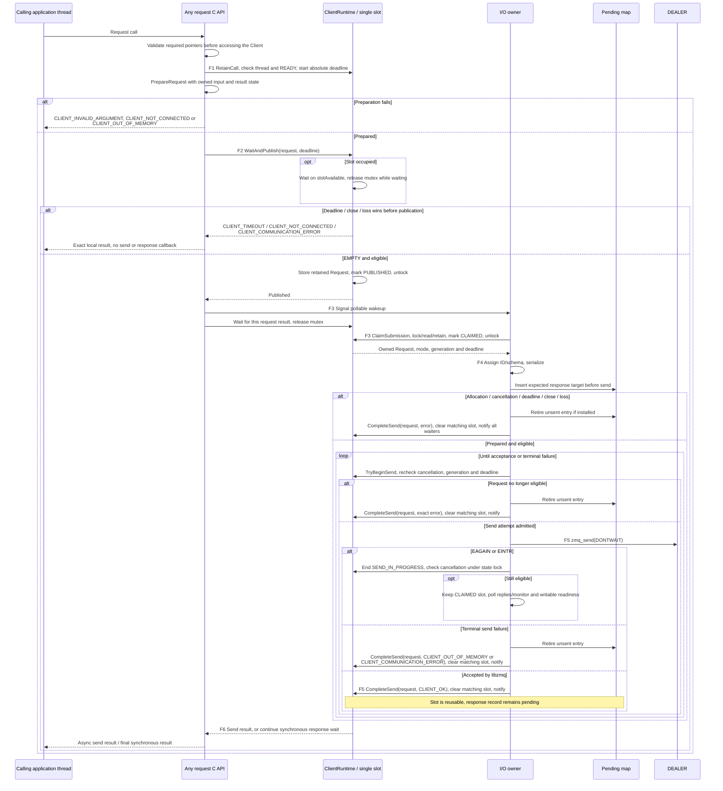

### 5.3 General routing: concurrent requests on one connection

Coverage: **AC2-Client.1, AC2-Client.2–AC2-Client.3, AC2-Client.5,
AC1.5–AC1.7, AC2-Firebolt.1–AC2-Firebolt.2**.

Use these flow points in the API diagrams and implementation:

| Point | Calling component / internal method | Work and next boundary |
| --- | --- | --- |
| F1 | C API: RetainCall / PrepareRequest | Validate handle, calling thread and arguments; check READY, start the deadline, own input and initialize request/result state |
| F2 | Calling thread: WaitAndPublish | Wait for the single slot, releasing the mutex; publish only while eligible; timeout/close/loss can end the wait |
| F3 | Caller: WakeIo; owner: ClaimSubmission | Wake the poller; owner explicitly locks, reads and retains the published request, marks CLAIMED and unlocks |
| F4 | Owner: PrepareWireRequest / TrackRequest | Recheck deadline/generation, assign ID and schema 1, serialize and install the pending entry before sending |
| F5 | Owner: TryBeginSend / CompleteSend | Attempt zmq_send(DONTWAIT); retain the slot on temporary backpressure; atomically record the send result and release only its matching slot, then wake callers |
| F6 | Calling thread: WaitForSend or WaitForResponse | Async returns send result; sync waits for its own final response within the same total deadline, without occupying the slot after send |
| F7 | Owner: ReceiveResponse / MatchRequest | Receive a complete response, validate framing/envelope, match the original ID/service/generation and require recorded send acceptance |
| F8 | Owner: CompleteResponse | Prepare final bytes/status text, claim completion against timeout/close, retire once, wake the sync caller or invoke the async callback without locks |

These internal names make the call boundaries explicit; they can be methods
and state in one ClientRuntime plus Request records. The common send/error
rules are in section 5.6; F1–F8 do not add public API methods. F6 is the caller's
wait/return: it overlaps owner steps F3–F5 and, for sync, F7–F8. Waiting on that
result condition does not prevent the owner from claiming or sending work.

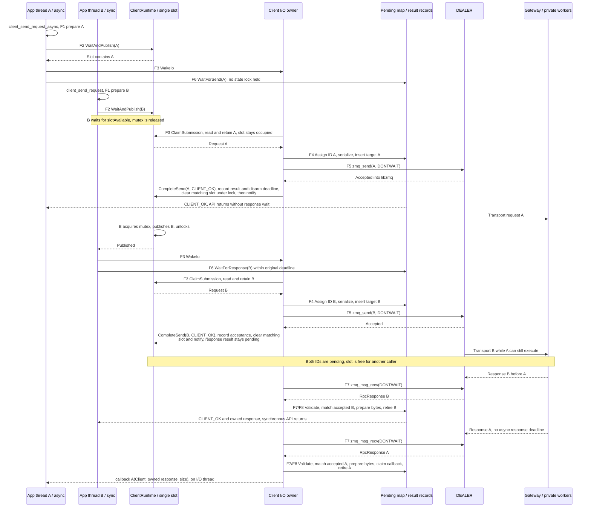

The diagram shows the successful path; each request still has independent
allocation, timeout, close and transport-error handling. Only one unsent
submission occupies the slot, while any number of successfully sent requests
can await responses subject to available memory. Callers waiting for the slot
are not stored in a client submission queue. Simultaneous callers have no FIFO
admission guarantee. The owner fairly services responses, monitor events,
submission readiness and deadlines, even while an occupied slot cannot send.

### 5.4 Public API index

The public API is declared in
[EyilClient.h](../apis/eyilclient/EyilClient.h). All nine methods
have individual sequences below. Both asynchronous request methods are required
public functionality under AC2-Client.5, alongside their synchronous counterparts.
The selected string path delivers Gateway's unsupported-service response;
successful text execution is outside this delivery as recorded in section 5.8.

| Method | Behavior | AC coverage |
| --- | --- | --- |
| client_connect | Return a handle after successful handshake; reject an occupied handle slot with CLIENT_ALREADY_CONNECTED; report exact startup/authentication/timeout errors | AC2-Client.1–AC2-Client.4; AC1.2, AC1.4–AC1.6 |
| client_send_request | Wait/publish one submission slot, then await the correlated binary response without holding that slot | AC2-Client.1, AC2-Client.2–AC2-Client.3, AC2-Client.5 |
| client_send_request_async | Wait for the slot and libzmq send acceptance within 15 seconds; deliver a later binary response with no response timeout | AC2-Client.1, AC2-Client.2–AC2-Client.3, AC2-Client.5 |
| client_send_request_string | Send copied raw text with service=UNSPECIFIED through the slot; return CLIENT_OK plus received RPC_STATUS_UNSUPPORTED_SERVICE status text | AC2-Client.1, AC2-Client.5 |
| client_send_request_string_async | Same slot/send contract; Gateway unsupported-service status is delivered as owned text through the response callback | AC2-Client.1, AC2-Client.5 |
| client_free_response | Release a library-allocated result | AC2-Client.1 |
| client_register_notifications | Return CLIENT_NOT_IMPLEMENTED; reserved for future support | AC2-Client.1 and the public header |
| client_unregister_notifications | Return without changing state; reserved for future support | AC2-Client.1 and the public header |
| client_disconnect | Stop admission/I/O, settle pending work and destroy the handle | AC2-Client.1–AC2-Client.4; AC1.12 on the Gateway side |

#### Allocation failures across the public API

Catch detectable allocation failures at the C API boundary and inside the
I/O owner, including `std::bad_alloc`, failed allocator returns and explicit
ENOMEM from local setup/transport. No C++ allocation exception may escape a
C entry point or terminate the serving loop. Use retained result state to
publish an error; failure reporting and cleanup must not require another heap
allocation. Diagnostics are best effort and must not prevent retirement.

| API | Allocation failure handling |
| --- | --- |
| client_connect | CLIENT_OUT_OF_MEMORY for handle/runtime/setup allocation failure; roll back only this attempt, join any started threads, leave the output NULL |
| client_send_request | CLIENT_OUT_OF_MEMORY for input/envelope/request/waiter/pending-map/send storage or correlated response allocation failure; NULL output and size 0 |
| client_send_request_async | Before send acceptance, return CLIENT_OUT_OF_MEMORY with no response callback; after acceptance, retire a matched response that cannot be allocated with diagnostics and no callback |
| client_send_request_string | Same synchronous rules, including copying input text, constructing the wire request and allocating the response string; return CLIENT_OUT_OF_MEMORY and NULL, releasing temporary storage |
| client_send_request_string_async | Same async rules, including input copying and wire-request preparation before acceptance, and response-string allocation afterward |
| client_free_response | Void, releases storage without allocating; NULL is accepted; no ClientResult is returned |
| client_register_notifications | Always CLIENT_NOT_IMPLEMENTED in this version; no state is allocated or handler retained |
| client_unregister_notifications | Void, no effect or allocation in this version |
| client_disconnect | Void, uses an existing stop flag and wakeup to initiate cleanup without waiting for a free slot or allocating a control request; frees retained state, no ClientResult is returned |

For all four request methods, pre-send failure cancels the unsent request and
releases partial state. A call that times out before publication cannot leave
work for the owner. A published request remains retained until owner retirement;
cancellation prevents it being sent after the API reports failure. A failure
after sending does not undo remote execution or
make a shared buffer safe to reuse. Never replay the operation to recover a
local allocation failure.

The common receive pipeline in section 5.6 also defines failure before a
response can be correlated. An accepted async send retains CLIENT_OK even if
response processing fails before the submitting thread resumes; its send result
cannot be revised or turned into an error callback.

#### Required asynchronous request behavior

Implement client_send_request_async() and client_send_request_string_async()
using the same connection, request correlation and coordinator as the
synchronous methods. The submitting thread waits for its send result, **not for
the remote response**.

- Validate and copy the request, initialize its retained send-result state,
  then WaitAndPublish into the single slot. Waiting releases the state mutex.
- Wake the I/O owner, which explicitly claims the slot and installs the pending
  record before attempting send. Return CLIENT_OK only after zmq_send accepts
  that request. Slot publication alone is insufficient.
- EAGAIN retains the occupied slot within the original 15-second budget while
  the owner services other replies and events. Acceptance or terminal failure
  clears the slot and wakes waiting callers.
- Return validation, allocation, connection or send-submission timeout errors
  directly from the API. A failed submission invokes no response callback.
- After send acceptance, retain the request for a response with **no response
  timeout**. A valid response invokes its registered callback at most once.
- Connection loss or explicit shutdown retires outstanding async records without
  a response callback. Transport loss is reported by the connection-event handler.
  Local failure to validate or allocate a matched response also retires that
  record with diagnostics and no response callback.
- A successful send therefore does not guarantee a later callback. Never
  fabricate a Gateway response or deliver NULL as a synthetic error response.

**Selected send guarantee:** zmq_send success means acceptance into libzmq's
queue. It does not prove physical UDS transmission, Gateway receipt or backend
execution, even with a blocking send. No receipt ACK or Protobuf extension is
required by this contract. See the
[ZeroMQ send contract](https://libzmq.readthedocs.io/en/latest/zmq_send.html).

The string method accepts the same NUL-terminated text as its synchronous
counterpart, without caller encoding. Both asynchronous request methods are
required. Byte-method callers continue to supply and interpret serialized
Protobuf; the plain-text contract applies to the string methods.

#### Async signatures and response ownership

The asynchronous request API uses these signatures:

```c
typedef void (*ClientResponseHandler)(
    Client *client,
    uint8_t *response_data,
    size_t response_size);

typedef void (*ClientStringResponseHandler)(
    Client *client,
    char *response_data);

ClientResult client_send_request_async(
    Client *client,
    const uint8_t *request_data,
    size_t request_size,
    ClientResponseHandler handler);

ClientResult client_send_request_string_async(
    Client *client,
    const char *request_data,
    ClientStringResponseHandler handler);
```

The pending map associates the library-assigned request_id with the handler
supplied for that request. Callback arguments carry the actual response only.
For byte responses, the app inspects RpcStatus and service status. String
responses carry the symbolic name of the received Gateway error, normally
RPC_STATUS_UNSUPPORTED_SERVICE, under the defined contract in section 5.8.
The caller releases either result through
client_free_response(). A valid Gateway error response follows the same response
delivery path. ClientNotificationHandler is reserved for future support and is
not used to deliver request results or local errors.

Copy input before returning so the caller may reuse its request storage.
Keep pending bookkeeping and callback code valid until response delivery or
connection teardown. Without a response deadline, a request that never receives
a reply can retain its pending-map entry and memory until teardown. Local
validation/allocation failure retires the affected entry but cannot report a
per-request error through these response-only signatures.

#### Send-result coordination and cancellation

Each async request has two distinct stages: a bounded submission wait and an
unbounded response wait. Keep separate send-result and response-completion
states in the same retained Request, rather than requiring separate allocated
coordinator objects. CompleteSend commits the send outcome and matching-slot
release together under the state lock, then notifies the request and slot
waiters. The submitting thread returns that result; response waiting never
occupies the slot.

Serialize the nonblocking send attempt and its acceptance publication against
send-deadline cancellation. Check the request's state and deadline before every
attempt. With no attempt in progress, cancellation atomically makes the request
ineligible for any later send. During SEND_IN_PROGRESS, latch the cancellation
reason and resolve that attempt before publishing its terminal send result.
If libzmq accepts it, the async result is CLIENT_OK even if the deadline or
close occurred during that attempt. If it does not accept it, apply the latched
reason and do not retry. Without cancellation, EAGAIN/EINTR leaves the request
eligible only within its original deadline; a terminal send error completes it.

After requesting cancellation, a waiter awaiting the active attempt uses its
result condition; it must not spin on an already expired deadline. The deadline
prevents a new send attempt, but resolving an admitted attempt and safely
retiring its state can finish later. This is not a hard real-time return bound.
Section 5.6 applies the same send eligibility rules to synchronous calls while
keeping their final response result separate from send acceptance.

After acceptance, disarm the async send deadline. Response arrival and
connection cleanup compete only for ownership of the pending record; retire it
once and discard late/duplicate replies. No async response-expiry task runs.
A local retirement or successful send does not prove backend completion or make
a shared buffer safe to reuse.

#### Request-callback execution model

- Invoke response callbacks on the owning Client's serving/I/O thread, without
  internal state/slot locks held. Callbacks are serialized within a Client;
  different Clients can invoke callbacks concurrently.
- Retire the pending record before calling application code, and keep the Client
  and response storage alive for the invocation.
- Never call the handler inline on the submission call stack. A fast response
  can invoke it on the I/O owner before the submitting thread resumes from its
  send-result wait; prepare application state before making the API call.
- A response callback may call client_free_response. Schedule new requests and
  other work on an application thread.
- All request APIs, including async submission, can wait for the I/O owner.
  Calling them from that owner's callback would deadlock. Detect this case and
  return CLIENT_INVALID_ARGUMENT before admission. Do not call client_connect
  or client_disconnect from the callback either.
- Callbacks must return promptly so other sends, replies, monitor events and
  active deadlines can progress.

These rules do not depend on AppManager or the Crypto backend. Explicit
disconnect closes callback admission, resolves unresolved sync/send-result
waiters with CLIENT_NOT_CONNECTED, retires async response records and waits for
already-claimed callbacks and live calls before destroying the handle. Section
5.13 defines the complete ordering. Section 5.5 defines the connection-handler
contract: startup uses the synchronous result, later unexpected loss emits
CLIENT_CONNECTION_LOST and explicit close emits no connection callback.

### 5.5 client_connect()

Coverage: **AC2-Client.1–AC2-Client.4; AC1.2, AC1.4–AC1.6**.

#### Handle ownership and CLIENT_ALREADY_CONNECTED

The API treats `Client **client` as an input/output handle slot.
Initialize it before the first call, for example `Client *client = NULL`.

- If `client == NULL`, return CLIENT_INVALID_ARGUMENT without dereferencing it.
- If `*client != NULL` and contains a valid Client handle that has not been
  destroyed, return CLIENT_ALREADY_CONNECTED immediately. Preserve that handle,
  its registered handler, pending requests and connection state. Do not allocate
  a runtime, start threads, connect another socket or invoke a callback for the
  rejected call.
- If `*client == NULL`, start a new connection attempt. Publish the handle only
  on CLIENT_OK; on startup failure the slot remains NULL after rollback.

CLIENT_ALREADY_CONNECTED is local handle-ownership validation, not a Gateway
rejection or a restriction to one connection per process, UID or app. A separate
NULL-initialized slot may create another independent Client. An existing handle
still occupies its slot after transport loss; calling client_connect with it is
not a reconnect API and returns CLIENT_ALREADY_CONNECTED. To reconnect, call
client_disconnect on the old handle from an application thread, reset the slot
to NULL and call client_connect again. The new call creates a fresh runtime and
authenticated session; the old handle never returns to READY after loss.

The caller must serialize access to the same handle slot, including concurrent
connect attempts. Uninitialized, fabricated or destroyed handles are invalid
API usage. After client_disconnect destroys a handle, the caller must reset its
own slot to NULL before reusing it: client_disconnect takes Client*, so it cannot
clear the caller's variable.

#### Readiness contract

**Agreed readiness contract:** return CLIENT_OK and publish a valid Client
handle only after local startup has succeeded and the client monitor receives
`ZMQ_EVENT_HANDSHAKE_SUCCEEDED` for the pending connection attempt. The
application can then immediately submit RPC requests. Gateway completes
NotifyAppState(CONNECTED) during authentication before returning ZAP success.
Crypto is available before Gateway activation; RPCs carry operation results.

The startup coordinator waits for handshake success or a terminal failure
within a **15-second connect deadline**. Deadline expiry returns CLIENT_TIMEOUT;
explicit authentication rejection returns CLIENT_AUTH_FAILED. Section 5.14
defines the common duration constant and its application to each timed wait.

#### Connection callback contract

client_connect is synchronous. Its return value reports the initial connection
outcome; the connection handler reports only a later unexpected loss.

| Situation | API result | Connection callback |
| --- | --- | --- |
| Initial setup and authentication succeed | CLIENT_OK with a valid Client handle | None |
| Initial connection attempt fails | Exact ClientResult, including CLIENT_AUTH_FAILED for an explicit authentication denial; output remains NULL | None |
| An established connection is lost unexpectedly | Retire pending work using section 5.14; later request submissions return CLIENT_NOT_CONNECTED | CLIENT_CONNECTION_LOST once, if the registered handler can be claimed before explicit close shuts callback admission |
| Application calls client_disconnect | Synchronous local cleanup, void return | None for the intentional close; an already-claimed loss callback may finish before disconnect returns |

CLIENT_CONNECTION_RESTORED and CLIENT_CONNECTION_TERMINATED are unused in this
design. A fresh explicit client_connect reports its own success or failure
through its return value. Authentication denial occurs during that call's
handshake and returns CLIENT_AUTH_FAILED; it does not generate TERMINATED.
An established socket closing does not by itself identify an authentication
failure. Automatic reconnect and in-place reauthentication are not part of
this lifecycle. Any future use of RESTORED or TERMINATED requires an explicit
lifecycle contract under TODO(RECONNECT-LIFECYCLE); the enum declarations alone
do not define that behavior.

Keep connection-callback delivery disabled while the handle is unpublished.
Serialize successful handle publication with enabling loss-callback delivery;
retain a loss detected after startup success until it can be delivered with the
published handle. Failed startup never exposes an incomplete Client through a
callback. A genuine loss immediately after readiness can race the calling
thread's resumption; it is a distinct loss event, not a startup-success callback.
Section 5.13 defines callback claims and quiescence during explicit close.

#### Socket settings for a fresh connection

Set these options on each new client DEALER before zmq_connect:

| Option | Required setting | Purpose |
| --- | --- | --- |
| ZMQ_RECONNECT_IVL | -1 | Disable libzmq automatic reconnection |
| ZMQ_IMMEDIATE | 1 | Queue sends only on completed connections |
| ZMQ_LINGER | 0 | Discard unsent transport messages when closing the socket |

Also set zero linger on the client monitor socket. Retain the library's
HANDSHAKE_SUCCEEDED admission barrier and nonblocking sends; IMMEDIATE does not
replace readiness validation. Closing the old socket is required to retire its
transport queues. These options do not cancel messages already received by
Gateway or prove remote completion. See the
[ZeroMQ socket options](https://libzmq.readthedocs.io/en/latest/zmq_setsockopt.html).

The 15-second connect deadline still bounds readiness waiting for a new attempt.
It does not create an automatic retry loop. If startup fails, roll back that
attempt; another attempt requires a new explicit client_connect call. A terminal
failure returns its mapped error promptly; an attempt still pending at the
deadline returns CLIENT_TIMEOUT.

#### Disabled ZeroMQ heartbeats

**Decision: ZeroMQ transport heartbeats are disabled on both the client's
DEALER and Gateway's ROUTER.** Apply these settings before connect/bind and
whenever either socket is recreated:

| Option | Required setting | Meaning |
| --- | --- | --- |
| ZMQ_HEARTBEAT_IVL | 0 | Do not send periodic ZMTP PING commands |
| ZMQ_HEARTBEAT_TIMEOUT | 0 | No active heartbeat timeout while the heartbeat interval is disabled |
| ZMQ_HEARTBEAT_TTL | 0 | Do not request heartbeat-based expiry at the peer |

Configure the disabled values before zmq_connect()/zmq_bind() and after socket
recreation. These settings apply when establishing the connection. See the
[ZeroMQ socket-option contract](https://libzmq.readthedocs.io/en/latest/zmq_setsockopt.html).

Freezing an application also stops its libzmq threads. Disabling transport
heartbeats avoids disconnecting that preserved idle connection merely because
the frozen client cannot exchange heartbeat traffic. This does not guarantee
survival across Gateway failure, actual socket closure or checkpoint/restore
that replaces descriptors.

Keep the PAIR monitors and the 15-second connect, synchronous-request and
async-send deadlines. Async responses have no timeout. There is no application
heartbeat RPC, heartbeat worker, idle-expiry timer or inactivity watchdog.

Gateway serves requests and owns connection resources; it does not supervise
application health. An idle, completely hung process may retain its socket and
bounded connection state until actual disconnection or an explicitly agreed
platform lifecycle action. Protect other clients through quotas, fair scheduling
and nonblocking sends; do not add responsiveness probes or heartbeat expiry.

#### Connection sequence

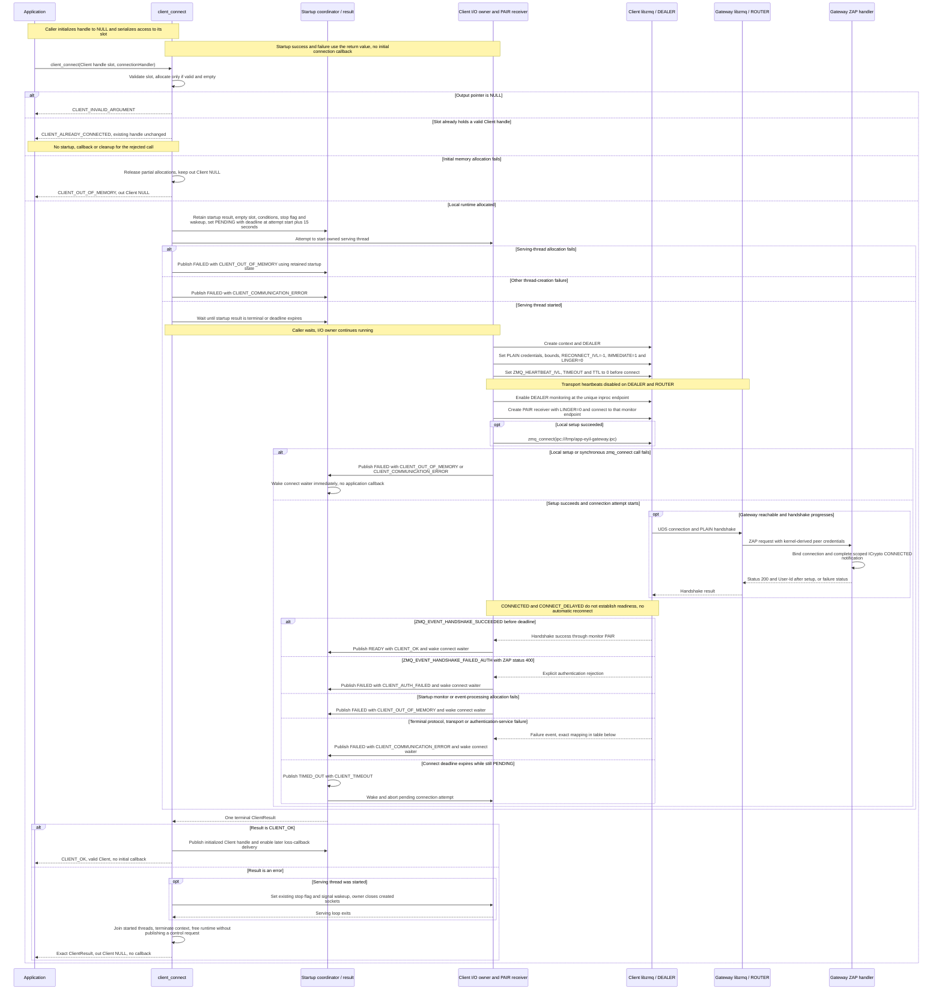

Startup state includes the empty slot, slotAvailable condition, stop flag and
wakeup needed for rollback. A detected
allocation failure during serving-thread creation or owner-side setup publishes
CLIENT_OUT_OF_MEMORY through that retained state. Other startup failures use
CLIENT_COMMUNICATION_ERROR. Cleanup only stops or joins threads that actually
started and does not allocate a shutdown action.

#### Exact initial-connect outcomes

| Condition / monitor event | Startup action | client_connect result |
| --- | --- | --- |
| Output argument `Client **client` is NULL | Reject before creating runtime state | CLIENT_INVALID_ARGUMENT |
| `*client` already holds a valid, not-yet-destroyed Client handle, including after transport loss | Reject before allocating or starting another connection; preserve the existing handle, handler and state | CLIENT_ALREADY_CONNECTED, original handle unchanged |
| Client/runtime/serving-thread allocation fails, including an explicit ENOMEM from local setup or startup event processing | Stop/roll back any initialized resources | CLIENT_OUT_OF_MEMORY, output NULL |
| Non-memory context/socket/monitor/thread setup failure, or synchronous zmq_connect error | Publish FAILED and stop the attempt | CLIENT_COMMUNICATION_ERROR, output NULL |
| ZMQ_EVENT_CONNECTED | Keep PENDING; transport connection alone is insufficient | No return yet |
| ZMQ_EVENT_CONNECT_DELAYED | Keep PENDING within the original deadline; do not create another connection attempt | No return yet |
| ZMQ_EVENT_HANDSHAKE_SUCCEEDED while PENDING and before the deadline | Publish READY and wake caller | CLIENT_OK, valid output handle |
| ZMQ_EVENT_HANDSHAKE_FAILED_AUTH with ZAP status 400 | Publish FAILED and wake caller immediately | CLIENT_AUTH_FAILED, output NULL |
| ZMQ_EVENT_HANDSHAKE_FAILED_AUTH with ZAP status 300 or 500 | End this connect attempt as an authentication-service failure | CLIENT_COMMUNICATION_ERROR, output NULL |
| ZMQ_EVENT_HANDSHAKE_FAILED_PROTOCOL | Publish FAILED and wake caller immediately | CLIENT_COMMUNICATION_ERROR, output NULL |
| ZMQ_EVENT_HANDSHAKE_FAILED_NO_DETAIL | Publish FAILED and wake caller immediately | CLIENT_COMMUNICATION_ERROR, output NULL |
| ZMQ_EVENT_DISCONNECTED before initial readiness | End this connect attempt and wake caller | CLIENT_COMMUNICATION_ERROR, output NULL |
| Monitor/receive processing terminates unexpectedly for a non-memory reason while startup is PENDING | Publish FAILED and wake caller | CLIENT_COMMUNICATION_ERROR, output NULL |
| Absolute connection deadline expires while startup is PENDING, including an unavailable endpoint without a terminal failure event | Publish TIMED_OUT; stop and clean up the attempt | CLIENT_TIMEOUT, output NULL |

The monitor's HANDSHAKE_FAILED_AUTH event carries the ZAP status: 400 is an
authentication denial, 300 a temporary authentication-service error and 500 an
internal authentication-service error. This client contract ends the current
connect call on those explicit failures, preserving CLIENT_AUTH_FAILED for a
denial. Event and status definitions:
[ZeroMQ monitor API](https://libzmq.readthedocs.io/en/latest/zmq_socket_monitor.html),
[ZAP specification](https://rfc.zeromq.org/spec/27/).

`zmq_connect()` returning zero and receiving ZMQ_EVENT_CONNECTED are both
insufficient for CLIENT_OK. Successful handshake detection is the agreed
readiness barrier. The client sends no extra Crypto request or AppManager
probe; Gateway performs CONNECTED during authentication as in section 6.5.

The startup coordinator stores a terminal result, rather than only a
`connected` boolean. The wait predicate is `startupState != PENDING` with an
absolute monotonic deadline. Success and explicit failures publish the result
and notify the waiter; the timeout path publishes CLIENT_TIMEOUT. Synchronize
these transitions so one attempt has one final outcome. A late handshake event
cannot revive a timed-out or failed attempt or restart its deadline. After a
previously successful client_connect, connection loss is terminal and recovery
uses a new explicit connection as defined in section 5.14.

On failure of a new connection attempt from an empty slot, keep the output
handle NULL, close created sockets on their owner, stop/join started threads,
terminate the owned context and free the incomplete handle before returning.
CLIENT_ALREADY_CONNECTED is an earlier rejection: preserve the existing handle
and do not run startup rollback against it. The deadline bounds the readiness
wait; safe rollback still has to finish. Return every startup outcome through
client_connect alone, without a connection callback. Handshake success does
not emit RESTORED, and authentication denial does not emit TERMINATED. Only a
separate unexpected loss after startup success can enter the loss-callback path
defined above.

### 5.6 client_send_request()

Coverage: **AC2-Client.1, AC2-Client.2–AC2-Client.3, AC2-Client.5**; Crypto use also supports **AC2-Firebolt.1–AC2-Firebolt.2**.

The caller supplies one serialized RpcRequest containing the service and its
opaque payload. The library parses that envelope, replaces request_id and
schema_version, and serializes the outgoing request. It validates the returning
RpcResponse and gives the caller its complete serialized bytes. It does not
parse CryptoRequest or CryptoResponse. No additional service argument or byte
API signature change is needed for this agreed envelope handling.

#### Submission and synchronous wait

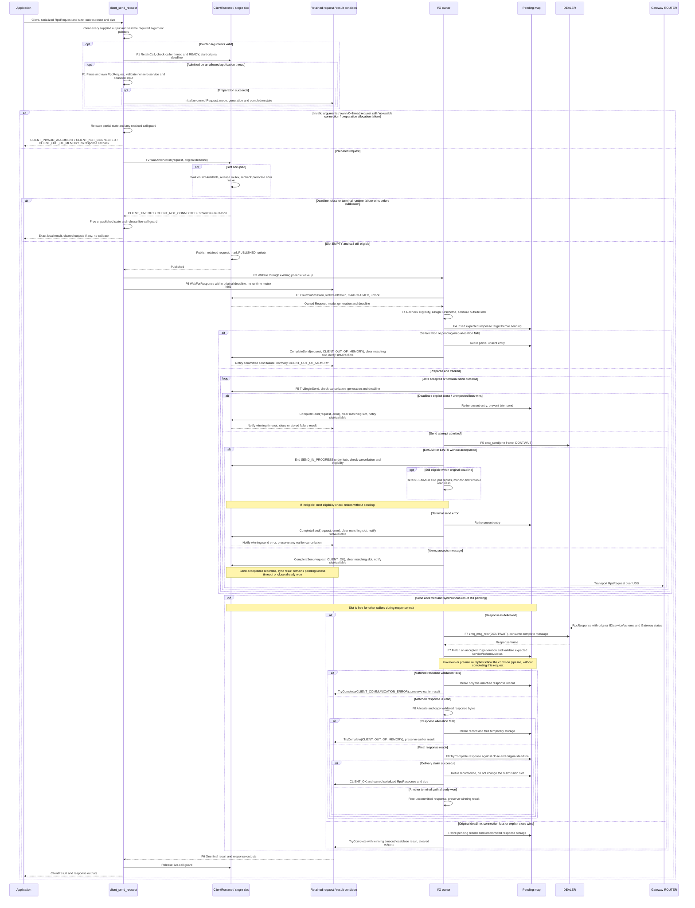

F2/F3 explicitly show publication and the owner's read of the single slot.
CompleteSend releases the slot at F5, so the synchronous response wait does
not serialize other requests behind the remote operation. Every local-error
return releases the call guard and prepared storage, with NULL/0 outputs.

Before dereferencing outputs, validate their addresses; clear every supplied
output even if another required argument is missing. Require a non-NULL live
Client, non-NULL input with nonzero bounded length, and both output pointers.
An empty/default envelope or RPC_SERVICE_UNSPECIFIED is invalid. Other numeric
service values can reach Gateway, which determines support. Validate Protobuf
parsing and common message limits without interpreting the service payload.
Caller-supplied request_id and schema_version are ignored and overwritten.

The request record owns its parsed data, completion state and connection
generation. Application input need remain valid only for the API call. Allocate
the owned request and completion bookkeeping before acceptance. For async
calls the same preparation completes before returning CLIENT_OK. Neither API
may leave a published pointer into temporary caller storage.

#### Shared nonblocking send and receive pipeline

This pipeline serves all four request APIs. Socket operations, pending-map
mutation and monitor processing belong to the I/O owner. A record identifies
whether its caller waits for a synchronous result or only for async send
acceptance. Sync requests retain their total deadline after send; async requests
disarm their submission deadline once libzmq accepts the message.

The send half below shows one attempt. After EAGAIN/EINTR, resume at
TryBeginSend on the same tracked Request; do not assign another ID, reinsert
the pending entry or claim another submission. Receive processing can run on
any owner iteration, including while the slot waits for writable readiness.

CompleteSend updates the retained Request's send result and releases only its
matching slot in the single transition defined in section 5.2. Arrows to result
waiters below notify/read that committed state; they do not perform another
unconditional result assignment. All synchronous error completions use
TryComplete and preserve an earlier terminal result. In particular, retirement
of an accepted response record never touches another request's submission slot.

Explicit local close uses CLIENT_NOT_CONNECTED for still-pending API results;
unexpected transport loss uses CLIENT_COMMUNICATION_ERROR. Preserve any result
that already won completion. No callback or send attempt can be newly admitted
after the local-close cutoff; section 5.13 covers an attempt already in progress.

```mermaid
sequenceDiagram
    participant S as ClientRuntime / single slot
    participant IO as Client I/O owner
    participant P as Pending requests
    participant W as Sync result or async send waiter
    participant Z as Client libzmq / DEALER
    participant G as Gateway ROUTER
    participant H as Async response handler
    IO->>S: F3 ClaimSubmission, lock/read/retain, mark CLAIMED, unlock
    S-->>IO: Owned request, mode, generation and active deadline
    alt Cancelled, expired before send or generation unusable
        IO->>P: Retire unsent request
        IO->>S: CompleteSend(request, error), clear matching slot and notify<br/>slotAvailable
        IO-->>W: CLIENT_TIMEOUT or mapped connection error
    else Request can proceed
        IO->>IO: Assign nonzero request_id and schema 1, serialize envelope
        IO->>P: Install response target before first send
        alt Serialization, message storage or pending-map allocation fails
            IO->>P: Roll back partial insertion and retire unsent record
            IO->>S: CompleteSend(request, CLIENT_OUT_OF_MEMORY), clear matching slot<br/>and notify slotAvailable
            IO-->>W: CLIENT_OUT_OF_MEMORY, no response callback
        else Prepared and tracked
            IO->>S: F5 TryBeginSend, recheck cancellation, generation and deadline
            alt Timeout, close or terminal runtime failure wins
                IO->>P: Retire unsent entry, prevent later send
                IO->>S: CompleteSend(request, error), clear matching slot and notify<br/>slotAvailable
                IO-->>W: CLIENT_TIMEOUT, CLIENT_NOT_CONNECTED or stored terminal error
            else Send attempt admitted
                IO->>Z: zmq_send(DEALER, one frame, DONTWAIT)
                alt Message accepted into libzmq queue
                    IO->>S: F5 CompleteSend(request, CLIENT_OK), record ACCEPTED, clear<br/>matching slot and notify
                    opt Async request
                        IO-->>W: CLIENT_OK, immutable async send result
                    end
                    Note over S,P: Accepted response target remains pending unless local retirement<br/>already won
                    Z->>G: Transport queued request over UDS
                else EAGAIN or EINTR, no acceptance
                    IO->>S: End SEND_IN_PROGRESS under lock, check cancellation and<br/>eligibility
                    alt Cancellation, deadline or runtime cutoff now applies
                        IO->>P: Retire unsent entry
                        IO->>S: CompleteSend(request, winning error), clear matching slot and<br/>notify
                        S-->>W: Committed failure, no response callback
                    else Still eligible
                        IO->>S: Retain CLAIMED slot and owned bytes, no attempt in progress
                        Note over IO,Z: Service replies/events, resume at TryBeginSend when eligible
                    end
                else Detected memory failure before acceptance
                    IO->>P: Retire unsent record and free temporary storage
                    IO->>S: CompleteSend(request, CLIENT_OUT_OF_MEMORY), clear matching slot<br/>and notify slotAvailable
                    IO-->>W: CLIENT_OUT_OF_MEMORY, no response callback
                else Other terminal send error
                    IO->>P: Retire request
                    IO->>S: CompleteSend(request, CLIENT_COMMUNICATION_ERROR), clear<br/>matching slot and notify slotAvailable
                    IO-->>W: CLIENT_COMMUNICATION_ERROR, no response callback
                end
            end
        end
    end
    opt A response becomes readable
        G-->>Z: RpcResponse
        Z-->>IO: Readable, zmq_msg_recv(DONTWAIT)
        IO->>IO: Check framing and parse envelope
        alt Receive/decode allocation fails before trustworthy correlation
            IO->>S: Latch CLIENT_OUT_OF_MEMORY terminal reason, close admission,<br/>notify slotAvailable
            IO->>P: Retire affected records and clear occupied slot safely
            IO-->>W: Resolve still-pending API results with CLIENT_OUT_OF_MEMORY
            Note over IO,H: Close through connection-state path, no accepted-async error<br/>callback
        else Unparseable response, invalid framing or zero request_id
            IO->>S: Latch CLIENT_COMMUNICATION_ERROR, close admission, notify<br/>slotAvailable
            IO->>P: Retire affected records and clear occupied slot safely
            IO-->>W: Resolve still-pending API results with<br/>CLIENT_COMMUNICATION_ERROR
            Note over IO,H: Connection event handling, no accepted-async error callback
        else Parsed response
            IO->>P: Match request_id and generation
            alt Unknown or retired nonzero ID
                IO->>IO: Discard without invoking another request's handler
            else Matching entry exists but send is not accepted
                IO->>IO: Log and discard premature response, keep request and slot<br/>unchanged
                Note over IO,P: No completion or callback before send acceptance
            else Matching accepted request
                IO->>IO: Validate service, schema and RpcStatus, prepare owned response
                alt Response allocation or response-text preparation allocation<br/>fails
                    IO->>P: Retire record once and free temporary storage
                    alt Synchronous request
                        IO-->>W: TryComplete(CLIENT_OUT_OF_MEMORY), preserve prior result
                    else Async send already accepted
                        IO->>IO: Record diagnostics, no response callback
                        Note over IO,H: Already-published send result remains CLIENT_OK
                    end
                else Matched metadata or non-memory response-text error
                    IO->>P: Retire record once
                    Note over IO,H: Sync TryComplete(CLIENT_COMMUNICATION_ERROR) preserves prior<br/>results, async records diagnostics without callback
                else Valid response ready before any applicable deadline
                    IO->>P: Try claiming final delivery against local close and any deadline
                    alt Claim succeeds
                        IO->>P: Retire record and accounting once
                        alt Synchronous request
                            IO-->>W: CLIENT_OK and owned final byte/string response
                        else Async request
                            IO->>IO: Release internal locks
                            IO-->>H: handler(Client, owned response[, size])
                        end
                    else Timeout or close already won
                        IO->>P: Retire record and accounting once
                        IO->>IO: Free uncommitted response, preserve winning result, no callback
                    end
                end
            end
        end
    end
```

Implementation rules:

- Install the response target before sending, so even an immediate reply can
  be correlated. Serialization, message-storage and pending-map allocation
  failures retire only the affected unsent request, publish
  CLIENT_OUT_OF_MEMORY unless another terminal path already won, and leave
  other requests progressing. Clear only that Request's matching slot and notify
  waiting callers on its terminal send result. Use one DEALER body frame without
  a REQ-style delimiter.
- A successful zmq_send is the async return boundary: libzmq queued the message.
  Do not claim physical delivery or submit it again. EAGAIN permits retry only
  for work that has not been accepted, within its original active deadline.
  EINTR permits retry while the request remains eligible. Other terminal send
  failures return CLIENT_COMMUNICATION_ERROR; explicit memory failures return
  CLIENT_OUT_OF_MEMORY. See
  [zmq_send](https://libzmq.readthedocs.io/en/latest/zmq_send.html).
- Receive with zmq_msg_recv and check ZMQ_RCVMORE. EAGAIN means nothing to read;
  EINTR permits retry. Drain malformed multipart input without treating its
  remaining frames as separate responses. See
  [zmq_msg_recv](https://libzmq.readthedocs.io/en/latest/zmq_msg_recv.html).
- A detected receive/decode allocation failure before trustworthy request-ID
  correlation cannot safely be attributed to one request. Mark the connection
  unusable and close it on its owner. Resolve still-pending synchronous results
  and unaccepted async send waiters with CLIENT_OUT_OF_MEMORY, including callers
  waiting for the slot through the retained runtime failure reason; retire accepted
  async records and report CLIENT_CONNECTION_LOST through the connection-state
  path. Do not use a partly parsed ID to fail an unrelated request. Complete
  cleanup with retained state, without allocating another control action.
- Uncorrelatable malformed input makes the connection unusable under the
  terminal-loss policy. Resolve pending synchronous and not-yet-accepted send
  waiters with CLIENT_COMMUNICATION_ERROR. Retire accepted async response
  records and report connection loss through the connection-state path.
- A parsed nonzero ID absent from the pending map is discarded. It may be a
  late synchronous reply or a duplicate; it is not a notification.
- A pending entry alone does not authorize response delivery: its send must
  already be recorded as accepted. Log and discard a premature response for an
  installed but unaccepted request without retiring it, changing its send result
  or clearing its slot. The sole owner records acceptance before processing
  another received message, so a valid fast response satisfies this check.
- A matched response must have the expected service, schema version 1 and a
  known nonzero RpcStatus. A valid Gateway error response is still delivered
  normally: byte sync returns CLIENT_OK with bytes and byte async invokes its
  response handler. String records expect service=0 and a non-OK status with
  empty payload; return its symbolic name as defined in section 5.8. Only the
  service-specific byte consumer interprets CryptoResponse.
- Matched metadata failure returns CLIENT_COMMUNICATION_ERROR to a synchronous
  waiter; matched response allocation failure returns CLIENT_OUT_OF_MEMORY.
  Claim either error through TryComplete; preserve a timeout/close that already
  won and free any uncommitted storage.
  For an async record whose send succeeded, retire it with diagnostics and no
  response callback. Its send result remains CLIENT_OK, even if its submitting
  thread has not resumed yet. These signatures have no post-send error channel.
- Returned response storage must be compatible with client_free_response.
  String methods copy the validated non-OK RpcStatus name into owned
  NUL-terminated storage; they do not return the binary envelope as a C string.
  If response-text preparation fails, apply the same sync-error/async-retirement
  distinction. Never truncate binary data at an embedded NUL to report success.
- Prepare the final byte or string result before claiming synchronous success
  or an async callback. Serialize that claim with explicit close and any active
  synchronous deadline. If another terminal path wins during preparation, free
  the uncommitted result; a received envelope alone does not commit public success.
- Retire request accounting once and free temporary Protobuf/ZMQ storage on
  every terminal path. Late replies cannot revive a retired request.

The connection-wide handling of an uncorrelatable malformed response or decode
allocation failure follows the terminal cleanup path in section 5.14, preserving
the error mappings above. Recovery requires explicit close and a fresh connect.
An allocation failure after trustworthy correlation affects only that request.
No async response deadline or synthetic local-error RpcResponse is introduced.
Failure before correlation wakes all entered slot waiters as well as pending
requests. The runtime latches its first terminal reason before notifying
slotAvailable; later explicit teardown cannot overwrite that reason.

#### Synchronous timeout, disconnect and response races

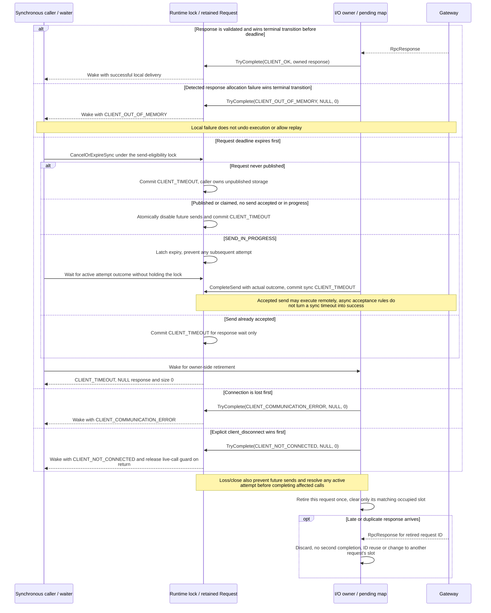

The waiter and owner share a retained Request, not a pointer to the caller's
stack. TryComplete claims its final result and response ownership once against
all other terminal paths. Before send acceptance, a synchronous timeout must
also cancel send eligibility under the same state lock used by TryBeginSend;
changing only the response waiter is insufficient. During an admitted attempt,
latch expiry and wait for its actual outcome. An accepted send is recorded as
such, but a synchronous call whose response deadline expired still returns
CLIENT_TIMEOUT. It may have executed remotely. A nonaccepted attempt after
expiry is retired without another send.

After acceptance, timeout ends only the local response wait. Check the absolute
deadline when claiming the final response, including after byte/string storage
preparation. If another result wins during preparation, free the uncommitted
storage. The owner alone removes pending entries and clears a slot only when
it still contains this Request; an older response timeout cannot affect a newer
submission. Published storage survives until owner retirement, even if its
caller has returned. Unpublished storage remains the caller's responsibility.
Async submission uses the separate send-result rules in section 5.4 and has
no response deadline after acceptance.

On every local failure, return NULL response and size zero. A timeout ends the
local wait; it does not cancel remote work, release remote buffers or authorize
replay. A valid response containing a non-OK RpcStatus still returns CLIENT_OK;
the caller inspects that status and eventually calls client_free_response.

The 15-second synchronous deadline includes preparation and waiting for the
single slot. The pending-response map grows dynamically; detected allocation
failures use CLIENT_OUT_OF_MEMORY. A busy slot waits or times out, with no
local queue-full result. Section 5.14 defines terminal loss and explicit reconnect.
Section 5.13 defines explicit-close results and callback quiescence. Per-message
size bounds remain under RESOURCE-LIMITS in section 7.2.

### 5.7 client_send_request_async()

Coverage: **AC2-Client.1, AC2-Client.2–AC2-Client.3, AC2-Client.5**.

The caller waits for slot availability and libzmq acceptance within one total
15-second send budget. Publishing the slot or waking the owner does not complete
the API. The owner's explicit claim, pending-map insertion and send are shown
as separate calls below. A valid response may arrive before the submitting
thread resumes, so application callback state must be ready before API entry.

```mermaid
sequenceDiagram
    participant A as Application
    participant API as client_send_request_async
    participant S as ClientRuntime / single slot
    participant W as Retained request / result condition
    participant IO as I/O owner
    participant P as Pending map
    participant Z as DEALER
    participant G as Gateway ROUTER
    A->>API: Client, serialized RpcRequest and size, response handler
    API->>API: Validate required argument pointers and handler
    opt Pointer arguments valid
        API->>S: F1 RetainCall, check caller thread and READY, start original<br/>deadline
        opt Admitted on an allowed application thread
            API->>API: F1 Parse and own RpcRequest, validate nonzero service and<br/>bounded input
            opt Preparation succeeds
                API->>W: Initialize owned Request, mode, generation and completion state
            end
        end
    end
    alt Invalid arguments / own I/O-thread request call / no usable<br/>connection / preparation allocation failure
        API->>API: Release partial state and any retained call guard
        API-->>A: CLIENT_INVALID_ARGUMENT / CLIENT_NOT_CONNECTED /<br/>CLIENT_OUT_OF_MEMORY, no response callback
    else Prepared request
        API->>S: F2 WaitAndPublish(request, original deadline)
        opt Slot occupied
            S->>S: Wait on slotAvailable, release mutex, recheck predicate after<br/>wake
        end
        alt Deadline, close or terminal runtime failure wins before<br/>publication
            S-->>API: CLIENT_TIMEOUT / CLIENT_NOT_CONNECTED / stored failure reason
            API->>API: Free unpublished state and release live-call guard
            API-->>A: Exact local result, cleared outputs if any, no callback
        else Slot EMPTY and call still eligible
            S->>S: Publish retained request, mark PUBLISHED, unlock
            S-->>API: Published
            API->>IO: F3 WakeIo through existing pollable wakeup
            API->>W: F6 WaitForSend, no runtime mutex held
            IO->>S: F3 ClaimSubmission, lock/read/retain, mark CLAIMED, unlock
            S-->>IO: Owned Request, mode, generation and deadline
            IO->>IO: F4 Recheck eligibility, assign ID/schema, serialize outside lock
            IO->>P: F4 Insert expected response target before sending
            alt Serialization or pending-map allocation fails
                IO->>P: Retire partial unsent entry
                IO->>S: CompleteSend(request, CLIENT_OUT_OF_MEMORY), clear matching<br/>slot, notify slotAvailable
                S-->>W: Notify committed send failure, normally CLIENT_OUT_OF_MEMORY
            else Prepared and tracked
                loop Until accepted or terminal send outcome
                    IO->>S: F5 TryBeginSend, check cancellation, generation and deadline
                    alt Deadline / explicit close / unexpected loss wins
                        IO->>P: Retire unsent entry, prevent later send
                        IO->>S: CompleteSend(request, error), clear matching slot, notify<br/>slotAvailable
                        S-->>W: Notify winning timeout, close or stored failure result
                    else Send attempt admitted
                        IO->>Z: F5 zmq_send(one frame, DONTWAIT)
                        alt EAGAIN or EINTR without acceptance
                            IO->>S: End SEND_IN_PROGRESS under lock, check cancellation and<br/>eligibility
                            opt Still eligible within original deadline
                                IO->>IO: Retain CLAIMED slot, poll replies, monitor and writable<br/>readiness
                            end
                            Note over S,IO: If ineligible, next eligibility check retires without sending
                        else Terminal send error
                            IO->>P: Retire unsent entry
                            IO->>S: CompleteSend(request, error), clear matching slot, notify<br/>slotAvailable
                            S-->>W: Notify winning send error, preserve any earlier cancellation
                        else libzmq accepts message
                            IO->>S: CompleteSend(request, CLIENT_OK), clear matching slot, notify<br/>slotAvailable
                            S-->>W: Notify immutable CLIENT_OK already committed by CompleteSend
                            Z->>G: Transport RpcRequest over UDS
                        end
                    end
                end
            end
            W-->>API: F6 One send result
            API->>S: Release live-call guard
            API-->>A: ClientResult, no response wait
            opt Send accepted with CLIENT_OK
                Note over S,P: Slot is free, pending response has no deadline
                alt Response is delivered
                    G-->>Z: RpcResponse with original ID/service/schema and Gateway status
                    IO->>Z: F7 zmq_msg_recv(DONTWAIT), consume complete message
                    Z-->>IO: Response frame
                    IO->>P: F7 Match an accepted ID/generation and validate expected<br/>service/schema/status
                    Note over IO,P: Unknown or premature replies follow the common pipeline, without<br/>completing this request
                    alt Matched response validation fails
                        IO->>P: Retire only the matched response record
                        IO->>IO: Record diagnostics, no callback, send result stays CLIENT_OK
                    else Matched response is valid
                        IO->>IO: F8 Allocate and copy validated response bytes
                        alt Response allocation fails
                            IO->>P: Retire record and free temporary storage
                            IO->>IO: Log allocation failure, no callback, send result stays CLIENT_OK
                        else Final response ready
                            IO->>P: F8 Claim callback delivery against explicit close
                            alt Delivery claim succeeds
                                IO->>P: Retire record once, do not change the submission slot
                                IO->>IO: Release internal locks
                                IO-->>A: handler(Client, owned serialized RpcResponse, size), on I/O<br/>thread
                            else Another terminal path already won
                                IO->>IO: Free uncommitted response, preserve winning result
                            end
                        end
                    end
                else Connection loss or explicit close
                    IO->>P: Retire pending record and uncommitted response storage
                    Note over IO,A: No response callback, accepted send result remains CLIENT_OK
                end
            end
        end
    end
```

There is no response timeout after acceptance. All pre-acceptance failures
return through ClientResult and invoke no response callback. Invalid arguments,
envelope, handler or request calls from the I/O-owner callback return
CLIENT_INVALID_ARGUMENT. A non-ready handle returns CLIENT_NOT_CONNECTED.
Preparation, serialization or pending-map allocation failure returns
CLIENT_OUT_OF_MEMORY. Slot/send deadline expiry returns CLIENT_TIMEOUT.
Explicit close returns CLIENT_NOT_CONNECTED; unexpected loss or terminal send
failure returns CLIENT_COMMUNICATION_ERROR. Connection-wide local failures
retain the mappings in the common pipeline.

After CLIENT_OK, a validated correlated response, including a Gateway error,
invokes ClientResponseHandler at most once. Connection cleanup or local response
processing failure can retire it without a callback. The pending map remains
dynamic; an unanswered async request can stay there until teardown. Callbacks
run on the I/O owner without locks and may free their response, but must schedule
new request calls on an application thread.

### 5.8 client_send_request_string() — Gateway returns unsupported service

Coverage: **AC2-Client.1, AC2-Client.5**. Actual string-service execution is a
delivery limitation against AC2-Client.5; the original AC remains unchanged.

Accept an ordinary NUL-terminated request string, without a size argument,
Base64, ProtoJSON or a caller-built envelope. The library copies bytes up to
the first NUL and uses the same slot, owner, pending map and total synchronous
deadline as the byte API. **Gateway rejects the string request with the existing
RPC_STATUS_UNSUPPORTED_SERVICE (4).** The public method does not return a local
CLIENT_NOT_IMPLEMENTED without contacting Gateway.

#### Defined wire request and error response

| Boundary | Selected representation |
| --- | --- |
| Caller input | NUL-terminated text, including an empty string; NULL is invalid |
| Internal request | RpcRequest with assigned nonzero request_id, schema_version=1, service=RPC_SERVICE_UNSPECIFIED (0) and payload equal to the copied text bytes, excluding the terminator |
| Gateway dispatch | After common context/envelope/ID checks, service 0 has no registered handler. Log ERROR unsupported_service and construct a correlated RPC_STATUS_UNSUPPORTED_SERVICE response; do not parse CryptoRequest or submit a service job |
| Wire response | RpcResponse echoes request_id and service=0, sets schema_version=1 and status=RPC_STATUS_UNSUPPORTED_SERVICE, with empty payload |
| Synchronous C result | CLIENT_OK with a library-allocated NUL-terminated string containing exactly RPC_STATUS_UNSUPPORTED_SERVICE |
| Async C result / response | CLIENT_OK after libzmq send acceptance; a delivered error response later invokes the supplied string callback with that same owned status string |

UNSPECIFIED records the absence of an assigned text service. It is not a new
service identifier and never selects Crypto. The internal string builder alone
creates this envelope; the public byte-input validator continues to require a
nonzero service. Common response validation matches the service expected by
the pending record, including 0 for this string path. No Protobuf field, enum
or schema-version change is needed for this unsupported behavior. A future text
service requires an explicit route and interpretation contract; do not turn
service 0 into a working text service or guess a route from input contents.

The status string is the symbolic name of the **received** non-OK RpcStatus.
For example, a correlated INVALID_CONNECTION or INTERNAL reply is exposed as
RPC_STATUS_INVALID_CONNECTION or RPC_STATUS_INTERNAL. This is a defined remote
error representation, not a fabricated local-error response. Reject an unknown
or UNSPECIFIED status, unexpected OK or nonempty payload on this unsupported
path as CLIENT_COMMUNICATION_ERROR for sync, or diagnostic retirement without
a callback for an already-accepted async request. Future successful text/service
responses are outside this version's scope.

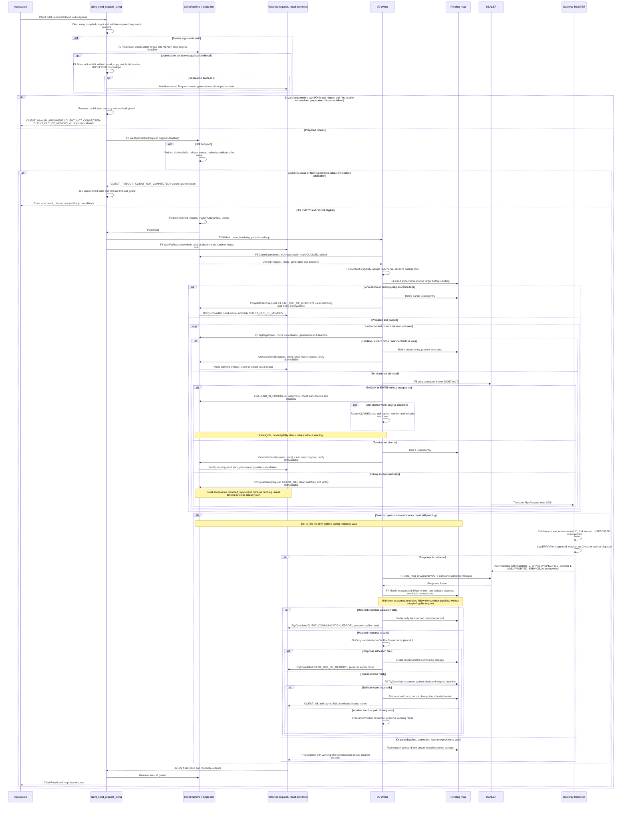

#### Plain-string ownership and local failures

The caller keeps input valid and unchanged until the API returns. Scan within
the configured text bound, own the bytes before publication and keep explicit
binary lengths during Protobuf serialization and ZMQ transmission. The first
NUL ends input: "abc\0def" supplies "abc" only. Empty input still reaches the
same unsupported-service response. Never measure a serialized envelope using
strlen(), decode caller text as Protobuf, or infer a Crypto operation from it.

For a valid remote error, allocate the symbolic status name plus its final NUL
before claiming completion. The application checks that text and calls
client_free_response. CLIENT_OK means the remote error response was delivered;
it does not mean the text operation succeeded. A successful string result is
never NULL and is never binary Protobuf disguised as a C string.

Invalid arguments or oversized input return CLIENT_INVALID_ARGUMENT. Allocation
failure in copying, request creation, serialization, pending-map insertion or
final status-string preparation returns CLIENT_OUT_OF_MEMORY. Slot waiting,
send attempts and final response preparation share the original 15-second
deadline. Timeout, explicit close and unexpected loss return CLIENT_TIMEOUT,
CLIENT_NOT_CONNECTED and CLIENT_COMMUNICATION_ERROR respectively, with NULL
output. Free all partial storage and release the live-call guard on every exit.
The general race/uncorrelatable-response rules in section 5.6 also apply.

This keeps the existing C signatures and raw-string input boundary. Consumers
use the byte APIs with serialized CryptoRequest payloads for actual Crypto
operations. Neither client nor Gateway translates arbitrary text into ICrypto.

### 5.9 client_send_request_string_async() — Gateway returns unsupported service

Coverage: **AC2-Client.1, AC2-Client.5**, with the same string-service delivery
limitation as section 5.8. The async transport path is required: the method
copies raw text, waits for its single-slot handoff and libzmq acceptance, then
returns the send result. It does not wait for Gateway's unsupported response
and does not return CLIENT_NOT_IMPLEMENTED locally.

```mermaid
sequenceDiagram
    participant A as Application
    participant API as client_send_request_string_async
    participant S as ClientRuntime / single slot
    participant W as Retained request / result condition
    participant IO as I/O owner
    participant P as Pending map
    participant Z as DEALER
    participant G as Gateway ROUTER
    A->>API: Client, NUL-terminated text, response handler
    API->>API: Validate required argument pointers and handler
    opt Pointer arguments valid
        API->>S: F1 RetainCall, check caller thread and READY, start original<br/>deadline
        opt Admitted on an allowed application thread
            API->>API: F1 Scan to first NUL within bound, copy text, build service<br/>UNSPECIFIED envelope
            opt Preparation succeeds
                API->>W: Initialize owned Request, mode, generation and completion state
            end
        end
    end
    alt Invalid arguments / own I/O-thread request call / no usable<br/>connection / preparation allocation failure
        API->>API: Release partial state and any retained call guard
        API-->>A: CLIENT_INVALID_ARGUMENT / CLIENT_NOT_CONNECTED /<br/>CLIENT_OUT_OF_MEMORY, no response callback
    else Prepared request
        API->>S: F2 WaitAndPublish(request, original deadline)
        opt Slot occupied
            S->>S: Wait on slotAvailable, release mutex, recheck predicate after<br/>wake
        end
        alt Deadline, close or terminal runtime failure wins before<br/>publication
            S-->>API: CLIENT_TIMEOUT / CLIENT_NOT_CONNECTED / stored failure reason
            API->>API: Free unpublished state and release live-call guard
            API-->>A: Exact local result, cleared outputs if any, no callback
        else Slot EMPTY and call still eligible
            S->>S: Publish retained request, mark PUBLISHED, unlock
            S-->>API: Published
            API->>IO: F3 WakeIo through existing pollable wakeup
            API->>W: F6 WaitForSend, no runtime mutex held
            IO->>S: F3 ClaimSubmission, lock/read/retain, mark CLAIMED, unlock
            S-->>IO: Owned Request, mode, generation and deadline
            IO->>IO: F4 Recheck eligibility, assign ID/schema, serialize outside lock
            IO->>P: F4 Insert expected response target before sending
            alt Serialization or pending-map allocation fails
                IO->>P: Retire partial unsent entry
                IO->>S: CompleteSend(request, CLIENT_OUT_OF_MEMORY), clear matching<br/>slot, notify slotAvailable
                S-->>W: Notify committed send failure, normally CLIENT_OUT_OF_MEMORY
            else Prepared and tracked
                loop Until accepted or terminal send outcome
                    IO->>S: F5 TryBeginSend, check cancellation, generation and deadline
                    alt Deadline / explicit close / unexpected loss wins
                        IO->>P: Retire unsent entry, prevent later send
                        IO->>S: CompleteSend(request, error), clear matching slot, notify<br/>slotAvailable
                        S-->>W: Notify winning timeout, close or stored failure result
                    else Send attempt admitted
                        IO->>Z: F5 zmq_send(one frame, DONTWAIT)
                        alt EAGAIN or EINTR without acceptance
                            IO->>S: End SEND_IN_PROGRESS under lock, check cancellation and<br/>eligibility
                            opt Still eligible within original deadline
                                IO->>IO: Retain CLAIMED slot, poll replies, monitor and writable<br/>readiness
                            end
                            Note over S,IO: If ineligible, next eligibility check retires without sending
                        else Terminal send error
                            IO->>P: Retire unsent entry
                            IO->>S: CompleteSend(request, error), clear matching slot, notify<br/>slotAvailable
                            S-->>W: Notify winning send error, preserve any earlier cancellation
                        else libzmq accepts message
                            IO->>S: CompleteSend(request, CLIENT_OK), clear matching slot, notify<br/>slotAvailable
                            S-->>W: Notify immutable CLIENT_OK already committed by CompleteSend
                            Z->>G: Transport RpcRequest over UDS
                        end
                    end
                end
            end
            W-->>API: F6 One send result
            API->>S: Release live-call guard
            API-->>A: ClientResult, no response wait
            opt Send accepted with CLIENT_OK
                Note over S,P: Slot is free, pending response has no deadline
                G->>G: Validate context, envelope and ID, find service UNSPECIFIED<br/>unsupported
                G->>G: Log ERROR unsupported_service, no Crypto or worker dispatch
                alt Response is delivered
                    G-->>Z: RpcResponse with matching ID, service UNSPECIFIED, schema 1,<br/>UNSUPPORTED_SERVICE, empty payload
                    IO->>Z: F7 zmq_msg_recv(DONTWAIT), consume complete message
                    Z-->>IO: Response frame
                    IO->>P: F7 Match an accepted ID/generation and validate expected<br/>service/schema/status
                    Note over IO,P: Unknown or premature replies follow the common pipeline, without<br/>completing this request
                    alt Matched response validation fails
                        IO->>P: Retire only the matched response record
                        IO->>IO: Record diagnostics, no callback, send result stays CLIENT_OK
                    else Matched response is valid
                        IO->>IO: F8 Copy validated non-OK RpcStatus name plus NUL
                        alt Response allocation fails
                            IO->>P: Retire record and free temporary storage
                            IO->>IO: Log allocation failure, no callback, send result stays CLIENT_OK
                        else Final response ready
                            IO->>P: F8 Claim callback delivery against explicit close
                            alt Delivery claim succeeds
                                IO->>P: Retire record once, do not change the submission slot
                                IO->>IO: Release internal locks
                                IO-->>A: handler(Client, owned NUL-terminated status name), on I/O thread
                            else Another terminal path already won
                                IO->>IO: Free uncommitted response, preserve winning result
                            end
                        end
                    end
                else Connection loss or explicit close
                    IO->>P: Retire pending record and uncommitted response storage
                    Note over IO,A: No response callback, accepted send result remains CLIENT_OK
                end
            end
        end
    end
```

The wire envelope and exact status-text representation are defined in section
5.8. A delivered RPC_STATUS_UNSUPPORTED_SERVICE response invokes
ClientStringResponseHandler(Client, owned_status_text); the caller frees it
through client_free_response. Gateway errors are real responses and therefore
use the existing response-only callback, with no new ClientResult callback
argument or user_data parameter.

Input validation, copying, slot waiting and send failures follow section 5.7.
A failed submission has no response callback. After acceptance there is no
response timeout: loss, explicit close, invalid response or inability to allocate
the status text can retire the record without a callback. Preserve the already
published CLIENT_OK send result. A fast response can invoke the handler on the
I/O owner before the submitting thread resumes. No internal lock is held during
the callback, and request/disconnect calls must be scheduled on an application
thread.

### 5.10 client_free_response()

Coverage: **AC2-Client.1**.

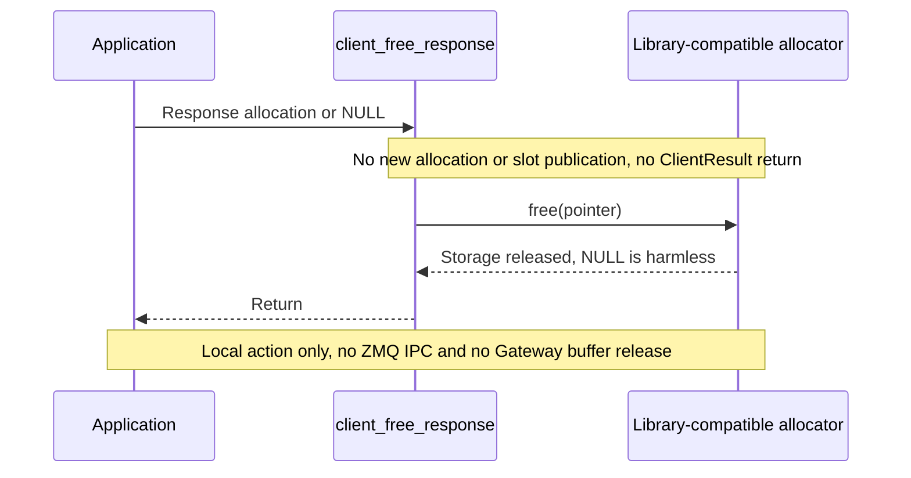

This releases a message-result allocation, not a shared-memory object.
Do not pass a mapped buffer, stack memory or a Gateway buffer ID. Freeing a
response requires no request record or new allocation and remains available
after another API reports CLIENT_OUT_OF_MEMORY.

### 5.11 client_register_notifications()

Coverage: **AC2-Client.1**. This API is reserved for future notification support.

**Return CLIENT_NOT_IMPLEMENTED.** The function ignores its arguments and does
not store or invoke the handler, allocate notification state, subscribe to events
or send a message to Gateway.

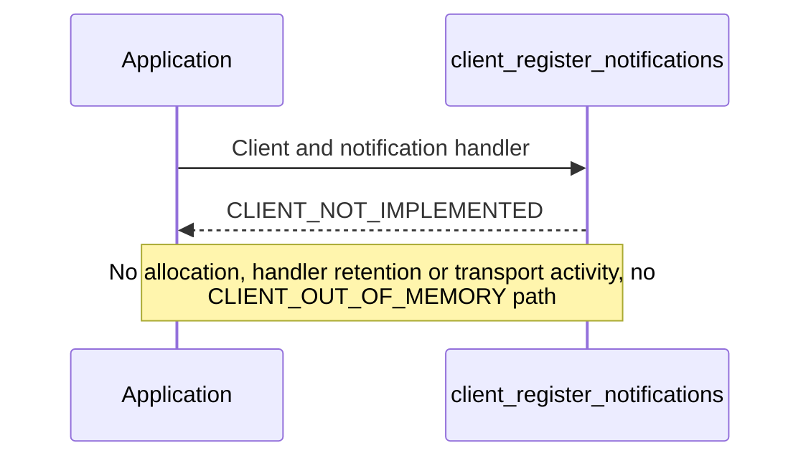

Notification delivery is outside this version's scope. A future feature must
define the events, Protobuf payloads, wire identification and callback lifecycle
before enabling this API. It is not a pending decision for the current delivery.

Connection-state events go to ClientConnectionEventHandler registered through
client_connect(). Async responses go to the response handler supplied with each
request. A late or unmatched RPC response follows the validation rules in
section 5.6 and must not be reclassified as a notification.

### 5.12 client_unregister_notifications()

Coverage: **AC2-Client.1**. This API is reserved for future notification support.

This void function returns without changing state. Notification registration
is unsupported, so there is no handler to remove or notification delivery to drain.

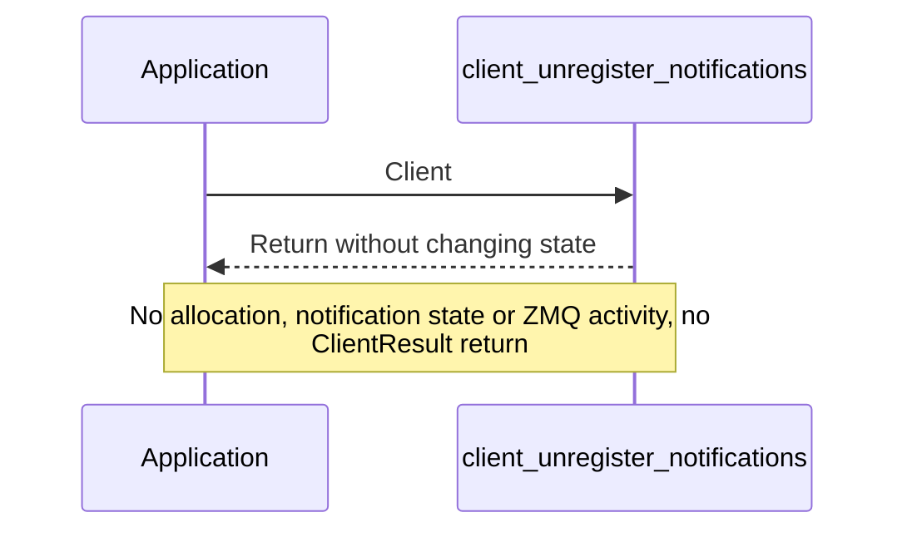

Calling this function is not required before client_disconnect in this version.
It does not affect the connection-event handler or pending request responses.
Neither notification function allocates, so neither has an out-of-memory path.

### 5.13 client_disconnect()

Coverage: **AC2-Client.1–AC2-Client.4**, leading to **AC1.12** when the Gateway detects closure.

client_disconnect is a synchronous local cleanup barrier. The app may call it
while calls wait for the slot, occupy it or await responses; it need not wait for those
responses first. The function closes new admission, wakes slot waiters, cancels the unsent submission,
retires pending response IDs and closes the connection. It returns only after
the old runtime is quiescent and the handle is destroyed. It does not wait for
a Gateway acknowledgement or certify that remote operations have finished.

#### Results and callback behavior during explicit close

| State when local close wins | Outcome |
| --- | --- |
| Synchronous request still waiting | Return CLIENT_NOT_CONNECTED with NULL response and size 0 for bytes, or NULL for strings; prevent further sends and resolve any admitted send attempt before returning |
| Async submission not accepted and no send attempt in progress | Return CLIENT_NOT_CONNECTED through its send waiter; cancel the unsent action and invoke no response callback |
| Nonblocking send attempt in progress | Latch close and wait for its outcome; acceptance preserves async CLIENT_OK, while a pending sync response result becomes CLIENT_NOT_CONNECTED; nonacceptance cannot trigger another attempt |
| Async send already accepted | Preserve CLIENT_OK, remove its pending response ID and release library-owned storage without a response callback |
| Uncommitted response or unclaimed callback | Discard its storage and pending record; do not start delivery after the close cutoff |
| Result or callback already claimed | Preserve the winning result/ownership, let the call or callback finish and wait for its live reference to be released |
| Already LOST handle | Finish teardown without changing the loss result or closing an already closed socket again |

Serialize local-close admission with request publication and callback claims.
Use the same retained completion state for close, response, timeout and transport
failure: only one terminal result wins. If a nonblocking send is already in
progress, let the owner resolve it before completing its send waiter. Successful
libzmq acceptance remains CLIENT_OK for an async submission even if local close
was requested while that attempt ran. A synchronous call still waiting for its
response returns CLIENT_NOT_CONNECTED when close wins, even if its send was
accepted. That local error does not prove remote cancellation. Unsent actions
cancelled by close can never execute later.

An intentional close generates no connection callback. Suppress monitor events
caused by shutting down the socket. A connection callback already claimed for an
earlier unexpected loss may finish; no new callback is claimed after callback
admission closes.
Response and connection callbacks run without internal locks, and no callback
can execute for that Client after client_disconnect returns.

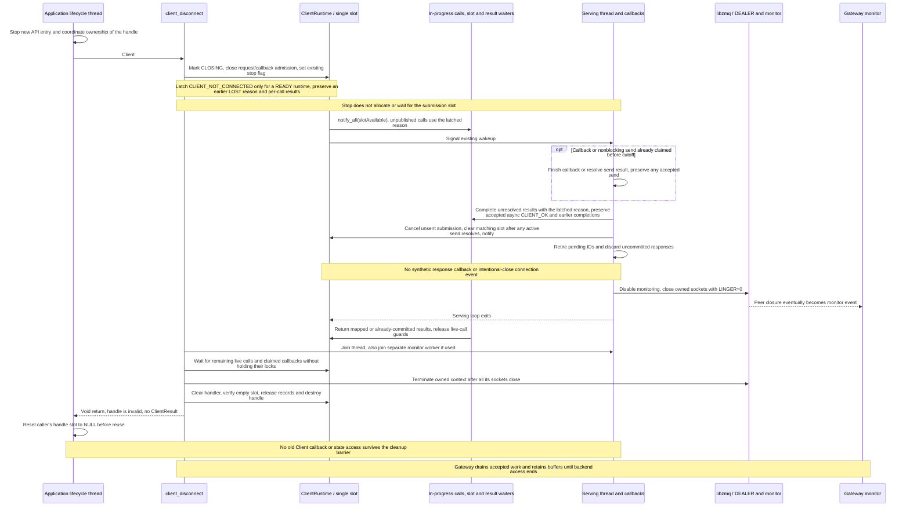

Disconnect must remain possible after allocation failure. Set a stop flag
created during connect, notify slotAvailable and signal the existing wakeup.
Shutdown must not acquire an empty slot or publish a control request. Resolve
result waiters using retained
completion objects and erase/free records without constructing a temporary
container. The function is void; it cannot report CLIENT_OUT_OF_MEMORY and
must not depend on allocating an error object to clean up.

Wake and resolve pending callers before waiting for their live-call references
to drain. Never wait while holding the state/slot or callback locks they need
to return. Joining the I/O owner also waits for its active callback. Callbacks
must return promptly; safe cleanup cannot forcefully terminate application code
running on that thread. Preserve results already committed to a caller,
including a fully prepared string owned by a completed waiter. Response-text
preparation precedes the final completion claim, as specified in section 5.8.
Free only uncommitted library-owned response storage.

The same function destroys a handle whose connection already reached LOST.
Reuse completed cleanup safely: close each socket once, join started threads
and terminate the old owned ZMQ context before releasing the handle. Free only
library-owned undelivered response storage; results already transferred to the
caller remain available for client_free_response. Explicit reconnect starts
from a NULL handle slot with no old runtime state, as specified in section 5.14.

#### Concurrent callers and handle lifetime

- Call disconnect from an application lifecycle thread, never from a Client
  response/connection callback or the I/O thread it must join. A callback can
  schedule cleanup on an application thread and return.
- The application serializes connect/disconnect and destruction of the same
  handle. Stop new call entry and coordinate threads that could still enter
  using a copied raw pointer. A call not yet holding an internal live reference
  must not race handle destruction; neither the internal state mutex nor a raw
  Client pointer makes that race safe.
- Calls already holding live references may remain blocked in the library while
  disconnect runs. Close wakes their waiters. An entered call that has not yet
  submitted work checks admission before publication and returns the retained
  terminal reason instead of publishing into the slot: CLIENT_NOT_CONNECTED for
  explicit close from READY, or the earlier loss reason for an already LOST
  runtime. Every return path
  releases its guard, including validation and allocation failures.
- Serialize callback admission with CLOSING. Claims made before the cutoff
  retain the Client until return; later responses/events are discarded. Keep
  the registered handler and its application dependencies valid until the
  disconnect barrier completes, then clear the registration.
- Once disconnect returns, do not use the old handle again, including a second
  disconnect. Clear the application's slot and use a new Client for reconnect.
  Already-transferred response allocations remain app-owned and may still be
  released through client_free_response.

The library never detaches a live thread and destroys its state. Explicit local
close cleans transport and request bookkeeping; Gateway's accepted jobs and
shared-buffer leases follow their existing drain and completion rules.

### 5.14 Deadlines, callbacks, reconnect and library unloading

#### Initial timeout and submission defaults

| Setting | Initial value | Meaning |
| --- | --- | --- |
| Common timed-wait duration | 15,000 ms | Used for connect, sync requests and async send submission; no public timeout setter |
| Connect deadline | Attempt start plus 15 seconds | Includes startup/handshake waiting; rollback must finish safely |
| Synchronous request deadline | Request-call admission plus 15 seconds | One budget covering input preparation, slot availability, serialization, send, receive/validation and final result preparation |
| Async send deadline | Request-call admission plus 15 seconds | Covers preparation, waiting/publishing the slot and send attempts until libzmq acceptance |
| Async response deadline | None | Send acceptance disarms its send timer; pending response remains until delivery or retirement/teardown |
| Client submission storage | One pre-created slot | At most one published/claimed unsent request; other callers wait on slotAvailable, with no queue container or queue-full result |
| Pending-response map | Dynamic, no fixed request-count cap | Install before first send; sent requests awaiting replies do not occupy the slot |

Do not restart the deadline after acquiring the slot or after sending. Use a
monotonic clock. A call waiting for the slot gets CLIENT_TIMEOUT when its
original budget expires. Callers wait without holding the state mutex; the I/O
owner can process the occupied slot, earlier responses and monitor events.
None of these timers expires an idle connection.

Cancellation before publication leaves nothing for the owner. Cancellation of
a published request marks its retained state and wakes the owner; that request
cannot be sent later. If a nonblocking send is already in progress, resolve
that attempt before reporting failure claiming no acceptance. Acceptance keeps
the async CLIENT_OK result even if a deadline/close raced it. The slot remains
occupied until its owner finishes that send/cancellation outcome, then becomes
available independently of response waiting.

Slot publication moves a retained reference and does not allocate. Input,
request state, serialization, pending-map growth and response preparation still
can fail with CLIENT_OUT_OF_MEMORY under sections 5.2 and 5.4. Unpublished callers
retain their own prepared requests while blocked, so removal of the submission
container is not a total client memory bound. The pending map can retain
unanswered async requests indefinitely because there is no response timeout.
No FIFO guarantee is made among callers competing for the slot.

Per-message bounds and libzmq high-water marks remain separate transport
settings under RESOURCE-LIMITS. EAGAIN retains the occupied slot while the owner
continues polling; it is not a local queue-full error. Gateway retains its own
1,024 waiting-request limit and 10-second dispatch deadline. Client-side slot
waiting is unrelated to that Gateway queue. App-owned delivered responses
remain valid until freed.

#### Terminal connection loss and explicit reconnect

**Decision:** loss of an established connection ends that connection generation.
The I/O owner closes admission and transitions READY to LOST once. It stops
submissions, retires pending work and closes the old transport; it does not
reconnect the socket, restore the handle to READY or replay an operation. A new
request on the still-allocated lost handle returns CLIENT_NOT_CONNECTED.

| State at detected transport loss | Required cleanup/result |
| --- | --- |
| Callers waiting for the slot | Save the terminal failure reason and notify slotAvailable; entered calls return that reason without publication |
| Published/claimed unsent request | Cancel, resolve any active send attempt, clear the slot and release its reference; never send cancelled work later |
| Synchronous result or async send-result waiter still pending | Complete once with CLIENT_COMMUNICATION_ERROR; clear response outputs and invoke no async response callback |
| Async send already accepted by libzmq | Preserve its CLIENT_OK submission result, retire its response record without a callback and release library-owned request state |
| Unread, received or prepared response not committed to a caller | Discard it and release its library-owned storage and accounting |
| Result already committed to a waiter or callback | Preserve the winning completion and ownership transfer; do not overwrite it or free the caller's response |
| Old libzmq queues | Disable monitoring and close owner-held sockets with LINGER=0; discard unread input, release received message objects and do not reuse the sockets |

Use the retained completion objects, stop flags and wakeups so cleanup remains
possible after allocation failure. A response, timeout or send acceptance that
already won its terminal transition keeps its result. For connection-wide
local allocation/validation failures, use the existing error mappings from
section 5.6 with the same teardown discipline. No synthetic async error response
is introduced.

The terminal runtime reason is latched once. Explicit cleanup after loss must
not change CLIENT_COMMUNICATION_ERROR or CLIENT_OUT_OF_MEMORY to
CLIENT_NOT_CONNECTED for previously admitted callers still preparing input or
waiting for the slot. New calls after READY ended are rejected before admission
with CLIENT_NOT_CONNECTED; they do not inherit an older operation's error.

Report CLIENT_CONNECTION_LOST once for the established connection, without held
internal locks, if its callback is claimed before explicit close shuts callback
admission. Local close does not create a new loss event. Stop or wake any separate
monitor collector so all sockets close
on their owners. The old serving loop exits and the lost handle remains valid
only for rejected requests and orderly destruction. client_disconnect joins the
started threads and terminates the old owned ZMQ context; none of that runtime
is reused. A callback already executing must return before destruction completes.
The application schedules disconnect/reconnect from an application thread, not
from the connection callback.

Neither CLIENT_CONNECTION_RESTORED nor CLIENT_CONNECTION_TERMINATED is emitted.
The new explicit connection reports its startup outcome only through the
client_connect return value, just like the first connection. It cannot restore
the old handle or session.

The explicit API sequence is:

```c
client_disconnect(client);
client = NULL;
ClientResult result = client_connect(&client, connection_handler);
```

The application first coordinates its callers and the old handle's lifetime.
A successful new connect has a new Client runtime, owned ZMQ context, DEALER,
monitor endpoint and connection generation. Gateway authenticates a new
User-Id/session and performs CONNECTED again. Matching UID/PID or future
authoritative app identity does not restore an old connection. The submission
slot and pending-response map start empty; old buffer IDs and session key handles
cannot be used in the new session.

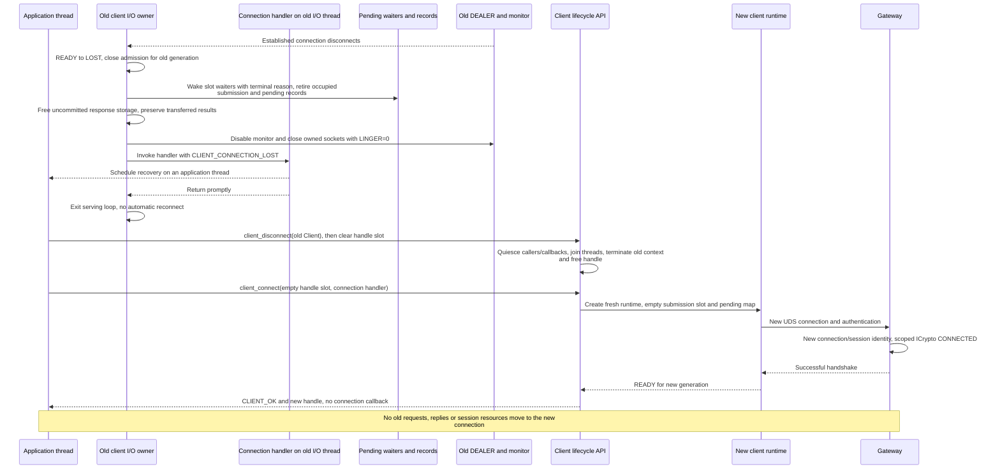

Client cleanup is not a remote cancellation acknowledgement. Gateway separately
closes the old context's admission and drops its undeliverable responses. Accepted
Gateway jobs follow the existing drain/deadline contract; active backend access
must finish before DISCONNECTED and buffer destruction. A new session can be
admitted while the old one retains private cleanup references, without sharing
its resources or accepting its late completions. A missing response does not
make automatic operation replay safe.

#### Freeze and runtime behavior

The application owns preparation for freezing its process: stop new submissions,
finish accepted operations and callbacks, and leave no uncertain remote work.
Async CLIENT_OK confirms only send acceptance, so it does not satisfy this
preparation requirement; the operation may still be executing remotely.
With no pending operation, no request timer is active and the 15-second duration
does not expire the idle connection. No custom heartbeat or inactivity watchdog
is part of that flow.

The intended freeze preserves the process and its descriptors. Transport
heartbeats are disabled on both ends, so a lack of heartbeat traffic during the
pause does not expire that connection. Actual socket closure or Gateway failure
still uses normal disconnect handling. Section 6.14 describes the Gateway side
and the distinction from process destruction.

#### Concurrency, callbacks and reconnect

The following constraints apply to all request APIs:

- Protect the one submission slot and admission state with a per-Client mutex.
  WaitAndPublish releases that mutex while waiting; ClaimSubmission retains
  the request and unlocks before serialization or I/O. CompleteSend frees the
  slot after acceptance/failure. Process replies and monitor events even when
  the occupied slot cannot send. The pending-response map has no fixed count cap.
- Use a monotonic clock for the agreed 15-second local deadlines. The current
  API has no timeout argument; future configurability is optional and does not
  block the initial fixed defaults. There is no idle-connection expiry.
- Resolve each synchronous result and async send-result waiter once. Async
  callbacks deliver responses at most once and are not guaranteed after send
  success. Retire async records without a callback on connection loss or local
  response-processing failure. Late replies cannot trigger a duplicate callback
  or satisfy another request; this does not guarantee exactly-once execution.
- Explicit local close resolves still-pending sync/send results with
  CLIENT_NOT_CONNECTED, retires pending IDs without synthetic callbacks and
  waits for live calls/claimed callbacks before destroying the handle. Preserve
  an earlier response, send acceptance, timeout or unexpected-loss result.
- Do not retry automatically after a timeout or reconnect. A crypto operation
  may already have changed backend state.
- Disable automatic transport reconnect and discard old pending requests and
  undelivered responses on connection loss. Explicit reconnect creates a fresh
  context with no reused buffer IDs, session key handles or queued work.
- Apply RECONNECT_IVL=-1, IMMEDIATE=1 and LINGER=0 to each new DEALER. Close the
  old socket rather than reconnecting it or carrying its libzmq queues forward.
- Keep transport heartbeats disabled on DEALER and ROUTER, including after
  socket recreation. Actual connection loss still invalidates assumptions about
  the old Gateway context, buffers and key handles. The explicit new-connection
  flow above applies after any actual loss, including one observed after thaw.
- Connection callbacks are specified by the header to run on
  an internal thread without calling other client APIs. Request callbacks use
  the execution rules in section 5.4: run on the I/O owner without held
  internal locks, permit response freeing, and prohibit all request calls
  because they wait for that same owner. Schedule new requests, disconnect and
  heavy work on an application thread.
- If arbitrary blocking callbacks must be supported, add a separate bounded
  completion executor with its own shutdown contract. Do not silently create
  an unbounded thread per callback.
- An application-owned event-loop mode would need additional public integration
  APIs. It is an optional future extension, not a requirement for this version.

#### Library unloading

A shared library can create threads. Runtime unloading is safe only after the
application disconnects every Client, all library-owned threads are joined,
all calls/callbacks have returned, owned ZMQ contexts are terminated and all
buffers requiring `client_free_response()` have been freed. No thread may still
execute library code after `dlclose()`. libzmq's internal threads do not remove
this obligation. See the
[dynamic loader API](https://man7.org/linux/man-pages/man3/dlopen.3.html).

### 5.15 Call hierarchy

```text
Application / Firebolt Crypto
  client_connect
    ClientRuntime::Start
      Allocate runtime, EMPTY slot, slotAvailable, result conditions, stop flag, wakeup
      Start I/O owner, create DEALER and set options before connecting
        heartbeat IVL/TIMEOUT/TTL=0, RECONNECT_IVL=-1, IMMEDIATE=1, LINGER=0
      Enable monitoring, connect PAIR receiver, then connect DEALER and await handshake
      HANDSHAKE_SUCCEEDED -> publish handle, CLIENT_OK, no initial callback
      Failure -> retained error, stop/join/close and NULL output

  client_send_request / client_send_request_async
    F1 RetainCall / PrepareRequest
      Check READY, start original deadline, own and validate binary RpcRequest
  client_send_request_string / client_send_request_string_async
    F1 RetainCall / PrepareRequest
      Check READY, start original deadline, scan/copy raw text to first NUL
      Build service=UNSPECIFIED envelope, payload=text bytes, no terminator

  Shared request path for all four methods
    F2 ClientRuntime::WaitAndPublish
      Wait until EMPTY or deadline/close/failure, release mutex during wait
      Publish retained Request, mark PUBLISHED, unlock
    F3 WakeIo -> I/O poller
      ClientRuntime::ClaimSubmission -> lock/read/retain/CLAIMED/unlock
    F4 I/O owner: PrepareWireRequest / TrackRequest
      Recheck eligibility -> assign ID/schema -> serialize -> install pending entry
      Allocation failure -> CLIENT_OUT_OF_MEMORY unless another terminal path won
                            retire unsent entry, free matching slot, notify
    F5 TryBeginSend -> zmq_send(DEALER, DONTWAIT)
      EAGAIN/EINTR -> occupied slot retained, process replies/events, retry if eligible
      Deadline/close/loss -> disable later sends, resolve any active attempt first
      CompleteSend(request, outcome) -> commit send result and free matching slot once
        Accepted async -> CLIENT_OK, even if cancellation raced the admitted attempt
        Sync response result remains separate; expiry/close does not become success
        Unlock -> notify result and slot waiters
    F6 Calling thread
      Async: return send result, no response timeout after acceptance
      Sync: wait for final response within original deadline, slot already free
    F7 I/O owner: zmq_msg_recv -> framing/parse -> match ID/service/schema/status
      Uncorrelatable allocation failure -> terminal CLIENT_OUT_OF_MEMORY, wake slot waiters
      Uncorrelatable invalid response -> terminal CLIENT_COMMUNICATION_ERROR, wake waiters
      Unknown/retired ID -> discard
      Installed but unaccepted ID -> log/discard response, preserve request and slot
    F8 CompleteResponse
      Byte: allocate serialized response bytes, preserve RpcStatus/service payload
      String: validate non-OK status/empty payload -> allocate RpcStatus name + NUL
        Gateway normally returns UNSUPPORTED_SERVICE, service=0, no Crypto invocation
      Claim result against deadline/close -> retire pending entry once
        Never clear another request's occupied submission slot
      Sync: CLIENT_OK + response, or exact local error with NULL/0
      Async: response callback without locks, or diagnostics/retirement without callback

  Monitor processing on I/O owner
    Established loss -> READY to LOST, latch reason once, notify slotAvailable
    Resolve occupied send, fail unresolved results, retire async records
    Close sockets with LINGER=0, emit CLIENT_CONNECTION_LOST if callback claim allowed
    Exit owner, no automatic reconnect or RESTORED/TERMINATED event
    App explicitly disconnects old handle and connects a fresh runtime/session

  client_register_notifications -> CLIENT_NOT_IMPLEMENTED, no retained handler
  client_unregister_notifications -> no effect
  client_free_response -> free, no slot access or allocation

  client_disconnect
    App coordinates handle lifetime and stops new call entry
    Close admission, set existing stop flag, notify slotAvailable, wake I/O owner
    No wait for EMPTY and no control request published into the slot
    Resolve active send, preserve accepted async CLIENT_OK
    Unresolved calls -> latched reason (CLIENT_NOT_CONNECTED for close from READY)
    Preserve earlier LOST reason, clear matching occupied slot and pending IDs
    Owner closes sockets -> join -> quiesce entered calls/claimed callbacks
    Terminate context, destroy runtime, no callback after return
```

The numbered boundaries match sections 5.2–5.9. They belong to one runtime and
its Request records; no additional client coordinator thread or request pool
is implied. Gateway request scheduling remains independent.

## 6. EyilGateway design and flows

### 6.1 Plugin and implementation organization

EyilGateway runs **in process** with Thunder. The thin
`EyilGateway` wrapper implements IPlugin and acquires
`EyilGatewayImplementation` using
`Root<Exchange::IConfiguration>()`, then calls `Configure(IShell*)`.
The default `configuration.root.mode` is `Off`. A future `Local` mode can use
the same split with matching framework proxy/stubs.

**There is no app-facing Gateway COM-RPC or JSON-RPC API.** IConfiguration is
the internal Thunder bootstrap contract. The wrapper also acquires a private
lifecycle-control interface with StopAndWait(), which is not a method on
IConfiguration and is not exposed to apps. A future remote implementation needs
matching proxy/stubs for that interface. ICrypto calls form a separate
trusted backend boundary. "No public Gateway COM-RPC API" does not mean there
are no framework/backend interfaces internally.

| Component | Responsibility | Separation rule |
| --- | --- | --- |
| EyilGateway wrapper | Register notifications, acquire/configure implementation, await StopAndWait before release | Keep transport and service logic out of IPlugin |
| EyilGatewayImplementation | Own configuration/runtime and idempotent StopAndWait | IConfiguration starts the runtime; private lifecycle control drains and stops it |
| GatewayServer / IoLoop | Own ROUTER, receive messages, route completions | No blocking backend work; no worker uses ROUTER |
| ZapAuthenticator | Own REP, parse credentials, answer ZAP | No application-supplied identity is trusted |
| AuthenticationProvider | Interim acceptance; future authoritative lookup | TODO(AUTH-APPMANAGER), separate from transport |
| ConnectionRegistry | Map User-Id to retained context; serialize admission/closing | Never key ownership solely by UID/PID/routing ID |
| RequestDispatcher | Envelope/service validation, routing and nonblocking handoff to the private pool | Service-neutral at outer boundary |
| PendingRequestQueue | std::queue<Action> with a global 1,024-request waiting limit and 10-second dispatch deadline | Mutex-protected admission/counting; includes jobs submitted to the pool but not started |
| RequestJob | One retained dispatch object per accepted request | Immutable input plus explicit context/resource references |
| PrivateRequestPool | Own a Core::ThreadPool with a configured worker count | No replacement of Thunder's global worker singleton; internal capacity must not block ROUTER |
| CryptoServiceAdapter | Decode Crypto operations and query/invoke/release ICrypto per call | No cached ICrypto pointer, global Crypto session, health observer or duplicated key policy |
| SharedBufferManager | Create/track allocations, quotas, active-use leases and deferred release; finalize once access ends | Gateway-local; no dependency on ICrypto types |
| CompletionQueue | Bounded worker-to-ROUTER handoff for newly completed responses | At most one send attempt; release on success/failure, no per-connection retry queue and no delivery to a replacement route |
| MonitorCollector | Own PAIR and post normalized transport events | Correlation is a prerequisite for targeted cleanup |
| Optional lifecycle observer | Future app lifecycle events | TODO(LIFECYCLE-EVENTS), no current platform subscription |

#### Gateway component and API-call overview

Coverage: **AC1.1–AC1.12; AC2-Client.2–AC2-Client.3, AC2-Client.5;
AC2-Firebolt.1–AC2-Firebolt.2**.

The application calls EyilClient's C API. Gateway receives the resulting
Protobuf RPC over its ROUTER socket and dispatches a request job. The diagram
separates that request/response path from authentication, connection cleanup
and Thunder lifecycle control. Everything inside the implementation block is
owned by that Gateway runtime; the application and Crypto plugin remain
outside it.

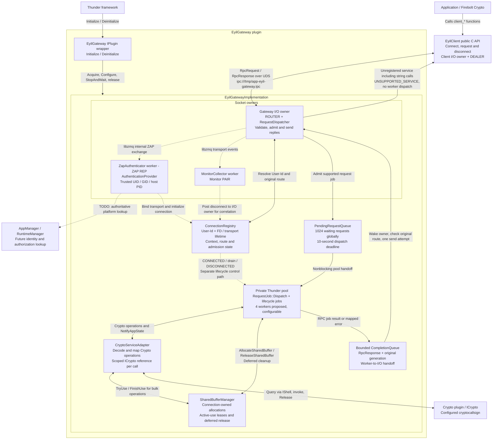

Solid arrows show API calls and RPC data flow. Dashed arrows show authentication,
monitor events and connection lifecycle control. The ZAP and monitor arrows are
libzmq's internal exchanges; they do not mean the ROUTER owner uses REP or PAIR.
This is a component/call map; the sequence diagrams below define ordering and
failure handling.

The three transport owners are separate Gateway threads. RequestDispatcher
runs on the ROUTER owner; request and lifecycle jobs run on the private pool.
The monitor collector posts events to the I/O owner, which correlates them and
serializes the registry's disconnect transition.
The adapter, registry, buffer manager and queues are shared runtime components,
not additional threads. Four request workers remain a sizing proposal in
section 6.2, in addition to the transport owners and libzmq's internal threads.

| Call or event entering Gateway | Internal path and result | Detailed flow |
| --- | --- | --- |
| Thunder Initialize / Deinitialize | Wrapper acquires/configures the implementation; deactivation awaits StopAndWait before releasing it | Sections 6.4 and 6.16 |
| client_connect | DEALER handshake reaches ZAP; bind a unique User-Id to the transport/context and complete the worker-side NotifyAppState(CONNECTED) before ZAP success | Section 6.5 |
| client_send_request / client_send_request_async carrying a Crypto RpcRequest | ROUTER owner validates/adopts the request, queues a distinct job and returns its correlated completion through the same owner | Sections 6.6–6.9 |
| client_send_request_string / client_send_request_string_async | ROUTER rejects the unrouted service=0 envelope with RPC_STATUS_UNSUPPORTED_SERVICE before worker admission; client exposes the received status as text | Sections 5.8–5.9 and 6.6 |
| ALLOCATE_SHARED_BUFFER / RELEASE_SHARED_BUFFER | Worker calls SharedBufferManager locally. Allocation returns buffer_id, name and size; release acceptance blocks new use and defers physical cleanup while access remains active or unresolved | Sections 6.10–6.11 and 6.13 |
| ENCRYPT / DECRYPT / SIGN / VERIFY | Worker-side adapter acquires an execution-time buffer lease, calls ICrypto using trusted context/object metadata, and ends the lease when backend access is definitively complete | Section 6.12 |
| Other Crypto operations | Adapter queries the configured callsign through IShell, invokes the mapped ICrypto method and releases the reference immediately after that call | Sections 6.7–6.9 |
| Peer closure after client_disconnect or unexpected transport loss | PAIR event identifies the original connection; close admission, drain accepted work, notify DISCONNECTED through the private pool and finalize releasable resources | Section 6.14 |

Only the ROUTER owner sends RPC replies. Workers publish completions carrying
the original connection generation; backend notifications publish internal
lifecycle results, not unsolicited RPCs. A response gets at most one
nonblocking send attempt. An undeliverable response is logged and dropped,
without retry or a second error reply. Admission rejections use the same owner
and delivery policy without creating a service job. Lifecycle work uses the
separate control path and does not consume the 1,024 application waiting slots.

There is no application heartbeat service, heartbeat worker or inactivity
watchdog in the Gateway runtime. The registry has no last-request-age expiry
rule. Connection cleanup is driven by correlated disconnect events and the
normal explicit shutdown path. ROUTER's built-in ZeroMQ heartbeats are disabled
at startup and on socket recreation, matching the client settings.
Gateway owns request isolation and resource accounting; application-health
supervision and app restart decisions remain outside its responsibilities.

These are recommended responsibilities, not a requirement for one source file
per row. Keep explicit module/config/version files, a thin wrapper and separate
implementation sources. Use internal interfaces at unfinished integration points
to isolate AppManager integration. Use topic/crypto ICrypto types only within the
Crypto adapter; keep them out of EyilClient, transport and buffer ownership.
Gateway does not poll Crypto health or subscribe to Crypto availability events.
The wrapper notifications for Gateway's own implementation lifetime remain
separate from Crypto and are still required.

### 6.2 Thread model and private Thunder pool

Coverage: **AC1.1–AC1.3, AC1.7**.

| Execution context | Owns / performs | Must not do |
| --- | --- | --- |
| Thunder framework thread | Initialize/Deinitialize and framework notifications | Run application requests synchronously |
| Gateway I/O owner | ROUTER, request validation/enqueueing, event/completion draining | Wait for Crypto, worker-pool capacity or a slow client |
| ZAP worker | REP and authentication exchange | Use ROUTER or modify another thread's socket |
| Monitor worker | PAIR events, normalized disconnect records | Guess a session from a non-unique PID |
| Private Thunder workers | RequestJob::Dispatch, buffer operations and scoped ICrypto calls | Send a ROUTER reply or own transport state |
| libzmq internal threads | Transport machinery | Replace Gateway request/session coordination |

Create a Gateway-owned `Core::ThreadPool` instance with an explicit worker
count and stack budget. Keep waiting request jobs in std::queue<Action> under
a mutex, with a global limit of **1,024 waiting requests** across connections.
The accounting includes both Gateway-staged jobs and jobs submitted to the
private pool that have not begun Dispatch. Running jobs are bounded separately
by the worker count; moving a job into Thunder's queue does not release a waiting
slot. Each action retains its context, generation, original dispatch deadline
and completion state before publication. Roll back partial allocations on
failure; pop under the mutex and process after unlocking.

A new request at the limit is rejected with RPC_STATUS_INTERNAL. A queued request
has **10,000 ms from Gateway admission to the start of Dispatch**, measured with
a monotonic clock. This is neither a backend execution timeout nor the client's
15-second deadline. EyilClient uses a single submission slot; its pending-response map remains dynamic.

Atomically arbitrate WAITING -> RUNNING against WAITING -> EXPIRED. The worker
checks the original deadline before executing any service logic; expiry wins
at/after the deadline, produces one correlated RPC_STATUS_INTERNAL response and
prevents later execution. Include time spent in Thunder's internal queue. The
ROUTER owner processes deadlines without blocking while other requests proceed.

Remove expired staged work and release its resources. If an already submitted
wrapper cannot be removed immediately, it retains an expired/cancelled marker
and becomes a no-op when dispatched. Return its capacity credit only when the
queued record is reclaimed; do not accumulate uncounted cancelled wrappers.
Errors and response delivery use the normal I/O completion path. No new
Protobuf status or client error code is introduced.

Shutdown, disconnect and authentication lifecycle control use a separate retained
control path, so the full request queue cannot prevent cleanup. A private worker
never waits for a reply to reach the client before releasing its execution slot.

Submit a distinct `Core::IDispatch` object for each queued request when the
private pool can accept it. A busy pool leaves admitted work pending only
within its original deadline; queue saturation rejects new work immediately.
Do not call `Core::IWorkerPool::Assign()`
or use `Core::IWorkerPool::Instance().Submit()` for application request work.
Some Thunder helper job classes submit implicitly to that global instance;
select the explicit private-pool path. Never implement the 10-second wait as a
blocking pool submission from the ROUTER thread.

The local Thunder R4.4 implementation supports independently owned thread pools.
Its submission APIs must be wrapped carefully: not every version returns an
enqueue-success result, and infinite submission waits would block the ROUTER.
The dynamic staging queue does not change Thunder's internal queue behavior.
Use a version-appropriate nonblocking handoff with tracked submission ownership;
if the pool cannot accept work yet, retain it and resume on capacity becoming
available. Never spin on a busy pool, drop an unconfirmed submission or block
the ROUTER. The exact handoff and worker-completion wakeup must be validated
against the target Thunder release. Reference:
[Thunder pool implementation](https://github.com/rdkcentral/Thunder/blob/2c0fcc5529e7da734be558ca6efa05d934dcce31/Source/core/ThreadPool.h).

The wrapper submits its framework deactivation job to Thunder's global pool.
Application request jobs use the Gateway's private pool.

Catch detectable request/job/queue allocation failures and release partial
state without publishing a job that could later execute. For a trustworthy
request ID and route, report RPC_STATUS_INTERNAL if the error reply can be
constructed and sent. If memory or transport failure prevents that reply, do
not claim it was delivered, fabricate success or retry the service operation.
After execution starts, an error response does not undo backend effects or
authorize early release of leased buffers. Client-local allocation failures
continue to use CLIENT_OUT_OF_MEMORY; these are separate error layers.

#### Proposed initial resource sizing

The following values are **proposals for target-device validation**, not adopted
production defaults or changes to runtime configuration. Rows marked **Agreed**
record the existing limits; the additional byte budgets and transport/worker
settings remain subject to product sizing under TODO(RESOURCE-LIMITS).

| Resource | Initial value / policy | Status |
| --- | --- | --- |
| Maximum complete request / response | 1 MiB each, including the outer RPC envelope; bulk Crypto data uses shared memory | Proposed |
| Gateway waiting requests | 1,024 globally, with at most 10 seconds from admission to the start of Dispatch | Agreed |
| Queued request data | 16 MiB globally, alongside the waiting-entry limit | Proposed |
| Reserved/completed response slots | 128 per connection / 1,024 globally, including reservations for running jobs | Agreed |
| Reserved/completed response data | 4 MiB per connection / 16 MiB globally, alongside the response-slot limits | Proposed |
| ZeroMQ send/receive high-water marks | ZMQ_SNDHWM = 32 and ZMQ_RCVHWM = 32 messages per peer on ROUTER and DEALER; tune through burst/load tests | Proposed |
| Private request workers | 4, configured independently of Thunder's global pool | Proposed |
| Worker stack size | Keep the Thunder/platform default initially; measure before reducing it, including when Crypto executes in process | Proposed |
| Shared memory | 16 MiB per buffer, up to 4 buffers / 64 MiB per connection, and 128 MiB globally | Proposed |
| Kernel socket buffers | Keep OS defaults with ZMQ_SNDBUF = -1 and ZMQ_RCVBUF = -1 | Proposed |

All applicable count and byte limits apply together. A 1,024-entry queue holding
1 MiB requests would otherwise consume 1 GiB for payloads alone. Fast dequeueing
does not prevent accumulation while backend workers are occupied. Inline
results, including GenerateRandom and ExportKey, must fit the complete response
limit with Protobuf overhead; the maximum payload is therefore smaller than
the maximum envelope.

System limits are a final boundary, not a per-plugin or per-connection budget.
Gateway initially shares Thunder's process, so exhausting memory can affect
other plugins. Keep OS socket-buffer and platform stack defaults where suitable,
but explicitly account for Gateway-owned queues, responses and shared memory.
libzmq 4.3.4 defaults to high-water marks of 1,000 messages per peer and an
unlimited maximum inbound message size. These settings alone do not define a
predictable Gateway memory budget.
[ZeroMQ 4.3.4 socket options](https://github.com/zeromq/libzmq/blob/v4.3.4/doc/zmq_setsockopt.txt)

The proposed budgets are not a total-process RAM limit. Protobuf copies,
bookkeeping, stacks, kernel buffers and libzmq queues add storage. In particular,
libzmq's queues are per peer and separate from Gateway's completion handoff;
validate sizing against simultaneous connections, peak message sizes and
backend latency. Apply the shared-memory global quota across all connections.

Expose adopted values through product configuration supplied by CMake/BitBake;
no public client API change is needed. Keep the existing error and delivery
contracts: Gateway resource rejection emits an explicit ERROR log and returns
RPC_STATUS_INTERNAL when a correlated reply is possible. Each response has one
send attempt. EyilClient uses one submission slot and a dynamic pending-response
map; local allocation failures use CLIENT_OUT_OF_MEMORY. Transport high-water
marks can delay slot release through backpressure but do not create a local
queue-full result.

Apply message bounds at the client API and Gateway validation boundaries as
well as in transport configuration. A libzmq ZMQ_MAXMSGSIZE rejection disconnects
the oversized sender before an RPC error can be constructed; it follows normal
connection-loss handling. It must not be described as a guaranteed
RPC_STATUS_INTERNAL reply. The configured complete-message and text bounds must
also allow for envelope overhead and the local string terminator.
[ZeroMQ maximum message size](https://github.com/zeromq/libzmq/blob/v4.3.4/doc/zmq_setsockopt.txt)

### 6.3 Runtime records and synchronization

Each connection context contains:

| Field group | Required information |
| --- | --- |
| Identity | Unique User-Id, activation and connection generations, interim appId and sessionId |
| Transport binding | Gateway-side accepted FD plus immutable transport lifetime, bound to User-Id before ZAP success; FD is metadata owned by libzmq |
| Peer | Trusted host UID/GID/PID; process-instance evidence if available |
| Routing | Binary ROUTER routing ID plus a proven binding to this connection generation |
| Admission | AUTHENTICATING, ACTIVE, DRAINING, CLOSING or RETIRED; admission policy and accepted/queued/in-flight bookkeeping |
| Crypto context | Per-connection initialization/drain state and last observed call outcome; no ICrypto pointer or background plugin-health state |
| Resources | Owned buffer IDs, execution-time active-use leases, pending releases and cleanup accounting; queued jobs do not reserve buffers |
| Lifecycle | Correlated closing reason and exactly-once cleanup/notification state |

Preserve runtime app-instance identity separately when a future platform API
supplies it. The interim per-connection sessionId is not evidence of a real
launcher-provided app instance. Never derive uniqueness from UID, PID or a
reusable numeric FD alone.

Each RequestJob retains an immutable request plus `User-Id`, connection
generation, request_id, expected service and the required resource references.
A completion carries the same identity tuple and activation generation; workers
do not look up "whatever connection now has this routing ID."

Required synchronization rules:

- The Gateway ROUTER I/O owner serializes admission, route publication and
  terminal connection transitions. ZAP/monitor workers submit bounded control
  events.
- ZAP must publish its context before returning acceptance; an acknowledgement
  or a protected registry insertion is needed so the first request cannot race
  ahead of its record. No backend call runs under the registry lock.
- SharedBufferManager protects lookup, ownership, active-use state and quota
  accounting with short locks. A worker checks and acquires an idle buffer
  atomically when it executes; queuing a request reserves no buffer dependency.
  Release atomically sets releasePending on a valid owned allocation, including
  one in use, and prevents subsequent use. Competing uses of a busy buffer and
  uses of an unavailable/release-pending buffer fail under section 4.2.
  Last-use completion and release compete for one finalization claim; neither
  can destroy the object while an active or unresolved access remains.
  Section 6.13 also orders finalization against connection teardown. No lock is
  held across ICrypto, filesystem or transport calls.
- CONNECTED runs once during authentication before a context becomes ACTIVE
  and ZAP returns success. RPC workers never perform lazy session creation.
  Keep notification bookkeeping, not internal Crypto key state or health data.
- Closing new admission does not cancel accepted jobs. During deactivation or
  a correlated peer disconnect, queued jobs either start within their original
  10-second worker-wait deadline
  or expire with an error; started jobs complete before resources are released.
- Accepted jobs use their retained context and original generation during drain;
  removal from new-request lookup must not make them resolve a replacement
  context or fail solely because admission is now closed. Buffer dependencies
  and validation still apply. A disconnected route cannot receive a completion.
- A session removed from public lookup may remain privately retained by accepted
  jobs and lifecycle tasks. Purge entitlement/admission visibility immediately;
  retain only what those jobs and cleanup need.

These rules require synchronized records, not an ordering guarantee between
queued operations. Section 6.13 defines the outcome when release overtakes use.
The client's DEALER I/O owner cannot enforce Gateway buffer ownership or stop
an application from writing through its own mapping.

### 6.4 Startup and partial-start failure

Coverage: **AC1.1–AC1.3, AC1.7**.

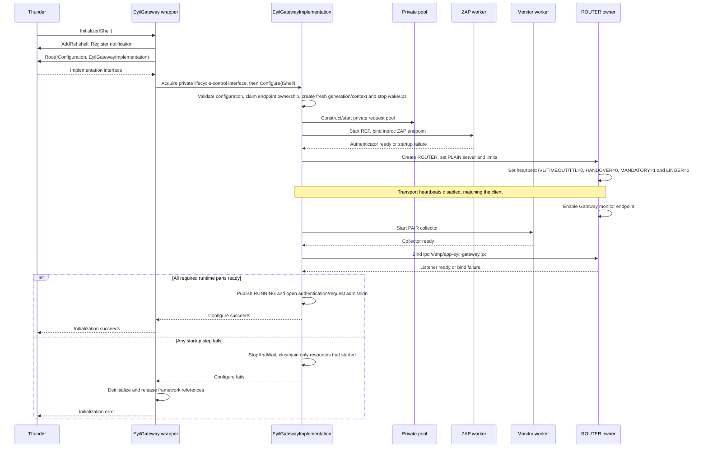

Crypto is available before Gateway activation and remains available during
orderly Gateway teardown. Configure validates/stores its callsign; each
notification and operation acquires its interface on demand. There is no cached
ICrypto pointer, availability observer or startup polling. AppManager/RuntimeManager
lookup is not called in this phase.

Start the private pool, ZAP and monitor collector before binding ROUTER. Publish
RUNNING only once all owners are ready; a racing handshake cannot create an
ACTIVE context while startup admission is closed. Each activation gets fresh
registries, counters, generation, wakeups, sockets and its own ZMQ context.

Before binding ROUTER, explicitly set ZMQ_HEARTBEAT_IVL, ZMQ_HEARTBEAT_TIMEOUT
and ZMQ_HEARTBEAT_TTL to 0, matching client setup in section 5.5. Use the PAIR
monitor for transport events and event-driven cleanup. There is no application
heartbeat worker or inactivity watchdog.

Partial rollback uses the same StopAndWait discipline as section 6.16. Create
stop state and wakeups before starting threads; close/join only resources
actually created/started. Failed Configure returns only after rollback completes.

Require exclusive ownership of the configured UDS endpoint. Never replace a
live listener or unlink another runtime's socket. Release endpoint ownership
after socket owners exit and context termination completes. Rebinding creates
a new socket inode; container mounts must expose it as specified in section 3.3.

### 6.5 ZAP, interim identity and future AppManager lookup

Coverage: **AC1.2, AC1.4–AC1.6; AC2-Client.2–AC2-Client.3**.

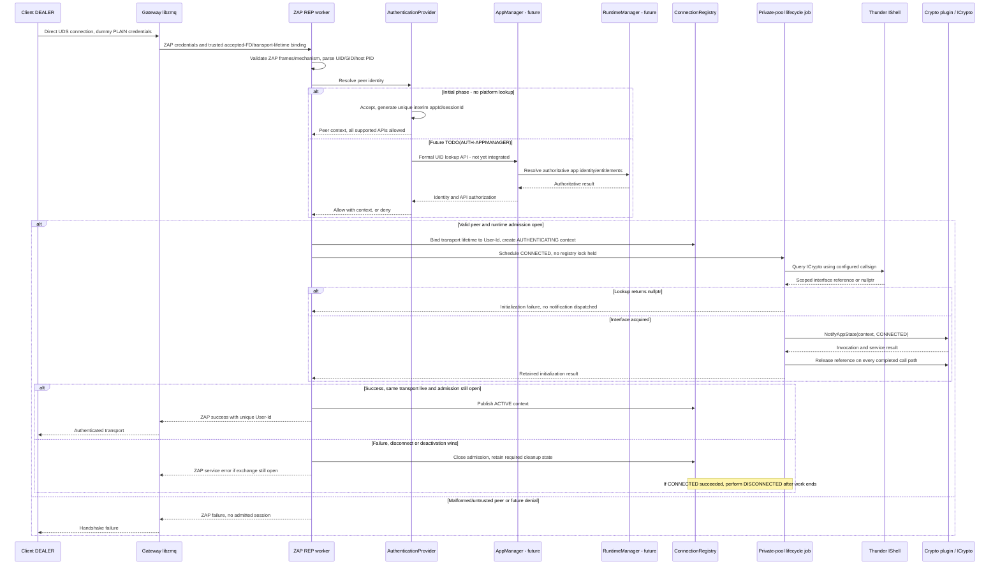

A User-Id can encode `appId#sessionId#connectionToken`, or be an opaque random
token resolved through the registry. The important property is uniqueness per
accepted connection and an unambiguous lookup; any delimiter-based encoding
needs escaping/validation. Reconnection creates a new generation. Two sockets
from the same UID/GID/PID do not share a context.

CONNECTED is sent during authentication for every accepted connection,
including one that never sends an RPC. Crypto is already available. The private
lifecycle job completes before ZAP success; no first-request initialization is
needed. ZAP waits without registry locks and must wake on stop/transport closure.
A late CONNECTED result cannot revive a closed context.

A null ICrypto lookup or failed CONNECTED invocation fails setup. Return ZAP
300/500 when possible, mapped to CLIENT_COMMUNICATION_ERROR by the client, and
retain any uncertain cleanup obligation. Do not poll/retry Crypto or admit RPCs
against a context whose initialization failed. An in-progress CONNECTED job is
included in plugin shutdown accounting.

The interim "accept all" decision removes policy checks, not frame validation,
credential provenance checks, quotas or buffer isolation. Production API
entitlements are cached per connection and purged from admission on disconnect.
No app-supplied username, password, route or payload field replaces the kernel
identity or the future platform lookup.

### 6.6 Request ingress, dispatch and response delivery

Coverage: **AC1.1, AC1.5–AC1.11; AC2-Client.5**.

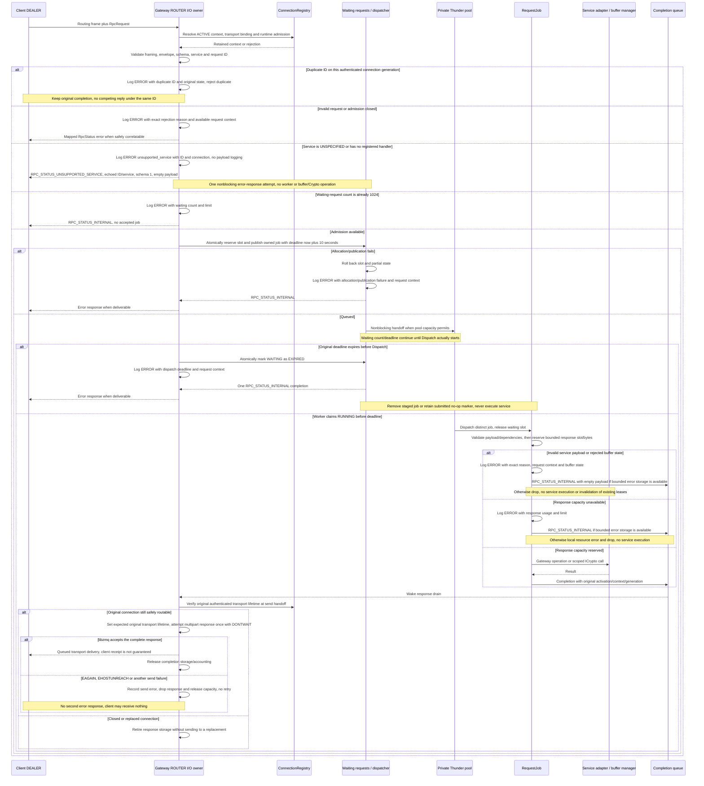

Stage accepted work while private workers are occupied, within the global
1,024 waiting-request limit and original 10-second dispatch deadline. Saturation,
expiry and allocation failure produce RPC_STATUS_INTERNAL when deliverable.
Expired/rejected work never invokes Crypto or performs a buffer operation.
Requests that started Dispatch complete normally; this timer cannot cancel them.

The Gateway ROUTER owner serializes new admission with deactivation. Already
accepted work settles during drain while replies and control events continue.
Per-message bounds, shared-buffer quotas and completion-storage policy remain
separate. Process ingress, completions and deadlines fairly in bounded batches.

Validate at least: frame count, message size, trusted metadata, live context,
schema 1, supported service, request-ID rules, service parse, operation/oneof
agreement, enum/range validity and allocation ownership. Apply the generic
rejection and ERROR-log contract in section 4.2, including preservation of an
original request when its ID is duplicated. Independent requests can finish in
any order; dependent operations must follow the resource-ordering contract.

Complete validation and reserve response capacity before committing buffer
release. A rejection before that point creates no releasePending transition.
If execution has already acquired an active-use lease and a later check fails
before calling Crypto, end that lease through FinishUse; a concurrently accepted
release may then become eligible for cleanup. Once release is accepted, later
response preparation/delivery failure cannot undo it, as defined in section 6.13.

String APIs build a binary RpcRequest with service=RPC_SERVICE_UNSPECIFIED,
schema 1, an assigned nonzero ID and raw text payload. After context/framing/
schema/ID validation, reject that unregistered service with
RPC_STATUS_UNSUPPORTED_SERVICE and log ERROR unsupported_service. Echo the ID,
service=0 and schema 1, with empty payload. Do not parse CryptoRequest, acquire
ICrypto, mutate buffers or consume a waiting-request slot for this rejection.
The same rule handles other unregistered service values. CRYPTO still requires
its normal serialized CryptoRequest; no format sniffing or text translation is
performed. Common invalid-context/schema/duplicate-ID rules take precedence.

The rejected string request uses the same bounded error-response allocation,
original-transport validation and one-attempt send policy as other admission
errors. If it cannot be delivered, log/drop rather than retry or send a second
error. The client may then time out (sync) or receive no callback (async).
Sections 5.8–5.9 define the response text only when a valid reply arrives.

A job publishes completion rather than touching ROUTER. The handoff queue exists
to transfer the result to its socket owner; it is not a retry queue. Process
new completions promptly in bounded batches so replies, ingress, monitor events
and deadlines all progress. The storage and send rules below are selected
behavior, not an outstanding architecture gap.

#### Bounded response handoff

Use a bounded completion handoff from private workers to the ROUTER owner.
Initial response-slot defaults are **128 per connection and 1,024 globally**,
separate from the 1,024 requests waiting for workers. Count reserved slots for
running jobs as well as completed records. These limits do not introduce a
per-connection response-retry queue.

Before executing a service operation, reserve its completion slot and response
byte allowance atomically against the connection/global budgets. Use a finite
configured maximum serialized response size and finite per-connection/global
byte budgets; counts alone do not bound variable-size output. Validate the
configuration and size arithmetic before opening admission. Product sizing is
a resource configuration task, not a choice of delivery policy. Section 6.2
lists [proposed initial byte budgets](#proposed-initial-resource-sizing) for
target-device validation.

If reservation is unavailable, do not execute the operation or block a worker.
Publish RPC_STATUS_INTERNAL through the owner if bounded error storage is
available; otherwise record the local resource error and drop. Likewise,
allocation/publication failure cannot create unbounded overflow storage or
trigger another backend execution. Validate requested output lengths before
calling the backend where possible, and enforce the serialized-response limit
before publishing a completion.

Release the reservation exactly once when the single send attempt succeeds,
fails, or the response is discarded as stale. Configure a finite ROUTER
ZMQ_SNDHWM as well: libzmq's accepted output is separate from Gateway handoff
storage. Apply platform connection/message limits when sizing that storage.
Process a bounded batch of new completions per I/O-loop iteration, then return
to ingress, monitor events and deadlines.

#### One response send attempt

**Gateway attempts each response once, nonblocking. On failure it records a
local delivery error and drops the response.** There are no retained failed
replies, per-connection retry queues, send-retry timers or second attempts.

Configure ROUTER_MANDATORY=1 and use ZMQ_DONTWAIT for the multipart response.
A full route reports EAGAIN and an unreachable route reports EHOSTUNREACH;
neither is permission to replay the operation.
[ROUTER send behavior](https://libzmq.readthedocs.io/en/latest/zmq_setsockopt.html#zmq-router-mandatory-accept-only-routable-messages)

| Outcome | Gateway action |
| --- | --- |
| Original context/route is already retired or replaced | Discard the stale completion without sending it to another connection |
| Complete response accepted by libzmq | Release Gateway completion storage/accounting; do not wait for client receipt |
| EAGAIN | Record output-backpressure failure, drop this response and continue other work; do not infer process death or disconnect solely for this result |
| EHOSTUNREACH | Record unreachable-route failure and drop; connection cleanup uses the authenticated lifecycle path |
| EINTR or another send error | Record the failed attempt, drop without a retry and apply any required socket/runtime error handling |
| Completion preparation/publication fails | Record local failure and release owned state without blocking a worker or starting another backend operation |

"One attempt" applies to the complete response message, whose ROUTER framing is
[routing_id][RpcResponse bytes], not to a single frame. Prepare both frames
before starting, use SNDMORE on the route frame, and never interleave another
response. If routing-frame submission fails, do not submit its payload. If a
later frame fails, preserve or terminate the socket's multipart state safely
under the verified libzmq contract before sending unrelated traffic; never
restart that response. The target transport tests must cover these frame-level
failure paths. Success confirms local libzmq acceptance, not peer receipt.
[Send and multipart contract](https://libzmq.readthedocs.io/en/latest/zmq_send.html)

Apply this policy to successful results and all Gateway error replies, including
queue-saturation and 10-second dispatch-expiry errors. Do not attempt to send a
second RPC_STATUS_INTERNAL to report the failure of the first response.
Record the request ID, connection generation and local send error in bounded
diagnostics/counters, without logging Crypto payloads. Drop releases response
storage, not an allocation still leased to an active backend operation.

The client cannot observe this local send failure through a response that was
not delivered. If the transport stays open, a synchronous call reaches its
15-second CLIENT_TIMEOUT; an accepted async request has no response timeout and
may retain its pending record until local teardown or connection loss, without
a response callback. A monitor reports connection events, not individual
dropped replies. This policy does not introduce an async error callback or
unsolicited notification.

Finite libzmq output high-water marks and response byte limits are still
required: accepted messages can remain queued inside libzmq, and concurrent
workers can produce handoff records before the I/O owner consumes them.
The client request-submission retry behavior within its existing deadline is
separate from this Gateway response policy.

### 6.7 Crypto adapter: per-call ICrypto references and per-connection sessions

Coverage: **AC1.8, AC1.12**.

Use the ICrypto API from
[entservices-apis branch topic/crypto](https://github.com/rdkcentral/entservices-apis/tree/topic/crypto),
specifically [apis/Crypto/ICrypto.h](https://github.com/rdkcentral/entservices-apis/blob/topic/crypto/apis/Crypto/ICrypto.h).
The reviewed branch revision is 6926f6a72fbfff18b691d09b3b7376fbd541b9d3.
The platform build supplies compatible headers and any required COM-RPC
proxy/stubs from that branch; pin a compatible revision in the dependency
recipe for reproducible builds. The architecture assumes Crypto is deployed
and queries it through Thunder using the configured callsign.

The interface supplies ApplicationContext { appId, sessionId } and
SharedBuffer { name }. Construct these from trusted internal records. A raw
FD integer is not an interprocess shared-memory identity.

#### Callsign configuration: BitBake to CMake to runtime

Define a CMake cache string, using org.rdk.Crypto as the default configuration
value. Products override it to match their installed Crypto plugin:

```cmake
set(PLUGIN_EYILGATEWAY_CRYPTO_CALLSIGN "org.rdk.Crypto"
    CACHE STRING "Crypto plugin callsign queried by EyilGateway"
)
```

The BitBake recipe forwards its product-selected value through EXTRA_OECMAKE:

```bitbake
EYILGATEWAY_CRYPTO_CALLSIGN ?= "org.rdk.Crypto"
EXTRA_OECMAKE += "-DPLUGIN_EYILGATEWAY_CRYPTO_CALLSIGN=${EYILGATEWAY_CRYPTO_CALLSIGN}"
```

EyilGateway.config must carry that value into configuration.cryptocallsign in
the generated Thunder configuration. The following fragment shows the setting:

```json
{
    "callsign": "org.rdk.EyilGateway",
    "configuration": {
        "cryptocallsign": "org.rdk.Crypto"
    }
}
```

Configure(IShell*) reads ConfigLine(), validates the callsign is nonempty and
retains the string for the runtime lifetime. Empty/invalid configuration fails
Configure; do not substitute another plugin silently. No ICrypto lookup is
needed during Gateway startup. Every invocation passes the stored value to
QueryInterfaceByCallsign<Exchange::ICrypto>(). The name is not accepted from
an application request, and changing it requires Gateway reconfiguration/restart.
The Gateway's own callsign remains org.rdk.EyilGateway.

#### Interface ownership

Acquire ICrypto on the private worker immediately before the method invocation.
Hold the returned reference in a scoped Release guard around that invocation
and release it as soon as the call returns. The API returns value outputs into
caller-owned storage; check Core::hresult before consuming them, then map and
serialize them after releasing the interface. Release exactly once on every
path, including errors and unwinding; later response-allocation failure must
not leave an interface retained. Do not hold ICrypto while waiting in the
request queue, waiting for a session-initialization barrier or delivering a response.

No ICrypto pointer is cached in GatewayRuntime, CryptoServiceAdapter, a
connection context or a queued job. Concurrent invocations own independent
references, even if Thunder returns the same underlying object. Crypto owns
its internal synchronization under the ICrypto contract; reference counting
does not serialize calls. Use the same query/invoke/release scope for
NotifyAppState as for all operation methods.

This is a short-lived interface reference. Thunder owns the plugin and its
COM-RPC transport; Release is not an instruction to destroy Crypto, close a
physical transport connection or end the application's Crypto session. The
Gateway retains its IShell reference until workers and lifecycle jobs finish,
so they can safely perform their own lookups.

```mermaid
sequenceDiagram
    participant J as Private-pool operation or lifecycle job
    participant A as CryptoServiceAdapter
    participant T as Thunder IShell
    participant C as Crypto plugin / ICrypto
    J->>A: Method, trusted ApplicationContext and owned inputs
    Note over J,A: Satisfy required per-connection ordering before acquiring ICrypto
    A->>T: QueryInterfaceByCallsign(ICrypto ID, configured cryptocallsign)
    T-->>A: Caller-owned interface reference or nullptr
    alt Lookup returns nullptr
        A-->>J: RPC_STATUS_INTERNAL, no Crypto invocation
    else Interface acquired
        A->>A: Install scoped Release guard
        A->>C: Requested method or NotifyAppState(context, state)
        C-->>A: Core result and method outputs
        A->>C: Release immediately after invocation on every path
        alt Invocation succeeded
            A->>A: Preserve CryptoError and copy valid outputs
        else Invocation failed
            A->>A: Ignore unspecified outputs, prepare RPC_STATUS_INTERNAL
        end
        A-->>J: Owned result or mapped failure, no retained ICrypto pointer
    end
```

#### Application context is separate from the interface reference

Keep appId and sessionId stable for the client connection. The Crypto plugin
owns the corresponding session and transient keys; Gateway keeps only trusted
identity and lifecycle bookkeeping. There is no global Crypto session shared
by all apps and no new app session for each interface lookup.

For example, GenerateKey returns a key ID, Gateway releases its ICrypto
reference, and a later Sign obtains another reference and passes the same
ApplicationContext and key ID. Crypto must preserve that session's state across
these independent interface references. Releasing an interface must not invoke
NotifyAppState(DISCONNECTED) or discard the app's keys.

NotifyAppState(CONNECTED) completes during authentication before ZAP success
and RPC admission. After accepted work finishes, send DISCONNECTED once before
final connection-resource release. This also covers authenticated connections
that never send a request.

Crypto owns session creation, key lifetime, authorization, internal concurrency
and backend recovery. Gateway forwards ApplicationContext and arguments, checks
results and releases each interface reference. It does not implement those
Crypto policies. Every notification uses the same per-call ownership as an
operation.

Gateway does not poll Crypto, subscribe to its plugin-state changes, cache a
backend-health flag or automatically reactivate/restart it. Lookup and call
results are the observations available to Gateway. A new lookup does not prove
that earlier keys or sessions survived a backend restart. Section 6.15 defines
the Gateway error boundary; Crypto owns its internal recovery. Framework
notifications for the Gateway implementation are unrelated and remain valid.

Crypto owns key authorization. Gateway checks API entitlements when that
platform integration is enabled, without duplicating Crypto's key-usage,
export-protection or cross-app-sharing decisions.

### 6.8 Crypto operation routing map

All 17 Protobuf operations have an explicit destination. Only the two buffer
management operations terminate locally; the remaining 15 invoke the Crypto
backend. Structure/limit checks apply even in the interim accept-all phase.

| CryptoRequest operation | Destination / method | Main inputs → successful outputs |
| --- | --- | --- |
| LOAD_KEY | ICrypto::LoadKey | locator, provision_type → key_id |
| KEY_EXISTS | ICrypto::KeyExists | locator → exists, key_id when present |
| FLUSH_KEYS | ICrypto::FlushKeys | trusted context → empty response |
| GENERATE_KEY_PAIR | ICrypto::GenerateKeyPair | algorithm, matching parameters → private_key_id, public_key_id |
| DERIVE_SESSION_KEYS | ICrypto::DeriveSessionKeys | algorithm and source key IDs → encryption/hmac/wrapping key IDs |
| GET_KEY_INFO | ICrypto::GetKeyInfo | key_id → type, usages, algorithm |
| GENERATE_KEY | ICrypto::GenerateKey | algorithm, usages → key_id |
| UNLOAD_KEY | ICrypto::UnloadKey | key_id → empty response |
| IMPORT_KEY | ICrypto::ImportKey | type, optional protection format, blob → key_id |
| EXPORT_KEY | ICrypto::ExportKey | key_id, optional protection format → blob |
| GENERATE_RANDOM | ICrypto::GenerateRandom | bounded byte count → random bytes |
| ENCRYPT | ICrypto::Encrypt | buffer_id, algorithm, key_id, init/input regions → encrypted region |
| DECRYPT | ICrypto::Decrypt | buffer_id, algorithm, key_id, init/encrypted regions → plaintext region |
| SIGN | ICrypto::Sign | buffer_id, algorithms, key_id, input region → signature region |
| VERIFY | ICrypto::Verify | buffer_id, algorithms, key_id, input/signature regions → verification_status |
| ALLOCATE_SHARED_BUFFER | SharedBufferManager::Allocate | requested_size → buffer_id, client name, size |
| RELEASE_SHARED_BUFFER | SharedBufferManager::RequestRelease | buffer_id → accepted release, immediate cleanup or destruction deferred until active access ends |

Preserve optional presence for import_export_type rather than replacing an
absent field with the enum's zero value. Validate repeated usages, algorithm
parameter variants, sizes and numeric conversions before constructing backend
types. Use explicit mappings rather than assuming enum ordinals always match.

#### Client and Gateway boundaries in the Crypto sequences

The Crypto sequences in sections 6.9–6.13 use the **byte request APIs**.
The consumer constructs the operation-specific message inside CryptoRequest,
serializes it into RpcRequest.payload, selects RPC_SERVICE_CRYPTO and supplies
that serialized outer request to client_send_request or
client_send_request_async. EyilClient replaces request_id/schema_version and
handles the outer response only. The consumer checks RpcStatus, then decodes
CryptoResponse and checks CryptoError before using operation outputs.

An operation name in a diagram identifies its payload; it is not another public
EyilClient function. Shared-buffer allocation returns response bytes containing
buffer_id, name and size, never a mapped pointer from EyilClient. String APIs
receive Gateway UNSUPPORTED_SERVICE and are not usable for these Crypto operations in this version.

Every dispatch follows the waiting-deadline, resource-reservation and accepted
work-drain rules in section 6.6. Response arrows show the successful delivery
path: the ROUTER owner makes one guarded nonblocking attempt, and a failed send
is logged/dropped without replay or a guaranteed client callback. Rejections
and allocation/invocation failures use section 4.2, including an ERROR log.

### 6.9 Non-shared-memory operations

Coverage: **AC1.8; AC2-Firebolt.1–AC2-Firebolt.2**. This flow applies to the eleven key/random
operations above; allocation/release and the four bulk-data operations have
separate flows.

```mermaid
sequenceDiagram
    participant F as Firebolt Crypto / consumer
    participant L as EyilClient
    participant R as Gateway ROUTER
    participant J as Private request job / adapter
    participant T as Thunder IShell
    participant C as Crypto plugin / ICrypto
    F->>F: Serialize CryptoRequest inside RpcRequest with service CRYPTO
    F->>L: client_send_request or client_send_request_async with envelope bytes
    L->>R: RpcRequest(service=CRYPTO, schema=1)
    R->>J: Submit retained context and request
    J->>J: Validate operation, parameters and entitlement, satisfy context ordering
    J->>T: Query ICrypto using configuration.cryptocallsign
    T-->>J: Caller-owned interface reference or nullptr
    alt Lookup returns nullptr
        J-->>R: RPC_STATUS_INTERNAL
    else Scoped reference acquired
        J->>C: LoadKey / GenerateKey / other mapped method with ApplicationContext
        C->>C: Enforce key policy and perform operation
        C-->>J: Core result, CryptoError and output values
        J->>C: Release immediately after invocation on every result path
        J->>J: Check Core result, preserve CryptoError and copy defined outputs
        J->>J: Encode owned CryptoResponse or mapped invocation failure
        J-->>R: Completion with original request ID/generation
    end
    R-->>L: RpcResponse through original connection
    L-->>F: Serialized result to matching waiter/callback
    F->>F: Inspect RpcStatus and CryptoError, decode result
```

Key generation/import/derivation may change backend state. Loss of a response
does not justify retrying automatically. Ordering UnloadKey or FlushKeys
is handled by Crypto under its ICrypto contract. Gateway does not implement
key-policy synchronization. Competing buffer uses fail at execution-time checks;
a valid release is accepted with destruction deferred until active access ends,
as specified in sections 6.10–6.13.

### 6.10 Shared-memory identity, records and invariants

Coverage: **AC1.9–AC1.12**. Allocation is a Gateway responsibility; mapping by
the application and access by Crypto are separate responsibilities.

**Agreed application contract:** authenticated applications are trusted to
coordinate their buffer users and follow the allocation/use/release rules.
The app keeps the object name and size unchanged, does not unlink it, and does
not overwrite participating regions while Crypto is using them. Authentication
identifies the peer; this cooperation is an application responsibility, not a
protection enforced by EyilClient. Gateway still validates connection ownership,
ranges, states and quotas for every operation.

| Identifier | Example | Meaning |
| --- | --- | --- |
| buffer_id | Opaque generated token | Gateway lookup key, scoped to one connection generation |
| Client name | `/eyil.<random-token>` | POSIX name opened with shm_open() inside the app container |
| Backend path | `/proc/<host-peer-pid>/root/dev/shm/eyil.<random-token>` | Proposed host-visible path passed as SharedBuffer.name |
| Gateway FD | Process-local descriptor | Retains the created object; never sent as a bare integer to Crypto |
| Shared-memory directory FD | Gateway-owned reference to the original peer shared-memory directory | Supports allocation cleanup after peer exit without resolving /proc/PID/root again |
| BufferRegion | `{ offset, length }` | Byte range in the same allocation, not a pointer |

Each buffer record retains the owner token/generation, peer evidence, opaque ID,
client name, backend path, actual capacity, object FD, a retained directory
reference, active-use count, releasePending flag and finalization/cleanup state.
The active-use count is initially limited to zero or one. A pending release may
coexist with active or unresolved access. Directory references may be
shared by the connection's allocations. Queued requests retain their context
and buffer ID, but reserve no
buffer use. Per-connection count/byte quotas and a global byte budget require
atomic reservation and rollback on every failure path.
Keep allocation count/byte charges until physical cleanup of Gateway's owned
resources completes, including while release is pending or cleanup has failed.
Quota rejection returns RPC_STATUS_INTERNAL and emits an ERROR log containing
the requested allocation, usage and limit, as specified in section 4.2.

Use exclusive creation, generated names, close-on-exec descriptors and deliberate
ownership/mode settings. The shared-memory proposal sets the peer UID/GID and
owner read/write access. Verify user-namespace mappings and backend permissions
on the target platform; Gateway running in Thunder is not itself proof of the
required procfs access.

The proposal's namespace path uses the peer's mount view. Access is subject to
procfs checks and can become unavailable when the peer or its main thread exits.
See [proc_pid_root](https://man7.org/linux/man-pages/man5/proc_pid_root.5.html).
The selected trust model requires the app to preserve that name/object binding.
Retaining an object FD alone does not prevent replacement of its pathname.
Retain the original shared-memory directory FD and generated relative filename
for Gateway cleanup, using unlinkat() against that directory after backend
access ends. Close the directory reference after its last allocation is cleaned
up. Do not rebuild cleanup paths using a dead or reused PID. Directory-relative
operations keep a stable directory reference; see
[openat](https://man7.org/linux/man-pages/man2/open.2.html) and
[unlinkat](https://man7.org/linux/man-pages/man2/unlink.2.html).

Required invariants:

- Only the owner connection may resolve a buffer_id; same UID/PID is insufficient.
- A connection may have multiple allocations. Allow at most one executing
  operation per allocation. A worker atomically checks ownership/state and
  takes the active-use lease when execution begins. A competing use fails with
  RPC_STATUS_INTERNAL and an ERROR log; it is not queued behind the active
  operation. A valid release is accepted and closes admission to that buffer;
  its destruction waits for the active use to end. Other allocations and
  connections remain independent.
- Check `offset <= size && length <= size - offset`; avoid unchecked
  `offset + length` arithmetic. Enforce per-operation region presence and
  overlap rules.
- Keep the active-use lease through the ICrypto invocation. A completed
  synchronous invocation, including a defined CryptoError, ends that access
  under the Crypto contract. Every definitive lease-ending path checks for a
  pending release and triggers eligible cleanup, including failure before a
  backend invocation. Release/disconnect must not invalidate Gateway's own live
  records. Queued operations have no lease: release may overtake them, and their
  execution-time lookup then fails without calling Crypto.
- The app must not resize, unlink or modify participating regions while an
  operation is outstanding. This is the selected cooperation contract; hard
  enforcement against a violating app is outside this version's scope.
- Gateway owns unlink/cleanup. An app unmaps/closes its own view; it does not
  call shm_unlink(). Unlink/close by Gateway also does not revoke an existing
  app mapping.
- A local client timeout is not a backend completion event. Gateway does not
  receive that timer event or prolong the client's wait; it lets the invocation
  finish and handles the result normally. An uncertain COM-RPC failure remains
  different from a completed invocation returning a defined service error.

Configure maximum shared-buffer size, buffer count and aggregate byte quotas
per connection and globally. Their values must match platform memory and
concurrency budgets. Section 6.2 lists
[proposed initial quotas](#proposed-initial-resource-sizing); final product
values remain subject to validation under TODO(RESOURCE-LIMITS).

#### Application cleanup after completion or error

When an allocation is no longer needed, including when abandoning it after an
error, the app-side Crypto layer stops further use, unmaps/closes its local view
and sends ReleaseSharedBufferRequest(buffer_id) through EyilClient. The response
must be checked for release acceptance. Success retires the ID from further
use; it does not mean that active backend access or physical cleanup has already
finished. Freeing a message with client_free_response() does not release a shared
allocation. For an async release call, CLIENT_OK confirms only libzmq send
acceptance; inspect the eventual RPC/service response for Gateway acceptance.

This applies when the app knows the buffer ID and still has a usable connection.
An error or the 15-second client timeout does not force an active Crypto call to
finish. Gateway accepts a valid release while access is active or unresolved,
marks releasePending and retains the object until access is known to have ended.
The app does not need to resubmit merely because the buffer was busy. Accepted
release does not cancel the original operation, authorize further reads/writes
of that allocation or certify readiness to freeze a process with uncertain work.
The app must not consume a later operation result's regions from a buffer it has
abandoned. Ordinary completion, including a returned CryptoError, triggers
eligible deferred cleanup without waiting for the app to receive the result.

If the release response is lost or its client wait times out, the app cannot
infer that release was rejected; it may already be pending or complete. Do not
resume buffer use or automatically replay the release. Closing the connection
transfers any remaining reclamation to Gateway's drain/cleanup path. A successful
release reply also does not promise immediate quota availability for another
allocation: pending resources still count against the limits.

If allocation fails before an ID is published, Gateway rolls back its partial
allocation. If the allocation succeeded but its response was lost, the app has
no ID to release; connection teardown reclaims that allocation as well. After
unexpected connection loss, cleanup needs no release RPC from the app. A fresh
connection cannot release or reuse the old connection's IDs.

#### Application/container access and failure limits

The app opens its allocation with O_RDWR and maps it with MAP_SHARED. Its
mapping is writable without going through EyilClient or Gateway. A client-side
mutex or an advisory in-use flag can coordinate cooperating callers, but cannot
stop another app thread from writing, truncating or unlinking the object using
ordinary memory access or system calls. A container's private /dev/shm separates
its namespace; it does not remove the app's access to its own allocation.

| App action | Effect and error boundary |
| --- | --- |
| Close its FD or unmap its own view | Does not invalidate an FD or mapping already held by Gateway or Crypto; no Crypto failure is implied |
| Unlink before Crypto opens the object | A later open can fail; Crypto handles that failure and returns its service result |
| Unlink after Crypto has opened/mapped the object | Existing references remain usable; unlink alone does not cancel the operation |
| Replace the name | A later open may resolve a different object; failure is not guaranteed merely because Gateway still holds the original FD |
| Rewrite input through its mapping during execution | Crypto may consume changed or inconsistent data without detecting an error |
| Shrink an object already mapped by Crypto | Access beyond its new end can raise SIGBUS; this is not automatically a returned CryptoError |

These are Linux shared-memory semantics, described by
[shm_open/shm_unlink](https://man7.org/linux/man-pages/man3/shm_open.3.html),
[mmap](https://man7.org/linux/man-pages/man2/mmap.2.html) and the shared-memory
hazards in [memfd_create](https://man7.org/linux/man-pages/man2/memfd_create.2.html).
They do not require Gateway to preserve an invalid request until it succeeds.

Crypto owns validation and safe access inside its ICrypto implementation.
Gateway forwards a returned CryptoError in the service response with
RPC_STATUS_OK when the invocation and Gateway handling succeeded. It does not
retry the operation. A failed ICrypto invocation uses RPC_STATUS_INTERNAL and
an ERROR log. A fault that terminates the backend, or Thunder when Crypto shares
its process, cannot be assumed to yield a normal response. These limits are
accepted with the trusted-app cooperation contract; they are not an outstanding
requirement to add memory protection to EyilClient.

EyilClient cannot revoke another process's mapping, and Gateway changing file
permissions does not revoke existing writable mappings. Additional containment
of a violating app would be a separate platform/backend requirement. It is not
part of the selected path/name-based ICrypto integration.

If a synchronous call has already returned CLIENT_TIMEOUT after 15 seconds,
its pending ID is retired. Gateway may subsequently send Crypto's success or
error result, but EyilClient discards that late reply. There is no second return
or notification callback. An accepted async request can receive the error
through its response callback while its connection and pending ID remain live.
Both follow the single response-send attempt and delivery limits in section 6.6.

### 6.11 AllocateSharedBuffer and client mapping

Coverage: **AC1.9–AC1.11; AC2-Client.5; AC2-Firebolt.1–AC2-Firebolt.2**. No ICrypto call is involved.

Prepare a retained allocation/cleanup record before creating the filesystem
object. Failed creation rolls back resources and quota; if physical rollback
itself fails, keep that private record and the unreclaimed resource charges for
connection cleanup, log ERROR and return RPC_STATUS_INTERNAL without publishing
a buffer ID. Failure reporting must not lose the only reference to a partially
created object.

```mermaid
sequenceDiagram
    participant A as App-side Crypto / buffer helper
    participant L as EyilClient
    participant R as Gateway ROUTER
    participant J as Private request job
    participant B as SharedBufferManager
    participant K as Linux / peer private dev-shm
    A->>A: Put AllocateSharedBufferRequest in CryptoRequest, serialize into RpcRequest
    A->>L: Byte request API with serialized RpcRequest, service CRYPTO
    L->>R: RpcRequest through DEALER IPC
    R->>J: Dispatch with retained connection context
    J->>B: Allocate(owner, requested_size)
    B->>B: Validate size, prepare retained record and reserve count/byte quotas
    alt Invalid size or quota unavailable
        B->>B: Roll back partial reservation, log ERROR with exact cause and request context
        B-->>J: RPC_STATUS_INTERNAL, no allocation
        J-->>R: Error completion with empty service payload
        R-->>L: Single response attempt through original connection
        L-->>A: RpcResponse error, no buffer to map
    else Validation and quota reservation succeed
        B->>K: Retain peer shm directory FD, create exclusive object relative to it
        B->>K: ftruncate, set approved ownership and permissions
        K-->>B: Retained object/directory references and verified capacity
        B->>B: Publish buffer_id, client name, host path and owner
        B-->>J: AllocateSharedBufferResponse
        J-->>R: Completion carrying original context/generation
        R-->>L: RpcResponse
        L-->>A: Complete serialized RpcResponse
        A->>A: Check RpcStatus and CryptoError, decode buffer_id, name and size
        A->>K: shm_open(name, O_RDWR), inspect size, mmap(MAP_SHARED)
        K-->>A: Application mapping
        Note over B,K: On creation failure log ERROR and roll back, return RPC_STATUS_INTERNAL<br/>If rollback fails, retain private cleanup record and unreclaimed quota
    end
```

The mapping helper is outside the current EyilClient transport API. Decide
whether Firebolt Crypto supplies it or a separate utility does. The application
must also handle allocation success followed by mapping failure: request release
when possible, otherwise let correlated connection cleanup reclaim the record.

If the connection closes while creation is in progress, recheck its generation
before publishing the result and clean up an allocation that cannot be admitted.
If an allocation reply is lost, the Gateway may own a buffer unknown to the app;
quota accounting and eventual connection cleanup must still cover it.

### 6.12 Shared-memory operations: common backend boundary

For all four operations, the app writes inputs before sending the request.
When a worker executes the request, SharedBufferManager atomically resolves
buffer_id, validates owner/ranges/state and claims the idle allocation. Missing,
released, release-pending or busy buffers fail with RPC_STATUS_INTERNAL and an
ERROR log before any ICrypto call. Do not reserve buffers for queued jobs, wait
for a conflict to clear or replay failed work. After a successful claim, Gateway passes the
trusted backend path and regions to the Crypto adapter. Crypto independently
opens the object, checks its actual size, maps it, performs the operation and
unmaps/closes it before a definitive synchronous return, including a returned
CryptoError. An accepted release can retire the ID while that invocation runs;
it preserves the existing active-use lease and backing object until access ends.

FinishUse ends that lease exactly once and checks releasePending. It triggers
eligible cleanup outside manager locks, or records readiness for connection
cleanup if disconnect/deactivation owns finalization. Invoke it on every
definitive path, including null lookup and failure before calling Crypto, a
returned service error and later response-processing failure. It does not wait
for reply delivery. Section 6.13 defines the finalization and error contract.

The topic/crypto ICrypto contract selects output locations in Crypto. Gateway
forwards the returned region only after validating the invocation and service
result. On success, output must be inside the allocation. A BUFFER_OVERFLOW
result may describe required capacity rather than an accessible output range;
the app must not read it as produced data. Exact required-size propagation must
match the adopted interface revision.

An invalid successful output region is a Gateway processing failure: log ERROR
and return RPC_STATUS_INTERNAL without exposing that region as usable output.
Definitive backend return still ends the lease and can complete pending release;
response validation or serialization must not leave completed access active.

The following diagrams expand the four operation-specific calls using the
deployed Crypto plugin. Each invocation acquires its own scoped ICrypto
reference. CONNECTED has already completed during authentication; null lookup
and invocation failures follow sections 6.7 and 6.15.

#### Encrypt

Coverage: **AC1.8–AC1.11; AC2-Firebolt.1–AC2-Firebolt.2**.

```mermaid
sequenceDiagram
    participant A as App-side Crypto / mapped buffer
    participant L as EyilClient
    participant R as Gateway ROUTER
    participant J as Private job / Crypto adapter
    participant B as SharedBufferManager
    participant T as Thunder IShell
    participant C as Crypto plugin / ICrypto
    A->>A: Write init_data and plaintext input_data
    A->>A: Wrap EncryptRequest(buffer_id, algorithm, key_id, regions) in CryptoRequest and RpcRequest
    A->>L: Byte request API with serialized RpcRequest, service CRYPTO
    L->>R: RpcRequest over DEALER IPC
    R->>J: Dispatch independent job
    J->>B: TryUse(owner, buffer_id, regions) at execution time
    alt Missing, released, release-pending, busy or invalid buffer
        B->>B: Log ERROR with exact cause, owner and request ID
        B-->>J: RPC_STATUS_INTERNAL, no active-use lease
        J-->>R: Error completion, no Crypto call and no retry
    else Idle owned allocation claimed atomically
        B-->>J: Retained object identity and capacity
        J->>T: Query ICrypto using configuration.cryptocallsign
        T-->>J: Scoped reference or nullptr
        alt Lookup returns nullptr
            J->>B: FinishUse for unused lease, finalize pending release if eligible
            J->>J: Log ERROR for unavailable ICrypto
            J-->>R: RPC_STATUS_INTERNAL
        else Scoped reference acquired
            J->>C: Encrypt(context, buffer, algorithm, keyId, initData, inputData)
            C->>C: Open/check/map, enforce key policy, write ciphertext
            C->>C: Unmap and close before normal return
            C-->>J: Invocation result, CryptoError, encryptedData region
            alt Core invocation failed
                J->>C: Release scoped reference after call returns
                alt Backend access remains uncertain
                    J->>B: Retain lease and any pending release
                else Access definitively ended or was never started
                    J->>B: FinishUse, finalize pending release if eligible
                end
                J->>J: Log ERROR and ignore undefined outputs
                J-->>R: RPC_STATUS_INTERNAL, no automatic replay
            else Invocation completed
                J->>C: Release immediately after invocation
                J->>J: Log returned service failure if any, preserve CryptoError and defined outputs
                J->>J: Validate successful output or preserve overflow result
                J->>B: FinishUse after definitive completion, finalize pending release if eligible
                J-->>R: Completion with EncryptResponse
            end
        end
    end
    R-->>L: RpcResponse
    L-->>A: Matched RpcResponse bytes through waiter or callback
    A->>A: Check RpcStatus and CryptoError, decode region, read ciphertext only on success
```

#### Decrypt

Coverage: **AC1.8–AC1.11; AC2-Firebolt.1–AC2-Firebolt.2**.

```mermaid
sequenceDiagram
    participant A as App-side Crypto / mapped buffer
    participant L as EyilClient
    participant R as Gateway ROUTER
    participant J as Private job / Crypto adapter
    participant B as SharedBufferManager
    participant T as Thunder IShell
    participant C as Crypto plugin / ICrypto
    A->>A: Write init_data and encrypted_data
    A->>A: Wrap DecryptRequest(buffer_id, algorithm, key_id, regions) in CryptoRequest and RpcRequest
    A->>L: Byte request API with serialized RpcRequest, service CRYPTO
    L->>R: RpcRequest over DEALER IPC
    R->>J: Dispatch independent job
    J->>B: TryUse(owner, buffer_id, regions) at execution time
    alt Missing, released, release-pending, busy or invalid buffer
        B->>B: Log ERROR with exact cause, owner and request ID
        B-->>J: RPC_STATUS_INTERNAL, no active-use lease
        J-->>R: Error completion, no Crypto call and no retry
    else Idle owned allocation claimed atomically
        B-->>J: Trusted object identity and capacity
        J->>T: Query ICrypto using configuration.cryptocallsign
        T-->>J: Scoped reference or nullptr
        alt Lookup returns nullptr
            J->>B: FinishUse for unused lease, finalize pending release if eligible
            J->>J: Log ERROR for unavailable ICrypto
            J-->>R: RPC_STATUS_INTERNAL
        else Scoped reference acquired
            J->>C: Decrypt(context, buffer, algorithm, keyId, initData, encryptedData)
            C->>C: Open/check/map, enforce key policy, write plaintext
            C->>C: Unmap and close before normal return
            C-->>J: Invocation result, CryptoError, outputData region
            alt Core invocation failed
                J->>C: Release scoped reference after call returns
                alt Backend access remains uncertain
                    J->>B: Retain lease and any pending release
                else Access definitively ended or was never started
                    J->>B: FinishUse, finalize pending release if eligible
                end
                J->>J: Log ERROR and ignore undefined outputs
                J-->>R: RPC_STATUS_INTERNAL, no automatic replay
            else Invocation completed
                J->>C: Release immediately after invocation
                J->>J: Log returned service failure if any, preserve CryptoError and defined outputs
                J->>J: Validate result and successful output bounds
                J->>B: FinishUse after definitive completion, finalize pending release if eligible
                J-->>R: Completion with DecryptResponse
            end
        end
    end
    R-->>L: RpcResponse
    L-->>A: Matched RpcResponse bytes through waiter or callback
    A->>A: Check RpcStatus and CryptoError, decode region, read plaintext only on success
```

#### Sign

Coverage: **AC1.8–AC1.11; AC2-Firebolt.1–AC2-Firebolt.2**.

```mermaid
sequenceDiagram
    participant A as App-side Crypto / mapped buffer
    participant L as EyilClient
    participant R as Gateway ROUTER
    participant J as Private job / Crypto adapter
    participant B as SharedBufferManager
    participant T as Thunder IShell
    participant C as Crypto plugin / ICrypto
    A->>A: Write input_data
    A->>A: Wrap SignRequest(buffer_id, algorithm, key_id, digest, input) in CryptoRequest and RpcRequest
    A->>L: Byte request API with serialized RpcRequest, service CRYPTO
    L->>R: RpcRequest over DEALER IPC
    R->>J: Dispatch independent job
    J->>B: TryUse(owner, buffer_id, regions) at execution time
    alt Missing, released, release-pending, busy or invalid buffer
        B->>B: Log ERROR with exact cause, owner and request ID
        B-->>J: RPC_STATUS_INTERNAL, no active-use lease
        J-->>R: Error completion, no Crypto call and no retry
    else Idle owned allocation claimed atomically
        B-->>J: Trusted object identity and capacity
        J->>T: Query ICrypto using configuration.cryptocallsign
        T-->>J: Scoped reference or nullptr
        alt Lookup returns nullptr
            J->>B: FinishUse for unused lease, finalize pending release if eligible
            J->>J: Log ERROR for unavailable ICrypto
            J-->>R: RPC_STATUS_INTERNAL
        else Scoped reference acquired
            J->>C: Sign(context, buffer, algorithm, keyId, digestAlgorithm, inputData)
            C->>C: Open/check/map, sign, select/write signature region
            C->>C: Unmap and close before normal return
            C-->>J: Invocation result, CryptoError, signature region
            alt Core invocation failed
                J->>C: Release scoped reference after call returns
                alt Backend access remains uncertain
                    J->>B: Retain lease and any pending release
                else Access definitively ended or was never started
                    J->>B: FinishUse, finalize pending release if eligible
                end
                J->>J: Log ERROR and ignore undefined outputs
                J-->>R: RPC_STATUS_INTERNAL, no automatic replay
            else Invocation completed
                J->>C: Release immediately after invocation
                J->>J: Log returned service failure if any, preserve CryptoError and defined outputs
                J->>J: Validate success region or overflow result
                J->>B: FinishUse after definitive completion, finalize pending release if eligible
                J-->>R: Completion with SignResponse
            end
        end
    end
    R-->>L: RpcResponse
    L-->>A: Matched RpcResponse bytes through waiter or callback
    A->>A: Check RpcStatus and CryptoError, decode region, read signature only on success
```

#### Verify

Coverage: **AC1.8–AC1.11; AC2-Firebolt.1–AC2-Firebolt.2**.

```mermaid
sequenceDiagram
    participant A as App-side Crypto / mapped buffer
    participant L as EyilClient
    participant R as Gateway ROUTER
    participant J as Private job / Crypto adapter
    participant B as SharedBufferManager
    participant T as Thunder IShell
    participant C as Crypto plugin / ICrypto
    A->>A: Write input_data and expected_signature
    A->>A: Wrap VerifyRequest(buffer_id, algorithms, key_id, regions) in CryptoRequest and RpcRequest
    A->>L: Byte request API with serialized RpcRequest, service CRYPTO
    L->>R: RpcRequest over DEALER IPC
    R->>J: Dispatch independent job
    J->>B: TryUse(owner, buffer_id, regions) at execution time
    alt Missing, released, release-pending, busy or invalid buffer
        B->>B: Log ERROR with exact cause, owner and request ID
        B-->>J: RPC_STATUS_INTERNAL, no active-use lease
        J-->>R: Error completion, no Crypto call and no retry
    else Idle owned allocation claimed atomically
        B-->>J: Trusted object identity and capacity
        J->>T: Query ICrypto using configuration.cryptocallsign
        T-->>J: Scoped reference or nullptr
        alt Lookup returns nullptr
            J->>B: FinishUse for unused lease, finalize pending release if eligible
            J->>J: Log ERROR for unavailable ICrypto
            J-->>R: RPC_STATUS_INTERNAL
        else Scoped reference acquired
            J->>C: Verify(context, buffer, algorithms, keyId, input, signature)
            C->>C: Open/check/map, enforce key policy, compare signature
            C->>C: Unmap and close before normal return
            C-->>J: Invocation result, CryptoError, verificationStatus
            alt Core invocation failed
                J->>C: Release scoped reference after call returns
                alt Backend access remains uncertain
                    J->>B: Retain lease and any pending release
                else Access definitively ended or was never started
                    J->>B: FinishUse, finalize pending release if eligible
                end
                J->>J: Log ERROR and ignore undefined outputs
                J-->>R: RPC_STATUS_INTERNAL, no automatic replay
            else Invocation completed
                J->>C: Release immediately after invocation
                J->>J: Log returned service failure if any, preserve CryptoError and defined outputs
                J->>B: FinishUse after definitive completion, finalize pending release if eligible
                J-->>R: Completion with VerifyResponse
            end
        end
    end
    R-->>L: RpcResponse
    L-->>A: Matched RpcResponse bytes through waiter or callback
    A->>A: Check RpcStatus and CryptoError, decode verification_status
    Note over A,C: Verify returns no binary output region
```

A verification result of false and a failed invocation are different outcomes.
For every operation, a transport failure after remote dispatch may leave
completion uncertain. Do not take the normal FinishUse arrow in that case;
retain the access obligation and any accepted pending release until backend
completion is established. A definitive error result ends access and permits
deferred cleanup just as a successful operation does.

### 6.13 ReleaseSharedBuffer and conflicting buffer operations

Coverage: **AC1.9–AC1.12**. Release is a Gateway-local operation.

#### Release acceptance and deferred destruction

**Agreed release contract:** validate the buffer ID and owning connection, then
atomically set releasePending. From that instant, no new operation may acquire
the allocation. If no active access remains, Gateway cleans up immediately,
subject to the connection-teardown ordering below. Otherwise, it retains the
object, directory reference, record and quota until the last active use ends.
The completion path then performs cleanup; no worker waits for another operation,
no polling timer runs and no application retry is required.

Return RPC_STATUS_OK with CRYPTO_ERROR_NONE and the empty
ReleaseSharedBufferResponse once release has been accepted. Do not wait for an
active operation to finish before producing this response. Success means **the
ID is retired from further use and Gateway has accepted cleanup responsibility**.
It does not certify that the object has already been unlinked, that backend
execution ended or that kernel memory has been reclaimed. No pending status,
additional response, notification or Protobuf/API extension is required.

The deferred period has no fixed deadline. The 10-second worker-wait budget
applies before the release job starts; expiry there rejects an unexecuted
request and creates no pending release. The 15-second client wait does not
cancel an accepted release or authorize destruction. Once accepted, the release
remains pending until its cleanup prerequisites are satisfied, independently of
whether the response reaches the client.

#### Atomic state and execution-time conflicts

SharedBufferManager protects lookup, ownership, active-use count,
releasePending and finalization claims with short locks. It holds no such lock
across ICrypto, filesystem operations or response delivery. Store these fields
in the retained allocation record: recording releasePending and ending a use
must not depend on allocating a separate pending-release job.

| State / event | Atomic transition and outcome |
| --- | --- |
| Valid use of an idle allocation with releasePending false | Claim the sole active-use lease; activeOperations becomes 1 |
| Competing use while activeOperations is 1 | RPC_STATUS_INTERNAL and ERROR log; no wait and no Crypto call |
| First valid release, with activeOperations either 0 or 1 | Set releasePending, reject all later uses and accept release; retain any active lease |
| New use after releasePending is set | RPC_STATUS_INTERNAL and ERROR log, even if the original operation has since ended |
| Unknown/unowned ID or another release after release was already accepted | RPC_STATUS_INTERNAL and ERROR log; leave the original release and active use unchanged |
| Definitive end of active access | Decrement activeOperations once; if releasePending is false the allocation becomes idle, otherwise trigger eligible finalization |
| releasePending, activeOperations zero and lifecycle ordering permits cleanup | One worker claims finalization under the lock, then cleans up outside it; other paths cannot claim it again concurrently |
| Physical cleanup succeeds | Remove the private cleanup record, release allocation quota and drop the retained directory reference exactly once |
| Physical cleanup fails | Keep the ID unavailable, retain unresolved cleanup/accounting and log ERROR; never restore the allocation to use |

Uncertain backend access retains its active-use obligation until completion is
established; returning an invocation error or releasing ICrypto is not itself
that evidence. It may coexist with releasePending. Section 7.1 describes this
exceptional lifecycle boundary.

**Queued operations have no buffer reservation.** Check the buffer when a job
executes. Gateway does not promise request-arrival ordering, delay release to
preserve queued work or replay a rejected operation.

| Race at the buffer manager | Result |
| --- | --- |
| Release is accepted before a queued Encrypt claims the buffer | The ID becomes unavailable; Encrypt fails with RPC_STATUS_INTERNAL without calling Crypto |
| Encrypt claims the buffer before Release executes | Encrypt retains its lease; Release is accepted immediately, with destruction deferred until that use ends |
| Two operations try to claim the same idle buffer | One claims it; the other fails with RPC_STATUS_INTERNAL if it observes active use |
| A later operation executes after the previous use ends, without an accepted release | It may claim the still-live buffer and proceed normally |
| Release races the last active-use completion | Either path may find the object ready for cleanup, but exactly one claims finalization; no lost release or double cleanup |
| The app removes the object outside Gateway before Crypto opens it | Crypto handles an open/access failure if detected; Gateway logs and forwards the returned CryptoError and ends the lease after definitive completion |

The application submits dependent operations sequentially when it needs a
particular order. Different buffers and connections can execute concurrently.
Deferred destruction protects an existing active use; it does not add a buffer
dependency queue or promise that queued operations will succeed.

#### Release request sequence

```mermaid
sequenceDiagram
    participant A as App-side buffer helper
    participant L as EyilClient
    participant R as Gateway ROUTER
    participant J as Private release job
    participant B as SharedBufferManager
    participant K as Linux
    A->>A: Stop further use, unmap and close own view
    A->>A: Wrap ReleaseSharedBufferRequest in CryptoRequest and RpcRequest
    A->>L: Byte request API with serialized RpcRequest, service CRYPTO
    L->>R: RpcRequest over IPC
    R->>J: Dispatch release job within its worker-wait deadline
    J->>B: RequestRelease(owner, buffer_id)
    B->>B: Under lock, validate owner and release state
    alt Unknown, unowned or previously released ID
        B->>B: Log ERROR with exact cause, request context and buffer state
        B-->>J: RPC_STATUS_INTERNAL, existing use or release unchanged
    else First valid release
        B->>B: Set releasePending, exclude new uses, retain cleanup ownership
        alt No active access and lifecycle ordering permits cleanup
            B->>B: Claim finalization once, unlock
            B->>K: unlinkat retained directory and name, close owned object FD
            alt Cleanup succeeds
                B->>B: Remove cleanup record, release quota and directory reference
            else Cleanup fails
                B->>B: Log ERROR, retain unresolved cleanup/accounting, keep ID unavailable
            end
        else Active or unresolved access, or lifecycle cleanup owns finalization
            B->>B: Unlock, retain object, record, directory reference and quota
            Note over J,B: No wait for active use and no cleanup timer
        end
        B-->>J: Accepted, successful empty ReleaseSharedBufferResponse
    end
    J-->>R: Completion with original ID and generation
    R-->>L: Single RpcResponse attempt
    L-->>A: Matched RpcResponse bytes if still pending and delivered
    A->>A: Check RpcStatus and CryptoError for acceptance, never reuse a released ID
    Note over A,B: Response loss or timeout does not undo an accepted release
```

The following flow shows release during an active operation on a live connection:

```mermaid
sequenceDiagram
    participant A as Application
    participant R as Gateway ROUTER
    participant W as Crypto request worker
    participant F as Release worker
    participant B as SharedBufferManager
    participant C as Crypto plugin / ICrypto
    participant K as Linux
    W->>B: TryUse(B), claim sole active lease
    B-->>W: Retained allocation
    W->>C: Scoped ICrypto invocation using B
    Note over W,C: Invocation remains in progress
    A->>R: ReleaseSharedBuffer(B), separate request ID
    R->>F: Dispatch release job
    F->>B: RequestRelease(B)
    B->>B: Set releasePending, keep active lease and quota
    B-->>F: Accepted without waiting for Crypto
    F-->>R: RPC_STATUS_OK, CRYPTO_ERROR_NONE, empty release response
    R-->>A: Single response attempt acknowledging accepted release
    Note over B,C: New uses are rejected, backing object remains valid
    C-->>W: Definitive synchronous completion, success or CryptoError
    W->>C: Release scoped interface
    W->>B: FinishUse, activeOperations becomes zero
    B->>B: Claim pending finalization once, unlock
    B->>K: Unlink owned name and close owned object reference
    alt Cleanup succeeds
        B->>B: Remove cleanup record, release quota and directory reference
    else Cleanup fails
        B->>B: Log ERROR and retain private cleanup/accounting
    end
    B-->>W: Active-use obligation settled
    W-->>R: Original operation result, independently of the release response
    R-->>A: Single original-result attempt if route and pending ID still exist
    Note over A,B: No second release response or notification, abandoned buffer regions must not be read
```

The release-before-use case is also intentionally allowed:

```mermaid
sequenceDiagram
    participant A as Application
    participant R as Gateway ROUTER and waiting queue
    participant E as Encrypt worker
    participant F as Release worker
    participant B as SharedBufferManager
    A->>R: Encrypt(B), request ID 10
    A->>R: ReleaseSharedBuffer(B), request ID 11
    R->>E: Dispatch Encrypt, no queued buffer reservation
    R->>F: Dispatch Release
    Note over E,F: Worker scheduling does not guarantee arrival order
    F->>B: RequestRelease(B), mark idle allocation releasePending
    B->>B: Claim immediate cleanup once, keep ID unavailable
    B-->>F: Release accepted
    F-->>R: Successful release response, ID 11
    E->>B: TryUse(B) when Encrypt reaches its buffer check
    B->>B: Log ERROR for unavailable buffer
    B-->>E: RPC_STATUS_INTERNAL
    E-->>R: Error response, ID 10, no Crypto invocation
    R-->>A: One send attempt for each response using its own request ID
```

#### Completion, cleanup failures and response ownership

Finish the active-use obligation on every path that establishes no backend
access remains: failure before invocation, null ICrypto lookup, or definitive
synchronous return, including a CryptoError or verification result of false.
A later output-validation, serialization or response-allocation failure must
not strand that lease. Use retained/scoped ownership so it is ended once even
on error paths. If releasePending is set, run eligible finalization on the
current worker outside manager locks. Otherwise return the allocation to idle.
No request worker waits for another worker to free the allocation.

An ambiguous remote invocation failure keeps the access obligation and pending
release intact. When backend/platform lifecycle handling establishes completion,
the same finalization path becomes eligible. Neither a client timeout, connection
loss nor the passage of a fixed interval provides that evidence.

Unlink through the retained directory reference and generated relative name;
then release Gateway's remaining object/reference ownership. A missing name
(ENOENT) is already unlinked and does not by itself prevent closing retained
references and completing accounting. A different filesystem cleanup failure
keeps private state describing exactly what remains, and emits an ERROR log
with the buffer ID, owning connection and failed step. Do not double-close a
released descriptor, remove quota twice or make the ID usable again. The normal
connection cleanup path can revisit retained failed cleanup; there is no
periodic cleanup poller or client-driven replay requirement.

| Failure / outcome | Response and resource handling |
| --- | --- |
| Release rejected before acceptance, including validation or dispatch-wait failure | RPC_STATUS_INTERNAL and ERROR log; no releasePending transition for this request |
| Valid release accepted while idle, busy or awaiting definitive backend completion | Successful release response acknowledges acceptance; keep resources and quota until eligible physical cleanup completes |
| Filesystem cleanup fails after acceptance, even during the immediate idle-buffer path | Log ERROR and retain private cleanup/accounting; the accepted-release result stays successful, with no second response |
| Release response allocation/serialization fails after acceptance | Preserve pending cleanup; report RPC_STATUS_INTERNAL if a correlated fallback can be built before any send attempt, otherwise log/drop; no rollback or automatic replay |
| Release response send fails, or client has already timed out/disconnected | Log/drop under the single-attempt rule; cleanup continues without an ACK from the client |
| Original Crypto operation returns a defined error while release is pending | Forward its CryptoError through its own request; end active use and finalize when eligible |
| Original Crypto invocation leaves remote access uncertain | RPC_STATUS_INTERNAL for that operation when deliverable; retain its access obligation and any pending release until completion is established |

Cleanup failure does not overwrite an earlier accepted release or the original
Crypto result. Success does not revoke an app mapping or certify that the kernel
freed pages still referenced by another process. Quota is released only when
Gateway's allocation cleanup completes, rather than on response creation or
send acceptance.

#### Coordination with disconnect and plugin drain

Connection teardown retains the agreed ordering: settle accepted work and
active access, notify Crypto with DISCONNECTED, then finalize the connection's
remaining allocations. At the admission cutoff, SharedBufferManager records
lifecycle ownership atomically against finalization claims. A finalizer already
claimed by an earlier explicit release finishes as part of that earlier work.
Still-unclaimed records, including accepted pending releases, are finalized by
connection cleanup after the notification stage. Last-use completion records
readiness and wakes that cleanup path without blocking a worker.

Closing admission alone does not mark every buffer released: previously
accepted queued operations may still use allocations without releasePending,
subject to their execution-time checks and original dispatch budget. An accepted
explicit release still rejects later uses of its ID. Release jobs admitted before
the cutoff may record acceptance during drain without waiting for physical
cleanup. After accepted work settles, connection cleanup marks all remaining
allocations for release. App exit, a lost allocation reply or an omitted release
RPC therefore leaves cleanup owned by Gateway, not by the vanished client.

### 6.14 Disconnect detection, PID observations and hibernation

Coverage: **AC1.3, AC1.5–AC1.6, AC1.12**.

#### Required connection-to-FD binding

One monitor is attached to the Gateway ROUTER and observes all its underlying
connections. Each DISCONNECTED event concerns one of those connections. Client
disconnect closes DEALER on its owning thread; the resulting UDS closure is
detected by Gateway without a disconnect Protobuf message or heartbeat.
Close is asynchronous and does not acknowledge remote cleanup.
[Monitor API](https://libzmq.readthedocs.io/en/latest/zmq_socket_monitor.html),
[socket close API](https://libzmq.readthedocs.io/en/latest/zmq_close.html)

| Gateway input | Information to associate |
| --- | --- |
| Monitor ACCEPTED | Gateway-side accepted transport FD and its lifetime |
| ZAP authentication | Trusted peer credentials and transport FD/lifetime metadata; Gateway assigns a unique User-Id |
| ROUTER request | User-Id, transport FD/lifetime metadata and binary routing ID |
| Monitor DISCONNECTED | Transport FD/lifetime and versioned peer credentials |

**Bind the Gateway-side FD and its connection lifetime to User-Id before ZAP
success.** Keep the activation generation and a non-reused transport lifetime
identifier in that record. The client's own numeric FD is unrelated.

The platform/libzmq integration must expose the same trusted binding to ZAP and
disconnect handling. A transport-generated connection token accompanying the FD
in local ZAP metadata and versioned monitor events supplies that contract.
Credentials alone or arrival order across independent queues do not.
This is a required integration contract, not a claim that standard ZAP exposes
an accepted FD or standard monitor events contain User-Id.

An event's FD may already be closed. Its stored number can still be used for
lookup; the lifetime identifier prevents selection of a newer connection that
reused it. The registry observes the FD but never closes, reads, writes or
duplicates it. Do not rediscover credentials by calling SO_PEERCRED on a delayed
event's FD. ZMQ_FD returned by zmq_getsockopt is a notification descriptor for
the ZeroMQ socket, not an accepted client's FD.
[ZMQ_FD contract](https://libzmq.readthedocs.io/en/latest/zmq_getsockopt.html#zmq-fd-retrieve-file-descriptor-associated-with-the-socket)

Required rules:

1. Establish the binding during authentication, before any RPC is needed.
   Connections that never send a request remain identifiable for cleanup.
2. Serialize acceptance and closure of that lifetime. Retain closing state
   until in-progress authentication resolves; delayed ACCEPTED or ZAP completion
   must not resurrect a closed connection.
3. Resolve each disconnect to the original context only. Two connections from
   the same UID/GID/PID remain independent.
4. Carry activation and connection generations through every job, completion
   and control event. Retire a binding once; delayed/duplicate events cannot
   affect a replacement connection or a new Gateway activation.
5. Bind ROUTER routing identity to that same transport lifetime and keep
   ROUTER_HANDOVER disabled. At send handoff, the transport integration must
   verify the route still identifies the original connection. A stale registry
   entry or matching routing-ID string alone does not permit old response
   delivery to a replacement connection.
6. Treat missing/conflicting binding evidence as a transport-contract failure,
   never as permission to choose all connections with the same PID. Reject an
   unbound connection; if reliable runtime accounting is lost, use controlled
   teardown rather than guessing ownership.

Use the local metadata and monitor encoding below. A version-2 monitor alone
does not establish support for this extension. Validate FD reuse, rapid
reconnect, interleaved handshakes and closure before the first request on each
target.

#### Rationale: authentication succeeds before the first message

Coverage: **AC1.3, AC1.5–AC1.6, AC1.12**. The source extension supplies the common
connection identity needed for cleanup under the selected authentication-time
session lifecycle. It is not needed merely to obtain an accepted FD.

Unmodified libzmq 4.3.4 already reports the accepted transport FD through
ZMQ_EVENT_ACCEPTED. Its ZAP request exposes the peer credentials, but neither
that FD nor a shared connection-lifetime identifier. A received application
message can provide User-Id and FD together, using message metadata and the
existing ZMQ_SRCFD accessor. That last association exists only if a message
actually reaches the Gateway receiver.
[Monitor events](https://libzmq.readthedocs.io/en/latest/zmq_socket_monitor.html),
[4.3.4 message metadata](https://github.com/zeromq/libzmq/blob/v4.3.4/src/stream_engine_base.cpp),
[4.3.4 ZAP request construction](https://github.com/zeromq/libzmq/blob/v4.3.4/src/zap_client.cpp).

The distinction between connection readiness and first-message delivery is
essential. The transport handshake and ZAP exchange happen during connection
setup. client_connect returns CLIENT_OK after handshake success; this does not
require the application to submit a Crypto RPC or confirm that Gateway has
received any application message. The application may immediately disconnect
one of its Clients while keeping its other connections open. A transport failure
can also occur before its first queued message reaches Gateway.

Gateway already creates an independent ApplicationContext and completes
NotifyAppState(CONNECTED) during authentication, before ZAP success. That context
needs matching cleanup even if no RPC follows. This failure does not require a
shared-memory allocation to exist: the authenticated context and Crypto session
are enough to make targeted disconnect handling necessary.

##### Failure sequence without a shared transport identity

Clients A and B below are two DEALER sockets in the same application process,
with identical UID/GID/PID. The diagram shows B's authentication being processed
first to illustrate independent scheduling. The A/B labels describe the actual
connections for the reader; they are not extra information available to the ZAP
handler. Neither connection sends an application message in this sequence.

```mermaid
sequenceDiagram
    participant A as Client A
    participant B as Client B - same process
    participant T as Gateway libzmq
    participant M as Gateway monitor PAIR
    participant Z as Gateway ZAP handler
    participant R as Gateway registry
    participant C as Private lifecycle worker / ICrypto
    A->>T: Open UDS connection A
    T-->>M: ACCEPTED with FD 42
    M->>R: Record accepted FD 42
    B->>T: Open UDS connection B
    T-->>M: ACCEPTED with FD 43
    M->>R: Record accepted FD 43
    Note over T,R: Monitor and ZAP processing have no shared per-connection key
    T->>Z: ZAP for B, shared peer credentials, no FD or lifetime
    Z->>R: Create context U1 from trusted credentials
    R->>C: Scoped NotifyAppState(context for U1, CONNECTED)
    C-->>R: Completed successfully
    R-->>Z: Context published
    Z-->>T: ZAP 200 with User-Id U1
    T-->>B: Handshake succeeds, client_connect returns CLIENT_OK
    T->>Z: ZAP for A, identical peer credentials, no FD or lifetime
    Z->>R: Create context U2 from trusted credentials
    R->>C: Scoped NotifyAppState(context for U2, CONNECTED)
    C-->>R: Completed successfully
    R-->>Z: Context published
    Z-->>T: ZAP 200 with User-Id U2
    T-->>A: Handshake succeeds, client_connect returns CLIENT_OK
    Note over A,R: No received RPC or probe has associated either User-Id with an FD
    B->>T: Close only connection B before its first message arrives
    T-->>M: DISCONNECTED with FD 43
    M->>R: Resolve FD 43 to its authenticated context
    Note over R,C: U1 and U2 share credentials, so the registry cannot safely choose one
    Note over A,R: Closing both would invalidate live A<br/>Retaining both would leave B's session unreclaimed
```

Adding UID/GID/PID to the disconnect event identifies the process but still
does not distinguish U1 from U2. Pairing the first ACCEPTED event with the first
ZAP request is also insufficient: independent queues and I/O threads do not
provide that ordering contract. The FD can identify the disconnected transport
while the application still lacks its association with the authenticated session.

##### Why an immediate request or automatic probe does not close the gap

ZMQ_PROBE_ROUTER=1 can make DEALER automatically send an empty message when a
connection is established. It defaults to 0. This is a one-time probe, not a
periodic heartbeat; Gateway would have to recognize it separately from an RPC.
If received, it can help associate routing identity, User-Id and FD. It is not
enabled by the current client design.
[ZMQ_PROBE_ROUTER](https://libzmq.readthedocs.io/en/latest/zmq_setsockopt.html#zmq-probe-router-bootstrap-connections-to-router-sockets).

Neither a probe nor an application HELLO is guaranteed to reach Gateway before
the connection fails. Successful zmq_send only establishes local queue
acceptance. A successful transport handshake is not an acknowledgement that
Gateway's application loop has consumed the probe. The failure sequence above
therefore also applies when a first message was queued but never received.
[Send completion contract](https://libzmq.readthedocs.io/en/latest/zmq_send.html).

An explicit HELLO/ACK protocol could define a different session-activation
boundary and defer Crypto CONNECTED until Gateway receives HELLO. That would
require a new bootstrap contract and rules for all pre-HELLO state. It would
change the selected requirement to bind the context and notify Crypto during
ZAP. The source extension satisfies that existing requirement without depending
on a new application message. FD and outgoing-route reuse also require lifetime
checks independently of when the first message arrives.

##### Selected sequence with the connection-lifetime extension

The extension assigns the lifetime before authentication and carries it through
local ZAP metadata, received messages and monitor events. The registry can bind
the FD to User-Id before acknowledging ZAP. The sequence below shows B closing
without an RPC while A remains live.

```mermaid
sequenceDiagram
    participant B as Client B
    participant T as Gateway libzmq
    participant M as Gateway monitor PAIR
    participant Z as Gateway ZAP handler
    participant R as Gateway registry
    participant C as Private lifecycle worker / ICrypto
    Note over R,C: Client A already has independent context U2, FD 42, lifetime 101
    B->>T: Open UDS connection B
    T->>T: Capture credentials, assign FD 43 and lifetime 102
    T-->>M: ACCEPTED with FD 43 and lifetime 102
    M->>R: Record transport lifetime 102 in the current activation
    T->>Z: ZAP credentials plus local FD 43 and lifetime 102 metadata
    Z->>R: Bind User-Id U1 to FD 43 and lifetime 102
    R->>C: Scoped NotifyAppState(context for U1, CONNECTED)
    C-->>R: Completed successfully
    R-->>Z: Context ready, binding established
    Z-->>T: ZAP 200 with User-Id U1
    T-->>B: Handshake succeeds, client_connect returns CLIENT_OK
    Note over B,R: No application RPC or probe is required to establish this binding
    B->>T: Close connection B before sending any RPC
    T-->>M: DISCONNECTED with FD 43, peer credentials and lifetime 102
    M->>R: Resolve current activation and lifetime 102, verify stored FD
    R->>R: Mark only U1 closing, finish its accepted work if any
    R->>C: Scoped NotifyAppState(context for U1, DISCONNECTED)
    C-->>R: Completed successfully
    R->>R: Retire U1 and its releasable resources
    Note over R,C: Client A and context U2 remain active
    opt A later connection reuses the numeric FD
        T->>T: Reuse FD 43 with a new lifetime 103
        T-->>M: ACCEPTED with FD 43 and lifetime 103
        M->>R: Track the new lifetime independently
        Note over M,R: Old lifetime 102 events or cleanup work cannot select lifetime 103
    end
```

The shown ordering is one valid execution, not a requirement that monitor
events arrive before ZAP. Both paths use the same lifetime, so the registry can
merge their evidence without guessing. If disconnect overtakes an in-progress
authentication or CONNECTED job, retain a CLOSING record for that lifetime.
After the job settles, send matching DISCONNECTED if CONNECTED succeeded;
late authentication completion must not reactivate the closed context.

The non-reused lifetime is also necessary after the initial binding: a delayed
event, retained job or cleanup action keyed only by FD could otherwise select
a replacement connection. Carry the activation/lifetime tuple through every
such record. For outgoing responses, check the original lifetime against the
currently selected ROUTER pipe before sending, as specified below. The patch
provides the transport evidence and send guard; Gateway must implement the
registry transitions and resource cleanup that consume them.

#### Required libzmq extension and platform integration

The source patch is included in this repository:
[zmq_connection_lifetime.patch](zmq_connection_lifetime.patch).
Apply it to the upstream libzmq 4.3.4 sources in the platform recipe. It contains
the connection metadata, version-2 monitor events, guarded ROUTER sends,
regression tests and libzmq integration notes described below.

The reviewed RDK manifest selects `meta-openembedded` tag `rdk-4.0.0`, whose
[ZeroMQ recipe](https://github.com/rdkcentral/meta-openembedded/blob/4ad41baed6236d499804cbfc4f174042d84fce97/meta-oe/recipes-connectivity/zeromq/zeromq_4.3.4.bb)
uses **libzmq 4.3.4**. Build that library with the connection-lifetime source
extension and `-DENABLE_DRAFTS=ON`. Gateway uses the matching headers with
`ZMQ_BUILD_DRAFT_API` defined. Stock libzmq 4.3.4 does not supply this complete
binding; the properties and guarded-send option below are downstream additions.

| Boundary | Required extension contract |
| --- | --- |
| ZAP request body frames | `zmq_msg_gets()` exposes `Transport-Connection-Id` and `Transport-FD` as decimal uint64 strings; Peer-Address retains kernel-derived UDS credentials |
| Received ROUTER request | The same transport properties accompany User-Id on the body and routing frames; copy them before closing the messages |
| Monitor ACCEPTED, version 2 | Two values: `[FD, connection_id]` |
| Monitor DISCONNECTED, version 2 | Five values: `[FD, UID, GID, PID, connection_id]` |
| Monitor version 1 | Existing framing and single FD value remain unchanged; it cannot provide the required lifetime binding |
| Outgoing ROUTER reply | Set `ZMQ_ROUTER_EXPECTED_CONNECTION_ID` to the original request's uint64 transport identity before its routing frame; libzmq verifies the selected pipe on the ROUTER owner thread |

The stream engine allocates a nonzero identity before authentication and does
not reuse it within the loaded library instance. Pair it with Gateway's own
activation generation; the identity is not persistent across process restart
or library unloading. Capture UID/GID/PID while the accepted UDS FD is valid;
disconnect reporting uses the retained snapshot. An unavailable credential is
represented by UINT64_MAX and must not be accepted as a valid UDS identity.

ZAP keeps its standard multipart body. The added properties are local message
metadata, not extra wire frames or application-supplied credentials. The ZAP
request-ID field is not the connection lifetime. Native transport properties
take precedence over metadata from ZAP replies or remote peers. This contract
uses a direct inproc ZAP handler; rebuilding ZAP messages from their byte strings
alone would lose the local properties.

The ROUTER guard uses downstream option number 10001 and a native uint64
argument. Its value persists until changed; zero disables it. Gateway must
successfully set the original connection ID for every response, then attempt
the routing frame and body under the single-attempt policy in section 6.6.
A missing or replaced route fails with EHOSTUNREACH before entering multipart
send state, even if the same routing-ID bytes now identify a different peer.
Do not send the body after routing-frame failure. The guard does not promise
peer receipt after local send acceptance.

Keep ROUTER_MANDATORY enabled and ROUTER_HANDOVER disabled. The guard supports
the binding ROUTER and accepted ZMTP TCP/IPC stream path; unsupported routes
fail closed. Check option results, metadata presence and monitor frame counts.
Do not silently fall back to PID matching, an unguarded send or assumed event
ordering when the installed library lacks the extension. The version number
reported by zmq_version() alone cannot identify this downstream capability.

The extension's native Linux/GCC 9 regression covers independent connections
from one process, no-request disconnects, rejected/in-progress authentication,
closure before ZAP, actual FD reuse, context recreation, monitor-v1 compatibility
and stale reply rejection after forced route reuse. It also checks that ZAP
metadata cannot replace native transport identity. This validates the source
extension, not the EyilGateway implementation or the deployed device binary.

**TODO(ZMQ-PLATFORM):** integrate the extension into the product recipe, consume
its properties/events and guarded-send option in Gateway, and verify the
matching headers, library and behavior on the target rootfs. Gateway must still
serialize authentication/disconnect state, retain closing records for late
events and explicitly retire its contexts during local shutdown.

#### Event-driven connection cleanup

On correlated disconnect, mark that context CLOSING immediately, close its
admission and remove public authentication/routing visibility. Retain resources
for accepted work. Queued requests start within their original worker deadline
or expire; started operations finish before destructive connection cleanup.
There is no reconnect grace period or idle/process-responsiveness timeout.

At that cutoff, establish SharedBufferManager's lifecycle finalization gate as
specified in section 6.13. It covers still-unclaimed pending releases and all
remaining connection allocations; it does not invalidate unreleased buffers
needed by accepted jobs. Finish any already-claimed explicit-release finalizer
as part of draining that work. Last-use completion records cleanup readiness;
remaining destruction follows the DISCONNECTED notification stage, without
occupying a worker while waiting for another job.

**App crash or unexpected disconnect:** the app need not send any release
requests. When its connection closes, the monitor's FD/lifetime binding selects
the original context and Gateway performs the same cleanup as for an explicit
client disconnect. Settle accepted work, notify Crypto with DISCONNECTED and
release the connection's remaining allocations after active access ends. This
includes allocations whose response never reached the app. Release through
retained directory/object references rather than reopening the exited process's
/proc/PID/root path. The application trust assumption does not remove this
Gateway responsibility. Actual target behavior is verified by the crash and
disconnect scenarios in section 6.17.

Discard completed responses waiting for the closed route and release their
response capacity. Later completions from retained old jobs are discarded on
the same generation check. An explicit client reconnect authenticates a new
context; never transfer the old queue, response storage or buffer ownership to
it. Old resources remain retained only as needed for safe backend completion
and cleanup, independently of the new context.

```mermaid
sequenceDiagram
    participant P as Peer / kernel
    participant Z as libzmq monitor producer
    participant M as Gateway PAIR monitor worker
    participant REG as Registry / Gateway ROUTER I/O owner
    participant J as Accepted request and initialization jobs / private pool
    participant C as Crypto adapter
    participant T as Thunder IShell
    participant CP as Crypto plugin / ICrypto
    participant B as SharedBufferManager
    P->>Z: App exits/crashes, closes DEALER or loses the transport
    Z->>M: DISCONNECTED with FD/lifetime and peer credentials
    M->>REG: Normalize with original activation generation
    REG->>REG: Resolve established transport binding to User-Id
    alt Already retired lifetime
        REG->>REG: Ignore duplicate/stale event without touching a reused FD
    else Original context found
        REG->>REG: Mark CLOSING, remove admission and route visibility
        REG->>B: Establish lifecycle finalization gate, retain pending releases and quota
        REG->>REG: Drop completed undeliverable responses and release their capacity
        REG->>J: Drain accepted jobs, active uses, claimed finalizers and CONNECTED
        J-->>REG: Jobs settled, including any uncertain buffer-access outcome
        alt Backend access is definitively over
            opt CONNECTED succeeded
                REG->>C: Schedule one DISCONNECTED lifecycle job
                C->>T: Query ICrypto using configured callsign
                T-->>C: Scoped reference or nullptr
                alt Interface acquired
                    C->>CP: NotifyAppState(context, DISCONNECTED)
                    CP-->>C: Invocation and service result
                    C->>CP: Release reference on every completed call path
                    C-->>REG: Notification outcome, log any failure
                else Lookup failed
                    C-->>REG: Log cleanup notification failure, no background retry
                end
            end
            REG->>B: Mark remaining allocations releasePending, finalize through retained references
            alt Physical cleanup succeeds
                B-->>REG: Resources reclaimed, quota and directory references released once
                REG->>REG: Retire private context and binding when cleanup references end
            else Physical cleanup fails
                B-->>REG: ERROR logged, private cleanup records and unreclaimed quota retained
                REG->>REG: Keep cleanup ownership, admission and routes remain closed
            end
        else Backend buffer access remains uncertain
            REG->>B: Retain releasePending and affected allocations, leases and quota
            REG->>REG: Retain private cleanup state, keep admission and routes closed
            Note over REG,B: Completion evidence makes deferred cleanup eligible under section 7.1
        end
    end
```

CONNECTED occurs during authentication, so an authenticated connection that
sends no RPC still receives matching cleanup. If closure races CONNECTED, await
its outcome and retire the provisional context without admitting requests.
Do not infer that a failed notification cancelled an outstanding backend call.
Public admission/route removal is immediate; physical destruction waits for
retained jobs and leases, followed by the notification stage. Pending explicit
releases remain owned throughout this path, even if their responses were lost;
they do not require another app request or generate a later notification.
A returned invocation error does not, by itself,
establish that a remote operation stopped. Keeping private cleanup state for
that uncertainty does not re-enable the old connection or introduce Crypto
health polling.

A confirmed exit of an exact process instance can identify all its associated
contexts if process-exit integration is adopted. It needs PID-reuse protection.
A socket event carrying PID/UID is not a process-exit notification: closing
one socket must not remove the process's other connections. Inherited sockets
require a separate ownership policy. Normal socket cleanup needs no process
health polling.

Both endpoints disable ZeroMQ heartbeats. An idle/frozen process with an open
socket retains its context; Gateway does not supervise application health.
App lifecycle integration remains distinct from plugin stop/reactivation.

#### Intended process-freeze behavior and prerequisites

**An application may freeze its process after completing its operations. The
application owns that preparation; Gateway must not treat the pause as a
disconnect merely because the application is idle.** Transport heartbeats are
disabled on both ends as specified in section 5.5. This scenario preserves the
existing process and socket descriptors; destructive lifecycle changes remain
separate cases.

The intended operation freezes the existing process with its descriptors
preserved, for example through a process stop or container freezer. Linux's
[cgroup freezer](https://docs.kernel.org/admin-guide/cgroup-v2.html) stops the
processes until thawed; freezing is distinct from killing them.

Before allowing the freeze, the application must:

1. Stop new submissions from all its callers and finish any connect attempt.
2. Wait for all accepted requests and response callbacks to finish. There must
   be no unsent request, outstanding response, active callback or active backend
   operation belonging to the connection.
3. Coordinate its shared-buffer users so no Crypto operation is still reading
   or writing a region. Idle allocations and key/session state may remain owned
   by the live connection; freezing does not imply release.
4. Treat a timeout or communication error as an uncertain remote outcome, not
   proof that the operation ended. Without definitive completion, the app has
   not established the required idle state. The generic API has no remote-drain
   or cancel acknowledgement that could prove otherwise.

No new public prepare-to-freeze API or AppManager subscription is introduced by
these assumptions. The application coordinates its own activity with its
platform's freeze mechanism. This is a responsibility of the app, not a claim
that the current library can atomically certify remote quiescence.

```mermaid
sequenceDiagram
    participant A as Application / its callers
    participant C as EyilClient runtime
    participant P as Platform freeze mechanism
    participant K as Kernel / open UDS connection
    participant G as Gateway registry and I/O owner
    participant O as Another active application
    Note over C,G: Transport heartbeats disabled, existing process and socket descriptors preserved
    A->>A: Stop submissions and coordinate all callers
    C-->>A: Finish accepted calls and response callbacks
    A->>A: Establish no pending or uncertain remote operation
    A->>P: Application is ready for process freeze
    P->>K: Freeze process with existing descriptors preserved
    Note over A,C: All application and libzmq threads in this process stop
    Note over K,G: Freeze alone produces no socket disconnect event
    G->>G: Retain connection identity, context and idle resources
    O->>G: Requests on another connection
    G-->>O: Independent responses continue
    P->>K: Thaw the same process
    alt UDS connection and Gateway context survived
        A->>C: Submit a new request
        C->>G: RpcRequest on the existing connection
        G-->>C: RpcResponse for that request
        C-->>A: Normal request completion
    else Actual transport or Gateway failure occurred during pause
        C->>C: Process connection failure through the normal monitor/I/O path
        C-->>A: Report connection/request failure without replaying old work
        Note over A,G: Retire old pending state, explicitly close and connect a fresh session
    end
```

No application-level heartbeat or inactivity watchdog participates in this
flow. The 15-second deadlines cover connect, synchronous requests and async
send submission only. Async responses and otherwise idle connections do not expire.

**No heartbeat-driven expiry:** both endpoints disable transport heartbeats,
so a paused client does not lose its connection because it cannot exchange
heartbeat traffic. Actual disconnect events still require normal cleanup.
UID/GID/PID enrich event correlation; they neither preserve a closed socket nor
prove that an application is responsive.

A process that is stopped can retain its PID/UID and its open UDS descriptors.
Do not classify a stopped state, absence of CPU progress or lack of messages as
disconnect evidence. PID existence provides no responsiveness guarantee, and a
dedicated client monitor thread would be frozen along with the rest of the app.
UID/GID/PID metadata accompanies transport-disconnect events. It does not
report process freeze or introduce a timeout for an idle connection.

AppManager/RuntimeManager lifecycle subscriptions remain TODO(LIFECYCLE-EVENTS).
The idle process-freeze case does not require such an observer. Actual process
termination, checkpoint/restore that replaces the process or loses descriptors,
and restarting Gateway are separate cases: the same session cannot be assumed
to survive them. The specific platform hibernation mechanism still needs
verification if it does more than freeze the existing process.

#### Gateway behavior if a client stops receiving

For an idle freeze with the connection preserved, Gateway has no operation to
complete and no response to deliver to that client. It retains the context and
idle resource allocations while other clients continue. Retained buffers are
expected state, not evidence that disconnect cleanup failed; apply
per-connection and global quotas to keep that state bounded.

The design must still contain failures when an app freezes unexpectedly or
violates its preparation contract:

- Attempt each completed response once through the ROUTER owner with DONTWAIT.
  If accepted, it may remain in libzmq's bounded output queue. If rejected,
  record the local error and release the response; Gateway retains no retry.
- EAGAIN is output pressure, not proof of death or a reason to expire a frozen
  connection. Drop only the failed response and continue processing other work.
  The client may receive nothing and no connection monitor event is implied.
- A frozen client must not occupy workers waiting to deliver replies. Bound the
  completion handoff and libzmq output storage. The 1,024 waiting-request limit
  and 10-second dispatch deadline do not limit bytes already queued by libzmq.
  Client submission uses one slot; its pending-response map remains dynamic.
- If an operation is still executing, retain its context and buffer leases
  until its actual completion. Freezing, an undelivered reply or a local timeout
  must not invalidate backend memory access. On thaw, a synchronous request whose
  deadline elapsed can report CLIENT_TIMEOUT even if backend
  execution finished during the pause. Async response waiting has no deadline.
- A real peer exit or socket failure still requires the normal correlated
  disconnect cleanup. If Gateway fails while the app is frozen, the app learns
  about the transport failure after it resumes; preservation is not guaranteed
  across that independent failure.

The response policy is defined in section 6.6: bounded handoff, one attempt,
local error and drop. Resource sizes are configured for the platform. No freeze
timeout or forced disconnect for EAGAIN is introduced.

#### Platform validation requirements

Validate process freeze and disconnect behavior on the supported device with
its configured libzmq, monitor-event format and platform hibernation mechanism.
Tests must cover a prepared idle process frozen longer than 15 seconds,
continued operation of other clients, thaw with the same connection, transport
backpressure and cleanup after an actual socket closure. Section 6.17 lists the
runtime acceptance scenarios.

### 6.15 On-demand Crypto lookup and invocation failures

Coverage: **AC1.8–AC1.12**.

There is no Crypto health-monitoring component or plugin-availability
subscription. A request or lifecycle job resolves the configured interface
when it needs to call it. A failed lookup is an invocation-time condition;
it does not stop Gateway transport or prevent Gateway-local buffer operations
on an already authenticated context. A failure of CONNECTED during a new
authentication rejects that setup as specified in section 6.5.

```mermaid
sequenceDiagram
    participant J as Operation or lifecycle job
    participant A as Crypto adapter
    participant T as Thunder IShell
    participant C as Crypto plugin / ICrypto
    participant B as SharedBufferManager
    participant R as ROUTER owner
    J->>A: Execute with trusted connection context
    A->>T: QueryInterfaceByCallsign using configured callsign
    T-->>A: Scoped reference or nullptr
    alt Lookup returns nullptr before invocation
        A->>B: FinishUse for unused lease if held, finalize pending release if eligible
        A-->>J: RPC_STATUS_INTERNAL, nothing dispatched to Crypto
    else Reference acquired
        A->>C: Invoke method
        alt Core invocation succeeds
            C-->>A: CryptoError and defined outputs
            A->>C: Release scoped reference immediately after invocation
            A->>A: Preserve service error or copy successful outputs
            A->>B: FinishUse after definitive return, finalize pending release if eligible
            A-->>J: Owned operation response or internal lifecycle result
        else Invocation fails
            C-->>A: Core failure, outputs not valid
            A->>C: Release scoped reference after call returns
            alt Backend access remains uncertain
                A->>B: Retain unresolved lease and any pending release
            else Access definitively ended or was never started
                A->>B: FinishUse if held, finalize pending release if eligible
            end
            A->>A: Log ERROR with invocation failure and known completion state
            A-->>J: RPC_STATUS_INTERNAL, no automatic retry
        end
    end
    alt Job originated from an app RPC
        J-->>R: Correlated failure or result through normal completion path
    else Internal lifecycle notification
        J->>J: Record notification outcome, no unsolicited app RPC response
    end
    Note over J,C: Later calls perform their own lookup, no availability observer or automatic replay
```

Successful lookup does not guarantee that the call will succeed or that a
previous session survived. The selected API includes
CRYPTO_ERROR_INVALID_SESSION_STATE and CRYPTO_ERROR_INVALID_KEY_ID; preserve
those service results instead of silently recreating a session and retrying the
operation. They are not evidence, by themselves, of a particular restart cause.
Crypto owns session/key recovery; Gateway reports results without reconstructing
Crypto state or replaying operations.

Gateway cannot promise immediate detection of an idle Crypto restart without a
notification or explicit generation contract. This design accepts detection
through subsequent lookups/calls; it does not add health subscriptions to close
that gap. Session identity, valid key ownership and any backend generation check
are enforced by Crypto's contract. Gateway reports the result and does not
treat an error as permission to reuse an old context or buffer.

A scoped Release ends Gateway's interface ownership; it does not cancel a
remote operation or prove that shared-memory access stopped. Preserve unresolved
leases and any accepted pending release until backend/platform lifecycle
handling establishes completion; then signal the same finalization path used
by normal FinishUse. A null lookup before dispatch and a definitive synchronous
return, including CryptoError, can end this job's lease immediately and trigger
eligible cleanup. Later response-processing failure does not keep a completed
use active or cancel release. A blocked in-process call retains its reference
until the call actually returns; it
cannot be safely cancelled by releasing that reference from another thread.
Gateway retains its own buffer-lifetime obligations without implementing
Crypto recovery or adding a Crypto health-monitoring worker.

### 6.16 Gateway deactivation, reactivation and fresh startup after a crash

Coverage: **AC1.1–AC1.3, AC1.5–AC1.12**.

**Block new admissions, finish accepted work, close client connections, stop
ZeroMQ and owned threads, then destroy the runtime.** This requirement is
independent of future app lifecycle integration.

#### States and explicit stop ownership

```mermaid
stateDiagram-v2
    [*] --> STOPPED
    STOPPED --> STARTING: Initialize fresh runtime
    STARTING --> RUNNING: Owners ready and ROUTER bound
    STARTING --> STOPPING: Startup failure
    RUNNING --> DRAINING: Deinitialize closes admission
    DRAINING --> STOPPING: Accepted work and cleanup settled
    STOPPING --> STOPPED: All sockets closed and threads joined
    STOPPED --> STARTING: Reactivate with new generation
```

The wrapper calls the private StopAndWait() lifecycle contract before releasing
IConfiguration, lifecycle control or IShell. This is not a method on
IConfiguration. Repeated/concurrent stop calls await the same completion, and
stop after partial rollback is harmless. Success means no job, callback or
socket thread can still execute against runtime state.

Do not rely on a last Release or remote Terminate to stop active work. The
destructor checks/finalizes an already quiescent runtime. Invoke StopAndWait from
the framework lifecycle context, never from a worker/socket thread it must join.
Runtime failures request framework deactivation through the wrapper. Suppress
new lifecycle callbacks and quiesce registered ones without self-joining the
callback that initiated teardown.

#### Admission and drain contract

- Serialize RUNNING to DRAINING with request acceptance. An accepted request has
  its owned job/context/accounting published before the cutoff. Work still in
  a client's submission slot or in libzmq without Gateway admission is not in that set.
- Block new RPC and authentication admission. Reply to a trustworthy rejected
  RPC with RPC_STATUS_INVALID_CONNECTION when its route permits; otherwise
  discard it safely. Do not invent a disconnect message or new status.
- Continue every accepted queued/active job. The original 10-second worker-wait
  deadline still applies: an expired waiting job produces RPC_STATUS_INTERNAL
  and never executes later. Started jobs are not cancelled by this deadline or
  by deactivation.
- At the admission cutoff, establish each context's buffer-finalization gate.
  Previously claimed explicit-release cleanup finishes with its job; other
  pending releases retain their records and quota for cleanup after DISCONNECTED.
  Do not wait for this gated destruction before scheduling DISCONNECTED: first
  wait for accepted jobs and active-use obligations to settle, then notify and
  finalize, as in section 6.13.
- Keep ROUTER, ZAP, monitor processing, dispatcher and private pool running while
  draining. Do not unbind/close ROUTER or shut down its context at drain start.
  Queue empty is insufficient: account for submitted/active jobs, authentication
  already in progress, lifecycle jobs, completions, buffer leases and claimed
  finalizers. A release response being sent is not proof of completed cleanup.
- Preserve routes for existing responses. If a peer disconnects, retire its
  route but finish its accepted work and cleanup obligations. A late ZAP result
  cannot publish a new ACTIVE context after the cutoff.
- Wait without registry/queue locks. Schedule lifecycle cleanup only when its
  prerequisites finish, rather than occupying every worker waiting for work
  still queued behind them.
- Apply the normal one-attempt response rule during drain. Give each routable
  completion its single nonblocking attempt, then release it on acceptance or
  local failure. Completion means execution/ownership settled, not app receipt.
  Never block a worker on delivery or retry a failed response. Retire any
  remaining unsent storage when entering STOPPING; no receipt ACK is required.
- After accepted work ends, send DISCONNECTED once per initialized context and
  mark all remaining allocations releasePending. Finalize those whose backend
  access has ended, including earlier accepted releases and failed-cleanup
  records. Include connections that authenticated but never sent an RPC.
  Release quota once physical cleanup completes. Unresolved access or cleanup
  errors retain private ownership and must not be reported as completed teardown.

#### Deactivation sequence

```mermaid
sequenceDiagram
    participant T as Thunder
    participant P as EyilGateway wrapper
    participant I as Runtime / drain coordinator
    participant R as Gateway ROUTER I/O owner
    participant Z as ZAP worker
    participant M as Monitor worker
    participant W as Private request pool
    participant CP as Crypto adapter / ICrypto
    participant B as SharedBufferManager
    participant X as Owned ZMQ context
    T->>P: Deinitialize
    P->>P: Suppress new callbacks, retain implementation and IShell
    P->>I: StopAndWait()
    Note over I,B: Normal path requires definitive backend completion and completed resource cleanup<br/>Unresolved access or cleanup errors keep teardown pending
    I->>I: RUNNING to DRAINING under admission lock
    I->>B: Establish lifecycle finalization gates, retain pending releases and quota
    I->>R: Reject new RPCs, keep replies/control processing
    I->>Z: Reject new authentication, resolve in-progress setup
    I->>W: Drain accepted work within original dispatch deadlines
    loop Until accepted work settles
        alt Job starts before its deadline
            W->>CP: Scoped query, operation and Release
            CP-->>W: Definitive operation result
            W-->>R: Original-generation completion
            W->>B: FinishUse, record pending-release readiness without gated destruction
            W-->>I: Settle job, lease and any already-claimed finalizer accounting
        else Waiting job reaches its original deadline
            R->>R: Atomically expire request, prepare RPC_STATUS_INTERNAL
            R->>I: Settle accounting after queued wrapper is reclaimed
        end
        R->>R: Attempt reply once, release on acceptance or log and drop on failure
    end
    I->>CP: Schedule per-context DISCONNECTED on private pool
    Note over I,CP: Each notification acquires/releases its own ICrypto reference
    CP-->>I: Lifecycle jobs finish
    I->>B: Mark remaining buffers releasePending, finalize after access and notification
    B-->>I: Physical cleanup complete, quota and retained references released once
    I->>I: Mark all contexts CLOSING, enter STOPPING
    I->>R: Wake owner to retire egress and close transport
    R->>R: Disable monitor, zmq_close(ROUTER) with LINGER=0
    Note over R,M: No per-client DISCONNECTED event is required for plugin stop
    R-->>I: ROUTER closed on owner
    I->>X: zmq_ctx_shutdown()
    X-->>Z: Blocked socket operations wake with ETERM
    X-->>M: Blocked socket operations wake with ETERM
    I->>Z: Signal existing stop wakeup
    I->>M: Signal existing stop wakeup
    Z->>Z: Close REP exactly once, exit
    M->>M: Close PAIR exactly once, exit
    I->>I: Join ROUTER, ZAP and monitor owners
    I->>X: zmq_ctx_term(), retry EINTR
    X-->>I: Context and libzmq internal threads terminated
    I->>W: Stop and join drained private pool
    I->>I: Release queues, registries and endpoint ownership, publish STOPPED
    I-->>P: StopAndWait complete
    P->>P: Release implementation/control references, reset activation flags
    P->>T: Unregister remaining notifications and release IShell
    P-->>T: Deinitialize complete
```

#### ROUTER and context teardown

Set ZMQ_LINGER=0 on all application-owned Gateway sockets when created.
Execution drains before closure; linger is not an operation or delivery ACK.
Zero linger prevents unsent traffic to a frozen client from prolonging transport
teardown. Close is asynchronous.
[Socket close contract](https://libzmq.readthedocs.io/en/latest/zmq_close.html)

Only the ROUTER owner disables monitoring and closes ROUTER. Never close
registry peer FDs directly, close ROUTER from Deinitialize, or use
zmq_disconnect on a bound listener. Enumerate all registered contexts directly
during stop; local ROUTER closure need not produce one DISCONNECTED event per
client. The monitor worker must not await MONITOR_STOPPED indefinitely.

After ROUTER closes and no response/authentication exchange remains necessary,
zmq_ctx_shutdown interrupts blocked socket operations with ETERM. Owners treat
ETERM during stop as expected and still close their own sockets exactly once.
They also have an existing stop flag and pollable wakeup; shutdown must not
depend on allocating a queue entry or receiving one last monitor event.
[Context shutdown](https://libzmq.readthedocs.io/en/latest/zmq_ctx_shutdown.html)

Join socket owners before zmq_ctx_term. Termination waits for socket closure and
linger; retry EINTR. Do not share the Gateway shutdown context with other
Thunder plugins. Once shut down, a context cannot be restarted; reactivation
creates a fresh one.
[Context termination](https://libzmq.readthedocs.io/en/latest/zmq_ctx_term.html)

Partial-start rollback applies the same order to only the resources that exist.
No close/join assumes that startup reached the next stage. Successful teardown
leaves no application worker, ZMQ socket, libzmq thread or callback using plugin
code.

A graceful stop waits for actual backend completion. The client timeout and
Gateway worker-wait deadline cannot terminate a running ICrypto call. If it
never returns, do not force-kill its thread, unload code or free leased memory.
Crypto/platform failure escalation is outside Gateway policy; bounded
destruction is not promised for a non-returning backend.

#### Reactivation and fresh startup after a crash

```mermaid
sequenceDiagram
    participant T as Thunder / platform
    participant OLD as Previous Gateway runtime
    participant C as Existing client
    participant NEW as Fresh Gateway runtime
    T->>OLD: Deinitialize through StopAndWait
    OLD-->>C: UDS closes, client monitor reports connection loss
    OLD-->>T: STOPPED, old runtime quiescent
    T->>NEW: Initialize and Configure fresh generation/context
    NEW->>NEW: Start owners/private pool, bind same UDS pathname
    NEW-->>T: RUNNING
    C->>C: App may close old Client and create a fresh one
    C->>NEW: New UDS connection and authentication
    NEW->>NEW: New FD/lifetime and identity, notify CONNECTED
    NEW-->>C: Handshake succeeds
    Note over OLD,NEW: No old request, route, buffer ID or session is restored
```

Reactivate only after normal stop reaches STOPPED. Reset per-activation flags
and recreate queues, registry, identities, pool, sockets and context. Old events
or completions must not affect the new generation even if FD numbers or routing
IDs repeat. Rebinding can create a new socket inode; container mounts must
expose the new endpoint as required in section 3.3.

After a crash, use exactly the normal startup path with empty Gateway state.
Do not reconstruct old connections, requests, buffers or sessions, and do not
wait for old clients. Thunder/platform owns crash detection and relaunch. An
in-process crash may also terminate Thunder; its restart precedes activation.

Actual UDS closure is detected by the client monitor without heartbeats. A
frozen client processes it after resuming. Pending sync/send waiters fail;
accepted async records retire without synthetic response callbacks. The app may
close the old Client from an application thread and call client_connect again.
Automatic reconnect is disabled. Close with zero linger, discard old pending
requests and undelivered responses, and establish a fresh session as specified
in section 5.14. Old-session operations must not be replayed.

Use fresh buffer names after restart. Do not adopt old objects or blindly
unlink allocations from a previous runtime. Persistent leftover storage and
Crypto's internal recovery belong to the platform/backend; Gateway does not
implement restoration of old sessions.

### 6.17 Implementation order and verification targets

Build Gateway against the selected ICrypto API and implement its Crypto adapter
as part of this delivery. The following order separates transport, operation
routing and lifecycle work without deferring the ICrypto dependency:

1. Implement the FD/lifetime binding and fresh-runtime stop/reactivation
   contract. Apply the agreed client callback and synchronous local-close
   contracts, together with the selected 15-second
   connect/sync-request/async-send deadlines, the single client submission slot and
   CLIENT_OUT_OF_MEMORY handling, with no async response timeout. Disable ZeroMQ
   heartbeats on both ends. Implement terminal client loss, zero-linger queue
   disposal and explicit fresh reconnect. Keep app-owned freeze preparation and
   actual disconnect/reconnect behavior distinct; destructive lifecycle and platform
   integration decisions remain separate.
2. Implement the agreed RPC envelope, local error behavior and selected async
   completion contract. Document that contract in the public API. Add EyilClient's
   owner loop, single slot with mutex/condition/wakeup, pending map and shutdown.
   Prove callers wait/publish/claim/send independently of earlier responses.
   Implement string service=0 requests and Gateway UNSUPPORTED_SERVICE replies,
   including symbolic status text in both string methods. Preserve the plain-text
   public boundary.
3. Implement startup, ZAP/interim identities, authentication-time CONNECTED,
   the registry and monitor binding. Prove multiple connections from one PID
   remain independent, including closure before the first request.
4. Add private-pool jobs, the 1,024-entry waiting-request limit, 10-second
   dispatch deadline and completion routing. Validate per-call ICrypto
   acquisition/release, errors and nonblocking pool handoff.
5. Add Gateway-local allocations, atomic execution-time ownership/state
   checks and active-use leases. Reject competing uses and uses of retired IDs
   without reserving queued uses or replaying an operation. Accept valid release
   immediately, defer destruction until active access ends, and retain quota
   through cleanup. Apply the trusted-app cooperation contract, retained directory
   references and exactly-once finalization across release/disconnect/stop.
   Validate the exceptional completion boundary in section 7.1 with the
   platform/Crypto implementation.
6. Integrate AppManager/RuntimeManager authentication only at the marked TODOs,
   once their formal API exists. Add lifecycle event behavior only after a
   separate policy decision.
7. Validate CONNECTED during authentication, accepted-work drain,
   DISCONNECTED, owner-thread teardown and clean reactivation. Exercise the
   ICrypto contract without adding backend policy, health monitoring or replay.

| Test scope | Scenario / evidence required |
| --- | --- |
| L1 client | Nonzero request IDs are never reused within a generation, including after failed submission/retirement; counter exhaustion cannot wrap; response matching and duplicate/late replies; argument/output ownership; each waiter resolves once and each response callback runs at most once |
| L1 async send | API cannot return CLIENT_OK before zmq_send accepts the message; EAGAIN keeps the send waiter pending; timeout/error cancels unsent work with no callback; race acceptance against deadline and disconnect |
| L1 async response | A response later than 15 seconds is delivered; no response timer exists; original callback signatures carry valid Gateway error responses; connection loss or local response-processing failure retires the record without an error callback |
| L1 callback execution | Request calls from the I/O-owner callback return CLIENT_INVALID_ARGUMENT; freeing a response is allowed; callback runs without internal locks and may precede submitting-thread resumption |
| L1 connection callbacks | Initial success and every startup failure produce no callback; later unexpected loss produces CLIENT_CONNECTION_LOST at most once; explicit close suppresses new callback claims; RESTORED and TERMINATED are never emitted, including after an explicit fresh connect |
| L1 client submission slot | At most one published/claimed unsent request; competing callers wait with the mutex released; owner explicitly claims it; acceptance/failure frees the slot, sent requests remain independently pending; no queue container or queue-full result |
| L1 slot waiting and cancellation | Occupy the slot with EAGAIN, keep receiving earlier responses/PAIR events, expire a competing caller without publication, and prove its request never sends; clear SEND_IN_PROGRESS after every nonaccepted attempt and apply latched cancellation before retry; race cancellation with acceptance and preserve accepted async CLIENT_OK |
| L1 synchronous pre-send timeout | Expire a published/claimed sync request before TryBeginSend and prove no later send occurs; expire during an admitted attempt and resolve its actual outcome before returning CLIENT_TIMEOUT, even if accepted; verify the same behavior for both sync methods |
| L1 request-specific retirement | Retire response/timeout for accepted A while B occupies the slot; B remains intact. Repeat completion/retirement for A and inject preparation failure after timeout/close; preserve each winning result and release each matching slot/reference once |
| L1 premature response | Inject a response for a pending entry whose send is not yet accepted; discard/log it without callback, retirement or slot release. A fast valid reply after recorded acceptance still completes normally |
| L1 slot-waiter teardown | Wake callers that have not entered the pending map on explicit close, transport loss and connection-wide decode allocation failure; propagate CLIENT_NOT_CONNECTED, CLIENT_COMMUNICATION_ERROR and CLIENT_OUT_OF_MEMORY respectively, without allocating or waiting for EMPTY; a later explicit close cannot overwrite the loss reason for already admitted callers |
| L1 client startup allocation failures | Fail runtime, thread-start and owner-side setup allocation; CLIENT_OUT_OF_MEMORY leaves output NULL, closes partial resources and joins only started threads |
| L1 client submission allocation failures | Inject failure during input copy, request/waiter creation, serialization and pending-map insertion; all four request APIs return CLIENT_OUT_OF_MEMORY before send acceptance, release partial state and cannot send later or invoke a callback |
| L1 client response allocation failures | Sync returns CLIENT_OUT_OF_MEMORY and NULL/0; matched async responses retire without a callback or revision of accepted CLIENT_OK, even before the submitter resumes; uncorrelatable decode failure follows connection-wide cleanup |
| L1 client cleanup under allocation failure | Free/disconnect complete without waiting for a free slot or allocating a control request/temporary cleanup container; notification register/unregister allocate nothing and retain their specified outcomes |
| L1 client deadlines | Sync uses one 15-second total budget through final byte/string result preparation and async only a 15-second send budget; slot waiting uses the original budget and cancellation cannot send work after returning failure |
| L1 terminal client loss | Retire unsent/pending work and uncommitted responses once; unresolved waiters get CLIENT_COMMUNICATION_ERROR, accepted async submissions retain CLIENT_OK without error callbacks; preserve committed/app-owned responses and reject new requests on the lost handle |
| L1 explicit client disconnect | Close with sync/async/string calls waiting for or occupying the slot; unresolved waiters return CLIENT_NOT_CONNECTED with cleared outputs, accepted async sends retain CLIENT_OK, pending IDs and undelivered responses retire once; cancelled actions never send later |
| L1 disconnect races and callbacks | Race close against send acceptance, timeout, response claim and transport loss; preserve one result, suppress intentional-close events, release every live-call guard and wait for claimed callbacks; no callback or state access after return |
| L1 plain-string APIs | Both string methods copy to the first NUL with no size argument or caller encoding; exercise empty strings, whitespace and line breaks as data, text bounds, caller input reuse and allocation failures; copy the received non-OK RpcStatus name with one response terminator; reject unknown/UNSPECIFIED status, unexpected OK and nonempty error payload |
| L1 string completion races | Race response-text preparation with the synchronous deadline, explicit close and transport loss; no intermediate binary success escapes, the winning result is preserved, and any losing prepared string is freed |
| L2 string rejection | Both string APIs send raw text in a service=0 RpcRequest; Gateway logs ERROR and returns correlated UNSUPPORTED_SERVICE with empty payload before worker admission; sync returns CLIENT_OK plus exact status text, async receives that text through its response callback; no ICrypto call or invented text service |
| L1 Gateway | Envelope/oneof validation; context lookup; queued/in-flight ownership; enum/presence mapping; allocation rollback; the same numeric request ID on two authenticated connections is independent, while a duplicate of tracked work in one connection cannot replace its completion |
| L1 Gateway rejection logging | Invalid service payload, buffer quota, competing buffer uses, uses after releasePending and invalid/repeated releases produce RPC_STATUS_INTERNAL with empty payload and an ERROR log identifying the exact cause and known request/connection context; a first valid release of a busy buffer succeeds; duplicate request IDs cannot dispatch twice or replace the original completion; unsafe correlation logs/drops without a fabricated reply; logs contain no payload or key material |
| L1 Gateway queue | 1,024 global waiting slots include staged/pool-queued jobs; saturation rejects with RPC_STATUS_INTERNAL; allocation failure rolls back credit; control cleanup remains possible |
| L1 Gateway dispatch deadline | Expire after 10,000 ms without starting; include pool queue time; race expiry against Dispatch; exactly one result and no backend execution after expiry; do not time out running calls |
| L1 Gateway drain | Atomic admission cutoff; queued work starts or expires under original deadline; active work finishes; callbacks and stop state require no new shutdown queue allocation |
| L1 Gateway response capacity | Reserve at most 128 slots per connection and 1,024 globally plus configured byte allowances before execution; reject without service execution on exhaustion; no blocking/overflow queue; release each reservation once |
| L1 resource configuration | Exercise the selected product message/byte/quota bounds and arithmetic; reject before side effects where possible, log exact resource failures and release reservations once; section 6.2's proposed numeric values are not hard-coded acceptance requirements |
| L1 Gateway response send | At most one logical response attempt; EAGAIN/EHOSTUNREACH/EINTR cause local error and drop; no requeue, second error response or backend replay; storage released once; multipart frames never cross responses |
| L1 buffer concurrency | Queued jobs reserve no buffer; release winning before TryUse makes the use fail with RPC_STATUS_INTERNAL and no Crypto call; use winning still rejects a competing use but permits release acceptance; race release with last-use completion and verify one finalization claim, no use after releasePending and no lost cleanup |
| L1 deferred release | Release during active access returns RPC_STATUS_OK, CRYPTO_ERROR_NONE and the empty release response before that access ends; retain object, record, directory reference and quota; definitive completion triggers cleanup once; duplicate release cannot clear state or create another finalizer |
| L1 buffer completion errors | Null lookup/pre-invocation failure, defined CryptoError and post-call validation/serialization/allocation failure end the lease exactly once when access is definitively over and trigger eligible pending cleanup; ambiguous remote failure retains access and releasePending until completion evidence arrives |
| L1 release and cleanup failures | Idle and deferred cleanup failures log ERROR and keep the ID unavailable with retained cleanup/accounting; accepted release is not retroactively failed and produces no second response; ENOENT permits remaining cleanup; partial allocation rollback failure retains a private record without publishing an ID |
| L1 release response loss and deadlines | Response-construction failure, the single-send drop policy and a 15-second client timeout do not undo accepted release; 10-second pre-dispatch expiry creates no releasePending state; active cleanup has no forced 10/15-second destruction deadline and does not depend on response delivery |
| L2 transport | Real DEALER/ROUTER IPC, ZAP metadata, reverse-order completion and simultaneous sync/async callers |
| L2 connect readiness | CONNECTED alone cannot complete connect; HANDSHAKE_SUCCEEDED returns CLIENT_OK; explicit rejection returns CLIENT_AUTH_FAILED; unresolved/stalled attempt reaches CLIENT_TIMEOUT; each failure wakes the waiter and rolls back resources; no startup outcome invokes a callback, and immediate subsequent loss cannot expose an unpublished handle |
| L2 explicit reconnect | Verify RECONNECT_IVL=-1, IMMEDIATE=1 and LINGER=0; after loss and Gateway return, no automatic handshake or old queued send occurs; explicit close/new connect creates an empty client runtime and new Gateway session, rejects old buffer IDs and never delivers old replies to new requests |
| L2 client disconnect barrier | Disconnect with pending calls and an active short callback; wake callers before waiting, join socket owners without lock deadlocks, discard transport queues, preserve app-owned responses and verify zero callbacks after return |
| L2 disabled heartbeats | Verify IVL/TIMEOUT/TTL are 0 on DEALER and ROUTER before connect/bind and after socket recreation; confirm monitor-driven cleanup still occurs on actual socket closure |
| L2 disconnect | Trusted FD/lifetime-to-User-Id binding; close one of multiple connections from a PID; delayed/duplicate events and FD/route reuse; disconnect before first request; no unrelated cleanup |
| L2 guarded responses | Apply the expected transport lifetime to successful and error replies; force route reuse and verify no old response reaches a replacement connection, including before monitor cleanup catches up |
| L2 buffers | Container-private mapping, cross-connection rejection, release before queued use and deferred release during active use; buffer remains accessible to the active backend until definitive completion, new uses fail, and quota becomes available only after cleanup; Crypto errors are forwarded; size/region failures and lost replies; a result after a synchronous timeout is discarded |
| Shared-memory platform validation | Verify app permissions, directory/object reference lifetime and namespace/process reuse under the selected cooperation contract; cleanup does not reopen an exited or reused PID's path |
| L2 app crash cleanup | Allocate buffers, then terminate the owning app without release RPCs; correlated disconnect settles accepted work, sends DISCONNECTED and reclaims all remaining objects/FDs/quotas through retained directory references; repeat with an active Crypto call, accepted pending release, lost allocation/release replies and notification failure, without early destruction or lost cleanup ownership |
| L2 lifecycle | Fail every startup stage; stop idle/busy/full-queue runtimes; race CONNECTED, explicit release, finalization and disconnect/deactivation; drain already-claimed finalizers, gate other destruction until accepted work settles and DISCONNECTED runs; pending-release records do not block the notification that enables cleanup; unresolved access/cleanup cannot report successful teardown |
| L2 socket teardown | ROUTER closes on its owner after drain; slow/frozen reader cannot block; REP/PAIR close on stop/ETERM; no final monitor-event dependency; all threads/context retire |
| L2 reactivation | Repeated activation cycles rebind in host/container views; fresh identities/generations; stale callbacks/events cannot reach new clients; no FD/thread leaks |
| L2 crash restart | Start with empty state; client monitor observes loss; no old replay/session restoration; fresh connection performs authentication and CONNECTED |
| L2 process freeze | With transport heartbeats disabled: app drains operations/callbacks, freezes longer than 15 seconds, preserves its live context/buffers while another client continues, then resumes; no custom RPC heartbeat or inactivity watchdog exists |
| L2 unexpected frozen receiver | Force output backpressure; failed response is logged/dropped once with no retry or forced idle disconnect; other clients continue; client sync timeout and retained async pending record match the contract |
| L2 multipart response errors | Inject failure before/after routing frame; verify safe multipart finalization or controlled socket teardown, no response retry and no mixing routes/payloads |
| Crypto integration | CMake/BitBake callsign reaches runtime lookup; one query/release per invocation including notifications, errors and local output-allocation failures; no retained ICrypto or health subscriptions; invocation/CryptoError mapping; restart observed through call results; communicator restrictions |
| Future platform integration | AppManager identity mapping and agreed runtime lifecycle events |

Use a controlled fake adapter for concurrency/failure tests when needed, clearly
separate from production Crypto and never described as real cryptography.
An eventual DobbyTool-based smoke test should execute the client inside a real
application container to verify mounts, credentials and private shared memory;
DobbyTool itself is not in the RPC path.

Runtime components and their integration boundaries are organized as follows:

```text
GatewayRuntime
  authentication = InterimIdentityProvider
    // TODO(AUTH-APPMANAGER): replace acceptance with the formal UID lookup.
    // TODO(API-AUTHORIZATION): populate per-connection API entitlements.
  cryptoBackend = CryptoServiceAdapter(shell, configuration.cryptocallsign)
    // Query topic/crypto ICrypto immediately before each invocation.
    // Scoped Release after use, no cached interface or Crypto health observer.
    // CONNECTED during authentication; DISCONNECTED after accepted work ends.
    // Crypto owns internal session/key behavior and recovery.
  lifecycleObserver = none
    // TODO(LIFECYCLE-EVENTS): add agreed platform subscriptions and policy.
```

Keep this choice explicit in startup/configuration and tests. Interim admission
must not be silently mistaken for production authorization when the later
provider is unavailable.

### 6.18 Build and repository validation reference

These commands cover build and repository validation. Runtime acceptance also
requires the behavior tests described above.

#### Repository layout

Public interfaces live in `apis/`; implementation lives in `src/`.

```text
apis/
  eyilclient/EyilClient.h       Public C client API
  proto/rpc.proto             RPC envelope schema
  proto/crypto.proto          Crypto service schema
  proto/ProtocolVersion.h     Public protocol version constant
src/
  clientlib/                  Client implementation and CMakeLists.txt
  gateway/                    Plugin implementation, private headers,
                              configuration and CMakeLists.txt
cmake/
  EyilProtocol.cmake          Protocol generation, library and install rules
  EyilClientConfig.cmake.in   Installed client package template
  EyilProtocolConfig.cmake.in Installed protocol package template
  eyilclient.pc.in            pkg-config template
  Coverage.cmake             Coverage configuration
  FindZeroMQ.cmake            ZeroMQ discovery
CMakeLists.txt                Top-level build
Tests/                       Test suites
scripts/                     Build and validation utilities
doc/                         Architecture and supporting material
```

The interface tree contains only public headers and schemas. Build rules and
package templates stay outside it; generated Protobuf sources/headers and
configured package files are written to the build directory. The client keeps
the public include path `eyilclient/EyilClient.h`. Library names, CMake targets
`EyilClient::EyilClient` and `EyilProtocol::EyilProtocol`, and installed interface
locations are independent of the source layout.

<details>
<summary>Build, installation, coverage and GitHub workflow details</summary>

#### Build, install and validation

Required tools: CMake 3.21+, Ninja, a C/C++ compiler, Protobuf 3.15+ development
files and a host-runnable protoc, ZeroMQ development files, and Python 3.9+.
Building the plugin additionally requires Thunder Core/COM/Plugins, ThunderTools and the
matching IConfiguration and ICrypto headers in the SDK. Obtain ICrypto from
entservices-apis branch topic/crypto as specified in section 6.7. Out-of-process
use requires compatible proxy/stubs for every crossed interface, including
ICrypto when Crypto is remote, and IConfiguration plus the private lifecycle
control interface when Gateway implementation mode is Local. Do not mix headers
and bindings from incompatible releases.

For Gateway runtime builds and transport L2 tests, use **libzmq 4.3.4 with the
included [connection-lifetime patch](zmq_connection_lifetime.patch)**,
ENABLE_DRAFTS=ON and matching consumer headers
with ZMQ_BUILD_DRAFT_API. Section 6.14 defines the required metadata, monitor and
guarded-send contract. Finding an arbitrary ZeroMQ 4.3+ package is insufficient
to establish Gateway compatibility. Client/protocol-only builds can use a
supported stock ZeroMQ 4.3+ package; those builds do not validate the Gateway
extension. Product builds must link and load the same compatible dependency.

With PLUGIN_EYILGATEWAY enabled, ICrypto headers are a required build input:
configuration must report a missing SDK/API dependency instead of silently
building an adapter without Crypto support. The platform image supplies the
Crypto plugin and required bindings. Client/protocol-only builds do not require
ICrypto or the Crypto plugin.

For a native SDK build, install the host development prerequisites, then run:

```sh
bash build_dependencies.sh
bash build.sh
source scripts/environment.sh
python3 scripts/run-tests.py --build-dir build --label L1
python3 scripts/run-tests.py --build-dir build --label L2
bash scripts/check-install.sh build rootfs/all
```

build_dependencies.sh fetches pinned Thunder R4.4, ThunderTools and
ThunderInterfaces sources into the ignored _deps directory. It builds the
IConfiguration headers and proxy/stubs along with Thunder. Supply the selected
topic/crypto ICrypto headers and any required proxy/stubs through the SDK/API
dependency as well. The bootstrap does not install system packages. To use an
existing SDK, set EYIL_THUNDER_PREFIX; optional
EYIL_DEPS_DIR selects local dependency storage. EYIL_CONFIGURATION_INCLUDE_DIR
can select the SDK include directory containing `interfaces/IConfiguration.h`
when it is not found automatically.

To generate a configuration for a separate implementation process, build with
`bash build.sh -DPLUGIN_EYILGATEWAY_MODE=Local`. The default is `Off`. Install both
plugin libraries and make the matching proxy/stubs available to Thunder and
WPEProcess before using Local mode.

Select the Crypto callsign through
`-DPLUGIN_EYILGATEWAY_CRYPTO_CALLSIGN=org.rdk.Crypto` or the product-specific
value. Section 6.7 defines how the BitBake recipe forwards that setting and how
it reaches configuration.cryptocallsign. It is independent of Gateway's own
callsign and implementation mode.

The client and protocol can be built without Thunder:

```sh
cmake -S . -B build-client -G Ninja \
  -DPLUGIN_EYILGATEWAY=OFF -DBUILD_EYILCLIENT=ON \
  -DCMAKE_INSTALL_PREFIX=/usr -DCMAKE_INSTALL_LIBDIR=lib
cmake --build build-client
bash scripts/check-install.sh build-client rootfs/client
```

Use a CMake toolchain file and target dependency prefixes when cross compiling.
Protobuf_PROTOC_EXECUTABLE must identify a host-runnable protoc. Cross-platform
rootfs validation is still pending.

Installed CMake consumers use EyilClient::EyilClient and
EyilProtocol::EyilProtocol. The C header is eyilclient/EyilClient.h; the client also
provides eyilclient.pc. Both plugin libraries install to the Thunder plugin
directory. The generated configuration uses org.rdk.EyilGateway, with autostart
false by default. No test executables are installed.

L1 and L2 runners invoke CTest and emit summaries and JUnit reports.
Install-consumer checks cover compilation, linking and the Protobuf status
contract. Runtime tests validate the client and Gateway flows described above.

```sh
EYIL_BUILD_DIR=build-coverage bash build.sh -DENABLE_COVERAGE=ON
source scripts/environment.sh
python3 scripts/coverage.py --build-dir build-coverage
```

Coverage instruments handwritten plugin/client code, excluding generated
Protobuf and dependency sources. Empty suites produce an explicit coverage
unavailable summary. Once real tests are registered with L1/L2 labels, the same
runner produces XML, HTML and text reports. No artificial percentage is reported.
Use `--label L1` or `--label L2` to run coverage for one suite; the default runs
both suites.

#### Repository checks and GitHub configuration

C/C++ uses .clang-format; Python uses Black; YAML uses yamllint. New source,
build, workflow and documentation files carry the Apache-2.0 licensing header.
JSON remains strict JSON and is covered by LICENSE/NOTICE. README.md is
intentionally empty.

Install the pinned development tools from scripts/requirements-dev.txt and run
scripts/check-format.sh plus scripts/validate-files.py. Build outputs and local
SDKs are ignored by Git.

GitHub workflows cover native build/install checks, standalone client builds,
L1/L2, coverage, formatting, JSON validation, manual CI, FOSSID,
changelog/version validation, and manual draft release creation. CLA and
CODEOWNERS are retained as repository governance.

L1 and L2 each collect coverage for their selected suite through the shared
`native-ci.yml` workflow. Manual CI uses the same native build job. Formatting
and licensing checks run together with JSON checks in `json_validator.yml`.
The scripts directory supplies the build and validation commands used locally
and in CI; GitHub Actions itself does not require that directory layout.

Gateway transport acceptance tests require the extended libzmq and selected
ICrypto SDK/bindings described above. Installing a distribution libzmq3-dev
package alone does not establish those runtime prerequisites. Record the
dependency revision/capabilities with test results and validate the installed
device binary separately under ZMQ-PLATFORM.

Jobs use GitHub-hosted `ubuntu-24.04` runners. This release supplies Protobuf
3.21, which meets the project's 3.15 minimum for proto3 optional fields.
The native SDK cache includes the runner release.
No organization-specific runner label is required. Native and standalone-client
builds use CMake 3.28.3, compatible with the pinned Thunder sources.

FOSSID uses the public
`rdkcentral/build_tools_workflows/.github/workflows/fossid_integration_stateless_diffscan.yml@1.0.0`
on pull requests from branches in this repository. It requires the four FOSSID
secrets referenced in the workflow and skips fork pull requests. CLA uses
`rdkcentral/cmf-actions` and requires CLA_ASSISTANT. Build, test, coverage and
repository-validation jobs require no organization credentials.

The scripts directory, formatting configuration and CHANGELOG.md must be
committed with the workflows so a fresh checkout contains their dependencies.

The release workflow is manual and creates a draft only from main after
checking the requested version against CMake and CHANGELOG.md. Repository
administrators must configure branch protection and runner access separately.
Version checks also compare the CMake version and src/gateway/Version.h so the
plugin's reported and registered versions agree.

</details>

## 7. Gaps to answer

The application trust model is selected: authenticated apps cooperate with the
shared-buffer rules and request release when an allocation is no longer needed,
including after errors. Gateway automatically owns cleanup after a correlated
unexpected disconnect or app crash; no release RPC is required from a dead app.
Execution-time rejection of competing uses, accepted release with deferred
destruction, quota retention and disconnect/drain ordering are specified in
sections 6.10–6.14. They are not open design questions.

FD/lifetime binding, graceful plugin stop/reactivation, fresh startup after a
crash, authentication-time CONNECTED and bounded response handoff with one send
attempt are also selected. Crypto owns safe access, validation and its internal
session/key/recovery implementation. Gateway forwards returned errors.

Section 7.1 retains only the abnormal backend-completion boundary. Section 7.2
lists remaining API/product choices and future platform requirements. Section
7.3 separates integration and verification from unresolved design decisions.

### 7.1 Abnormal backend completion: lifecycle integration boundary

**Defined behavior:** a completed synchronous ICrypto invocation, including a
returned service error, ends its buffer access under the backend contract.
Gateway ends active-use accounting and triggers eligible pending release or
connection cleanup. A valid release closes the ID to further use immediately
and succeeds even while access is active; it retains the object and quota until
physical cleanup. The trusted app requests release after errors when it knows
the buffer ID and has a usable connection. App crash/disconnect needs no release
RPC and transfers remaining reclamation to Gateway's normal drain/notification/
cleanup path. Deferred release is selected behavior, not an unresolved policy.

A 15-second synchronous client timeout retires the client request ID without
cancelling backend work. The Gateway still observes its own ICrypto invocation
and handles its eventual result. An accepted release remains pending while that
access continues, then completion triggers cleanup. Disconnect cleanup retains
the same safety rule and notification ordering. A late response is discarded
by the client without cancelling cleanup. None of these normal paths needs an
additional completion protocol, release retry or fixed destruction deadline.

**Remaining lifecycle question:** if an abnormal remote ICrypto invocation
fails without establishing that backend memory access ended, what existing
backend/platform evidence permits Gateway to finish retained-resource cleanup?
A defined CryptoError is already a completed invocation; a communication failure
with an uncertain remote outcome is the exceptional case. Do not infer safe
completion merely because the client disconnected or its local wait expired.

Gateway accepts release and keeps affected references, quota and private cleanup
state until access is known to have ended. Completion evidence makes the same
deferred-cleanup path eligible; deferral itself is not evidence that a remote
call finished. A failed DISCONNECTED notification also cannot end an unresolved
access obligation. Gateway does not implement Crypto recovery, health polling,
operation replay or forced termination of an in-process worker. A non-returning
backend also remains subject to the platform's lifecycle policy. The required
failure/termination evidence belongs at the backend/platform integration
boundary, not in a new app-facing EyilClient API.

Trusting the app closes the question about enforcing no-mutation/no-resize/
no-unlink rules against that app in this version. Normal process exit and PID
reuse are covered by retained allocation/directory references and target
validation, not by reopening app-trust or parallel-ordering decisions.

**Scope:** exceptional backend/platform lifecycle handling. The supplied ACs
require notification and connection-resource cleanup; they do not prescribe a
retry mechanism, health observer or forced cleanup deadline. This boundary is
not an additional AC requirement or a claim that the defined normal cleanup
flow fails AC1.12.
**TODO:** SHM-COMPLETION.

### 7.2 Remaining API and platform decisions

These items complement the abnormal-completion boundary and cover client API
and product decisions. Future platform lifecycle requirements do not
block the selected initial explicit-close/fresh-connect and plugin-drain
contracts.

| TODO | Answer needed / integration boundary |
| --- | --- |
| AUTH-APPMANAGER | Formal UID lookup via AppManager/RuntimeManager, authoritative app/app-instance identity, UID reuse guarantees and lookup failure behavior |
| API-AUTHORIZATION | Exact entitlement format and mapping from service/operation to allowed APIs; currently all supported APIs are allowed |
| LIFECYCLE-EVENTS | Whether/how to integrate stop, destruction or platform hibernation events; application-owned freeze preparation is agreed, and transport heartbeats remain disabled independently of future observers |
| RECONNECT-LIFECYCLE | Future platform requirements, absent from the supplied ACs, for automatic reconnect, retry, reauthentication or session restoration and any use of RESTORED/TERMINATED. The initial delivery is already defined: cleanup and explicit fresh connect, no automatic reconnect, and only later unexpected loss emits CLIENT_CONNECTION_LOST |
| CHECKPOINT-RESTORE | Platform-specific behavior when hibernation replaces a process or descriptors; ordinary connection loss already requires cleanup and explicit fresh reconnect, while an idle freeze preserving the connection does not |
| CLIENT-MONITOR | Confirm the monitor-responsibility checklist in section 5.2 and whether PAIR plus the I/O owner satisfies the AC, or a distinct OS thread is mandatory |
| FUTURE-TEXT-SERVICE | Successful execution of text commands needs a separately defined service route and request/response semantics. Current behavior is settled: service=0 is rejected by Gateway with UNSUPPORTED_SERVICE and exposed as status text; this future feature does not block the selected rejection path |
| BUFFER-HELPER | Ownership of app-side shm_open/mmap helpers, output validation and release coordination |
| RESOURCE-LIMITS | Validate and select product values from the [resource-sizing proposals in section 6.2](#proposed-initial-resource-sizing): message/response byte limits, queue byte budgets, libzmq high-water marks, worker count/stacks and shared-buffer quotas; the agreed Gateway waiting limit remains 1,024/10 seconds and response slots remain 128 per connection/1,024 globally; client uses one submission slot and has no fixed pending-response count cap |

### 7.3 Integration and validation work

These items implement or verify selected contracts. They are not additional
unresolved Gateway architecture gaps.

| Work item | Required integration / evidence |
| --- | --- |
| ZMQ-PLATFORM | Integrate the included [libzmq 4.3.4 patch](zmq_connection_lifetime.patch) into the product build and Gateway consumers; enable draft APIs, use ZAP/request metadata, version-2 FD/lifetime events and guarded ROUTER sends, then validate the exact rootfs binary; section 6.14 defines the contract |
| DEPLOYMENT | Configure and verify UDS mounts across endpoint recreation, permissions, procfs/user-namespace access, private /dev/shm and blocked direct Crypto communicator access. Confirm platform ownership of leftover storage after a crash; Gateway starts fresh and does not reconstruct or blindly unlink old allocations |
| Private Thunder pool | Validate nonblocking job handoff, ownership transfer, capacity wakeups and drain against the target Thunder API; keep application jobs off the global pool and preserve the 1,024-entry/10-second waiting contract |
| SDK and runtime dependencies | Supply the selected topic/crypto ICrypto headers/bindings, configured Crypto callsign and matching Thunder interfaces; validate per-call references, authentication-time CONNECTED and ordered DISCONNECTED without a Crypto health observer |
| Runtime acceptance | Exercise the L1/L2 scenarios in section 6.17 on the intended dependency set and device, including concurrent requests, response drops, stop/reactivation and prepared process freeze |

**Integration boundary:** Gateway has a required dependency on the topic/crypto
ICrypto API and uses the deployed Crypto plugin through the CMake-configured
callsign. Each invocation owns and releases its own interface reference;
no global Crypto session or Crypto
health monitor is introduced. AppManager/RuntimeManager authentication and
optional lifecycle integration remain at the marked TODO seams. The app-owned
idle process-freeze preparation, 15-second connect/sync-request/async-send
deadlines, no async response
timeout and a single client submission slot with allocation-failure reporting are selected.
ZeroMQ transport heartbeats are disabled on both ends; application heartbeat and inactivity-watchdog
logic are excluded. Connection loss retires old pending work and transport queues;
automatic reconnect is disabled and explicit reconnect creates fresh state.
Destructive hibernation/checkpoint behavior and external lifecycle integration
remain explicit architecture questions.
