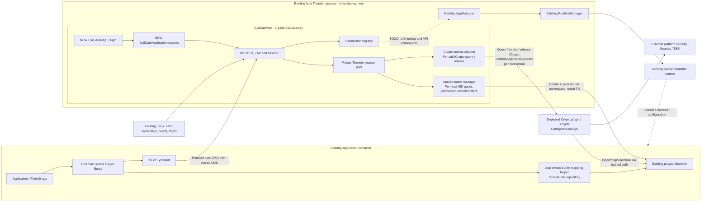

<!--
If not stated otherwise in this file or this component's LICENSE
file the following copyright and licenses apply:

Copyright 2026 RDK Management

Licensed under the Apache License, Version 2.0 (the "License");
you may not use this file except in compliance with the License.
You may obtain a copy of the License at

http://www.apache.org/licenses/LICENSE-2.0

Unless required by applicable law or agreed to in writing, software
distributed under the License is distributed on an "AS IS" BASIS,
WITHOUT WARRANTIES OR CONDITIONS OF ANY KIND, either express or implied.
See the License for the specific language governing permissions and
limitations under the License.
-->

# Eyil Secure Gateway architecture and implementation guide

## 1. Introduction

This specification defines the EyilClient and EyilGateway architecture: transport,
concurrent request coordination, connection contexts, request execution and
gateway-owned shared memory. It also records the integration boundaries and
unanswered questions that must not be replaced
by assumptions in code.

Eyil Secure Gateway is an open-source RDK component intended for the
`rdkcentral` ecosystem. The supported platform deployment uses the
**AppManager and RuntimeManager plugins**. Crypto is its first service; the
Gateway remains a general service router. The plugin is `EyilGateway`, its
callsign is `org.rdk.EyilGateway`, and its independent C client library is
`EyilClient`, installed as `libeyilclient.so`.

> **Integration scope:** ICrypto from entservices-apis branch `topic/crypto` is
> a required Gateway build/API dependency. The deployed Crypto plugin supplies
> the runtime implementation when configured; its presence is not required for
> Gateway activation or transport admission.
> Gateway queries its configurable callsign for
> each invocation and releases that interface reference immediately after use.
> AppManager/RuntimeManager API integration remains at the explicitly marked
> TODO boundaries.

The document specifies the design and its required behavior. Items marked
**Proposed** require review; **TODO** identifies an unresolved contract or
integration decision. Deployment diagrams distinguish platform components from
EyilGateway and EyilClient responsibilities. UML sequences define call flows,
ownership and failure handling. Unresolved policy, public API and format
choices are listed separately from agreed behavior.

The specification is split into a compact entry document and complete
implementation guides. Section numbers remain continuous across the files:

| File | Required reading |
| --- | --- |
| This document | Original ACs, platform placement, common protocol/error/logging contracts and gaps |
| [EyilClient.md](EyilClient.md) | Sections 5.1–5.15: full client design, every API sequence and error/race handling |
| [EyilGateway.md](EyilGateway.md) | Sections 6.1–6.17: full Gateway design, every runtime/shared-memory flow and verification targets |
| [BuildAndValidation.md](BuildAndValidation.md) | Section 6.18: repository layout, build, installation and CI validation |

For implementation, including Copilot-assisted work, load this document and
the relevant detailed guide; cross-component work requires both guides. The
supporting files are normative parts of the same specification, not optional
background. No sequence or failure-handling rule was replaced by a summary.

Navigation: [ACs](#2-acceptance-criteria-and-scope),
[platform architecture](#3-high-level-architecture-and-platform-placement),
[protocol](#4-apis-protobuf-and-zeromq),
[client flows](EyilClient.md#5-eyilclient-design-and-api-flows),
[Gateway flows](EyilGateway.md#6-eyilgateway-design-and-flows),
[gaps to answer](#7-gaps-to-answer).

## 2. Acceptance criteria and scope

Sections 2.1–2.3 reproduce the supplied acceptance criteria with their original
wording and labels, including both groups labelled **AC2**. WHEN conditions and
every THEN/AND clause are preserved. Row references are documentation-only
identifiers for UML traceability: AC1.1–AC1.12, AC2-Client.1–AC2-Client.5 and
AC2-Firebolt.1–AC2-Firebolt.2. They do not rename the original AC groups.

Implementation decisions and proposals are recorded separately in section 2.4
and the detailed architecture sections. They do not replace or amend the ACs.

### 2.1 AC1 - Eyil Gateway Plugin

WHEN the device runs thunder framework

| Reference | Original acceptance criterion |
| --- | --- |
| AC1.1 | THEN the Eyil Gateway SHALL run as the thunder plugin and listen for request from its client over ZMQ (over UDS) with ZMQ socket type ZMQ_ROUTER and bind on ipc:///tmp/app-eyil-gateway.ipc |
| AC1.2 | AND the Eyil Gateway SHALL also run the ZMQ Auth Protocol (ZAP) Handler with ZMQ socket type ZMQ_REP and SHALL use ZMQ_PLAIN_SERVER mode for authentication |
| AC1.3 | AND the Eyil Gateway SHALL also run the ZMQ monitor thread on inproc://app-eyil-gateway-monitor with socket type as ZMQ_PAIR |
| AC1.4 | AND the Eyil Gateway SHALL retrieve the UID of the connecting client using ZMQ's PEER CREDENTIAL mechanism (address frame) within the ZMQ Auth Protocol (ZAP) Handler for the purpose of authentication and authorisation (As part of this EPIC, no auth check is required. Assume all clients are authenticated and all APIs are authorised). |
| AC1.5 | AND the Eyil Gateway, upon successful authentication, SHALL assign a unique "User-ID" for the client within the ZAP Handler (One ID per connection). |
| AC1.6 | AND the Eyil Gateway SHALL retrieve the "User-Id" (from every request it receives in its main thread) and maintain a separate session for each "User-ID" |
| AC1.7 | AND ** the Eyil Gateway SHALL process each request in a separate thread AND processing of one request shall not block or delay the processing of other requests |
| AC1.8 | AND the Eyil Gateway SHALL parse the payload as per the attached "proto" definition and when the RPC service name is RPC_SERVICE_CRYPTO, then route the calls to underlying Crypto Plugin whose interface definition is available at https://github.com/rdkcentral/entservices-apis/pull/1089/changes |
| AC1.9 | AND the Eyil Gateway SHALL create and own the "shared memory" required for some of the crypto operations (encrypt, decrypt, sign and verify) as per the attached Gateway-Owned-Shared-Memory-Proposal.md |
| AC1.10 | AND the AllocateSharedBufferRequest and  ReleaseSharedBufferRequest defined in proto SHALL terminate at the Eyil Gateway itself and the gateway shall own the life cycle of the shared memory |
| AC1.11 | AND the Eyil Gateway SHALL create separate shared memory buffer for each of the connection so that there is no accidental overwrite by crypto gateway or multiple clients |
| AC1.12 | AND the Eyil Gateway SHALL release all resources (including the shared memory) maintained for a connection whenever it learns that a particular client is disconnected after informing the same with Crypto Plugin through its NotifyAppState API. |

### 2.2 AC2 - Eyil Client Lib

WHEN the device runs thunder framework and Eyil Gateway

| Reference | Original acceptance criterion |
| --- | --- |
| AC2-Client.1 | THEN Eyil Client Library SHALL provide convenience APIs for the Firebolt Crypto Client Library as defined in the attached EyilClient.h |
| AC2-Client.2 | AND the Eyil Client Library SHALL connect with the Eyil Gateway at ipc:///tmp/app-eyil-gateway.ipc using ZMQ (over UDS) with ZMQ socket type ZMQ_DEALER |
| AC2-Client.3 | AND the Eyil Client Library SHALL also use ZMQ Auth Protocol (ZAP), however SHALL pass dummy username and token (exists only for future potential use and also to provide a piggy bagging provision for the PEER CRED authentication over ZAP). |
| AC2-Client.4 | AND the Eyil Client Library SHALL also run the ZMQ monitor thread on `"inproc://app-eyil-client-monitor-<client specific unique-identifier>"` with socket type as ZMQ_PAIR |
| AC2-Client.5 | AND the Eyil Client Library SHALL provide both synchronous as well as asynchronous APIs for sending and receiving byte stream as well as "string" formatted request - response payload as defined in the google protobuf definitions attached, for the firebolt Crypto Client Library to route the requests coming from the Firebolt Apps. |

### 2.3 AC2 - Firebolt Crypto Client Library

WHEN Firebolt Apps and Eyil Gateway are running in the sytem

| Reference | Original acceptance criterion |
| --- | --- |
| AC2-Firebolt.1 | THEN the Firebolt CryptoClient Library SHALL make use of the EyilClient Library to route the calls from apps to underlying Eyil Gateway (which will subsequently route the calls to Crypto Plugin) |
| AC2-Firebolt.2 | AND Firebolt CryptoClient Library SHALL make use of the attached EyilClient.h for sending and receiving data from underlying Crypto operations and shall make use of the attached proto definitions for serialising / deserialzing the payload. |

### 2.4 Design decisions and interpretation

The following implementation decisions and proposals describe the design; they
are not additional acceptance criteria. The original separate-thread and
nonblocking wording remains in AC1.7. Private-pool scheduling, receive pauses,
worker-start deadlines, callback behavior, lifecycle ordering and protocol
handling are described against the unchanged ACs. The agreed client monitor
implementation runs PAIR collection and connection-state handling on the same
serving/I/O thread, as specified in section 5.2.

Each accepted request has an independent dispatch job on the fixed private
worker pool. Workers are reused across jobs; available workers, backend
capacity and resource dependencies determine execution concurrency.

Gateway activation/deactivation is required for Thunder plugin ownership.
Application hibernation uses the agreed idle-process contract and needs no
AppManager/RuntimeManager lifecycle subscription. Deactivation blocks new
admissions, settles already accepted requests under their dispatch deadlines
and drain rules, closes client
connections, stops ZeroMQ and joins owned threads before destruction.
Reactivation and startup after a crash create
fresh runtime state; old connections and requests are not restored. Section
6.16 defines the sequence.

Both string methods accept ordinary NUL-terminated text without a caller-supplied
length or encoding step. EyilClient owns input copying and wire serialization.
The byte methods retain explicit sizes for binary Protobuf. String calls use
service=RPC_SERVICE_UNSPECIFIED until a text service is defined; Gateway returns
RPC_STATUS_UNSUPPORTED_SERVICE and EyilClient exposes that received status as
NUL-terminated text. Section 5.8 defines the exact request and response. This is
an explicit delivery limitation against the original string-functionality AC,
not a change to its wording or a local CLIENT_NOT_IMPLEMENTED implementation.

Notification APIs are retained for future support. In this version,
client_register_notifications returns CLIENT_NOT_IMPLEMENTED and
client_unregister_notifications has no effect. No notification handler is stored
or invoked. Async responses and connection-state callbacks retain their separate
contracts.

EyilClient uses a **library-owned serving/I/O thread**, one per `Client`.
Applications do not supply an I/O handler or pump the library. The same thread
owns DEALER and the monitor PAIR, polls both, and performs the monitor duties
listed in section 5.2. This consolidated arrangement is agreed; no additional
client monitor thread is required. The original AC text above is preserved.

Initial client defaults are **15 seconds for connect**, **15 seconds per
synchronous request** and **15 seconds for async send submission**. Client
requests use one submission slot per Client. Competing callers wait for that
slot within their original deadline; there is no client submission queue or
queue-full result. The pending-response map grows dynamically with no fixed
request-count cap. Async responses have no deadline. These time limits do not
expire idle connections. An application may freeze
its process after finishing all operations and callbacks; it owns preparation
for that freeze. ZeroMQ heartbeats are disabled on both ends. See section 5.5
for socket settings and sections 5.14 and 6.14 for lifecycle assumptions.

Automatic reconnect and session restoration are outside this delivery.
Thunder crash or Gateway reload is a platform failure case for active apps,
not a normal transient-disconnection use case. Connection-loss cleanup and
explicit creation of a fresh Client are defined below; no automatic platform
recovery requirement remains open.

The agreed design makes connection loss terminal for that Client
connection: disable automatic reconnect, retire pending client work and discard
undelivered messages. After closing the old Client, any later explicit connect
creates fresh client and Gateway session state. No waiting/submitted request, response, buffer
ID or session key handle is transferred to the new connection. Section 5.14
defines cleanup and ownership.

Initial connection success or failure is reported only by the synchronous
client_connect return value. A later unexpected connection loss invokes
CLIENT_CONNECTION_LOST once through the registered handler, subject to the
explicit-close cutoff. Explicit disconnect emits no connection callback.
CLIENT_CONNECTION_RESTORED and CLIENT_CONNECTION_TERMINATED are not emitted by
this lifecycle. Section 5.5 defines the callback contract.

The ACs require socket monitoring and cleanup on disconnect. They do
not require application heartbeat RPCs, an inactivity watchdog or ZeroMQ
transport heartbeats. EyilClient and Gateway have transport heartbeats
disabled and contain no custom heartbeat or inactivity-watchdog logic.

Firebolt Crypto and the real Crypto plugin are separate deliverables. Their
presence in diagrams does not add their implementation to this repository.

### 2.5 Delivery boundary

| Part | Responsibility | Integration boundary |
| --- | --- | --- |
| Thunder wrapper | IPlugin, Root<IConfiguration>(), Configure(), final release and remote-connection notification | Final Release invokes the implementation destructor; drain and teardown finish before it returns |
| Implementation library | IConfiguration and runtime ownership | Transport, authentication seam, registry, private pool, CryptoServiceAdapter using ICrypto, router and buffers |
| EyilClient | Nine C APIs, connection handles, coordinator, I/O thread, pending requests and response ownership | Independent of Thunder and ICrypto; async behavior uses the public callback signatures, as specified in section 5.4 |
| Protocol | Generated rpc.proto and crypto.proto, schema constant 1 | EyilClient handles the RPC envelope; service consumers handle service payloads |
| ZeroMQ | Runtime sockets, monitors and peer credentials | Target libzmq must provide the required credential and monitor behavior |
| AppManager / RuntimeManager | Future identity and entitlement integration | TODO(AUTH-APPMANAGER); no calls or authentication dependency in the initial scope |
| ICrypto API | Required Gateway build/API dependency | Use entservices-apis topic/crypto headers and compatible COM-RPC bindings where required; CryptoServiceAdapter implements the calls against this interface |
| Crypto plugin | Required deployed backend for Crypto operations | Callsign selected through PLUGIN_EYILGATEWAY_CRYPTO_CALLSIGN; query/invoke/release ICrypto per call with the connection's ApplicationContext |
| Tests and CI | Build/install validation, L1/L2 and coverage | Validate the API, concurrency, transport and ownership flows in this document |

Keep authentication and Crypto integration behind separate adapters. The interim
identity provider accepts connections until AppManager lookup is integrated.
CryptoServiceAdapter calls the deployed Crypto plugin using trusted connection
metadata and checks both invocation and service results. Gateway-local buffer
allocation/release needs no ICrypto call.

Crypto operations depend on ICrypto, but Gateway startup and client admission
do not require an available backend. The production default backend callsign is
empty; development builds with the CLI select `org.rdk.CryptoTestBackend` when no callsign
was supplied (see [development tools](DevelopmentClient.md#development-cryptotestbackend)).
Unavailable Crypto is reported through backend RPC results. The application chooses its
connection lifetime; retaining one connection across operations and idle periods
for the app instance's lifetime is recommended. Gateway uses the corresponding
connection's ApplicationContext for notifications. The current design sends
a CONNECTED attempt during authentication, recording backend failure separately
from transport admission. A detected disconnect immediately starts that
connection's teardown, with DISCONNECTED after accepted work ends and before
final resource release. No reconnect grace period or last-connection wait
applies. Crypto owns its internal session, key and recovery implementation.

## 3. High-level architecture and platform placement

### 3.1 RDK deployment

The deployment is an RDK platform with AppManager and RuntimeManager. The initial
Gateway implementation shares Thunder's process, while an application and its
EyilClient instance run inside an application container. The wrapper/implementation
split preserves a path to a separate implementation process later.

AppManager and RuntimeManager remain part of the intended deployment while
their Gateway authentication integration is pending. Crypto is called through
the configured Thunder interface. Local PC builds and isolated development
tests validate the component; production deployment uses the RDK platform
components shown below.

The inner EyilGateway block groups components owned by the plugin. AppManager
and RuntimeManager remain separate plugins within the Thunder process. The
diagram distinguishes existing platform infrastructure from new Gateway
components and pending AppManager/RuntimeManager integration. Crypto may itself
be in process or remote;
Gateway must not depend on a raw pointer or FD being meaningful in Crypto's
process.

### 3.2 Components, ownership and trust boundaries

| Component | Owner / location | Responsibility |
| --- | --- | --- |
| Application / Firebolt Crypto | Application container; external consumer | Express operations, serialize Crypto payloads and consume results |
| EyilClient | New library in the application's process | Transport coordination, RPC correlation and C API buffer ownership |
| App-side mapping helper | Implemented by the application, outside this repository and the EyilClient transport API | Open/map the name returned by allocation; manage app mappings and release coordination |
| EyilGateway wrapper | New Thunder IPlugin | Framework lifecycle and implementation acquisition |
| EyilGatewayImplementation | New implementation library | Own Gateway transport, contexts, request pool, adapters and allocations |
| AppManager / RuntimeManager | Existing RDK platform plugins | Future authoritative identity/entitlements |
| Dobby / DobbyTool | Existing container runtime / diagnostic tool | Launch, container namespace/mount setup and test execution; no request routing |
| Linux kernel / libzmq | Existing platform dependencies | UDS transport and peer credentials; monitor support depends on the target libzmq |
| Crypto plugin / ICrypto | Deployed external Thunder backend | Crypto execution, per-application-session state, keys and key authorization |
| Sec API / secure hardware / TEE | External platform-specific implementation | Backend-dependent cryptographic operations; no Gateway dependency |

There is **one listening UDS endpoint**, shared by all intended applications.
Each accepted connection gets its own identity, request accounting and buffer
ownership. Separate connections do not require separate socket paths. Buffer
quota is shared across connections with the same trusted host UID; this does
not permit one connection to access another connection's allocations.

The app cannot authoritatively provide its UID, appId, sessionId or a host
shared-memory path. The transport supplies peer credentials; the Gateway creates
the connection context and resolves opaque buffer IDs. Key policy remains in
Crypto, including locators, usages, import/export restrictions and sharing.

### 3.3 Container mounts and direct access

The AC endpoint is `ipc:///tmp/app-eyil-gateway.ipc`. Thunder is trusted to run
one Gateway instance. The initial Gateway implementation explicitly applies
mode `0666` to its socket after binding. This lets applications with different
UIDs connect without a shared Gateway group; it also permits local host processes
that can reach the path. This is an explicit part of interim accept-all admission,
not app authorization. Container policy supplies the correct endpoint mount,
including exposure of the current socket after endpoint recreation. A product
that narrows socket permissions must also provide the required UID/GID or ACL
access for every intended app; changing to `0600` or `0660` alone breaks those
clients. These are selected deployment assumptions, described in section
7.4; endpoint ownership and server identity are not open Gateway design topics.

The AppManagers Legacy and RALF generators add the socket bind mount only when
the source exists and is a Unix socket. Otherwise the container starts without
Gateway access. If Gateway becomes available later, recreate the container with
a newly generated configuration to add the mount. See
[container mount setup](DevelopmentClient.md#container-mount).

Monitor and ZAP `inproc://` endpoints are local to a ZMQ context; they need no
filesystem socket or container mount.

Ordinary application containers must not acquire the Crypto interface directly
through Thunder's communicator. `ApplicationContext` is identity metadata; it
does not authenticate the COM-RPC caller. The platform direction is to restrict
general app access to Thunder. Deployment validation must verify the actual
communicator mounts and access policy for the deployed Crypto integration.

Gateway's private pool isolates its request scheduling from Thunder's global
worker queue. It does not isolate process crashes, total CPU/memory pressure or
a blocked in-process backend. Those limits matter while Gateway is in process.

### 3.4 External integration seams

| TODO | Integration point | Selected behavior / remaining decision |
| --- | --- | --- |
| TODO(AUTH-APPMANAGER) | AuthenticationProvider called by ZAP; future Gateway → AppManager → RuntimeManager lookup using trusted UID | Accept valid direct UDS peers, record UID/GID/PID, create appId `eyil-interim:<unique-token>` and a separate unique sessionId per connection; the prefix marks non-authoritative identity |
| TODO(API-AUTHORIZATION) | Admission check against entitlements cached in the connection context | Allow all structurally valid supported APIs; still enforce limits and buffer ownership |
| ICrypto lifecycle | Scoped NotifyAppState calls through CryptoServiceAdapter using the connection's ApplicationContext | Attempt CONNECTED during authentication; backend failure does not reject transport admission. Detected disconnect immediately starts per-connection teardown, with DISCONNECTED after safe drain for an initialized backend context as specified in section 6.14. No grace period or wait for app termination/the last connection; Crypto owns its session/key cleanup |

The interface names in this table describe internal seams. They are not
additional app-facing Thunder interfaces and do not claim that a formal
AppManager authentication API is already available. Future API additions should
be confined to these seams, rather than spreading external plugin types through
the client, transport or buffer registry.

## 4. APIs: Protobuf and ZeroMQ

### 4.1 The two Protobuf files

| File | Purpose | Boundary |
| --- | --- | --- |
| [rpc.proto](../apis/proto/rpc.proto) | Service-neutral RpcRequest/RpcResponse, request_id, service, schema_version and RpcStatus | EyilClient ↔ Gateway routing |
| [crypto.proto](../apis/proto/crypto.proto) | CryptoRequest/CryptoResponse, operations, key metadata, buffer allocation/release and offset/length regions | Crypto consumer ↔ Gateway Crypto adapter |

`RpcRequest.payload` carries service payload bytes. For CRYPTO these are a
serialized CryptoRequest; the unsupported string path carries text as described
below. `RpcResponse.payload` contains the service response when available and
is empty for Gateway routing errors. Crypto
defines an operation enum and a `oneof`; they must agree. A valid Protobuf parse
alone does not validate the operation, enum values, required message presence
or allowed lengths.

The RPC envelope fields are:

| Message | Fields |
| --- | --- |
| RpcRequest | request_id: uint64; service: RpcService; schema_version: uint32; payload: bytes |
| RpcResponse | request_id: uint64; service: RpcService; schema_version: uint32; status: RpcStatus; payload: bytes |

[ProtocolVersion.h](../apis/proto/ProtocolVersion.h) fixes the current envelope
schema to **1**. EyilClient sets it for each RPC. There is no version negotiation
or fallback protocol in the current schema. Library/package ABI versions and
Thunder plugin metadata versions are separate concepts.

Client and Gateway must use matching generated rpc.proto and crypto.proto
definitions for the agreed schema. C++ consumers such as Firebolt use the public
`EyilProtocol::EyilProtocol` shared library and its installed generated headers.
Do not compile a second copy of those bindings into the same process: both RPC
and Crypto descriptors must have one shared implementation. EyilClient remains
the transport API; the protocol library only supplies message types and codecs.
The original ACs require the schemas and EyilClient, not independent C++ code
generation by every consumer. See the [SDK contract](BuildAndValidation.md).

**Agreed envelope handling:** EyilClient
serializes/deserializes the outer RPC envelope, owns request IDs, sets
schema_version to 1 and correlates responses.

For the byte API, the caller supplies a serialized RpcRequest carrying
service and payload. EyilClient parses the envelope, assigns request_id, sets
schema_version and serializes it for transmission. On receipt, it parses and
validates RpcResponse, matches request_id to the pending call and returns the
serialized response to that caller. The service is carried in the envelope;
no separate service argument is needed. Crypto payload bytes remain opaque to
EyilClient and are interpreted by the service-specific consumer.

Request IDs are nonzero and unique throughout one Client connection generation,
including after a request is retired. Different connections may use the same
numeric ID. Gateway therefore identifies a request by its authenticated
connection generation together with request_id, never by request_id globally.

Both string request APIs accept ordinary NUL-terminated request text and return
ordinary NUL-terminated response text. EyilClient measures and copies input up
to the first NUL; the caller supplies no size or text encoding. Wire envelope
construction and serialization belong inside the library. The current string
path uses service=RPC_SERVICE_UNSPECIFIED (0) and carries raw text bytes in
payload. Gateway rejects that unrouted request with
RPC_STATUS_UNSUPPORTED_SERVICE; the client returns its symbolic status name as
text. No text is interpreted as CryptoRequest or sent to ICrypto. Section 5.8
defines this unsupported behavior and the complete string error representation.

### 4.2 Status and error layers

| Layer | Meaning and handling |
| --- | --- |
| ClientResult | Local C API validation, connection, allocation, timeout or communication result |
| RpcStatus | Gateway routing/execution result; explicitly inspect it even when a response was received |
| CryptoError | Crypto service result, carried inside CryptoResponse |
| Core::hresult | Whether the ICrypto invocation itself succeeded; check before reading output parameters |

`CLIENT_OK` on an asynchronous submission means zmq_send accepted the message
into libzmq's queue; it does not confirm physical UDS delivery or remote success.
`RPC_STATUS_OK` means the Gateway successfully produced the
service response; `CryptoResponse.error` can still report a failed crypto
operation. Protobuf's zero default `RPC_STATUS_UNSPECIFIED` is not success.

#### Agreed local error behavior

The following client behavior is agreed. It applies independently of AppManager authentication and the outcome of
a Crypto invocation.
Apply ClientResult through the connect, synchronous request or async submission
return value. Async response callbacks carry response data only; they do not
carry local ClientResult errors.

| Situation | ClientResult | Response handling |
| --- | --- | --- |
| Invalid arguments, lengths that the actual API cannot safely represent or invalid caller-supplied binary request envelope | CLIENT_INVALID_ARGUMENT | No response |
| client_register_notifications is called | CLIENT_NOT_IMPLEMENTED | Reserved for future support; no handler is stored or invoked |
| client_connect receives a valid, already allocated Client handle in the caller's slot | CLIENT_ALREADY_CONNECTED | Preserve the existing handle and connection state; create no new connection and invoke no callback |
| Submission without a usable connection | CLIENT_NOT_CONNECTED | No response |
| Explicit client_disconnect wins while a synchronous result or an unaccepted async send is pending | CLIENT_NOT_CONNECTED | Clear synchronous outputs, cancel unsent work and retire pending IDs; no async response callback |
| Authentication explicitly rejected | CLIENT_AUTH_FAILED | No response |
| Detected allocation failure during connect, sync processing or async submission before libzmq acceptance, including request preparation and pending-map insertion | CLIENT_OUT_OF_MEMORY | Roll back local state; sync outputs remain NULL/0 and async submission invokes no response callback |
| Connect, synchronous request or async send-submission deadline expires | CLIENT_TIMEOUT | No handle on connect failure; no synchronous response on timeout; async send failure invokes no response callback. A synchronous timeout may leave remote execution in progress |
| Connection lost during a synchronous request or before async send acceptance, malformed synchronous response or terminal send failure | CLIENT_COMMUNICATION_ERROR | No response |
| Valid correlated synchronous RPC response delivered, or async message accepted by zmq_send | CLIENT_OK | Sync returns the response; async returns without waiting for one. The caller checks RpcStatus and service status when a response is delivered |

These mappings apply when that terminal path wins. An admitted nonblocking send
must finish before its acceptance is known: timeout or close during the attempt
cannot turn an accepted async send into a failed submission. A synchronous
call can still time out or close while awaiting its response. Section 5.2
defines result arbitration and preserves the first terminal runtime reason.

For synchronous byte responses, every local error produces `response_data == NULL` and
`response_size == 0`. For string responses, it produces `response_data == NULL`.
A valid Gateway error response, including RPC_STATUS_INTERNAL, is still a
received RPC response: byte APIs return CLIENT_OK with its bytes and preserve
RpcStatus.
Do not turn a local failure into a fabricated Gateway RpcResponse or CryptoError.

Byte APIs expose the complete RpcResponse for inspection. String APIs expose
the symbolic name of its validated non-OK RpcStatus, normally the exact text
"RPC_STATUS_UNSUPPORTED_SERVICE". Sync returns CLIENT_OK with that owned string;
async delivers it through the existing response callback after a successful
send. The text is a remote rejection, not successful text-service execution.
Local errors still use ClientResult and do not fabricate a response. Unexpected
OK, unknown status or nonempty payload on this unsupported string path is a
response-validation failure as specified in section 5.8.

Connect, synchronous request and async send-submission timeouts are **15,000 ms**
in the initial version, using one common internal duration constant. Async
responses have no timeout. No new public timeout-configuration
API is required for this version. An authentication error requires an explicit
rejection; an unavailable endpoint or lost connection is not evidence of denied
access.
Temporary socket backpressure is handled within the active send deadline and
is not automatically a terminal communication failure. Client callers wait for
the one submission slot within their original deadline. There is no submission
container or queue-full result. Allocation failure in owned request state or
the dynamic pending-response map uses CLIENT_OUT_OF_MEMORY. A busy slot alone
is not an allocation failure; expiry while waiting uses CLIENT_TIMEOUT.
Gateway retains one current admitted request and has no request waiting queue.
If no private worker can start it, pause further ROUTER receives while continuing
replies/control processing. A ten-second worker-start timeout logs ERROR
worker_pool_exhausted and returns RPC_STATUS_INTERNAL with empty payload when
deliverable; the expired request must never execute later. Request/job/response
allocation failure uses the same RPC status with its own diagnostic reason.
Shared-buffer allocation and validation failures use the CryptoError mapping
below. Neither remote failure becomes a local CLIENT_OUT_OF_MEMORY result
in EyilClient.

An async submission that returns an error must not invoke its response callback.
After CLIENT_OK, deliver a valid correlated response at most once. There is no
async response timeout and no synthetic error callback. A connection failure
retires outstanding async records through the connection-state path; a matched
response that fails local validation/allocation is retired with diagnostics and
no callback. Therefore a callback is not guaranteed after every successful send.
Section 5.4 defines this response-only contract.

A timeout or connection loss does not prove remote cancellation. Do not replay
the operation automatically or claim that its shared buffer is safe to reuse.

| RpcStatus | Intended use |
| --- | --- |
| UNSPECIFIED (0) | Missing/unset result; reject as an invalid response |
| OK (1) | Successfully routed and processed at the Gateway layer |
| INVALID_REQUEST (2) | Parsed outer RPC envelope violates the agreed structure; service-message failures and parsed buffer outcomes follow their separate mappings below |
| UNSUPPORTED_SCHEMA (3) | Unsupported envelope schema_version |
| UNSUPPORTED_SERVICE (4) | No registered service, including service=UNSPECIFIED used by the unsupported string path; log ERROR and return empty payload |
| MALFORMED_REQUEST (5) | Cannot decode the outer RPC envelope or its framing; service-payload decoding failures use INTERNAL as specified below |
| INVALID_CONNECTION (6) | Missing, stale or inadmissible authenticated connection context |
| INTERNAL (7) | Gateway infrastructure or service-message decoding failure: ten-second current-request worker-start timeout, request/job/response allocation failure, null ICrypto lookup or failed invocation when a correlated reply is possible. Shared-buffer service outcomes use the CryptoError table below |

#### Gateway faults, buffer service outcomes and explicit error logging

Preserve the two remote error layers. RPC_STATUS_INTERNAL with an empty service
payload reports a Gateway infrastructure/decoding failure. A structurally valid
Crypto operation that produces a buffer/service error returns RPC_STATUS_OK
with a serialized CryptoResponse carrying the appropriate CryptoError. This
also applies to AllocateSharedBuffer and ReleaseSharedBuffer, which execute in
Gateway without ICrypto. Use the existing schema; no new error enum is required.

| Gateway failure | RPC result when safely correlatable | Required log detail |
| --- | --- | --- |
| Duplicate ID still owned by an accepted request on the same connection generation | No second response; log and discard the duplicate | Duplicate ID and original request state; preserve the original completion |
| Undecodable service message or operation/oneof mismatch | RPC_STATUS_INTERNAL, empty payload | Exact parse/structure failure; no service execution |
| Current request cannot start on a private worker within 10 seconds | RPC_STATUS_INTERNAL, empty payload | ERROR worker_pool_exhausted; configured/running/reserved workers, elapsed wait, request ID/service and connection generation; never execute it later |
| Request/job/response infrastructure allocation failure | RPC_STATUS_INTERNAL, empty payload | Failing allocation/preparation stage and result, distinct from worker saturation; preserve cleanup ownership |
| Null ICrypto lookup or failed Core::hresult invocation | RPC_STATUS_INTERNAL, empty payload | Configured callsign, operation and lookup/invocation result; do not consume undefined outputs |
| Invalid output region returned as a successful backend result | RPC_STATUS_INTERNAL, empty payload | Returned bounds and recorded capacity; expose no unusable output |

The following buffer/service outcomes follow the shared-memory proposal's
error model. Every row returns **RPC_STATUS_OK plus CryptoResponse.error**,
not an empty RPC error payload:

| Condition | CryptoError | Required handling/log detail |
| --- | --- | --- |
| Zero allocation size | CRYPTO_ERROR_INVALID_PARAMETERS | Log the invalid size; create no object |
| Requested allocation exceeds the per-buffer maximum | CRYPTO_ERROR_OVERSIZED_INPUT_DATA | Log requested size and maximum; create no object |
| Allocation, object creation/sizing/preallocation or shared host-UID quota failure | CRYPTO_ERROR_OPERATION_FAILED | Log stage/errno or host UID, connection, charged count/bytes and limit, including fallocate failure; roll back partial allocation and retain any unresolved cleanup record and quota charge |
| Missing, released or wrong-session buffer ID | CRYPTO_ERROR_INVALID_SESSION_STATE | Log failed lookup/ownership/state; do not call Crypto |
| Invalid caller-supplied input region: missing, out of bounds or overlapping another input | CRYPTO_ERROR_INVALID_PARAMETERS | Log the failed presence, bounds or overlap check; do not expose or access that region |
| Input exceeds the operation's maximum | CRYPTO_ERROR_OVERSIZED_INPUT_DATA | Log input length and operation limit |
| Crypto-selected output does not fit | CRYPTO_ERROR_BUFFER_OVERFLOW | Preserve the required output region when known; it is not readable output |
| Completed generic Crypto service failure | CRYPTO_ERROR_OPERATION_FAILED | Preserve this result when returned by Crypto; retain any more specific returned CryptoError unchanged |
| Competing use of a busy buffer, or new use after releasePending | CRYPTO_ERROR_INVALID_SESSION_STATE | Log active/release state; no wait, new lease or Crypto call |
| Repeated release after a release was already accepted | CRYPTO_ERROR_INVALID_SESSION_STATE | Preserve the existing release/active use; do not create another finalizer |

The proposal does not assign separate values for busy or repeated-release
cases. This spec uses the existing invalid-session-state value for those
unavailable buffer states; no new busy enum is added. A **first
valid release succeeds even while the buffer is in use**. It sets releasePending
and defers physical destruction as specified in section 6.13.

For a service result, select the response oneof matching the recognized
operation. On an allocation error, return no usable buffer ID/name/capacity;
on another error, operation outputs are not usable except the required-capacity
region explicitly allowed for BUFFER_OVERFLOW. Invalid transport context still
uses RPC_STATUS_INVALID_CONNECTION; it is distinct from a buffer ownership/state
failure inside an otherwise valid connection. A service error is a delivered
RPC response: EyilClient returns CLIENT_OK or invokes the response callback,
and Firebolt inspects both RpcStatus and CryptoError.

The Gateway logs each specific failure at **ERROR** where it is detected,
independently of whether its response can be sent. Include connection
token/generation, request_id, service/operation and opaque buffer ID when known;
record a bounded reason such as invalid_service_payload, buffer_quota_exceeded,
buffer_unavailable or buffer_busy. Section 4.5 defines suppression and content
restrictions. Do not log payloads, key material or shared-memory contents.

Rejected buffer work must not invoke Crypto, overwrite another request's state
or invalidate active leases. Roll back partial reservations. If constructing
a service-error response itself fails, report RPC_STATUS_INTERNAL only if a
correlated fallback can be prepared before any send attempt; otherwise log/drop.
Neither fallback nor response loss undoes side effects or releases active memory.

Only send an error when the request ID and original authenticated route permit
unambiguous correlation. A duplicate ID still owned by an accepted request must
not produce a second competing response under that ID: log and discard the
duplicate, leave the original job/completion intact and never dispatch a second
operation. Scope this check to the authenticated connection generation; request
1 on another connection is independent. This is not a replay/deduplication
guarantee for completed operations. Likewise, log and discard malformed input
without a trustworthy ID or route. Neither error layer permits inventing a
request ID or replying to a replacement connection.

Error replies follow the same single nonblocking send-attempt rule as successful
responses. Log any delivery failure separately and drop the reply without a
retry. An error result does not acknowledge buffer release or prove that an
earlier operation finished. Sections 6.10–6.13 define execution-time buffer
checks, rejection of competing uses and deferred destruction after an accepted
release. Gateway does not preserve not-yet-started buffer uses through a release
or replay rejected work.

An accepted release returns RPC_STATUS_OK with CRYPTO_ERROR_NONE and the empty
ReleaseSharedBufferResponse. This acknowledges that the ID is closed to further
use and Gateway owns cleanup; it does not certify physical destruction or backend
completion. Cleanup errors after acceptance are logged at ERROR, retain private
cleanup state and quota, and do not change that release result or generate a
second response. Response-allocation or delivery failure after acceptance does
not undo the release. The full failure and ownership rules are in section 6.13.

### 4.3 Protocol capabilities and limitations

| Capability | Implementation consequence |
| --- | --- |
| Independent request_id | Many requests may be outstanding; match responses by ID, not arrival order |
| Explicit service enum | A new service needs a schema/adapter addition; only CRYPTO is currently defined |
| Opaque service payload | Transport does not implement Crypto key policy |
| Buffer ID plus regions | Four bulk-data operations avoid embedding their input/output in the RPC message |
| Empty ReleaseSharedBufferResponse | Successful response acknowledges accepted release; destruction may wait for active access to end, with no later completion notification |
| uint32 buffer fields | Validate size/ranges with overflow-safe arithmetic and stricter configured quotas |
| No app identity fields | Derive context from trusted transport metadata |
| No deadline/cancel message | A local timeout cannot cancel backend work or prove buffer reuse is safe |
| No notification envelope | Notification support is reserved for the future; registration returns CLIENT_NOT_IMPLEMENTED and creates no subscription |
| No retry/deduplication contract | Do not replay key generation, import or other operations automatically |
| NUL-terminated string API boundary | Copy input without caller encoding; send an unrouted service=0 envelope and expose Gateway UNSUPPORTED_SERVICE as status text; successful text-service execution is deferred |
| No lifecycle/heartbeat messages | Do not invent idle expiry, hibernation commands or heartbeat services |

The protocol permits concurrent requests; it does not define ordering for
operations sharing a key, buffer or session. Request-ID correlation also does
not provide exactly-once execution or distinguish a lost reply from an operation
that never ran.

### 4.4 ZeroMQ endpoints and message framing

| Endpoint | Socket / owner | Purpose |
| --- | --- | --- |
| `ipc:///tmp/app-eyil-gateway.ipc` | Gateway ROUTER binds; each client DEALER connects | Application RPC over filesystem UDS |
| `inproc://zeromq.zap.01` | Gateway ZAP REP binds | Internal authentication exchange |
| `inproc://app-eyil-gateway-monitor` | ROUTER monitor publishes; Gateway PAIR receives | Gateway transport events |
| `inproc://app-eyil-client-monitor-<unique-client-id>` | DEALER monitor publishes; client PAIR receives | Client transport events |

DEALER sends one frame containing the serialized RpcRequest.
ROUTER receives `[routing_id][RpcRequest bytes]` and replies with
`[routing_id][RpcResponse bytes]`; DEALER receives the response body only.
There is no empty REQ delimiter.
Validate the frame count and consume/reject an entire malformed multipart
message before accepting another. The required frame count is explicit; no
additional message-byte cap applies. Retain representation and arithmetic checks.

String API input does not change this framing: EyilClient constructs the binary
RpcRequest internally and sends it with its serialized length. Gateway still
receives a binary envelope. The local C-string terminator is not a transport
frame delimiter and is not included in a directly carried text payload.

The ROUTER I/O owner copies `zmq_msg_gets(message, "User-Id")` before closing
the received message. The routing frame is a delivery address, not authenticated
identity. ZAP's User-Id is a different identifier.

Each DEALER and ROUTER has one socket-owning thread. Client API callers hand
work to their owner through one synchronized submission slot and a wakeup.
Gateway workers hand owned results to ROUTER through its completion handoff.
Neither application callers nor Gateway workers send or receive on the owner's
socket. This follows the restrictions for these socket types in the
[ZeroMQ socket API](https://libzmq.readthedocs.io/en/latest/zmq_socket.html).
Socket options, connection, monitoring and closure follow the same ownership.

PLAIN server mode belongs on the ROUTER. The REP handler answers ZAP exchanges;
EyilClient supplies dummy PLAIN strings and never runs a ZAP server. The trusted
UID/GID/PID representation depends on the target libzmq implementation, rather
than the client password. See the
[ZAP specification](https://rfc.zeromq.org/spec/27/).

### 4.5 Diagnostics and logging

The initial implementation emphasizes actionable warning/error diagnostics.
Use the platform's existing logging facilities and a consistent reason code;
no new metrics service, app API or mandatory request-tracing system is required.

Connection teardown emits `WARNING reason=cleanup_wait` once per connection and
waiting cause: authentication, accepted work, unresolved buffer access, worker
capacity or failed final cleanup. Include connection/UID, active-request count,
worker running/reserved counts and whether Gateway is stopping. Repeated I/O
wakeups do not repeat the same warning. Existing category suppression still
limits bursts across connections. This is event-driven diagnostics; it adds no
periodic poll, cleanup replay or permission to free an unresolved lease.

| Severity | Events and required context |
| --- | --- |
| ERROR | worker_pool_exhausted after the ten-second worker-start wait, with total/running/reserved counts and request identity; Gateway faults and buffer/service failures from section 4.2; startup/configuration or required-libzmq-capability failure; ICrypto lookup/invocation failure; response allocation/send failure; shared-memory creation or deferred-cleanup failure. Record the failing stage and result/errno when available. |
| WARNING | First transition of a request into waiting for worker capacity; client deadline expiry, unexpected connection loss, an accepted async record retired without a deliverable response, and unresolved backend-access/cleanup obligations. Include the reason and number of affected records; normal idle connections and prepared process freeze are not warnings. |
| INFO | One activation/readiness summary with relevant configured limits and libzmq version/capability-check outcome; one orderly stop/drain summary. Routine successful requests, buffer operations and explicit client disconnects need no per-operation INFO log. |
| DEBUG / TRACE | Optional, disabled-by-default investigation of sequencing or individual successful operations. Never enable full request-flow tracing by default to compensate for missing error context. |

Include the component, activation/connection generation, request_id, service,
operation and opaque buffer ID only when known and relevant. Use bounded,
sanitized fields. Never log payloads, strings supplied by applications, key
material, authentication tokens or shared-memory contents. Logging a rejection
does not imply its error response was delivered; log a failed delivery as a
separate outcome under the same correlation identifiers.

Keep the ERROR classification required by section 4.2. Rate-limit diagnostics
within each fixed category and severity to one emitted event per five-second
window, reporting suppressed-event counts at that same severity. WARNING must
not suppress ERROR. Stop-time summaries retain the last suppressed connection
and request identifiers; aggregate counts can cover multiple requests.
Synchronous adapter calls inherit a bounded thread-local correlation scope;
deferred buffer cleanup retains its own context, including the explicit release
request when one exists. Buffer IDs are truncated to 64 characters and sanitized;
payloads and credentials are never included. Small counters may summarize
rejections, timeouts, dropped replies, outstanding async records and deferred
cleanup at shutdown or on a diagnostic request. Do not add periodic polling,
per-request INFO traces or a new externally exposed metrics contract.

Diagnostics must not hold registry/dispatcher/completion locks, block a socket
owner or require another allocation to finish an error/cleanup path. Failure to log cannot
change a ClientResult/RpcStatus, cancel backend access or lose cleanup ownership.

## 5. EyilClient design and API flows

The complete implementation contract is in [EyilClient.md](EyilClient.md).
It retains sections 5.1–5.15, all API sequences, internal flow points, ownership
and race/error handling. Read it with the common protocol and diagnostics in
section 4 and the outstanding decisions in section 7.

| Detailed guide | Content |
| --- | --- |
| Sections 5.1–5.3 | Responsibilities, component/API-call diagram, one submission slot, I/O ownership and concurrent request routing |
| Section 5.4 | API index, allocation failures, async send acceptance, supplied callback signatures, ownership and reentrancy |
| Sections 5.5–5.13 | All nine C APIs with full UML and terminal-result handling |
| Sections 5.14–5.15 | Deadlines, explicit fresh reconnect, callbacks, freezing, unloading and call hierarchy |

The main document is an entry point, not a substitute for those implementation
details. There is no client request queue; one I/O owner services submissions,
responses and monitor events, with multiple pending responses tracked by ID.

## 6. EyilGateway design and flows

The complete runtime contract is in [EyilGateway.md](EyilGateway.md), sections
6.1–6.17. [BuildAndValidation.md](BuildAndValidation.md) contains section 6.18.
All detailed UML, resource/lifetime rules, platform-patch rationale and
verification scenarios remain part of the specification.

| Detailed guide | Content |
| --- | --- |
| Sections 6.1–6.3 | Component/API-call diagram, socket owners, private pool, current-request receive pause, resource policy and synchronization |
| Sections 6.4–6.9 | Activation, ZAP, request dispatch, ICrypto ownership/configuration and service operations |
| Sections 6.10–6.13 | Shared-memory identity, allocation, four Crypto flows, conflicting uses, accepted release and deferred destruction |
| Sections 6.14–6.16 | Disconnect binding, required libzmq extension, capability checks, freeze, backend failures and plugin teardown/reactivation |
| Sections 6.17–6.18 | Implementation sequence, complete L1/L2 acceptance targets, repository layout, build/install and CI commands |

## 7. Gaps to answer

The application trust model is selected: authenticated apps cooperate with the
shared-buffer rules and request release when an allocation is no longer needed,
including after errors. Gateway automatically owns cleanup after a correlated
unexpected disconnect or app crash; no release RPC is required from a dead app.
Execution-time rejection of competing uses, accepted release with deferred
destruction, quota retention and disconnect/drain ordering are specified in
sections 6.10–6.14. They are not open design questions.

FD/lifetime binding, graceful plugin stop/reactivation, fresh startup after a
crash, authentication-time CONNECTED and owned response handoff with one send
attempt are also selected. Crypto owns safe access, validation and its internal
session/key/recovery implementation. Gateway forwards returned errors.

Section 7.1 describes a backend-completion edge case and a potential backend
contract. Section 7.2 lists remaining API/product choices. Section 7.3 separates
integration and verification from unresolved design decisions. Section 7.4
records settled deployment and scope assumptions.

### 7.1 Abnormal backend completion: lifecycle integration boundary

**Normal case:** the client times out after 15 seconds, but Crypto completes at
20 seconds. Gateway observes that completion and can finish an accepted deferred
release under the normal cleanup rules. A completed invocation returning a
defined CryptoError also ends that operation's buffer access.

**Potential backend/integration requirement — to confirm:** when an ICrypto
call returns to Gateway, no backend work from that invocation may continue
accessing its shared buffer. This guarantee should cover successful returns,
service errors and invocation failures. A client-side timeout is not a return
from Gateway's ICrypto call.

**Edge case to verify:** COM-RPC may return a communication error while the
remote Crypto operation is still running. Confirm that the backend and COM-RPC
integration can uphold the proposed guarantee. If they cannot, reliable evidence
that access ended is required before cleanup. Until then, Gateway retains the
buffer references, quota and pending cleanup; disconnect or a failed
DISCONNECTED notification alone is not completion evidence. Deferral protects
the buffer but does not prove that Crypto finished.

This is a backend/platform lifecycle requirement to confirm, not a new AC or
EyilClient API. The existing deferred-release and notification ordering remain
defined in sections 6.13–6.16.
**TODO:** SHM-COMPLETION.

### 7.2 Remaining API and platform decisions

These items complement the abnormal-completion boundary. The deployment,
hibernation, reconnect scope, client monitor and application buffer-helper
responsibilities in section 7.4 are settled and are not remaining gaps.

| TODO | Answer needed / integration boundary |
| --- | --- |
| AUTH-APPMANAGER | Formal UID lookup via AppManager/RuntimeManager, authoritative app/app-instance identity, UID reuse guarantees and lookup failure behavior; no independent static UID-to-appId map. Interim appIds use reserved `eyil-interim:` prefix; agree Crypto's handling of that marker for identity-dependent key policy |
| MULTI-CONNECTION-POLICY | Architects expect one connection per app instance; confirmation is pending on allowing additional connections with unique User-Ids or rejecting a second connection. If allowed, define the corresponding ICrypto ApplicationContext mapping so closing one connection cannot release another's active resources. Section 6.5 preserves independent interim contexts until that decision; shared host-UID quota is separate |
| AUTHENTICATION-PROGRESS | Define a bound on waiting for authentication-time CONNECTED and lifecycle-worker capacity if needed. Platform startup ordering is selected; it does not bound an ICrypto call. A client timeout cannot cancel a running call, and any abandoned exchange must retain cleanup ownership for a late result |
| API-AUTHORIZATION | Exact entitlement format and mapping from service/operation to allowed APIs; currently all supported APIs are allowed |
| FUTURE-TEXT-SERVICE | Successful execution of text commands needs a separately defined service route and request/response semantics. Current behavior is settled: service=0 is rejected by Gateway with UNSUPPORTED_SERVICE and exposed as status text; this future feature does not block the selected rejection path |

### 7.3 Integration and validation work

These items implement or verify selected contracts. They are not additional
unresolved Gateway architecture gaps.

| Work item | Required integration / evidence |
| --- | --- |
| ZMQ-PLATFORM | Integrate the included [libzmq 4.3.4 patch](zmq_connection_lifetime.patch) into the product build and Gateway consumers; enable draft APIs, probe option 10001 and run the bounded private-IPC behavioral self-test before production bind/admission, validate ZAP/request metadata and version-2 FD/lifetime events, and guard ROUTER sends. Monitor version 2 alone does not identify the patch. Test the exact rootfs binary and activation failure with an incompatible library; section 6.14 defines the contract |
| DEPLOYMENT | Use the trusted single-instance Thunder lifecycle and container endpoint policy in section 7.4. Verify procfs/user-namespace access, private /dev/shm and blocked direct Crypto communicator access. Leftover storage after a crash belongs to platform recovery; Gateway starts fresh and does not reconstruct or blindly unlink old allocations |
| Resource policy | Apply the [initial resource policy in section 6.2](EyilGateway.md#initial-resource-policy): four private workers, default stacks, default libzmq HWM and kernel buffers; no additional message/text or response-count/byte caps. Shared memory allows 1.5 MiB (1,572,864 bytes) per buffer and four allocations per trusted host UID across all its connections, including child apps sharing that UID; at most 6 MiB combined, with no global cap. Quota remains charged through deferred cleanup and reconnect. No Gateway request queue exists; the current request pauses further receives while waiting up to ten seconds for a worker. Validate memory/representation behavior without inventing extra admission limits |
| Private Thunder pool | Validate nonblocking transfer to reserved execution capacity, worker-start acknowledgement, wakeups and drain against Thunder; four private workers, no application backlog in the pool. While the current RPC waits, pause only new receives; after ten seconds return INTERNAL and log worker_pool_exhausted, with no later execution |
| SDK and runtime dependencies | Supply the selected topic/crypto ICrypto headers/bindings and matching Thunder interfaces. Configure the Crypto entry in the backend list when deployed. Gateway also starts and accepts clients with an empty/default or unavailable backend; backend RPCs report errors. When Crypto is included, platform/Thunder coordination should retain it through Gateway drain. Validate per-call references, authentication-time CONNECTED attempts and ordered DISCONNECTED without a Crypto health observer |
| Diagnostics | Verify section 4.5: actionable ERROR/WARNING context, bounded startup/stop INFO summaries, suppression counts for repeated errors, no sensitive content and no default full request-flow tracing |
| Runtime acceptance | Exercise the L1/L2 scenarios in section 6.17 on the intended dependency set and device, including concurrent requests, response drops, stop/reactivation and prepared process freeze |

### 7.4 Settled deployment and scope assumptions

Thunder is trusted to run one EyilGateway instance. Container policy mounts
the correct Gateway endpoint with the required permissions and maintains that
mapping across endpoint recreation. Gateway uses the standard libzmq bind/close
path at `ipc:///tmp/app-eyil-gateway.ipc`; startup/bind failures are logged and
rolled back. A separate native listener, endpoint ownership protocol and client
server-identity verification are outside the selected scope. The original AC
endpoint is unchanged.

Hibernation preserves the application process, socket descriptors and connection.
The application first stops submissions and finishes all operations and
callbacks, with no uncertain remote work. With transport heartbeats disabled,
the idle connection and its resources remain available after thaw. No lifecycle
subscription, checkpoint/restore protocol or reconnect is needed for this case.
Sections 5.14 and 6.14 define the preparation and runtime behavior.

Thunder crash or Gateway reload is an exceptional platform failure for active
apps. Automatic reconnect and restoration of the previous session are outside
scope. Actual connection loss still performs the defined cleanup; any later
explicit client_connect creates fresh state. These error cases do not create
an open automatic-recovery requirement.

The client monitor is handled by the existing serving/I/O thread: it owns and
polls the PAIR socket alongside DEALER and the submission wakeup. This arrangement
is agreed; the original AC wording remains unchanged.

For shared-memory quota, the application group is identified by its trusted
host UID from ZAP. All its connections, processes and child apps sharing that
UID consume one four-buffer allowance. Connection ownership and per-connection
Crypto identities remain independent; quota accounting needs no appId lookup.
Section 6.10 defines reservation and cleanup of the shared quota record.

The application implements its own shared-buffer mapping helper, including
shm_open/mmap, local unmap/close, response checks and release coordination.
That helper is outside this repository. Gateway allocation ownership and
release/disconnect cleanup remain as specified in sections 6.10–6.14.

**Integration boundary:** Gateway has a required dependency on the topic/crypto
ICrypto API and uses the deployed Crypto plugin through the CMake-configured
callsign. Each invocation owns and releases its own interface reference;
no global Crypto session or Crypto
health monitor is introduced. AppManager/RuntimeManager authentication and
API authorization remain at the marked TODO seams. The app-owned
idle process-freeze preparation, 15-second connect/sync-request/async-send
deadlines, no async response
timeout and a single client submission slot with allocation-failure reporting are selected.
ZeroMQ transport heartbeats are disabled on both ends; application heartbeat and inactivity-watchdog
logic are excluded. Connection loss retires old pending work and transport queues;
automatic reconnect is disabled and explicit reconnect creates fresh state.
Hibernation follows the idle-process contract above. Platform failure recovery
and application buffer helpers are outside this delivery.
