<!--
If not stated otherwise in this file or this component's LICENSE
file the following copyright and licenses apply:

Copyright 2026 RDK Management

Licensed under the Apache License, Version 2.0 (the "License");
you may not use this file except in compliance with the License.
You may obtain a copy of the License at

http://www.apache.org/licenses/LICENSE-2.0

Unless required by applicable law or agreed to in writing, software
distributed under the License is distributed on an "AS IS" BASIS,
WITHOUT WARRANTIES OR CONDITIONS OF ANY KIND, either express or implied.
See the License for the specific language governing permissions and
limitations under the License.
-->

# Eyil Secure Gateway architecture and implementation guide

## 1. Introduction

This document defines the EyilClient and EyilGateway architecture: transport,
concurrent request coordination, connection contexts, request execution and
gateway-owned shared memory. It also records
the integration boundaries and unanswered questions that must not be replaced
by assumptions in code.

Eyil Secure Gateway is an open-source RDK component intended for the
`rdkcentral` ecosystem. The supported platform deployment uses the
**AppManager and RuntimeManager plugins**. Crypto is its first service; the
Gateway remains a general service router. The plugin is `EyilGateway`, its
callsign is `org.rdk.EyilGateway`, and its independent C client library is
`EyilClient`, installed as `libeyilclient.so`.

> **Integration scope:** AppManager/RuntimeManager APIs and the Crypto backend
> through ICrypto are not used at this time. Their future integration points
> are explicitly marked with TODO identifiers below.

Use the following distinction throughout the document:

| Label | Meaning |
| --- | --- |
| Existing | Present in this repository or supplied by the platform, as identified |
| Target | Agreed behavior to implement, including the acceptance criteria |
| Proposed | Recommended implementation detail requiring review where indicated |
| TODO | An unresolved contract or future integration |

Sequence diagrams describe the **target or proposed implementation**, unless
explicitly identified as existing. Internal component and method names in
diagrams are design names, not claims that those classes already exist.
Public `client_*` functions, Protobuf messages and Thunder bootstrap methods
refer to actual API names.

UML sequences show the intended execution flow. Unresolved policy, public API
or format choices are listed separately from agreed behavior.

Navigation: [ACs](#2-acceptance-criteria-and-scope),
[platform architecture](#3-high-level-architecture-and-platform-placement),
[protocol](#4-apis-protobuf-and-zeromq),
[client flows](#5-eyilclient-design-and-api-flows),
[Gateway flows](#6-eyilgateway-design-and-flows),
[gaps to answer](#7-gaps-to-answer).

## 2. Acceptance criteria and scope

The IDs below make the supplied ACs traceable to individual flows and define
the required feature behavior.
The duplicated original "AC2" for Firebolt Crypto is numbered **AC3** here.

### 2.1 AC1: EyilGateway plugin

| ID | Target acceptance criterion |
| --- | --- |
| AC1.1 | Run as the Thunder plugin `EyilGateway`, callsign `org.rdk.EyilGateway`. Initially run the implementation in process. |
| AC1.2 | Bind a `ZMQ_ROUTER` to `ipc:///tmp/app-eyil-gateway.ipc` and accept multiple application connections. |
| AC1.3 | Enable `ZMQ_PLAIN_SERVER` on the ROUTER and run a `ZMQ_REP` ZAP handler at `inproc://zeromq.zap.01` in the same ZMQ context. |
| AC1.4 | Run a monitor worker receiving events on a `ZMQ_PAIR` at `inproc://app-eyil-gateway-monitor`. |
| AC1.5 | Extract kernel-derived peer UID from the ZAP address; retain GID and host PID. For this phase, accept valid direct UDS clients without AppManager authorization and allow all gateway APIs. |
| AC1.6 | Assign a unique ZAP `User-Id` per connection. Retrieve it from every received request and resolve an independent connection context. Multiple connections from one process remain independent. |
| AC1.7 | Dispatch every accepted request as a separate job on a Gateway-owned Thunder thread pool. Keep transport and other requests progressing, subject to bounded capacity and declared resource dependencies. |
| AC1.8 | Parse the Protobuf envelope and route `RPC_SERVICE_CRYPTO` to a service adapter. Future backend integration invokes the external Crypto plugin through ICrypto. |
| AC1.9 | Gateway creates, owns and accounts for shared-memory allocations used by encrypt, decrypt, sign and verify. AllocateSharedBuffer and ReleaseSharedBuffer terminate in Gateway. Allocations belong to one connection; multiple allocations per connection are supported. |
| AC1.10 | When a disconnect is reliably associated with a connection, close its admission, notify the integrated Crypto backend through NotifyAppState(DISCONNECTED), and release its resources without invalidating outstanding backend access. Exact notification/drain ordering remains a lifecycle TODO. |

"Separate thread" in the original high-level AC is implemented as an
independent dispatch job using a fixed private worker pool. It does not mean
creating an unbounded OS thread for every request, or promising unlimited
parallelism when workers, backend capacity or shared resources are exhausted.

### 2.2 AC2: EyilClient library

| ID | Target acceptance criterion |
| --- | --- |
| AC2.1 | Expose the C API in `eyilclient/EyilClient.h` for consumers such as the Firebolt Crypto Client Library. The library itself does not depend on Thunder. |
| AC2.2 | Connect a `ZMQ_DEALER` to `ipc:///tmp/app-eyil-gateway.ipc`. Supply internal dummy PLAIN username/password strings to trigger server-side ZAP; they are not app credentials. |
| AC2.3 | Receive socket monitor events through a `ZMQ_PAIR` at `inproc://app-eyil-client-monitor-<unique-client-id>`. |
| AC2.4 | Implement all four binary/string request methods, including client_send_request_async and client_send_request_string_async. Support multiple outstanding requests on one connection and responses arriving out of order. Async calls return CLIENT_OK after the I/O owner successfully submits the message to libzmq, then deliver a validated response through the supplied response callback with no response timeout. Section 5.4 defines send failures and cleanup when no response can be delivered. |

Notification APIs are retained for future support. In this version,
client_register_notifications returns CLIENT_NOT_IMPLEMENTED and
client_unregister_notifications has no effect. No notification handler is stored
or invoked. Async responses and connection-state callbacks retain their separate
contracts.

The accepted implementation direction is a **library-owned serving/I/O
thread**, initially one per `Client`. Applications do not supply an I/O
handler or pump the library. The supplied AC mentions a separate client monitor
thread. Handling its PAIR socket on the serving loop is a proposed consolidation;
confirmation is required before treating that as satisfying the literal
dedicated-thread wording. See TODO(CLIENT-MONITOR).

Initial client defaults are **15 seconds for connect**, **15 seconds per
synchronous request**, **15 seconds for async send submission**, and **64
outstanding requests per Client**. Async responses have no deadline. These are
local operation limits, not idle-connection expiry. An application may freeze
its process after finishing all operations and callbacks; it owns preparation
for that freeze. ZeroMQ heartbeats are disabled on both ends. See section 5.5
for socket settings and sections 5.14 and 6.14 for lifecycle assumptions.

The supplied ACs require socket monitoring and cleanup on disconnect. They do
not require application heartbeat RPCs, an inactivity watchdog or ZeroMQ
transport heartbeats. The target client and Gateway have transport heartbeats
disabled and contain no custom heartbeat or inactivity-watchdog logic.

### 2.3 AC3: Firebolt Crypto Client Library

| ID | Target acceptance criterion |
| --- | --- |
| AC3.1 | Firebolt Crypto uses EyilClient to route app requests to Gateway and ultimately the external Crypto backend. |
| AC3.2 | Firebolt Crypto serializes/deserializes service-specific Crypto payloads using the agreed Protobuf definitions. EyilClient handles the outer RPC envelope, owns request IDs and sets schema version 1. |

Firebolt Crypto and the real Crypto plugin are separate deliverables. Their
presence in diagrams does not add their implementation to this repository.

### 2.4 Delivery boundary

| Part | Responsibility | Integration boundary |
| --- | --- | --- |
| Thunder wrapper | IPlugin, Root<IConfiguration>(), Configure(), release and remote-connection notification | Deterministic stop/drain before releasing the implementation |
| Implementation library | IConfiguration and runtime ownership | Transport, authentication seam, registry, private pool, router and buffers |
| EyilClient | Nine C APIs, connection handles, coordinator, I/O thread, pending requests and response ownership | Independent library; async behavior uses the supplied callback signatures, as specified in section 5.4 |
| Protocol | Generated rpc.proto and crypto.proto, schema constant 1 | EyilClient handles the RPC envelope; service consumers handle service payloads |
| ZeroMQ | Runtime sockets, monitors and peer credentials | Target libzmq must provide the required credential and monitor behavior |
| AppManager / RuntimeManager | Future identity, entitlement and optional lifecycle integration | TODO(AUTH-APPMANAGER); no calls or authentication dependency in the initial scope |
| Crypto / ICrypto | External cryptographic backend behind a service adapter | TODO(BACKEND-ICRYPTO), after interface and lifecycle contracts are approved; no ICrypto dependency in the initial scope |
| Tests and CI | Build/install validation, L1/L2 and coverage | Validate the API, concurrency, transport and ownership flows in this document |

The first transport implementation should keep the two external seams explicit:
an interim identity provider accepts connections, and an unavailable service
backend reports a clear failure for backend-dependent operations. It must not
manufacture successful cryptographic results. Gateway-local allocation/release
can be implemented independently of ICrypto.

## 3. High-level architecture and platform placement

### 3.1 RDK deployment

The target is an RDK platform with AppManager and RuntimeManager. The initial
Gateway implementation shares Thunder's process, while an application and its
EyilClient instance run inside an application container. The wrapper/implementation
split preserves a path to a separate implementation process later.

The platform plugins are part of the intended deployment **even while Gateway
does not call them**. Local PC builds and isolated development tests are useful
validation environments; they do not define a second production deployment
based on a legacy application service.

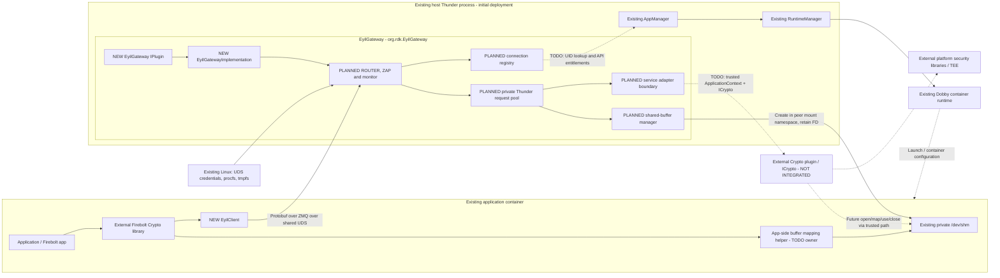

The inner EyilGateway block groups components owned by the plugin. AppManager
and RuntimeManager remain separate plugins within the Thunder process. The
diagram distinguishes existing platform infrastructure from new Gateway
components and future integrations. Crypto may itself be in process or remote;
Gateway must not depend on a raw pointer or FD being meaningful in Crypto's
process.

### 3.2 Components, ownership and trust boundaries

| Component | Owner / location | Responsibility |
| --- | --- | --- |
| Application / Firebolt Crypto | Application container; external consumer | Express operations, serialize Crypto payloads and consume results |
| EyilClient | New library in the application's process | Transport coordination, RPC correlation and C API buffer ownership |
| App-side mapping helper | Placement TODO; not part of the current EyilClient transport API | Open/map the name returned by allocation; manage app mappings |
| EyilGateway wrapper | New Thunder IPlugin | Framework lifecycle and implementation acquisition |
| EyilGatewayImplementation | New implementation library | Own Gateway transport, contexts, request pool, adapters and allocations |
| AppManager / RuntimeManager | Existing RDK platform plugins | Future authoritative identity/entitlements; lifecycle information if adopted |
| Dobby / DobbyTool | Existing container runtime / diagnostic tool | Launch, container namespace/mount setup and test execution; no request routing |
| Linux kernel / libzmq | Existing platform dependencies | UDS transport and peer credentials; monitor support depends on the target libzmq |
| Crypto plugin / ICrypto | External backend, not integrated | Crypto execution, lower-level sessions, keys and key authorization |
| Sec API / secure hardware / TEE | External platform-specific implementation | Backend-dependent cryptographic operations; no Gateway dependency |

There is **one listening UDS endpoint**, shared by all intended applications.
Each accepted connection gets its own identity, request accounting and buffer
ownership. Separate connections do not require separate socket paths.

The app cannot authoritatively provide its UID, appId, sessionId or a host
shared-memory path. The transport supplies peer credentials; the Gateway creates
the connection context and resolves opaque buffer IDs. Key policy remains in
Crypto, including locators, usages, import/export restrictions and sharing.

### 3.3 Container mounts and direct access

The AC endpoint is `ipc:///tmp/app-eyil-gateway.ipc`. Deployment must expose the
same socket object to intended containers, with deliberate directory/socket
permissions. Sharing all of host `/tmp` also exposes unrelated objects; a narrow
mount is preferred when supported. A directory mount avoids binding a container
to an obsolete socket inode after the server recreates it. Final Dobby mount
configuration and permissions remain TODO(DEPLOYMENT).

Monitor and ZAP `inproc://` endpoints are local to a ZMQ context; they need no
filesystem socket or container mount.

Ordinary application containers must not acquire the Crypto interface directly
through Thunder's communicator. `ApplicationContext` is identity metadata; it
does not authenticate the COM-RPC caller. The platform direction is to restrict
general app access to Thunder. Verify the actual communicator mounts and access
policy before enabling Crypto integration.

Gateway's private pool isolates its request scheduling from Thunder's global
worker queue. It does not isolate process crashes, total CPU/memory pressure or
a blocked in-process backend. Those limits matter while Gateway is in process.

### 3.4 External integration seams

| TODO | Planned insertion point | Behavior before integration |
| --- | --- | --- |
| TODO(AUTH-APPMANAGER) | AuthenticationProvider called by ZAP; future Gateway → AppManager → RuntimeManager lookup using trusted UID | Accept valid direct UDS peers, record UID/GID/PID, create unique interim appId/sessionId per connection |
| TODO(API-AUTHORIZATION) | Admission check against entitlements cached in the connection context | Allow all structurally valid supported APIs; still enforce limits and buffer ownership |
| TODO(BACKEND-ICRYPTO) | CryptoServiceAdapter implementing an internal service-backend boundary | No ICrypto calls or generated success results; backend-dependent requests fail explicitly |
| TODO(BACKEND-SESSION) | Ordered backend session initialization and drain hooks on the connection context | Keep state model independent of external Crypto types |
| TODO(LIFECYCLE-EVENTS) | Lifecycle observer receiving platform events and submitting serialized context transitions | No AppManager/RuntimeManager subscriptions or inferred hibernate/idle policy |

The interface names in this table describe internal seams. They are not
additional app-facing Thunder interfaces and do not claim that a formal
AppManager authentication API is already available. Future API additions should
be confined to these seams, rather than spreading external plugin types through
the client, transport or buffer registry.

## 4. APIs: Protobuf and ZeroMQ

### 4.1 The two Protobuf files

| File | Purpose | Boundary |
| --- | --- | --- |
| [rpc.proto](../apis/proto/rpc.proto) | Service-neutral RpcRequest/RpcResponse, request_id, service, schema_version and RpcStatus | EyilClient ↔ Gateway routing |
| [crypto.proto](../apis/proto/crypto.proto) | CryptoRequest/CryptoResponse, operations, key metadata, buffer allocation/release and offset/length regions | Crypto consumer ↔ Gateway Crypto adapter |

`RpcRequest.payload` contains a serialized service request.
`RpcResponse.payload` contains the service response when available. Crypto
defines an operation enum and a `oneof`; they must agree. A valid Protobuf parse
alone does not validate the operation, enum values, required message presence
or allowed lengths.

The RPC envelope fields are:

| Message | Fields |
| --- | --- |
| RpcRequest | request_id: uint64; service: RpcService; schema_version: uint32; payload: bytes |
| RpcResponse | request_id: uint64; service: RpcService; schema_version: uint32; status: RpcStatus; payload: bytes |

[ProtocolVersion.h](../apis/proto/ProtocolVersion.h) fixes the current envelope
schema to **1**. EyilClient sets it for each RPC. There is no version negotiation
or fallback protocol in the current schema. Library/package ABI versions and
Thunder plugin metadata versions are separate concepts.

**Agreed envelope handling:** EyilClient
serializes/deserializes the outer RPC envelope, owns request IDs, sets
schema_version to 1 and correlates responses.

For the existing byte API, the caller supplies a serialized RpcRequest carrying
service and payload. EyilClient parses the envelope, assigns request_id, sets
schema_version and serializes it for transmission. On receipt, it parses and
validates RpcResponse, matches request_id to the pending call and returns the
serialized response to that caller. The service is carried in the envelope;
no separate service argument is needed. Crypto payload bytes remain opaque to
EyilClient and are interpreted by the service-specific consumer.

### 4.2 Status and error layers

| Layer | Meaning and handling |
| --- | --- |
| ClientResult | Local C API validation, connection, allocation, timeout or communication result |
| RpcStatus | Gateway routing/execution result; explicitly inspect it even when a response was received |
| CryptoError | Crypto service result, carried inside CryptoResponse |
| Future Core::hresult | Whether the ICrypto invocation itself succeeded; check before reading output parameters |

`CLIENT_OK` on an asynchronous submission means zmq_send accepted the message
into libzmq's queue; it does not confirm physical UDS delivery or remote success.
`RPC_STATUS_OK` means the Gateway successfully produced the
service response; `CryptoResponse.error` can still report a failed crypto
operation. Protobuf's zero default `RPC_STATUS_UNSPECIFIED` is not success.

#### Agreed local error behavior

The following client behavior is agreed. It does not depend on AppManager or
Crypto backend integration.
Apply ClientResult through the connect, synchronous request or async submission
return value. Async response callbacks carry response data only; they do not
carry local ClientResult errors.

| Situation | ClientResult | Response handling |
| --- | --- | --- |
| Invalid arguments or invalid caller-supplied request envelope | CLIENT_INVALID_ARGUMENT | No response |
| client_register_notifications is called | CLIENT_NOT_IMPLEMENTED | Reserved for future support; no handler is stored or invoked |
| client_connect receives a valid, already allocated Client handle in the caller's slot | CLIENT_ALREADY_CONNECTED | Preserve the existing handle and connection state; create no new connection and invoke no callback |
| Submission without a usable connection | CLIENT_NOT_CONNECTED | No response |
| Authentication explicitly rejected | CLIENT_AUTH_FAILED | No response |
| Local memory allocation failure | CLIENT_OUT_OF_MEMORY | No response |
| Connect, synchronous request or async send-submission deadline expires | CLIENT_TIMEOUT | No handle on connect failure; no synchronous response on timeout; async send failure invokes no response callback. A synchronous timeout may leave remote execution in progress |
| Connection lost during a synchronous request or before async send acceptance, malformed synchronous response or terminal send failure | CLIENT_COMMUNICATION_ERROR | No response |
| Valid correlated synchronous RPC response delivered, or async message accepted by zmq_send | CLIENT_OK | Sync returns the response; async returns without waiting for one. The caller checks RpcStatus and service status when a response is delivered |

For synchronous byte responses, every local error produces `response_data == NULL` and
`response_size == 0`. For string responses, it produces `response_data == NULL`.
A valid Gateway error response, including RPC_STATUS_QUEUE_FULL, is still a
received RPC response: return CLIENT_OK with its bytes and preserve RpcStatus.
Do not turn a local failure into a fabricated Gateway RpcResponse or CryptoError.

Connect, synchronous request and async send-submission timeouts are **15,000 ms**
in the initial version, using one common internal duration constant. Async
responses have no timeout. No new public timeout-configuration
API is required for this version. An authentication error requires an explicit
rejection; an unavailable endpoint or lost connection is not evidence of denied
access.
Temporary socket backpressure is handled by bounded queue/deadline policy and
is not automatically a terminal communication failure. The local queue-full
result remains a separate admission-policy question because ClientResult has
no dedicated queue-full value; the initial count limit is 64 outstanding requests
per Client, as defined in section 5.14.

An async submission that returns an error must not invoke its response callback.
After CLIENT_OK, deliver a valid correlated response at most once. There is no
async response timeout and no synthetic error callback. A connection failure
retires outstanding async records through the connection-state path; a matched
response that fails local validation/allocation is retired with diagnostics and
no callback. Therefore a callback is not guaranteed after every successful send.
Section 5.4 defines this response-only contract.

A timeout or connection loss does not prove remote cancellation. Do not replay
the operation automatically or claim that its shared buffer is safe to reuse.

| RpcStatus | Intended use |
| --- | --- |
| UNSPECIFIED (0) | Missing/unset result; reject as an invalid response |
| OK (1) | Successfully routed and processed at the Gateway layer |
| INVALID_REQUEST (2) | Parsed envelope/service request violates the agreed structure |
| UNSUPPORTED_SCHEMA (3) | Unsupported envelope schema_version |
| UNSUPPORTED_SERVICE (4) | Unknown or unregistered RPC service |
| MALFORMED_REQUEST (5) | Cannot decode the expected message/framing |
| INVALID_CONNECTION (6) | Missing, stale or inadmissible authenticated connection context |
| INTERNAL (7) | Gateway failure or, provisionally, unavailable/failed backend invocation |
| QUEUE_FULL (8) | Bounded request admission rejected the request |

Exact Gateway service-validation versus CryptoError mappings, malformed-message
correlation and backend-unavailable mapping remain TODO(ERROR-MAPPING).
Without a trustworthy request ID or route, do not fabricate a correlated reply.
Transport/authentication failures can occur before any RpcResponse is possible.

### 4.3 Protocol capabilities and limitations

| Capability | Implementation consequence |
| --- | --- |
| Independent request_id | Many requests may be outstanding; match responses by ID, not arrival order |
| Explicit service enum | A new service needs a schema/adapter addition; only CRYPTO is currently defined |
| Opaque service payload | Transport does not implement Crypto key policy |
| Buffer ID plus regions | Four bulk-data operations avoid embedding their input/output in the RPC message |
| uint32 buffer fields | Validate size/ranges with overflow-safe arithmetic and stricter configured quotas |
| No app identity fields | Derive context from trusted transport metadata |
| No deadline/cancel message | A local timeout cannot cancel backend work or prove buffer reuse is safe |
| No notification envelope | Notification support is reserved for the future; registration returns CLIENT_NOT_IMPLEMENTED and creates no subscription |
| No retry/deduplication contract | Do not replay key generation, import or other operations automatically |
| No text encoding definition | String API cannot carry arbitrary binary Protobuf via strlen(); its codec remains TODO |
| No lifecycle/heartbeat messages | Do not invent idle expiry, hibernation commands or heartbeat services |

The protocol permits concurrent requests; it does not define ordering for
operations sharing a key, buffer or session. Request-ID correlation also does
not provide exactly-once execution or distinguish a lost reply from an operation
that never ran.

### 4.4 ZeroMQ endpoints and message framing

| Endpoint | Socket / owner | Purpose |
| --- | --- | --- |
| `ipc:///tmp/app-eyil-gateway.ipc` | Gateway ROUTER binds; each client DEALER connects | Application RPC over filesystem UDS |
| `inproc://zeromq.zap.01` | Gateway ZAP REP binds | Internal authentication exchange |
| `inproc://app-eyil-gateway-monitor` | ROUTER monitor publishes; Gateway PAIR receives | Gateway transport events |
| `inproc://app-eyil-client-monitor-<unique-client-id>` | DEALER monitor publishes; client PAIR receives | Client transport events |

The sample's DEALER sends one frame containing the serialized RpcRequest.
ROUTER receives `[routing_id][RpcRequest bytes]` and replies with
`[routing_id][RpcResponse bytes]`; DEALER receives the response body only.
Retain this framing as the proposed baseline. There is no empty REQ delimiter.
Validate the frame count and consume/reject an entire malformed multipart
message before accepting another. Define size and frame limits explicitly.

The ROUTER I/O owner copies `zmq_msg_gets(message, "User-Id")` before closing
the received message. The routing frame is a delivery address, not authenticated
identity. ZAP's User-Id is a different identifier.

Each DEALER and ROUTER has one socket-owning thread. API callers and request
workers communicate with it through queues; they never send or receive on its
socket. This follows the restrictions for these socket types in the
[ZeroMQ socket API](https://libzmq.readthedocs.io/en/latest/zmq_socket.html).
Socket options, connection, monitoring and closure follow the same ownership.

PLAIN server mode belongs on the ROUTER. The REP handler answers ZAP exchanges;
EyilClient supplies dummy PLAIN strings and never runs a ZAP server. The trusted
UID/GID/PID representation depends on the target libzmq implementation, rather
than the client password. See the
[ZAP specification](https://rfc.zeromq.org/spec/27/).

### 4.5 Reference baseline and deliberate changes from samples

The architect-provided reference materials are the latest
`CryptoGateway/EyilGateway/` sample,
its `Gateway-Owned-Shared-Memory-Proposal.md`,
`zmq_disconnect_sending_UID_GID_PID.patch` and `zmq_server.cpp`.
The table below compares these materials with the agreed implementation
decisions for this repository. They are design references, not build dependencies.

| Reference behavior | Direction for this repository |
| --- | --- |
| Gateway-owned allocation, opaque buffer ID and trusted backend path | Retain; add concurrency/lifetime constraints below |
| Sample transport_error_code and heartbeat service | Use the checked-in RpcStatus schema; no heartbeat service |
| Sample application-level RPC heartbeat | Removed from the target client and Gateway; no heartbeat RPC, sender thread or handler |
| Sample libzmq transport heartbeats on DEALER and ROUTER | Disabled in the target runtime on both ends; set IVL, TIMEOUT and TTL to 0 before connect/bind |
| Sample client_watchdog removes sessions after ClientTimeout=15 seconds without a request | Replaced in the target design by correlated disconnect-event cleanup, not by another idle timer |
| Sample client_connect waits for HANDSHAKE_SUCCEEDED, but reports AUTH_FAILED on wait expiry | Retain handshake readiness; return CLIENT_TIMEOUT on deadline expiry and distinguish explicit failures |
| Sample 15-second connect wait, send timeout and response wait | Use 15 seconds for connect, one total 15-second sync request budget, and 15 seconds for async send submission; async responses have no timeout |
| Sample single pending client request and multiple socket users | One I/O owner and a request-ID pending map |
| Sample synchronous dispatch in the ROUTER loop | One private Thunder-pool dispatch job per accepted request |
| Credential monitor patch | Evaluate for events; it does not provide a complete per-connection correlation token |
| Sample hardcoded identities / detached background threads | Generate independent connection identities; own and join the required Gateway threads |

The current repository's schema and accepted decisions take precedence when a
sample differs. No runtime sample code is imported by this documentation change.
Do not mix current and legacy sample binaries solely because both advertise
schema 1: for example, the old zero transport-error value meant success, while
zero RpcStatus now means UNSPECIFIED. Use matching generated definitions at
both ends.

## 5. EyilClient design and API flows

### 5.1 Responsibilities and limits

EyilClient provides transport coordination, not Crypto semantics. A caller can
submit concurrent synchronous and asynchronous requests on the same `Client`.
A synchronous caller waits for its response; an async caller waits only for
libzmq send acceptance. Neither may hold a lock needed by the I/O owner or
another caller while waiting.

The proposed first implementation has one library-owned serving thread and one
owned ZMQ context per `Client`. A shared context or shared serving loop can be
an optimization after ownership and shutdown are proven. libzmq also creates
its own internal I/O threads: those do not maintain the library's pending map,
run its callbacks or replace its serving thread.

There is no application heartbeat producer, heartbeat worker, periodic liveness
RPC or inactivity watchdog in the target client. Connection-state handling uses
the monitor events and the request coordinator. Connect, sync requests and async
send submission retain 15-second deadlines; async response waiting has none.
Built-in libzmq transport heartbeats are also disabled, as specified in
section 5.5.

The library does not:

- Call AppManager, RuntimeManager, Thunder or ICrypto.
- Decide key authorization, generate trusted app identity or choose host paths.
- Allocate, map or release Gateway-owned buffers implicitly through the generic
  transport API. The app-side Crypto layer requests and maps them explicitly.
- Promise that reconnect preserves keys, buffers or a Gateway session.
- Treat a timeout, a successful send or a connection callback as proof that a
  remote Crypto operation finished.

### 5.2 Component organization and ownership

| Planned component | Responsibility | Owner / synchronization |
| --- | --- | --- |
| C API facade | Validate arguments, clear outputs, parse the outer request into owned storage and hold a live call reference | Calling application thread; never touches DEALER |
| Per-Client coordinator | State, generation, admission, command queue and shutdown coordination | Short protected state transitions |
| Request record | Copied request, assigned ID, waiter or response handler, generation and state; sync total deadline or async send deadline | Retained until response delivery or local retirement; accepted async response waiting has no deadline |
| Serving/I/O loop | Drain submissions, send/receive, correlate replies, monitor events | Library-owned thread; sole DEALER owner |
| Pending map | request_id → waiter/callback and expected response metadata | Serving thread; completion ownership transferred once |
| Completion target | Sync result waiter, async send-result waiter and per-request response callback | Each waiter resolves once; response callbacks run at most once on the I/O owner without internal locks held |
| Monitor collector | Read/decode PAIR events and hand them to connection-state handling | I/O owner performs these monitor-thread duties in the proposed design; a separate worker remains an AC wording decision |
| Response storage | Independently allocated byte/string result | Ownership passes to application, freed with client_free_response |

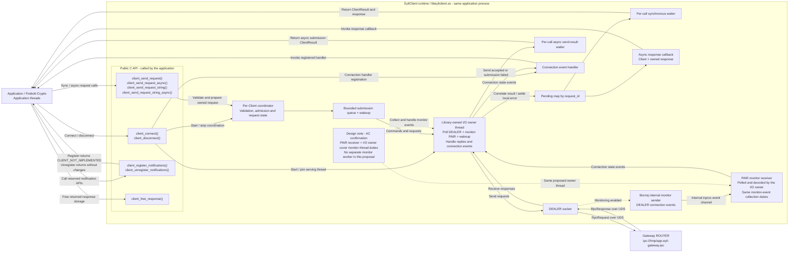

The application explicitly calls the public functions shown in the inner API
block. Those entry points run on the calling application thread; request and
control queues transfer work to the library-owned I/O loop. Synchronous results
return to the caller, while asynchronous results use the registered per-request
response handler. Section 5.4 defines send waiting and callback execution rules.
Response freeing is a local operation. The reserved notification APIs do not
create callback state, subscriptions or Gateway event producers.

The PAIR monitor receiver is an internal socket plus event-decoding code.
Enabling monitoring on DEALER makes libzmq create the other PAIR endpoint, which
emits connection, handshake and disconnect events. The receiver connects through
the client monitor's inproc endpoint. It carries transport events rather than
RPC responses. See the
[ZeroMQ monitor API](https://libzmq.readthedocs.io/en/latest/zmq_socket_monitor.html).
In the proposed arrangement, the same client I/O loop reads DEALER and the
PAIR receiver; the PAIR block does not itself imply a separate thread or service.
The dedicated-monitor-thread wording remains TODO(CLIENT-MONITOR).

> **Note for the PAIR and I/O-owner blocks:** together they perform the monitor
> thread's expected event-collection and connection-state duties. The PAIR block
> is a socket and decoder executed by the I/O owner, not another thread. A
> separate worker is technically optional; accepting this arrangement against
> the AC's explicit monitor-thread wording remains to be confirmed.

Monitoring is a responsibility, not necessarily a dedicated thread. The two
proposed arrangements consume the same PAIR events:

| Thread or component | Responsibility |
| --- | --- |
| libzmq's internal I/O threads | Transport/protocol work and production of socket-monitor events |
| EyilClient serving/I/O owner | Own DEALER, poll replies, submissions and deadlines; in the proposed consolidated model, also poll the monitor PAIR and update connection state |
| Optional dedicated monitor worker | Own only the monitor PAIR and post decoded events to the coordinator/I/O owner; needed only if the AC requires a distinct worker |

In the consolidated model, poll the DEALER, monitor PAIR and submission wakeup
together. Reading a monitor event must not wait for an RPC response. A dedicated
monitor worker would separate that event-reading work, but it would not replace
the I/O owner or its pending-request coordination. ZeroMQ's monitor API requires
a PAIR receiver, not a particular application-thread arrangement. The remaining
CLIENT-MONITOR question is acceptance of the AC's thread wording; both proposed
arrangements provide the required monitoring function.

Freezing the whole application stops both its serving thread and any dedicated
monitor thread, including libzmq's own threads. Adding a separate monitor thread
cannot make the frozen application process events. In either arrangement,
callbacks must remain short to avoid delaying the client's processing.

#### Monitor responsibilities for AC confirmation

Confirm the following monitoring contract independently of whether a dedicated
OS thread is required. The consolidated implementation assigns collection and
handling to the existing I/O owner. A dedicated collector would own only PAIR
and forward events to that owner; it must not also read or write DEALER or
independently mutate the pending-request map.

| Expected monitor responsibility | How PAIR plus the I/O owner cover it |
| --- | --- |
| Set up event collection before connecting | The DEALER owner enables monitoring at the unique client monitor endpoint; the collector creates/connects its PAIR receiver in the same ZMQ context |
| Receive and decode complete monitor messages | Poll PAIR alongside DEALER and the submission wakeup; validate the event frames, event value and endpoint for the configured monitor API version |
| Establish handshake readiness | On HANDSHAKE_SUCCEEDED, publish READY and wake client_connect; CONNECTED or connection-retry events alone do not establish readiness |
| Report initial connection/authentication failures | Decode failure details and wake the connect waiter with the exact ClientResult from section 5.5; retain the distinction between authentication denial and transport/protocol failure |
| Handle loss of an established connection | Mark the connection unusable, stop admission, fail unresolved sync/send-result waiters with CLIENT_COMMUNICATION_ERROR, retire accepted async response records and emit the applicable connection event |
| Handle later state transitions without duplicates | Serialize state changes, ignore events belonging to a stopped runtime and issue connection callbacks only for relevant transitions; actual reconnect behavior remains CONNECTION-LIFETIME |
| Keep application callbacks and request retirement coordinated | Invoke connection handlers without internal locks, resolve each active API waiter once and retire affected async response records once; no synthetic async error callback |
| Handle monitor failure and orderly stop | Treat unexpected collector failure as a runtime error; during requested shutdown, wake the poller, stop monitoring and close PAIR on its owner without waiting indefinitely for another event |

The selected monitor events and their framing come from the
[ZeroMQ monitor API](https://libzmq.readthedocs.io/en/latest/zmq_socket_monitor.html).
The ClientResult mapping, pending-request completion and callback rules are
EyilClient responsibilities built on those events. The 15-second connect, sync
request and async send-submission timers are coordinator/I/O-loop work; monitor
events alone do not implement those deadlines. Async response waiting has no timer.

The loop must fairly service monitor events, replies and submissions in bounded
batches. Functional equivalence does not imply identical scheduling isolation:
a blocking callback on the shared owner delays monitor processing too. A
separate collector can keep reading events in that situation, but pending-map
updates and request completions still need the owner. The proposed design
therefore requires nonblocking I/O and short application callbacks.

**Confirmation to obtain:** does the PAIR receiver plus the I/O owner, with the
responsibilities above, satisfy AC2.3, or is an additional dedicated OS thread
itself mandatory? No heartbeat sender, idle-session watchdog or periodic PID
responsiveness probe is part of this monitor contract. The monitor also does
not perform Gateway-side ZAP authentication or decode service responses.

#### Request submission and completion

A wakeup FD or equivalent queue notification lets application threads wake the
serving loop without sharing a ZMQ socket. Copy an asynchronous request before
returning to the caller, so the caller may reuse its input memory. Queue bounds
must include copied request bytes as well as the number of requests.

Proposed request states are `QUEUED → ACCEPTED_BY_LIBZMQ → RETIRED`, with local
failure/cancellation/shutdown paths. Retirement may follow response delivery
or cleanup without a response. Remove a pending entry atomically before
invoking its response handler. Reserve IDs before sending; do not reuse an ID while
a late response from the same connection generation could still arrive.
Validate response ID, service, schema and status before completing the caller.

### 5.3 General routing: concurrent requests on one connection

Coverage: **AC2.1, AC2.2, AC2.4, AC1.6, AC1.7, AC3.1–AC3.2**.

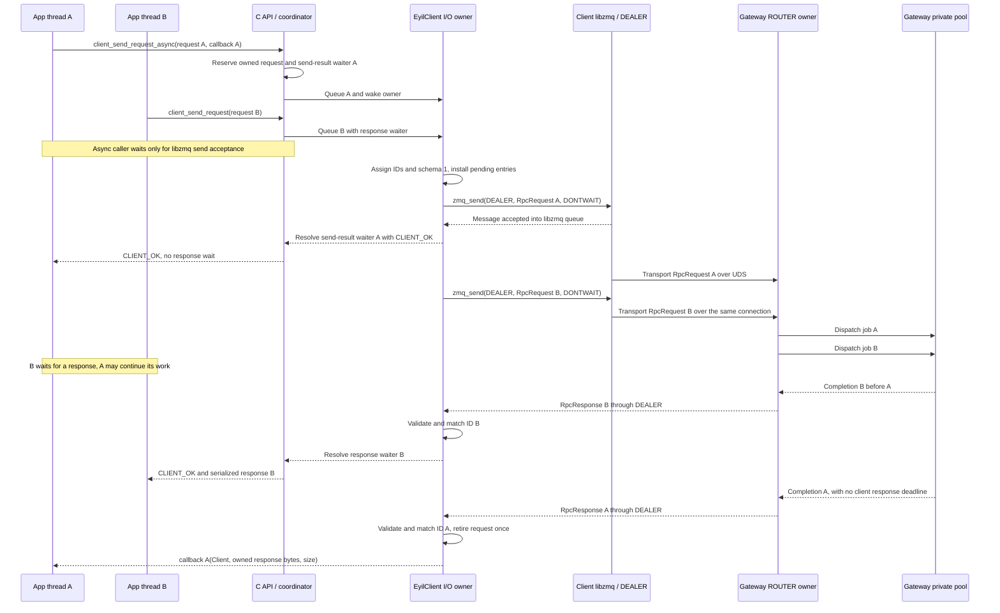

This is not a strict send/receive alternation. Several callers can wait for
send acceptance while the same I/O owner continues receiving earlier replies.
A successful send does not confirm that the UDS write or Gateway receipt has
occurred. Request-ID correlation routes each response to its own waiter or
registered response handler. Slow callbacks must not monopolize the I/O loop.

### 5.4 Public API index

The public API is declared in
[EyilClient.h](../EyilClient/include/eyilclient/EyilClient.h). All nine methods
have individual sequences below. Both asynchronous request methods are required
public functionality under AC2.4, alongside their synchronous counterparts.

| Method | Target behavior | AC coverage |
| --- | --- | --- |
| client_connect | Return a handle after successful handshake; reject an occupied handle slot with CLIENT_ALREADY_CONNECTED; report exact startup/authentication/timeout errors | AC2.1–AC2.3; AC1.3, AC1.5–AC1.6 |
| client_send_request | Binary request with a per-call synchronous waiter | AC2.1, AC2.2, AC2.4 |
| client_send_request_async | Wait for libzmq send acceptance; deliver a later binary response through the supplied callback with no response timeout | AC2.1, AC2.2, AC2.4 |
| client_send_request_string | Defined text codec plus synchronous request core | AC2.1, AC2.4 |
| client_send_request_string_async | Selected text codec plus the same send-acceptance contract and response-only callback | AC2.1, AC2.4 |
| client_free_response | Release a library-allocated result | AC2.1 |
| client_register_notifications | Return CLIENT_NOT_IMPLEMENTED; reserved for future support | AC2.1 through the supplied header |
| client_unregister_notifications | Return without changing state; reserved for future support | AC2.1 through the supplied header |
| client_disconnect | Stop admission/I/O, settle pending work and destroy the handle | AC2.1–AC2.3; AC1.10 on the Gateway side |

#### Required asynchronous request behavior

Implement client_send_request_async() and client_send_request_string_async()
using the same connection, request correlation and bounded coordinator as the
synchronous methods. The submitting thread waits for its send result, **not for
the remote response**.

- Validate and copy the request, reserve its pending record and send-result
  waiter, then queue work for the I/O owner.
- Return CLIENT_OK only after that owner successfully calls zmq_send for the
  request. Enqueueing a command in the library's own submission queue is not
  sufficient. EAGAIN remains pending within the 15-second send-submission budget.
- Return validation, allocation, connection or send-submission timeout errors
  directly from the API. A failed submission invokes no response callback.
- After send acceptance, retain the request for a response with **no response
  timeout**. A valid response invokes its registered callback at most once.
- Connection loss or explicit shutdown retires outstanding async records without
  a response callback. Transport loss is reported by the connection-event handler.
  Local failure to validate or allocate a matched response also retires that
  record with diagnostics and no response callback.
- A successful send therefore does not guarantee a later callback. Never
  fabricate a Gateway response or deliver NULL as a synthetic error response.

**Selected send guarantee:** zmq_send success means acceptance into libzmq's
queue. It does not prove physical UDS transmission, Gateway receipt or backend
execution, even with a blocking send. No receipt ACK or Protobuf extension is
required by this contract. See the
[ZeroMQ send contract](https://libzmq.readthedocs.io/en/latest/zmq_send.html).

The string method uses the same selected text codec as its synchronous
counterpart. The codec decision does not make asynchronous support optional.

#### Supplied async signatures and response ownership

Retain the supplied request and response-callback signatures:

```c
typedef void (*ClientResponseHandler)(
    Client *client,
    uint8_t *response_data,
    size_t response_size);

typedef void (*ClientStringResponseHandler)(
    Client *client,
    char *response_data);

ClientResult client_send_request_async(
    Client *client,
    const uint8_t *request_data,
    size_t request_size,
    ClientResponseHandler handler);

ClientResult client_send_request_string_async(
    Client *client,
    const char *request_data,
    ClientStringResponseHandler handler);
```

The pending map associates the library-assigned request_id with the handler
supplied for that request. Callback arguments carry the actual response only.
The app inspects RpcStatus and service status, then releases the owned response
through client_free_response(). A valid Gateway error response is delivered
through the same callback. ClientNotificationHandler is reserved for future
support and is not used to deliver request results or local errors.

Copy input before returning so the caller may reuse its request storage.
Keep pending bookkeeping and callback code valid until response delivery or
connection teardown. Without a response deadline, a request that never receives
a reply can occupy one of the 64 outstanding slots until teardown. Local
validation/allocation failure retires the affected slot but cannot report a
per-request error through these response-only signatures.

#### Send-result coordination and cancellation

Each async request has two distinct stages: a bounded submission wait and an
unbounded response wait. Use a retained send-result waiter separate from the
pending response record. The I/O owner publishes ACCEPTED or a terminal send
error once; the submitting thread returns that result.

Serialize the nonblocking send attempt and its acceptance publication against
send-deadline cancellation. Check the request's state and deadline before every
attempt. Once cancelled before acceptance, it must never be sent later. If a
nonblocking attempt is already in progress, resolve that attempt before returning
an error that claims the submission failed. A successful acceptance cannot
later be changed into a send timeout by a competing waiter or disconnect event.

After acceptance, disarm the async send deadline. Response arrival and
connection cleanup compete only for ownership of the pending record; retire it
once and discard late/duplicate replies. No async response-expiry task runs.
A local retirement or successful send does not prove backend completion or make
a shared buffer safe to reuse.

#### Request-callback execution model

- Invoke response callbacks on the owning Client's serving/I/O thread, without
  internal state/queue locks held. Callbacks are serialized within a Client;
  different Clients can invoke callbacks concurrently.
- Retire the pending record before calling application code, and keep the Client
  and response storage alive for the invocation.
- Never call the handler inline on the submission call stack. A fast response
  can invoke it on the I/O owner before the submitting thread resumes from its
  send-result wait; prepare application state before making the API call.
- A response callback may call client_free_response. Schedule new requests and
  other work on an application thread.
- All request APIs, including async submission, can wait for the I/O owner.
  Calling them from that owner's callback would deadlock. Detect this case and
  return CLIENT_INVALID_ARGUMENT before admission. Do not call client_connect
  or client_disconnect from the callback either.
- Callbacks must return promptly so other sends, replies, monitor events and
  active deadlines can progress.

These rules do not depend on AppManager or the Crypto backend. Connection-handler
lifetime and initial callback timing remain TODO(CLIENT-CALLBACKS). Explicit
disconnect must resolve active sync/send-result waiters, retire async response
records and quiesce callbacks. Its local-close return mapping and shutdown
ordering remain TODO(CLIENT-SHUTDOWN).

### 5.5 client_connect()

Coverage: **AC2.1–AC2.3; AC1.3, AC1.5–AC1.6**.

#### Handle ownership and CLIENT_ALREADY_CONNECTED

The target contract treats `Client **client` as an input/output handle slot.
Initialize it before the first call, for example `Client *client = NULL`.

- If `client == NULL`, return CLIENT_INVALID_ARGUMENT without dereferencing it.
- If `*client != NULL` and contains a valid Client handle that has not been
  destroyed, return CLIENT_ALREADY_CONNECTED immediately. Preserve that handle,
  its registered handler, pending requests and connection state. Do not allocate
  a runtime, start threads, connect another socket or invoke a callback for the
  rejected call.
- If `*client == NULL`, start a new connection attempt. Publish the handle only
  on CLIENT_OK; on startup failure the slot remains NULL after rollback.

CLIENT_ALREADY_CONNECTED is local handle-ownership validation, not a Gateway
rejection or a restriction to one connection per process, UID or app. A separate
NULL-initialized slot may create another independent Client. An existing handle
still occupies its slot after transport loss; calling client_connect with it is
not a reconnect API and returns CLIENT_ALREADY_CONNECTED. Recovery of that
existing connection remains part of the separate reconnect contract.

The caller must serialize access to the same handle slot, including concurrent
connect attempts. Uninitialized, fabricated or destroyed handles are invalid
API usage. After client_disconnect destroys a handle, the caller must reset its
own slot to NULL before reusing it: client_disconnect takes Client*, so it cannot
clear the caller's variable.

#### Readiness contract

**Agreed readiness contract:** return CLIENT_OK and publish a valid Client
handle only after local startup has succeeded and the client monitor receives
`ZMQ_EVENT_HANDSHAKE_SUCCEEDED` for the pending connection attempt. The
application can then immediately submit RPC requests. Crypto backend availability
and operation results are handled by subsequent RPCs.

The architect-provided sample already uses this handshake event to set its
connected state and wake a condition-variable wait. It waits up to 15 seconds,
but incorrectly returns CLIENT_AUTH_FAILED when the wait expires. Retain its
handshake-readiness mechanism, use the agreed **15-second connect deadline**,
and apply the agreed CLIENT_TIMEOUT mapping. Section 5.14 defines the shared
duration constant and its separate application to each request.

#### Disabled ZeroMQ heartbeats

**Decision: ZeroMQ transport heartbeats are disabled on both the client's
DEALER and Gateway's ROUTER.** Apply these settings before connect/bind and
whenever either socket is recreated:

| Option | Required setting | Meaning |
| --- | --- | --- |
| ZMQ_HEARTBEAT_IVL | 0 | Do not send periodic ZMTP PING commands |
| ZMQ_HEARTBEAT_TIMEOUT | 0 | No active heartbeat timeout while the heartbeat interval is disabled |
| ZMQ_HEARTBEAT_TTL | 0 | Do not request heartbeat-based expiry at the peer |

The sample uses a 5,000 ms heartbeat interval and 15,000 ms timeout on both
ends. Those sample settings are superseded by this decision and must not be
copied into the target runtime. Configure the disabled values before
zmq_connect()/zmq_bind(); do not rely on changing an established connection's
options. See the
[ZeroMQ socket-option contract](https://libzmq.readthedocs.io/en/latest/zmq_setsockopt.html).

Freezing an application also stops its libzmq threads. Disabling transport
heartbeats avoids disconnecting that preserved idle connection merely because
the frozen client cannot exchange heartbeat traffic. This does not guarantee
survival across Gateway failure, actual socket closure or checkpoint/restore
that replaces descriptors.

Keep the PAIR monitors and the 15-second connect, synchronous-request and
async-send deadlines. Async responses have no timeout. There is no application
heartbeat RPC, heartbeat worker, idle-expiry timer or inactivity watchdog.

Gateway serves requests and owns connection resources; it does not supervise
application health. An idle, completely hung process may retain its socket and
bounded connection state until actual disconnection or an explicitly agreed
platform lifecycle action. Protect other clients through quotas, fair scheduling
and nonblocking sends; do not add responsiveness probes or heartbeat expiry.

#### Connection sequence

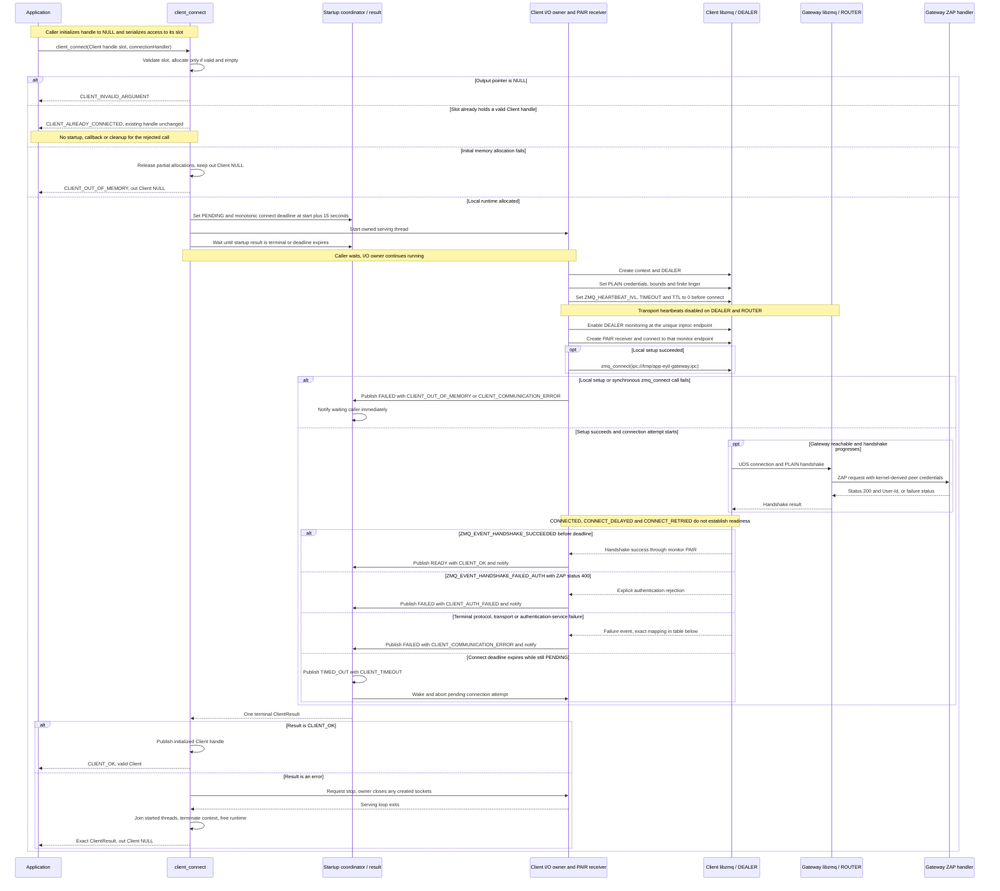

A serving-thread startup failure is handled by the caller using the same
failure/rollback path; cleanup only stops or joins threads that were actually
started.

#### Exact initial-connect outcomes

| Condition / monitor event | Startup action | client_connect result |
| --- | --- | --- |
| Output argument `Client **client` is NULL | Reject before creating runtime state | CLIENT_INVALID_ARGUMENT |
| `*client` already holds a valid, not-yet-destroyed Client handle, including after transport loss | Reject before allocating or starting another connection; preserve the existing handle, handler and state | CLIENT_ALREADY_CONNECTED, original handle unchanged |
| Client/runtime allocation fails, including an explicit ENOMEM from local setup | Stop/roll back any initialized resources | CLIENT_OUT_OF_MEMORY, output NULL |
| Non-memory context/socket/monitor/thread setup failure, or synchronous zmq_connect error | Publish FAILED and stop the attempt | CLIENT_COMMUNICATION_ERROR, output NULL |
| ZMQ_EVENT_CONNECTED | Keep PENDING; transport connection alone is insufficient | No return yet |
| ZMQ_EVENT_CONNECT_DELAYED or ZMQ_EVENT_CONNECT_RETRIED | Keep PENDING within the original deadline | No return yet |
| ZMQ_EVENT_HANDSHAKE_SUCCEEDED while PENDING and before the deadline | Publish READY and wake caller | CLIENT_OK, valid output handle |
| ZMQ_EVENT_HANDSHAKE_FAILED_AUTH with ZAP status 400 | Publish FAILED and wake caller immediately | CLIENT_AUTH_FAILED, output NULL |
| ZMQ_EVENT_HANDSHAKE_FAILED_AUTH with ZAP status 300 or 500 | End this connect attempt as an authentication-service failure | CLIENT_COMMUNICATION_ERROR, output NULL |
| ZMQ_EVENT_HANDSHAKE_FAILED_PROTOCOL | Publish FAILED and wake caller immediately | CLIENT_COMMUNICATION_ERROR, output NULL |
| ZMQ_EVENT_HANDSHAKE_FAILED_NO_DETAIL | Publish FAILED and wake caller immediately | CLIENT_COMMUNICATION_ERROR, output NULL |
| ZMQ_EVENT_DISCONNECTED before initial readiness | End this connect attempt and wake caller | CLIENT_COMMUNICATION_ERROR, output NULL |
| Monitor/receive processing terminates unexpectedly while startup is PENDING | Publish FAILED and wake caller | CLIENT_COMMUNICATION_ERROR, output NULL |
| Absolute connection deadline expires while startup is PENDING, including an unavailable endpoint with delayed/retried connects | Publish TIMED_OUT; stop and clean up the attempt | CLIENT_TIMEOUT, output NULL |

The monitor's HANDSHAKE_FAILED_AUTH event carries the ZAP status: 400 is an
authentication denial, 300 a temporary authentication-service error and 500 an
internal authentication-service error. This client contract ends the current
connect call on those explicit failures, preserving CLIENT_AUTH_FAILED for a
denial. Event and status definitions:
[ZeroMQ monitor API](https://libzmq.readthedocs.io/en/latest/zmq_socket_monitor.html),
[ZAP specification](https://rfc.zeromq.org/spec/27/).

`zmq_connect()` returning zero and receiving ZMQ_EVENT_CONNECTED are both
insufficient for CLIENT_OK. Successful handshake detection is the agreed
readiness barrier. No Crypto request or AppManager availability probe is needed
to establish it.

The startup coordinator stores a terminal result, rather than only a
`connected` boolean. The wait predicate is `startupState != PENDING` with an
absolute monotonic deadline. Success and explicit failures publish the result
and notify the waiter; the timeout path publishes CLIENT_TIMEOUT. Synchronize
these transitions so one attempt has one final outcome. A late handshake event
cannot revive a timed-out or failed attempt, and retries do not restart its
deadline. Reconnect behavior after a previously successful client_connect
remains a separate lifecycle decision.

On failure of a new connection attempt from an empty slot, keep the output
handle NULL, close created sockets on their owner, stop/join started threads,
terminate the owned context and free the incomplete handle before returning.
CLIENT_ALREADY_CONNECTED is an earlier rejection: preserve the existing handle
and do not run startup rollback against it. The deadline bounds the readiness
wait; safe rollback still has to finish. Do not expose an incomplete handle through
application callbacks on a failed attempt. Initial connection-callback timing
around successful handle publication, including whether the first handshake
emits RESTORED, remains CLIENT-CALLBACKS; it does not change the agreed readiness
or error return contract.

### 5.6 client_send_request()

Coverage: **AC2.1, AC2.2, AC2.4**; Crypto use also supports **AC3.1–AC3.2**.

The caller supplies one serialized RpcRequest containing the service and its
opaque payload. The library parses that envelope, replaces request_id and
schema_version, and serializes the outgoing request. It validates the returning
RpcResponse and gives the caller its complete serialized bytes. It does not
parse CryptoRequest or CryptoResponse. No additional service argument or byte
API signature change is needed for this agreed envelope handling.

#### Submission and synchronous wait

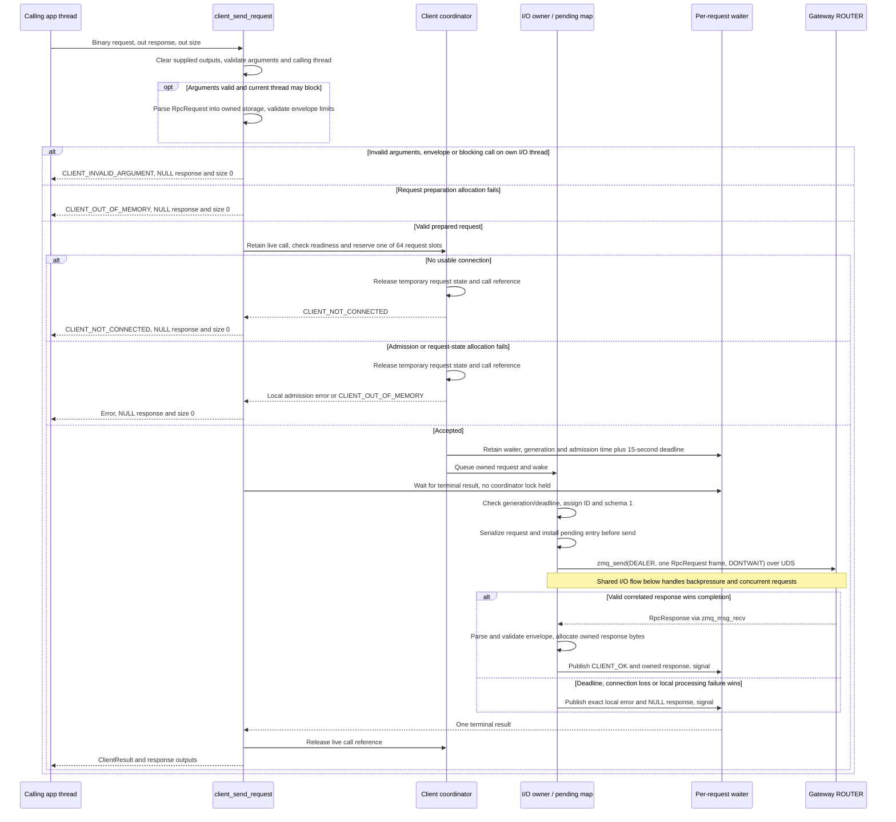

Before dereferencing outputs, validate their addresses; clear every supplied
output even if another required argument is missing. Require a non-NULL live
Client, non-NULL input with nonzero bounded length, and both output pointers.
An empty/default envelope or RPC_SERVICE_UNSPECIFIED is invalid. Other numeric
service values can reach Gateway, which determines support. Validate Protobuf
parsing and common message limits without interpreting the service payload.
Caller-supplied request_id and schema_version are ignored and overwritten.

The request record owns its parsed data, completion state and connection
generation. Application input need remain valid only for the API call. Reserve
count/byte capacity and completion bookkeeping before acceptance. For async
calls the same preparation completes before returning CLIENT_OK. Neither API
may leave a queued pointer into temporary caller storage.

#### Shared nonblocking send and receive pipeline

This pipeline serves all four request APIs. Socket operations, pending-map
mutation and monitor processing belong to the I/O owner. A record identifies
whether its caller waits for a synchronous result or only for async send
acceptance. Sync requests retain their total deadline after send; async requests
disarm their submission deadline once libzmq accepts the message.

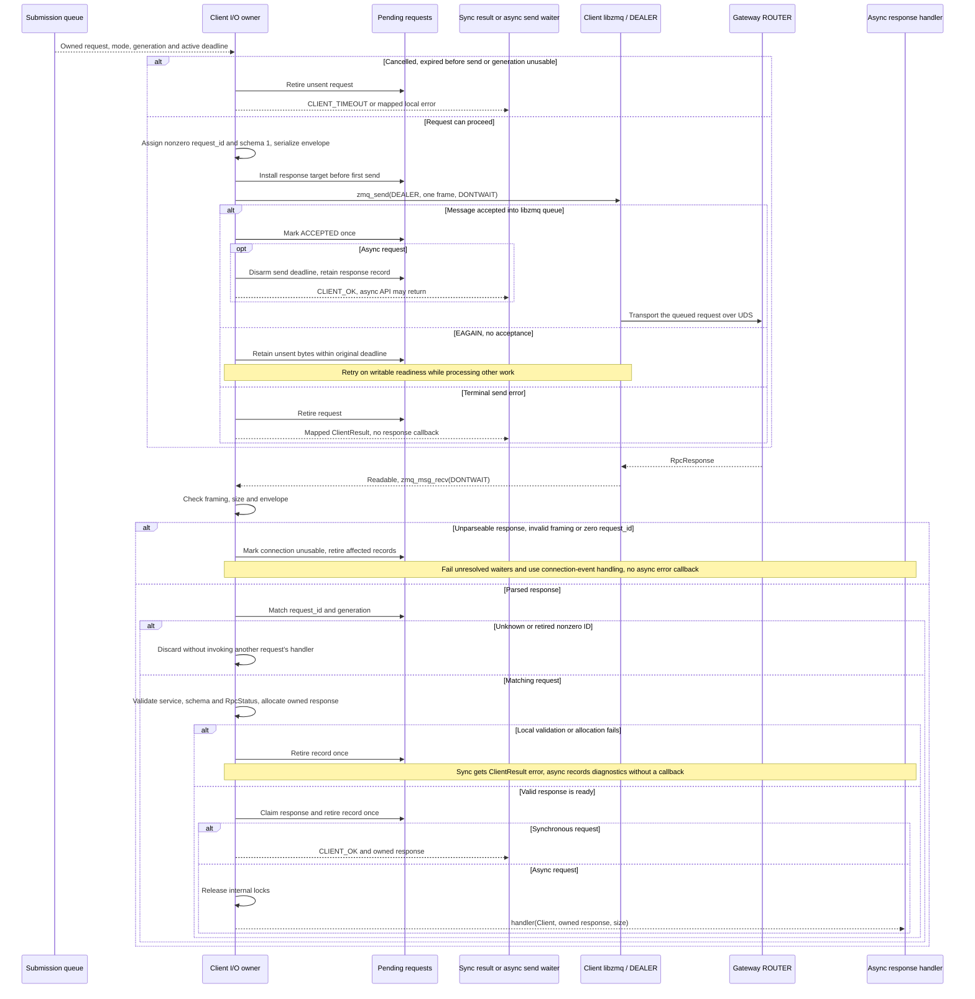

Implementation rules:

- Install the response target before sending, so even an immediate reply can
  be correlated. Use one DEALER body frame without a REQ-style delimiter.
- A successful zmq_send is the async return boundary: libzmq queued the message.
  Do not claim physical delivery or submit it again. EAGAIN permits retry only
  for work that has not been accepted, within its original active deadline.
  EINTR permits retry while the request remains eligible. Other terminal send
  failures return CLIENT_COMMUNICATION_ERROR; explicit memory failures return
  CLIENT_OUT_OF_MEMORY. See
  [zmq_send](https://libzmq.readthedocs.io/en/latest/zmq_send.html).
- Receive with zmq_msg_recv and check ZMQ_RCVMORE. EAGAIN means nothing to read;
  EINTR permits retry. Drain malformed multipart input without treating its
  remaining frames as separate responses. See
  [zmq_msg_recv](https://libzmq.readthedocs.io/en/latest/zmq_msg_recv.html).
- Uncorrelatable malformed input makes the connection unusable under the
  proposed client policy. Resolve pending synchronous and not-yet-accepted send
  waiters with CLIENT_COMMUNICATION_ERROR. Retire accepted async response
  records and report connection loss through the connection-state path.
- A parsed nonzero ID absent from the pending map is discarded. It may be a
  late synchronous reply or a duplicate; it is not a notification.
- A matched response must have the expected service, schema version 1 and a
  known nonzero RpcStatus. A valid Gateway error response is still delivered
  normally: sync returns CLIENT_OK with bytes, async invokes its response
  handler. The service consumer interprets CryptoResponse.
- Matched metadata or allocation failure returns a local error to a synchronous
  waiter. For an async record whose send succeeded, retire it with diagnostics
  and no response callback. These signatures have no post-send error channel.
- Returned response storage must be compatible with client_free_response.
  String wrappers encode the validated envelope before delivery. If conversion
  fails, apply the same sync-error/async-retirement distinction.
- Retire request accounting once and free temporary Protobuf/ZMQ storage on
  every terminal path. Late replies cannot revive a retired request.

The malformed-response scope is a client implementation proposal; reconnect
policy for an unusable connection remains separate. No async response deadline
or synthetic local-error RpcResponse is introduced.

#### Synchronous timeout, disconnect and response races

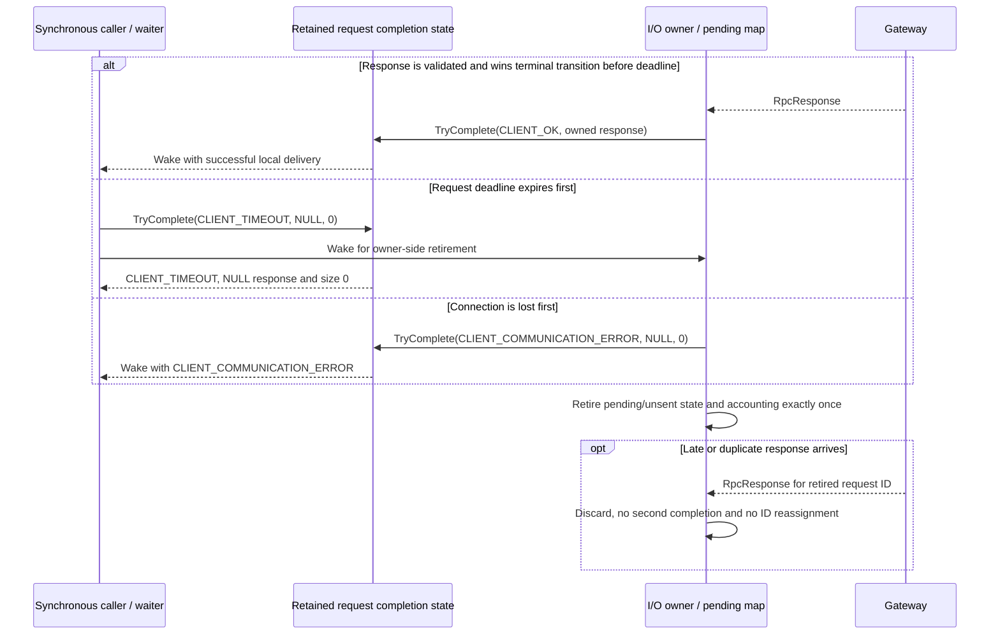

The waiter and I/O owner share a retained completion object, not a pointer to
the caller's stack. TryComplete publishes the result and its response ownership
atomically with respect to other terminal paths. If a prepared response loses
that race, its storage is freed internally. The I/O owner alone removes pending
entries; a caller-side timeout marks completion and wakes that owner. The queued
record stays alive until owner-side retirement, even if the caller has returned.
This response-deadline race applies to synchronous requests only. For async
submission, section 5.4 defines the separate send-result race; after acceptance,
an async request has no response deadline. A cancelled unsent record must never
be sent later. Check a synchronous request's absolute deadline when claiming its
response as well as when processing timers.

On every local failure, return NULL response and size zero. A timeout ends the
local wait; it does not cancel remote work, release remote buffers or authorize
replay. A valid response containing a non-OK RpcStatus still returns CLIENT_OK;
the caller inspects that status and eventually calls client_free_response.

There is no unresolved envelope-processing step in this flow. The 15-second
deadline and 64-request count limit are selected. Remaining client decisions are
the local queue-full ClientResult, byte-size budgets and explicit close/reconnect
behavior. They are recorded under CLIENT-ADMISSION, RESOURCE-LIMITS,
CLIENT-SHUTDOWN and CONNECTION-LIFETIME in section 7.7.

### 5.7 client_send_request_async()

Coverage: **AC2.1, AC2.2, AC2.4**.

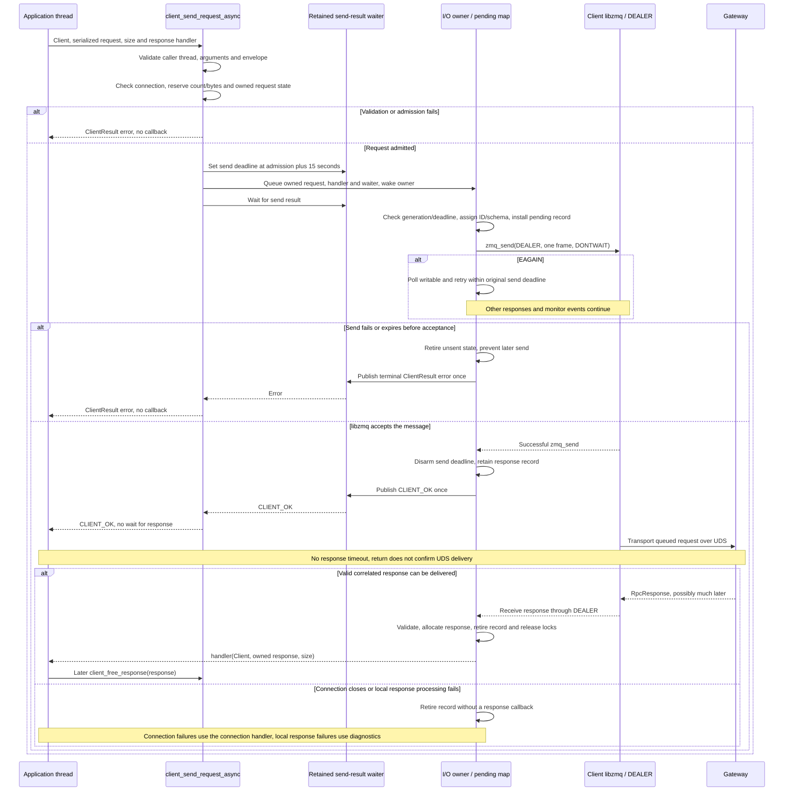

CLIENT_OK is returned after libzmq send acceptance, not after insertion into
the library's command queue. The API may wait up to the 15-second send budget
for the owner to submit the message; it never waits for the operation's response.

Invalid arguments/envelope/handler or invocation on the I/O-owner callback thread
returns CLIENT_INVALID_ARGUMENT. No usable connection returns
CLIENT_NOT_CONNECTED; allocation failure returns CLIENT_OUT_OF_MEMORY; terminal
send failure or connection loss before acceptance returns CLIENT_COMMUNICATION_ERROR.
Send-deadline expiry returns CLIENT_TIMEOUT. The queue-full result remains
CLIENT-ADMISSION. Every failed submission returns without a response callback.

After acceptance, invoke the supplied ClientResponseHandler only for a validated,
deliverable response, including a Gateway error response. No local response
timeout or error callback runs. Connection teardown or a local response-processing
failure can retire the request without invoking the handler. A server that stays
connected but never replies leaves the record pending within the bounded limit.

Callbacks run on the I/O owner with no internal locks. They may free their
response, but must schedule subsequent request calls on an application thread:
even an async API waits for this same I/O owner to submit its send.

### 5.8 client_send_request_string()

Coverage: **AC2.1, AC2.4**.

The string API requires a lossless text representation of the outer RPC
envelope. Its target flow is a conversion wrapper around the same binary
request core. The diagrams below show that complete flow; selection of the text
format is a genuine contract question, described after the first diagram.

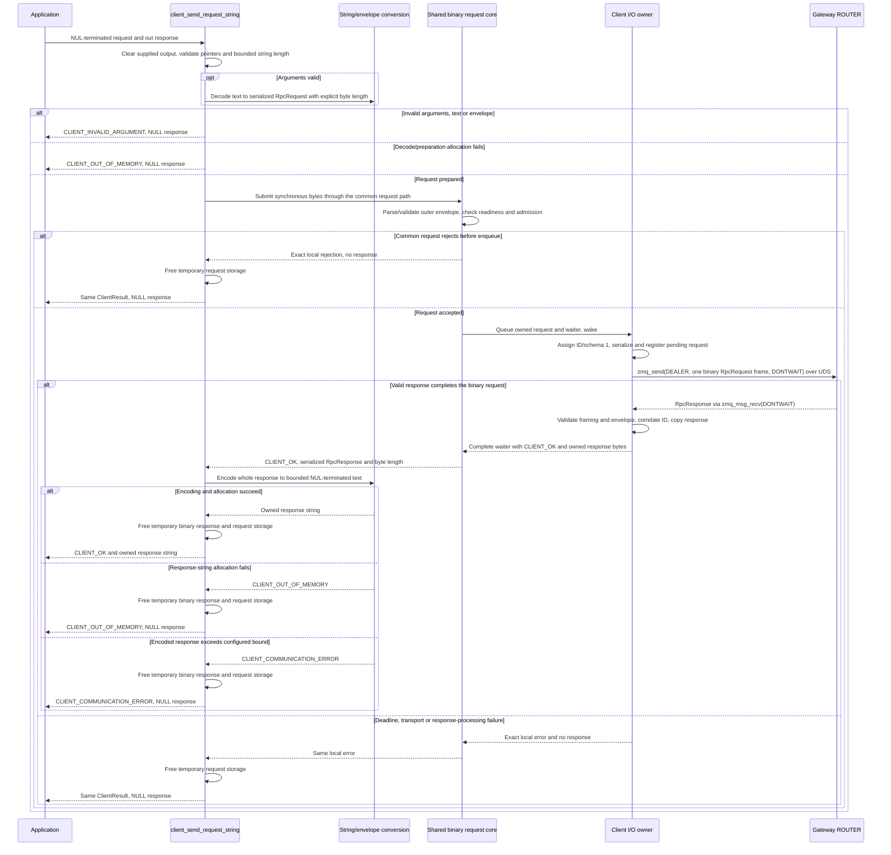

#### Why the string format still needs a decision

The architect-provided sample's client_send_request_string applies strlen() to
request_data, passes those bytes directly to the byte API, then copies the
binary response and appends a NUL. It contains no text encoder/decoder. Its
header only promises NUL-terminated strings; it does not specify their format.

Serialized Protobuf can contain zero bytes, including inside the opaque
payload. strlen() would truncate such an input, and appending a terminator to a
binary response would not make it an unambiguous C string. The target wrapper
therefore needs a format decision, not merely removal of an implementation TODO.
See the [Protobuf wire format](https://protobuf.dev/programming-guides/encoding/).

| Candidate string contract | Input/output conversion | Consequence |
| --- | --- | --- |
| Base64 of the complete serialized RpcRequest/RpcResponse | Decode to binary before the shared core; encode validated response bytes afterward | Simple lossless binary wrapper, including unknown wire fields; text is not field-readable |
| Protobuf JSON mapping of the outer RpcRequest/RpcResponse | Parse/print using the Protobuf JSON mapping; retain service payload as bytes | Field-readable outer envelope; bytes fields use base64, with ProtoJSON's compatibility/unknown-field limits |

The [ProtoJSON specification](https://protobuf.dev/programming-guides/json/)
defines the second option. Keep **both options as proposals for a later
decision**; neither is selected. Base64 is the smaller implementation around the
byte API, while ProtoJSON makes the outer fields readable. Confirm the format
with the API consumer under **TODO(STRING-CODEC)**, including text and
decoded-message limits. Do not select a format by guessing from the input. Both
alternatives keep binary Protobuf over ZMQ and keep service payload interpretation
outside EyilClient.

Conversion ownership and failures are already defined: validate and decode input
before submission, own all intermediate storage, and return a separately owned
NUL-terminated response for client_free_response. Check size arithmetic and the
configured decoded/encoded limits before allocation. Invalid/oversized input
returns CLIENT_INVALID_ARGUMENT; allocation failure returns CLIENT_OUT_OF_MEMORY.
All temporary storage is released on every success/rejection/error path. A valid
received response must fit the agreed encoded-response bound; a response that
cannot be represented within that bound is a local CLIENT_COMMUNICATION_ERROR.

CLIENT_TIMEOUT and transport errors propagate unchanged from the shared binary
core. Failure to allocate the final text can occur after remote execution and
successful receipt of its response: return CLIENT_OUT_OF_MEMORY and NULL, and
do not replay the operation. Format-independent error/ownership behavior is not
an outstanding design question; choosing the string format remains separate.

### 5.9 client_send_request_string_async()

Coverage: **AC2.1, AC2.4**.

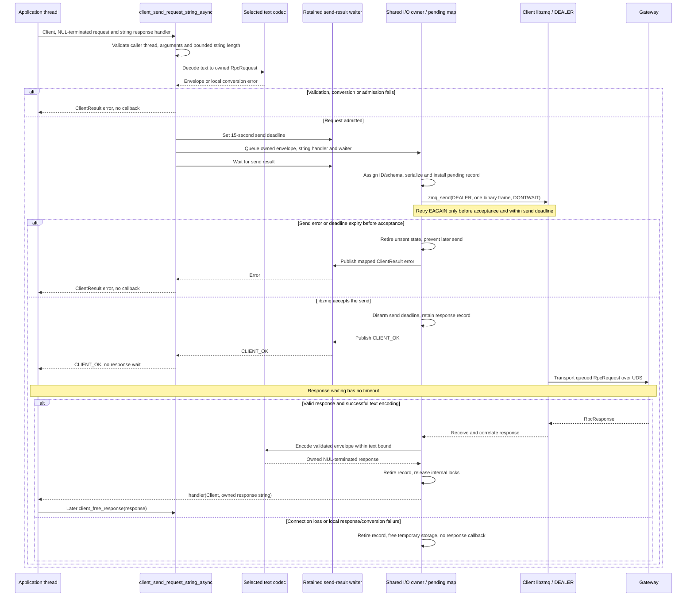

Both string APIs share the byte APIs' coordinator, pending map and DEALER.
The async string method uses the supplied ClientStringResponseHandler signature,
with no size argument. Local input conversion and send errors return from the
API using the same ClientResult mappings as section 5.7.

After successful send acceptance there is no response timeout. Encoding or
allocating the returned string may fail after remote execution; in that case,
retire the record with diagnostics and do not invoke a synthetic error callback.
Connection failures use the connection-event path. The selected text codec is
the same STRING-CODEC decision as for synchronous strings.

### 5.10 client_free_response()

Coverage: **AC2.1**.

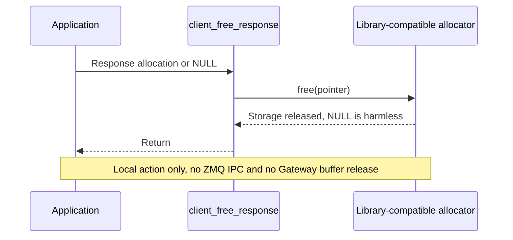

This releases a message-result allocation, not a shared-memory object.
Do not pass a mapped buffer, stack memory or a Gateway buffer ID.

### 5.11 client_register_notifications()

Coverage: **AC2.1**, retaining the supplied API for future support.

**Return CLIENT_NOT_IMPLEMENTED.** The function ignores its arguments and does
not store or invoke the handler, allocate notification state, subscribe to events
or send a message to Gateway.

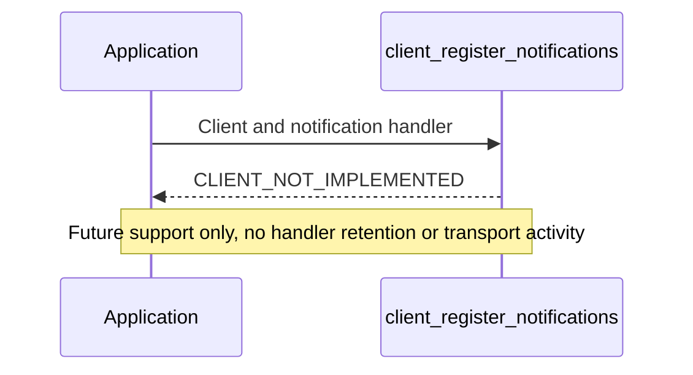

Notification delivery is outside this version's scope. A future feature must
define the events, Protobuf payloads, wire identification and callback lifecycle
before enabling this API. It is not a pending decision for the current delivery.

Connection-state events go to ClientConnectionEventHandler registered through
client_connect(). Async responses go to the response handler supplied with each
request. A late or unmatched RPC response follows the validation rules in
section 5.6 and must not be reclassified as a notification.

### 5.12 client_unregister_notifications()

Coverage: **AC2.1**, retaining the supplied API for future support.

This void function returns without changing state. Notification registration
is unsupported, so there is no handler to remove or notification delivery to drain.

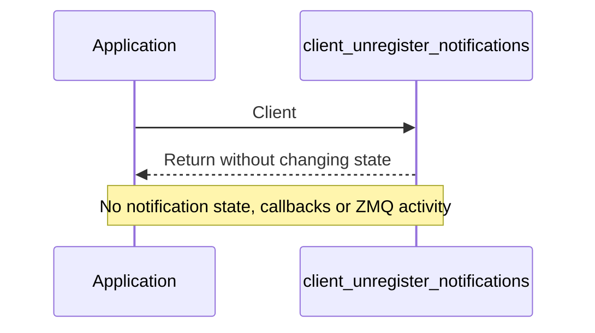

Calling this function is not required before client_disconnect in this version.
It does not affect the connection-event handler or pending request responses.

### 5.13 client_disconnect()

Coverage: **AC2.1–AC2.3**, leading to **AC1.10** when the Gateway detects closure.

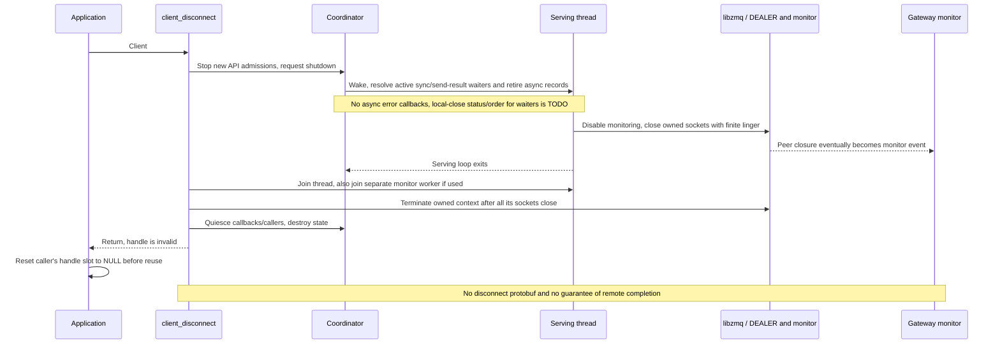

Do not call disconnect from its own callback thread or race destruction against
uncoordinated application calls. A proposed implementation closes admission and
waits for retained in-progress API references; the public concurrency contract
must describe what the application must serialize. Never detach a serving
thread and free its state.

### 5.14 Deadlines, callbacks, reconnect and library unloading

#### Initial timeout and admission defaults

| Setting | Initial value | Meaning |
| --- | --- | --- |
| Common timed-wait duration | 15,000 ms | Shared by connect, synchronous requests and async send submission; no public timeout setter is required initially |
| Connect deadline | Connect-attempt start plus 15 seconds | Covers setup/handshake waiting; retries cannot restart it and safe rollback must finish before return |
| Synchronous request deadline | Admission time plus 15 seconds | One budget across queueing, serialization, send attempts and receiving/validating the response |
| Async send-submission deadline | Admission time plus 15 seconds | Covers queueing, serialization and send attempts until libzmq accepts the request; return its result through the API |
| Async response deadline | None | Disarm the send deadline after acceptance and retain the response record until delivery or local retirement/teardown |
| Outstanding-request count | 64 per Client | Queued/unsent and sent/awaiting-response records share this one limit |

The synchronous deadline is one total budget, not a new 15 seconds per phase.
An async request has a 15-second send budget only: time waiting for libzmq
acceptance does not start a response timer afterward. Connect and each request
use independent deadlines. None of these timers expires an idle connection.

A send-submission timeout must cancel unsent work and resolve any racing send
attempt before returning; it must not leave an abandoned queue entry that can
later be sent. If libzmq already accepted the request, preserve CLIENT_OK as
that submission's result. This does not prove that Gateway received or executed
the operation.

A dynamic C++ container still needs bounded admission. Reserve count and byte
capacity before enqueueing. Reject the 65th unfinished request without a response
callback. Retire each slot once on response delivery, terminal local failure or
connection teardown. Outstanding async requests that receive no response can
retain their slots indefinitely; there is no hidden response or idle timeout.

A response callback may free its storage but must schedule new requests on an
application thread, because even async submission waits for the I/O owner.
This request-count limit does not prescribe a fixed-size container.

The exact local full-queue result remains **TODO(CLIENT-ADMISSION)**. A proposed
CLIENT_QUEUE_FULL value is not present in the header and has not been selected.
Do not fabricate Gateway's RPC_STATUS_QUEUE_FULL for local rejection.

Select maximum message sizes and byte budgets under RESOURCE-LIMITS; the count
limit alone does not bound parsing storage or libzmq queues. Gateway enforces
its own per-connection/global limits and cannot trust client-library admission.
Already-delivered response allocations remain owned by the application outside
the pending-request count.

#### Freeze and runtime behavior

The application owns preparation for freezing its process: stop new submissions,
finish accepted operations and callbacks, and leave no uncertain remote work.
Async CLIENT_OK confirms only send acceptance, so it does not satisfy this
preparation requirement; the operation may still be executing remotely.
With no pending operation, no request timer is active and the 15-second duration
does not expire the idle connection. No custom heartbeat or inactivity watchdog
is part of that flow.

The intended freeze preserves the process and its descriptors. Transport
heartbeats are disabled on both ends, so a lack of heartbeat traffic during the
pause does not expire that connection. Actual socket closure or Gateway failure
still uses normal disconnect handling. Section 6.14 describes the Gateway side
and the distinction from process destruction.

#### Concurrency, callbacks and reconnect

The following constraints apply to all request APIs:

- Bounded queues and nonblocking socket operations keep one caller from holding
  the shared connection indefinitely. Use the 64-request limit and explicit
  byte/message limits.
- Use a monotonic clock for the agreed 15-second local deadlines. The current
  API has no timeout argument; future configurability is optional and does not
  block the initial fixed defaults. There is no idle-connection expiry.
- Resolve each synchronous result and async send-result waiter once. Async
  callbacks deliver responses at most once and are not guaranteed after send
  success. Retire async records without a callback on connection loss or local
  response-processing failure. Late replies cannot trigger a duplicate callback
  or satisfy another request; this does not guarantee exactly-once execution.
- Do not retry automatically after a timeout or reconnect. A crypto operation
  may already have changed backend state.
- A transport reconnect is not a promise of the same Gateway context. Buffer IDs
  and key handles from the old session cannot simply be reused.
- Choose libzmq automatic-reconnect and queued-send behavior explicitly. Avoid
  silently carrying old-session work onto a newly authenticated connection.
  Application-level "no retry" alone does not settle what libzmq does with its
  internal send queues. This remains part of TODO(CONNECTION-LIFETIME).
- Keep transport heartbeats disabled on DEALER and ROUTER, including after
  socket recreation. Actual connection loss still invalidates assumptions about
  the old Gateway context, buffers and key handles; reconnect remains a separate
  lifecycle contract.
- Connection callbacks are specified by the header to run on
  an internal thread without calling other client APIs. Request callbacks use
  the target execution rules in section 5.4: run on the I/O owner without held
  internal locks, permit response freeing, and prohibit all request calls
  because they wait for that same owner. Schedule new requests, disconnect and
  heavy work on an application thread.
- If arbitrary blocking callbacks must be supported, add a separate bounded
  completion executor with its own shutdown contract. Do not silently create
  an unbounded thread per callback.
- An application-owned event-loop mode would need additional public integration
  APIs. It is an optional future extension, not a requirement for this version.

#### Library unloading

A shared library can create threads. Runtime unloading is safe only after the
application disconnects every Client, all library-owned threads are joined,
all calls/callbacks have returned, owned ZMQ contexts are terminated and all
buffers requiring `client_free_response()` have been freed. No thread may still
execute library code after `dlclose()`. libzmq's internal threads do not remove
this obligation. See the
[dynamic loader API](https://man7.org/linux/man-pages/man3/dlopen.3.html).

### 5.15 Planned call hierarchy

```text
Application / Firebolt Crypto
  client_connect
    ClientCoordinator::Start
      IoLoop::Run
        Configure DEALER options with heartbeat IVL/TIMEOUT/TTL set to 0
        Enable monitor and connect PAIR receiver -> zmq_connect
        Poll PAIR -> handshake result -> complete startup waiter

  client_send_request[_async]
  client_send_request_string[_async]
    Validate caller thread and arguments -> optional text decoding
      EnvelopeCodec::ParseRequest -> owned RpcRequest and opaque payload
      Reserve request capacity and sync result / async send-result waiter
      ClientCoordinator::Submit -> bounded queue -> wakeup
        IoLoop::DrainSubmissions
          CheckGenerationAndActiveDeadline
          EnvelopeCodec::SerializeRequest(schema=1, unique request_id)
          PendingRequests::Insert(handler or synchronous waiter)
          zmq_send(DEALER, DONTWAIT)
            EAGAIN -> retain unsent work within original deadline
            Error -> retire request, resolve API waiter, no async callback
            Accepted -> resolve async send waiter with CLIENT_OK
                        disarm async send deadline, retain response record
        IoLoop::Receive
          zmq_msg_recv -> framing/size check -> parse RpcResponse
            match ID/generation -> validate service/schema/status
              optional text encoding -> owned response
                retire pending record once
                  sync: return ClientResult and response to waiter
                  async: handler(Client, response[, size]), no held locks
        Sync deadline -> CLIENT_TIMEOUT through response waiter
        Async send deadline -> cancel unsent work, return CLIENT_TIMEOUT
        Async response waiting -> no deadline
        Post-send async local response failure -> diagnostics, retire, no callback

  Monitor processing on the same I/O owner
    Poll PAIR -> decode transport event -> connection-state transition
      resolve unresolved API waiters
      retire accepted async response records, no synthetic error callback
      notify connection handler

  client_register_notifications -> CLIENT_NOT_IMPLEMENTED, future support
  client_unregister_notifications -> return without changing state

  client_free_response -> free
  client_disconnect
    CloseAdmission -> resolve waiters / retire async records
      owner closes sockets -> join threads -> terminate context -> release handle
```

The call hierarchy contains no application heartbeat producer, heartbeat
service dispatch or inactivity-watchdog task. Pending lifecycle/API choices are
kept in sections 5.5 and 7.7.

## 6. EyilGateway design and flows

### 6.1 Plugin and implementation organization

The initial implementation is **in process** with Thunder. The existing thin
`EyilGateway` wrapper implements IPlugin and acquires
`EyilGatewayImplementation` using
`Root<Exchange::IConfiguration>()`, then calls `Configure(IShell*)`.
The default `configuration.root.mode` is `Off`. A future `Local` mode can use
the same split with matching framework proxy/stubs.

**There is no app-facing Gateway COM-RPC or JSON-RPC API.** IConfiguration is
the internal Thunder bootstrap contract. Future ICrypto calls form a separate
trusted backend boundary. "No public Gateway COM-RPC API" does not mean there
are no framework/backend interfaces internally.

| Planned unit | Responsibility | Separation rule |
| --- | --- | --- |
| EyilGateway wrapper | Register framework notifications, acquire/configure implementation, release it | Keep transport and service logic out of IPlugin |
| EyilGatewayImplementation | Construct and stop the runtime; own configuration/resources | Internal IConfiguration; define explicit safe teardown |
| GatewayServer / IoLoop | Own ROUTER, receive messages, route completions | No blocking backend work; no worker uses ROUTER |
| ZapAuthenticator | Own REP, parse credentials, answer ZAP | No application-supplied identity is trusted |
| AuthenticationProvider | Interim acceptance; future authoritative lookup | TODO(AUTH-APPMANAGER), separate from transport |
| ConnectionRegistry | Map User-Id to retained context; serialize admission/closing | Never key ownership solely by UID/PID/routing ID |
| RequestDispatcher | Envelope/service validation and routing | Service-neutral at outer boundary |
| RequestJob | One retained dispatch object per accepted request | Immutable input plus explicit context/resource references |
| PrivateRequestPool | Own a Core::ThreadPool and bounded admission | No replacement of Thunder's global worker singleton |
| CryptoServiceAdapter | Decode Crypto operation, validate structure and call backend seam | No Crypto key policy or direct app identity claims |
| SharedBufferManager | Create/track allocations, quotas, leases and release | Gateway-local; no dependency on ICrypto types |
| CompletionQueue | Carry result bytes and original connection generation back to I/O | Bounded; stale completions cannot acquire a new route |
| MonitorCollector | Own PAIR and post normalized transport events | Correlation is a prerequisite for targeted cleanup |
| Optional lifecycle observer | Future app lifecycle events | TODO(LIFECYCLE-EVENTS), no current platform subscription |

There is no application heartbeat service, heartbeat worker or inactivity
watchdog in the Gateway runtime. The registry has no last-request-age expiry
rule. Connection cleanup is driven by correlated disconnect events and the
normal explicit shutdown path. ROUTER's built-in ZeroMQ heartbeats are disabled
at startup and on socket recreation, matching the client settings.
Gateway owns request isolation and resource accounting; application-health
supervision and app restart decisions remain outside its responsibilities.

These are recommended responsibilities, not a requirement for one source file
per row. Keep explicit module/config/version files, a thin wrapper and separate
implementation sources. Use internal interfaces at unfinished integration points
so including ICrypto or AppManager headers is unnecessary for the first transport
and buffer implementation.

### 6.2 Thread model and private Thunder pool

Coverage: **AC1.2–AC1.4, AC1.7**.

| Execution context | Owns / performs | Must not do |
| --- | --- | --- |
| Thunder framework thread | Initialize/Deinitialize and framework notifications | Run application requests synchronously |
| Gateway I/O owner | ROUTER, bounded parsing/admission, event/completion draining | Wait for Crypto, a full worker queue or a slow client |
| ZAP worker | REP and authentication exchange | Use ROUTER or modify another thread's socket |
| Monitor worker | PAIR events, normalized disconnect records | Guess a session from a non-unique PID |
| Private Thunder workers | RequestJob::Dispatch, buffer operations and future backend calls | Send a ROUTER reply or own transport state |
| libzmq internal threads | Transport machinery | Replace Gateway request/session coordination |

Create a Gateway-owned `Core::ThreadPool` instance with an explicit worker
count, stack budget and bounded queue. Submit a distinct `Core::IDispatch`
object for each admitted request. Do not call `Core::IWorkerPool::Assign()`
or use `Core::IWorkerPool::Instance().Submit()` for application request work.
Some Thunder helper job classes submit implicitly to that global instance;
select the explicit private-pool path.

The local Thunder R4.4 implementation supports independently owned thread pools.
Its submission APIs must be wrapped carefully: not every version returns an
enqueue-success result, and infinite submission waits would block the ROUTER.
Use explicit admission accounting and a version-appropriate nonblocking/bounded
submission path. Pool sizing and behavior must be validated against the target
Thunder release. Reference:
[Thunder pool implementation](https://github.com/rdkcentral/Thunder/blob/2c0fcc5529e7da734be558ca6efa05d934dcce31/Source/core/ThreadPool.h).

The wrapper's existing use of the global pool for a framework deactivation job
can remain. It is separate from the new application request pool.

### 6.3 Runtime records and synchronization

A planned connection context contains:

| Field group | Required information |
| --- | --- |
| Identity | Unique User-Id, connection token/generation, interim appId and sessionId |
| Peer | Trusted host UID/GID/PID; process-instance evidence if available |
| Routing | Binary ROUTER routing ID plus a proven binding to this connection generation |
| Admission | State, API admission policy, in-flight counts and byte budgets |
| Backend | Not integrated / not initialized / initializing / ready / failed / draining |
| Resources | Owned buffer IDs, queued/active leases, completion accounting |
| Lifecycle | Correlated closing reason and exactly-once cleanup/notification state |

Preserve runtime app-instance identity separately when a future platform API
supplies it. The interim per-connection sessionId is not evidence of a real
launcher-provided app instance. Never derive uniqueness from UID, PID or a
reusable numeric FD alone.

Each RequestJob retains an immutable request plus `User-Id`, connection
generation, request_id, expected service and the required resource references.
A completion carries the same identity tuple; workers do not look up "whatever
connection now has this routing ID."

Proposed synchronization rules:

- The I/O owner serializes admission, route publication and terminal connection
  transitions. ZAP/monitor workers submit bounded control events.
- ZAP must publish its context before returning acceptance; an acknowledgement
  or a protected registry insertion is needed so the first request cannot race
  ahead of its record. No backend call runs under the registry lock.
- Buffer records use retained leases and synchronized ownership/quota accounting.
  A release removes admission to that allocation before physical destruction.
- Backend initialization happens once per context. Other requests wait through
  an ordered continuation/barrier, not by exhausting all pool threads while an
  initialization job waits behind them.
- A session removed from public lookup may remain privately retained by active
  jobs. Purge entitlement/admission visibility immediately; retain only what
  those jobs and cleanup need.

These rules define invariants. The exact locking/owner-thread implementation
and dependency ordering remain **Gap 5**, not an assertion that arbitrary
concurrent access to these records is safe.

### 6.4 Startup and partial-start failure

Coverage: **AC1.1–AC1.4, AC1.7**.

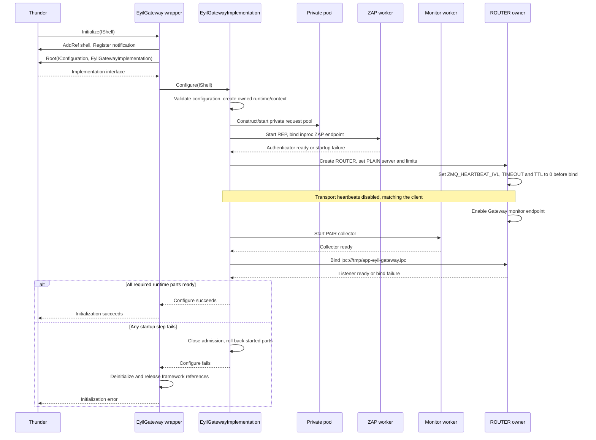

Require ZAP readiness before accepting handshakes. Do not publish a healthy
plugin until its required runtime parts are ready. With ICrypto absent, the
transport can be ready while Crypto is unavailable; the chosen degraded-start
policy is a TODO. AppManager/RuntimeManager lookup is not called in this phase.

Before binding ROUTER, explicitly set ZMQ_HEARTBEAT_IVL, ZMQ_HEARTBEAT_TIMEOUT
and ZMQ_HEARTBEAT_TTL to 0, matching client setup in section 5.5. The sample's
enabled heartbeat settings are superseded. Start no application heartbeat or
inactivity-watchdog workers. Keep the PAIR monitor and event-driven cleanup.

Partial rollback must use the same ownership discipline as normal stop.
Define how the wrapper requests and awaits full runtime shutdown before
releasing IConfiguration; this ownership contract is **Gap 2**.

### 6.5 ZAP, interim identity and future AppManager lookup

Coverage: **AC1.3, AC1.5–AC1.6; AC2.2**.

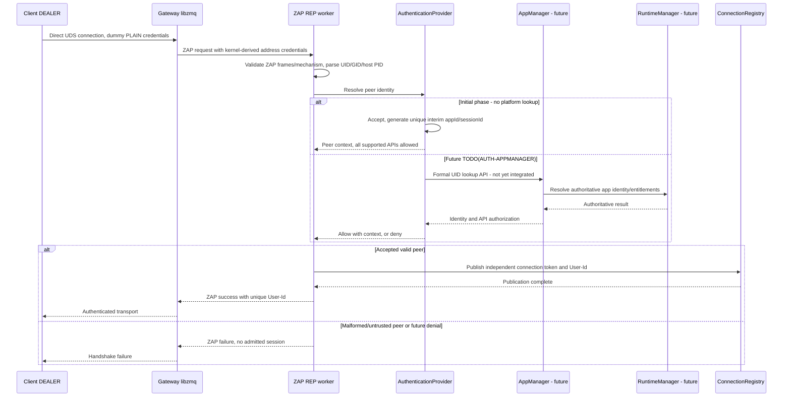

A User-Id can encode `appId#sessionId#connectionToken`, or be an opaque random
token resolved through the registry. The important property is uniqueness per
accepted connection and an unambiguous lookup; any delimiter-based encoding
needs escaping/validation. Reconnection creates a new generation. Two sockets
from the same UID/GID/PID do not share a context.

The interim "accept all" decision removes policy checks, not frame validation,
credential provenance checks, quotas or buffer isolation. Production API
entitlements are cached per connection and purged from admission on disconnect.
No app-supplied username, password, route or payload field replaces the kernel
identity or the future platform lookup.

### 6.6 Request ingress, dispatch and response delivery

Coverage: **AC1.2, AC1.6–AC1.9; AC2.4**.

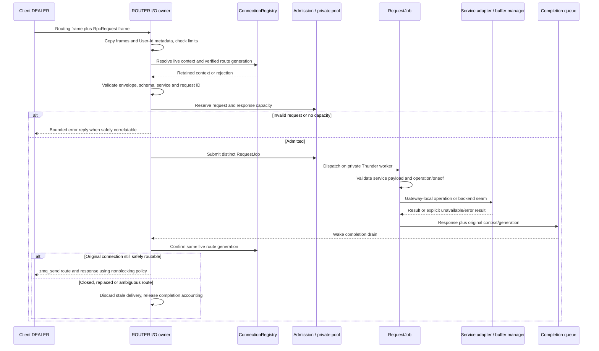

Admission should bound per-connection and global requests, serialized bytes and
expected response capacity. Expensive service work belongs in the job; bound
even envelope parsing so malformed traffic cannot monopolize I/O.

Validate at least: frame count, message size, trusted metadata, live context,
schema 1, supported service, request-ID rules, service parse, operation/oneof
agreement, enum/range validity and allocation ownership. Unknown/duplicate IDs
need an explicit policy. Independent requests can finish in any order;
dependent operations must follow the resource-ordering contract.

A job publishes completion rather than touching ROUTER. Configure deliberate
ROUTER routing/error behavior and use nonblocking sends. A full client queue
must not stall other clients. `ZMQ_ROUTER_MANDATORY` makes unreachable/full-route
conditions observable; it does not authenticate a routing ID or solve route
reuse. See [ZeroMQ socket options](https://libzmq.readthedocs.io/en/latest/zmq_setsockopt.html).
Detailed admission-to-egress accounting remains **Gap 6**.

### 6.7 Service adapter and future ICrypto session setup

Coverage: **AC1.8, AC1.10**.

**ICrypto is not included or called by the current repository.** The future
adapter is based on the reviewed
[ICrypto revision 6926f6a](https://github.com/rdkcentral/entservices-apis/blob/6926f6a72fbfff18b691d09b3b7376fbd541b9d3/apis/Crypto/ICrypto.h)
from [PR #1089](https://github.com/rdkcentral/entservices-apis/pull/1089).
Pin an approved compatible revision when integrating; this document does not
claim that the PR has been merged.

That revision supplies `ApplicationContext { appId, sessionId }` and
`SharedBuffer { name }`. The adapter creates these from trusted internal
records. A raw FD integer is not an interprocess shared-memory identity.

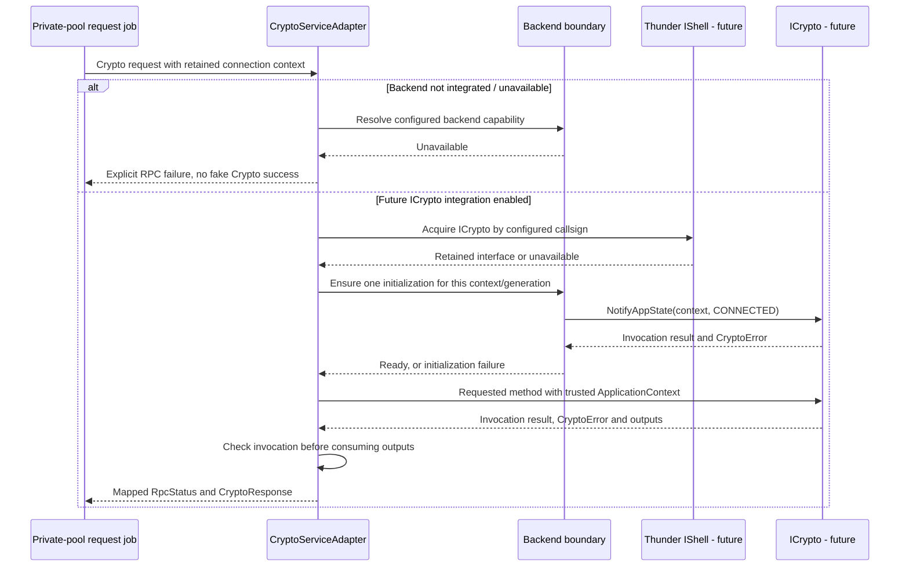

Acquire a configured backend using the appropriate IShell interface lookup
(for example `QueryInterfaceByCallsign<Exchange::ICrypto>()`), not by
constructing the Crypto implementation inside Gateway. Retain the interface
for active calls and release it through an ordered stop/restart path.

An initialization barrier must prevent an operation from overtaking CONNECTED
or multiple concurrent requests from initializing the same context twice.
Whether CONNECTED occurs at authentication or first backend use, and how
never-used connections are cleaned up, remain TODO(BACKEND-SESSION).
No such notification is sent while the backend is absent.

Crypto owns key authorization. Gateway will eventually check API entitlements
before dispatch, but it must not duplicate Crypto's decisions about key usage,
export protection or cross-app sharing.

### 6.8 Crypto operation routing map

All 17 Protobuf operations have an explicit destination. Only the two buffer
management operations terminate locally; the remaining 15 require the future
backend. Structure/limit checks apply even in the interim accept-all phase.

| CryptoRequest operation | Destination / future method | Main inputs → successful outputs |
| --- | --- | --- |
| LOAD_KEY | ICrypto::LoadKey | locator, provision_type → key_id |
| KEY_EXISTS | ICrypto::KeyExists | locator → exists, key_id when present |
| FLUSH_KEYS | ICrypto::FlushKeys | trusted context → empty response |
| GENERATE_KEY_PAIR | ICrypto::GenerateKeyPair | algorithm, matching parameters → private_key_id, public_key_id |
| DERIVE_SESSION_KEYS | ICrypto::DeriveSessionKeys | algorithm and source key IDs → encryption/hmac/wrapping key IDs |
| GET_KEY_INFO | ICrypto::GetKeyInfo | key_id → type, usages, algorithm |
| GENERATE_KEY | ICrypto::GenerateKey | algorithm, usages → key_id |
| UNLOAD_KEY | ICrypto::UnloadKey | key_id → empty response |
| IMPORT_KEY | ICrypto::ImportKey | type, optional protection format, blob → key_id |
| EXPORT_KEY | ICrypto::ExportKey | key_id, optional protection format → blob |
| GENERATE_RANDOM | ICrypto::GenerateRandom | bounded byte count → random bytes |
| ENCRYPT | ICrypto::Encrypt | buffer_id, algorithm, key_id, init/input regions → encrypted region |
| DECRYPT | ICrypto::Decrypt | buffer_id, algorithm, key_id, init/encrypted regions → plaintext region |
| SIGN | ICrypto::Sign | buffer_id, algorithms, key_id, input region → signature region |
| VERIFY | ICrypto::Verify | buffer_id, algorithms, key_id, input/signature regions → verification_status |
| ALLOCATE_SHARED_BUFFER | SharedBufferManager::Allocate | requested_size → buffer_id, client name, size |
| RELEASE_SHARED_BUFFER | SharedBufferManager::Release | buffer_id → release result |

Preserve optional presence for import_export_type rather than replacing an
absent field with the enum's zero value. Validate repeated usages, algorithm
parameter variants, sizes and numeric conversions before constructing backend
types. Use explicit mappings rather than assuming enum ordinals always match.

### 6.9 Non-shared-memory operations

Coverage: **AC1.8; AC3.1–AC3.2**. This flow applies to the eleven key/random
operations above; allocation/release and the four bulk-data operations have
separate flows.

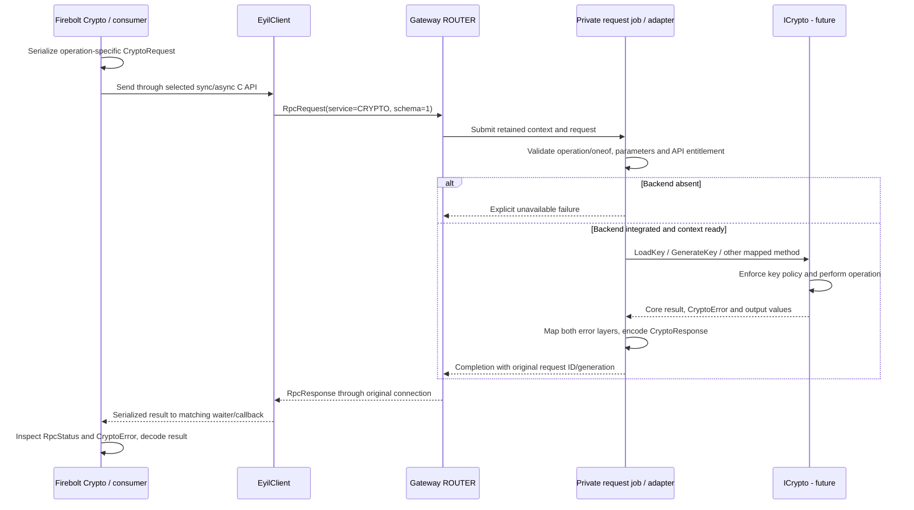

Key generation/import/derivation may change backend state. Loss of a response
does not justify retrying automatically. Ordering UnloadKey or FlushKeys
against concurrent use of those keys is part of **Gap 5**.

### 6.10 Shared-memory identity, records and invariants

Coverage: **AC1.9–AC1.10**. Allocation is a Gateway responsibility; mapping by
the application and future access by Crypto are separate responsibilities.

| Identifier | Example | Meaning |
| --- | --- | --- |
| buffer_id | Opaque generated token | Gateway lookup key, scoped to one connection generation |
| Client name | `/eyil.<random-token>` | POSIX name opened with shm_open() inside the app container |
| Backend path | `/proc/<host-peer-pid>/root/dev/shm/eyil.<random-token>` | Proposed host-visible path passed as SharedBuffer.name |
| Gateway FD | Process-local descriptor | Retains the created object; never sent as a bare integer to Crypto |
| BufferRegion | `{ offset, length }` | Byte range in the same allocation, not a pointer |

Each buffer record retains the owner token/generation, peer evidence, opaque ID,
client name, backend path, actual capacity, FD, reserved/active use count and
release state. Per-connection count/byte quotas and a global byte budget require
atomic reservation and rollback on every failure path.

Use exclusive creation, generated names, close-on-exec descriptors and deliberate
ownership/mode settings. The shared-memory proposal sets the peer UID/GID and
owner read/write access. Verify user-namespace mappings and backend permissions
on the target platform; Gateway running in Thunder is not itself proof of the
required procfs access.

The proposal's namespace path uses the peer's mount view. Access is subject to
procfs checks and can become unavailable when the peer or its main thread exits.
See [proc_pid_root](https://man7.org/linux/man-pages/man5/proc_pid_root.5.html).
The path/FD relationship remains **Gap 4**: retaining an FD does not guarantee
that a later open of the pathname obtains the same object.

Required invariants:

- Only the owner connection may resolve a buffer_id; same UID/PID is insufficient.
- A connection may have multiple allocations. Initially allow at most one
  operation using an allocation at a time, with queued-use reservation rules
  still to be settled.
- Check `offset <= size && length <= size - offset`; avoid unchecked
  `offset + length` arithmetic. Enforce per-operation region presence and
  overlap rules.
- Keep a lease from the point at which the operation depends on the allocation
  until backend access is definitively over. Release/disconnect cannot invalidate it.
- The app must not resize, unlink or modify participating regions while an
  operation is outstanding. This cooperation rule is not protection against
  a malicious writable client; mutation/truncation defenses remain TODO.
- Gateway owns unlink/cleanup. An app unmaps/closes its own view; it does not
  call shm_unlink(). Unlink/close by Gateway also does not revoke an existing
  app mapping.
- A local client timeout or uncertain COM-RPC failure is not safe completion.

The sample's 32 MiB buffer, four buffers and 128 MiB per-session limits are
reference values, not production defaults adopted by this document. Select
configuration values together with the platform memory and concurrency budgets.

### 6.11 AllocateSharedBuffer and client mapping

Coverage: **AC1.9; AC2.4; AC3.1–AC3.2**. No ICrypto call is involved.

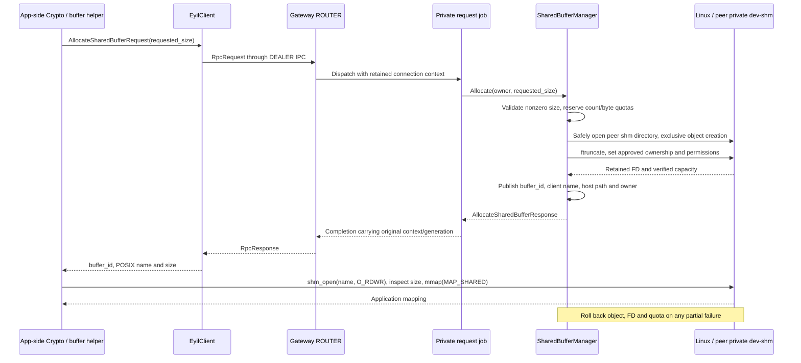

The mapping helper is outside the current EyilClient transport API. Decide
whether Firebolt Crypto supplies it or a separate utility does. The application
must also handle allocation success followed by mapping failure: request release
when possible, otherwise let correlated connection cleanup reclaim the record.

If the connection closes while creation is in progress, recheck its generation
before publishing the result and clean up an allocation that cannot be admitted.
If an allocation reply is lost, the Gateway may own a buffer unknown to the app;
quota accounting and eventual connection cleanup must still cover it.

### 6.12 Shared-memory operations: common backend boundary

For all four operations, the app writes inputs before sending the request.
The Gateway resolves buffer_id and validates owner/ranges, then passes the
trusted backend path and regions to the future adapter. Crypto independently
opens the object, checks its actual size, maps it, performs the operation and
unmaps/closes it before a successful synchronous invocation returns.

The reviewed ICrypto contract selects output locations in Crypto. Gateway
forwards the returned region only after validating the invocation and service
result. On success, output must be inside the allocation. A BUFFER_OVERFLOW
result may describe required capacity rather than an accessible output range;
the app must not read it as produced data. Exact required-size propagation must
match the adopted interface revision.

The following diagrams expand the four operation-specific calls. All Crypto
participants are **future TODO(BACKEND-ICRYPTO)**; while absent, dispatch returns
an explicit failure without running these backend steps.

#### Encrypt

Coverage: **AC1.8–AC1.9; AC3.1–AC3.2**.

```mermaid
sequenceDiagram
    participant A as App-side Crypto / mapped buffer
    participant L as EyilClient
    participant R as Gateway ROUTER
    participant J as Private job / Crypto adapter
    participant B as SharedBufferManager
    participant C as ICrypto - future
    A->>A: Write init_data and plaintext input_data
    A->>L: EncryptRequest(buffer_id, algorithm, key_id, regions)
    L->>R: RpcRequest over DEALER IPC
    R->>J: Dispatch independent job
    J->>B: Acquire owner-checked lease, validate regions
    B-->>J: Retained object identity and capacity
    J->>C: Encrypt(context, buffer, algorithm, keyId, initData, inputData)
    C->>C: Open/check/map, enforce key policy, write ciphertext
    C->>C: Unmap and close before normal return
    C-->>J: Invocation result, CryptoError, encryptedData region
    J->>J: Validate successful output or preserve overflow result
    J->>B: End lease only when backend access is known finished
    J-->>R: Completion with EncryptResponse
    R-->>L: RpcResponse
    L-->>A: Matching completion, read ciphertext only on success
```

#### Decrypt

Coverage: **AC1.8–AC1.9; AC3.1–AC3.2**.

```mermaid
sequenceDiagram
    participant A as App-side Crypto / mapped buffer
    participant L as EyilClient
    participant R as Gateway ROUTER
    participant J as Private job / Crypto adapter
    participant B as SharedBufferManager
    participant C as ICrypto - future
    A->>A: Write init_data and encrypted_data
    A->>L: DecryptRequest(buffer_id, algorithm, key_id, regions)
    L->>R: RpcRequest over DEALER IPC
    R->>J: Dispatch independent job
    J->>B: Acquire owner-checked lease, validate input regions
    B-->>J: Trusted object identity and capacity
    J->>C: Decrypt(context, buffer, algorithm, keyId, initData, encryptedData)
    C->>C: Open/check/map, enforce key policy, write plaintext
    C->>C: Unmap and close before normal return
    C-->>J: Invocation result, CryptoError, outputData region
    J->>J: Validate result and successful output bounds
    J->>B: End lease after definitive backend completion
    J-->>R: Completion with DecryptResponse
    R-->>L: RpcResponse
    L-->>A: Matching completion, read plaintext only on success
```

#### Sign

Coverage: **AC1.8–AC1.9; AC3.1–AC3.2**.

```mermaid
sequenceDiagram
    participant A as App-side Crypto / mapped buffer
    participant L as EyilClient
    participant R as Gateway ROUTER
    participant J as Private job / Crypto adapter
    participant B as SharedBufferManager
    participant C as ICrypto - future
    A->>A: Write input_data
    A->>L: SignRequest(buffer_id, algorithm, key_id, digest, input)
    L->>R: RpcRequest over DEALER IPC
    R->>J: Dispatch independent job
    J->>B: Acquire owner-checked lease, validate input region
    B-->>J: Trusted object identity and capacity
    J->>C: Sign(context, buffer, algorithm, keyId, digestAlgorithm, inputData)
    C->>C: Open/check/map, sign, select/write signature region
    C->>C: Unmap and close before normal return
    C-->>J: Invocation result, CryptoError, signature region
    J->>J: Validate success region or overflow result
    J->>B: End lease after definitive backend completion
    J-->>R: Completion with SignResponse
    R-->>L: RpcResponse
    L-->>A: Matching completion, read signature only on success
```

#### Verify

Coverage: **AC1.8–AC1.9; AC3.1–AC3.2**.

```mermaid
sequenceDiagram
    participant A as App-side Crypto / mapped buffer
    participant L as EyilClient
    participant R as Gateway ROUTER
    participant J as Private job / Crypto adapter
    participant B as SharedBufferManager
    participant C as ICrypto - future
    A->>A: Write input_data and expected_signature
    A->>L: VerifyRequest(buffer_id, algorithms, key_id, two regions)
    L->>R: RpcRequest over DEALER IPC
    R->>J: Dispatch independent job
    J->>B: Acquire owner-checked lease, validate both input regions
    B-->>J: Trusted object identity and capacity
    J->>C: Verify(context, buffer, algorithms, keyId, input, signature)
    C->>C: Open/check/map, enforce key policy, compare signature
    C->>C: Unmap and close before normal return
    C-->>J: Invocation result, CryptoError, verificationStatus
    J->>B: End lease after definitive backend completion
    J-->>R: Completion with VerifyResponse
    R-->>L: RpcResponse
    L-->>A: Matching completion with boolean result
    Note over A,C: Verify returns no binary output region
```

A verification result of false and a failed invocation are different outcomes.
For every operation, a transport failure after remote dispatch may leave
completion uncertain. Do not take the normal lease-release arrow in that case;
retain/quarantine the resource until an agreed recovery mechanism resolves it.

### 6.13 ReleaseSharedBuffer, reuse and concurrent release

Coverage: **AC1.9–AC1.10**. No ICrypto call is needed for an idle allocation.

```mermaid
sequenceDiagram
    participant A as App-side buffer helper
    participant L as EyilClient
    participant R as Gateway ROUTER
    participant J as Private release job
    participant B as SharedBufferManager
    participant K as Linux
    A->>A: Wait for definitive completion of all uses
    A->>K: munmap and close own mapping/FD
    A->>L: ReleaseSharedBufferRequest(buffer_id)
    L->>R: RpcRequest over IPC
    R->>J: Dispatch release job with owner context
    J->>B: Release(owner, buffer_id)
    B->>B: Check owner, reject future use atomically
    alt No reserved or active operation
        B->>K: Unlink owned object and close retained FD
        B->>B: Remove record, release quota
        B-->>J: Released
    else Operation still has a lease
        B->>B: Mark release pending, retain object and quota
        Note over J,B: TODO: defer response or acknowledge pending release?
        B-->>J: Outcome according to agreed release contract
    end
    J-->>R: Completion
    R-->>L: RpcResponse
    L-->>A: Matching release result
```

When the last definitive lease ends, the manager can finish a pending release
exactly once. Unknown IDs, duplicate release and release pending acknowledgements
need precise error/idempotency rules.

Do not rely on the order requests arrived at ROUTER: a queued Encrypt can run
after a Release job unless its dependency was reserved or ordered earlier.
Similarly, `client_send_request()` timing out does not satisfy the app's
"all uses completed" condition. These are **Gaps 4 and 5**.

### 6.14 Disconnect detection, PID observations and hibernation

Coverage: **AC1.4, AC1.6, AC1.10**.

#### Event-driven connection cleanup

The target replaces the sample's inactivity watchdog with event-driven cleanup:
an actual transport disconnect is correlated to the original connection, its
admission is closed, and backend/resource cleanup follows the retained-work
rules below. Do not expire a context because no RPC arrived recently. UID alone
does not identify a connection; multiple connections from one process remain
independent.

These events establish connection state, not application health. Gateway need
not prove an idle app is responsive to retain its bounded connection state. If
an app hangs with the transport still open, cleanup requires an actual close or
an explicitly adopted platform lifecycle policy. Heartbeats and idle expiry
are disabled; retain bounded state while the socket remains open. Do not
introduce client health polling as part of disconnect handling.

The supplied libzmq patch extends version-2 disconnect monitor events with
UID/GID/PID in addition to the FD. `zmq_server.cpp` demonstrates consuming those
values. The draft/versioned monitor API and exact event format must match the
target patched libzmq build. A normal ZeroMQ 4.3 dependency declaration does not
guarantee that extension exists.

The patch does not enable or disable ZeroMQ heartbeats, and `zmq_server.cpp`
does not configure them. The separate EyilGateway client/Gateway samples do
enable them; the target runtime must explicitly replace those sample settings
with the disabled configuration in section 5.5. Applying the credential patch
alone does not disable the sample's heartbeats.

Standard monitor disconnect events do not include ZAP User-Id; their FD may
already be closed. See the
[monitor API](https://libzmq.readthedocs.io/en/latest/zmq_socket_monitor.html).
The patch's credential tuple still identifies a process, not one of its several
connections. FD reuse, handshakes that never send a request and rapid reconnects
must be covered by a stronger correlation contract.

```mermaid
sequenceDiagram
    participant P as Peer / kernel
    participant Z as libzmq monitor producer
    participant M as Gateway PAIR monitor worker
    participant REG as Registry / I/O owner
    participant J as Queued and active jobs
    participant C as Crypto adapter - future
    participant B as SharedBufferManager
    P->>Z: Socket closes or transport fails
    Z->>M: Disconnect event with versioned identity evidence
    M->>REG: Post normalized event
    REG->>REG: Correlate to exact connection generation
    alt Evidence is ambiguous
        REG->>REG: Record unresolved event, do not select every matching PID
        Note over M,REG: Gap 1 blocks reliable targeted cleanup
    else Exact original connection is known
        REG->>REG: Close admission, remove auth/routing visibility
        REG->>J: Resolve queued jobs, retain active references
        J-->>REG: Definitive completion of active backend access
        opt Backend had an initialized context
            REG->>C: Schedule NotifyAppState(DISCONNECTED) through worker path
            C-->>REG: Completion or unresolved failure
        end
        REG->>B: Finalize releasable allocations after leases end
        B-->>REG: Resources released or retained for unresolved access
        REG->>REG: Retire context when references and cleanup permit
    end
```

The proposed drain-before-destructive-notification ordering prevents
DISCONNECTED from freeing Crypto resources used by an active call. The
architectural requirement to notify on detection must be reconciled with this
ordering; it is a TODO, not a reconnect grace period. Backend work must not run
on the monitor or I/O thread.

Process-existence tracking can supplement monitor events. It needs a stable
process-instance handle or equivalent reuse protection; UID has no process
lifetime, and a PID existence check alone can match a replacement process.
A living process can close one of several connections. An inherited connection
can outlive its original creator, so process exit is not automatically socket
closure.

#### Intended process-freeze behavior and prerequisites

**An application may freeze its process after completing its operations. The
application owns that preparation; Gateway must not treat the pause as a
disconnect merely because the application is idle.** Transport heartbeats are
disabled on both ends as specified in section 5.5. This scenario preserves the
existing process and socket descriptors; destructive lifecycle changes remain
separate cases.

The intended operation freezes the existing process with its descriptors
preserved, for example through a process stop or container freezer. Linux's
[cgroup freezer](https://docs.kernel.org/admin-guide/cgroup-v2.html) stops the
processes until thawed; freezing is distinct from killing them.

Before allowing the freeze, the application must:

1. Stop new submissions from all its callers and finish any connect attempt.
2. Wait for all accepted requests and response callbacks to finish. There must
   be no unsent request, outstanding response, active callback or active backend
   operation belonging to the connection.
3. Coordinate its shared-buffer users so no Crypto operation is still reading
   or writing a region. Idle allocations and key/session state may remain owned
   by the live connection; freezing does not imply release.
4. Treat a timeout or communication error as an uncertain remote outcome, not
   proof that the operation ended. Without definitive completion, the app has
   not established the required idle state. The generic API has no remote-drain
   or cancel acknowledgement that could prove otherwise.

No new public prepare-to-freeze API or AppManager subscription is introduced by
these assumptions. The application coordinates its own activity with its
platform's freeze mechanism. This is a responsibility of the app, not a claim
that the current library can atomically certify remote quiescence.

```mermaid
sequenceDiagram
    participant A as Application / its callers
    participant C as EyilClient runtime
    participant P as Platform freeze mechanism
    participant K as Kernel / open UDS connection
    participant G as Gateway registry and I/O owner
    participant O as Another active application
    Note over C,G: Transport heartbeats disabled, existing process and socket descriptors preserved
    A->>A: Stop submissions and coordinate all callers
    C-->>A: Finish accepted calls and response callbacks
    A->>A: Establish no pending or uncertain remote operation
    A->>P: Application is ready for process freeze
    P->>K: Freeze process with existing descriptors preserved
    Note over A,C: All application and libzmq threads in this process stop
    Note over K,G: Freeze alone produces no socket disconnect event
    G->>G: Retain connection identity, context and idle resources
    O->>G: Requests on another connection
    G-->>O: Independent responses continue
    P->>K: Thaw the same process
    alt UDS connection and Gateway context survived
        A->>C: Submit a new request
        C->>G: RpcRequest on the existing connection
        G-->>C: RpcResponse for that request
        C-->>A: Normal request completion
    else Actual transport or Gateway failure occurred during pause
        C->>C: Process connection failure through the normal monitor/I/O path
        C-->>A: Report connection/request failure without replaying old work
        Note over A,G: Reconnect and resource recovery follow the separate lifecycle contract
    end
```

No application-level heartbeat or inactivity watchdog participates in this
flow. The 15-second deadlines cover connect, synchronous requests and async
send submission only. Async responses and otherwise idle connections do not expire.

**No heartbeat-driven expiry:** both endpoints disable transport heartbeats,
so a paused client does not lose its connection because it cannot exchange
heartbeat traffic. Actual disconnect events still require normal cleanup.
UID/GID/PID enrich event correlation; they neither preserve a closed socket nor
prove that an application is responsive.

A process that is stopped can retain its PID/UID and its open UDS descriptors.
Do not classify a stopped state, absence of CPU progress or lack of messages as
disconnect evidence. PID existence provides no responsiveness guarantee, and a
dedicated client monitor thread would be frozen along with the rest of the app.
The supplied UID/GID/PID patch only enriches an actual transport-disconnect event;
it neither detects a freeze nor adds a timeout for one.

AppManager/RuntimeManager lifecycle subscriptions remain TODO(LIFECYCLE-EVENTS).
The idle process-freeze case does not require such an observer. Actual process
termination, checkpoint/restore that replaces the process or loses descriptors,
and restarting Gateway are separate cases: the same session cannot be assumed
to survive them. The specific platform hibernation mechanism still needs
verification if it does more than freeze the existing process.

#### Removed sample application-level liveness logic

| Removed from the target design | Replacement or retained responsibility |
| --- | --- |
| Client RpcHeartbeat producer, heartbeat worker and Gateway RPC_SERVICE_CONTROL heartbeat handler | Normal application requests only; PAIR monitor events supply connection-state information |
| Sample client_watchdog() thread and last_request inactivity expiry | Correlated disconnect events drive session cleanup, with safe handling of outstanding work and buffers |

The old watchdog could release buffers and notify DISCONNECTED after RPC
silence while the UDS socket remained connected. It is sample-only application
logic and is not part of the new client or Gateway architecture. There is no
replacement periodic application liveness timer. Keep socket monitors, safe
disconnect cleanup and the selected local operation deadlines. Built-in ZeroMQ
transport heartbeats are disabled as well.

#### Gateway behavior if a client stops receiving

For an idle freeze with the connection preserved, Gateway has no operation to
complete and no response to deliver to that client. It retains the context and
idle resource allocations while other clients continue. Retained buffers are
expected state, not evidence that disconnect cleanup failed; apply
per-connection and global quotas to keep that state bounded.

The design must still contain failures when an app freezes unexpectedly or
violates its preparation contract:

- A response may remain queued for the frozen peer. Do not make ROUTER, the
  monitor or a private-pool worker wait for that peer to read it. Deliver through
  bounded per-connection completion queues and nonblocking ROUTER sends.
- Use explicit ROUTER_MANDATORY/error handling: a full live route must not
  silently lose an RPC response. EAGAIN is backpressure, not proof that the peer
  died. Schedule other writable routes instead of spinning or blocking on this
  one. A process-existence check cannot turn a full queue into a safe disconnect.
- A frozen client must not exhaust global completion storage or occupy all
  workers. Gateway needs independent count/byte admission and fair egress; the
  client's 64-request limit is insufficient as a server resource guarantee.
- If an operation is still executing, retain its context and buffer leases
  until its actual completion. Freezing, an undelivered reply or a local timeout
  must not invalidate backend memory access. On thaw, a synchronous request whose
  deadline elapsed can report CLIENT_TIMEOUT even if backend
  execution finished during the pause. Async response waiting has no deadline.
- A real peer exit or socket failure still requires the normal correlated
  disconnect cleanup. If Gateway fails while the app is frozen, the app learns
  about the transport failure after it resumes; preservation is not guaranteed
  across that independent failure.

Exact egress budgets and saturation policy remain **Gap 6**. Bounded queues and
nonblocking sends protect other clients without inventing a freeze timeout.

#### Local transport evidence and remaining device validation

A local Linux probe using libzmq 4.3.5 stopped only its own DEALER test process
with SIGSTOP for 20.03 seconds, with transport heartbeats disabled at both ends.
The PID remained present, no ROUTER disconnect event occurred during the pause,
another client completed 21 round trips, and the stopped client resumed its
existing connection. A separate stress phase filled the frozen peer's route;
nonblocking mandatory ROUTER sends returned EAGAIN and the other client still
completed a request.

This probe covers local libzmq transport behavior. It does not validate the
EyilClient/Gateway flows, patched ZAP/monitor identity handling, Crypto backend
or Dobby platform hibernation. Validate the idle-freeze and backpressure
scenarios on the target device using its actual freeze mechanism and libzmq.

### 6.15 Backend unavailable, restarted or uncertain

Coverage: **AC1.8–AC1.10**, with backend integration pending.

```mermaid
sequenceDiagram
    participant T as Thunder backend availability - future
    participant A as Crypto adapter
    participant REG as Connection/backend states
    participant J as Active request job
    participant B as SharedBufferManager
    participant R as ROUTER owner
    T-->>A: Interface unavailable or remote backend lost
    A->>REG: Mark backend generation unavailable
    REG->>REG: Stop new backend-dependent admission
    J-->>A: Invocation returns failure or completion becomes uncertain
    alt Backend is known to have stopped all access
        A->>B: End affected leases according to recovery contract
    else Completion / remote process state uncertain
        A->>B: Retain resources, do not claim safe reuse
    end
    A-->>R: Failure completions where correlation remains valid
    opt Backend becomes available again
        T-->>A: New interface generation
        A->>REG: Require an explicit session/key recovery decision
        Note over A,REG: No automatic replay or reuse of old key/buffer handles
    end
```

This is the proposed backend failure boundary. Choose the availability-signal
source, startup behavior, acquisition retries, interface-release ordering and
recovery semantics in **Gap 3**. While Crypto is not integrated, Gateway-local
buffer operations can remain available according to their own admission rules.

### 6.16 Gateway stop, unload and crash recovery

Coverage: **AC1.1, AC1.4, AC1.7, AC1.10**.

```mermaid
sequenceDiagram
    participant T as Thunder
    participant P as EyilGateway wrapper
    participant I as Implementation runtime
    participant R as ROUTER / ZAP / monitor owners
    participant W as Private worker pool
    participant C as Crypto adapter - future
    participant B as SharedBufferManager
    T->>P: Deinitialize
    P->>I: Request deterministic Stop - trigger is TODO
    I->>I: Close admission, mark contexts closing
    I->>R: Stop accepting handshakes/requests, keep control drain alive
    I->>W: Cancel or resolve queued work under agreed policy
    W-->>I: Active calls finish and completion references drain
    I->>C: Schedule final backend notifications on worker path
    C-->>I: Notifications complete or failure policy applies
    I->>B: Finalize buffers with no unresolved access
    I->>W: Stop and join private workers
    I->>R: Disable monitors, close sockets on their owners, exit
    I->>I: Join transport/auth/monitor threads, terminate ZMQ context
    I-->>P: Runtime quiescent
    P->>P: Release implementation and shell references
    opt Future remote implementation mode
        P->>T: Terminate/release remote connection after orderly stop
    end
    P-->>T: Deinitialize complete
```

Do not unload a library while a job, callback or socket thread can execute its
code. A finite ZMQ linger policy is necessary for bounded transport shutdown;
context termination waits for open sockets and pending linger.
[ZeroMQ context termination](https://libzmq.readthedocs.io/en/latest/zmq_ctx_term.html)

This sequence needs an actual stop trigger through the existing
IConfiguration-only split. Merely adding threads and relying on the current
Release()/Terminate() sequence is insufficient. In-process Crypto calls cannot
be safely killed by forcefully terminating their worker thread.

A crash is different from orderly stop. Named objects can survive without their
registry, and a remote backend might still be accessing one. Define an ownership
marker/epoch and safe orphan recovery; never scan and unlink arbitrary app
shared-memory files. Crash cleanup, hung calls and a bounded shutdown policy
remain **Gap 2**.

### 6.17 Implementation order and verification targets

Implement the transport and registry behind the seams described above before
adding external dependencies. The following order keeps each step reviewable:

1. Resolve the remaining connection/shutdown callback and connection-correlation
   contracts that block the first implementation. Apply the selected 15-second
   connect/sync-request/async-send deadlines and 64-request client limit, with
   no async response timeout. Disable ZeroMQ heartbeats on both ends. Keep
   app-owned freeze preparation and actual disconnect/reconnect behavior distinct;
   destructive lifecycle and platform integration decisions remain separate.
2. Implement the agreed RPC envelope, local error behavior and selected async
   completion contract. Document that contract in the public API. Add EyilClient's
   owner loop, bounded queues, pending map and shutdown. Prove two callers can
   use one connection without touching its socket.
3. Implement Gateway startup/ZAP/interim identities, the registry and monitor
   integration. Prove multiple connections from one PID remain independent.
4. Add private-pool jobs, bounded admission and completion routing using an
   unavailable backend seam. Test errors without claiming Crypto success.
5. Add Gateway-local allocations, ownership checks and leases. Resolve pathname
   identity and release-ordering gaps before enabling real backend access.
6. Integrate AppManager/RuntimeManager authentication only at the marked TODOs,
   once their formal API exists. Add lifecycle event behavior only after a
   separate policy decision.
7. Integrate the approved ICrypto revision in the adapter, including session
   initialization, failure handling and definitive buffer completion.

| Test scope | Scenario / evidence required |
| --- | --- |
| L1 client | Request IDs and response matching; duplicate/late replies; argument/output ownership; each waiter resolves once and each response callback runs at most once |
| L1 async send | API cannot return CLIENT_OK before zmq_send accepts the message; EAGAIN keeps the send waiter pending; timeout/error cancels unsent work with no callback; race acceptance against deadline and disconnect |
| L1 async response | A response later than 15 seconds is delivered; no response timer exists; original callback signatures carry valid Gateway error responses; connection loss or local response-processing failure retires the record without an error callback |
| L1 callback execution | Request calls from the I/O-owner callback return CLIENT_INVALID_ARGUMENT; freeing a response is allowed; callback runs without internal locks and may precede submitting-thread resumption |
| L1 client limits | 64 queued plus awaiting-response records share one limit; excess submissions fail without callback; each slot retires once; sync uses one 15-second total budget and async only a 15-second send budget |
| L1 Gateway | Envelope/oneof validation; context lookup; admission accounting; enum/presence mapping; allocation rollback |
| L1 concurrency | Queued/active leases, disconnect during dispatch, independent connections and dependency barriers |
| L2 transport | Real DEALER/ROUTER IPC, ZAP metadata, reverse-order completion and simultaneous sync/async callers |
| L2 connect readiness | CONNECTED alone cannot complete connect; HANDSHAKE_SUCCEEDED returns CLIENT_OK; explicit rejection returns CLIENT_AUTH_FAILED; absent/stalled endpoint reaches CLIENT_TIMEOUT; each failure wakes the waiter and rolls back resources |
| L2 disabled heartbeats | Verify IVL/TIMEOUT/TTL are 0 on DEALER and ROUTER before connect/bind and after socket recreation; confirm monitor-driven cleanup still occurs on actual socket closure |
| L2 disconnect | Target patched monitor, multiple connections from one PID, FD/route reuse, disconnect before first request |
| L2 buffers | Container-private mapping, cross-connection rejection, release during work, size/region failures and lost replies |
| L2 lifecycle | Partial-start rollback, stop with queued/active jobs, slow receiver fairness and no surviving library threads |
| L2 process freeze | With transport heartbeats disabled: app drains operations/callbacks, freezes longer than 15 seconds, preserves its live context/buffers while another client continues, then resumes; no custom RPC heartbeat or inactivity watchdog exists |
| L2 unexpected frozen receiver | Outstanding response hits route backpressure without blocking other routes/workers; bounded accounting and buffer leases survive until definitive completion or actual disconnect |
| Future integration | AppManager identity mapping, ICrypto invocation/result mapping, backend restart and communicator restrictions |

Use a controlled fake adapter for concurrency/failure tests when needed, clearly
separate from production Crypto and never described as real cryptography.
An eventual DobbyTool-based smoke test should execute the client inside a real
application container to verify mounts, credentials and private shared memory;
DobbyTool itself is not in the RPC path.

The implementation wiring should make the current external boundaries visible
in comments, following this conceptual example (not existing source code):

```text
GatewayRuntime
  authentication = InterimIdentityProvider
    // TODO(AUTH-APPMANAGER): replace acceptance with the formal UID lookup.
    // TODO(API-AUTHORIZATION): populate per-connection API entitlements.
  cryptoBackend = UnavailableBackend
    // TODO(BACKEND-ICRYPTO): bind the approved interface in one adapter.
    // TODO(BACKEND-SESSION): add ordered CONNECTED/DISCONNECTED handling.
  lifecycleObserver = none
    // TODO(LIFECYCLE-EVENTS): add agreed platform subscriptions and policy.
```

Keep this choice explicit in startup/configuration and tests. Interim admission
must not be silently mistaken for production authorization when the later
provider is unavailable.

### 6.18 Build and repository validation reference

These commands cover build and repository validation. Runtime acceptance also
requires the behavior tests described above.

<details>
<summary>Build, installation, coverage and GitHub workflow details</summary>

#### Build, install and validation

Required tools: CMake 3.21+, Ninja, a C/C++ compiler, Protobuf 3.15+ development
files and protoc, ZeroMQ 4.3+ development files, and Python 3.9+. Building the
plugin additionally requires Thunder Core/COM/Plugins, ThunderTools and the
matching `interfaces/IConfiguration.h` from ThunderInterfaces or the platform's
entservices-apis SDK. Out-of-process use also requires matching IConfiguration
proxy/stubs in Thunder's configured proxystub directory. Do not mix headers
and proxy/stubs from different interface providers or releases.

For a native SDK build, install the host development prerequisites, then run:

```sh
bash build_dependencies.sh
bash build.sh
python3 scripts/run-tests.py --build-dir build --label L1
python3 scripts/run-tests.py --build-dir build --label L2
bash scripts/check-install.sh build rootfs/all
```

build_dependencies.sh fetches pinned Thunder R4.4, ThunderTools and
ThunderInterfaces sources into the ignored _deps directory. It builds the
IConfiguration headers and proxy/stubs along with Thunder. It does not install
system packages. To use an existing SDK, set EYIL_THUNDER_PREFIX; optional
EYIL_DEPS_DIR selects local dependency storage. EYIL_CONFIGURATION_INCLUDE_DIR
can select the SDK include directory containing `interfaces/IConfiguration.h`
when it is not found automatically.

To generate a configuration for a separate implementation process, build with
`bash build.sh -DPLUGIN_EYILGATEWAY_MODE=Local`. The default is `Off`. Install both
plugin libraries and make the matching proxy/stubs available to Thunder and
WPEProcess before using Local mode.

The client and protocol can be built without Thunder:

```sh
cmake -S . -B build-client -G Ninja \
  -DPLUGIN_EYILGATEWAY=OFF -DBUILD_EYILCLIENT=ON \
  -DCMAKE_INSTALL_PREFIX=/usr -DCMAKE_INSTALL_LIBDIR=lib
cmake --build build-client
bash scripts/check-install.sh build-client rootfs/client
```

Use a CMake toolchain file and target dependency prefixes when cross compiling.
Protobuf_PROTOC_EXECUTABLE must identify a host-runnable protoc. Cross-platform
rootfs validation is still pending.

Installed CMake consumers use EyilClient::EyilClient and
EyilProtocol::EyilProtocol. The C header is eyilclient/EyilClient.h; the client also
provides eyilclient.pc. Both plugin libraries install to the Thunder plugin
directory. The generated configuration uses org.rdk.EyilGateway, with autostart
false by default. No test executables are installed.

L1 and L2 runners invoke CTest and emit summaries and JUnit reports.
Install-consumer checks cover compilation, linking and the Protobuf status
contract. Runtime tests validate the client and Gateway flows described above.

```sh
EYIL_BUILD_DIR=build-coverage bash build.sh -DENABLE_COVERAGE=ON
python3 scripts/coverage.py --build-dir build-coverage
```

Coverage instruments handwritten plugin/client code, excluding generated
Protobuf and dependency sources. Empty suites produce an explicit coverage
unavailable summary. Once real tests are registered with L1/L2 labels, the same
runner produces XML, HTML and text reports. No artificial percentage is reported.
Use `--label L1` or `--label L2` to run coverage for one suite; the default runs
both suites.

#### Repository checks and GitHub configuration

C/C++ uses .clang-format; Python uses Black; YAML uses yamllint. New source,
build, workflow and documentation files carry the Apache-2.0 licensing header.
JSON remains strict JSON and is covered by LICENSE/NOTICE. README.md is
intentionally empty.

Install the pinned development tools from scripts/requirements-dev.txt and run
scripts/check-format.sh plus scripts/validate-files.py. Build outputs and local
SDKs are ignored by Git.

GitHub workflows cover native build/install checks, standalone client builds,
L1/L2, coverage, formatting, JSON validation, manual CI, FOSSID,
changelog/version validation, and manual draft release creation. CLA and
CODEOWNERS are retained as repository governance.

L1 and L2 each collect coverage for their selected suite through the shared
`native-ci.yml` workflow. Manual CI uses the same native build job. Formatting
and licensing checks run together with JSON checks in `json_validator.yml`.
The scripts directory supplies the build and validation commands used locally
and in CI; GitHub Actions itself does not require that directory layout.

Jobs use GitHub-hosted `ubuntu-24.04` runners. This release supplies Protobuf
3.21, which meets the project's 3.15 minimum for proto3 optional fields; Ubuntu
22.04 supplies Protobuf 3.12. The native SDK cache includes the runner release.
No organization-specific runner label is required. Native and standalone-client
builds use CMake 3.28.3, matching the tested SDK setup and retaining compatibility
with the pinned Thunder sources' older CMake policy baseline.

FOSSID uses the public
`rdkcentral/build_tools_workflows/.github/workflows/fossid_integration_stateless_diffscan.yml@1.0.0`
on pull requests from branches in this repository. It requires the four FOSSID
secrets referenced in the workflow and skips fork pull requests. CLA uses
`rdkcentral/cmf-actions` and requires CLA_ASSISTANT. Build, test, coverage and
repository-validation jobs require no organization credentials.

TODO(CI): add Coverity when an accessible rdkcentral workflow and its credential
contract are available. No private Coverity workflow is referenced in this
repository.

The scripts directory, formatting configuration and CHANGELOG.md must be
committed with the workflows so a fresh checkout contains their dependencies.

The release workflow is manual and creates a draft only from main after
checking the requested version against CMake and CHANGELOG.md. Repository
administrators must configure branch protection and runner access separately.
Version checks also compare the CMake version and EyilGateway/Version.h so the
plugin's reported and registered versions agree.

</details>

## 7. Gaps to answer

These are the **six architectural gaps from the review**, followed by the
remaining API/platform TODOs. Proposed safeguards in earlier sections describe
the required invariants; they do not close these questions. Resolve the
blocking items before implementing the affected production path.

### 7.1 Gap 1: Connection identity for disconnects and outgoing responses

**Question:** what stable transport identity links a ZAP acceptance, each
request, its ROUTER route and a later disconnect to the same connection
generation?

The supplied patch returns FD/UID/GID/PID, but two connections from one process
share the credentials. FDs and routing IDs can be reused. A ZAP connection may
also disconnect before sending its first request, leaving no request-derived
route binding.

Answers required:

- Which immutable token or verified mapping joins ZAP User-Id, monitor events
  and ROUTER messages, including before the first request?
- Does the target libzmq need a further patch to expose the same token at all
  three points? Which version/draft build is required?
- How are reconnect, FD reuse, duplicate routing IDs and ROUTER handover handled?
- How is a late reply prevented from reaching another connection that reused
  the same ROUTER identity? An incoming User-Id check alone does not protect
  an outgoing route.
- What happens when a monitor event cannot be correlated, without disconnecting
  unrelated connections or retaining unbounded abandoned state?

**Implementation constraint:** carry a generation through every job/completion
and reject stale delivery. This is necessary but is not a complete transport
binding by itself; libzmq can change routes independently of the registry.
Do not claim that the credential patch alone solves this gap.

**Blocks:** reliable independent-session cleanup and secure response routing.
**Coverage affected:** AC1.4, AC1.6, AC1.10; AC2.3–AC2.4.
**TODO:** CONNECTION-CORRELATION.

### 7.2 Gap 2: Complete startup, shutdown and crash-recovery lifecycle

**Question:** how does Thunder activation/deactivation drive a complete,
deterministic runtime lifecycle through the current IConfiguration-only split?

Answers required:

- What must be ready before Configure succeeds, and is missing Crypto allowed
  to leave the transport in a deliberately degraded mode?
- How does the wrapper request and await stop before Release/remote Terminate?
  Is controlled destruction sufficient, or is an explicit internal stop
  contract needed?
- Which queued requests are cancelled versus drained? How are active calls,
  completion records, ZAP replies and monitor workers joined in dependency order?
- What is the policy when an in-process backend never returns or a remote call
  has an uncertain outcome? A timeout cannot make forced thread destruction safe.
- How are allocations recovered after a crash without unlinking a live client's
  or another Gateway instance's object?
- Which bounded shutdown/linger policies apply, and what state is reported if
  safe teardown cannot complete?

**Implementation constraint:** use one rollback/stop ownership model and keep
implementation code loaded while any worker can still execute it. Releasing an
interface reference alone does not establish that the runtime has stopped.

**Blocks:** safe plugin disable/reload, partial-start rollback and orphan cleanup.
**Coverage affected:** AC1.1, AC1.4, AC1.7, AC1.10.
**TODO:** GATEWAY-LIFECYCLE.

### 7.3 Gap 3: Crypto acquisition, availability and restart lifecycle

**Question:** how will the future adapter manage an ICrypto interface and its
per-connection Crypto sessions across startup, failure and backend replacement?

Answers required:

- Which callsign and approved ICrypto revision are used? What is the interface
  acquisition, reference ownership and availability-notification mechanism?
- Does backend absence fail Gateway startup or only backend-dependent requests?
  Which RpcStatus communicates that condition?
- Is CONNECTED sent on authentication or first backend use? How are concurrent
  first requests ordered, and what happens if initialization fails?
- What are the backend's concurrency guarantees for different requests, one
  ApplicationContext, and different keys/buffers?
- What happens to existing key handles and context state after backend restart?
  Must the client reconnect, or is a defined reinitialization sequence available?
- How do DISCONNECTED and invocation failure interact with active calls and
  uncertain remote completion?

**Implementation constraint:** retain the internal backend seam now; add ICrypto
types and calls only in the future adapter. Never replay operations or silently
reuse a prior backend generation's resources.

**Blocks:** real Crypto integration and correct backend session cleanup.
**Coverage affected:** AC1.8–AC1.10; AC3.1.
**TODOs:** BACKEND-ICRYPTO, BACKEND-SESSION, BACKEND-RECOVERY.

### 7.4 Gap 4: Stable shared-memory object identity and lifetime

**Question:** how do Gateway and Crypto guarantee they access the same backing
object, and when is that object safe to reuse or destroy?

Gateway retains an FD, but Crypto opens a pathname. A client can potentially
replace/unlink the name, resize the file or mutate mapped bytes. A retained FD
continues referring to the original object even if its name changes; a later
open by name need not. `O_NOFOLLOW` alone does not secure the entire path.
See the [Linux open API](https://man7.org/linux/man-pages/man2/open.2.html).

Answers required:

- Is the client-namespace pathname a sufficient identity under the accepted
  threat model, or is a stable Gateway-controlled path/object handle needed?
- How does Crypto verify the opened object matches the retained allocation?
  What changes, if any, are needed in the backend identity contract?
- What survives peer exit, PID reuse or loss of /proc/PID/root access? Which
  namespace references, permissions or capabilities are required?
- What prevents replacement, truncation and mutation during processing?
  Are input snapshots or a different protected mapping arrangement required?
- After a client timeout, disconnect or uncertain COM-RPC result, what proves
  backend completion? How does the app learn that reuse is safe?
- What are the release acknowledgement and BUFFER_OVERFLOW/required-capacity
  contracts?

**Implementation constraint:** retain leases and quarantine uncertain use.
Gateway ownership is allocation ownership; it is not immutability, revocation
of client mappings or proof that a reopened pathname resolves to the same file.

**Blocks:** safe real shared-memory backend access and reliable cleanup/reuse.
**Coverage affected:** AC1.8–AC1.10.
**TODOs:** SHM-IDENTITY, SHM-COMPLETION, SHM-MUTATION.

### 7.5 Gap 5: Ownership and ordering under parallel dispatch

**Question:** which component serializes mutable session/resource state, and
what ordering is guaranteed for requests that depend on the same resource?

Answers required:

- Which transitions belong to the I/O owner, and which registry/buffer/backend
  operations use locks or retained records across ZAP and worker threads?
- Does a job acquire/reserve its buffer dependency before enqueueing or when
  execution begins? How is a queued use protected from a later Release?
- Are dependent operations client-ordered, server-serialized, rejected while
  busy or represented by continuations? Which errors express rejection?
- How do UnloadKey and FlushKeys interact with pending Sign/Encrypt/Derive calls?
- Does closing a session cancel queued work, drain it, or use different rules
  for requests that have not yet entered Crypto?
- How are CONNECTED/DISCONNECTED barriers scheduled without blocking every
  worker on work that is itself queued behind them?

**Implementation constraint:** one dispatch object per request does not imply
unrestricted simultaneous access to every resource. Define resource-specific
ordering while keeping unrelated requests concurrent on the private worker pool.

**Blocks:** safe concurrent request, release and disconnect behavior.
**Coverage affected:** AC1.6–AC1.10; AC2.4.
**TODO:** PARALLEL-ORDERING.

### 7.6 Gap 6: Response-side backpressure and fairness

**Question:** how are completions bounded and fairly delivered when a client
stops receiving, freezes or produces requests faster than it consumes replies?

Answers required:

- What per-connection/global count and byte limits cover pending requests,
  completed responses and libzmq queues? The selected 64 outstanding requests
  per Client do not define or enforce these Gateway-side budgets.
- Is response capacity reserved before dispatch, including large random/export
  results and error replies? What happens if serialization exceeds that budget?
- How are nonblocking multipart sends resumed/rejected on EAGAIN, and how is
  EHOSTUNREACH distinguished from temporary pressure?
- How are clients scheduled fairly so one full route cannot starve others?
- What happens to a slow client's completions when its limit is reached?
  The intended preservation scenario retains the live context without a custom
  idle timer, and transport heartbeats are disabled. Unexpected backlog needs
  bounded handling; any policy to disconnect a saturated live
  client remains a separate decision.
- How does shutdown release completion accounting without blocking workers on
  a full egress queue or losing ownership of live buffers?

**Implementation constraint:** bounding the private request queue alone is
insufficient. Do not block the ROUTER or every worker while waiting for one
client's output queue. Use explicit admission-to-completion accounting.

**Blocks:** bounded resource use and progress under slow/frozen clients.
**Coverage affected:** AC1.2, AC1.7, AC1.10; AC2.4.
**TODO:** EGRESS-BACKPRESSURE.

### 7.7 Remaining API and platform decisions

These items complement the six gaps; several are prerequisites for implementing
a public API, even though they are not new Gateway architecture gaps.

| TODO | Answer needed / integration boundary |
| --- | --- |
| AUTH-APPMANAGER | Formal UID lookup via AppManager/RuntimeManager, authoritative app/app-instance identity, UID reuse guarantees and lookup failure behavior |
| API-AUTHORIZATION | Exact entitlement format and mapping from service/operation to allowed APIs; currently all supported APIs are allowed |
| LIFECYCLE-EVENTS | Whether/how to integrate stop, destruction or platform hibernation events; application-owned freeze preparation is agreed, and transport heartbeats remain disabled independently of future observers |
| CONNECTION-LIFETIME | Actual connection-loss/reconnect, Gateway restart and checkpoint/restore behavior; idle freeze assumes retained process/socket descriptors, with transport heartbeats and inactivity watchdogs disabled |
| CLIENT-CALLBACKS | Initial connection-callback timing and connection-handler lifetime/quiescence; supplied response-only async signatures, send acceptance, I/O-thread execution and reentrancy rules are defined in section 5.4 |
| CLIENT-SHUTDOWN | Explicit local-close result code for active sync/send-result waiters, shutdown callback ordering and concurrent-caller quiescence; accepted async response records are retired without synthetic error callbacks |
| CLIENT-ADMISSION | Local full-queue result after the selected 64 outstanding requests per Client; ClientResult lacks a queue-full value, and server RpcStatus must not be fabricated for local rejection |
| CLIENT-MONITOR | Confirm the monitor-responsibility checklist in section 5.2 and whether PAIR plus the I/O owner satisfies the AC, or a distinct OS thread is mandatory |
| STRING-CODEC | Choose later between Base64 of the entire binary envelope and ProtoJSON, including text/binary size limits |
| ERROR-MAPPING | Invalid service payload, duplicate/malformed IDs, backend unavailable, busy/release-pending and quota errors |
| BUFFER-HELPER | Ownership of app-side shm_open/mmap helpers, output validation and release coordination |
| DEPLOYMENT | UDS mount/recreation, permissions, procfs/user-namespace access, private /dev/shm and blocked direct Crypto communicator access |
| RESOURCE-LIMITS | Byte/message limits beyond the selected client count of 64; Gateway private-pool workers/stacks, queue/response budgets, buffer counts/sizes and global limits |
| ZMQ-PLATFORM | Exact peer-credential encoding, patched version-2 monitor support and stable connection identity on supported devices |
| CI | Add Coverity only when the usable public workflow and credential contract are available; real L1/L2 coverage follows real tests |

**Current integration boundary remains unchanged:** Gateway does not call
AppManager/RuntimeManager or Crypto/ICrypto today. Implement the local transport
and ownership mechanisms around the marked seams, then add each external
integration after its contract is agreed. The app-owned idle process-freeze
preparation, 15-second connect/sync-request/async-send deadlines, no async response
timeout and 64-request client count limit are selected. ZeroMQ transport
heartbeats are disabled on both ends; application heartbeat and inactivity-watchdog
logic are excluded. Actual reconnect, destructive hibernation/checkpoint behavior
and external lifecycle integration remain explicit architecture questions.
