<!--
If not stated otherwise in this file or this component's LICENSE
file the following copyright and licenses apply:

Copyright 2026 RDK Management

Licensed under the Apache License, Version 2.0 (the "License");
you may not use this file except in compliance with the License.
You may obtain a copy of the License at

http://www.apache.org/licenses/LICENSE-2.0

Unless required by applicable law or agreed to in writing, software
distributed under the License is distributed on an "AS IS" BASIS,
WITHOUT WARRANTIES OR CONDITIONS OF ANY KIND, either express or implied.
See the License for the specific language governing permissions and
limitations under the License.
-->

# Eyil Secure Gateway architecture and implementation guide

## 1. Introduction

This document describes how to implement the remaining EyilClient and
EyilGateway logic: transport, concurrent request coordination, connection
contexts, request execution and gateway-owned shared memory. It also records
the integration boundaries and unanswered questions that must not be replaced
by assumptions in code.

Eyil Secure Gateway is an open-source RDK component intended for the
`rdkcentral` ecosystem. The supported platform deployment uses the
**AppManager and RuntimeManager plugins**. Crypto is its first service; the
Gateway remains a general service router. The plugin is `EyilGateway`, its
callsign is `org.rdk.EyilGateway`, and its independent C client library is
`EyilClient`, installed as `libeyilclient.so`.

> **Current implementation:** this repository contains a buildable skeleton.
> It has no active ZMQ connections, request workers, shared-memory allocation
> or backend calls. **AppManager/RuntimeManager APIs and the Crypto backend
> through ICrypto are not used at this time.** Their future integration points
> are explicitly marked with TODO identifiers below.

Use the following distinction throughout the document:

| Label | Meaning |
| --- | --- |
| Existing | Present in this repository or supplied by the platform, as identified |
| Target | Agreed behavior to implement, including the acceptance criteria |
| Proposed | Recommended implementation detail requiring review where indicated |
| TODO | An unresolved contract or future integration; not implemented behavior |

Sequence diagrams describe the **target or proposed implementation**, unless
explicitly identified as existing. Internal component and method names in
diagrams are design names, not claims that those classes already exist.
Public `client_*` functions, Protobuf messages and Thunder bootstrap methods
refer to actual API names.

Navigation: [ACs](#2-acceptance-criteria-and-scope),
[platform architecture](#3-high-level-architecture-and-platform-placement),
[protocol](#4-apis-protobuf-and-zeromq),
[client flows](#5-eyilclient-design-and-api-flows),
[Gateway flows](#6-eyilgateway-design-and-flows),
[gaps to answer](#7-gaps-to-answer).

## 2. Acceptance criteria and scope

The IDs below make the supplied ACs traceable to individual flows. They
describe completion of the feature, not the status of the current skeleton.
The duplicated original "AC2" for Firebolt Crypto is numbered **AC3** here.

### 2.1 AC1: EyilGateway plugin

| ID | Target acceptance criterion |
| --- | --- |
| AC1.1 | Run as the Thunder plugin `EyilGateway`, callsign `org.rdk.EyilGateway`. Initially run the implementation in process. |
| AC1.2 | Bind a `ZMQ_ROUTER` to `ipc:///tmp/app-eyil-gateway.ipc` and accept multiple application connections. |
| AC1.3 | Enable `ZMQ_PLAIN_SERVER` on the ROUTER and run a `ZMQ_REP` ZAP handler at `inproc://zeromq.zap.01` in the same ZMQ context. |
| AC1.4 | Run a monitor worker receiving events on a `ZMQ_PAIR` at `inproc://app-eyil-gateway-monitor`. |
| AC1.5 | Extract kernel-derived peer UID from the ZAP address; retain GID and host PID. For this phase, accept valid direct UDS clients without AppManager authorization and allow all gateway APIs. |
| AC1.6 | Assign a unique ZAP `User-Id` per connection. Retrieve it from every received request and resolve an independent connection context. Multiple connections from one process remain independent. |
| AC1.7 | Dispatch every accepted request as a separate job on a Gateway-owned Thunder thread pool. Keep transport and other requests progressing, subject to bounded capacity and declared resource dependencies. |
| AC1.8 | Parse the Protobuf envelope and route `RPC_SERVICE_CRYPTO` to a service adapter. Future backend integration invokes the external Crypto plugin through ICrypto. |
| AC1.9 | Gateway creates, owns and accounts for shared-memory allocations used by encrypt, decrypt, sign and verify. AllocateSharedBuffer and ReleaseSharedBuffer terminate in Gateway. Allocations belong to one connection; multiple allocations per connection are supported. |
| AC1.10 | When a disconnect is reliably associated with a connection, close its admission, notify the integrated Crypto backend through NotifyAppState(DISCONNECTED), and release its resources without invalidating outstanding backend access. Exact notification/drain ordering remains a lifecycle TODO. |

"Separate thread" in the original high-level AC is implemented as an
independent dispatch job using a fixed private worker pool. It does not mean
creating an unbounded OS thread for every request, or promising unlimited
parallelism when workers, backend capacity or shared resources are exhausted.

### 2.2 AC2: EyilClient library

| ID | Target acceptance criterion |
| --- | --- |
| AC2.1 | Expose the C API in `eyilclient/EyilClient.h` for consumers such as the Firebolt Crypto Client Library. The library itself does not depend on Thunder. |
| AC2.2 | Connect a `ZMQ_DEALER` to `ipc:///tmp/app-eyil-gateway.ipc`. Supply internal dummy PLAIN username/password strings to trigger server-side ZAP; they are not app credentials. |
| AC2.3 | Receive socket monitor events through a `ZMQ_PAIR` at `inproc://app-eyil-client-monitor-<unique-client-id>`. |
| AC2.4 | Support synchronous and asynchronous binary and string requests, including multiple outstanding requests on one connection and responses arriving out of order. |

The accepted implementation direction is a **library-owned serving/I/O
thread**, initially one per `Client`. Applications do not supply an I/O
handler or pump the library. The supplied AC mentions a separate client monitor
thread. Handling its PAIR socket on the serving loop is a proposed consolidation;
confirmation is required before treating that as satisfying the literal
dedicated-thread wording. See TODO(CLIENT-MONITOR).

### 2.3 AC3: Firebolt Crypto Client Library

| ID | Target acceptance criterion |
| --- | --- |
| AC3.1 | Firebolt Crypto uses EyilClient to route app requests to Gateway and ultimately the external Crypto backend. |
| AC3.2 | Firebolt Crypto serializes/deserializes service-specific Crypto payloads using the agreed Protobuf definitions. The EyilClient envelope contract must be aligned with its public header before implementation. |

Firebolt Crypto and the real Crypto plugin are separate deliverables. Their
presence in diagrams does not add their implementation to this repository.

### 2.4 Delivery boundary and current status

| Part | Existing skeleton | Remaining implementation |
| --- | --- | --- |
| Thunder wrapper | IPlugin, Root<IConfiguration>(), Configure(), release and remote-connection notification | Integrate a deterministic stop/drain lifecycle |
| Implementation library | IConfiguration, configuration guard and dependency logging | Transport, authentication seam, registry, private pool, router and buffers |
| EyilClient | Nine C functions with placeholder results and response freeing | Connection handles, coordinator, I/O thread, pending requests and callbacks |
| Protocol | Generated rpc.proto and crypto.proto, schema constant 1 | Envelope processing, validation and service mapping |
| ZeroMQ | Located and linked by CMake | Runtime sockets, monitors and target peer-credential support |
| AppManager / RuntimeManager | No calls or authentication dependency in this code | TODO(AUTH-APPMANAGER); optional lifecycle integration remains TODO |
| Crypto / ICrypto | No ICrypto header dependency, adapter binding, real backend or stub | TODO(BACKEND-ICRYPTO), after interface and lifecycle contracts are approved |
| Tests and CI | Build/install checks, L1/L2 runners and coverage scaffolding | Runtime tests for the flows in this document; L1/L2 currently contain zero tests |

The first transport implementation should keep the two external seams explicit:
an interim identity provider accepts connections, and an unavailable service
backend reports a clear failure for backend-dependent operations. It must not
manufacture successful cryptographic results. Gateway-local allocation/release
can be implemented independently of ICrypto. These are planned boundaries,
not runtime components already implemented.

## 3. High-level architecture and platform placement

### 3.1 RDK deployment

The target is an RDK platform with AppManager and RuntimeManager. The initial
Gateway implementation shares Thunder's process, while an application and its
EyilClient instance run inside an application container. The wrapper/implementation
split preserves a path to a separate implementation process later.

The platform plugins are part of the intended deployment **even while Gateway
does not call them**. Local PC builds and isolated development tests are useful
validation environments; they do not define a second production deployment
based on a legacy application service.

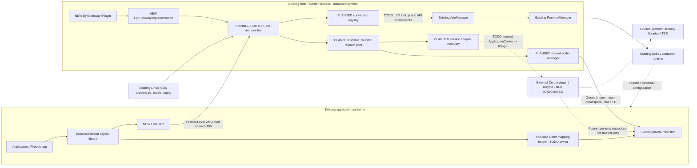

The diagram distinguishes existing platform infrastructure from new Gateway
components and future integrations. Crypto may itself be in process or remote;
Gateway must not depend on a raw pointer or FD being meaningful in Crypto's
process.

### 3.2 Components, ownership and trust boundaries

| Component | Owner / location | Responsibility |
| --- | --- | --- |
| Application / Firebolt Crypto | Application container; external consumer | Express operations, serialize Crypto payloads and consume results |
| EyilClient | New library in the application's process | Transport coordination, RPC correlation and C API buffer ownership |
| App-side mapping helper | Placement TODO; not part of the current EyilClient transport API | Open/map the name returned by allocation; manage app mappings |
| EyilGateway wrapper | New Thunder IPlugin | Framework lifecycle and implementation acquisition |
| EyilGatewayImplementation | New implementation library | Own Gateway transport, contexts, request pool, adapters and allocations |
| AppManager / RuntimeManager | Existing RDK platform plugins | Future authoritative identity/entitlements; lifecycle information if adopted |
| Dobby / DobbyTool | Existing container runtime / diagnostic tool | Launch, container namespace/mount setup and test execution; no request routing |
| Linux kernel / libzmq | Existing platform dependencies | UDS transport and peer credentials; monitor support depends on the target libzmq |
| Crypto plugin / ICrypto | External backend, not integrated | Crypto execution, lower-level sessions, keys and key authorization |
| Sec API / secure hardware / TEE | External platform-specific implementation | Backend-dependent cryptographic operations; no Gateway dependency |

There is **one listening UDS endpoint**, shared by all intended applications.
Each accepted connection gets its own identity, request accounting and buffer
ownership. Separate connections do not require separate socket paths.

The app cannot authoritatively provide its UID, appId, sessionId or a host
shared-memory path. The transport supplies peer credentials; the Gateway creates
the connection context and resolves opaque buffer IDs. Key policy remains in
Crypto, including locators, usages, import/export restrictions and sharing.

### 3.3 Container mounts and direct access

The AC endpoint is `ipc:///tmp/app-eyil-gateway.ipc`. Deployment must expose the
same socket object to intended containers, with deliberate directory/socket
permissions. Sharing all of host `/tmp` also exposes unrelated objects; a narrow
mount is preferred when supported. A directory mount avoids binding a container
to an obsolete socket inode after the server recreates it. Final Dobby mount
configuration and permissions remain TODO(DEPLOYMENT).

Monitor and ZAP `inproc://` endpoints are local to a ZMQ context; they need no
filesystem socket or container mount.

Ordinary application containers must not acquire the Crypto interface directly
through Thunder's communicator. `ApplicationContext` is identity metadata; it
does not authenticate the COM-RPC caller. The platform direction is to restrict
general app access to Thunder. Verify the actual communicator mounts and access
policy before enabling Crypto integration.

Gateway's private pool isolates its request scheduling from Thunder's global
worker queue. It does not isolate process crashes, total CPU/memory pressure or
a blocked in-process backend. Those limits matter while Gateway is in process.

### 3.4 External integration seams

| TODO | Planned insertion point | Behavior before integration |
| --- | --- | --- |
| TODO(AUTH-APPMANAGER) | AuthenticationProvider called by ZAP; future Gateway → AppManager → RuntimeManager lookup using trusted UID | Accept valid direct UDS peers, record UID/GID/PID, create unique interim appId/sessionId per connection |
| TODO(API-AUTHORIZATION) | Admission check against entitlements cached in the connection context | Allow all structurally valid supported APIs; still enforce limits and buffer ownership |
| TODO(BACKEND-ICRYPTO) | CryptoServiceAdapter implementing an internal service-backend boundary | No ICrypto calls or generated success results; backend-dependent requests fail explicitly |
| TODO(BACKEND-SESSION) | Ordered backend session initialization and drain hooks on the connection context | Keep state model independent of external Crypto types |
| TODO(LIFECYCLE-EVENTS) | Lifecycle observer receiving platform events and submitting serialized context transitions | No AppManager/RuntimeManager subscriptions or inferred hibernate/idle policy |

The interface names in this table describe internal seams. They are not
additional app-facing Thunder interfaces and do not claim that a formal
AppManager authentication API is already available. Future API additions should
be confined to these seams, rather than spreading external plugin types through
the client, transport or buffer registry.

## 4. APIs: Protobuf and ZeroMQ

### 4.1 The two Protobuf files

| File | Purpose | Boundary |
| --- | --- | --- |
| [rpc.proto](../apis/proto/rpc.proto) | Service-neutral RpcRequest/RpcResponse, request_id, service, schema_version and RpcStatus | EyilClient ↔ Gateway routing |
| [crypto.proto](../apis/proto/crypto.proto) | CryptoRequest/CryptoResponse, operations, key metadata, buffer allocation/release and offset/length regions | Crypto consumer ↔ Gateway Crypto adapter |

`RpcRequest.payload` contains a serialized service request.
`RpcResponse.payload` contains the service response when available. Crypto
defines an operation enum and a `oneof`; they must agree. A valid Protobuf parse
alone does not validate the operation, enum values, required message presence
or allowed lengths.

The RPC envelope fields are:

| Message | Fields |
| --- | --- |
| RpcRequest | request_id: uint64; service: RpcService; schema_version: uint32; payload: bytes |
| RpcResponse | request_id: uint64; service: RpcService; schema_version: uint32; status: RpcStatus; payload: bytes |

[ProtocolVersion.h](../apis/proto/ProtocolVersion.h) fixes the current envelope
schema to **1**. EyilClient sets it for each RPC. There is no version negotiation
or fallback protocol in the current schema. Library/package ABI versions and
Thunder plugin metadata versions are separate concepts.

**TODO(CLIENT-ENVELOPE):** the public byte API currently says that it does not
serialize or deserialize Protobuf. Its arguments also lack a service parameter.
The design requires EyilClient to own request IDs and set schema 1. Before coding
this path, align the contract: a proposed compatible signature-level approach
is for the caller to provide a serialized RpcRequest containing service/payload,
then for EyilClient to parse only the envelope, replace request_id/schema_version
and return a serialized RpcResponse. Crypto payload bytes stay opaque.
Alternatively, changing the public API to accept a service and payload requires
explicit agreement. Diagrams use the first proposal and mark this dependency;
they do not assume that arbitrary raw bytes identify a service.

### 4.2 Status and error layers

| Layer | Meaning and handling |
| --- | --- |
| ClientResult | Local C API validation, connection, allocation, timeout or communication result |
| RpcStatus | Gateway routing/execution result; explicitly inspect it even when a response was received |
| CryptoError | Crypto service result, carried inside CryptoResponse |
| Future Core::hresult | Whether the ICrypto invocation itself succeeded; check before reading output parameters |

`CLIENT_OK` on an asynchronous submission would mean local acceptance, not
remote success. `RPC_STATUS_OK` means the Gateway successfully produced the
service response; `CryptoResponse.error` can still report a failed crypto
operation. Protobuf's zero default `RPC_STATUS_UNSPECIFIED` is not success.

| RpcStatus | Intended use |
| --- | --- |
| UNSPECIFIED (0) | Missing/unset result; reject as an invalid response |
| OK (1) | Successfully routed and processed at the Gateway layer |
| INVALID_REQUEST (2) | Parsed envelope/service request violates the agreed structure |
| UNSUPPORTED_SCHEMA (3) | Unsupported envelope schema_version |
| UNSUPPORTED_SERVICE (4) | Unknown or unregistered RPC service |
| MALFORMED_REQUEST (5) | Cannot decode the expected message/framing |
| INVALID_CONNECTION (6) | Missing, stale or inadmissible authenticated connection context |
| INTERNAL (7) | Gateway failure or, provisionally, unavailable/failed backend invocation |
| QUEUE_FULL (8) | Bounded request admission rejected the request |

Exact service-validation versus CryptoError mappings, malformed-message
correlation and backend-unavailable mapping remain TODO(ERROR-MAPPING).
Without a trustworthy request ID or route, do not fabricate a correlated reply.
Transport/authentication failures can occur before any RpcResponse is possible.

### 4.3 Protocol capabilities and limitations

| Capability | Implementation consequence |
| --- | --- |
| Independent request_id | Many requests may be outstanding; match responses by ID, not arrival order |
| Explicit service enum | A new service needs a schema/adapter addition; only CRYPTO is currently defined |
| Opaque service payload | Transport does not implement Crypto key policy |
| Buffer ID plus regions | Four bulk-data operations avoid embedding their input/output in the RPC message |
| uint32 buffer fields | Validate size/ranges with overflow-safe arithmetic and stricter configured quotas |
| No app identity fields | Derive context from trusted transport metadata |
| No deadline/cancel message | A local timeout cannot cancel backend work or prove buffer reuse is safe |
| No notification envelope | Public callback registration does not define a wire notification protocol |
| No retry/deduplication contract | Do not replay key generation, import or other operations automatically |
| No text encoding definition | String API cannot carry arbitrary binary Protobuf via strlen(); its codec remains TODO |
| No lifecycle/heartbeat messages | Do not invent idle expiry, hibernation commands or heartbeat services |

The protocol permits concurrent requests; it does not define ordering for
operations sharing a key, buffer or session. Request-ID correlation also does
not provide exactly-once execution or distinguish a lost reply from an operation
that never ran.

### 4.4 ZeroMQ endpoints and message framing

| Endpoint | Socket / owner | Purpose |
| --- | --- | --- |
| `ipc:///tmp/app-eyil-gateway.ipc` | Gateway ROUTER binds; each client DEALER connects | Application RPC over filesystem UDS |
| `inproc://zeromq.zap.01` | Gateway ZAP REP binds | Internal authentication exchange |
| `inproc://app-eyil-gateway-monitor` | ROUTER monitor publishes; Gateway PAIR receives | Gateway transport events |
| `inproc://app-eyil-client-monitor-<unique-client-id>` | DEALER monitor publishes; client PAIR receives | Client transport events |

The sample's DEALER sends one frame containing the serialized RpcRequest.
ROUTER receives `[routing_id][RpcRequest bytes]` and replies with
`[routing_id][RpcResponse bytes]`; DEALER receives the response body only.
Retain this framing as the proposed baseline. There is no empty REQ delimiter.
Validate the frame count and consume/reject an entire malformed multipart
message before accepting another. Define size and frame limits explicitly.

The ROUTER I/O owner copies `zmq_msg_gets(message, "User-Id")` before closing
the received message. The routing frame is a delivery address, not authenticated
identity. ZAP's User-Id is a different identifier.

Each DEALER and ROUTER has one socket-owning thread. API callers and request
workers communicate with it through queues; they never send or receive on its
socket. This follows the restrictions for these socket types in the
[ZeroMQ socket API](https://libzmq.readthedocs.io/en/latest/zmq_socket.html).
Socket options, connection, monitoring and closure follow the same ownership.

PLAIN server mode belongs on the ROUTER. The REP handler answers ZAP exchanges;
EyilClient supplies dummy PLAIN strings and never runs a ZAP server. The trusted
UID/GID/PID representation depends on the target libzmq implementation, rather
than the client password. See the
[ZAP specification](https://rfc.zeromq.org/spec/27/).

### 4.5 Reference baseline and deliberate changes from samples

The local review inputs are the latest `CryptoGateway/EyilGateway/` sample,
its `Gateway-Owned-Shared-Memory-Proposal.md`,
`zmq_disconnect_sending_UID_GID_PID.patch`, `zmq_server.cpp`, and the older
`entservices-eyilgateway` modular implementation. They are design references,
not build dependencies or the authoritative implementation of this repository.

| Reference behavior | Direction for this repository |
| --- | --- |
| Gateway-owned allocation, opaque buffer ID and trusted backend path | Retain; add concurrency/lifetime constraints below |
| Sample transport_error_code and heartbeat service | Use the checked-in RpcStatus schema; no heartbeat service |
| Sample heartbeat/inactivity timeout | Do not adopt; lifecycle rules remain TODO |
| Sample single pending client request and multiple socket users | One I/O owner and a request-ID pending map |
| Sample synchronous dispatch in the ROUTER loop | One private Thunder-pool dispatch job per accepted request |
| Older modular implementation's serial backend worker | Use as component-boundary reference only; retain parallel request design |
| Older implementation's invalid-Crypto-request readiness probe | Do not adopt; define connection readiness without assuming Crypto is present |
| Credential monitor patch | Evaluate for events; it does not provide a complete per-connection correlation token |
| Sample hardcoded identities / detached watchdog threads | Generate independent connection identities; own and join all Gateway threads |

The current repository's schema and accepted decisions take precedence when a
sample differs. No runtime sample code is imported by this documentation change.
Do not mix current and legacy sample binaries solely because both advertise
schema 1: for example, the old zero transport-error value meant success, while
zero RpcStatus now means UNSPECIFIED. Use matching generated definitions at
both ends.

## 5. EyilClient design and API flows

### 5.1 Responsibilities and limits

EyilClient provides transport coordination, not Crypto semantics. A caller can
submit concurrent synchronous and asynchronous requests on the same `Client`.
Only a synchronous caller waits; it must not hold a lock needed by the I/O owner
or another caller while waiting.

The proposed first implementation has one library-owned serving thread and one
owned ZMQ context per `Client`. A shared context or shared serving loop can be
an optimization after ownership and shutdown are proven. libzmq also creates
its own internal I/O threads: those do not maintain the library's pending map,
run its callbacks or replace its serving thread.

The library does not:

- Call AppManager, RuntimeManager, Thunder or ICrypto.
- Decide key authorization, generate trusted app identity or choose host paths.
- Allocate, map or release Gateway-owned buffers implicitly through the generic
  transport API. The app-side Crypto layer requests and maps them explicitly.
- Promise that reconnect preserves keys, buffers or a Gateway session.
- Treat a timeout, a successful send or a connection callback as proof that a
  remote Crypto operation finished.

### 5.2 Component organization and ownership

| Planned component | Responsibility | Owner / synchronization |
| --- | --- | --- |
| C API facade | Validate arguments, clear output pointers, hold a live call reference | Calling application thread; never touches DEALER |
| Per-Client coordinator | State, generation, admission, command queue and shutdown coordination | Short protected state transitions |
| Request record | Copied request, assigned ID, completion target, state and optional deadline | Retained until one terminal local outcome |
| Serving/I/O loop | Drain submissions, send/receive, correlate replies, monitor events | Library-owned thread; sole DEALER owner |
| Pending map | request_id → waiter/callback and expected response metadata | Serving thread; completion ownership transferred once |
| Completion target | Condition variable for sync caller or async callback | Exact callback/error contract remains TODO |
| Monitor collector | Read PAIR socket and submit connection events | Same I/O loop proposed; dedicated worker alternative |
| Response storage | Independently allocated byte/string result | Ownership passes to application, freed with client_free_response |

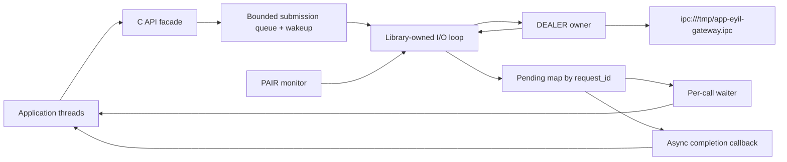

A wakeup FD or equivalent queue notification lets application threads wake the
serving loop without sharing a ZMQ socket. Copy an asynchronous request before
returning to the caller, so the caller may reuse its input memory. Queue bounds
must include copied request bytes as well as the number of requests.

Proposed request states are `QUEUED → SENT → COMPLETED`, with terminal local
failure/timeout/shutdown paths. Remove a pending entry atomically before
delivering completion. Reserve IDs before sending; do not reuse an ID while
a late response from the same connection generation could still arrive.
Validate response ID, service, schema and status before completing the caller.

### 5.3 General routing: concurrent requests on one connection

Coverage: **AC2.1, AC2.2, AC2.4, AC1.6, AC1.7, AC3.1–AC3.2**.

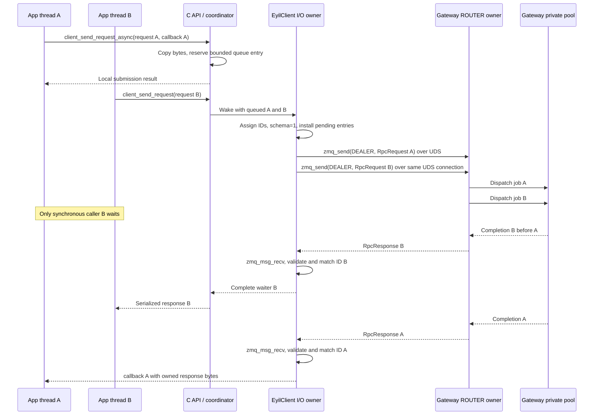

This is not a strict send/receive alternation. DEALER/ROUTER supports the message
flow; request correlation and delivery to the right API caller are EyilClient
responsibilities. Slow application callbacks must not monopolize its I/O loop.

### 5.4 Public API index

The exact signatures are in [EyilClient.h](../EyilClient/include/eyilclient/EyilClient.h).
All nine methods have individual sequences below.

| Method | Target behavior | AC coverage |
| --- | --- | --- |
| client_connect | Create a handle and serving loop; connect/authenticate DEALER | AC2.1–AC2.3; AC1.3, AC1.5–AC1.6 |
| client_send_request | Binary request with a per-call synchronous waiter | AC2.1, AC2.2, AC2.4 |
| client_send_request_async | Binary submission with later callback | AC2.1, AC2.2, AC2.4 |
| client_send_request_string | Defined text codec plus synchronous request core | AC2.1, AC2.4 |
| client_send_request_string_async | Defined text codec plus asynchronous request core | AC2.1, AC2.4 |
| client_free_response | Release a library-allocated result | AC2.1 |
| client_register_notifications | Register a local handler; wire notifications remain TODO | AC2.1; not a completed notification protocol |
| client_unregister_notifications | Remove the handler and define callback quiescence | AC2.1 |
| client_disconnect | Stop admission/I/O, settle pending work and destroy the handle | AC2.1–AC2.3; AC1.10 on the Gateway side |

The skeleton currently returns `CLIENT_NOT_IMPLEMENTED` for unimplemented
result-returning functions, validates required output pointers and clears
outputs. Disconnect/unregister are no-ops. Only response freeing is functional.
The following sequences are implementation targets, not tests that pass today.

### 5.5 client_connect()

Coverage: **AC2.1–AC2.3; AC1.3, AC1.5–AC1.6**.

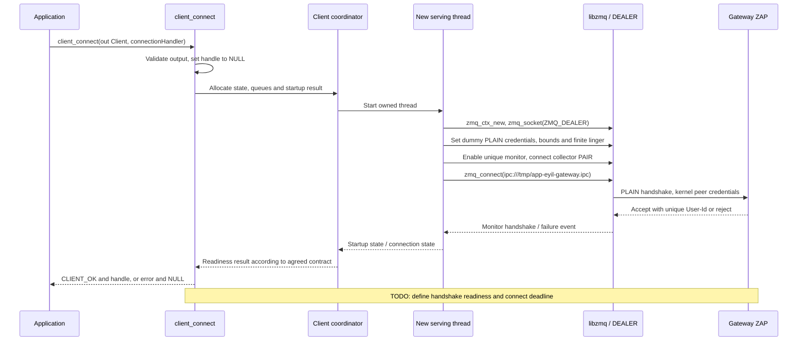

`zmq_connect()` returning success only initiates connection establishment.
It does not prove that ZAP accepted the client or that the service is ready.
Proposed behavior is to return a handle after authenticated transport readiness;
the timeout, event support and distinction from backend readiness need agreement.
Do not use an intentionally invalid Crypto request as a readiness probe.

On partial startup failure, close created sockets on their owner, stop/join the
thread, terminate its context and free the incomplete handle. No callback may
retain a handle that the API reports as failed.

### 5.6 client_send_request()

Coverage: **AC2.1, AC2.2, AC2.4**; Crypto use also supports **AC3.1–AC3.2**.

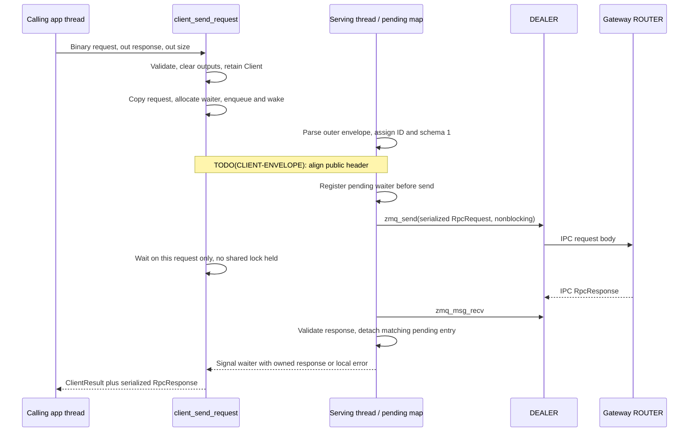

A valid response can contain a non-OK RpcStatus; the caller must inspect it.
On local failure, return a NULL response and size zero. A synchronous timeout
ends the local wait only; do not release remote buffers or replay the request.

### 5.7 client_send_request_async()

Coverage: **AC2.1, AC2.2, AC2.4**.

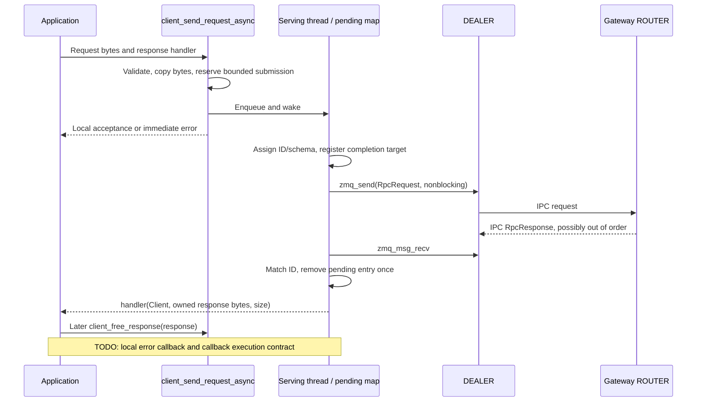

The current response handler has no `ClientResult` argument or user-data
pointer. Define how an accepted async request reports a later timeout,
disconnect, allocation failure or malformed response before implementing it.
Do not silently drop the completion, invent an undocumented NULL sentinel or
present a locally synthesized response as a real Gateway reply.

### 5.8 client_send_request_string()

Coverage: **AC2.1, AC2.4**.

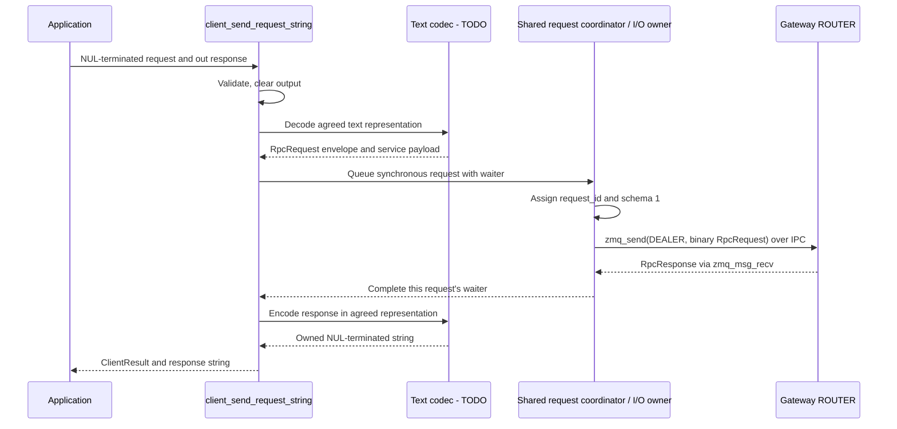

TODO(STRING-CODEC): choose and document a lossless representation, conversion
ownership and length limits. Protobuf JSON and a base64 wrapper are different
contracts; neither is selected here. Until agreed, keep this method explicitly
unsupported rather than sending raw binary through C-string operations.

### 5.9 client_send_request_string_async()

Coverage: **AC2.1, AC2.4**.

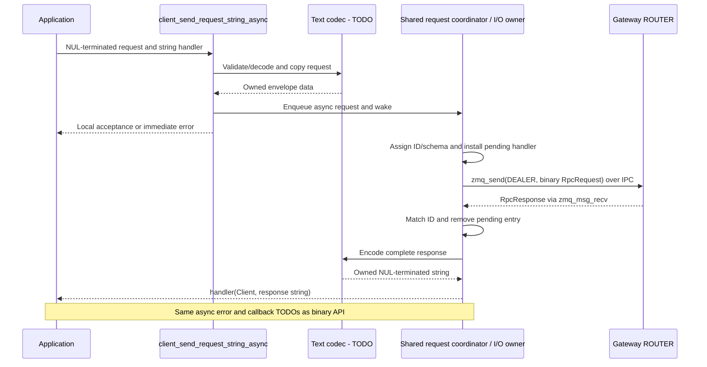

Both string APIs use the same coordinator and pending map as byte APIs.
They do not create a second DEALER, use arrival-order matching or implement
their own synchronous receive loop.

### 5.10 client_free_response()

Coverage: **AC2.1**.

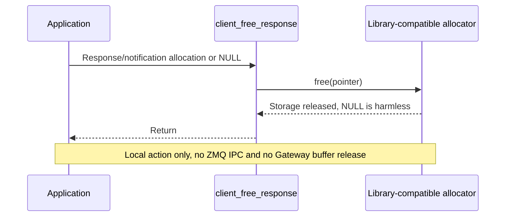

This releases a message-result allocation, not a shared-memory object.
Do not pass a mapped buffer, stack memory or a Gateway buffer ID. The header's
notification callback prohibition on other API calls needs clarification for
this freeing function; until clarified, defer freeing outside that callback.

### 5.11 client_register_notifications()

Coverage: **AC2.1**; incoming notification protocol remains a TODO.

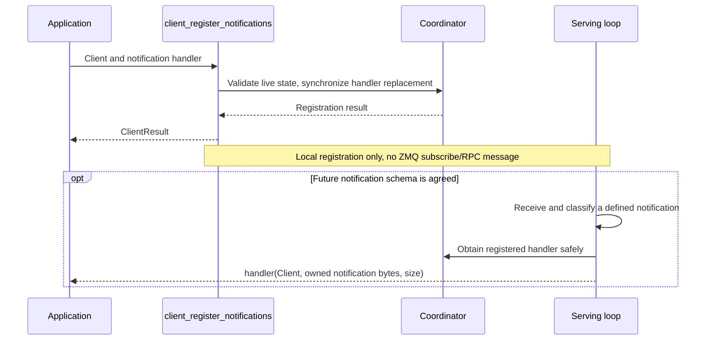

No notification message exists in the checked-in RPC schema. Do not classify
an unmatched response or request_id zero as a notification without a protocol
decision. Replacement behavior, handler lifetime and failure reporting belong
to TODO(CLIENT-CALLBACKS) and TODO(NOTIFICATIONS).

### 5.12 client_unregister_notifications()

Coverage: **AC2.1**.

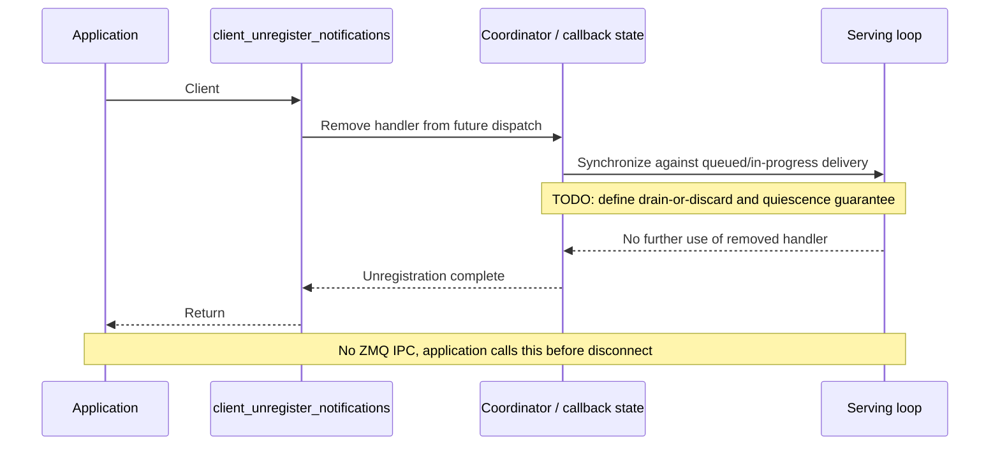

The current header requires unregistering notifications before disconnect.
A useful target guarantee is that no notification callback uses the removed
handler after return. Its implementation and behavior when called from a
callback need agreement; self-waiting on the serving thread is invalid.

### 5.13 client_disconnect()

Coverage: **AC2.1–AC2.3**, leading to **AC1.10** when the Gateway detects closure.

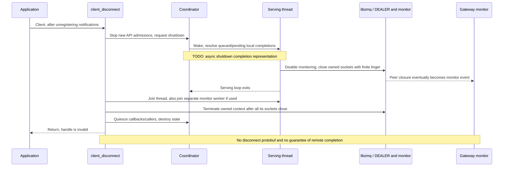

Do not call disconnect from its own callback thread or race destruction against
uncoordinated application calls. A proposed implementation closes admission and
waits for retained in-progress API references; the public concurrency contract
must describe what the application must serialize. Never detach a serving
thread and free its state.

### 5.14 Deadlines, callbacks, reconnect and library unloading

The following constraints apply to all request APIs:

- Bounded queues and nonblocking socket operations keep one caller from holding
  the shared connection indefinitely. Select queue/message limits explicitly.
- Use a monotonic clock for any agreed local deadline. No timeout value or idle
  expiry is implied by the sample; the current API has no timeout argument.
- Complete each locally accepted request at most once. Late replies must not
  trigger a second callback or satisfy a newly allocated request ID.
- Do not retry automatically after a timeout or reconnect. A crypto operation
  may already have changed backend state.
- A transport reconnect is not a promise of the same Gateway context. Buffer IDs
  and key handles from the old session cannot simply be reused.
- Choose libzmq automatic-reconnect and queued-send behavior explicitly. Avoid
  silently carrying old-session work onto a newly authenticated connection.
  Application-level "no retry" alone does not settle what libzmq does with its
  internal send queues. This remains part of TODO(CONNECTION-LIFETIME).
- Connection and notification callbacks currently run on an internal thread and
  must not call other client APIs. Async response callback affinity/reentrancy
  is not yet defined. A proposed initial model uses short callbacks on the
  serving thread; callbacks must hand heavy work to the application.
- If arbitrary blocking callbacks must be supported, add a separate bounded
  completion executor with its own shutdown contract. Do not silently create
  an unbounded thread per callback.
- An application-owned event-loop mode would need additional public integration
  APIs. It is an optional future extension, not a requirement for this version.

A shared library can create threads. Runtime unloading is safe only after the
application disconnects every Client, all library-owned threads are joined,
all calls/callbacks have returned, owned ZMQ contexts are terminated and all
buffers requiring `client_free_response()` have been freed. No thread may still
execute library code after `dlclose()`. libzmq's internal threads do not remove
this obligation. See the
[dynamic loader API](https://man7.org/linux/man-pages/man3/dlopen.3.html).

### 5.15 Planned call hierarchy

```text
Application / Firebolt Crypto
  client_connect
    ClientCoordinator::Start
      IoLoop::Run -> configure DEALER/monitor -> zmq_connect

  client_send_request[_async]
  client_send_request_string[_async]
    C API validation -> optional text codec
      ClientCoordinator::Submit -> bounded queue -> wakeup
        IoLoop::DrainSubmissions
          EnvelopeCodec::Prepare(schema=1, unique request_id)
          PendingRequests::Insert
          zmq_send(DEALER)
        IoLoop::Receive
          zmq_msg_recv -> validate RpcResponse -> PendingRequests::Take
            synchronous waiter OR asynchronous completion

  client_register_notifications / client_unregister_notifications
    CallbackRegistry -> synchronization; no current wire subscription

  client_free_response -> free
  client_disconnect
    CloseAdmission -> wake/settle -> owner closes sockets
      join threads -> terminate context -> release handle
```

## 6. EyilGateway design and flows

### 6.1 Plugin and implementation organization

The initial implementation is **in process** with Thunder. The existing thin
`EyilGateway` wrapper implements IPlugin and acquires
`EyilGatewayImplementation` using
`Root<Exchange::IConfiguration>()`, then calls `Configure(IShell*)`.
The default `configuration.root.mode` is `Off`. A future `Local` mode can use
the same split with matching framework proxy/stubs.

**There is no app-facing Gateway COM-RPC or JSON-RPC API.** IConfiguration is
the internal Thunder bootstrap contract. Future ICrypto calls form a separate
trusted backend boundary. "No public Gateway COM-RPC API" does not mean there
are no framework/backend interfaces internally.

| Planned unit | Responsibility | Separation rule |
| --- | --- | --- |
| EyilGateway wrapper | Register framework notifications, acquire/configure implementation, release it | Keep transport and service logic out of IPlugin |
| EyilGatewayImplementation | Construct and stop the runtime; own configuration/resources | Internal IConfiguration; define explicit safe teardown |
| GatewayServer / IoLoop | Own ROUTER, receive messages, route completions | No blocking backend work; no worker uses ROUTER |
| ZapAuthenticator | Own REP, parse credentials, answer ZAP | No application-supplied identity is trusted |
| AuthenticationProvider | Interim acceptance; future authoritative lookup | TODO(AUTH-APPMANAGER), separate from transport |
| ConnectionRegistry | Map User-Id to retained context; serialize admission/closing | Never key ownership solely by UID/PID/routing ID |
| RequestDispatcher | Envelope/service validation and routing | Service-neutral at outer boundary |
| RequestJob | One retained dispatch object per accepted request | Immutable input plus explicit context/resource references |
| PrivateRequestPool | Own a Core::ThreadPool and bounded admission | No replacement of Thunder's global worker singleton |
| CryptoServiceAdapter | Decode Crypto operation, validate structure and call backend seam | No Crypto key policy or direct app identity claims |
| SharedBufferManager | Create/track allocations, quotas, leases and release | Gateway-local; no dependency on ICrypto types |
| CompletionQueue | Carry result bytes and original connection generation back to I/O | Bounded; stale completions cannot acquire a new route |
| MonitorCollector | Own PAIR and post normalized transport events | Correlation is a prerequisite for targeted cleanup |
| Optional lifecycle observer | Future app lifecycle events | TODO(LIFECYCLE-EVENTS), no current platform subscription |

These are recommended responsibilities, not a requirement for one source file
per row. Keep explicit module/config/version files, a thin wrapper and separate
implementation sources. Use internal interfaces at unfinished integration points
so including ICrypto or AppManager headers is unnecessary for the first transport
and buffer implementation.

### 6.2 Thread model and private Thunder pool

Coverage: **AC1.2–AC1.4, AC1.7**.

| Execution context | Owns / performs | Must not do |
| --- | --- | --- |
| Thunder framework thread | Initialize/Deinitialize and framework notifications | Run application requests synchronously |
| Gateway I/O owner | ROUTER, bounded parsing/admission, event/completion draining | Wait for Crypto, a full worker queue or a slow client |
| ZAP worker | REP and authentication exchange | Use ROUTER or modify another thread's socket |
| Monitor worker | PAIR events, normalized disconnect records | Guess a session from a non-unique PID |
| Private Thunder workers | RequestJob::Dispatch, buffer operations and future backend calls | Send a ROUTER reply or own transport state |
| libzmq internal threads | Transport machinery | Replace Gateway request/session coordination |

Create a Gateway-owned `Core::ThreadPool` instance with an explicit worker
count, stack budget and bounded queue. Submit a distinct `Core::IDispatch`
object for each admitted request. Do not call `Core::IWorkerPool::Assign()`
or use `Core::IWorkerPool::Instance().Submit()` for application request work.
Some Thunder helper job classes submit implicitly to that global instance;
select the explicit private-pool path.

The local Thunder R4.4 implementation supports independently owned thread pools.
Its submission APIs must be wrapped carefully: not every version returns an
enqueue-success result, and infinite submission waits would block the ROUTER.
Use explicit admission accounting and a version-appropriate nonblocking/bounded
submission path. Pool sizing and behavior must be validated against the target
Thunder release. Reference:
[Thunder pool implementation](https://github.com/rdkcentral/Thunder/blob/2c0fcc5529e7da734be558ca6efa05d934dcce31/Source/core/ThreadPool.h).

The wrapper's existing use of the global pool for a framework deactivation job
can remain. It is separate from the new application request pool.

### 6.3 Runtime records and synchronization

A planned connection context contains:

| Field group | Required information |
| --- | --- |
| Identity | Unique User-Id, connection token/generation, interim appId and sessionId |
| Peer | Trusted host UID/GID/PID; process-instance evidence if available |
| Routing | Binary ROUTER routing ID plus a proven binding to this connection generation |
| Admission | State, API entitlements placeholder, in-flight counts and byte budgets |
| Backend | Not integrated / not initialized / initializing / ready / failed / draining |
| Resources | Owned buffer IDs, queued/active leases, completion accounting |
| Lifecycle | Correlated closing reason and exactly-once cleanup/notification state |

Preserve runtime app-instance identity separately when a future platform API
supplies it. The interim per-connection sessionId is not evidence of a real
launcher-provided app instance. Never derive uniqueness from UID, PID or a
reusable numeric FD alone.

Each RequestJob retains an immutable request plus `User-Id`, connection
generation, request_id, expected service and the required resource references.
A completion carries the same identity tuple; workers do not look up "whatever
connection now has this routing ID."

Proposed synchronization rules:

- The I/O owner serializes admission, route publication and terminal connection
  transitions. ZAP/monitor workers submit bounded control events.
- ZAP must publish its context before returning acceptance; an acknowledgement
  or a protected registry insertion is needed so the first request cannot race
  ahead of its record. No backend call runs under the registry lock.
- Buffer records use retained leases and synchronized ownership/quota accounting.
  A release removes admission to that allocation before physical destruction.
- Backend initialization happens once per context. Other requests wait through
  an ordered continuation/barrier, not by exhausting all pool threads while an
  initialization job waits behind them.
- A session removed from public lookup may remain privately retained by active
  jobs. Purge entitlement/admission visibility immediately; retain only what
  those jobs and cleanup need.

These rules define invariants. The exact locking/owner-thread implementation
and dependency ordering remain **Gap 5**, not an assertion that arbitrary
concurrent access to these records is safe.

### 6.4 Startup and partial-start failure

Coverage: **AC1.1–AC1.4, AC1.7**.

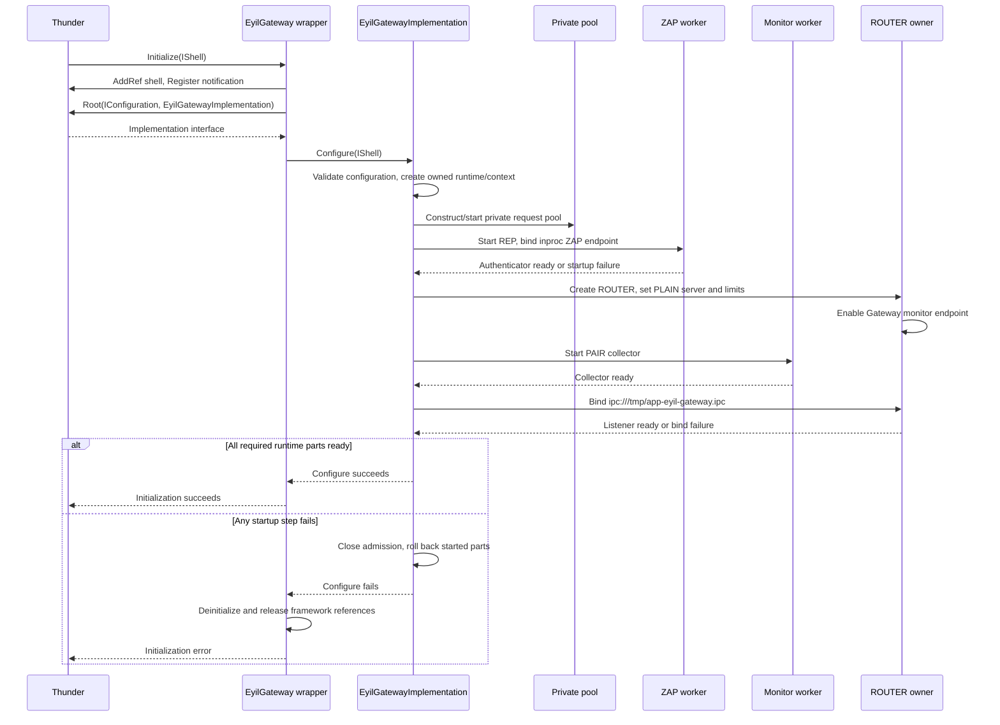

Require ZAP readiness before accepting handshakes. Do not publish a healthy
plugin until its required runtime parts are ready. With ICrypto absent, the
transport can be ready while Crypto is unavailable; the chosen degraded-start
policy is a TODO. AppManager/RuntimeManager lookup is not called in this phase.

Partial rollback must use the same ownership discipline as normal stop.
The IConfiguration-only wrapper currently has no explicit runtime stop method;
how to request and await full shutdown before release is **Gap 2**.

### 6.5 ZAP, interim identity and future AppManager lookup

Coverage: **AC1.3, AC1.5–AC1.6; AC2.2**.

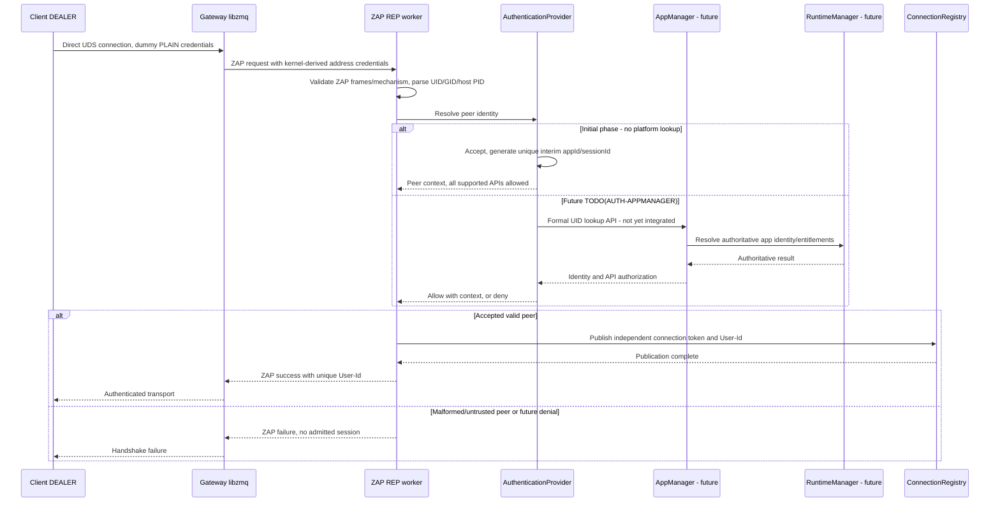

A User-Id can encode `appId#sessionId#connectionToken`, or be an opaque random
token resolved through the registry. The important property is uniqueness per
accepted connection and an unambiguous lookup; any delimiter-based encoding
needs escaping/validation. Reconnection creates a new generation. Two sockets
from the same UID/GID/PID do not share a context.

The interim "accept all" decision removes policy checks, not frame validation,
credential provenance checks, quotas or buffer isolation. Production API
entitlements are cached per connection and purged from admission on disconnect.
No app-supplied username, password, route or payload field replaces the kernel
identity or the future platform lookup.

### 6.6 Request ingress, dispatch and response delivery

Coverage: **AC1.2, AC1.6–AC1.9; AC2.4**.

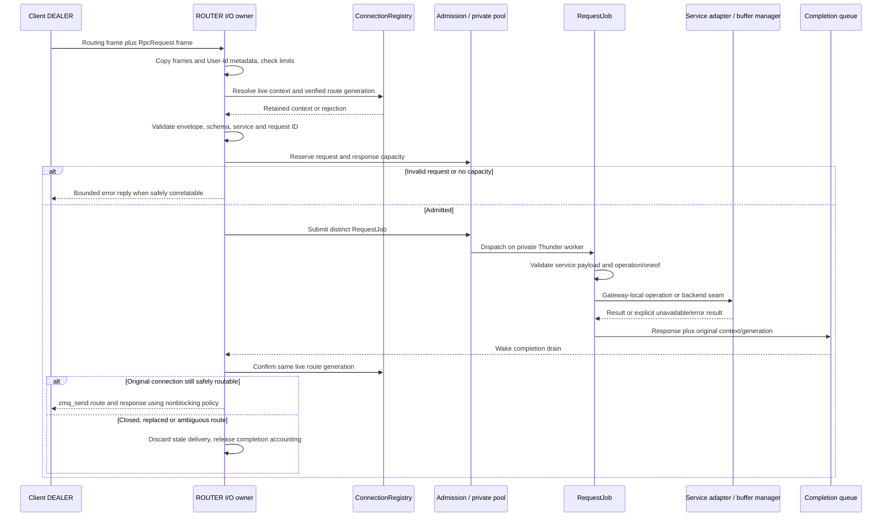

Admission should bound per-connection and global requests, serialized bytes and
expected response capacity. Expensive service work belongs in the job; bound
even envelope parsing so malformed traffic cannot monopolize I/O.

Validate at least: frame count, message size, trusted metadata, live context,
schema 1, supported service, request-ID rules, service parse, operation/oneof
agreement, enum/range validity and allocation ownership. Unknown/duplicate IDs
need an explicit policy. Independent requests can finish in any order;
dependent operations must follow the resource-ordering contract.

A job publishes completion rather than touching ROUTER. Configure deliberate
ROUTER routing/error behavior and use nonblocking sends. A full client queue
must not stall other clients. `ZMQ_ROUTER_MANDATORY` makes unreachable/full-route
conditions observable; it does not authenticate a routing ID or solve route
reuse. See [ZeroMQ socket options](https://libzmq.readthedocs.io/en/latest/zmq_setsockopt.html).
Detailed admission-to-egress accounting remains **Gap 6**.

### 6.7 Service adapter and future ICrypto session setup

Coverage: **AC1.8, AC1.10**.

**ICrypto is not included or called by the current repository.** The future
adapter is based on the reviewed
[ICrypto revision 6926f6a](https://github.com/rdkcentral/entservices-apis/blob/6926f6a72fbfff18b691d09b3b7376fbd541b9d3/apis/Crypto/ICrypto.h)
from [PR #1089](https://github.com/rdkcentral/entservices-apis/pull/1089).
Pin an approved compatible revision when integrating; this document does not
claim that the PR has been merged.

That revision supplies `ApplicationContext { appId, sessionId }` and
`SharedBuffer { name }`. The adapter creates these from trusted internal
records. A raw FD integer is not an interprocess shared-memory identity.

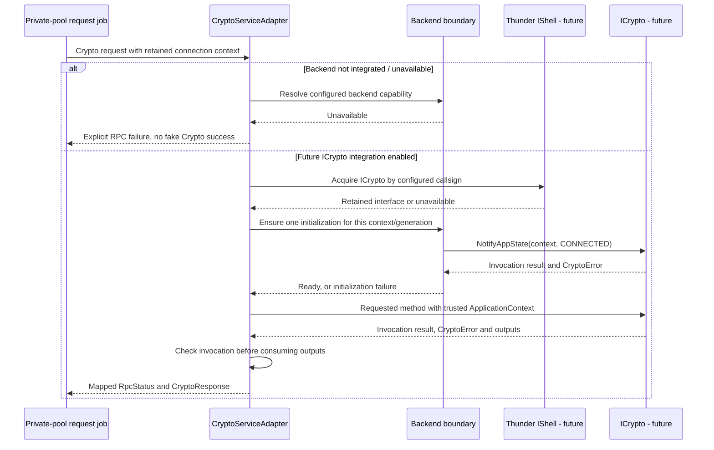

Acquire a configured backend using the appropriate IShell interface lookup
(for example `QueryInterfaceByCallsign<Exchange::ICrypto>()`), not by
constructing the Crypto implementation inside Gateway. Retain the interface
for active calls and release it through an ordered stop/restart path.

An initialization barrier must prevent an operation from overtaking CONNECTED
or multiple concurrent requests from initializing the same context twice.
Whether CONNECTED occurs at authentication or first backend use, and how
never-used connections are cleaned up, remain TODO(BACKEND-SESSION).
No such notification is sent while the backend is absent.

Crypto owns key authorization. Gateway will eventually check API entitlements
before dispatch, but it must not duplicate Crypto's decisions about key usage,
export protection or cross-app sharing.

### 6.8 Crypto operation routing map

All 17 Protobuf operations have an explicit destination. Only the two buffer
management operations terminate locally; the remaining 15 require the future
backend. Structure/limit checks apply even in the interim accept-all phase.

| CryptoRequest operation | Destination / future method | Main inputs → successful outputs |
| --- | --- | --- |
| LOAD_KEY | ICrypto::LoadKey | locator, provision_type → key_id |
| KEY_EXISTS | ICrypto::KeyExists | locator → exists, key_id when present |
| FLUSH_KEYS | ICrypto::FlushKeys | trusted context → empty response |
| GENERATE_KEY_PAIR | ICrypto::GenerateKeyPair | algorithm, matching parameters → private_key_id, public_key_id |
| DERIVE_SESSION_KEYS | ICrypto::DeriveSessionKeys | algorithm and source key IDs → encryption/hmac/wrapping key IDs |
| GET_KEY_INFO | ICrypto::GetKeyInfo | key_id → type, usages, algorithm |
| GENERATE_KEY | ICrypto::GenerateKey | algorithm, usages → key_id |
| UNLOAD_KEY | ICrypto::UnloadKey | key_id → empty response |
| IMPORT_KEY | ICrypto::ImportKey | type, optional protection format, blob → key_id |
| EXPORT_KEY | ICrypto::ExportKey | key_id, optional protection format → blob |
| GENERATE_RANDOM | ICrypto::GenerateRandom | bounded byte count → random bytes |
| ENCRYPT | ICrypto::Encrypt | buffer_id, algorithm, key_id, init/input regions → encrypted region |
| DECRYPT | ICrypto::Decrypt | buffer_id, algorithm, key_id, init/encrypted regions → plaintext region |
| SIGN | ICrypto::Sign | buffer_id, algorithms, key_id, input region → signature region |
| VERIFY | ICrypto::Verify | buffer_id, algorithms, key_id, input/signature regions → verification_status |
| ALLOCATE_SHARED_BUFFER | SharedBufferManager::Allocate | requested_size → buffer_id, client name, size |
| RELEASE_SHARED_BUFFER | SharedBufferManager::Release | buffer_id → release result |

Preserve optional presence for import_export_type rather than replacing an
absent field with the enum's zero value. Validate repeated usages, algorithm
parameter variants, sizes and numeric conversions before constructing backend
types. Use explicit mappings rather than assuming enum ordinals always match.

### 6.9 Non-shared-memory operations

Coverage: **AC1.8; AC3.1–AC3.2**. This flow applies to the eleven key/random
operations above; allocation/release and the four bulk-data operations have
separate flows.

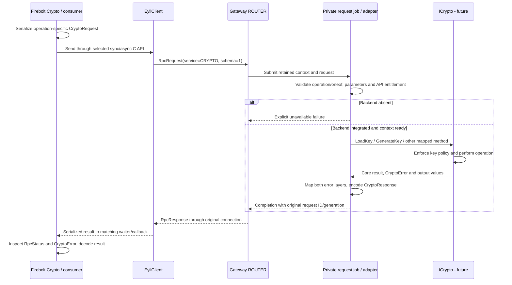

Key generation/import/derivation may change backend state. Loss of a response
does not justify retrying automatically. Ordering UnloadKey or FlushKeys
against concurrent use of those keys is part of **Gap 5**.

### 6.10 Shared-memory identity, records and invariants

Coverage: **AC1.9–AC1.10**. Allocation is a Gateway responsibility; mapping by
the application and future access by Crypto are separate responsibilities.

| Identifier | Example | Meaning |
| --- | --- | --- |
| buffer_id | Opaque generated token | Gateway lookup key, scoped to one connection generation |
| Client name | `/eyil.<random-token>` | POSIX name opened with shm_open() inside the app container |
| Backend path | `/proc/<host-peer-pid>/root/dev/shm/eyil.<random-token>` | Proposed host-visible path passed as SharedBuffer.name |
| Gateway FD | Process-local descriptor | Retains the created object; never sent as a bare integer to Crypto |
| BufferRegion | `{ offset, length }` | Byte range in the same allocation, not a pointer |

Each buffer record retains the owner token/generation, peer evidence, opaque ID,
client name, backend path, actual capacity, FD, reserved/active use count and
release state. Per-connection count/byte quotas and a global byte budget require
atomic reservation and rollback on every failure path.

Use exclusive creation, generated names, close-on-exec descriptors and deliberate
ownership/mode settings. The shared-memory proposal sets the peer UID/GID and
owner read/write access. Verify user-namespace mappings and backend permissions
on the target platform; Gateway running in Thunder is not itself proof of the
required procfs access.

The proposal's namespace path uses the peer's mount view. Access is subject to
procfs checks and can become unavailable when the peer or its main thread exits.
See [proc_pid_root](https://man7.org/linux/man-pages/man5/proc_pid_root.5.html).
The path/FD relationship remains **Gap 4**: retaining an FD does not guarantee
that a later open of the pathname obtains the same object.

Required invariants:

- Only the owner connection may resolve a buffer_id; same UID/PID is insufficient.
- A connection may have multiple allocations. Initially allow at most one
  operation using an allocation at a time, with queued-use reservation rules
  still to be settled.
- Check `offset <= size && length <= size - offset`; avoid unchecked
  `offset + length` arithmetic. Enforce per-operation region presence and
  overlap rules.
- Keep a lease from the point at which the operation depends on the allocation
  until backend access is definitively over. Release/disconnect cannot invalidate it.
- The app must not resize, unlink or modify participating regions while an
  operation is outstanding. This cooperation rule is not protection against
  a malicious writable client; mutation/truncation defenses remain TODO.
- Gateway owns unlink/cleanup. An app unmaps/closes its own view; it does not
  call shm_unlink(). Unlink/close by Gateway also does not revoke an existing
  app mapping.
- A local client timeout or uncertain COM-RPC failure is not safe completion.

The sample's 32 MiB buffer, four buffers and 128 MiB per-session limits are
reference values, not production defaults adopted by this document. Select
configuration values together with the platform memory and concurrency budgets.

### 6.11 AllocateSharedBuffer and client mapping

Coverage: **AC1.9; AC2.4; AC3.1–AC3.2**. No ICrypto call is involved.

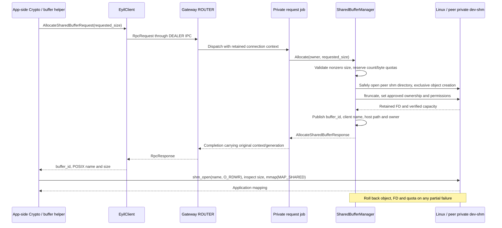

The mapping helper is outside the current EyilClient transport API. Decide
whether Firebolt Crypto supplies it or a separate utility does. The application
must also handle allocation success followed by mapping failure: request release
when possible, otherwise let correlated connection cleanup reclaim the record.

If the connection closes while creation is in progress, recheck its generation
before publishing the result and clean up an allocation that cannot be admitted.
If an allocation reply is lost, the Gateway may own a buffer unknown to the app;
quota accounting and eventual connection cleanup must still cover it.

### 6.12 Shared-memory operations: common backend boundary

For all four operations, the app writes inputs before sending the request.
The Gateway resolves buffer_id and validates owner/ranges, then passes the
trusted backend path and regions to the future adapter. Crypto independently
opens the object, checks its actual size, maps it, performs the operation and
unmaps/closes it before a successful synchronous invocation returns.

The reviewed ICrypto contract selects output locations in Crypto. Gateway
forwards the returned region only after validating the invocation and service
result. On success, output must be inside the allocation. A BUFFER_OVERFLOW
result may describe required capacity rather than an accessible output range;
the app must not read it as produced data. Exact required-size propagation must
match the adopted interface revision.

The following diagrams expand the four operation-specific calls. All Crypto
participants are **future TODO(BACKEND-ICRYPTO)**; while absent, dispatch returns
an explicit failure without running these backend steps.

#### Encrypt

Coverage: **AC1.8–AC1.9; AC3.1–AC3.2**.

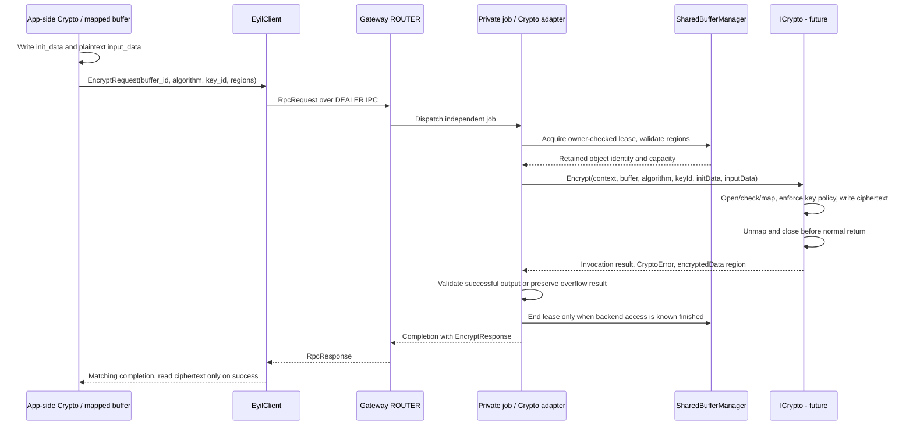

#### Decrypt

Coverage: **AC1.8–AC1.9; AC3.1–AC3.2**.

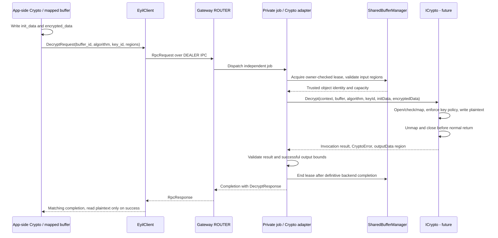

#### Sign

Coverage: **AC1.8–AC1.9; AC3.1–AC3.2**.

```mermaid
sequenceDiagram
    participant A as App-side Crypto / mapped buffer
    participant L as EyilClient
    participant R as Gateway ROUTER
    participant J as Private job / Crypto adapter
    participant B as SharedBufferManager
    participant C as ICrypto - future
    A->>A: Write input_data
    A->>L: SignRequest(buffer_id, algorithm, key_id, digest, input)
    L->>R: RpcRequest over DEALER IPC
    R->>J: Dispatch independent job
    J->>B: Acquire owner-checked lease, validate input region
    B-->>J: Trusted object identity and capacity
    J->>C: Sign(context, buffer, algorithm, keyId, digestAlgorithm, inputData)
    C->>C: Open/check/map, sign, select/write signature region
    C->>C: Unmap and close before normal return
    C-->>J: Invocation result, CryptoError, signature region
    J->>J: Validate success region or overflow result
    J->>B: End lease after definitive backend completion
    J-->>R: Completion with SignResponse
    R-->>L: RpcResponse
    L-->>A: Matching completion, read signature only on success
```

#### Verify

Coverage: **AC1.8–AC1.9; AC3.1–AC3.2**.

```mermaid
sequenceDiagram
    participant A as App-side Crypto / mapped buffer
    participant L as EyilClient
    participant R as Gateway ROUTER
    participant J as Private job / Crypto adapter
    participant B as SharedBufferManager
    participant C as ICrypto - future
    A->>A: Write input_data and expected_signature
    A->>L: VerifyRequest(buffer_id, algorithms, key_id, two regions)
    L->>R: RpcRequest over DEALER IPC
    R->>J: Dispatch independent job
    J->>B: Acquire owner-checked lease, validate both input regions
    B-->>J: Trusted object identity and capacity
    J->>C: Verify(context, buffer, algorithms, keyId, input, signature)
    C->>C: Open/check/map, enforce key policy, compare signature
    C->>C: Unmap and close before normal return
    C-->>J: Invocation result, CryptoError, verificationStatus
    J->>B: End lease after definitive backend completion
    J-->>R: Completion with VerifyResponse
    R-->>L: RpcResponse
    L-->>A: Matching completion with boolean result
    Note over A,C: Verify returns no binary output region
```

A verification result of false and a failed invocation are different outcomes.
For every operation, a transport failure after remote dispatch may leave
completion uncertain. Do not take the normal lease-release arrow in that case;
retain/quarantine the resource until an agreed recovery mechanism resolves it.

### 6.13 ReleaseSharedBuffer, reuse and concurrent release

Coverage: **AC1.9–AC1.10**. No ICrypto call is needed for an idle allocation.

```mermaid
sequenceDiagram
    participant A as App-side buffer helper
    participant L as EyilClient
    participant R as Gateway ROUTER
    participant J as Private release job
    participant B as SharedBufferManager
    participant K as Linux
    A->>A: Wait for definitive completion of all uses
    A->>K: munmap and close own mapping/FD
    A->>L: ReleaseSharedBufferRequest(buffer_id)
    L->>R: RpcRequest over IPC
    R->>J: Dispatch release job with owner context
    J->>B: Release(owner, buffer_id)
    B->>B: Check owner, reject future use atomically
    alt No reserved or active operation
        B->>K: Unlink owned object and close retained FD
        B->>B: Remove record, release quota
        B-->>J: Released
    else Operation still has a lease
        B->>B: Mark release pending, retain object and quota
        Note over J,B: TODO: defer response or acknowledge pending release?
        B-->>J: Outcome according to agreed release contract
    end
    J-->>R: Completion
    R-->>L: RpcResponse
    L-->>A: Matching release result
```

When the last definitive lease ends, the manager can finish a pending release
exactly once. Unknown IDs, duplicate release and release pending acknowledgements
need precise error/idempotency rules.

Do not rely on the order requests arrived at ROUTER: a queued Encrypt can run
after a Release job unless its dependency was reserved or ordered earlier.
Similarly, `client_send_request()` timing out does not satisfy the app's
"all uses completed" condition. These are **Gaps 4 and 5**.

### 6.14 Disconnect detection, PID observations and hibernation

Coverage: **AC1.4, AC1.6, AC1.10**.

The supplied libzmq patch extends version-2 disconnect monitor events with
UID/GID/PID in addition to the FD. `zmq_server.cpp` demonstrates consuming those
values. The draft/versioned monitor API and exact event format must match the
target patched libzmq build. A normal ZeroMQ 4.3 dependency declaration does not
guarantee that extension exists.

Standard monitor disconnect events do not include ZAP User-Id; their FD may
already be closed. See the
[monitor API](https://libzmq.readthedocs.io/en/latest/zmq_socket_monitor.html).
The patch's credential tuple still identifies a process, not one of its several
connections. FD reuse, handshakes that never send a request and rapid reconnects
must be covered by a stronger correlation contract.

```mermaid
sequenceDiagram
    participant P as Peer / kernel
    participant Z as libzmq monitor producer
    participant M as Gateway PAIR monitor worker
    participant REG as Registry / I/O owner
    participant J as Queued and active jobs
    participant C as Crypto adapter - future
    participant B as SharedBufferManager
    P->>Z: Socket closes or transport fails
    Z->>M: Disconnect event with versioned identity evidence
    M->>REG: Post normalized event
    REG->>REG: Correlate to exact connection generation
    alt Evidence is ambiguous
        REG->>REG: Record unresolved event, do not select every matching PID
        Note over M,REG: Gap 1 blocks reliable targeted cleanup
    else Exact original connection is known
        REG->>REG: Close admission, remove auth/routing visibility
        REG->>J: Resolve queued jobs, retain active references
        J-->>REG: Definitive completion of active backend access
        opt Backend had an initialized context
            REG->>C: Schedule NotifyAppState(DISCONNECTED) through worker path
            C-->>REG: Completion or unresolved failure
        end
        REG->>B: Finalize releasable allocations after leases end
        B-->>REG: Resources released or retained for unresolved access
        REG->>REG: Retire context when references and cleanup permit
    end
```

The proposed drain-before-destructive-notification ordering prevents
DISCONNECTED from freeing Crypto resources used by an active call. The
architectural requirement to notify on detection must be reconciled with this
ordering; it is a TODO, not a reconnect grace period. Backend work must not run
on the monitor or I/O thread.

Process-existence tracking can supplement monitor events. It needs a stable
process-instance handle or equivalent reuse protection; UID has no process
lifetime, and a PID existence check alone can match a replacement process.
A living process can close one of several connections. An inherited connection
can outlive its original creator, so process exit is not automatically socket
closure.

**No heartbeat or idle expiry is selected.** A hibernated process can still
exist with its sockets open. Neither the patch nor PID existence proves
responsiveness, and neither automatically closes a frozen client. AppManager/
RuntimeManager stop, hibernate and resume notifications remain
TODO(LIFECYCLE-EVENTS); no subscriptions or close-on-hibernate behavior are
implemented or assumed.

### 6.15 Backend unavailable, restarted or uncertain

Coverage: **AC1.8–AC1.10**, with backend integration pending.

```mermaid
sequenceDiagram
    participant T as Thunder backend availability - future
    participant A as Crypto adapter
    participant REG as Connection/backend states
    participant J as Active request job
    participant B as SharedBufferManager
    participant R as ROUTER owner
    T-->>A: Interface unavailable or remote backend lost
    A->>REG: Mark backend generation unavailable
    REG->>REG: Stop new backend-dependent admission
    J-->>A: Invocation returns failure or completion becomes uncertain
    alt Backend is known to have stopped all access
        A->>B: End affected leases according to recovery contract
    else Completion / remote process state uncertain
        A->>B: Retain resources, do not claim safe reuse
    end
    A-->>R: Failure completions where correlation remains valid
    opt Backend becomes available again
        T-->>A: New interface generation
        A->>REG: Require an explicit session/key recovery decision
        Note over A,REG: No automatic replay or reuse of old key/buffer handles
    end
```

This is the proposed failure boundary, not an implemented notification API.
Choose startup behavior, acquisition retries, interface-release ordering and
recovery semantics in **Gap 3**. While Crypto is not integrated, Gateway-local
buffer operations can remain available according to their own admission rules.

### 6.16 Gateway stop, unload and crash recovery

Coverage: **AC1.1, AC1.4, AC1.7, AC1.10**.

```mermaid
sequenceDiagram
    participant T as Thunder
    participant P as EyilGateway wrapper
    participant I as Implementation runtime
    participant R as ROUTER / ZAP / monitor owners
    participant W as Private worker pool
    participant C as Crypto adapter - future
    participant B as SharedBufferManager
    T->>P: Deinitialize
    P->>I: Request deterministic Stop - trigger is TODO
    I->>I: Close admission, mark contexts closing
    I->>R: Stop accepting handshakes/requests, keep control drain alive
    I->>W: Cancel or resolve queued work under agreed policy
    W-->>I: Active calls finish and completion references drain
    I->>C: Schedule final backend notifications on worker path
    C-->>I: Notifications complete or failure policy applies
    I->>B: Finalize buffers with no unresolved access
    I->>W: Stop and join private workers
    I->>R: Disable monitors, close sockets on their owners, exit
    I->>I: Join transport/auth/monitor threads, terminate ZMQ context
    I-->>P: Runtime quiescent
    P->>P: Release implementation and shell references
    opt Future remote implementation mode
        P->>T: Terminate/release remote connection after orderly stop
    end
    P-->>T: Deinitialize complete
```

Do not unload a library while a job, callback or socket thread can execute its
code. A finite ZMQ linger policy is necessary for bounded transport shutdown;
context termination waits for open sockets and pending linger.
[ZeroMQ context termination](https://libzmq.readthedocs.io/en/latest/zmq_ctx_term.html)

This sequence needs an actual stop trigger through the existing
IConfiguration-only split. Merely adding threads and relying on the current
Release()/Terminate() sequence is insufficient. In-process Crypto calls cannot
be safely killed by forcefully terminating their worker thread.

A crash is different from orderly stop. Named objects can survive without their
registry, and a remote backend might still be accessing one. Define an ownership
marker/epoch and safe orphan recovery; never scan and unlink arbitrary app
shared-memory files. Crash cleanup, hung calls and a bounded shutdown policy
remain **Gap 2**.

### 6.17 Implementation order and verification targets

Implement the transport and registry behind the seams described above before
adding external dependencies. The following order keeps each step reviewable:

1. Align the envelope, client error/callback and connection-correlation
   contracts that block the first implementation. Record unresolved lifecycle
   policy without adding speculative heartbeat/expiry behavior.
2. Implement EyilClient's owner loop, bounded queues, pending map and shutdown;
   prove two callers can use one connection without touching its socket.
3. Implement Gateway startup/ZAP/interim identities, the registry and monitor
   integration. Prove multiple connections from one PID remain independent.
4. Add private-pool jobs, bounded admission and completion routing using an
   unavailable backend seam. Test errors without claiming Crypto success.
5. Add Gateway-local allocations, ownership checks and leases. Resolve pathname
   identity and release-ordering gaps before enabling real backend access.
6. Integrate AppManager/RuntimeManager authentication only at the marked TODOs,
   once their formal API exists. Add lifecycle event behavior only after a
   separate policy decision.
7. Integrate the approved ICrypto revision in the adapter, including session
   initialization, failure handling and definitive buffer completion.

| Test scope | Scenario / evidence required |
| --- | --- |
| L1 client | Request IDs and response matching; duplicate/late replies; argument/output ownership; exactly one local completion |
| L1 Gateway | Envelope/oneof validation; context lookup; admission accounting; enum/presence mapping; allocation rollback |
| L1 concurrency | Queued/active leases, disconnect during dispatch, independent connections and dependency barriers |
| L2 transport | Real DEALER/ROUTER IPC, ZAP metadata, reverse-order completion and simultaneous sync/async callers |
| L2 disconnect | Target patched monitor, multiple connections from one PID, FD/route reuse, disconnect before first request |
| L2 buffers | Container-private mapping, cross-connection rejection, release during work, size/region failures and lost replies |
| L2 lifecycle | Partial-start rollback, stop with queued/active jobs, slow receiver fairness and no surviving library threads |
| Future integration | AppManager identity mapping, ICrypto invocation/result mapping, backend restart and communicator restrictions |

Use a controlled fake adapter for concurrency/failure tests when needed, clearly
separate from production Crypto and never described as real cryptography.
No optional example app or Crypto stub is currently installed by this skeleton.
An eventual DobbyTool-based smoke test should execute the client inside a real
application container to verify mounts, credentials and private shared memory;
DobbyTool itself is not in the RPC path.

The implementation wiring should make the current external boundaries visible
in comments, following this conceptual example (not existing source code):

```text
GatewayRuntime
  authentication = InterimIdentityProvider
    // TODO(AUTH-APPMANAGER): replace acceptance with the formal UID lookup.
    // TODO(API-AUTHORIZATION): populate per-connection API entitlements.
  cryptoBackend = UnavailableBackend
    // TODO(BACKEND-ICRYPTO): bind the approved interface in one adapter.
    // TODO(BACKEND-SESSION): add ordered CONNECTED/DISCONNECTED handling.
  lifecycleObserver = none
    // TODO(LIFECYCLE-EVENTS): add agreed platform subscriptions and policy.
```

Keep this choice explicit in startup/configuration and tests. Interim admission
must not be silently mistaken for production authorization when the later
provider is unavailable.

### 6.18 Build and repository validation reference

These commands validate the existing skeleton. Runtime acceptance remains tied
to the implementation and tests described above.

<details>
<summary>Build, installation, coverage and GitHub workflow details</summary>

#### Build, install and validation

Required tools: CMake 3.21+, Ninja, a C/C++ compiler, Protobuf 3.15+ development
files and protoc, ZeroMQ 4.3+ development files, and Python 3.9+. Building the
plugin additionally requires Thunder Core/COM/Plugins, ThunderTools and the
matching `interfaces/IConfiguration.h` from ThunderInterfaces or the platform's
entservices-apis SDK. Out-of-process use also requires matching IConfiguration
proxy/stubs in Thunder's configured proxystub directory. Do not mix headers
and proxy/stubs from different interface providers or releases.

For a native SDK build, install the host development prerequisites, then run:

```sh
bash build_dependencies.sh
bash build.sh
python3 scripts/run-tests.py --build-dir build --label L1
python3 scripts/run-tests.py --build-dir build --label L2
bash scripts/check-install.sh build rootfs/all
```

build_dependencies.sh fetches pinned Thunder R4.4, ThunderTools and
ThunderInterfaces sources into the ignored _deps directory. It builds the
IConfiguration headers and proxy/stubs along with Thunder. It does not install
system packages. To use an existing SDK, set EYIL_THUNDER_PREFIX; optional
EYIL_DEPS_DIR selects local dependency storage. EYIL_CONFIGURATION_INCLUDE_DIR
can select the SDK include directory containing `interfaces/IConfiguration.h`
when it is not found automatically.

To generate a configuration for a separate implementation process, build with
`bash build.sh -DPLUGIN_EYILGATEWAY_MODE=Local`. The default is `Off`. Install both
plugin libraries and make the matching proxy/stubs available to Thunder and
WPEProcess before using Local mode.

The client and protocol can be built without Thunder:

```sh
cmake -S . -B build-client -G Ninja \
  -DPLUGIN_EYILGATEWAY=OFF -DBUILD_EYILCLIENT=ON \
  -DCMAKE_INSTALL_PREFIX=/usr -DCMAKE_INSTALL_LIBDIR=lib
cmake --build build-client
bash scripts/check-install.sh build-client rootfs/client
```

Use a CMake toolchain file and target dependency prefixes when cross compiling.
Protobuf_PROTOC_EXECUTABLE must identify a host-runnable protoc. Cross-platform
rootfs validation is still pending.

Installed CMake consumers use EyilClient::EyilClient and
EyilProtocol::EyilProtocol. The C header is eyilclient/EyilClient.h; the client also
provides eyilclient.pc. Both plugin libraries install to the Thunder plugin
directory. The generated configuration uses org.rdk.EyilGateway, with autostart
false by default. No test executables are installed.

L1 and L2 are intentionally empty. Their runners invoke CTest and emit summaries
and JUnit reports with zero tests. Install-consumer checks verify compilation,
linking, client API placeholders and the Protobuf status contract separately;
they are not advertised as implemented service tests.

```sh
EYIL_BUILD_DIR=build-coverage bash build.sh -DENABLE_COVERAGE=ON
python3 scripts/coverage.py --build-dir build-coverage
```

Coverage instruments handwritten plugin/client code, excluding generated
Protobuf and dependency sources. Empty suites produce an explicit coverage
unavailable summary. Once real tests are registered with L1/L2 labels, the same
runner produces XML, HTML and text reports. No artificial percentage is reported.
Use `--label L1` or `--label L2` to run coverage for one suite; the default runs
both suites.

#### Repository checks and GitHub configuration

C/C++ uses .clang-format; Python uses Black; YAML uses yamllint. New source,
build, workflow and documentation files carry the Apache-2.0 licensing header.
JSON remains strict JSON and is covered by LICENSE/NOTICE. README.md is
intentionally empty.

Install the pinned development tools from scripts/requirements-dev.txt and run
scripts/check-format.sh plus scripts/validate-files.py. Build outputs and local
SDKs are ignored by Git.

GitHub workflows cover native build/install checks, standalone client builds,
L1/L2, coverage, formatting, JSON validation, manual CI, FOSSID,
changelog/version validation, and manual draft release creation. CLA and
CODEOWNERS are retained as repository governance.

L1 and L2 each collect coverage for their selected suite through the shared
`native-ci.yml` workflow. Manual CI uses the same native build job. Formatting
and licensing checks run together with JSON checks in `json_validator.yml`.
The scripts directory supplies the build and validation commands used locally
and in CI; GitHub Actions itself does not require that directory layout.

Jobs use GitHub-hosted `ubuntu-24.04` runners. This release supplies Protobuf
3.21, which meets the project's 3.15 minimum for proto3 optional fields; Ubuntu
22.04 supplies Protobuf 3.12. The native SDK cache includes the runner release.
No organization-specific runner label is required. Native and standalone-client
builds use CMake 3.28.3, matching the tested SDK setup and retaining compatibility
with the pinned Thunder sources' older CMake policy baseline.

FOSSID uses the public
`rdkcentral/build_tools_workflows/.github/workflows/fossid_integration_stateless_diffscan.yml@1.0.0`
on pull requests from branches in this repository. It requires the four FOSSID
secrets referenced in the workflow and skips fork pull requests. CLA uses
`rdkcentral/cmf-actions` and requires CLA_ASSISTANT. Build, test, coverage and
repository-validation jobs require no organization credentials.

TODO(CI): add Coverity when an accessible rdkcentral workflow and its credential
contract are available. No private Coverity workflow is referenced in this
repository.

The scripts directory, formatting configuration and CHANGELOG.md must be
committed with the workflows so a fresh checkout contains their dependencies.

The release workflow is manual and creates a draft only from main after
checking the requested version against CMake and CHANGELOG.md. Repository
administrators must configure branch protection and runner access separately.
Version checks also compare the CMake version and EyilGateway/Version.h so the
plugin's reported and registered versions agree.

</details>

## 7. Gaps to answer

These are the **six architectural gaps from the review**, followed by the
remaining API/platform TODOs. Proposed safeguards in earlier sections describe
the required invariants; they do not close these questions. Resolve the
blocking items before implementing the affected production path.

### 7.1 Gap 1: Connection identity for disconnects and outgoing responses

**Question:** what stable transport identity links a ZAP acceptance, each
request, its ROUTER route and a later disconnect to the same connection
generation?

The supplied patch returns FD/UID/GID/PID, but two connections from one process
share the credentials. FDs and routing IDs can be reused. A ZAP connection may
also disconnect before sending its first request, leaving no request-derived
route binding.

Answers required:

- Which immutable token or verified mapping joins ZAP User-Id, monitor events
  and ROUTER messages, including before the first request?
- Does the target libzmq need a further patch to expose the same token at all
  three points? Which version/draft build is required?
- How are reconnect, FD reuse, duplicate routing IDs and ROUTER handover handled?
- How is a late reply prevented from reaching another connection that reused
  the same ROUTER identity? An incoming User-Id check alone does not protect
  an outgoing route.
- What happens when a monitor event cannot be correlated, without disconnecting
  unrelated connections or retaining unbounded abandoned state?

**Implementation constraint:** carry a generation through every job/completion
and reject stale delivery. This is necessary but is not a complete transport
binding by itself; libzmq can change routes independently of the registry.
Do not claim that the credential patch alone solves this gap.

**Blocks:** reliable independent-session cleanup and secure response routing.
**Coverage affected:** AC1.4, AC1.6, AC1.10; AC2.3–AC2.4.
**TODO:** CONNECTION-CORRELATION.

### 7.2 Gap 2: Complete startup, shutdown and crash-recovery lifecycle

**Question:** how does Thunder activation/deactivation drive a complete,
deterministic runtime lifecycle through the current IConfiguration-only split?

Answers required:

- What must be ready before Configure succeeds, and is missing Crypto allowed
  to leave the transport in a deliberately degraded mode?
- How does the wrapper request and await stop before Release/remote Terminate?
  Is controlled destruction sufficient, or is an explicit internal stop
  contract needed?
- Which queued requests are cancelled versus drained? How are active calls,
  completion records, ZAP replies and monitor workers joined in dependency order?
- What is the policy when an in-process backend never returns or a remote call
  has an uncertain outcome? A timeout cannot make forced thread destruction safe.
- How are allocations recovered after a crash without unlinking a live client's
  or another Gateway instance's object?
- Which bounded shutdown/linger policies apply, and what state is reported if
  safe teardown cannot complete?

**Implementation constraint:** use one rollback/stop ownership model and keep
implementation code loaded while any worker can still execute it. Do not infer
that the existing skeleton's reference release is a complete runtime stop.

**Blocks:** safe plugin disable/reload, partial-start rollback and orphan cleanup.
**Coverage affected:** AC1.1, AC1.4, AC1.7, AC1.10.
**TODO:** GATEWAY-LIFECYCLE.

### 7.3 Gap 3: Crypto acquisition, availability and restart lifecycle

**Question:** how will the future adapter manage an ICrypto interface and its
per-connection Crypto sessions across startup, failure and backend replacement?

Answers required:

- Which callsign and approved ICrypto revision are used? What is the interface
  acquisition, reference ownership and availability-notification mechanism?
- Does backend absence fail Gateway startup or only backend-dependent requests?
  Which RpcStatus communicates that condition?
- Is CONNECTED sent on authentication or first backend use? How are concurrent
  first requests ordered, and what happens if initialization fails?
- What are the backend's concurrency guarantees for different requests, one
  ApplicationContext, and different keys/buffers?
- What happens to existing key handles and context state after backend restart?
  Must the client reconnect, or is a defined reinitialization sequence available?
- How do DISCONNECTED and invocation failure interact with active calls and
  uncertain remote completion?

**Implementation constraint:** retain the internal backend seam now; add ICrypto
types and calls only in the future adapter. Never replay operations or silently
reuse a prior backend generation's resources.

**Blocks:** real Crypto integration and correct backend session cleanup.
**Coverage affected:** AC1.8–AC1.10; AC3.1.
**TODOs:** BACKEND-ICRYPTO, BACKEND-SESSION, BACKEND-RECOVERY.

### 7.4 Gap 4: Stable shared-memory object identity and lifetime

**Question:** how do Gateway and Crypto guarantee they access the same backing
object, and when is that object safe to reuse or destroy?

Gateway retains an FD, but Crypto opens a pathname. A client can potentially
replace/unlink the name, resize the file or mutate mapped bytes. A retained FD
continues referring to the original object even if its name changes; a later
open by name need not. `O_NOFOLLOW` alone does not secure the entire path.
See the [Linux open API](https://man7.org/linux/man-pages/man2/open.2.html).

Answers required:

- Is the client-namespace pathname a sufficient identity under the accepted
  threat model, or is a stable Gateway-controlled path/object handle needed?
- How does Crypto verify the opened object matches the retained allocation?
  What changes, if any, are needed in the backend identity contract?
- What survives peer exit, PID reuse or loss of /proc/PID/root access? Which
  namespace references, permissions or capabilities are required?
- What prevents replacement, truncation and mutation during processing?
  Are input snapshots or a different protected mapping arrangement required?
- After a client timeout, disconnect or uncertain COM-RPC result, what proves
  backend completion? How does the app learn that reuse is safe?
- What are the release acknowledgement and BUFFER_OVERFLOW/required-capacity
  contracts?

**Implementation constraint:** retain leases and quarantine uncertain use.
Gateway ownership is allocation ownership; it is not immutability, revocation
of client mappings or proof that a reopened pathname resolves to the same file.

**Blocks:** safe real shared-memory backend access and reliable cleanup/reuse.
**Coverage affected:** AC1.8–AC1.10.
**TODOs:** SHM-IDENTITY, SHM-COMPLETION, SHM-MUTATION.

### 7.5 Gap 5: Ownership and ordering under parallel dispatch

**Question:** which component serializes mutable session/resource state, and
what ordering is guaranteed for requests that depend on the same resource?

Answers required:

- Which transitions belong to the I/O owner, and which registry/buffer/backend
  operations use locks or retained records across ZAP and worker threads?
- Does a job acquire/reserve its buffer dependency before enqueueing or when
  execution begins? How is a queued use protected from a later Release?
- Are dependent operations client-ordered, server-serialized, rejected while
  busy or represented by continuations? Which errors express rejection?
- How do UnloadKey and FlushKeys interact with pending Sign/Encrypt/Derive calls?
- Does closing a session cancel queued work, drain it, or use different rules
  for requests that have not yet entered Crypto?
- How are CONNECTED/DISCONNECTED barriers scheduled without blocking every
  worker on work that is itself queued behind them?

**Implementation constraint:** one dispatch object per request does not imply
unrestricted simultaneous access to every resource. Keep unrelated requests
concurrent while defining resource-specific ordering. Do not restore a single
global serial backend worker as an accidental workaround.

**Blocks:** safe concurrent request, release and disconnect behavior.
**Coverage affected:** AC1.6–AC1.10; AC2.4.
**TODO:** PARALLEL-ORDERING.

### 7.6 Gap 6: Response-side backpressure and fairness

**Question:** how are completions bounded and fairly delivered when a client
stops receiving, freezes or produces requests faster than it consumes replies?

Answers required:

- What per-connection/global count and byte limits cover pending requests,
  completed responses and libzmq queues?
- Is response capacity reserved before dispatch, including large random/export
  results and error replies? What happens if serialization exceeds that budget?
- How are nonblocking multipart sends resumed/rejected on EAGAIN, and how is
  EHOSTUNREACH distinguished from temporary pressure?
- How are clients scheduled fairly so one full route cannot starve others?
- What happens to a slow client's completions when its limit is reached?
  Any disconnect/expiry action needs an agreed lifecycle policy, especially
  during hibernation.
- How does shutdown release completion accounting without blocking workers on
  a full egress queue or losing ownership of live buffers?

**Implementation constraint:** bounding the private request queue alone is
insufficient. Do not block the ROUTER or every worker while waiting for one
client's output queue. Use explicit admission-to-completion accounting.

**Blocks:** bounded resource use and progress under slow/frozen clients.
**Coverage affected:** AC1.2, AC1.7, AC1.10; AC2.4.
**TODO:** EGRESS-BACKPRESSURE.

### 7.7 Remaining API and platform decisions

These items complement the six gaps; several are prerequisites for implementing
a public API, even though they are not new Gateway architecture gaps.

| TODO | Answer needed / integration boundary |
| --- | --- |
| AUTH-APPMANAGER | Formal UID lookup via AppManager/RuntimeManager, authoritative app/app-instance identity, UID reuse guarantees and lookup failure behavior |
| API-AUTHORIZATION | Exact entitlement format and mapping from service/operation to allowed APIs; currently all supported APIs are allowed |
| LIFECYCLE-EVENTS | Whether to subscribe to stop/hibernate/resume events, through which plugin API, and what each event does to connections/resources |
| CONNECTION-LIFETIME | Client connect-on-first-use versus app-lifetime guidance, idle policy, reconnect behavior and multiple-connection lifecycle; no heartbeat/expiry assumed |
| CLIENT-ENVELOPE | Confirm caller input/return message types, EyilClient request-ID/schema ownership and corresponding header wording |
| CLIENT-CALLBACKS | Local async failure representation, callback affinity/reentrancy, handler replacement, unregister/disconnect quiescence and absence of user-data parameters |
| CLIENT-DEADLINES | Connect/request timeout configuration, exactly-once local completion and late-response handling without claiming remote cancellation |
| CLIENT-MONITOR | Dedicated monitor thread required by literal AC, or PAIR handling on the serving thread accepted |
| STRING-CODEC | Lossless string encoding, conversion boundary and size limits |
| NOTIFICATIONS | Wire message/service definition and notification classification; local registration alone is insufficient |
| ERROR-MAPPING | Invalid service payload, duplicate/malformed IDs, backend unavailable, busy/release-pending and quota errors |
| BUFFER-HELPER | Ownership of app-side shm_open/mmap helpers, output validation and release coordination |
| DEPLOYMENT | UDS mount/recreation, permissions, procfs/user-namespace access, private /dev/shm and blocked direct Crypto communicator access |
| RESOURCE-LIMITS | Private-pool workers/stacks, queue and response budgets, buffer counts/sizes and global limits |
| ZMQ-PLATFORM | Exact peer-credential encoding, patched version-2 monitor support and stable connection identity on supported devices |
| CI | Add Coverity only when the usable public workflow and credential contract are available; real L1/L2 coverage follows real tests |

**Current integration boundary remains unchanged:** Gateway does not call
AppManager/RuntimeManager or Crypto/ICrypto today. Implement the local transport
and ownership mechanisms around the marked seams, then add each external
integration after its contract is agreed. Unanswered hibernation and lifecycle
questions remain TODOs.
